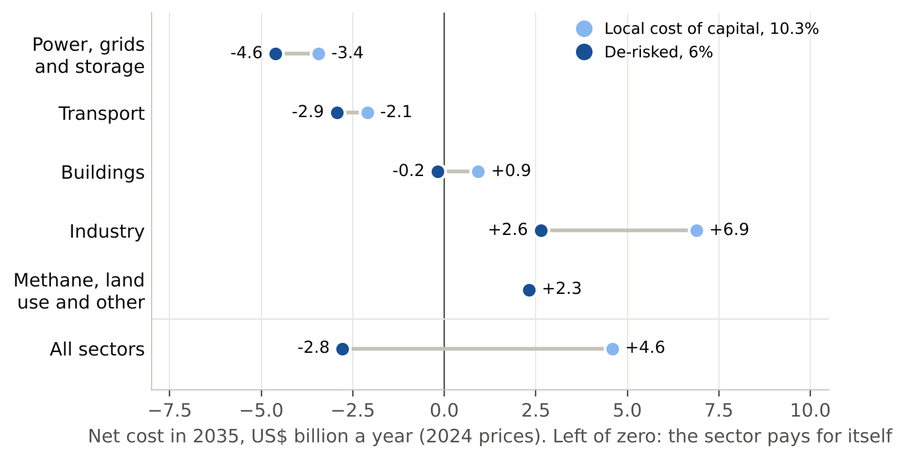
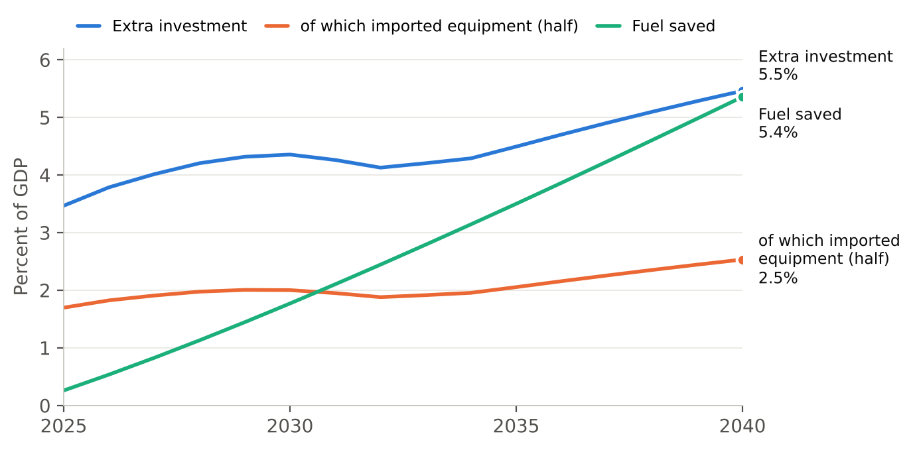

---
# MASTER - this is the file to edit. The .docx beside it is made from it (house working-paper format).
# Note 3.4, new research awaiting review in B Theory and Research. Joins C Policy and FInance/3.FinanceAndRisk once reviewed.
# WORK IN PROGRESS (20 Nov 2026): the Egypt estimates, the institutions section and the method appendix are drafted;
# the stylized-facts section and Appendix A wait on the evidence check; [VERIFY: pending ...] marks every gap.
# Egypt numbers: 2.Source/egypt_estimates.py (illustrative tool results, public data).
title: "The Energy Transition Swaps a Fuel Bill for a Capital Bill"
subtitle: "Stylized Facts, What They Mean for Macroeconomic Policy, and First Estimates for Egypt at Local and De-risked Costs of Capital"
short-title: "A Fuel Bill for a Capital Bill"
series: "Theory and Research Note No. 3.4"
version: "0.1"
author:
  - name: "Stephen J. Stretton"
    note: "Writing in a personal capacity."
date: "November 2026"
abstract: |
  [VERIFY: abstract to be written when the draft is complete.]
keywords: [energy transition, cost of capital, de-risking, guarantees, carbon pricing, public investment, Egypt]
jel: [E22, H54, H63, O13, Q43, Q48]
bibliography: EnergyTransitionMacroeconomics.bib
csl: https://www.zotero.org/styles/chicago-author-date
number-sections: true
crossref:
  fig-prefix: Figure
  tbl-prefix: Table
  sec-prefix: Section
format:
  docx: default
---

*Theory and Research Note No. 3.4, November 2026. Stephen J. Stretton, writing in a personal capacity. The views expressed are the author's own and do not represent those of any institution with which he is or has been affiliated. Work in progress. The Egypt results are illustrative results from the author's tools, built on public data; they are not official estimates.*

# What the stylized facts say {#sec-facts}

[VERIFY: pending fact check: section to be written from the evidence check.]

## The system {#sec-system}

## The macroeconomy {#sec-macro}

# First estimates for Egypt {#sec-egypt}

## One program, two costs of capital {#sec-program}

**The estimates price one program at two costs of capital.** The program is the rapid transition path of the investment model in the author's Climate Fiscal AI Tools, which papers 6.3 and 6.5 describe [@StrettonWP63; @StrettonWP65]: fossil-free power by 2045, every new vehicle electric by 2040, fossil heat in buildings replaced by 2050, and 80 percent of industrial fuel use abated by 2050. The comparison is a current-trends path on which the fossil share of generation drifts down at its recent 0.4 points a year. The model runs on public data: energy use, supply costs and pollution costs from the IMF's fossil fuel subsidies dataset, generation from Ember and output from the IMF [@Black2023; @Ember2025]. The results are illustrative results from the tool, not official estimates [@InvModelEgypt2026].

[VERIFY: pending fact check: paragraph comparing the path (38 percent renewables in 2030; 7.5 GW a year of wind and solar) with Egypt's official 2030 target and installed capacity]

**The local cost of capital is 10.3 percent and the de-risked cost of capital is 6 percent.** IRENA's survey of financiers put the nominal after-tax weighted average cost of capital for solar power in Egypt at 9.7 percent in 2020, on debt at 10.5 percent and equity at 15.9 percent; the tool averages that with IRENA's benchmark value and uses 10.3 percent [@IRENA2023Finance; @Steffen2025]. Both observations predate the 2022–24 currency crisis, so a high case adds 4.5 points. The de-risked rate, 6 percent, is the World Bank rate used across this series [@StrettonWP63]. It stands for what the same assets would cost if their payments were as safe as a development bank loan. [VERIFY: pending fact check: current IBRD lending rate for comparison]

**Capital is priced at world prices, which is one change to the tool.** The tool scales capital costs by the local price level, which for Egypt after the 2024 float gives 41 percent of world prices. Solar modules and wind turbines are bought at world prices, and Egyptian contracts cost what contracts cost elsewhere ([VERIFY: pending fact check: recent Egyptian wind and solar contract costs]). The central case therefore uses world prices, as the costing note in this series now does [@StrettonWP68]. This choice decides the sign of the result at the local cost of capital, and @sec-limits returns to it.

## Cost: power and transport pay at either rate, industry at neither {#sec-cost}

**The program more than doubles energy investment.** @tbl-invest shows the ten years to 2035. Investment in the sectors covered rises from \$119 billion on current trends to \$332 billion, 6.6 percent of GDP over the decade. Industry is the largest increment and the least certain: it rests on an assumed \$150 of capital for each gigajoule a year of fuel abated.

| US\$ billion, 2026–2035 (2024 prices) | Current trends | Rapid transition | Extra |
|---|---:|---:|---:|
| Power generation | 58 | 90 | 32 |
| Grids and storage | 35 | 67 | 32 |
| Transport (electric vehicles and charging) | 7 | 27 | 20 |
| Buildings (heat pumps and efficiency) | 0 | 25 | 25 |
| Industry (fuel switching, carbon capture) | 0 | 88 | 88 |
| Methane, land use and other | 0 | 16 | 16 |
| Other clean investment, same on both paths | 19 | 19 | 0 |
| **Total** | **119** | **332** | **213** |
| Percent of GDP, 2026–2035 | 2.4 | 6.6 | 4.2 |

: The rapid transition adds \$213 billion of investment in ten years, two-fifths of it in industry (illustrative). Capital at world prices. Buildings and industry have no bottom-up spending on the current-trends path, so their increments are upper bounds. Source: @InvModelEgypt2026. {#tbl-invest}

**At the local cost of capital the program costs about 1 percent of GDP a year; de-risked, it pays for itself from 2032.** Net cost is the annual charge on the extra capital, plus other running costs, less the fuel saved at its supply cost. In 2035 the extra capital in service is \$210 billion. At 10.3 percent it costs \$24.3 billion a year and saves \$21.0 billion of fuel, and the program's net cost is \$4.6 billion, 0.8 percent of GDP. At 6 percent the same capital costs \$16.9 billion and the program saves \$2.8 billion net (@tbl-sector, @fig-sector). The \$7.4 billion between the two charges, 1.2 percent of GDP, is what the cost of capital itself costs Egypt.

| US\$ billion a year, 2035 | Extra capital in service | Capital charge at 10.3% | at 6% | Fuel saved | Net cost at 10.3% | at 6% |
|---|---:|---:|---:|---:|---:|---:|
| Power, grids and storage | 68 | 7.4 | 4.9 | 7.0 | −3.4 | −4.6 |
| Transport | 21 | 3.2 | 2.5 | 4.8 | −2.1 | −2.9 |
| Buildings | 27 | 3.1 | 2.1 | 2.6 | +0.9 | −0.2 |
| Industry | 94 | 10.6 | 7.4 | 6.6 | +6.9 | +2.6 |
| Methane, land use and other | – | – | – | – | +2.3 | +2.3 |
| **All sectors** | **210** | **24.3** | **16.9** | **21.0** | **+4.6** | **−2.8** |
| Percent of GDP | 35 | 4.0 | 2.8 | 3.5 | +0.8 | −0.5 |

: De-risking turns a net cost of \$4.6 billion a year into a net saving of \$2.8 billion (illustrative, 2035). Net cost also counts running costs and the electricity that electrified end uses buy from the power sector, priced at the cost of the extra clean power (\$37 per megawatt-hour at 10.3 percent, \$24 at 6 percent), so the lines add up. Negative is a net saving. Source: @InvModelEgypt2026. {#tbl-sector}

{#fig-sector width=95%}

**The sectors differ more than the rates do.** Power pays for itself at any cost of capital below 21 percent, because each megawatt-hour of wind or solar displaces \$66 of gas. Transport pays from the early 2030s, once the price premium on electric vehicles has gone. Buildings break even at 6.7 percent, so they pay only when de-risked. Industry breaks even only below 3 percent: at these unit costs, fuel savings alone do not repay it at any rate a lender would offer. Methane and land-use measures are spending with no fuel saving. A finance ministry should read the program as two programs. Power and transport are an investment the country would want on cost grounds alone; industry is an abatement cost that needs a price, a border charge or a payment from outside to justify it.

**In power the comparison is with fuel, and renewables win it by a wide margin.** @fig-power gives unit costs. Solar costs \$39 per megawatt-hour at the local cost of capital and \$29 de-risked; wind costs \$47 and \$34. Gas-fired power costs \$66 in fuel alone at the \$8.8 per million British thermal units that the IMF data put on gas supplied to Egyptian power stations, and \$90 at an imported price of \$12. Storing half of a solar plant's output in batteries roughly doubles its cost, to \$54–79 de-risked and \$71–102 at the local rate, depending on the battery price. Stored solar therefore competes with the fuel cost of gas only when it is financed cheaply.

{#fig-power width=95%}

**Grids can be valued by what they carry and by what delay costs.** The model gives grids and storage no savings of their own, which understates them. Two numbers put a value on them. First, the extra grids and storage cost \$15–17 for each megawatt-hour of wind and solar they connect at the local cost of capital and \$9–11 de-risked, against \$77 of fuel and running cost saved when that megawatt-hour displaces gas. Second, each year's additions of wind and solar, 7.5 gigawatts, save \$1.3 billion of gas a year, so a grid that arrives a year late costs that much for every year of plants left waiting. Networks take far longer to build than the plants they connect (@sec-system), so the second number is the one that matters. It is an option value: building the grid early buys the right to connect cheap power on time.

## Fiscal: de-risking lowers the bill, tariffs decide who pays it {#sec-fiscal}

**The saving from de-risking is a fiscal number, because the state stands behind the buyer.** The \$7.4 billion a year saved in 2035 does not go to investors. It is the difference in what users, the state electricity companies and the budget must pay for the same assets. [VERIFY: pending fact check: who buys the power and who guarantees the buyer in Egypt] In 2030 the saving is \$3.5 billion, 0.7 percent of GDP. [VERIFY: pending fact check: interest bill and revenue for scale]

**De-risking barely changes who pays; cost-recovery tariffs do.** The tool splits investment by where repayment comes from: the budget, regulated utility tariffs, contracts with a public buyer, private investment needing a public top-up, and private investment that pays its own way [@StrettonWP65]. With tariffs covering 45 percent of the supply cost of electricity, as the IMF data put it for 2024, much of the power and grid investment falls back on the budget. The direct budget need is \$11.7 billion in 2030, 2.4 percent of GDP (@tbl-payer). De-risking alone lowers it to 2.2 percent. Tariffs that recover costs, with fuel subsidies gone, lower it to 0.9 percent, because grids and utility plants then repay themselves from tariffs. The shares are judgments applied to country data, so the direction is firmer than the levels.

| US\$ billion, 2030 | Local cost of capital, tariffs as today | De-risked, tariffs as today | De-risked, cost-recovery tariffs, no fuel subsidies |
|---|---:|---:|---:|
| Budget (pure public) | 7.9 | 7.9 | 2.7 |
| Regulated utility | 3.5 | 3.5 | 8.7 |
| Contracted with a public buyer | 3.9 | 3.9 | 6.1 |
| Private, needing a public top-up | 12.5 | 9.9 | 5.6 |
| Private, paying its own way | 5.4 | 8.0 | 10.1 |
| **Investment** | **33.3** | **33.3** | **33.3** |
| Direct budget need | 11.7 | 10.9 | 4.4 |
| Percent of GDP | 2.4 | 2.2 | 0.9 |

: Cost-recovery tariffs move more investment off the budget than de-risking does (illustrative, 2030). Direct budget need is the pure public part plus 30 percent of investment needing a top-up. Source: @InvModelEgypt2026. {#tbl-payer}

**The fuel saved is gas Egypt would otherwise import.** The program saves 7 billion cubic meters of gas in power stations in 2030 and 19 billion in 2035. [VERIFY: pending fact check: Egypt's gas consumption and LNG import bill for scale] Across all sectors the fuel saved is worth \$8.7 billion in 2030 and \$21.0 billion in 2035 at supply cost. [VERIFY: pending fact check: share of the fuel saving that accrues to the budget and state companies through lower subsidies]

**The cost of the de-risking itself is small on the development banks' record and large without it.** A guarantee saves the borrower the spread and costs the guarantor the expected loss. On the multilateral development banks' sovereign record, an annual default rate of 0.77 percent and a recovery rate of 95.1 percent over 1984–2024, each dollar of expected loss buys about \$80 of interest saving; on market-like losses it buys \$2.7 [@GEMs2025; @CFPB41]. Applied to Egypt's \$7.4 billion, the expected cost of the guarantees lies between \$0.1 billion and \$2.7 billion a year. The first figure holds only while the guaranteed payments are treated as a preferred creditor's claims. The binding limit is then the guarantors' capital and their exposure to one country, and the guarantee stays on Egypt's books as a contingent liability [@CFPB31]. [VERIFY: pending fact check: development bank exposure to Egypt]

## Economic: the investment arrives first, the savings later {#sec-economic}

**The program is front-loaded.** Extra investment runs at 3.5 to 4.5 percent of GDP a year from the first year. Fuel savings start at 0.3 percent of GDP and reach 1.8 percent in year six and 3.5 percent in year eleven (@fig-path). At the local cost of capital the net cost peaks at 1 percent of GDP in 2030. The model's clock starts in 2025; a program that starts in 2027 shifts each date by two years.

{#fig-path width=95%}

**About half the spending stays in Egypt, and the imported half is repaid by fuel savings from the early 2030s.** If half of capital spending is imported equipment (@sec-macro), the import bill is about 2 percent of GDP a year and domestic spending on construction, installation and grids about 2.3 percent. Fuel saved exceeds the imported equipment from 2031. Until then the program widens the external deficit, by 1.3 percent of GDP in 2026 and 0.2 percent in 2030. The gap must be financed in foreign currency, which is the case for long-maturity external finance and for finance in the supplier's currency (@sec-institutions).

**The two macroeconomic models in the tools disagree on the size of the growth effect, and both say it is positive.** A model in the tradition of the IMF's Global Integrated Monetary and Fiscal model, which counts private investment and energy savings, puts GDP 4.8 percent above its no-program level in 2030. A model in the tradition of the IMF's debt, investment and growth models, which sees only the public part, puts it 0.8 percent above. Public debt in 2030 is 92 and 94 percent of GDP in the two models, against 91 percent in 2024 [@StrettonWP65; @InvModelEgypt2026]. The calibrations are illustrative, and the larger model's results for 2050 should not be quoted. [VERIFY: pending fact check: published IEA and IMF estimates for comparison]

## What these numbers cannot say {#sec-limits}

**The sign of the total at the local cost of capital depends on what capital costs in Egypt.** At world prices the program is a net cost of \$4.7 billion in 2030 at the local rate. At the tool's default, with capital at 41 percent of world prices, it is a net saving of \$2.3 billion at the local rate and \$3.8 billion de-risked. The truth lies between: equipment costs what it costs everywhere, while labor and civil works are cheaper in Egypt. The ranking of sectors and the size of the saving from de-risking relative to the capital stock do not depend on this choice.

**Four other limits matter.** Fuel is valued at 2024 supply costs, held constant, so a rise in the price of imported gas raises every saving. The power mix follows target dates and does not respond to the cost of capital, although a high cost of capital in practice tilts investment away from capital-heavy plants [@Ameli2021]. Unit costs in buildings and industry are assumptions and their increments are upper bounds. And the model has no hourly dispatch, so the storage and grid needs of a system that is 60 percent wind and solar are rules of thumb. A faster path, with fossil-free power by 2040, puts renewables at 46 percent of generation in 2030 and leaves the net cost at the local rate lower, \$3.3 billion against \$4.7 billion, because power is the sector that pays.

# The institutions the facts call for {#sec-institutions}

**The facts call for institutions that make long payments safe, more than for a higher price on carbon.** A capital bill is paid over twenty-five years by a buyer the investor must trust, so the price of energy depends on who stands behind that payment. The papers in this series set out the institutions in @tbl-institutions. Each answers one of the facts, and each has a concrete form in Egypt.

| The fact | The institution | Paper | In Egypt |
|---|---|---|---|
| Long assets need long contracts, and the buyer is the risk | A payment intermediary facility: one standard power purchase agreement, payment in full and on time, a guarantee waterfall agreed in advance | 3.1 | [VERIFY: pending fact check: form in Egypt] |
| Finance is bespoke, and domestic savers lack long assets | Two-stage finance; pooled operating plants refinanced as synthetic sovereign bonds, with a local-currency senior tranche | 3.2 | Refinance operating wind and solar plants into pooled bonds and sell the local-currency tranche to pension funds and banks |
| Grids are slow and strategic, and have no power contract | A regulated return on grid assets, with a tiered bond guarantee conditional on tariff reform | 3.2 | Finance transmission ahead of need on the transmission company's regulated assets |
| De-risking is cheap in expected loss and scarce in capital | A Climate Investment Trust that holds capital second in line behind guarantees | 4.2 | Adds guarantee capacity beyond what one development bank can extend to one country |
| Policy is reversible, so the reward must be large and conditional | Guarantee capacity as the reward for policy kept, measured by standard indicators | 4.1, 4.3 | Scale guarantee capacity to steps delivered on cost-recovery tariffs and fuel subsidies |
| Fuel price rises are unpopular and carbon prices get reversed | A feebate on producers; consumption priced later, at the destination | 1.1, 1.2 | A revenue-neutral feebate in power and industry, which under a single buyer barely moves tariffs |
| Exports meet a carbon charge at the border | Verified emissions data and a domestic price the importer credits | 6.2, 1.4 | The EU charge on seven Egyptian products falls from €793 million to €480 million a year with verified data |

: Seven institutions, the fact each answers and its form in Egypt. Sources: @CFPB31; @CFPB32; @CFPB42; @CFPB41; @CFPB43; @CFPB11; @CFPB12; @CFPB62; @CFPB14. {#tbl-institutions}

**Start with the buyer.** [VERIFY: pending fact check: paragraph on the single buyer and its guarantees]

**Then turn projects into securities, and give domestic savers the senior paper.** Once the contract is safe, a plant's debt can be refinanced after commissioning into pooled bonds, which cuts the price of solar power by about a fifth in a stylized case [@CFPB32]. The local-currency senior tranche is the link to pensions. [VERIFY: pending fact check: pension funds and demography]

**Write contracts in the currency the buyer earns, and finance imported equipment in the currency of its supplier.** A dollar tariff hands the state the devaluation risk of every contract [@CFPB31]. [VERIFY: pending fact check: supplier-currency finance, swap lines, Egypt's renminbi bond]

**Work through the state companies, because they are the sector.** [VERIFY: pending fact check: the state energy companies] A feebate should measure a dominant state utility against everyone else's average, and entry to the payment facility should require a published path to cost recovery [@CFPB12; @CFPB31].

**Use the price instrument that survives.** A feebate charges plants dirtier than the sector average and rebates cleaner ones. It gives the same signal to dispatch and build as a carbon tax at the same rate, with no net bill to pass on to households, and where a single buyer sets tariffs at average cost it raises them by \$0–4 per megawatt-hour at \$50 a tonne, against \$33–40 for a tax [@CFPB12]. It is the form of carbon pricing that fits a country that has just raised fuel and power prices under an adjustment program.

**Give the finance ministry the numbers.** The estimates in @sec-egypt come from tools a ministry can audit: the investment model, the payer split and the macro-fiscal scenario tool [@StrettonWP63; @StrettonWP65; @StrettonWP68]. A ministry should hold three numbers for every program: its net cost at the local cost of capital, the same at the de-risked rate, and the contingent liability that the de-risking creates.

# Why the transition may still come too slowly {#sec-slow}

**A transition that pays can still arrive late, and the facts give six reasons.** First, the money is needed before the savings: [VERIFY: pending fact check: interest as a share of revenue.] Second, the cost of capital falls only when someone creditworthy stands behind the payment, and the capital of those who can is limited. Third, the slowest asset sets the pace, and no contract pays anyone to build the grid early. Fourth, the parts that pay, power and transport, do not carry the parts that do not: industry needs a price or a payment, and prices are what politics reverses. Fifth, the fuel a country saves is burned elsewhere, so the national case is fiscal and the climate case needs a reward from outside. Sixth, the losers sit inside the state: the companies that sell subsidized gas and power are the government's own.

**None of the six is a reason to wait.** Each is an institution missing. The first two are answered by guarantees priced at expected loss and by capital held behind them. The third is answered by building grids on regulated returns ahead of demand. The fourth and fifth are answered by feebates at home and by rewards to governments from abroad. The sixth is answered by tariff reform as the condition of entry to cheap capital. What the estimates add is the order of magnitude. For Egypt the difference between the two costs of capital is worth 1.2 percent of GDP a year by 2035, more than the whole net cost of the program.

# What to do {#sec-what-to-do}

**Finance ministries: price every program at two costs of capital, and treat the gap as a budget line.** Publish the net cost at the local rate and at the de-risked rate, by sector. Route new wind and solar through one payment facility with one standard contract, record the guarantee at expected cost under a cap, and put the grid on regulated returns ahead of need.

**Development banks and donors: guarantee payments, not projects, and hold capital behind the guarantees.** Stand as the multilateral layer of the waterfall. Offer guarantee capacity as the reward for tariff and subsidy reform kept, and fund the capital that stands second in line.

**For these estimates: three checks before they are used.** Replace the assumed unit costs in industry and buildings with Egyptian plant data. Run the power sector hour by hour to size storage and grids. Reconcile the fiscal numbers with the budget and with the accounts of the state energy companies.

# References {.unnumbered}

::: {#refs}
:::

# Appendix B: How the Egypt estimates are made {#sec-appb .appendix}

**The model.** The estimates come from the national investment model of the author's Climate Fiscal AI Tools, a stock-and-flow model of energy use, power capacity and vehicles for 186 countries, 2024–2050 [@StrettonWP63; @StrettonWP65]. It projects end-use energy with the activity equation of the Climate Policy Assessment Tool at constant 2024 prices, builds the capital each path needs, and values fuel at supply cost. The script `2.Source/egypt_estimates.py` runs it for Egypt and writes every number in @sec-egypt to `egypt_estimates_output.txt`.

**The two paths.** On current trends the fossil share of generation falls 0.4 points a year, electric vehicles reach 15 percent of sales by 2035, and buildings and industry do not change fuel. On the rapid transition the fossil share falls in a straight line to zero in 2045, electric vehicles reach all sales in 2040, fossil heat in buildings is replaced by 2050, industrial fuel use is abated by 80 percent by 2050 (three-fifths of it electrified), methane and other non-CO₂ gases fall 30 percent by 2030 and 60 percent by 2050, and wind and solar fill the gap in generation, 60 percent solar.

**Unit costs.** Solar \$760 per kilowatt and wind \$1,160 in 2024, falling 3 and 1.5 percent a year; new gas plant \$1,304; batteries \$250 per kilowatt-hour falling 3 percent a year, two hours for each kilowatt of wind and solar at full penetration; grids at \$0.60 for each dollar of generation investment; electric vehicles at a premium of \$10,000 in 2024 falling to zero in 2032, plus \$1,000 for charging; buildings \$200 and industry \$150 for each gigajoule a year of fuel displaced; carbon capture on process emissions \$800 per tonne a year; methane and land use \$50 per tonne. The last four are assumptions. Capacity factors are Egypt's own from Ember: 26.6 percent for solar and 35.0 percent for wind.

**Fuel values.** Supply costs for 2024 from the IMF dataset, held constant: gas for power \$8.36 per gigajoule (\$8.8 per million British thermal units), fuel oil \$14.1, gasoline \$23.5, diesel \$20.2, liquefied petroleum gas \$21.3 and gas for industry \$9.1 per gigajoule [@Black2023]. The gas fleet's heat rate, 7.95 gigajoules per megawatt-hour, is calibrated to Egypt's power-sector gas use and generation.

**Net cost.** For each sector, the extra capital in service times a capital recovery factor at the cost of capital over the asset's life (25 years for generation, buildings and industry, 40 for grids, 12 for vehicles), plus the change in running cost, less fuel saved. Methane, land use and other measures are annual spending. Electricity bought by electric vehicles, heat pumps and electrified industry is charged to those sectors at the average capital charge per megawatt-hour of the extra wind and solar, grids and storage included, and credited to power. The sector lines sum to the model's own total, which the script checks.

**Who pays.** The model splits each investment line into five payer types using the power market structure (Egypt: a single buyer with independent producers), the ratio of electricity prices to supply cost (45 percent in the 2024 IMF data), the cost of capital and explicit fuel subsidies. The direct budget need is the pure public part plus 30 percent of investment needing a top-up. The shares are judgments [@StrettonWP65].

**Sensitivities.** @tbl-sens gives the cases the text refers to.

| US\$ billion a year | 2030: net cost at 10.3% | at 14.8% | at 6% | 2035: net cost at 10.3% | at 14.8% | at 6% |
|---|---:|---:|---:|---:|---:|---:|
| Central: capital at world prices | +4.7 | +8.7 | +1.2 | +4.6 | +13.0 | −2.8 |
| Tool default: capital at 41 percent of world prices | −2.3 | n.a. | −3.8 | −9.6 | n.a. | −12.7 |
| Faster: fossil-free power by 2040, all new vehicles electric by 2035 | +3.3 | n.a. | −0.7 | +1.8 | n.a. | −7.1 |

: The total is a net cost at the local rate only when capital is priced at world prices; de-risking improves every case (illustrative). Source: @InvModelEgypt2026. {#tbl-sens}

**What is not public.** The tools repository is private. The Egypt inputs are public data. No World Bank internal material and no result from the Climate Policy Assessment Tool's proprietary data is used.
