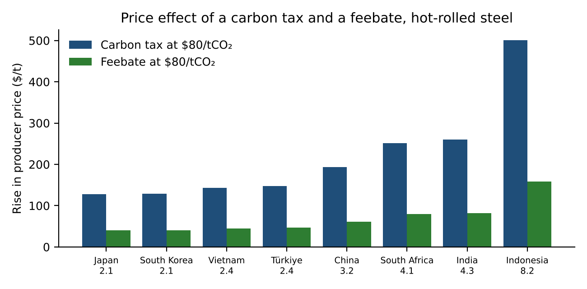

*Working paper, version 0.3, October 2026. Stephen J. Stretton, writing in a personal capacity. The views expressed are the author's own and do not represent those of any institution with which he is or has been affiliated. A short version is Climate Fiscal Policy Brief No. 1.1.*

# Introduction {#sec-intro}

Explicit carbon prices cover about a quarter of global emissions, and most covered emissions are priced well below the range the High-Level Commission on Carbon Prices judged consistent with the Paris temperature goals, \$50–100 per tonne by 2030 [@WorldBank2025; @HLCCP2017]. The usual explanation is political will. This paper argues that the gap is also built into the instrument.

A conventional carbon price, a tax or an emissions trading system covering domestic emitters, is levied on the origin basis: it falls on what a country produces. It therefore does two jobs with one rate. It gives each firm an incentive to cut emissions per unit of output, the *intensity margin*. And it raises the price of carbon-intensive goods, so that buyers use less of them, the *quantity margin*. In a closed economy both jobs are welcome and one rate does both efficiently. In an open economy the second job is done badly. The price rise falls on exports, which compete against unpriced foreign supply, and spares imports, which displace domestic production. Part of the quantity response is leakage rather than abatement, and the competitive loss is concentrated in the energy-intensive, trade-exposed sectors that hold most industrial emissions. Governments respond by exempting those sectors, allocating permits free or keeping the rate low [@KeenParryRoaf2022]. A border adjustment on imports, such as the EU's Carbon Border Adjustment Mechanism [@EU2023], protects the home market but leaves exports exposed and recognizes only explicit carbon prices paid abroad.

This paper proposes giving each job its own instrument. The *production track* prices intensity with a revenue-neutral feebate: each producer pays $t(e_i - \bar e)$ per unit of output, a charge above a sector benchmark $\bar e$ and a rebate below it. "Production" here means production in the economic and trade sense, what a country makes for home use or for export, and the metric is emissions per unit of physical output, or per dollar of output where products differ. The *consumption track* prices what is consumed at home, whatever its origin, with a destination-based charge on embodied carbon. It has two parts: a carbon component of the value-added tax (VAT) on goods, with imports charged and exports zero-rated, and a forward-announced legal obligation on the few large firms that supply domestic energy and transport. A *measurement framework*, a carbon-price-equivalent metric, puts every instrument, price-based or not, on one scale. The separate case for using the same intensity metric in electricity generation turns on capital turnover and household prices rather than trade, and is made in the companion paper on feebates [@CFPB12].

The paper makes four contributions.

1. **An equivalence result** (@sec-equivalence). With a common rate, the two tracks reproduce the Pigouvian allocation for domestic consumption and production intensity, with no leakage. The only difference from a Pigouvian origin tax is where revenue is collected: on consumption rather than production, a difference equal to the charge on net exports.
2. **The cost of the production track** (@sec-cost). A revenue-neutral feebate costs the treasury nothing and raises the producer price only by the resource cost of abatement, $\tfrac12 t\,\Delta e$, roughly a third of the price effect of a tax in the calibrated steel example (@sec-calibration). Its weakness, the absence of an output signal, has a precise size, and the consumption track removes it.
3. **A self-interested case for policy crediting** (@sec-crediting). If an outside buyer pays $\pi$ per tonne abated, a feebate is a net gain to the adopting country whenever $\pi > t/2$, and the country's best response is $t = \pi$.
4. **From leakage to a race to the top** (@sec-race). Once importers charge for embodied carbon, each exporter's most competitive feebate rate equals the charge in its markets. In a calibrated simulation the average embodied intensity of steel imports falls by more than half when exporters respond.

The paper anchors a series. The consumption track is developed in @CFPB16, the feebate design in @CFPB12, the measurement framework in @CFPB17, and the reform of the EU's border mechanism in @CFPB13.

# Related literature {#sec-literature}

The paper connects five literatures. Appendix A reviews them in detail.

*Leakage and competitiveness.* Unilateral carbon pricing shifts emissions-intensive production abroad. Model-based estimates of leakage rates for energy-intensive, trade-exposed sectors cluster between 5 and 25 percent [@BrangerQuirion2014; @BoehringerBalistreriRutherford2012], ex-post evidence of output losses is smaller and concentrated in a few sectors, and firms in those sectors pass through a fraction of carbon costs, typically under half [@NeuhoffRitz2019]. The theoretical case for border adjustment when carbon prices differ across countries is established: @Markusen1975 shows that with international externalities optimal policy combines production and consumption taxes, and @KeenKotsogiannis2014 show that border tax adjustments are needed for Pareto efficiency when carbon prices are not equalized.

*Border carbon adjustment.* The design literature [@IsmerNeuhoff2007; @Mehling2019; @Cosbey2019; @KeenParryRoaf2022] establishes the main choices: sectoral coverage, measurement of embodied carbon (domestic benchmark, country default or firm-specific data), treatment of exports and recognition of foreign policy. Keen, Parry and Roaf note the tension this paper builds on: a border adjustment in the VAT sense puts tax on a destination basis, while the Paris Agreement assigns responsibility on an origin basis.

*Output-based rebating and intensity standards.* Output-based allocation, tradable performance standards and feebates price intensity but subsidize output relative to a tax [@Fischer2001; @FischerFox2007; @FischerFox2012]. @HollandHughesKnittel2009 show that an intensity standard can even raise emissions when the implicit output subsidy is large, and @FowlieReguantRyan2016 show, for cement, that output-based allocation can outperform auctioning once leakage and market power are counted. @KeenParryRoaf2022 classify feebates and output-based rebates as cutting intensity but not output. This paper takes that weakness as given and assigns the output margin to a separate instrument.

*Destination-based taxation.* VAT spread to more than 170 countries partly because a destination tax does not disadvantage exporters [@KeenLockwood2010]. The same logic underlies proposals for destination-based corporate taxation [@Auerbach2017]. Consumption-based emissions accounting shows that high-income countries' consumption footprints exceed their territorial emissions [@PetersHertwich2008; @Grubb2022].

*International incentives.* Climate clubs use border measures to induce participation [@Nordhaus2015]; @HelmHepburnRuta2012 analyze the strategic use of border adjustments; @ParryRoafBlack2021 propose an international carbon price floor among large emitters. Results-based climate finance pays for verified reductions; this paper's crediting result gives a reason for the payee to adopt a policy rather than host projects.

*What is new.* The production–consumption split is implicit in Markusen's optimal-tax result and explicit in proposals to charge consumption of carbon-intensive materials. What this paper adds is a specific, implementable pairing (a revenue-neutral feebate with a destination charge through VAT and upstream obligations), the equivalence and cost results that justify it, and two international results, on crediting and on exporters' best responses, that follow from pricing production in relative terms.

# Model {#sec-model}

**Technology.** A competitive sector produces a homogeneous good. A producer choosing emissions intensity $e$ (tonnes of CO₂ per unit of output) has unit cost
$$
c(e) = c_0 + \frac{k}{2}\,(e_0 - e)^2, \qquad e \le e_0,
$$ {#eq-cost}
where $e_0$ is the intensity chosen with no carbon policy and $k > 0$ is the slope of the marginal cost of reducing intensity. The marginal abatement cost per unit of intensity is $k(e_0 - e)$. With competitive pricing and no policy, the price is $p_0 = c_0$.

**Demand.** Home consumption $D(p)$ and foreign demand for home exports $X(p)$ have price elasticities $\eta_D$ and $\eta_X$. In @sec-race, an importing market buys from several exporters under Armington demand [@Armington1969], with elasticity of substitution $\sigma$ among sources.

**Instruments.** Three instruments, each at a rate per tonne of CO₂:

- an **origin tax** $t$: a producer pays $t\,e$ per unit produced, whether sold at home or exported;
- a **feebate** $t$: a producer pays $t\,(e - \bar e)$ per unit produced, with $\bar e$ the sector's output-weighted average intensity, so that payments sum to zero;
- a **destination charge** $\tau$: each unit consumed at home pays $\tau\,m$, where $m$ is its embodied intensity, whether produced at home or imported; exports are zero-rated.

The feebate benchmark is updated to the realized average, so an individual firm's choice moves $\bar e$ only through its own output share. With many firms that effect is negligible, and the firm treats $\bar e$ as given.

# The equivalence result {#sec-equivalence}

**Proposition 1 (equivalence).** *Let the home country apply a feebate at rate $t$ and a destination charge at rate $\tau = t$, and let embodied intensity be measured accurately. Then (i) home producers choose the same intensity as under a Pigouvian origin tax at rate $t$; (ii) home consumers face the same price as under that tax for home-produced goods, and the full carbon cost of imported goods; (iii) home exports bear no domestic carbon charge beyond the resource cost of abatement. Revenue is $t$ times the carbon embodied in home consumption, compared with $t$ times the carbon in home production under the origin tax; the difference is $t$ times the carbon in net exports.*

The proof is in Appendix B. The intuition is that a Pigouvian price does two things a feebate and a destination charge can each do separately. The marginal cost of emitting, $t$, is the same under a feebate and a tax, so producers choose the same intensity. The average cost of emitting, $t\,e$, is moved from the producer to the consumer: the feebate removes it from the producer price, and the destination charge adds it back to the consumer price for everything consumed at home. Because the charge applies to imports at their own embodied intensity, foreign producers cannot undercut home producers by being dirtier, and there is no leakage on the consumption base.

@fig-incidence shows the incidence in a stylized steel market. Under an origin tax, home producers carry the carbon charge whether they sell at home or abroad, and imports carry none. A border adjustment on imports fixes the home market but not exports. The two tracks charge home sales and imports alike, and leave exports with only the resource cost of abatement.

{#fig-incidence width=100%}

Three qualifications matter. First, equivalence holds for the home country's consumption; it says nothing about emissions embodied in home exports, which are priced, on the consumption track, by the importer. That is the subject of @sec-race. Second, the result requires the destination charge to be measured on actual embodied intensity, at least for large importers that choose to verify; default values deliberately set high, as in the EU's regime [@EU2025DV], preserve the incentive to verify but tax average importers above their true intensity. Third, the feebate and the destination charge need not share a rate. The production rate $t$ can be set higher than the consumption rate $\tau$, because it does not raise average costs; the consumption rate is set by what households will accept and by the revenue the VAT reform needs (@sec-implementation).

**Corollary (revenue).** Revenue from the two tracks is $\tau\,M_C$, where $M_C$ is carbon embodied in home consumption, against $t\,E_P$ under an origin tax, where $E_P$ is carbon emitted in home production. A net exporter of embodied carbon raises less; a net importer raises more. This is the fiscal counterpart of the distinction between production-based and consumption-based emissions accounts [@PetersHertwich2008].

# What the production track costs {#sec-cost}

**Proposition 2 (intensity).** *A feebate and an origin tax at the same rate induce the same intensity, $e^* = e_0 - t/k$.*

**Proposition 3 (residual cost).** *Under a revenue-neutral feebate the producer price rises by*
$$
\Delta p_F = c(e^*) - c_0 = \frac{t^2}{2k} = \tfrac12\, t\, \Delta e ,
$$ {#eq-residual}
*the resource cost of abatement, while under an origin tax it rises by $t e_0 - t^2/2k$. The ratio is $\Delta e/(2e_0 - \Delta e)$. Output falls by $\eta\, t^2 / (2 k p_0)$ in proportion under the feebate, second order in $t$, and by about $\eta\, t e_0 / p_0$ under the tax, first order.*

The feebate's treasury cost is zero by construction. Its economic cost to producers is the cost of the abatement itself, which a tax also imposes; what it removes is the tax on the remaining emissions, the infra-marginal carbon bill. For a 30 percent cut in intensity, the feebate raises the price by 18 percent as much as a tax at the same rate; for a 48 percent cut, by about a third.

**Proposition 4 (the output margin).** *To cut the same tonnes as an origin tax at rate $t_T$, a feebate alone needs the rate*
$$
t_F = t_T\left(1 + \frac{\eta\, k\, e_0^2}{p_0}\right)
$$ {#eq-premium}
*to first order. The premium rises with the price elasticity of demand, with carbon intensity per dollar of output and with the steepness of abatement costs.*

This is the known weakness of intensity-based instruments [@HollandHughesKnittel2009; @FischerFox2012]. Two features of the open-economy setting limit it. In a trade-exposed sector, much of a tax's output response is foreign supply replacing home supply: it reduces home emissions but not global emissions. The premium in @eq-premium is therefore an upper bound on the feebate's disadvantage from a global view, reached only when $\eta$ reflects genuine demand reduction. And the consumption track restores genuine demand reduction on the consumption base. The architecture, not the feebate alone, delivers both margins.

**Heterogeneous firms.** Let firms differ in baseline intensity $e_{0i}$ and abatement slope $k_i$, with output shares $s_i$. Under a feebate the benchmark is $\bar e = \sum_i s_i e_i^*$ and firm $i$'s unit cost becomes $c_i(e_i^*) + t(e_i^* - \bar e)$. Two consequences follow.

1. *Reallocation.* Costs rise for firms dirtier than the benchmark and fall for cleaner ones, so output moves toward clean producers within the sector. This within-sector reallocation is part of the feebate's abatement, and it does not depend on a fall in total sector output.
2. *Price effects depend on the price-setting firm.* With a competitive fringe, the market price follows the marginal producer's cost. If the marginal producer is dirtier than the benchmark, the price rises by more than @eq-residual; if cleaner, it can fall, and total output can rise.

**Proposition 5 (sign condition).** *Under a revenue-neutral feebate, sector output falls relative to no policy if and only if the price-setting producer's net feebate payment plus its abatement cost is positive: $t(e_m^* - \bar e) + \tfrac12 t\,\Delta e_m > 0$, where $m$ indexes the marginal producer.* With identical firms the condition always holds, so total emissions fall. With a clean marginal producer and a benchmark well above its intensity it can fail, which is the case @HollandHughesKnittel2009 warn against. Updating the benchmark to the realized average and excluding new entrants' output from the benchmark calculation for an initial period are the design responses [@CFPB12].

*Windfalls.* Firms that are already clean receive rebates from the first year. Relative to a tax, the feebate transfers the infra-marginal carbon bill from dirty firms to clean ones rather than to the treasury. Relative to free allocation by historical output, as in most emissions trading systems, the transfer is targeted at performance rather than at incumbency.

# A calibrated illustration: steel {#sec-calibration}

The illustration uses the EU's default values for embodied emissions in hot-rolled flat steel (CN 7208), adopted under Implementing Regulation (EU) 2025/2621 [@EU2025DV]. Direct emissions intensities range from 2.1 tCO₂ per tonne (Japan, South Korea) through 2.4 (Türkiye) and 3.2 (China) to 4.3 (India) and 8.2 (Indonesia), reflecting differences in production route (blast furnace versus electric arc furnace) and in the coal intensity of iron-making. The rest of the calibration is stylized and labelled so: a base price of \$600 per tonne for every exporter, and an abatement slope $k_i$ set so that a rate of \$50/tCO₂ cuts each exporter's intensity by 30 percent. At \$80/tCO₂ the cut is 48 percent.

@tbl-steel and @fig-steel-prices compare the price effect of a tax and a feebate at \$80/tCO₂. The tax raises the producer price by 21–43 percent for exporters other than Indonesia; the feebate by 7–14 percent. The ratio is constant across exporters, at about 0.32, because the proportional intensity cut is the same; it is the infra-marginal carbon bill that the feebate removes.

| Exporter | Default intensity (tCO₂/t) | Intensity at \$80 (tCO₂/t) | Price rise, tax (\$/t) | Price rise, feebate (\$/t) | Tax (% of price) | Feebate (% of price) |
|---|---:|---:|---:|---:|---:|---:|
| Japan | 2.10 | 1.09 | 128 | 40 | 21 | 6.7 |
| South Korea | 2.12 | 1.10 | 129 | 41 | 21 | 6.8 |
| Vietnam | 2.35 | 1.22 | 143 | 45 | 24 | 7.5 |
| Türkiye | 2.43 | 1.26 | 148 | 47 | 25 | 7.8 |
| China | 3.19 | 1.66 | 194 | 61 | 32 | 10.2 |
| South Africa | 4.14 | 2.15 | 252 | 79 | 42 | 13.2 |
| India | 4.28 | 2.23 | 260 | 82 | 43 | 13.7 |
| Indonesia | 8.23 | 4.28 | 500 | 158 | 83 | 26.3 |

: Producer price effect of a carbon tax and a revenue-neutral feebate at \$80/tCO₂, hot-rolled flat steel. Intensities: EU default values, direct emissions [@EU2025DV]. Base price \$600/t and abatement costs stylized. Source: author's calculation, `2.Source/simulate_steel.py`. {#tbl-steel}

{#fig-steel-prices width=90%}

Two lessons follow for developing-country exporters. A production feebate at a rate comparable to the EU's carbon price is affordable: it raises costs by a single-digit percentage for most exporters, against a quarter to two-fifths for a tax. And the most carbon-intensive producers have the most to gain from adopting one, because their tax liability, which the feebate avoids, is largest.

# International payments and policy crediting {#sec-crediting}

Suppose an outside buyer pays $\pi$ per tonne of emissions abated below the unpriced baseline $e_0 Q$: a results-based climate finance facility, a cooperative approach under Article 6 of the Paris Agreement, or a bilateral arrangement. With @eq-cost and output $Q$, a feebate at rate $t$ abates $Q t / k$ tonnes at resource cost $Q t^2 / 2k$.

**Proposition 6 (crediting).** *The adopting country's net cost of a feebate at rate $t$ is*
$$
N(t) = \frac{Q\,t\,(t - 2\pi)}{2k}.
$$ {#eq-crediting}
*It is negative for $0 < t < 2\pi$. The country's best response is $t = \pi$, which yields a surplus of $Q\pi^2/2k$, half the buyer's payment of $Q\pi^2/k$.*

The intuition is that the payment is made at the marginal rate, while the country's average abatement cost is half its marginal cost under a linear marginal cost curve and below it under any rising curve. A crediting price therefore induces a feebate at the same rate, without any treasury cost, and leaves the country better off (@fig-crediting).

{#fig-crediting width=100%}

*The buyer's side.* The buyer pays $\pi$ per tonne. Paying is worthwhile if $\pi$ is at or below the buyer's marginal damage from emissions, or below its own marginal abatement cost if the payment counts toward its target. Because the feebate's marginal incentive equals $\pi$, the buyer pays exactly the marginal cost of the last tonne, as in an efficient permit market; it overpays the average cost, and the surplus is the price of getting the policy adopted.

*Baselines and additionality.* The result treats the baseline $e_0$ as known. In practice the adopting country knows it better than the buyer and has an incentive to overstate it. Three safeguards apply. The baseline can be set from verified historical intensity before the policy was announced; crediting can be on the *change* in measured intensity rather than its level, so that overstating the baseline has no payoff once the first year is verified; and the policy's effect can be measured as a carbon-price equivalent, the uniform tax that would produce the same emission change [@CFPB17], which separates the policy's contribution from changes in output and fuel prices. These are the same problems faced by every results-based instrument; the feebate makes them easier because it acts directly on the measured variable, intensity.

*Why credit policies rather than projects.* Project-based crediting pays for individual installations whose additionality is contested and whose emissions may simply move elsewhere in the sector. A sector-wide feebate moves the whole sector's intensity, and its rebate leg rewards the same clean installations a project mechanism would, without the counterfactual.

# From leakage to a race to the top {#sec-race}

Let an importing market apply a destination charge $\tau$ per tonne of embodied carbon, measured at actual intensity. Exporter $i$ runs a feebate at rate $t_i$, chooses intensity $e_i = e_{0i} - t_i/k_i$, and delivers at cost
$$
D_i = c_0 + \frac{t_i^2}{2k_i} + \tau\left(e_{0i} - \frac{t_i}{k_i}\right).
$$ {#eq-delivered}

**Proposition 7 (best response).** *$D_i$ is minimized at $t_i = \tau$. Each exporter's most competitive feebate rate equals the carbon charge in its export markets.*

The result is the production-side mirror of Proposition 1: the importer prices the average carbon in what it buys, and each exporter does best by matching the marginal incentive at home. As importers raise $\tau$, exporters raise $t_i$. Market share moves toward the producers with the lowest embodied carbon after the response. Under origin-based pricing without border adjustment the opposite happens: production moves toward the lowest carbon price.

The direction of competition has a simple statement. Under origin taxes, a country that raises its carbon price loses market share; under the two tracks, a country that raises its feebate rate toward its export markets' charges gains it. This is the property that let VAT spread without coordination [@KeenLockwood2010], and it is a decentralized form of the club incentive in @Nordhaus2015: no tariff on non-members is needed, because every exporter already faces the charge in its markets.

To quantify the effect, @fig-race simulates an importing market buying hot-rolled steel from the eight exporters in @tbl-steel, with Armington substitution ($\sigma = 4$, stylized) and equal shares before any charge. Two cases are compared at each charge $\tau$: exporters do nothing, so only the composition of imports changes; and exporters set $t_i = \tau$. At $\tau = \$100$, the average embodied intensity of imports falls from 3.6 to 2.8 tCO₂/t through composition alone, and to 1.2 tCO₂/t when exporters respond. The most carbon-intensive exporter loses share in both cases, but loses less when it adopts a feebate (2.9 against 2.0 percent of the market): it has the most to gain from adopting.

{#fig-race width=100%}

*The condition.* Proposition 7 requires that the importer's charge rise with actual intensity, so that a lower intensity earns a lower charge. A destination charge on verified or rebuttable default intensities satisfies it. The EU's mechanism satisfies it for intensity but not for policy: it deducts from the importer's liability only a carbon price "effectively paid" in the country of origin [@EU2023], and a revenue-neutral feebate, by design, has no net price paid. An exporter that adopts a feebate gains through lower intensity, but not through recognition of the policy itself. The companion paper on CBAM proposes recognizing implicit and non-price instruments through the default carbon-price methodology, measured as carbon-price equivalents [@CFPB13; @CFPB17].

*Crediting and the race together.* An exporter facing both a destination charge $\tau$ in its markets and a crediting price $\pi$ chooses a feebate rate between the two that balances its export competitiveness against crediting revenue. Both forces push the rate up from zero, and both reward the most carbon-intensive exporters most for adopting.

# Implementation {#sec-implementation}

**The production track.** A feebate needs, for each covered sector, a measure of output, a measure of emissions at the installation, and a benchmark rule. The first two already exist wherever an emissions trading system or a CBAM reporting obligation applies; the EU's monitoring rules and default values cover cement, iron and steel, aluminium, fertilizers, hydrogen and electricity [@EU2023]. The benchmark is the output-weighted average of the previous period, announced in advance. Canada's output-based pricing system and the free-allocation benchmarks of the EU system are working precedents for the benchmark side [@CFPB12].

**The consumption track, goods.** The carbon component of VAT is a charge per unit of embodied carbon added to the existing VAT on each good, with the value component reduced so that the total burden changes little at the start [@CFPB16]. Domestic goods carry a sector-average embodied intensity through the VAT chain; imports carry rebuttable default intensities set generously at the outset, so that the charge does not provoke a trade dispute, with importers free to prove a lower value; exports are zero-rated, as in VAT. Keen, Parry and Roaf recommend the same sequence of domestic benchmarks first and country-specific values later [@KeenParryRoaf2022].

**The consumption track, energy.** Fuel sold for domestic heating and transport and electricity sold to the grid do not pass through a goods chain, and a few large firms dominate their supply: fuel importers, refiners, utilities. For these the consumption track is a legal obligation, announced in advance and rising on a published path, to account for the carbon in what they sell. An obligation announced years ahead gives the firms that plan the capital stock the forward price that a tax set annually cannot credibly give [@Kydland1977; @HelmHepburnMash2003].

**Measurement.** Each track needs its effect expressed on a common scale for two purposes: recognition at foreign borders, and crediting. The carbon-price-equivalent metric of @CFPB17 expresses any instrument, price-based or not, as the uniform carbon tax that would produce the same emission change. A country that regulates rather than taxes can then claim the same recognition as one that prices.

**Trade law.** The consumption charge is an internal tax applied equally to domestic and imported goods and is adjustable at the border under GATT Articles II:2(a) and III:2; the open question is whether carbon intensity, a process characteristic, can differentiate otherwise like products [@Mehling2019; @IsmerNeuhoff2007]. The feebate is a sector-wide charge-and-rebate scheme, not contingent on export performance; its rebate leg needs care under the Agreement on Subsidies and Countervailing Measures, which a sector-wide, formula-based scheme is designed to satisfy. A full legal analysis is outside the scope of this paper.

# Objections and limits {#sec-objections}

*Distribution.* A carbon component of VAT is regressive if carbon-intensive goods form a larger share of poorer households' spending. Because the reform cuts the value component as the carbon component rises, the net effect depends on the difference in carbon intensity across budgets rather than on the level of carbon prices; it should be measured with household expenditure data before rates are set.

*Double charging in mixed regimes.* A good exported from a country with an origin carbon tax to one with a destination charge would pay twice unless the exporter zero-rates its exports, as the destination principle requires, or the importer deducts the origin price. In a transition, the importer's deduction for carbon prices paid, as under CBAM, is the stopgap.

*Accounting under the Paris Agreement.* National targets are set on territorial emissions. The production track reduces territorial emissions directly; the consumption track reduces them at home and abroad. A country adopting both gets credit for the first under its target and contributes to others' targets through the second.

*Capacity.* Countries without a functioning VAT cannot run the goods part of the consumption track. They can run the production track, which needs only sector intensity data, and that is where their emissions are.

*General equilibrium.* The model is partial equilibrium. Factor-market interactions, the use of revenue and exchange-rate effects all matter for welfare. The results on intensity, residual cost, crediting and best response do not depend on them; the welfare ranking against a uniform carbon tax does.

# Conclusion {#sec-conclusion}

A carbon price levied on production does two jobs with one rate, and in an open economy the second job undermines the first. Pricing production intensity with a revenue-neutral feebate and consumption with a destination-based charge gives each job its own instrument. Together they reproduce the Pigouvian allocation for domestic consumption without leakage; the production track costs a third or less of a tax in producer prices; crediting at a price above half the feebate rate makes adoption a gain; and destination charges make each exporter's most competitive feebate rate equal to the charge in its markets. The open work is empirical calibration of abatement costs by sector, the legal text for the consumption charge, and the border rules that recognize instruments that price carbon without a price paid.

# References {.unnumbered}

::: {#refs}
:::

# Appendix A: Literature review {.appendix}

*[To be integrated from `5.Notes/LiteratureAppendix-draft.md`.]*

# Appendix B: Proofs {.appendix}

*Setup.* Unit cost $c(e) = c_0 + \tfrac{k}{2}(e_0 - e)^2$; competitive pricing, $p = c(e) + {}$policy payment per unit; baseline $p_0 = c_0$.

*Proposition 2.* Under the origin tax the firm minimizes $c(e) + te$; under the feebate, $c(e) + t(e - \bar e)$ with $\bar e$ taken as given. In both cases the first-order condition is $k(e_0 - e) = t$, so $e^* = e_0 - t/k$ and $\Delta e = t/k$; the second-order condition holds since $c''(e) = k > 0$.

*Proposition 3.* Under the feebate with $\bar e = e^*$, net payments are zero and $p_F = c(e^*) = c_0 + t^2/2k$; since $\Delta e = t/k$, $t^2/2k = \tfrac12 t \Delta e$. Under the tax, $p_T = c(e^*) + t e^* = c_0 + t e_0 - t^2/2k$. The ratio is $(t^2/2k)/(te_0 - t^2/2k) = \Delta e/(2e_0 - \Delta e)$. Output changes follow from $\Delta Q/Q \approx -\eta\, \Delta p / p_0$.

*Proposition 1.* (i) follows from Proposition 2. (ii) Under the two tracks a home-produced unit consumed at home costs $c(e^*) + t(e^* - \bar e) + \tau e^*$; with $\bar e = e^*$ and $\tau = t$ this is $c(e^*) + t e^*$, the Pigouvian price. An imported unit with embodied intensity $m$ costs its delivered price plus $\tau m$. (iii) An exported unit costs $c(e^*) + t(e^* - \bar e) = c(e^*)$. Revenue: the feebate raises zero in total; the destination charge raises $\tau$ times embodied carbon in home consumption. The origin tax raises $t$ times emissions from home production. With $\tau = t$, the difference is $t$ times (carbon in home production minus carbon in home consumption), which is $t$ times carbon embodied in net exports.

*Proposition 4.* To first order, tonnes abated under the tax are $Q\,\Delta e + e_0\,|\Delta Q| = Q t_T/k + e_0 Q \eta t_T e_0 / p_0$; under the feebate alone, $Q t_F / k$ (the output change is second order). Equating gives $t_F = t_T (1 + \eta k e_0^2 / p_0)$.

*Proposition 5.* With a competitive fringe, the price equals the marginal producer's unit cost, $c_m(e_m^*) + t(e_m^* - \bar e) = c_{0m} + \tfrac12 t \Delta e_m + t(e_m^* - \bar e)$. Output falls relative to no policy if and only if this exceeds $c_{0m}$.

*Proposition 6.* $N(t) = Q t^2/2k - \pi Q t/k = Q t (t - 2\pi)/2k$. $N(t) < 0$ for $0 < t < 2\pi$; $N'(t) = Q(t - \pi)/k = 0$ at $t = \pi$, where $N = -Q\pi^2/2k$. The buyer pays $\pi \cdot Q\pi/k = Q\pi^2/k$.

*Proposition 7.* $\partial D_i / \partial t_i = (t_i - \tau)/k_i = 0$ at $t_i = \tau$, and $\partial^2 D_i / \partial t_i^2 = 1/k_i > 0$.

All results were checked symbolically.

# Appendix C: Calibration and simulation {.appendix}

*Data.* EU default values for embodied emissions, direct emissions in tCO₂ per tonne, as adopted under Implementing Regulation (EU) 2025/2621; extracted for cement (CN 2523 29), semi-finished steel (7207 11 11), hot-rolled flat steel (7208) and unwrought aluminium (7601) for 120 countries and the residual "other countries" category in `2.Source/CBAM-default-values-steel-aluminium-cement.csv`. The default values used in the EU's regime from 2026 add a mark-up of 10 percent in 2026, 20 percent in 2027 and 30 percent from 2028 for steel; the calibration uses the values before mark-up, which are the better estimate of actual intensity.

*Stylized parameters.* Base price \$600/t for all exporters [VERIFY against hot-rolled coil export prices]; abatement slope $k_i = 50/(0.3\,e_{0i})$, so that \$50/tCO₂ cuts intensity by 30 percent; an abatement floor at 30 percent of baseline intensity; Armington elasticity $\sigma = 4$ among exporters [VERIFY against estimates for steel]; equal preference weights.

*Code.* `2.Source/simulate_steel.py` writes @tbl-steel, @fig-steel-prices and @fig-race; `2.Source/make_fig1_incidence.py` writes @fig-incidence.

# Appendix D: Political feasibility {.appendix}

Let industry accept a policy if the rise in its average cost is at most $\bar c_I$, and voters accept it if the rise in household prices net of rebates is at most $\bar c_V$. Under an origin tax at rate $t$, industry's average cost rises by $t e_0 - t^2/2k \approx t e_0$, and households' prices by $\alpha t$, where $\alpha$ is the carbon embodied per dollar of household spending. The feasible rate is $t^{\max}_{\text{tax}} = \min(\bar c_I / e_0,\ \bar c_V / \alpha)$. Under the two tracks, industry's average cost rises by $t^2/2k$, so the industry constraint allows $t \le \sqrt{2k\,\bar c_I}$, which exceeds $\bar c_I/e_0$ whenever $\bar c_I < 2 k e_0^2$, that is, whenever the industry constraint binds at any rate cutting intensity by less than its full baseline. The household constraint applies to the consumption rate $\tau$ net of the VAT cut. The production rate is no longer limited by what households will accept, and the consumption rate is no longer limited by what industry will accept. That separation is the political case for the architecture.
