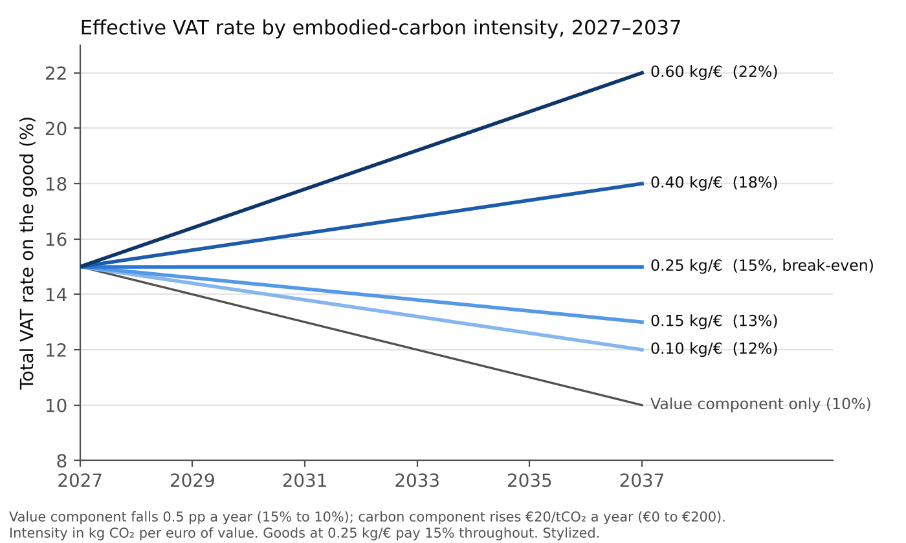

*Climate Fiscal Policy Brief No. 1.6, October 2026. Stephen J. Stretton, writing in a personal capacity. The views expressed are the author's own and do not represent those of any institution with which he is or has been affiliated.*

```{=openxml}
<w:p><w:r><w:br w:type="page"/></w:r></w:p>
```

# Executive summary {.unnumbered}

*The problem.* EU carbon pricing works on production. The Emissions Trading System prices power and heavy industry, and the Carbon Border Adjustment Mechanism (CBAM) extends that price to six import categories. The carbon embodied in everything else Europeans buy, from machinery to clothing, is unpriced, and much of it is emitted outside the EU.

*The proposal.* A carbon consumption tax in two parts. First, a carbon component of VAT: each good consumed in the EU, imported or domestic, pays a charge per tonne of embodied carbon through the ordinary VAT invoice, while the value component of VAT falls. Exports are zero-rated. Imports start on default intensities that are deliberately generous, the same for every origin, and an exporter can rebut them with verified data. Second, for fuel burned in homes and vehicles, which does not pass through a goods chain, a legal obligation on the few large suppliers, written into law ten years ahead, to pay for each tonne of carbon they sell.

*Why it works.* Imports and domestic goods pay alike, so the charge causes no leakage and needs no separate border adjustment. Rebuttable defaults reward exporters who cut emissions, which turns competition toward lower carbon. The forward obligation gives refiners and gas suppliers, who plan long-lived assets, a price path they can bank on, which a tax reset each year cannot give.

*What it costs.* On the illustrative path, the value component falls 0.5 percentage points a year from 15 to 10 percent while the carbon component rises €20 per tonne a year to €200 in 2037. A good with 0.25 kg CO₂ per euro then pays 15 percent throughout; cleaner goods pay less and dirtier goods more. The swap is revenue-neutral only if the taxed basket averages 0.25 kg per euro. If it is cleaner, the value component should fall by less: the carbon charge partly replaces VAT, not wholly.

*The legal question.* Adopting the carbon component by qualified majority under Article 192 TFEU, as an environmental measure, is doubtful. VAT harmonization needs unanimity under Article 113, and Article 192(2)(a) itself reserves "provisions primarily of a fiscal nature" to unanimity. The energy obligation, a compliance scheme like ETS2, can go by qualified majority.

*What to do.* The Commission should obtain a formal legal opinion on the basis for the carbon component and propose the forward obligation now, as an amendment to ETS2 with a published price path to 2037. Member states should build a product-level table of default intensities and adopt an automatic neutrality rule for the value component. A coalition can start before the Union does.

```{=openxml}
<w:p><w:r><w:br w:type="page"/></w:r></w:p>
```

# 1. The carbon in consumption is unpriced

**EU carbon pricing stops at the factory gate and the border of six sectors.** The Emissions Trading System prices emissions from power and heavy industry where they occur. CBAM charges imports of cement, iron and steel, aluminum, fertilizers, electricity and hydrogen for their embodied carbon [@CBAMReg]. Nothing prices the carbon embodied in other imported goods, and rich economies are large net importers of embodied carbon [@PetersHertwich2008]. A territorial price therefore misses a share of the emissions that European demand causes, and it raises the cost of producing in Europe relative to producing elsewhere for sale in Europe.

**Pricing consumption closes the gap without causing leakage.** A charge levied where goods are consumed falls equally on domestic and imported goods, so moving production abroad does not avoid it. Consumption-based approaches can be both fairer and more cost-effective than production-based ones for a region acting alone [@Steininger2014], and the case for accounting for carbon on a consumption basis is long-standing [@Helm2012]. The idea of a tax on carbon footprints has been formalized [@McAuslandNajjar2015], and a consumption charge on carbon-intensive materials has been designed and modeled for the EU [@Ismer2016; @PollittNeuhoffLin2020]. VAT shows the destination basis works at scale [@KeenLockwood2010; @Auerbach2017].

**This brief is the detailed consumption track of the series' two-track architecture** [@CFPB11]. Production is priced separately, by a revenue-neutral feebate on emissions intensity [@CFPB12].

# 2. Part one: a carbon component inside VAT

**The carbon component turns part of VAT from a tax on value into a tax on embodied carbon, without raising the average rate.** VAT already charges goods heavily per tonne of carbon, but blindly: a 15 percent rate on a good that embodies 0.30 kg CO₂ per euro is worth €500 per tonne, and on one that embodies 0.10 kg it is worth €1,500. The carbon component makes the charge follow carbon instead of value.

**It runs on the existing VAT chain.** Each registered business charges the carbon component on its sales, equal to the carbon price times the good's embodied carbon (its default intensity times its value), and deducts the carbon component paid on its purchases. Its net payment is the price times the carbon added at its stage, just as VAT is a tax on value added. Importers pay at the border; exporters reclaim the component on their inputs, as they do VAT. The invoice and return gain one column. Embodied carbon is the product's default intensity, a figure per product category published by the Commission, unless the seller proves a lower one.

**Defaults should be set by product category, not by country.** One national average score for all goods from each country, the simplest design, would give every good from a country the same surcharge, so it sends no signal between a steel-framed chair and a wooden one, and it sets different rates on like products by origin, which invites a most-favored-nation challenge. Product-category intensities, estimated from input–output data of the kind used to model the EU materials charge [@PollittNeuhoffLin2020], price carbon across the basket.

**On the illustrative path the effective rate fans out around 15 percent.** The value component falls 0.5 percentage points a year, 15 percent in 2027 to 10 percent in 2037; the carbon price rises €20 per tonne a year, zero to €200. A carbon price of $P$ euros per tonne on a good of intensity $e$ kg per euro adds $P \times e / 10$ percentage points. The two changes cancel at 0.25 kg per euro (Table 1 and Figure 1).

| Intensity (kg CO₂/€) | 2027 | 2032 | 2037 |
|---|---|---|---|
| Value component only | 15.0 | 12.5 | 10.0 |
| 0.10 | 15.0 | 13.5 | 12.0 |
| 0.15 | 15.0 | 14.0 | 13.0 |
| 0.25 (break-even) | 15.0 | 15.0 | 15.0 |
| 0.40 | 15.0 | 16.5 | 18.0 |
| 1.00 | 15.0 | 22.5 | 30.0 |

: Table 1. Total VAT rate (percent) by embodied-carbon intensity. Value component 15 − 0.5 per year; carbon price €20/tCO₂ per year from 2027. Stylized; computed in `figures/make_figures.py`.

{width=100%}

**A worked example shows the incentive (stylized, 2032).** Take three versions of a €100 good. At the default intensity of 0.25 kg per euro it embodies 25 kg CO₂ and pays €12.50 of value VAT plus €2.50 of carbon component: €15, as today. A version made with 0.40 kg per euro pays €12.50 plus €4.00, a total of €16.50. A supplier who verifies 0.10 kg per euro pays €12.50 plus €1.00, a total of €13.50. The €3 gap between the dirty and the clean version is the carbon price of €100 per tonne on the 30 kg that separates them.

**One tonne should bear one price.** The carbon component should deduct any carbon price paid upstream on the same tonnes, measured as a carbon-price equivalent [@CFPB17], whether paid under the ETS, CBAM, the energy obligation below, or a recognized foreign scheme [@CFPB13]. Production feebates are revenue-neutral and need no deduction. The carbon component should apply on top of reduced VAT rates; whether it reaches zero-rated food is a choice for each member state.

# 3. Imports: generous, rebuttable defaults

**Imports should start on generous defaults: for each product category, the EU's own average production intensity, applied to every origin.** That treats like products alike whatever their source, the strongest position under the national-treatment rule for internal taxes in GATT Article III:2 [@IsmerNeuhoff2007; @KeenParryRoaf2022], and it gives trading partners no grievance to retaliate against. The cost is that high-carbon imports are undercharged at first. That is a price worth paying to avoid a trade war.

**Rebuttal is what rewards clean exporters.** An exporter whose verified intensity is below the default pays on its own figure. Lower carbon then means a lower charge in the EU market, and once importers price embodied carbon, an exporter's most competitive policy at home is to price carbon too, which turns the race to the bottom into a race to the top [@CFPB11]. Defaults can tighten toward origin-specific values as measurement improves, with a deduction for carbon prices paid abroad, as CBAM already allows [@CBAMReg; @CFPB13].

**Country-level rates are illustrative only.** If EU goods fall from 0.20 to 0.15 kg per euro and Chinese exports from 0.40 to 0.25, the effective EU rate ends at 13.0 percent and the Chinese rate peaks at 15.75 percent in 2032, returning to 15.0. These intensities are assumptions, not estimates, and under product-category defaults no single country rate applies.

**Fraud is the main administrative risk.** A carbon component raises the gain from misdeclaring a product category or intensity, on top of the familiar VAT frauds [@KeenSmith2006]. Defaults by customs category, audit of rebuttals, and the same invoice trail as VAT limit it.

# 4. Part two: a forward obligation on energy suppliers

**Fuel burned in homes and vehicles should be priced through a legal obligation on its few suppliers, announced well in advance, rather than through a tax on consumers.** Road fuel, heating oil and gas do not pass through a goods chain; they are burned at the end of it. A few large firms dominate their supply: refiners, fuel importers and gas suppliers. Those firms decide the long-lived assets, refineries, gas networks and fuel retail, that fix emissions for decades.

**A forward-dated liability changes their investment now; a tax reset every budget does not.** A government cannot bind its successors to a future tax rate, so firms discount announced tax paths [@KydlandPrescott1977; @HelmHepburnMash2003]. The resulting time inconsistency depresses low-carbon investment [@ChiappinelliNeuhoff2020]. An obligation written into law today, naming quantities and dates ten years out, is harder to unwind and becomes a liability on the supplier's balance sheet now.

**The obligation should be absolute, per tonne sold, with a published price path.** Each supplier surrenders one compliance unit for each tonne of CO₂ in the fuel it sells for final use, with a price floor rising in step with the VAT carbon component, €20 a year to €200 per tonne in 2037. An intensity standard would be weaker, because it implicitly subsidizes fuel use [@HollandHughesKnittel2009]. Natural gas emits about 0.20 tCO₂ per MWh [@IPCC2006], so the obligation adds about €20 per MWh in 2032 and €40 per MWh in 2037. Fuel covered by the obligation is outside the VAT carbon component on the same tonnes. Electricity suppliers can carry the same obligation for power sold to final users, net of the price generators already pay under the ETS or a power-sector feebate [@CFPB12].

**The EU already has both precedents.** The Fuel Quality Directive obliged fuel suppliers to cut the life-cycle emissions of their fuel by at least 6 percent by 2020 [@FQD2009]. ETS2 places compliance obligations on suppliers of fuel for buildings and road transport [@ETS2Dir]; its start has been postponed and its future is contested in 2026 [VERIFY: current start date]. The proposal is ETS2 with a price path fixed a decade ahead. Energy charges can be regressive, so a visible use of the revenue, such as the VAT cut, matters for public consent [@Klenert2018].

# 5. What it costs: the carbon charge partly replaces VAT

**The swap is revenue-neutral only if the taxed basket averages 0.25 kg CO₂ per euro.** Each year the value component falls 0.5 points and the carbon component adds $20 \times e / 10$ points. If the basket is cleaner, revenue falls; if dirtier, it rises (Table 2).

| Average basket intensity (kg CO₂/€) | 0.10 | 0.15 | 0.20 | 0.25 | 0.30 |
|---|---|---|---|---|---|
| Revenue-neutral cut in value VAT by 2037 (points) | 2.0 | 3.0 | 4.0 | 5.0 | 6.0 |
| Revenue change in 2037 if value VAT is cut 5 points (points of base) | −3.0 | −2.0 | −1.0 | 0.0 | +1.0 |

: Table 2. Fiscal effect of a €200/tCO₂ carbon component by the average intensity of the taxed base. Stylized; computed in `figures/make_figures.py`.

**A fixed schedule would not be neutral.** With EU-made goods at 0.15–0.20 kg per euro, a schedule that cuts the value component in step with a rising carbon rate loses 1 to 2 points of the base on domestic goods by 2037. Revenue totals are also sensitive to the base: the VAT base is narrower than final consumption, because many services are exempt [@VATDirective], so this brief does not give euro totals.

**The value component should therefore fall by less, set by rule.** Each year's cut should equal the previous year's carbon-component receipts as a share of the base, so neutrality holds automatically instead of awaiting a 2032 review. The charge then partly replaces VAT, by whatever share the basket's carbon supports. Receipts from the energy obligation add room for further cuts.

**One more constraint binds.** Article 97 of the VAT Directive sets a standard rate of not lower than 15 percent [@VATDirective]. Clean goods paying 12 or 13 percent breach that floor, so the floor must be amended or the path rebased on each member state's actual standard rate, all of which exceed 15 percent [VERIFY: current standard rates].

# 6. The legal basis is an open question

**The tempting route, a Commission framework under Article 192 TFEU adopted by qualified majority, is doubtful for the VAT part.** Article 113 requires unanimity to harmonize turnover taxes, and a carbon component changes the rate structure the VAT Directive sets [@TFEU; @VATDirective]. Article 192 does not avoid this: its paragraph 2(a) reserves "provisions primarily of a fiscal nature" to the Council acting unanimously [@TFEU]. A component of VAT is hard to describe as anything else.

**The CBAM precedent does not transfer.** CBAM was adopted by qualified majority because it is built as a duty to surrender certificates mirroring the ETS, not as a tax [@CBAMReg]. The boundary of "primarily fiscal" is unsettled: @Scuderi2022 argues for reading it to admit environmental levies with mainly regulatory aims, but no ruling of the Court of Justice settles the question.

**Three routes follow.** The Union can seek unanimity, offering fiscal neutrality and member-state control of the value component. A coalition can start nationally: a member state may lower its standard rate to the 15 percent floor and levy a separate charge on embodied carbon, since Article 401 of the VAT Directive allows national taxes that cannot be characterized as turnover taxes [VERIFY: whether a charge collected on VAT invoices would count as a turnover tax]. And the energy obligation, a compliance scheme like ETS2 and the Fuel Quality Directive, can be adopted now by qualified majority under Article 192(1).

# 7. What to do

**The Commission** should obtain a formal opinion from the Council and Commission legal services on the basis for a carbon component of VAT, covering Articles 113 and 192(2)(a) TFEU and Articles 97 and 401 of the VAT Directive. It should propose the forward obligation now, as an amendment to ETS2 that publishes a price floor rising to €200 per tonne in 2037.

**Member states and the Commission** should build and publish a table of default intensities by product category, at the EU's own average, with a procedure for verified rebuttal and deduction of carbon prices paid upstream.

**Finance ministries** should adopt the neutrality rule: cut the value component each year by the carbon receipts of the year before. A coalition willing to start should design its charge under Article 401 and test it against the Court's case law before others join.

# Related papers in this series {.unnumbered}

- Climate Fiscal Policy Brief No. 1.1: the two-track architecture [@CFPB11].
- No. 1.2: feebates in power and industry, the production track [@CFPB12].
- No. 1.3: carbon price recognition under CBAM [@CFPB13].
- No. 1.7: the Total Effective Carbon Price, the measurement framework [@CFPB17].

# References {.unnumbered}

::: {#refs}
:::
