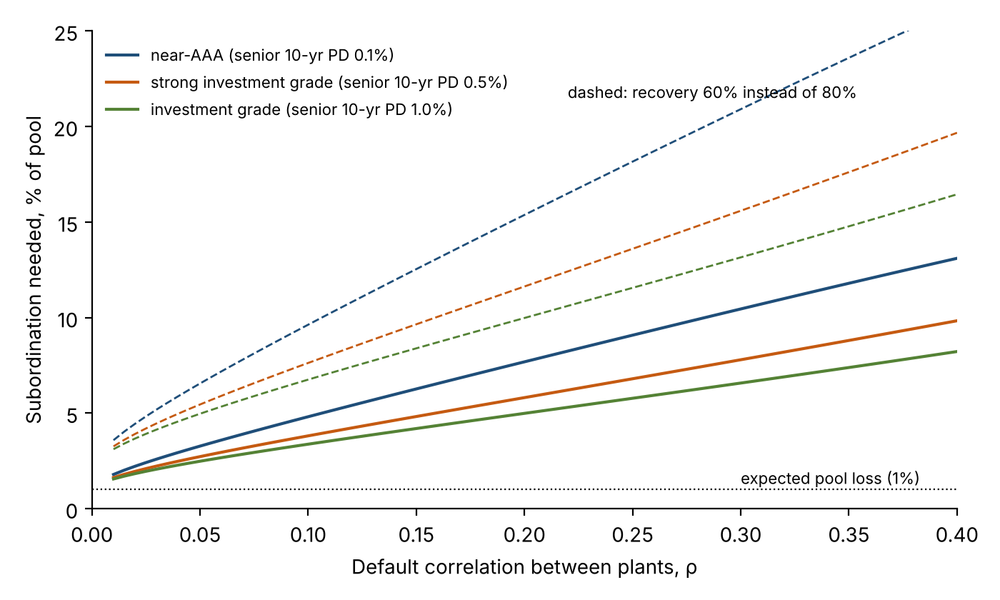
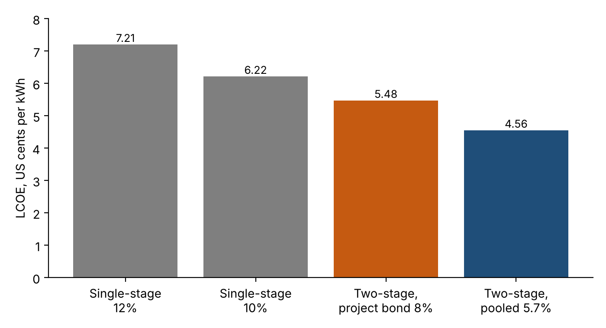

*Climate Fiscal Policy Brief No. 2.2, October 2026. Stephen J. Stretton, writing in a personal capacity. The views expressed are the author's own and do not represent those of any institution with which he is or has been affiliated. The two-stage finance and tiered guarantee material was developed with Jasper Zimmermann. The full argument, proofs and code are in the working paper [@StrettonWP22].*

# Executive summary {.unnumbered}

*The problem.* Solar power has no fuel bill, so its price is mostly the cost of the money that built it. A plant financed at 12 percent sells power about 80 percent dearer than the same plant financed at 4 percent. In 2021 the cost of capital for solar in emerging and developing economies was two to three times that of advanced economies. Once a payment intermediary has removed the risk that the buyer will not pay, the rest of the premium comes from packaging: each project is financed alone, on bespoke documents, by a lender who carries its construction risk for twenty years and cannot sell the loan to a pension fund.

*The proposal.* Split each project at commissioning and standardize each side. Banks and development finance institutions finance construction against a contingent power purchase agreement: the intermediary's promise to buy the plant's power on completion. Completed plants are pooled across countries and refinanced through three securities: first-loss equity, a thin mezzanine, and a senior synthetic sovereign bond rated on the guaranteed contracts, the cushion beneath it and a co-guarantee from highly rated sovereigns. Domestic savers get a local-currency version. Transmission and storage, which have no contract, get a tiered bond guarantee conditional on reform.

*Why it works.* An operating plant is a much better credit than one under construction: project finance default rates start at high speculative grade and fall to single-A levels by year seven. Single-stage finance prices both phases the same. A pool of operating plants with 5 to 8 percent of losses absorbed beneath the senior bond reaches a near-AAA standard at moderate default correlation. Refinancing at the pool's blended cost of about 5.7 percent, instead of a single-stage 10 percent, cuts the cost of solar power by about 27 percent in a stylized example.

*What it costs and where it fails.* At scale, first-loss capital for solar in developing countries other than China is roughly \$50–160 billion over a decade, recycled; the regional funds of the Climate Investment Trust are designed to supply it. A sovereign co-guarantee of the mezzanine costs about 0.13 percent of the guaranteed amount a year in expectation but can be fully drawn in a crisis. The host government keeps a contingent liability. The design fails if contracts stay bespoke, if correlation is underestimated, or if pools are confined to one country, where a sovereign crisis hits every plant at once.

*What to do.* Write contingent contracts and a standard take-out into every auction. Sponsor regional pools under one contract, with published first-loss sizing. Let regional equity funds hold the first loss and highly rated sovereigns guarantee the mezzanine. Use conditional tiered guarantees for grids.

# 1. Bespoke finance is expensive finance

The cost of capital, not the cost of panels, now sets the price of clean power in developing countries. For a stylized solar plant costing \$800 per kilowatt with a 20 percent capacity factor, the levelized cost of electricity is 3.6 US cents per kilowatt-hour at a 4 percent cost of capital, 5.7 cents at 10 percent and 6.5 cents at 12 percent (Table 1). At 10 percent, financing is 56 percent of the price. The International Energy Agency found that in 2021 the cost of capital for a typical solar plant in emerging and developing economies was two to three times that in advanced economies and China [@IEA2022CoC].

| Cost of capital | 4% | 6% | 8% | 10% | 12% |
|---|---:|---:|---:|---:|---:|
| Cost of power (US cents/kWh) | 3.6 | 4.3 | 5.0 | 5.7 | 6.5 |
| Financing share of the price | 30% | 41% | 49% | 56% | 61% |

: Table 1. The cost of capital is most of the price of solar power (stylized). \$800/kW, capacity factor 20 percent, operation and maintenance \$12/kW/yr, 25-year life. Source: author's calculation [@StrettonWP22].

Removing the risk that the buyer will not pay is the first step, and the companion brief proposes a payment intermediary facility to do it [@CFPB21]. The intermediary buys power from generators under one standard power purchase agreement, pays them in full and on time whatever the distribution company does, and is protected by a guarantee waterfall contracted in advance: the distribution company, its subnational owner, the national government, a multilateral agency and a donor contingency account.

A guaranteed contract is not yet cheap money. Each project is still financed alone, by a lender who prices the host sovereign into every coupon and cannot sell the loan, because nobody will rate plants one at a time. Project-by-project blended finance has mobilized little: each dollar of development finance brought in \$0.75 of private money across developing countries and \$0.37 in low-income ones [@AttridgeEngen2019]. The money exists. What is missing is a standard, rated security that pension funds and insurers are allowed to buy.

# 2. Split at commissioning: two-stage finance

A solar plant's life has two phases with very different risks. Construction lasts about two years and carries real, project-specific risks that need supervision: overruns, delays, failed grid connections. Operation lasts about twenty-three years, with predictable output and no fuel. Moody's data on more than 6,000 project finance loans show the difference. Default rates are those of high speculative-grade credits in the first three years after financial close and fall toward single-A levels by year seven; operating-phase defaults recover 81 percent on average [@Moodys2017PF].

Two-stage finance gives each phase to the investor who prices it most cheaply. Banks and development finance institutions, which can supervise construction, lend for the build. Once the plant operates, it is refinanced by bond investors who want long, safe cash flows and cannot take construction risk. Single-stage finance charges the construction premium for the whole life of the plant.

The rate on the long phase is what matters. Because operation lasts more than ten times as long as construction, a percentage point off the operating rate lowers the price of power about ten times as much as a point off the construction rate [@StrettonWP22]. And the gain depends on the gap between the two rates, not on their level, so higher world interest rates make it more valuable, not less.

The contingent power purchase agreement ties the two stages together. Before construction, the payment intermediary commits to buy the plant's power on completion under its standard contract. The construction lender then lends against a plant with a creditworthy buyer waiting. The refinancing pool knows exactly what it will be offered: the same contract, the same documents, the same buyer. Developers can bid a tariff on the refinanced cost of capital only if the refinancing is assured; otherwise they add a premium for the risk that it will not come.

# 3. Pool and tranche: first loss, mezzanine and the synthetic sovereign bond

Operating plants are pooled and refinanced through three securities, each for a different investor. Payments under the standard contract flow from the intermediary into a ring-fenced vehicle, which pays operating costs, then the senior bond, then the mezzanine, then the first-loss tranche.

- **First-loss tranche.** Equity that absorbs portfolio losses before any debt does. At scale its natural holder is a regional fund of the Climate Investment Trust [@CFPB32].
- **Mezzanine.** A thin layer above the first loss, held by development finance institutions or insurers, or replaced by a guarantee from highly rated sovereigns.
- **Senior synthetic sovereign bond.** A long-dated bond backed by guaranteed contracts on operating plants, the first-loss tranche and a co-guarantee from highly rated sovereigns, rated on that structure rather than on the host sovereign.

The cushion beneath the senior bond can be sized with a standard one-factor portfolio model, the one behind the Basel bank capital formula [@Vasicek2002; @Gordy2003]. The size depends on three things: how often operating plants default to the pool, how much is lost when they do, and how much plants fail together, measured by their default correlation. Defaults here mean losses the guarantee waterfall did not cover: a crisis that exhausts it, curtailment, a change in law, a failing plant.

Table 2 shows the result. With a 5 percent chance that an operating plant defaults over ten years, below the 6.7 percent average for all project finance loans, and 80 percent recovery [@Moodys2017PF], a near-AAA senior bond needs 4.8 percent subordination at a correlation of 0.10 and 7.7 percent at 0.20. If recovery falls to 60 percent, every figure doubles. Correlation, not the default rate, is what drives the cushion.

| Default correlation | Near-AAA (ten-year default probability 0.1%) | Investment grade (1%) | Near-AAA, recovery 60% |
|---|---:|---:|---:|
| 0.05 | 3.3% | 2.5% | 6.6% |
| 0.10 | 4.8% | 3.4% | 9.6% |
| 0.20 | 7.7% | 5.0% | 15.4% |
| 0.30 | 10.5% | 6.6% | 20.9% |

: Table 2. Subordination needed under the senior bond, percent of the pool (stylized). Ten-year default probability of operating plants 5 percent; recovery 80 percent unless stated. Rating labels are indicative. Source: author's calculation [@StrettonWP22], with default and recovery data from @Moodys2017PF.

{width=100%}

The host sovereign is the main source of correlation, and pooling across countries removes it. Plants in one country share a currency, a regulator, a distribution sector and a treasury; a sovereign crisis stresses them together. In the working paper's illustration, a near-AAA bond on a single-country pool needs 9.2 percent subordination; on a pool spread over ten countries it needs 5.3 percent [@StrettonWP22]. That gain is available only if the plants carry the same contract. Investors and rating agencies can treat a pool as diversified only if its assets are alike. Identical contracts make portfolios; portfolios make ratings.

A co-guarantee from highly rated sovereigns can replace the funded mezzanine at low expected cost. In the base case at a correlation of 0.20, the structure is 3.1 percent first loss, 4.6 percent mezzanine and 92.3 percent senior bond. On a \$10 billion pool, a guarantee of the mezzanine layer covers \$460 million and has an expected cost of about \$6 million over ten years. But it can be fully drawn in a regional crisis, so the guarantor must reserve for the tail. A guarantee that is cheap in expectation is not free.

Every piece has a precedent. IFC's Managed Co-Lending Portfolio Program has raised more than \$19 billion from 18 institutional partners who co-lend alongside IFC; its infrastructure arm puts IFC in a first-loss position, partly guaranteed by Sweden's development agency [@IFCMCPP; @IFC2016MCPPInfra]. Climate Investor One runs development, construction and refinancing funds in one platform [@FMO2019CIO]. Clifford Capital's Bayfront program has securitized pools of Asian infrastructure loans since 2018 with a sponsor-held subordinated tranche; its ninth issue, in 2026, carried Class A notes rated Aaa by Moody's and AAA by Fitch [@AllenGledhill2018Bayfront; @Latham2026Bayfront]. What has not been done is to combine them, for clean power, at scale, under one standard contract.

# 4. Where there is no contract: tiered conditional bond guarantees

Transmission lines and storage have no power purchase agreement to guarantee, and without them cheap generation buys nothing. Vietnam built more than 21,000 megawatts of solar and wind between 2018 and 2023 and then curtailed much of it because the grid could not carry the power [@TimeAndChance]. A transmission line earns a regulated charge on the balance sheet of the same weak utility whose credit raised the cost of generation.

The first choice is to create a contract. Independent transmission concessions paid by an availability charge, used in Brazil, Chile, Peru and India, turn a regulated line into a contracted asset that can enter the pool. The rule is simple: guarantee the contract where there is one, and guarantee the bond where there is not.

For backbone lines and storage that cannot be contracted, a tiered bond guarantee does the job. A regional or national clean energy system authority issues bonds; up to three tiers stand behind them: the government that regulates the power system, then the national government, then a donor-backed vehicle funded by highly rated governments. Guarantees go only to governments that adopt agreed reforms: the standard power purchase agreement, a path to cost-reflective tariffs, a schedule for retiring coal plants and a workable grid connection process. Conditions lower the chance that the first tier fails, and that is what keeps the later tiers from being called.

The tiers are correlated, so the donor tier carries more than it appears to. A state government and its national government tend to fail together. In a stylized example, raising the correlation between tiers from zero to 0.5 triples the probability that the donor tier is called, from 1.2 to 3.6 percent over ten years [@StrettonWP22]. Donors should size their commitment for that.

# 5. Local currency and domestic savers

A dollar senior bond moves currency risk to the host; a local-currency senior tranche keeps it out. Where power contracts are in local currency, the pool can issue the same senior claim in local currency, with the same first-loss cushion beneath it. Domestic pension funds, insurers and banks can hold it as a long-dated, high-grade asset. Where there is no deep bond market, banks can sell it as a fixed-term green savings certificate: a deposit-like instrument backed by operating plants and a regional first-loss fund.

Local-currency pools cannot diversify across currencies, so they need thicker cushions or a local-currency guarantor. GuarantCo, part of the Private Infrastructure Development Group, guarantees mostly local-currency loans and bonds and is rated A1 by Moody's and AA− by Fitch on the strength of its government owners [@PIDGGuarantees]. It is the model for the local-currency layer. A pool can issue dollar and local tranches side by side, matching the currency mix of its liabilities to that of its contracts so that neither the pool nor the host takes an open currency position.

# 6. What it saves: a worked example

Refinancing operating plants into a tranched pool cuts the cost of solar power by about a quarter. Table 3 compares four ways of financing the stylized plant, including interest during a two-year build. Single-stage finance at 10 percent gives 6.2 cents per kilowatt-hour. Building at 12 percent and refinancing into a stand-alone project bond at 8 percent gives 5.5 cents, 12 percent less. Building at 12 percent and refinancing into the pool at its blended cost of 5.65 percent gives 4.6 cents, 27 percent less. The blended cost assumes stylized returns of 12 percent on first loss, 8 percent on mezzanine and 5 percent on the senior bond, plus 0.3 percent a year of fees.

| Financing | Build rate | Operating rate | Cost of power (US c/kWh) | Change |
|---|---:|---:|---:|---:|
| Single-stage | 10% | 10% | 6.2 | — |
| Two-stage, project bond | 12% | 8% | 5.5 | −12% |
| Two-stage, pooled and tranched | 12% | 5.65% | 4.6 | −27% |

: Table 3. Refinancing into a tranched pool cuts the price of solar power by about a quarter (stylized). Includes interest during a two-year construction period. Source: author's calculation [@StrettonWP22].

{width=100%}

The result survives harsher assumptions. If operating plants default twice as often, at 10 percent over ten years as Moody's reports for projects in lower-middle-income economies, and recover only 72 percent, the first loss and mezzanine rise to 7.6 and 7.7 percent, the blended cost to 6.1 percent, and the price of power to 4.7 cents. The senior bond still funds 85 percent of the pool, and that is where the saving comes from.

The host government's exposure shrinks but does not vanish. The national government stands in the guarantee waterfall behind the intermediary and in the second tier of grid guarantees. These are contingent liabilities, mostly triggered only if the government's own utility stops paying or its own policy reverses. They should be recorded and capped, not denied [@TimeAndChance].

# 7. What to do

**Payment intermediaries** should write a contingent power purchase agreement and a published refinancing route into every auction, so developers bid on the refinanced cost of capital.

**Development banks** should sponsor regional pools of operating clean power plants under one standard contract, size first loss with a published model at the cautious end of plausible correlation and recovery, and keep each pool to one asset type with no re-securitization.

**The Climate Investment Trust's regional funds** should hold the first-loss tranches, priced explicitly and published, with the right to sell seasoned positions so the capital recycles [@CFPB32].

**Highly rated sovereigns** should co-guarantee the mezzanine layer rather than fund it, and hold explicit reserves against the correlated tail.

**Host governments** should contract transmission and storage where they can, and seek tiered bond guarantees, conditional on reform, where they cannot. They should record their contingent liabilities under these structures and cap them.

**Central banks and financial regulators** should treat the local-currency senior tranche as a high-grade asset for domestic pension funds, insurers and banks, with capital treatment that matches its structure.

# Related papers in this series {.unnumbered}

- **2.0** Make Clean Power an Asset Class: Standardised De-risking for Developing Countries (series overview).
- **2.1** Guarantee the Contract, Not the Debt: A Payment Intermediary for Clean Power [@CFPB21]. Removes payment risk at source; this brief starts where it ends.
- **3.2** The Climate Investment Trust: Hold Capital, Lend Its Strength [@CFPB32]. The natural provider of the first-loss tranche.
- **3.1** and **3.3** set out how guarantee capacity and sustainability-linked lending can reward the reforms that the tiered guarantees require [@CFPB31; @CFPB33].

# References {.unnumbered}

::: {#refs}
:::
