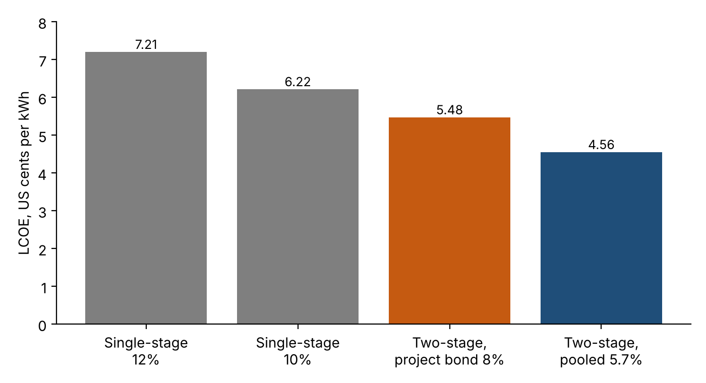
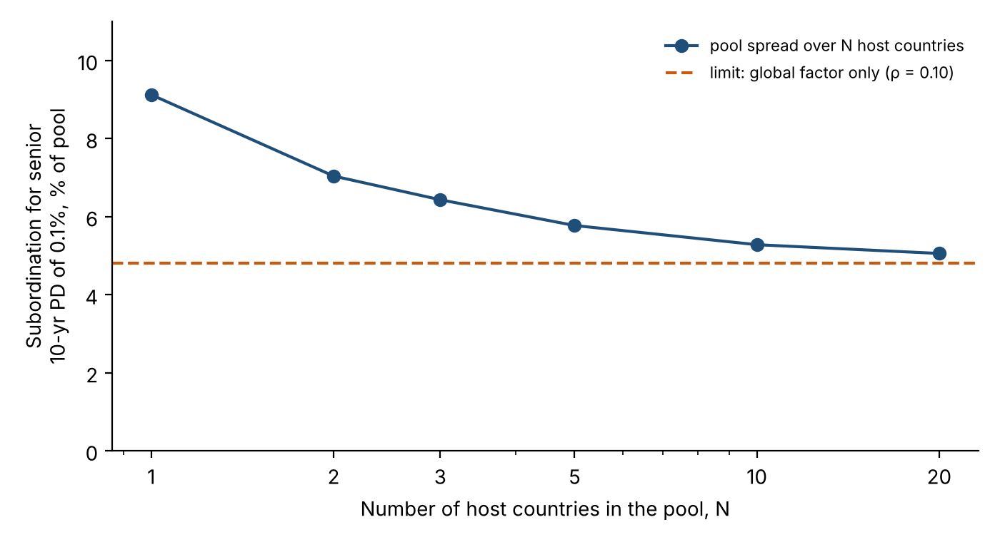

*Working paper, version 0.1, October 2026. Stephen J. Stretton, writing in a personal capacity. The views expressed are the author's own and do not represent those of any institution with which he is or has been affiliated. A short version is Climate Fiscal Policy Brief No. 2.2 [@CFPB22].*[^credit]

[^credit]: The two-stage finance structure, the tiered bond guarantee and the regional equity funds developed here began in joint work with Jasper Zimmermann ("A Solar Economy Financing System"). The synthetic sovereign bond and the guarantee stack draw on the author's book manuscript *Time and Chance* [@TimeAndChance]. Errors are the author's own.

# Introduction {#sec-intro}

A solar farm financed at 12 percent produces power that costs about 80 percent more than the same farm financed at 4 percent, and none of the difference is hardware. Solar has no fuel bill, so its tariff is mostly the cost of the money that built it. For a stylized plant costing \$800 per kilowatt, the levelized cost of electricity (LCOE) is 3.6 US cents per kilowatt-hour at a 4 percent cost of capital and 6.5 cents at 12 percent; at 10 percent, financing is 56 percent of the price (Table 1). The International Energy Agency found that in 2021 the cost of capital for a typical solar plant in emerging and developing economies was two to three times that in advanced economies and China [@IEA2022CoC]. A single percentage point off the cost of capital is worth more to these countries than a decade of further falls in panel prices.

Part of that premium is the risk that the state-owned distribution company buying the power will not pay. The companion paper removes it at source with a payment intermediary facility that pays generators on time whatever the distributor does, backed by a guarantee waterfall contracted in advance [@CFPB21; @StrettonWP21]. But a guaranteed contract is not yet cheap money. Each project is still financed on its own, with bespoke documents, by a lender who carries its construction risk for twenty years, prices the host sovereign into every coupon and cannot sell the loan to a pension fund because no rating agency or investor will analyze one plant at a time. Bespoke finance is expensive finance.

This paper asks how, once payment risk is removed, individual clean power projects can become standard securities that institutional and domestic savers will buy at low cost. The answer is to split each project at commissioning and standardize each side. Construction is financed by banks and development finance institutions against a contingent power purchase agreement: the intermediary's commitment, made before construction, to buy the plant's power on completion. Completed plants are pooled into portfolios and refinanced through tranched securities: a first-loss tranche of equity, a thin mezzanine, and a senior synthetic sovereign bond whose rating comes from the guaranteed contracts, the cushion beneath it and a co-guarantee from highly rated sovereigns, not from the host government. Where there is no contract to guarantee, as for transmission lines and storage, a tiered bond guarantee does the same job, conditional on agreed policy reforms. A local-currency senior tranche gives domestic savers a deposit-like green instrument.

Three results support the proposal. First, separating construction from operation lowers the LCOE whenever the operating-phase cost of capital falls below the single-stage rate, and because the operating phase is about 23 of a plant's 25 years, a point off the operating rate is worth about ten times a point off the construction rate (Proposition 1). Second, in a one-factor portfolio loss model [@Vasicek2002], the subordination needed under a senior bond for a target default probability has a closed form; with operating plants defaulting at 5 percent over ten years and recovering 80 percent, 5 to 8 percent subordination makes the senior bond near-AAA at default correlations of 0.10 to 0.20 (Proposition 2, Table 2). Third, pooling plants across host countries removes the host-country component of correlation, cutting the subordination needed from about 9 percent for a single-country pool to about 5 percent for a pool spread over ten countries (Proposition 3). Refinancing at the resulting blended cost of about 5.7 percent, against a single-stage 10 percent, cuts the LCOE of the stylized plant by about 27 percent.

The paper adds to three literatures. Work on renewable cost of capital shows how large the premium is and how much it matters [@Steffen2020; @Egli2018; @Ameli2021; @Calcaterra2024], but stops at the project. Work on blended finance shows that project-by-project mobilization has been small: each dollar of development finance mobilized \$0.75 of private money across developing countries and \$0.37 in low-income ones [@AttridgeEngen2019]. Work on structured finance warns that tranche ratings are fragile to correlation [@CovalJurekStafford2009]. This paper puts the three together: it sizes the first loss for clean power portfolios explicitly as a function of correlation and recovery, shows where the correlation comes from (the host sovereign), and shows how standard contracts and cross-country pooling make that correlation manageable.

Section 2 reviews the literature. Section 3 sets out the framework and propositions, Section 4 calibrates them, Sections 5 and 6 cover system assets and local currency, Section 7 the precedents, Section 8 the risks, and Section 9 the policy implications.

# What is known, and the gap {#sec-literature}

**The cost of capital decides the price of clean power.** Because renewables replace fuel with capital, their costs are far more sensitive to financing terms than those of fossil plants [@HirthSteckel2016; @Schmidt2014]. Estimates across countries put the weighted average cost of capital (WACC) for onshore wind and solar between about 3 and more than 10 percent, with the gap driven by country risk and policy design rather than technology [@Steffen2020]. Financing costs fell as markets matured, through lower base rates, learning by lenders and better terms [@Egli2018]. Modeling studies show that equalizing the cost of capital between developing and advanced economies would bring forward decarbonization and lower its cost substantially [@Ameli2021; @Calcaterra2024].

**Project finance is the dominant vehicle, and it bundles risks.** Most renewable plants are financed as non-recourse project finance, which lets sponsors raise high leverage against contracted cash flows [@Steffen2018]. The same structure ties a single lender to a single plant for the whole loan: construction risk, operating risk, payment risk and currency risk sit with one investor. Moody's data on more than 6,000 project finance loans show why that is wasteful. The ten-year cumulative default rate is 6.7 percent, but marginal default rates start at high speculative grade during the first three years after financial close and fall toward single-A levels by year seven; recoveries average 79.5 percent, and in almost two-thirds of defaults the lender loses nothing [@Moodys2017PF]. An operating plant is a much better credit than a plant under construction, yet single-stage finance prices both the same.

**Securitization turns pools into rated paper, and correlation decides the rating.** The one-factor Gaussian model gives the loss distribution of a large pool of loans as a function of the default probability and a single correlation parameter [@Vasicek2002]. It underlies the Basel internal-ratings formula [@Gordy2003; @BCBS2006], which assumes correlations between 0.12 and 0.24 for corporate exposures. Future-flow securitization has long let developing-country issuers borrow above their sovereign ceiling against receivables paid offshore [@KetkarRatha2001]. The 2007–09 crisis showed the danger: senior tranches of pools are highly sensitive to errors in correlation and default assumptions, and concentrate exposure to systematic risk [@CovalJurekStafford2009].

**Blended finance has mobilized little, one deal at a time.** Development finance institutions mobilize private money mostly in middle-income countries and in small amounts per dollar [@AttridgeEngen2019]. The binding constraint is not appetite for safe paper, which is large, but the absence of standard, rated, liquid instruments that institutional investors are allowed to hold. Green bonds trade at most a small premium over conventional bonds [@Zerbib2019], so labeling alone does not lower the cost of capital; credit quality does.

**Currency is the hidden layer.** Countries that cannot borrow abroad in their own currency face currency mismatches whenever they borrow in dollars [@EichengreenHausmannPanizza2003]. A dollar power contract reproduces the mismatch inside the power sector.

**The gap.** The literature measures the premium and the tools separately. It does not say how large the loss-absorbing layer must be for clean power pools in developing countries to reach a high rating, how that size depends on correlation with the host sovereign, or what the resulting refinancing is worth in cents per kilowatt-hour. This paper does.

# Two stages and five asset classes {#sec-framework}

## The structure

**Two-stage finance gives each phase of a plant's life to the investor who prices it most cheaply.** In stage one, a developer builds the plant with its own equity and a construction loan from a bank or a development finance institution. The lender supervises a bounded, project-specific risk over about two years. In stage two, the operating plant is sold to, or refinanced by, a pool. The pool holds the plant for the rest of its life and funds itself by issuing tranched securities.

**The contingent power purchase agreement links the two stages.** Before construction, the payment intermediary facility commits to buy the plant's power on completion under its standard power purchase agreement [@CFPB21]. The construction lender then lends against a plant with a contracted, creditworthy buyer waiting for it, rather than against a merchant project. The pool knows in advance what it will be offered: identical contracts, identical documents and an identical buyer. That is what turns the refinancing from a negotiation into a take-out.

**The pool issues five standard securities, each for a different investor.**

1. *Construction loan.* Two to three years, floating rate, held by banks and development finance institutions, secured on the plant and the contingent power purchase agreement.
2. *First-loss tranche.* Equity in the pool that absorbs portfolio losses before any debt does. At scale its natural holder is a regional fund of the Climate Investment Trust [@CFPB32; @StrettonWP32].
3. *Mezzanine.* A thin layer between the first loss and the senior bond, held by development finance institutions, by insurers seeking yield, or replaced by a sovereign co-guarantee of the same layer.
4. *Senior synthetic sovereign bond.* A long-dated bond backed by guaranteed contracts on operating plants, a first-loss tranche and a co-guarantee from highly rated sovereigns, rated on that structure rather than on the host sovereign. Its buyers are pension funds, insurers and, if eligible, central banks.
5. *Local-currency senior tranche.* The same senior claim, denominated in the host currency and sold to domestic banks, pension funds and retail savers (Section 6).

**The cash waterfall puts bondholders first.** Payments under the standard power purchase agreement flow from the intermediary into a ring-fenced vehicle, which pays operating costs, then senior interest and principal, then mezzanine, then the first-loss tranche. The bondholder is therefore exposed to the intermediary's payment, not to any one developer [@TimeAndChance, ch. 7]. Behind the intermediary stands the guarantee waterfall of the companion paper: the distribution company, its subnational owner, the national government, a multilateral agency and a donor contingency account [@CFPB21].

## Proposition 1: the refinancing gain

**Let a plant cost $C$ per kilowatt, take $B$ years to build with capital drawn evenly, run for $T$ years and produce $E$ kilowatt-hours per kilowatt a year at operating cost $m$.** Under single-stage finance one rate $r_1$ applies throughout. Under two-stage finance the construction lender charges $r_c$ and the operating plant is refinanced at $r_o$. With the capital recovery factor $\mathrm{CRF}(r,T) = r/(1-(1+r)^{-T})$, the LCOE is

$$
\mathrm{LCOE}(r_c, r_o) = \frac{C(1+r_c)^{B/2}\,\mathrm{CRF}(r_o,T) + m}{E},
$$

and single-stage finance is the special case $r_c = r_o = r_1$.

**Proposition 1 (refinancing gain).** *(a) Two-stage finance lowers the LCOE if and only if $(1+r_c)^{B/2}\mathrm{CRF}(r_o,T) < (1+r_1)^{B/2}\mathrm{CRF}(r_1,T)$; when $r_c = r_1$ this holds if and only if $r_o < r_1$. (b) The ratio of the LCOE's sensitivity to the operating rate and to the construction rate is $\frac{2(1+r_c)}{B}\cdot\frac{\mathrm{CRF}'(r_o,T)}{\mathrm{CRF}(r_o,T)}$, which for $B = 2$, $T = 25$ and rates between 6 and 10 percent lies between about 9 and 11. (c) The gain is passed to consumers only if the refinancing rate is known when the tariff is bid; otherwise the developer adds a premium for refinancing risk.*

The proof is in Appendix A. Part (b) is the heart of the matter. Construction lasts two years and operation twenty-five, so the rate that applies to the long phase dominates the tariff. Single-stage finance charges the construction rate for the whole life, because the lender cannot shed the construction risk it priced at the start. A plant built at 12 percent and refinanced at 8 percent pays for twenty-three years the price of risk that ended at commissioning. Part (c) is why the contingent power purchase agreement and a standing take-out matter: in a competitive auction developers bid the tariff they can finance, and they can bid on the refinanced cost only if refinancing is assured.

**The refinancing gain does not depend on the level of interest rates.** If construction debt costs 12 percent and refinancing 8 percent, the four-point gap is worth the same whether the world's safe rate is 2 or 5 percent. Higher safe rates raise the financing share of the tariff, from 30 percent at 4 percent to 41 percent at 6 percent in Table 1, so they make the gap more valuable, not less [@TimeAndChance, ch. 14].

## Proposition 2: how much first loss

**Model a pool of $n$ operating plants, each with a ten-year probability $p$ of defaulting to the pool and loss given default $\lambda$.** Plant $i$ defaults when a latent variable $X_i = \sqrt{\rho}\,Z + \sqrt{1-\rho}\,\varepsilon_i$ falls below $\Phi^{-1}(p)$, where $Z$ is a common factor, $\varepsilon_i$ is idiosyncratic and both are standard normal. The parameter $\rho$ is the default correlation in the latent variables: how much plants fail together. "Default to the pool" means a shortfall the guarantee waterfall behind the intermediary did not cover: a crisis that exhausts the waterfall, curtailment, a change in law, a plant that underperforms. As $n$ grows, the fraction of the pool lost converges to

$$
L(Z) = \lambda\,\Phi\!\left(\frac{\Phi^{-1}(p) - \sqrt{\rho}\,Z}{\sqrt{1-\rho}}\right),
$$

the large homogeneous pool of @Vasicek2002. A senior tranche that attaches at $K$, so that it loses only once pool losses exceed $K$, defaults with probability $\Pr[L > K]$.

**Proposition 2 (first-loss size).** *In the large homogeneous pool, the senior tranche has default probability at most $\alpha$ if and only if its attachment point is at least*

$$
K^*(p, \rho, \lambda, \alpha) = \lambda\,\Phi\!\left(\frac{\Phi^{-1}(p) + \sqrt{\rho}\,\Phi^{-1}(1-\alpha)}{\sqrt{1-\rho}}\right).
$$

*$K^*$ is proportional to $\lambda$, increasing in $p$ and decreasing in $\alpha$. Whenever the senior target is stricter than the average plant ($\alpha \le p$), $K^*$ is increasing in $\rho$.*

The proof is in Appendix A. $K^*$ is the subordination needed: the first-loss tranche plus the mezzanine, or plus a co-guarantee of the mezzanine layer. Three features matter for policy. Subordination scales one for one with loss given default, so recovery rights, which the guarantee waterfall preserves by keeping the claim on the distributor alive [@CFPB21], halve the cushion when they halve the loss. Subordination is far above expected loss when correlation is high: at $p = 5$ percent and $\lambda = 20$ percent, expected loss is 1 percent of the pool, but a near-AAA senior at $\rho = 0.2$ needs 7.7 percent. And correlation, not default probability, is the parameter a sponsor can most change, by choosing what goes into the pool.

**The co-guarantee from highly rated sovereigns substitutes for part of the subordination, at a low expected cost.** A guarantor that covers the mezzanine layer, losses between the top of the first-loss tranche and $K^*$, makes the senior bond as safe as if the mezzanine were funded. The guarantor's expected loss is the expected loss of that layer, which is small because it is drawn only in the correlated tail (Section 4). This is the "used but not used up" property of a guarantee made precise: the guarantor lends its rating at the cost of a reserve against the tail, and spends it only if the tail occurs [@TimeAndChance, ch. 14].

## Proposition 3: standard contracts let pools diversify across host countries

**The host sovereign is the main source of correlation.** Plants in one country share a currency, a regulator, a distribution sector and, behind the guarantee waterfall, a treasury. When the host sovereign is in crisis, they are stressed together. Write the latent variable of a plant in country $c$ as $X_i = \sqrt{\rho_g}\,Z + \sqrt{\rho_c}\,Y_c + \sqrt{1-\rho_g-\rho_c}\,\varepsilon_i$, where $Z$ is a global factor (world interest rates, the dollar) and $Y_c$ a host-country factor, independent across countries. A pool confined to one country has correlation $\rho_g + \rho_c$. A pool spread equally over $N$ countries, each holding many plants, loses $L_N = \frac{1}{N}\sum_{c=1}^N L_c(Z, Y_c)$.

**Proposition 3 (diversification across host countries).** *As $N \to \infty$, $L_N$ converges almost surely to the one-factor loss with correlation $\rho_g$, and the subordination needed for a senior target $\alpha$ converges to $K^*(p, \rho_g, \lambda, \alpha)$, which is strictly below the single-country requirement $K^*(p, \rho_g + \rho_c, \lambda, \alpha)$ whenever $\rho_c > 0$ and $\alpha \le p$.*

The proof is in Appendix A. Diversification across host countries removes the host-country factor, but not the global one. Three countries capture most of the gain; ten capture nearly all of it (Table 5). The result assumes the plants in different countries can be pooled at all, and that is where standardization does its work. A pool can be rated as homogeneous only if its assets carry the same contract, the same documents and comparable loss given default. Bespoke contracts force investors and rating agencies to analyze each asset, which makes the pool effectively small, and a small pool keeps its idiosyncratic risk [@Gordy2003]. Identical contracts make portfolios; portfolios make ratings. A regional payment intermediary, which buys power from several countries under one standard power purchase agreement, produces exactly the homogeneous, multi-country pool that Proposition 3 rewards [@CFPB21].

# Calibration: a stylized solar portfolio {#sec-calibration}

**The calibration uses a stylized plant and default parameters anchored to public data.** The plant costs \$800 per kilowatt, has a 20 percent capacity factor (1,752 kilowatt-hours per kilowatt a year), operating costs of \$12 per kilowatt a year and a 25-year life, as in the series' LCOE table [@TimeAndChance, ch. 14]. All rates are in dollars. The parameter choices for the pool are stylized but bracketed by data. The base ten-year default probability of an operating plant, $p = 5$ percent, sits below the 6.7 percent average for all project finance loans, which includes the riskier construction years, and is consistent with marginal default rates that fall to single-A levels in operation [@Moodys2017PF]. A stress case uses $p = 10$ percent, the ten-year rate Moody's reports for projects in lower-middle-income economies. Loss given default is 20 percent in the base case, from the 79.5 percent average recovery and 81.2 percent for operation-phase defaults [@Moodys2017PF], and 28 to 40 percent in stress cases, bracketing the 72 percent average recovery that development finance institutions report on private lending in emerging markets [@GEMs2024]. Correlations from 0.05 to 0.30 span the 0.12 to 0.24 assumed for corporates in the Basel formula [@BCBS2006]. Senior targets are ten-year default probabilities of 0.1, 0.5 and 1 percent. Moody's equates the 6.7 percent ten-year project finance default rate with low investment grade [@Moodys2017PF], so a 1 percent target is well inside investment grade and 0.1 percent is near the top of the scale; the labels in Table 2 are indicative, not rating-agency mappings.

| Cost of capital | 4% | 6% | 8% | 10% | 12% | 15% |
|---|---:|---:|---:|---:|---:|---:|
| LCOE (US cents/kWh) | 3.6 | 4.3 | 5.0 | 5.7 | 6.5 | 7.8 |
| Relative to 4% | 1.00 | 1.18 | 1.38 | 1.58 | 1.80 | 2.15 |
| Financing share of LCOE | 30% | 41% | 49% | 56% | 61% | 68% |

: Table 1. The cost of capital is most of the price of solar power (stylized plant). \$800/kW, capacity factor 20 percent, operation and maintenance \$12/kW/yr, 25 years, capital spent at commissioning. Financing share is one minus the LCOE at a zero cost of capital divided by the LCOE. Source: author's calculation (`2.Source/model.py`), parameters as in @TimeAndChance.

**Subordination of 5 to 8 percent makes the senior bond near-AAA at moderate correlation.** Table 2 applies Proposition 2. With the base parameters, a near-AAA senior bond needs 4.8 percent subordination at $\rho = 0.10$ and 7.7 percent at $\rho = 0.20$; an investment-grade senior needs 3.4 and 5.0 percent. Halving recovery from 80 to 60 percent doubles every figure. In the stress case for lower-middle-income countries the near-AAA requirement rises to 10.5 percent at $\rho = 0.10$ and 15.3 percent at $\rho = 0.20$. These are not exotic numbers. The 5 percent equity buffer proposed in *Time and Chance* is enough for a near-AAA senior bond only if correlation is low or recovery high; a well-diversified, standardized pool meets that condition, and a single-country pool does not.

| Correlation ρ | Near-AAA (PD 0.1%) | Strong IG (PD 0.5%) | IG (PD 1.0%) | Near-AAA, recovery 60% | Near-AAA, LMIC stress |
|---|---:|---:|---:|---:|---:|
| 0.05 | 3.3% | 2.7% | 2.5% | 6.6% | 7.6% |
| 0.10 | 4.8% | 3.8% | 3.4% | 9.6% | 10.5% |
| 0.20 | 7.7% | 5.8% | 5.0% | 15.4% | 15.3% |
| 0.30 | 10.5% | 7.8% | 6.6% | 20.9% | 19.3% |

: Table 2. Subordination needed under the senior bond, percent of the pool. Ten-year horizon, large homogeneous pool. Base case: ten-year default probability of operating plants 5 percent, recovery 80 percent. "LMIC stress": default probability 10 percent, recovery 72 percent. PD is the senior bond's ten-year default probability; IG is investment grade; labels are indicative. Source: author's calculation from Proposition 2 (`2.Source/model.py`), with parameters from @Moodys2017PF and @GEMs2024.

{width=100%}

**A near-AAA structure at ρ = 0.20 has a blended cost of about 5.7 percent.** Split the 7.7 percent subordination into a first-loss tranche that absorbs losses up to the point a mezzanine would have a 5 percent ten-year default probability, and a mezzanine above it. That gives first loss of 3.1 percent, mezzanine of 4.6 percent and a senior bond of 92.3 percent (Table 3). With stylized required returns of 12 percent on the first loss, 8 percent on the mezzanine and 5 percent on the senior bond, plus 0.3 percent a year for structuring, servicing and guarantee fees, the blended cost of the pool is 5.65 percent. In the lower-middle-income stress case, first loss rises to 7.6 percent and mezzanine to 7.7 percent, and the blended cost to 6.1 percent. The cost barely depends on the default assumptions: doubling default risk and raising loss severity by 40 percent adds less than half a point to the blended cost, because the senior bond's yield barely moves.

| | First loss | Mezzanine | Senior bond | Pool |
|---|---:|---:|---:|---:|
| Share of pool | 3.1% | 4.6% | 92.3% | 100% |
| Required return (stylized) | 12% | 8% | 5% | 5.65%* |
| Expected loss over 10 years, % of tranche | 30% | 1.25% | 0.001% | 1.0% |

: Table 3. A near-AAA capital structure and its cost (stylized). Base parameters, ρ = 0.20, senior ten-year default probability 0.1 percent. *Includes 0.3 percent a year of structuring, servicing and guarantee fees. Source: author's calculation (`2.Source/model.py`).

**The sovereign co-guarantee is cheap in expectation and large in the tail.** If highly rated sovereigns guarantee the mezzanine layer instead of funding it, the guarantee covers 4.6 percent of the pool. Its expected loss over ten years is 1.25 percent of the layer, or 0.06 percent of the pool. On a \$10 billion pool, that is a \$460 million guarantee with an expected cost of about \$6 million over ten years, or roughly 0.13 percent of the guaranteed amount a year. In the correlated tail the whole \$460 million can be drawn. The guarantor should hold capital against that tail and charge for it; the claim that such guarantees cost nothing is true in expectation and false in the tail [@TimeAndChance, ch. 14].

**Two-stage refinancing at the pool's cost cuts the LCOE by about a quarter.** Table 4 and Figure 2 apply Proposition 1. Construction takes two years at 12 percent in every two-stage case. Against single-stage finance at 10 percent, which is within the range the IEA's survey data imply for solar in many developing countries [@IEA2022CoC], refinancing into a stand-alone project bond at 8 percent cuts the LCOE by 12 percent; refinancing into the pool at 5.65 percent cuts it by 27 percent, from 6.2 to 4.6 cents per kilowatt-hour. The LCOE here is higher than in Table 1 because it includes interest during construction. The saving from pooling, beyond what a single project bond achieves, comes entirely from the tranching: the pool can sell 92 percent of its liabilities at a near-sovereign yield.

| Financing | Construction rate | Operating rate | LCOE (US c/kWh) | Change vs single-stage 10% |
|---|---:|---:|---:|---:|
| Single-stage | 12% | 12% | 7.21 | +16% |
| Single-stage | 10% | 10% | 6.22 | — |
| Two-stage, project bond | 12% | 8% | 5.48 | −12% |
| Two-stage, pooled and tranched | 12% | 5.65% | 4.56 | −27% |

: Table 4. Refinancing operating plants into a tranched pool cuts the LCOE by about a quarter (stylized). Construction two years with even drawdown; operation 25 years. Source: author's calculation (`2.Source/model.py`).

{width=100%}

**Pooling across ten host countries cuts the subordination needed by over 40 percent.** Table 5 and Figure 3 apply Proposition 3 with a global correlation of 0.10 and a host-country correlation of 0.15, so a single-country pool has correlation 0.25. A near-AAA senior bond on a single-country pool needs 9.2 percent subordination; on a pool spread over three countries, 6.3 percent; over ten, 5.3 percent; the limit is 4.8 percent. The parameters are stylized; the shape is not. Most of the first loss in a single-country pool pays for the host sovereign, and cross-country pooling under one standard contract is what removes it.

| Host countries in pool, N | 1 | 3 | 5 | 10 | 20 | Limit |
|---|---:|---:|---:|---:|---:|---:|
| Subordination for near-AAA senior | 9.2% | 6.3% | 5.7% | 5.3% | 5.1% | 4.8% |

: Table 5. Pooling across host countries removes the host-country factor (stylized). Global correlation 0.10, host-country correlation 0.15, ten-year default probability 5 percent, recovery 80 percent, senior ten-year default probability 0.1 percent. Monte Carlo with 400,000 draws; the limit is Proposition 3's one-factor value. Source: author's calculation (`2.Source/model.py`).

{width=100%}

**At scale the equity need is tens of billions of dollars, not trillions.** *Time and Chance* sizes the solar requirement in emerging and developing economies other than China at roughly \$2.0–2.5 trillion over a decade, of which \$1.6–2.0 trillion could be investment-grade debt at 80 percent gearing [@TimeAndChance, ch. 15]. Applying the 3 to 8 percent first-loss range of this paper to \$1.6–2.0 trillion of refinanced operating assets gives first-loss capital of roughly \$50–160 billion, recycled as pools are refinanced. That is the order of magnitude the Climate Investment Trust's regional funds are designed to supply [@CFPB32]. These are indicative sums built on stylized parameters; they show scale, not a forecast.

# Where there is no contract: tiered bond guarantees {#sec-system}

**Transmission, storage and equipment factories have no power purchase agreement to guarantee.** A transmission line earns a regulated charge on the balance sheet of the same utility whose weakness raised the cost of generation. The cost of that gap is visible. Vietnam built more than 21,000 megawatts of solar and wind between 2018 and 2023 and then curtailed much of it because the grid could not carry the power; South Africa's sixth bid window procured only six solar projects because the grid in the sunniest provinces was full [@TimeAndChance, ch. 23]. Cheap generation buys nothing without wires.

**The first choice is to create a contract where one can exist.** Independent transmission concessions paid by an availability charge, used in Brazil, Chile, Peru and India, turn a regulated asset into a contracted one, and storage can be procured under capacity-and-availability contracts [@TimeAndChance, ch. 23]. Where that works, the asset enters the pool on the same terms as a solar plant. The rule follows: guarantee the contract where there is one, and guarantee the bond where there is not.

**Where no contract can exist, a tiered bond guarantee takes its place.** A regional or national clean energy system authority issues bonds to finance backbone transmission, storage or equipment manufacturing. Up to three loss-absorbing tiers stand behind the bondholders. The first tier is the government that regulates the power system, such as an Indian state or the national government of Mozambique. The second is the national government, where states regulate. The third is a donor-backed special purpose vehicle, funded by a consortium of highly rated governments or a multi-donor trust fund. Bondholders lose only if all three fail.

**The tiers work only if their failures are not perfectly correlated, and they are correlated.** Table 6 illustrates with stylized ten-year default probabilities of 15 percent for the first tier, 8 percent for the second and 0.2 percent for the third, linked by a Gaussian copula. If the tiers failed independently, the second tier would be called with 15 percent probability, the third with 1.2 percent, and bondholders would lose with probability 0.002 percent. With a correlation of 0.5 between tiers, the third tier is called with 3.6 percent probability and bondholders lose with 0.09 percent; at 0.8, 6 percent and 0.19 percent. A state government and its national government fail together more often than not. The donor tier therefore does most of the work in the tail, and its contingent commitment must be sized for that.

| Correlation between tiers | Tier 2 called | Tier 3 (donor) called | Bondholders lose |
|---|---:|---:|---:|
| 0.0 | 15.0% | 1.20% | 0.002% |
| 0.5 | 15.0% | 3.61% | 0.094% |
| 0.8 | 15.0% | 5.95% | 0.19% |

: Table 6. A three-tier bond guarantee: correlation moves the burden to the last tier (stylized). Ten-year default probabilities: tier 1 (regulating government) 15 percent, tier 2 (national government) 8 percent, tier 3 (donor-backed vehicle) 0.2 percent. Gaussian copula with equal pairwise correlation. Source: author's calculation (`2.Source/model.py`).

**Conditionality is what makes the first two tiers worth having.** Guarantees should be offered only to governments that adopt a negotiated set of reforms: the standard power purchase agreement for generation, a path to cost-reflective tariffs, a schedule for retiring coal plants and a workable process for connecting new projects. Conditions lower the probability that the first tier fails, which in Table 6 is what reduces the call on everyone else. They also give a reforming government something concrete in return for hard decisions. That is where this paper meets the incentive instruments of series 3: guarantee capacity earned by climate policy can stand behind the third tier [@CFPB31], and a sustainability-linked loan can make the reforms its indicators [@CFPB33].

# Currency and domestic savings {#sec-currency}

**A dollar senior bond moves currency risk to the host; a local-currency senior tranche keeps it out.** If the standard power purchase agreement is denominated in dollars, the intermediary carries the mismatch between its dollar obligations and the local-currency tariffs it collects, and behind it the host government. That is original sin reproduced inside a power contract [@EichengreenHausmannPanizza2003]. The companion paper sets out the choices for the contract: denominate in local currency, index only the imported share, decline the tariff over time, or hedge [@CFPB21].

**The pool can issue the same senior claim in local currency.** Where the contracts are in local currency, the pool issues a local-currency senior tranche with the same seniority and the same first-loss cushion beneath it. Domestic banks, pension funds and insurers can hold it as a high-grade, long-dated asset. In countries without a deep bond market, the tranche can be sold through banks as a fixed-term green savings certificate: a deposit-like instrument backed by operating plants, guaranteed contracts and a regional first-loss fund. It gives savers a safe asset their banking system often cannot supply, and gives clean power the only source of long-term money with no currency mismatch.

**Local-currency tranches still carry host-country correlation, so they need thicker cushions or local guarantors.** A pool of local-currency contracts cannot diversify across currencies without taking currency risk, so Proposition 3's cross-country gain is not available to it. Its subordination should be sized at the single-country correlation of Table 5, or a local-currency guarantor can supply part of it. GuarantCo, part of the Private Infrastructure Development Group, is the model: it guarantees local-currency loans and bonds, most of its portfolio is in local currency, and its own ratings of A1 (Moody's) and AA− (Fitch) rest on its highly rated government owners [@PIDGGuarantees].

**Dollar and local tranches can sit side by side.** A pool can issue a dollar senior bond against the hard-currency share of its contracts and a local-currency tranche against the rest, so that neither the pool nor the host takes an open currency position. The currency mix of the liabilities should match the currency mix of the contracts [@TimeAndChance, ch. 10].

# Precedents {#sec-precedents}

**Every element of the structure has been used; they have not been used together for clean power at scale.**

**IFC's Managed Co-Lending Portfolio Program shows that institutions will buy a development bank's credit selection in bulk.** The program began in 2013 with \$3 billion from China's State Administration of Foreign Exchange, allocated as a blind pool alongside IFC's own loans, and IFC reports that it has since raised more than \$19 billion from 18 partners [@IFCMCPP]. Its infrastructure arm, launched in 2016 with a \$5 billion target and \$500 million from Allianz, puts IFC in a first-loss position, with the Swedish International Development Cooperation Agency guaranteeing part of that first loss [@IFC2016MCPPInfra]. That is a first-loss tranche, a donor co-guarantee and a senior investor in one structure, applied to loans rather than securities.

**Climate Investor One builds the two-stage logic into one facility.** Managed by Climate Fund Managers, it combines a development fund, a construction equity fund and a planned refinancing fund, so that a project moves from development to construction to long-term debt within one platform. The development and construction equity funds closed at a combined \$850 million in 2019 [@FMO2019CIO]. The refinancing stage is the least developed, which is the gap the pooled refinancing in this paper fills.

**Bayfront shows that pools of Asian infrastructure loans can carry a AAA senior tranche.** In 2018 Clifford Capital securitized \$458 million of 37 project and infrastructure loans across 16 Asian and Middle Eastern countries, bought from five commercial banks, about three-quarters of them to operating projects [@GTR2018Bayfront]. The notes were tranched into Class A, B and C notes and \$45.8 million of subordinated notes, about 10 percent of the pool, retained by the sponsor [@AllenGledhill2018Bayfront]. By 2026 the program had issued nine transactions, the latest of \$802 million with Class A notes rated Aaa by Moody's and AAA by Fitch [@Latham2026Bayfront]. Bayfront pools are diversified across countries and sectors, which is the condition of Proposition 3, and its sponsor holds the first loss, which is the role this paper gives the Climate Investment Trust's regional funds.

**Yieldcos show what goes wrong when operating-asset vehicles fund growth with their own equity price.** US yieldcos of 2013–2016 bought operating renewable plants from their sponsors and paid out their cash flows as dividends, on the assumption that rising share prices would fund each new acquisition cheaply. When the share prices fell, the model stopped, and SunEdison, the sponsor of two of them, filed for bankruptcy in April 2016 [@UtilityDive2016Yieldco]. The lesson for this paper's pools is to fund operating assets with long-term rated debt and patient first-loss capital, not with a growth story, and to keep the pool legally separate from any developer.

**India has built the domestic institutions for both stages.** The Indian Renewable Energy Development Agency, a state-owned lender founded in 1987 and listed in 2023, finances renewable projects [@IREDA]. The National Bank for Financing Infrastructure and Development, created by statute in 2021, is regulated by the Reserve Bank of India as an all-India financial institution for long-term infrastructure finance [@NaBFIDHistory; @RBI2022NaBFID]. Together with the Solar Energy Corporation of India as payment intermediary [@CFPB21], India has the pieces for a domestic two-stage system: a construction and development lender, a long-term refinancing institution and a central buyer. What it lacks is the standard pooled security that would let domestic pension funds and insurers hold the refinanced assets directly.

**Future-flow securitization shows that structure can lift paper above the sovereign ceiling.** Developing-country issuers have long raised money above their sovereign rating against export receivables or remittances routed through offshore accounts [@KetkarRatha2001]. The synthetic sovereign bond applies the same principle to contracted power payments, with the added support of first-loss capital and a highly rated co-guarantor.

# Risks {#sec-risks}

**The main risk is a correlated host-sovereign shock, and it does not diversify within a country.** A currency collapse or a fiscal crisis hits every distribution company, the subnational governments behind them and the national treasury at once. The guarantee waterfall behind the intermediary is then tested at every layer together. *Time and Chance* works through such a case: in a \$100 billion guaranteed portfolio with a 5 percent equity buffer, a stress in which 15 percent of offtakers fall into arrears together and the currency component of the affected contracts loses a quarter of its value causes losses of about \$15 billion, of which the buffer absorbs \$5 billion and the highly rated guarantor \$10 billion, with recovery rights on the sovereign ledgers [@TimeAndChance, ch. 14]. Proposition 3 is the defense: regional pools under a regional intermediary turn a host-country factor into a diversifiable one. Single-country pools in large markets need the thicker cushions of Table 5's first column.

**Correlation is the parameter most likely to be wrong, and the senior rating is most sensitive to it.** The lesson of 2007–09 is that senior tranches concentrate systematic risk and that ratings built on underestimated correlation fail together [@CovalJurekStafford2009]. Table 2 shows the sensitivity: moving from $\rho = 0.10$ to $0.20$ raises the near-AAA requirement by 60 percent. Sponsors should size first loss at the upper end of plausible correlation, publish their parameters, and keep the structure simple: one asset type, one contract, no re-securitization of tranches.

**First-loss capital priced too cheaply subsidizes lenders and invites moral hazard.** A first-loss provider that charges less than the risk it absorbs transfers value to bondholders who would have lent anyway, and a developer who knows its plant will be refinanced regardless has less reason to build it well. Two rules limit this. The pool should buy only plants that meet published technical and performance criteria after a period of operation, so construction quality is tested before the take-out. And the first-loss price should be explicit and published, so the subsidy element, if any, is visible [@CFPB32].

**The host government's exposure is smaller, contingent and contracted; it is not zero.** The structure does not add a direct debt to the host's balance sheet, but the guarantee waterfall behind the intermediary includes the national government, and the tiered bond guarantee puts the regulating and national governments in the first two tiers. These are contingent liabilities: obligations that fall due only if a specified event occurs. Most of them crystallize only if the government's own utility stops paying or its own policy reverses. A liability the government controls is different from one it is merely exposed to, and debt sustainability frameworks should record both, distinguishing them [@TimeAndChance, ch. 14]. Claims that such structures leave public finances untouched should not be made.

**Rating agencies and regulators may not treat the structure as designed.** Agencies may cap the senior bond's rating near the host sovereign's because of transfer and convertibility risk, may not give full credit to a multi-sovereign co-guarantee that is several rather than joint, and may treat a pool of one asset class as concentrated. The remedies are known but cost money: offshore payment accounts, political risk insurance on transfer, joint guarantees with a single highly rated agent, and engagement with agencies before the first issue. Bayfront's AAA rating on cross-country infrastructure pools shows that the rating is attainable [@Latham2026Bayfront]; it has not yet been achieved on pools exposed mainly to low-income host countries.

**Recycling depends on a market that the structure must first create.** The first-loss provider recycles capital only if it can sell seasoned positions. Until a secondary market exists, it holds to maturity and supports a fixed stock of plants rather than a flow. Development finance institutions can bridge this by committing to buy first-loss positions in later pools.

# Policy implications {#sec-policy}

**Payment intermediaries should write a contingent power purchase agreement and a standard take-out into every auction.** The contingent contract lets construction lenders lend against a known buyer, and a published refinancing route lets developers bid on the refinanced cost (Proposition 1(c)). The cost is legal drafting and a commitment the intermediary already intends to make. The design fails if the intermediary's own payment is not credible, which is the subject of the companion paper [@CFPB21].

**Development banks should sponsor regional pools of operating clean power assets, with explicit first-loss sizing.** A pool spread across several host countries, under one standard contract, needs about half the subordination of a single-country pool (Table 5). Sponsors should size first loss with a published model, at the upper end of plausible correlation and the lower end of plausible recovery, and disclose it. The cost is the first-loss capital, a few percent of the pool, and the analytical work of standardization. The recommendation fails if contracts stay bespoke, because then the pool cannot be rated as diversified.

**The Climate Investment Trust's regional funds should hold the first-loss tranches.** At scale, the first loss on clean power pools in emerging and developing economies is tens of billions of dollars over a decade. A regional fund that also co-invests at the development stage knows the failure modes of the plants it later insures, which is the information needed to price first loss [@CFPB32].

**Highly rated sovereigns should co-guarantee the mezzanine layer instead of funding it.** A guarantee of the layer between first loss and the senior attachment costs its expected loss, about 0.13 percent of the guaranteed amount a year in the base case, plus a reserve against the correlated tail. It delivers the same senior rating as funded mezzanine. Guarantors should hold explicit reserves and count the commitment in their own accounts; a guarantee that is free in expectation is not free in a crisis.

**Countries should finance grids through tiered, conditional bond guarantees, and contract the wire where they can.** Independent transmission concessions with availability charges should come first; tiered bond guarantees should cover backbone lines and storage that cannot be contracted. Guarantees should be conditional on the standard power purchase agreement, a path to cost-reflective tariffs and a coal retirement schedule. Donors should size the last tier for correlated failure of the first two (Table 6).

**Central banks and regulators should make the local-currency senior tranche an eligible, low-risk asset.** Domestic pension funds, insurers and banks should be allowed to hold it with capital treatment matching its structure, and, where prudent, central banks should accept it as collateral. The cost is regulatory work; the risk is that a badly sized pool earns a treatment it does not deserve, which is why sizing should be public.

# Conclusion {#sec-conclusion}

Once a payment intermediary has removed payment risk, the main remaining cost of clean power finance in developing countries is the way the projects are packaged. Splitting finance at commissioning, pooling operating plants under one standard contract and tranching the pool lets 90 percent or more of the money come from senior bonds priced near developed-sovereign levels. The first loss needed is small but highly sensitive to correlation, and the host sovereign is the main source of that correlation; regional pools under one contract remove most of it. In a stylized calibration the result is about a quarter off the price of solar power. The main limitation is that the default, recovery and correlation parameters for operating plants in low-income host countries are thin, and the senior rating depends on them. The next step is to calibrate the model to the loan-level default and recovery data that development finance institutions now publish, and to design a first regional pool with a sponsor, a first-loss provider and a guarantor willing to show their numbers.

# References {.unnumbered}

::: {#refs}
:::

# Appendix A. Proofs {.unnumbered}

**Proposition 1.** (a) Two-stage LCOE minus single-stage LCOE is $C[(1+r_c)^{B/2}\mathrm{CRF}(r_o,T) - (1+r_1)^{B/2}\mathrm{CRF}(r_1,T)]/E$, which is negative exactly under the stated inequality. With $r_c = r_1$ it reduces to $\mathrm{CRF}(r_o,T) < \mathrm{CRF}(r_1,T)$. $\mathrm{CRF}(r,T)$ is strictly increasing in $r$ for $T > 1$: it equals the level payment per dollar on a $T$-year annuity, and the present value of a fixed payment stream strictly falls as $r$ rises. So the inequality holds iff $r_o < r_1$. (b) Differentiating the LCOE, $\partial/\partial r_o = C(1+r_c)^{B/2}\mathrm{CRF}'(r_o,T)/E$ and $\partial/\partial r_c = C(B/2)(1+r_c)^{B/2-1}\mathrm{CRF}(r_o,T)/E$. Their ratio is $\frac{2(1+r_c)}{B}\cdot\frac{\mathrm{CRF}'(r_o)}{\mathrm{CRF}(r_o)}$. Numerically, with $r_c = 12$ percent, $B = 2$ and $T = 25$, the ratio is 10.6 at $r_o = 6$ percent, 9.6 at 8 percent and 8.6 at 10 percent (`model.py`). (c) In a competitive auction the winning tariff equals the bidder's expected LCOE at the financing terms it can secure when it bids. If the refinancing rate is uncertain, the bidder prices the distribution of $r_o$, and a risk-averse bidder adds a premium; if the take-out is committed at a known spread, the bid reflects it. This part is an argument about auction behavior, not a derivation.

**Proposition 2.** Conditional on $Z = z$, defaults are independent with probability $\pi(z) = \Phi\big((\Phi^{-1}(p) - \sqrt{\rho}z)/\sqrt{1-\rho}\big)$, so by the law of large numbers the pool loss converges to $L(z) = \lambda\pi(z)$ [@Vasicek2002; @Gordy2003]. $L$ is strictly decreasing in $z$, so $\Pr[L > K] = \Pr[Z < L^{-1}(K)] = \Phi(L^{-1}(K))$. Setting this equal to $\alpha$ gives $L^{-1}(K^*) = \Phi^{-1}(\alpha) = -\Phi^{-1}(1-\alpha)$, so $K^* = L(-\Phi^{-1}(1-\alpha))$, which is the stated formula. Because $\Pr[L > K]$ is decreasing in $K$, the senior tranche meets the target iff $K \ge K^*$. $K^*$ is proportional to $\lambda$, increasing in $p$ through $\Phi^{-1}(p)$, and decreasing in $\alpha$ through $\Phi^{-1}(1-\alpha)$. For correlation, write $a = \Phi^{-1}(p)$, $b = \Phi^{-1}(1-\alpha)$ and $f(\rho) = (a + \sqrt{\rho}b)(1-\rho)^{-1/2}$. Then $f'(\rho) = \tfrac12(1-\rho)^{-3/2}\,(b/\sqrt{\rho} + a)$, which is positive iff $b > -a\sqrt{\rho}$, that is iff $\alpha < \Phi(\sqrt{\rho}\,\Phi^{-1}(p))$. If $\alpha \le p < 1/2$, then $\Phi^{-1}(p) < 0$ and $\sqrt{\rho}\Phi^{-1}(p) > \Phi^{-1}(p)$ for $\rho < 1$, so $\Phi(\sqrt{\rho}\Phi^{-1}(p)) > p \ge \alpha$ and the condition holds.

**Proposition 3.** For a plant in country $c$, conditional on $(Z, Y_c)$ defaults are independent, so each country's large sub-pool loses $L_c = \lambda\Phi\big((\Phi^{-1}(p) - \sqrt{\rho_g}Z - \sqrt{\rho_c}Y_c)/\sqrt{1-\rho_g-\rho_c}\big)$. A single-country pool's latent variables have pairwise correlation $\rho_g + \rho_c$, so its loss is the one-factor loss with that correlation. Conditional on $Z$, the $L_c$ are independent and identically distributed and bounded, so by the strong law of large numbers $L_N \to E[L_c \mid Z]$ almost surely. Using the identity $E[\Phi(u + vY)] = \Phi(u/\sqrt{1+v^2})$ for standard normal $Y$, with $u = (\Phi^{-1}(p) - \sqrt{\rho_g}Z)/s$, $v = -\sqrt{\rho_c}/s$ and $s = \sqrt{1-\rho_g-\rho_c}$, gives $E[L_c \mid Z] = \lambda\Phi\big((\Phi^{-1}(p) - \sqrt{\rho_g}Z)/\sqrt{1-\rho_g}\big)$: the one-factor loss with correlation $\rho_g$. Almost-sure convergence implies convergence in distribution, and since the limit has a continuous, strictly increasing distribution function on $(0, \lambda)$, the $(1-\alpha)$-quantiles converge, so the required subordination converges to $K^*(p, \rho_g, \lambda, \alpha)$. By Proposition 2, $K^*$ is strictly increasing in $\rho$ when $\alpha \le p$, so $K^*(p,\rho_g,\lambda,\alpha) < K^*(p,\rho_g+\rho_c,\lambda,\alpha)$ whenever $\rho_c > 0$.

# Appendix B. Code and parameters {.unnumbered}

All tables and figures are generated by `2.Source/model.py` and `2.Source/make_wp_figures.py` (Python 3 with NumPy, SciPy and Matplotlib). Running `python3 model.py` prints Tables 1 to 6. Parameters: plant cost \$800/kW, capacity factor 20 percent, operation and maintenance \$12/kW/yr, 25-year operating life, two-year construction with even drawdown; ten-year default probability of operating plants 5 percent (stress 10 percent); recovery 80 percent (stress 72 and 60 percent); correlations 0.05–0.30; senior targets 0.1, 0.5 and 1 percent over ten years; mezzanine attachment at a 5 percent ten-year default probability; stylized required returns of 12 percent (first loss), 8 percent (mezzanine) and 5 percent (senior), plus 0.3 percent a year of running costs. The two-factor model in Table 5 uses 400,000 Monte Carlo draws with a fixed seed. The tiered guarantee in Table 6 uses a Gaussian copula with equal pairwise correlation.
