*Book manuscript, 2020, converted from R Markdown to Quarto in October 2026 without changes to the text. Original chapter files are in `2.Source/Chapters-Rmd`; the 2020 PDF is in `8.PreviousVersions`.*

# CHAPTER 1: FACING GLOBAL RISKS HEAD ON

# 1.1 A Perfect Storm

The film 'The Perfect Storm' describes the true story of a fishing trawler facing an epic storm.

A group of New England fishermen had fallen on hard times after a series of poor catches. Their captain, played in the film by the actor George Clooney, hired a boat for one final fishing trip of the year. The trawler sailed out into the mid-Atlantic. After much fruitless searching, they finally struck fish. Turning for home, they hoped to get the catch back whilst still fresh. Unfortunately, a storm was brewing - and not just any storm. Three separate weather systems had merged to create a 'weather bomb' of unusual intensity. Meteorologists warned of a serious threat to life.  

The fishermen faced a dilemma. Should they attempt to land their catch whilst still fresh? To do so, they would need to risk their lives by sailing back on a direct route, straight through the storm. Alternatively, they could avoid the storm by sailing further out to sea. After this detour, the fish would no longer be fresh, and they would be out of pocket.

Added to this dilemma were communication and leadership issues. The storm had damaged the radio, making it difficult to get information or call for help. The captain (we'll call him 'Clooney' after the actor playing him), whilst charismatic, lacked good judgment. He took the risk and sailed into the storm.

Taking a step back from their immediate plight, it seems odd that Clooney and his men took such a severe risk. Why were they in that situation in the first place? Perhaps there were two reasons.

First, the seas were no longer as bountiful as they once were. In the 1950s, the Grand Banks off Newfoundland teemed with fish. But over-fishing led to a collapse in stocks. Thus our crew needed to go further out to sea, where more plentiful stocks remained. Second, the fishermen lacked economic security in their lives. They had to fish to keep food on the table. Beyond their own homes, they owned little. The boat itself was owned by an investor who expected a return without doing anything quite so dangerous as heading out to sea.

The fishermen were in a situation that was neither safe nor fair -- and the lack of fairness led them to take dangerous risks. Moreover, their lives were defined by a world of scarcity, a world that had been depleted by over-exploitation of natural resources.

# 1.2 Spaceship Earth

What has the 'The Perfect Storm'^[@Petersen2000] got to do with the future of the planet?^[See also @Gardiner2011 and @Brown2013] On Earth, we are facing a similar situation as did Clooney and his crew. There are warnings of a dangerous future ahead for all of us. Climate scientists warn of a much hotter planet, with more intense storms and rising seas. Should we ignore the warnings and steam ahead, like Clooney, or recognise the dangers we face and try to mitigate them?

Even if we accept the scientists' warnings and resolve to act on them, our situation remains very tricky. You and I have little control over the direction of the world economy. There is no single captain of *Spaceship Earth*^[The first known use of this analogy is in *Progress and Poverty* [@George1879]. See also https://en.wikipedia.org/wiki/Spaceship_Earth]. Indeed, most of us have little understanding of how exactly the controls of our economy work. 

This book is about a centrally important set of controls which determine the focus and trajectory of our economy: Taxation. In this book, we show how intelligent and principled changes to the tax system could shift the economy towards a brighter future. We link taxation to substantive concerns of our daily lives and our long-term collective future, including welfare benefits, property rights, wealth accumulation, environmental health and safety, energy and housing policy.

A libertarian critic might argue that people's interests and actions are their own business. People should be free to do what they want, without the government interfering. Hasn't the market economy had a good record? Globally, humanity is richer, more secure, and living longer than ever before. Poverty is also at record low levels. 

There's a lot of truth in these observations - but it's also true that there are very real storm clouds on the horizon. This book investigates two major issues that threaten our future. The first is radical environmental destabilisation. The second is economic unfairness and insecurity. The richer and more populous humanity becomes, the more environmental damage we cause. The more unequal society becomes, the more we risk the hard-fought stability developed during the latter half of the twentieth century. Unless we develop better economic habits, we will damage the one planet that we have, and destroy the basic social consensus on which our system depends.  

Humanity is in a situation that is neither safe nor fair - and the lack of fairness is leading us to take dangerous risks. Moreover, the economic game is unfolding in an era of extreme environmental risks caused by polluters' failure to take responsibility for pollution, made worse by the *de facto* capture of governments by polluters. 

# 1.3 Your Safety and Quality of Life Depend on Achieving Major Tax Reforms

That's why we've set out to propose reforms in the way Britain's taxes are organised that make our society safer, fairer, and more responsible in economic and environmental terms. The same or similar reforms as those we propose could also be usefully applied in many other countries. 

Inequality takes many forms and strikes at the root of human security. A rising proportion of young people struggle just to pay the exorbitant monthly rent on the flats where they live and have no realistic prospect of ever owning their own homes. This contributes to anxiety and instability and inhibits family formation. Basic issues like these - concerns about the affordability of a decent lifestyle for ordinary people - are among the economic phenomena that motivated us to write this book. The question we ask is: How could we reform the tax system so that it is truly fair and effective in delivering the results that matter to ordinary people? Being able to afford a decent place to live, being rewarded in proportion to one's contributive merit, and being assured of a safe and stable global climate and sea-level are among the results that really matter.

There's one more crucial question: How can we decide on and make these changes together? The members of Clooney's crew had different preferences. Some wanted to get home swiftly; others wanted to stay out at sea and avoid the storm. But the fate of the crew was indivisible. No-one was in a position to exit the boat earlier than the others or take a different route. They had to decide together and hence live or die together. The fate of humanity is similar. Whatever our individual preferences, we also face issues in common. We need to understand the controls of our economy so we can shift its trajectory in a safer, fairer direction. If our society is analogous to Clooney's boat, our economy is akin to the boat's engine, and our taxation system is its rudder. That's why our focus in this text is on the British economy's control systems: not just on the rudder, but on the processes for deciding whether to shift the rudder in one direction or another.  

Throughout our analysis, we steer clear of the god-like perspective of meteorologists, with their satellites and computer models, and constrain our analysis to the ground-level, human perspective of Clooney and his men. We don't make it part of our task to demonstrate that the meteorologists and climate scientists are right about the dangers of rising atmospheric carbon levels. That issue is within the scope of many other texts - and we've read enough of them to be very confident that climate science isn't a hoax. ^[We recommend the Sceptical Science website (http://skepticalscience.com) for good, easy-to-read information about climate science, and rebuttals of mistaken talking-points often repeated by 'climate skeptics.'] We proceed from the credible assumption that threats to the stability and safety of the climate due to rising atmospheric greenhouse gas levels are very real, indeed existential, and need to be dealt with. The storm, in other words, is strong and rising. It will get much fiercer in the years and decades to come. 

The trawler and the fishermen in Clooney's boat were a combined mechanical and a social system. In determining the system's fate, what mattered was not only how well the boat's engine and rudder were working, but also how well Clooney was directing the crew. We face a similar situation with our economy and the political system that guides it. That's why our analysis considers two major economic questions, both of which need to be solved together: How can we prevent environmental destruction? And what constitutes a just distribution of wealth and property? In both cases, we're interested in taxation as a set of controls over the economy and the consequent impact on human lives - and the economy's wider impact on the physical world.

We can phrase these questions in economic and political terms. The economist would ask: Why do pollution and economic insecurity persist midst such wealth? Is there a remedy to these ills? The politician might ask: How can we change course together? We are in the same boat, after all. There is only one planet that we all sit on, one biosphere of which we are all living parts - and as a species, we are, for better or worse, now the most powerful force guiding its fate.

If we think of our economy as akin to Clooney's boat, money is the fuel coursing through its engine. Although humanity has developed almost god-like powers, we are new to their exercise. We lack experience in steering our boat, we don't fully understand how its engine works, and we also are constantly confronted with the human problems of a bickering crew. It's like we have a boat with a hugely powerful engine, but a crew with little competence in sailing it. We are in the terrifying position of being masters of our own environment, even as we are not quite masters of ourselves. 

# 1.4 Is Change Achievable?

Some have said that it is 'easier to imagine an end to the world than an end to capitalism' [@Fisher2009]. Money has long been recognised as dangerous to the human soul and the body politic. Two and a half millennia ago, the philosopher Plato argued that a shift from a 'timocratic' (rule by honour) system of government to an 'oligarchic' (rule by the rich) one was caused by a 'secret desire for treasure'.^[@Plato1964 (c. 380 BCE), Book 8; see also http://www.bookrags.com/notes/rep/part8.html]

In the song *Don't Stop Me Now* by Queen, the lead vocalist and writer, Freddie Mercury, sang that '...I feel alive... and the world... I'll turn it inside out, yeah'.^[@Queen1978 The full verse is as follows "Tonight, I'm gonna have myself a real good time //
I feel alive and the world I'll turn it inside out, yeah //
And floating around in ecstasy //
So don't stop me now don't stop me //
'Cause I'm having a good time, having a good time."] Ideas in the minds of human beings become embodied in physical form through economics, and market forces relentlessly generate changes in technology, disrupting any sense of permanence. We are in a world powered by money, ideas and our human -- and animal -- desires. Our civilisation's reigning set of concepts about the intersection of desire, money, and ideas, these powerful forces driving our world, is called *economics*.

Economists study scarcity, among other things.^[One influential, but flawed, definition of the subject is: "Economics is a science which studies human behaviour as a relationship between ends and scarce means which have alternative uses."@robbins1932] In this text, we focus on the key forms of scarcity: Space, time, and energy. 

Space is limited, although it is more limited in some places, e.g. Hong Kong, than in others, e.g. Siberia. Fundamentally, we are on a finite planet, and this includes finite resources such as high-grade mineral ores and finite natural systems, like fisheries, that regenerate themselves but only if we do not over-exploit them.

Time is limited too. What I do with the hours of my day today is irreversible, and my time is unrecoverable. 

Finally, energy is limited.^['Free energy is that portion of energy that is available to perform thermodynamic work': see https://en.wikipedia.org/wiki/Thermodynamic_free_energy] Some energy is limited in a similar way to our labour time. There's a limited amount of sunlight hitting the earth in a particular time period and area of land.^[Although the global quantity of available sunlight is, in fact, much greater than our current needs] If we don't usefully capture this incoming sunlight, we lose it, just like we lose an hour of our day spent browsing cat videos on Facebook. 

On the other hand, fossil fuel energy is a limited *stock*: we can use up our 'reserve'. Furthermore that stock does not just represent something useful that we can use up, it also represents a Pandora's box of demons that we might be better leaving put. Let us explain.

Humans of our era have built a civilization that is powered primarily by stored-up sunlight in the form of compounds of carbon and hydrogen: Coal, oil, and gas. About 85% of our primary energy today is delivered by fossil fuels, with nuclear power, hydroelectricity, and renewables (wind, solar, tidal and geothermal power) delivering the rest. It took millions of years for geological processes to form the fossil carbon and hydrocarbon fuels that we've burned in less than two centuries. By releasing their combustion products into the atmosphere, our use of this stored-up sunlight has markedly changed its chemical composition in a way that is causing it to trap more infrared radiation (heat radiation), adding enormous amounts of heat energy to land, sea, and atmosphere, thereby ensuring more frequent and intense storms, floods and droughts in the future, as well as rising sea levels as seawater thermally expands and glaciers in Greenland, West Antarctica and elsewhere melt.

We must change this trajectory, and take carbon back out of the atmosphere on a net basis as soon as possible, or self-reinforcing feedback loops in the carbon-climate system will kick in that will, within a century or two at most, cause us to lose London, New York City, Shanghai, Hamburg, the Netherlands, Florida, Bangladesh, the Nile Delta and many other regions to the sea, as well as make large parts of the planet uninhabitable. For example, climate scientists expect summer outdoor daytime temperatures in North Africa and the Middle East to be so hot by late in this century - within the lifetimes of people who are children today - that they will be fatal within less than an hour. Mass migrations and wars are among the likely results. 

But one great issue that makes it very difficult to shift course from our current trajectory, even though it is pointed straight toward shipwreck and disaster, is sheer momentum. Our whole economic way of life is 'locked in' to a particular course and the message is 'don't stop me now.' The incentives built into our economic system reward carrying on as usual, not changing course. 

In this book, we take a different interpretation of Queen's song. There's no good reason to destroy much of the natural world through environmental change. And there's no reason to disrupt the living conditions of our children either. We have been so through much as a planet and as species. So let's not stop the fun of a pleasant planet to live on. *Don't stop us now!*

# 1.5 What Role Can You Play?

We will need everyone on board Spaceship Earth to act, and not to cease from acting. But what actions should we each take? What, precisely, is the role of individuals here? 

Up to now, the main message about how to tackle climate change has been rooted in neoliberal consumer choice theory and focused on the individual consumer - ‘feel guilty about your carbon emissions and try to reduce them individually.’ At the other end of the spectrum, a small minority on the hard left argue vaguely for the overthrow of ‘the system.’ It is our contention that neither of these two strategies - individual consumer choice or system overthrow - can work. Individual choices will be insufficient. And 'revolutionary change of the system' is too vague a message, insufficiently targeted on the actual reforms needed. 

We instead offer a different message: ‘Reform of taxation and finance to transform the incentives of the private sector, combined with massive private and government-led investment in clean energy, can fix this problem.’ 

As simple as this message seems, making these reforms won't be easy. The scale of investment needed is huge. New renewable and nuclear electricity plants need to be built globally to replace existing fossil fuel infrastructure, and networks will need to be established to distribute this energy to those countries with fewer natural resources to exploit. Reform of the transport, industrial, and domestic sectors will be needed to further support these goals, and carbon sequestration technologies that are still in development will be needed as well, to reduce global carbon emissions to net zero. To drive all this, we believe that taxation is the key tool at hand. 

Taxes placed on carbon-intensive supply sources have the potential to accelerate the low-carbon transition by transforming the incentives to invest in clean electricity generation. Transition policies should aim at stimulating productivity and job generation, and making sure people are not left jobless or financially insecure in the course of the changes. 

So what is your role - the role of an individual - in this mission? We ask you to understand the issues, and then engage your elected representatives, your neighbours and friends, and the media, adding your voice to a wider call for economic reform. We need a reform of our taxation, energy and finance systems, carefully designed to drive a transformation in the way we do things, what we invest in, and how we live, toward greater human fairness and environmental sustainability. 

This book suggests some of the changes needed in the tax system. We provide ideas for a reform agenda consistent not only with the increasingly passionate outcry from scientists and climate protesters but also the financial needs and values of everyday people.

The need to include a diverse range of views is a core element of these changes. If the political right seeks to use the efficiency of the private sector to solve the problems, the political left seeks social equity through government intervention. In this book, we aim to demonstrate the necessity of both perspectives and explore possible opportunities to unite the best of both. 

# 1.6 How Did We Get Here?

So if the world of ideas - in particular, economic ideas - now influences the very fate of our planet, how on Earth did we get into this situation in the first place? To get a sense of this, let's first go back in time a couple of centuries to the era of Adam Smith and the economic concepts that first gained currency in his time. Then we'll run the clock forward, observing revolutions of politics, technology, and ideas. We bring humanity home to a set of economic ideas already expressed in our intellectual history.

---

# CHAPTER 2: REVOLUTIONS IN THE MINDS OF MEN

The first chapter was about the risks we were currently facing. This chapter is about justice and fairness of things, and how we got to where we are now. 

Let's go on a voyage through time. Imagine you had a magic carpet that allowed you to flit across the continents and centuries at will, and that you set out to see first-hand how some of the cornerstone ideas of our economic system came into being. Ready? Let's have a look around...

# 2.1 In the Beginning Came Adam

Under starry skies, distant in time and space from our present-day fishermen, sits a learned professor, beavering away at his manuscript. The year is 1773; the location, Kirkcaldy, a small town in Scotland; the author, Adam Smith (1723-90). The full title of Smith's great work would be 'An Inquiry into the Nature and Causes of the Wealth of Nations'.^[@smith1776wealth]

On this cool and starlit night, Smith was writing the fifth and final book of the 'Wealth of Nations', entitled 'On the Revenue of the Sovereign or Commonwealth'. Smith asked a series of questions, such as how should the activity of the government be funded, and which taxes a state should impose.

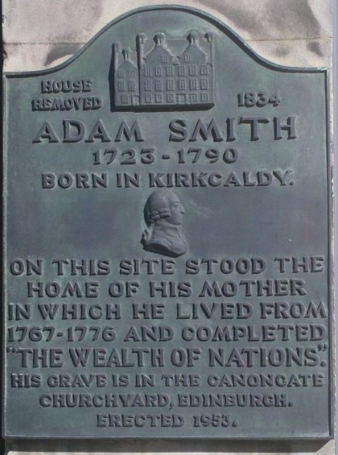

While Smith worked by candlelight, far across the oceans, in Boston Harbour in what was then the British colony of North America, some demonstrators had boarded ships of the British East India Company and were throwing chests of tea into the sea. The demonstrators' objection: The British state was collecting taxes from them, yet had refused to give them representation in the British parliament. From this dispute, the American Revolution was born.  Adam Smith himself agreed with the American revolutionaries that the North American colonies should be represented in the British parliament in proportion to the taxes they paid.

Revolution was also brewing in France. In 1766, French economist and statesman Anne Robert Jacques Turgot had said: "The art of taxation consists in so plucking the goose as to procure the largest quantity of feathers with the least possible amount of squawking."^[A rough translation. See @Burton1849, @Garson2018. The quote is often attributed to Jean Baptiste Colbert.] Francois Quesnay, one of the first economists, in 1758 had argued for a single tax on the value of land to replace all other taxes, in his monograph *Tableau Économique* [@quesnay1758tableau]. His advice was ignored, however, and a land-tax system of this kind was never applied. By 1789, the geese had not only squawked - they had overthrown the farmer, guillotined him, and taken control of the farm. The French Revolution had arrived. 

# 2.2 From Rural to Urban Land

The next stop on our Grand Tour is London in the early nineteenth century. Let's meet David Ricardo (1772-1823), a banker who became a renowned economic theorist. Ricardo, who remains well-known amongst economists today, had set out to discover the laws of *distribution* between the economic classes of society: workers, capitalists and landowners. Ricardo had argued that an agricultural landlord contributed nothing to the well-being of society. He merely extracted the surplus from the land once the costs of labour and tools had been paid. This surplus is known as 'rent.' As had been previously argued by Adam Smith, the best tax was a tax on rent. 

Ricardo's model of distribution between the economic classes, expressed in his classic, but hard-to-read, *On the Principles of Political Economy and Taxation* ^[@ricardo1821principles] is amongst the great intellectual achievements of economic theory. It stands central at the crossing points of the great schools of economic thought: classical, neoclassical, Marxist, post-Keynesian^[Especially Pierro Sraffa and those influenced by him] and Georgist^[Following Henry George, see next paragraph]. Many concepts crucial to modern economics (diminishing returns, marginal analysis and the use of mathematics) and many which have been largely forgotten from the mainstream (heterogeneity of factors, the centrality of land, and the law of rent) were expressed together most powerfully in Ricardo's great work. We will explain Ricardo's basic ideas in chapter 4 of this book.

Let's take our magic carpet across to the western edge of North America and half a century forward in time. A journalist in San Francisco is learning his craft. He is fascinated by a subject which was then still called 'political economy.' He's interested in one question in particular: Why is there so much poverty amid so much technological progress? The journalist, Philadelphia-born Henry George (1839-97), son of an English immigrant, sees that it is in the biggest, most advanced cities, with the most technological advancement, where the worst, most grinding poverty is to be encountered. The book for which Mr George became famous was called *Progress and Poverty*^[@George1879]. It became a bestseller, outselling all books published in the 1870s, apart from the Bible^[See https://en.wikipedia.org/wiki/Progress_and_Poverty]. Yet Henry George's name is not known to many today.

George criticised the economist Thomas Malthus, who had earlier argued^[@Malthus1878; See @Clark2009 for a modern exposition] that population growth would keep wages down to a subsistence level. George instead asserted that it was a lack of market power caused, originally, by the disinheriting of the poor from their collective inheritance of land,^[For example with the Enclosure Acts in England, and also through the dynamics of private land ownership thereafter] that was the underlying cause of subsistence wages.

While Ricardo modelled a rural economy, Henry George was concerned with urban land. Ownership of urban land allowed landowners to benefit further as society developed and urban areas densified, even if the landowners had contributed nothing to the increase in land values. George popularised the message that the remedy was to tax urban landlords. He used beautiful words that everyday folk could understand. 

*"Man is the only animal whose desires increase as they are fed; the only animal that is never satisfied"*^[@George1879]

Inspired by Henry George, a woman by the name of Elizabeth Magie (1866-1948) invented a board game called the *Landlords' Game*^[@Magie1902]. The game illustrated that without a tax on urban land, property tended to get monopolised and those who owned it extracted rent from those who did not. If, however, landowners were taxed, then a stable and fair (if rather boring) outcome ensued. Later, the game was shorn of the beneficial, but boring, rules, leaving a game where an unstable and unfair (albeit fun) set of rules remained. The original political implications of the game were lost, and the new version of the game was marketed as 'Monopoly.' The goal of Monopoly is to own the whole board and to drive all the other players into bankruptcy. This makes for exciting play, but it was the antithesis of a model for a system of widely-shared prosperity. The lessons of Magie's original version of the game and the insights of Henry George remain germane in our day, and accordingly, we will consider the case for a land value tax later in this book.

# 2.3 War and Progress

Henry George inspired many of his readers, including the young Winston Churchill (1874-1965) and British prime minister David Lloyd George (1863-1945). Towards the end of the First World War, there was even a budget which implemented a Land Value Tax, the 'People's Budget.' However, due to the resistance of landowners and the difficulties of land valuation, this budget was never implemented. Nevertheless, from the late nineteenth century through the whole of the twentieth century, and particularly after the Second World War, the conditions of the poor improved. The curse of destitution caused by the oppressive rents charged by slum landlords was almost banished.

One great milestone in this history of progress was the Beveridge report. Released in 1942 by an interdepartmental committee of civil servants chaired by Liberal economist Lord Beveridge (1879-1963), it laid the basis for the post-war welfare state. It aimed to banish five great evils: "Squalor, ignorance, want, idleness, and disease" ^[@Beveridge1942]. After World War Two, Beveridge's report became the basis for a welfare state encompassing social security, public education, public housing, a national health service, and macroeconomic management aimed at ensuring full employment. 

World War II had almost bankrupted Britain. Britain had financed the war through borrowing. The public debt ratio peaked at 238% of GDP in 1947. 

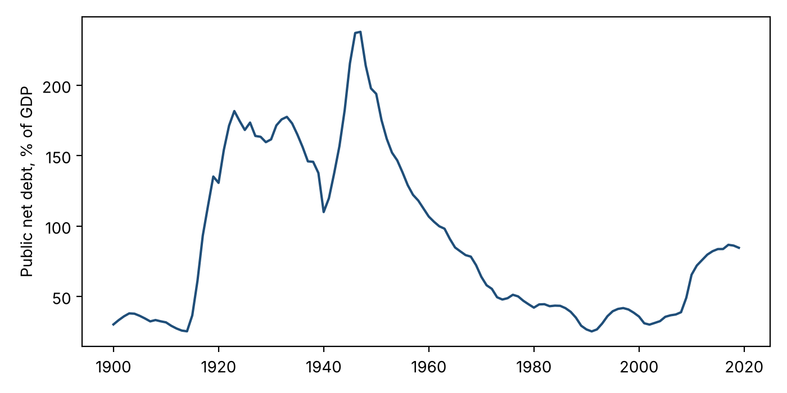

Despite this, post-war Britain soon rebuilt itself. It also managed to provide for its people a standard of living greater than that which prevailed before the war. Britain pursued a policy of low interest rates, moderate inflation, and high growth. As a result, the burden of public debt dropped to 70% of GDP by 1970, a mere 33 year later than the debt rate had peaked^[@Mitchell2011; @ReinhartRogoff2010]. These accomplishments are in themselves remarkable. 

Beveridge was successful in his mission to lay the foundation for a comprehensive welfare state. His reforms helped to reduce the prevalence of the five great evils and transformed the previously hellish conditions of the poor. But we have not yet achieved Heaven on Earth. There are still great evils facing us: The destruction of the environment, a lack of affordable housing in many cities and towns, extreme inequalities of wealth and income (which in many cases cannot be justified by any corresponding differences in contributive merit), and some risks attendant on automation. We will explain why these evils arise and explore how they can be fixed.

# 2.4 The Global Machine and the Global Mission

Returning to the present day from our brief historical survey, we note that the subject once known as political economy is now called economics - even though the distribution of wealth and income remains driven in no small part by *political* choices. 

Now we are in the present day. Great container ships cross the oceans. Aircraft roar across the skies. Massive machines in faraway lands churn out smartphones which seize the attention of billions of people for many hours each day. Many people live with more consumer comforts than in the past. Some things are cheap: It is relatively cheap to fly off to sun-kissed beaches on foreign shores. But some things are costly: It is wildly expensive to buy a flat in London, for example. 

The machinery of commerce is devoted to two purposes: To give people what they desire (or at least, what they can be coaxed into buying), and to make a profit in so doing. The commercial machine works remarkably smoothly in many of its day-to-day operations. But there are rumblings of discontent. In 1848, Karl Marx wrote in the Communist Manifesto that the "spectre of communism" was haunting Europe^[@Marx1848]. Today, the rising dangers of environmental destruction and runaway technology, and the dysfunctions of a state run by and for the rent-seeking superrich, keen to enrich themselves still further, cast shadows on this vast machine for the happy fulfilment of our consumer desires.

In America in 2016, a man who is very good at telling people what they want to hear promised to 'drain the swamp' in Washington DC. This man would soon become president of the United States of America. It would be natural to take these words to mean that the army of smart-suited lobbyists whose job it is to nudge the ship of state to favour the interests of their corporate employers would be sent packing. Nothing of the sort happened. Indeed, the swamp got even marshier and more sulphurous. The poor, who had seen nothing much in the way of improvements in prosperity despite forty years of productivity growth in the US, were increasingly addicted to prescription painkillers. Statistics showed the average lifespan of American citizens had stopped increasing.[@Smith2018]

This is by now a truly global civilisation. And scientists are warning that something truly global is wrong. Groups of scientists^[e.g. see @IPCC2018] are calling for radical shifts in our global infrastructure, aiming at an end the burning of fossil fuels within a couple of decades. The vast machinery of commerce, which has since the end of the Second World War been devoted to giving us more and more stuff, will need to be turned in a new direction and given a new purpose.

To turn around this great global machine, we need to apply not only the considerable resources of the state, but also the dynamism, flexibility, and capacity for rapid action of the private sector. We need to harness the profit motive for the good of the planet. It needs to become cheaper and more profitable to do good than to do harm. And that means we need to tax the damages that individuals and companies cause to the living planet. In this book, we outline how the tax system can be reformed to achieve this outcome, not only by changing the incentives of the private sector in one country but also by ensuring that other countries have a reason to follow suit. The reforms we propose will transform the prospects of early-adopter countries so significantly that others will have no choice but to follow their lead.

# 2.5 Of Flats and Of Flights

It's now a wet November evening. Let me introduce Peter and his wife, Lucy, who are shivering in their North London flat, pressing refresh on their email program and looking at their phones. They are waiting to see whether their offer has been accepted on a two-bedroom flat in a rundown neighbourhood of the city.

An advert flicks up for a getaway flight to somewhere sunnier. If they can take the time off, then they can get away to a charming sunny island for a week. The small flat they are purchasing is, by reasonable standards, inordinately expensive. They will be paying off their mortgage until they reach retirement age. But the flight is cheap: They can book it for less than one day's wages each.

To Peter and Lucy, this is the usual way of things, although they don't like it much. Their friend Mel pointed out to them that the world is running out of time to tackle one of the significant environmental problems of all time: Climate destabilisation due to increased greenhouse gas levels in the atmosphere. Lucy feels a certain amount of guilt in the back of her mind for taking a holiday and the associated carbon emissions but is swayed by the low cost of the flights and her felt need to get away from the damp cold and stress of London. When buying a roof over their heads is so expensive and so stressful, any sane person would need a little relief. She and Peter book a flight to sunny Mallorca.

# 2.6  Are the Prices Right?

This book is about the prices of things, and how these are influenced by the taxation system. Houses and flights already have some taxes applied to them. If you live in a house, you pay Council Tax. And if you take a flight, you pay Air Passenger Duty. Putting a higher tax on homes will *reduce* the purchase price of the house. That's because the value of the house depends in part on the obligations associated with it, taxation included. 

This book does not argue for environmental taxes primarily to change the behaviour of consumers. Instead, it seeks to shift the economy to provide goods in ways that do not damage the living planet. Sometimes, this will be difficult. It's hard to design aeroplanes that do not burn oil products (although it is possible, albeit financially and energetically expensive, to produce low-carbon synthetic kerosene). But technologies change and adapt to market demands. And if zero-carbon planes cannot be designed, then perhaps those who fly should pay for the capture of carbon dioxide from the air and its permanent safe storage. The tax on flying, and on other activities that produce greenhouse gases, should be enough to encourage people to capture those gases from the air if they cannot be eliminated directly.

The prices of things should be just. A just price requires a just tax system. A just tax system will cause people to pay for the damage they cause to the environment. A just system will also ensure that nobody gets rich *merely by owning* some of the things in life that are in limited supply, such as land. In short, in a just economy, justice and social benefit go hand-in-hand; fairness and efficiency are two sides of the same coin. That is the aim of the reforms we propose.  

There's an old joke about a man who asks for directions and gets the response: "Well, if I were going there, I wouldn't start from here." It's not just the final state of affairs that must be just, but also the pathway for getting from here to there. Later on, we will try to show how to transition in a fair way to a just tax system.

# 2.7 Bringing Back Self-Respect

Further down the street from Peter and Lucy lives Fred. Fred is on benefits. He took a job at one point a couple of years ago, but he found that once this happened, his benefits were cut off. There was a gap between his new wage and the benefits coming in. As a result, he didn't have the money for the rent. 

The UK has rolled out a reform known as 'Universal Credit,' which integrates four income-related benefits into one. The 'benefits withdrawal' rate (in effect the income tax on additional income) on Universal Credit is 63%^[@HMG2019UC]. This means that you lose two-thirds of the extra income you get from working (rather than merely staying on benefits and not working). Does that seem like a deal likely to motivate the long-term unemployed to get back into work? Some of the problems with the new system also relate to administration and design issues. The Universal Credit system has also seen delays in payments, which has caused problems for recipients, like Fred, many of whom have no savings to see them through short-term cash flow bottlenecks.

It does not have to be this way.

---

# CHAPTER 3: DESERT ISLAND ECONOMICS

## Summary

The purpose of this section is to take you on a second whirlwind tour of ideas in economics. This time, rather than travelling through history, we shall introduce these ideas through stories set on an imagined  group of islands, which we will term 'The Economic Archipelago' (informally, the 'Tea Islands').

# 3.1 Growth on Great Island: Adam Smith's Model

This economic fable demonstrates Adam Smith's model of growth through specialisation.

The largest island in the Tea Islands is 'Great Island', home to a few hundred people. All the islanders do the same thing, which is a bit of everything. Half the day is spent fishing (including maintenance of the boats and nets), and the other half is spent gathering nuts and berries. This yields 250 grams of fish and 250 grams of nuts and berries per person per day. In total, 500 grams of food is gathered, which is exactly equal to their dietary needs. 

## Specialization and Trade

Then a small group of fishermen discover something. They decide firstly, that they are *only* going to fish, and no longer participate in gathering berries. Whilst they like eating nuts and berries, they argue that they can catch enough fish and *trade* some of the fish with others for nuts and berries. They also split up tasks between themselves. Some of them make nets, others build bigger boats. They can catch more fish by splitting up tasks in this way. By collaborating and specializing they can double their productivity. Whereas before they could only make 500 grams of food per day, now they collectively can produce 1kg of food per day per fisherman. 

They now have some choices. They could catch fish all day (8 hours) and sell what they don't personally require for their own needs (the 'surplus'), saving this return or spending it on some luxuries. Another option is to cut down working hours by working only 4 hours per day. In the shorter working day they can still produce enough food to live on. In both cases we would say that the fishermen in the firm have higher hourly wages than before - twice what they were making before they decided to specialise. These higher wages reflect their higher productivity. 

This improvement in wages was generated by the fishermen and their initiative, and they are the beneficiaries of the new way of working. The economy has grown, but so far the additional prosperity has gone entirely to those fishermen. The price of fish relative to berries is unchanged. One kg of fish still sells for one kg of berries.

## Competition

At first, the benefits of improvements are captured by those that made the improvement. Our group of fisherman now live a life of relative luxury. Everyone else's material conditions are pretty much as they were before. The rest of the island's population does notice, however, that the fishermen who specialised seem to be getting richer. 

Pretty soon, some other islanders realise what the fisherman have done. They then follow suit, and adopt the new methods. Then even more fishermen notice what is going on and pile in as well. Fortunately the seas are plentiful. Once each fisherman has replicated the new improved double-productivity setup, they can all sell their surplus fish. 

But then something strange happens. Because the islanders only want to buy a certain quantity of fish, and now much more fish is being caught, the fishermen have to compete with each other to attract customers. So, they start to undercut each other in order to win market share. The price of fish in terms of berries starts to fall. 

## The Labour Theory of Value

To what price will the price of fish fall? It continues to fall until the point at which, under the new circumstances, it only just makes sense for workers to go fishing in the new fishing-conglomerates - i.e. when the wages from fishing in the new improved setup equilibrate to the wages for going gathering. In other words, the price of fish relative to berries will fall until it makes the same sense for someone to fish as to go collecting berries. This assumes of course that there is still value in eating some berries, perhaps for a varied diet. 

So now, the cost of fishing is expected to fall. In these new, changed circumstances, 1kg of fish (taking one day to collect) buys 0.5kg of berries (also taking one day to collect). This is the new, cheaper price of fish relative to berries.

## Widely Shared Prosperity?

If we add some numbers, we can make the improvement clearer.

At the end, people fish for a day to get one kilo of fish and perhaps go collecting for a day for half a kilo of berries. Two thirds of the people fish, and one third of the people collect berries. This is a change from the fifty-fifty split before the improvement in collective capabilities. 

The total average food production is (2/3)x1 + (1/3)x(1/2) = 5/6 or about 0.82kg. Thus the real wages per day have increased, from 0.5kg per eight-hour working day to 0.82kg of food per eight-hour day.

This is an example of the basic model of division of labour and competition. Let's now extend this model to the situation in which there is scarce land that is privately owned.

# 3.2 Rent on Private Land Island

Elsewhere in our Archipelago is an island where rabbits run free and are easy to hunt. On this island, lives a man, let's call him 'Man Friday', who has invented some laws of property. He defines himself the owner of this island, and has armed himself to make sure that nobody else can stay on the island or use its resources without his permission. He prepares to charge rent to anyone who turns up. This is thus an island of private property, which we will call 'Private Land Island'. 

One day a new man turns up, we can call him 'Robinson Crusoe'. This man has been living at sea in a fishing boat. Every (8-hour) day he fishes, he catches 1kg of fish, which we can assume are very nutritious. 

Crusoe arrives at Private Land Island, which is full of rabbits that are easy to hunt. He finds that if he works a whole 8-hour day, he can now catch 8kg of rabbits. Let's say that a rabbit is just as nutritious as a fish, and the work is just as pleasant. Because he only needs 1kg of food to live on, he can now work one hour per day and relax the rest of the time, perhaps by reading books on the division of labour. 

After the second day of fruitful hunting, Man Friday turns up to say hello. Fortunately, through a twist of fate, the two of them speak the same language. Friday is very happy that Crusoe has turned up. He invites Crusoe round to dinner. It's a very tasty dinner of rabbit-en-croute. Friday has many beautiful items on the wall, won from many years of selling rabbits to passing tradespeople. He even has a beautiful gun, and halfway through the meal, he gets it out of his gun holster, places it on the table to show it to Crusoe, and then puts it back in its holster.

Dessert is served. Friday has a family of servants who help him. Friday is saying how he is glad that Crusoe has joined the island. Half-way through the desert, Friday gets to the point. "Oh, about the rent" he says. "Would seven per day be ok?"

In that moment, Crusoe realises he has not been having a pleasant day after all. He had not even considered that Friday would charge him rent. There was space enough on the island for all. But Crusoe has few options. The best profession he had found up to now, working as a fisherman, earned 1 kg of food for a full day's work. Crusoe had thought that he would be in a position to work only one hour per day henceforward. But now he realised that his working hours would not change. The 8-hour shift of fishing to get one unit of fish is the same as the eight hours he would have to work to get 8kg of food in the new situation, of which 7kg would go to his landlord! He would still be working the same hours, and get the same pay. Admittedly, the new situation was a little better, as he was not subject to the storms and salt-corrosion of his boat, but it was not the bliss that he previously envisioned. 

It's interesting to note that the net wage after rent of our new arrival actually depends not on the conditions of the island, but rather on the conditions in his next best option, which is to go fishing. Suppose that fishing made 2kg of fish per 8-hour day (0.25 kg per hour). The landlord, observing this, would need to charge at most 6kg of rabbit per day in rent, since otherwise, Robinson Crusoe would always be better off fishing. This point is worth repeating: the well-being of someone in a given situation depends on the options they have available elsewhere.

A real-world example of this occured after the passing of the Enclosure Acts in England. The abolition of traditional peasant rights in England during the Enclosure Acts were the fundamental cause of poverty in big cities thereafter. Without the option of returning to the countryside to be a peasant, workers had no Plan B, and were not in a position to negotiate for better conditions in their urban environments. Therefore the wages paid by industrial capitalists needed only be sufficient to keep their wage-slaves alive, but no more - i.e. subsistence wages.

In economic terms, we say that the landlord can extract *rent* constituting the surplus over wages (in this case, the net resources kept by Crusoe once he has paid his rent).

## Differential Rent

Imagine the island is split into two domains of differential rabbit productivity. On the east side of the island, rabbits are plentiful, and a full day of hunting will yield 8kg of rabbits. On the west side, rabbits are less plentiful and only 4kg per day can be hunted. The landlord rents out both plots, but the rent charged on each must differ. Assume for now that the wage a person can make is still 1kg per day when fishing. Thus the landlord can charge 3kg of rabbits for residence on the less productive plot and 7kg of rabbits per day for residence on the more productive plot. As above, if the landlord attempted to charge more in rent, then their tenant would simply leave and return to fishing.

## Absolute Rent

Let's say that for some reason, there's a series of storms and the fishermen find it hard to catch fish. The landlords however have some spare resource - stored dried food - that they have accumulated over many years. They sell this food to the fishermen. In exchange the fishermen sell their boats to the landlords and rent them back. Now there is no rent-free way of earning a living. Either the islanders pay rent for a boat and fish, or they pay rent to stay on the island and hunt rabbits. In this situation, we say that land and other ways of earning a living are 'absolutely scarce'. They have been bought up by the wealthy landlords.

The amount of the landlord's revenue which comes from renting out boats versus the amount which comes from renting out hunting-rights to the rabbit hunters, will depend on the absolute scarcity of land and the absolute scarcity of labour.

In our current scenario of abundant labour (many islanders available to work), of the original 8kg of rabbits, only 1kg is retained by the hunter; the other 7kg are paid as rent for access to the landlord's hunting-grounds. The residual wages are not set at what the hunters can earn in a rent-free existence, but rather, the minimum that will keep them alive. 

In a scenario of scarce labour, this could change. This would require that the labourers (in this case, rabbit-hunters) have a choice of landlords to work for. If there are several islands with landlords and rabbits, but too few rabbit-hunters available to hunt all the rabbits produced by the islands, then the landlords will be forced to compete for the time and effort of the hunters. If they don't, they will receive no rent at all. In this case, the rabbit-hunters might be able to negotiate a deal with a landlord in which they retain two rabbits per day and pay the landlord only six rabbits (again assuming the hunter is able to bag eight rabbits a day). 

All this depends, of course, on the original rate of rabbit-hunting remaining sustainable; i.e. the fecundity of the rabbits and the available rabbit food on the islands must be such that the hunters' productivity of 8 killed rabbits per day doesn't overwhelm the ability of the rabbits to regenerate their populations. Also the rabbits' numbers mustn't get so high that they eat all the available greenery and cause a mass starvation. A dynamic equilibrium between rabbit population and the population of hunters is what's best for all concerned. 

## Capital

Let's say that our Robinson Crusoe sets aside some of his wages, in order to save for the future. He works for a bit and creates some rabbit traps. He has to invest some time in making them, but once he has done so, his productivity doubles from 1 rabbit per hour to 2 per hour; or from 8 rabbits per day to 16. It takes him one day to build the traps. The traps double his daily productivity to 16 rabbits per day. We can say that it increases his productivity by 8 rabbits. Each trap lasts 10 working days (80 hours) before having to be completely replaced. 

Does this investment make sense? Let's work it out. There's an original investment of 8 hours of time to create the trap, and this leads to 8 extra rabbits per day for 10 days. This is a total of 80 extra rabbits. I give up 8 rabbits in one day to construct my trap, and I get back 80 rabbits. Let's say that I borrow the resources to make the traps, so I borrow 8 rabbits to pay the rent and feed myself during the day I make the traps.

Thus my profit is 72 rabbits (assuming I continue to work a full day) each 10 day cycle. This is a profit of more than 7 rabbits per day, once the cost of my investment is taken into account.

At last Robinson Crusoe is happy! He is a great believer in hard work. He is working full days to pay the rent, and will continue to work full days. He can invest his time and create the traps, and reap the reward. After having paid back the time invested, there will be a surplus too! He can sell the spare rabbits to passing tradespeople or to Man Friday, and can build up assets.

We are assuming that Crusoe has some financial buffer, some wealth to tide him over for the day that he is building his trap and therefore not hunting. If rent is payable daily, he might be able to delay paying rent, he might be able to borrow some rabbits or other resources to pay rent, or he might invest his own stock of wealth until the investment pays back. 

Everything is going swimmingly well. He invests his time and he makes a surplus, and soon enough he's selling the spare rabbits to passing tradespeople and building up a store of value. 

But there's a catch. Man Friday comes round and observes what is going on. He takes some photos. And soon enough, some adverts go up in the Archipelago Gazette, the local newspaper for the islands. It's only after getting a copy from a trader on a passing ship that Crusoe sees them. The adverts say the following: 'Make a fortune hunting rabbits! Earn 16 rabbits per day.' He also reads the small print: 'Requires 8 rabbits investment to make traps; Rent: 14 rabbits per day.'

14 Rabbits! He's only paying 7 at the moment! What's coming? Sure enough, some visitors soon come around, friendly enough. The next day Man Friday invites Crusoe round for dinner again.... "About the rent"... he says. "I know you are enjoying staying here, but the market is changing. Market rents are going up. I had an offer the other day for someone to pay double what you are paying. Of course, I prefer to go with you, since I know you're a good reliable chap, so I won't chuck you out as long as you pay what the market is saying. It's only 14 rabbits per day. You still make a healthy 2 rabbits profit."^[Actually, it's only one rabbit after paying for your investments, and the cost of your own wages is not accounted for in that -- but the landlord didn't mention those things.]

So, Crusoe is back in his original position. He works an 8-hour day, and after rent, is again only left with 1kg rabbits in wages, enough for him to live on. He can't seem to get ahead! It sure seems like the concept of private *property* is the fundamental problem here, but as we will see, abolishing property causes its own problems...

# 3.3 Overhunting on Open Access Island

Let's now imagine another island. On this island, there are no property rights. Anyone can hunt for rabbits anywhere. And unlike the previous example, there is no landowner! Word gets around, and everyone comes to the island. 

In the beginning, everyone is happy. Wages, 8 rabbits per day, or one per hour, keep everyone in prosperity. There is no rent to pay. 

The problem this time is that too many people end up coming. Since the land is not owned by anyone, everyone hunts rabbits, and in the end too many rabbits are taken from the natural environment. The hunters soon deplete the common pool of rabbits on which everyone had relied. There is an ecological collapse. Soon there are few rabbits left. People have less food to eat. Those who can leave do so, and move to other islands. 

In contrast to the island with private property, people are poor, but there's no abusive rent collection. The absence of property rights has, however, caused a long-term impoverishment of the islanders, by causing a failure to allocate and enforce hunting-rights at sustainable levels. 

What we are learning through these scenarios is that the fair allocation of property rights is the key for protecting the rights and prosperity of the ordinary worker. 

# 3.4 Inequality on Special Island

Let's say now that hunters vary significantly in their skill level. There's a limited quantity of land, and a limited quantity of rabbits. But some people are much better than others at catching rabbits. Had there been unlimited rabbits or unlimited land, this wouldn't appear to be much of a problem. With limitations, however, there is a problem. The successful hunters can afford to pay the landlord more tribute (more in rent), and so their existence increases the price of land. Moreover, they put pressure on the rabbit population, harvesting more of the rabbits for themselves and leaving fewer for others. 

The landlord might impose a control by setting a limit on the total number of hunters allowed on the land. This may help somewhat, facilitating a process by which hunters compete to get rich by hunting ability rather than by merely owning land. However, in a limited environment, good hunters don't just benefit from their own hunting. They also indirectly impose costs on others. They raise the marginal price of land, and so make it more difficult for large families supported by rival hunters. As more individuals hunt rabbits, the resource becomes more scarce. 

This justifies what we call progressive taxation, to enable some degree of redistribution to compensate for the costs to the community of a more successful hunter. Progressive taxation means taxing people that have larger incomes at a greater proportional rate than people who have smaller incomes. 

# 3.5 Economic Justice on Dream Island

One of the islands on our archipelago is the island of our dreams. The fruit is bountiful, the water is clean, the people are happy. Everyone has a house or can build one with their own resources. Fisheries and forests are managed well. Some people are richer than others, but the difference isn't huge, and the people who are rich or high status are those that have contributed the most to society - in other words, the rewards which islanders receive are proportional to *contributive merit.* The community collaborates to ensure that the political system is not corrupt and governs the society well; the citizens trade with each other and with people on other islands. There is work for all, but no-one has to work uncomfortably long hours. The financial system supports beneficial activities - for example clean power and a recharging system for electric cars. Financially, people are secure; they have investments in the local factory, which, whilst its mostly robotised, provides everyone with a dividend to spend on the products that it and other factories produce.

Must this island just be the stuff of fantasy? Could it exist in the real world? Yes, and we hope in this book to outline a plan for achieving it. A good tax system, we claim, is the key tool towards achieving this heavenly island state - together with reforms of the social security system and some elements of the financial, education, and pensions systems. In this text our focus is on tax system reforms.

Now what can be said about taxation on this perfect island? Well, in simple terms, tax is fair, and fairly simple and straightforward for everyone to understand. In important ways, the tax system supports the rest of the economy - not only through ways in which revenues are spent, but also in the ways that the tax system creates appropriate incentives for the economy to function well. The incentives are to be in line with public purposes as well as private prosperity gained through genuine contributive merit. The two main ways the taxation system can be used toward such ends are *redistributive taxes* and *environmental taxes*. 

We will get to our Dream Island again, but first, an introduction to ideas which might solve some of the problems on the other islands in the archipelago.

## Getting to Dream Island

Let's now work out solutions to the problems we've encountered in our archepelago. It's easiest to solve problems before they get started - to set things up well from the start.

The problem of the landlord (Man Friday for example), extracting ever increasing rent from the islanders, for which he does no work. The first solution is a land value tax (LVT) - a tax on rent. With LVT, a landlord is taxed according to the surplus of each piece of land. He makes no unearned money. There's no such thing as a landlord any more, really. Land can still be purchased, but the person who owns and occupies it has to pay rent to the central authority. In other words, rent (money collected from tenants in excess of the landlord's costs) now accrues to the central authority, not to a private landlord. In our island archipelago, the central authority might be a democratic council elected on a one-person-one-vote basis. 

What does the central authority do with the taxes received (in our story: with the rabbits harvested)? There are two options: (1) The government could provide public services by paying people living on the island with rabbit-meat rations for doing useful things that benefit everyone. (2) The government could distribute rabbit-meat directly to the population, without requiring work in exchange.

What about over-hunting? A limited number of permits could be issued by the central authority, with fines and penalties levied against those who are caught ignoring the rules. Hunting rabbits could be constrained. Or put another way, a tax could be levied on hunting rabbits. On propertied land, it can be expected that the landowners/renters in charge of the land will themselves look after the rabbits on their own plots. If rabbits run freely between plots, there needs to be a joint solution agreed between all the land-owners or set by the central authority that constrains hunting.

# 3.6 Conclusions

In this chapter we dealt with *economics*. We worked out how economies can fail to have widely spread prosperity, and the reasons why they fail. In the real world we live in today is not merely an economy but a political *and* economic system. Rather than purely a theory of economics, we need a theory of politico-economic systems. In this book we do not have space to consider what such a theory would involve in great detail. Rather we suggest two guiding ideas: the win-win change, and the social contract. The win-win change ensures that the new policies *work for the pre-existing people and companies*, on the whole; the social contract gives a shared moral basis for what we are proposing.

We have seen a set of ideas concerning monopoly, land, external costs and the possibilities of progress in three different contexts: in the decision-making of a boat's captain, in the history of economic ideas, and in an imagined set of islands. In the next section we set out the central questions of this book in a bit more detail.

# CHAPTER 4: THE QUESTIONS POSED BY THIS BOOK

## Summary

In this chapter, we define five major questions that this enquiry seeks to answer. They are as follows:

1. What would an economy fit for our children look like? 
2. What are the economic conditions for sustainable and widely-spread prosperity?
2. What economic phenomena or issues can taxation address?
4. How can we effect change?
5. What improvements would a principled taxation and social security system allow?

\newpage

# 4.1  What Would An Economy Fit For Our Children Look Like?

This book is addressed to a wide readership: Economists, scientists, politicians, professionals, and the public alike. Everyone, in fact, who cares about two issues not usually understood to be intimately connected: Establishing a fair economy which rewards contributive merit in proportion to contribution (tempered by compassion for the elderly or disabled), and preventing catastrophic climate disruption. 

In fact, these two issues are indeed intimately linked. If we simply add the dimension of time, we quickly see why fairness is grotesquely betrayed in a world which ignores catastrophic climate disruption caused by human economic activity. If we fail to stop pumping garbage into the atmosphere, our children and grandchildren will be unfairly burdened by living in a chaotic world of crisis and destruction. It's that simple. Just add the dimension of time, and climate safety becomes a matter of fairness - profoundly so. 

Across the social spectrum, people are starting to lose hope. The poor are losing hope because of their precarious economic situation; the wider public because of a lack of certainty that society can fix critical issues such as preventing radical climate disruption. Even the wealthiest in society are showing signs of fear, building bunkers and preparing for the worst. But with careful design and application of policy, and sufficient political will, all is not lost. 

What would an economy fit for our children look like - a society and economy that promotes the wealth and happiness of its citizens? Such a framework would define, create, preserve, and equitably distribute wealth, both natural and human-made. To build an economy that enables and fosters happiness, we will need different metrics than those economists conventionally use today - metrics encompassing both economic security and satisfaction of needs, as well as measures of free time, manageable stress levels, and social stability. A thriving economy is one that is good for people and for the planet. Gross domestic product (GDP) is only one among many relevant measures.

\newpage

# 4.2 What Are The Economic Conditions For Sustainable Widespread Prosperity?

To define a desirable economy and society, we need first to determine the economic conditions that would be necessary for sustainable and widespread prosperity.  

Adam Smith wrote what is probably one of the two most famous books on economics, *The Wealth of Nations* [@smith1776wealth], more than two centuries ago, at a time when three revolutions were underway: The political revolution in America and France, the nascent industrial revolution in Britain, and the intellectual revolution that he himself played a part in. The world has seen tremendous technological progress and economic growth since his time. Yet major problems persist to this day - including widespread economic insecurity and existentially dangerous forms of pollution. 

Why, given two and a half centuries of remarkable technological and economic progress, do these issues persist? Why, despite the growth in global wealth, are many people still existing in precarious circumstances? Why is there environmental pollution, even though humanity has the wealth and technological ability to prevent it? The 19th-century reformer Henry George tried to answer these questions in his seminal text *Progress and Poverty* [@George1879]. He argued that it was the exploitation of the private ownership of land that caused poverty. This is not the sole reason for the issues that society currently faces, but we can draw from his analysis a few lessons that shape our recommendations. The very structure of our economic system is at fault: It does not place explicit value on the well-being and happiness of people. Our economic system has not allowed us to take full advantage of the technological progress we have made in ways that serve human happiness, fairness, safety, and environmental sustainability. To come to grips with this reality, we must fight fire with fire - i.e. we must adapt the tools of the current system to combat its weaknesses. What we seek is instruments of economic policy that will re-orient human efforts in desirable and necessary directions. This quest is in the tradition of what used to be called *political economy*.

\newpage

## Evolution of Political Economy

Economics is the study of activities that are, at least in part, motivated by financial gain. Economics comes from the older term *political economy*, which itself comes from Koine Greek, the *lingua franca* of the Eastern Roman Empire from the fourth century BCE onward. *Polis* means city-state, the main form of political organisation in ancient Greece. 'Economy' comes from two Greek words: *Oikos*, meaning household, and *Nomos* meaning law. Thus *Oikonomos* means household management and the root of *political economy* is 'household management of the state'. Classical political economy treatises include the works of Thomas Malthus, Adam Smith, David Ricardo, John Stuart Mill, and Karl Marx. 

Classical political economy considered how the economy's production was distributed amongst participants in the system. A question at the very heart of political economy has been that of just distribution. Taxation is a way to pay for public goods, but it is also a means to remedy distribution when it is inefficient or unfair. Thus, the study of political economy, or economics, is powerful, as economics has implications on the income, wealth, and well-being of all individuals. One can believe an economic theory for 'scientific' reasons, but one might also support a given theory because it furthers his own interests or ideological preconceptions. This makes economic discourse somewhat fraught - indeed political. Self-interested parties with deep pockets can influence (and have influenced) the public to assume the veracity of certain economic theories which are in reality normative ideologies, and lead them to be considered authoritative, by simple expedients such as generously endowing professorships of economics at leading universities, funding think-tanks, and owning newspapers. 

Theories of political economy often have questions of taxation and property at their heart. The efficacy of a particular taxation regime can be considered on two grounds: The extent to which it incentivises efficiency, and the extent to which it promotes fairness. These questions depend not only to economic processes (regulatory and infrastructural frameworks for production and competition) but also on the structures of taxation and private property ownership. What assets can be owned, who owns them, and how much tax should they pay for doing so? These questions are at the heart of economic management. Desirable economic outcomes depend not only the structure of economic activity but also on the taxation system and the system of property rights.  Our starting point is Adam Smith's model, since his work has helped to define the predominant economic view of the two centuries that followed the publication of his seminal work.

\newpage

## Adam Smith's Model

In *The Wealth of Nations*, Smith set out a model of how economic growth comes about, and how it can lead to widespread prosperity. He argued that the division of labour leads to higher levels of productivity, giving the example of a pin factory, where dividing the process of manufacturing pins into discrete steps and assigning workers to become efficient specialists in a single step leads to more pins being produced for the same total number of hours worked. By focusing on a single task, a worker can do this task more quickly than if he has a multitude of different jobs to do. This differentiation of jobs takes place not only in a single enterprise but also across the whole economy. By specialising and trading, we can get more work done in a given number of hours. The productivity of the economy rises.

If an entrepreneur improves the production process, she can lower her cost of production and still sell at the same price her competitors charge. In other words, she can make a higher profit. In the short term, the advantages of the improvement accrue to her. Thus, the profit motive provides an incentive to make improvements. Her competitors may notice the improvement that she has made and replicate it. To retain market share, they will lower their prices towards the new cost of production. A price-war to capture customers may result. After the competition has taken its course, we will be left with a different situation. The price of the goods concerned will have fallen to just above the new production cost. The long-term beneficiary of this technological improvement will be everyone who purchases the product. 

This combination of technological progress, the profit motive, and competition can lead to widely spread prosperity. While the initial profit from the improvement accrues to the entrepreneur, the long-term beneficiary from the reduced cost of production is the customer. If this picture is correct, profit is a necessary but temporary phenomenon. It is competed away, and as this occurs, society as a whole becomes richer.

\newpage

# 4.3 What Economic Phenomena Or Issues Can Taxation Address?

## Phenomenon 1: Rent

The simple model just described relies on certain assumptions. One assumption is that a production process, once improved, can be replicated. There must be enough market participants for competition to work. If there is only a single monopolist, or if market entry is prohibitively expensive for entrepreneurs not already established in the particular line of business, then competition will not work as described. If I own a big monopoly with no competition, I can also own a continual flow of profits that competition will not touch. The beneficiary will be the owners of the monopolist incumbent firm. Their earnings, untouched by competition, are termed 'rents.' 

Similarly, if the process relies on some factor of production that cannot be replicated - for example, land - then the beneficiaries of improvements will be the landlords. Imagine I own some land with buildings on it. I can let the buildings, sit back, and enjoy the flow of income, without having to work. This flow of income is also called 'rent.' Now, suppose that for reasons that have nothing to do with me, regional wages increase. I respond by jacking up the rent that I charge my tenants, taking away the improvement in their living standard. I can do this if I am a monopolist property owner, or I collude with other property owners, or even if other property owners and I merely respond to rising demand for better properties by raising our prices. Rent goes up as wages increase. 

We term these two forms of property income 'generalised rent.' Generalised rent is a permanent flow of revenue associated with an asset that cannot be replicated. It is received by the owners of properties in valuable locations and the shareholders of market-dominant companies. We argue that generalised rent leads to expensive housing, stagnating wages, and unmerited wealth gains for the already rich.

## Phenomenon 2: Wicked Externalities

So what about the problem of pollution? Damage to other people or their interests is usually illegal. Examples could include injury or theft. However, some economic activities which damage others are legal. Driving a  petrol car, which pollutes the environment, is legal and normal, but harms others' interests. Small indirect damages from many independent sources can add up to a significant total. Imagine driving into a major city at rush hour. Each car adds only a little congestion and pollution, but together they add up to gridlock and unhealthy air.

When one person or company's behaviour damages another, it is termed by economists as a 'negative externality.' Negative externalities are a form of economic theft if they have not been appropriately regulated. For example, if I throw my plastic waste into the ocean, it can then damage fish and other marine life. My careless action has stolen from the future of the ocean. If I play loud music late into the night, I damage the interests of my neighbours, robbing them of sleep, making them tired the next day, reducing their performance at work, getting them into trouble. I am, in effect, stealing their tranquillity.

Moreover, externalities that seem acceptable when societies are small may prove problematic as they grow. For example, Newfoundland fishermen could fish without constraints when their boats were small and their numbers low. There was plenty of fish. But then the industry grew in size. Fish stocks are not unlimited. If too many fish are taken, the fish don't get a chance to reproduce, and fish stocks collapse. This is what happened near Newfoundland. Fish used to be so plentiful that the sea teemed with life and business boomed. The exhaustion of these stocks through overfishing led to a collapse in both fish numbers and opportunities for the fisherman to earn livelihoods, leading to problems ranging from depression and divorce to community outmigration. This complex of overuse, collapse, and attendant harms could be termed a 'wicked externality.'

Climate change is among the wickedest of externalities. Wicked externalities such as climate change are damages caused by our actions that affect others remote in time and space, without adequate governance systems to constrain them. For the planet as a whole, this model is catastrophic. But there is a route out of this kind of economic situation. Economic growth needs to be dematerialised or physically circular. In other words, we need to decouple the impacts that economic growth has on natural resource use and on the natural world - or even, in some cases, make growth generate positive environmental externalities, by seeking activities that are regenerative of ecosystems (rather than degenerative) and setting financial incentives (through regulated financial mechanisms) that make regenerative actions remunerative and profitable. If in the past we've rewarded companies for clearcutting forests, in future, we can pay companies to replant deforested areas. We can rejig the system so that it's more profitable to generate low-carbon electricity (nuclear, wind, or solar power, for example) than electricity generated by burning fossil fuels. And so on.

## Which Policy Tools Can Affect Change?

This discussion of the problems of pollution and precariousness has led us to identify the two fundamental phenomena of rent and negative economic externalities. The issues are coming into focus. This leads on to the grand-challenge question: What should be done? In governance terms: Which policy tools can be employed to effect change?

Taxation is vital in our economic model not just because it alters the distribution of income, but also because it can be used to set finely tunable financial incentives for the private sector. Classical political economists, from Smith to Ricardo to Karl Marx Arthur Cecil Pigou [@Pigou1924], have argued that the taxation system or redistribution of property are the two basic categories of corrective tools for these issues. In short, economists have argued to tax rent and negative externalities such as pollution.^[Because this book is about taxation and welfare in the context of nthe real economy and the global environment, it inevitably overlaps with other systems, including systems for providing energy, housing, and finance. Our focus is mostly on taxation in relation to the problems seen in these systems. Nevertheless, we do not intend to exclude specific policy changes that are not related to tax. Smart taxation can make enormous contributions toward solving our social and environmental problems, but it is not the only mechanism for so
doing.]

Economists have been aware of the phenomena of 'rent' and 'externalities' for many decades, and yet taxes which would correct these economic distortions have only been imposed only occasionally and partially. 

\newpage

# 4.4 How Can We Effect Change?

Political feasibility is, it seems, a crucial barrier to these changes. Prioritisation of strong policy communication and smooth implementation are critical tenets of any successful public policy. A policy that's poorly communicated or implemented, even if well-conceived, will soon be rejected by outraged citizens, and political opponents may persuade voters that the plan was a bad idea in principle even if it was merely badly executed. That can take a good policy idea off the public agenda for a generation. Developing a *theory of change* for successful policy communication and implementation is, therefore, a key priority.

Here, we make a case for a simple 'change equation,' in which the perceived benefits of any policy must overwhelm the perceived costs. Dannemiller [-@Dannemiller1992] describes a formula created originally by David Gleicher. For change to take place: 

$$D * V * F > D$$
Where:

- *D = Dissatisfaction with how things are now;*
- *V = Vision of changes proposed;*
- *F = First concrete steps that can be taken towards the vision.*

According to the model, the change will only happen if the product of these three factors is greater than: 

- *R = Resistance*. 

## The Beveridge Example

Dissatisfaction with our taxation and the economic system seems rife, but is there enough of a vision for a better future? Can that vision be implemented by actors motivated to do so and with concrete steps available? Can we make a sufficiently passionate and positive case for these taxes, and therefore overcome opposition? Alternatively, can we reduce the perceived costs of the proposed changes, and hence the political resistance to them?

Let's consider one example of revolutionary change in the UK's social security system. As we noted earlier, a significant milestone in the history of social end economic progress in the UK was the Beveridge report [@Beveridge1942]. Over seventy years ago, in 1943, liberal economist William Beveridge presented a report proposing a whole new welfare state. It laid the basis for greatly expanded public services and benefits in the United Kingdom after the Second World War. Its objectives were to banish 'want, ignorance, squalor, disease and idleness.' Before the Second World War, these social evils ravaged the lives of the poor in Britain. 

The war itself destroyed many buildings, homes, and businesses, and increased the national debt. Moreover, the post-war government managed to create a comprehensive welfare state where none existed before. It included: the National Health Service; a system of social security (welfare benefits); a state education system; public housing; and a policy toolkit for 'Keynesian' macroeconomic management that aimed to achieve full employment. In this book, we'll focus on the social security system.

Three principles guided the Beveridge report [@Beveridge1942].

- *Radical*: Policies were designed from first principles, without fear or favour to social class or other interest groups.
- *Comprehensive*: It dealt with poverty, disease, inadequate housing, unemployment, and a lack of education.
- *A liberal social contract*: No means-testing and so no stifling of incentives; cooperation between the state, individuals, and firms.

Here, we adapt and expand these principles to the modern context in which they now operate, through outlining our four-fold framework for successful political change. 

## Principle 1: A Fundamental Review

Beveridge argued that the Second World War and its aftermath was 'a time for revolutions, not patching.' He offered a radical approach, informed by the experience of the past, but not restricted by excessive devotion to the interests of one group or another. In short, his report would be *radical* (working from first principles) and prioritise the *common interest*.

We also aim to look at tax and welfare from first principles. We will then apply those first principles without fear or favour. But are we at a revolutionary time? Can we change a complex system like tax and welfare from first principles, or is 'patching' the only realistic possibility? We will assert that change is possible if it is beneficial, practical, and fair, and communicated well so that these qualities are evident.

One does not make fundamental progress without thinking about what a system should *do* and what it should *be*. We address this in the 'Tax in Principle' chapter. 
We need to be passionate about the benefits that reform will bring. We consider these in the next section.

## Principle 2: Solving Great Social Evils

Beveridge argued for a *comprehensive* solution to the five 'giant' social problems of the poor. His report dealt primarily with want (poverty) and disease (poor health). The other three 'giants' were ignorance (lack of education), squalor (poor housing), and idleness (unemployment). As we mentioned before, his report laid the basis not only for the UK's post-war social security system, but also the National Health Service, public education, housing policy, and a system of macroeconomic management aiming for full employment.

We still have Beveridge's giant social issues to some degree, but we are also faced with new problems. This book, like Beveridge's report, is devoted to several great societal challenges which we face now:

- *Excessive Concentration of Wealth and Income*: How can extreme inequality of income and wealth - especially inequality caused by arguably unfair means, exacerbated by the context of increasing automation - be reduced, and incomes and accrued wealth brought more in line with individuals' real contributive merit?
- *High Rent on Land and Resources*: Can can the radical and increasing unaffordability of renting or purchasing homes be countered?
- *Tax Evasion and Avoidance*: How can a tax system be designed that is both simpler and more difficult to evade?
- *Debt and Economic Imbalance*: How can the economy be rebalanced away from high debt and asset inflation, and towards balanced growth and wealth formation?
- *Pollution and Other Environmental Damage*: How can we deal effectively with the problems of climate change, ocean acidification, plastics pollution, over-fishing, and habitat and biodiversity loss, issues that impinge on all of us and which all of us contribute to causing?

It's not enough to imagine top-down plans that might, in principle, solve these problems if they were applied. We have to do so in a competent way that involves everyone, or they won't, in fact, be implemented. We cover this matter in the next section.

## Principle 3: A Social Contract Aligning Reward and Contribution

Our new welfare system should not discourage work. It should encourage service and contribution. We will study in detail Beveridge's third principle (a liberal social contract, with no means-testing) to see if and how a better welfare system might be created. This suggests the case for a system with a universal component: We call this a 'citizen's dividend' (a form of basic income). 

Such a system of universal benefits has practical advantages too. It involves the *integration* of the tax system with the benefits system, so there is not a separate system of 'means testing'. Means testing is merely taking money away from individuals and families as they earn more. This function can be most naturally and efficiently carried out through the tax system. Rewarding people for full and gainful employment should be a priority for any successful system. Furthermore, we argue for an integrated skills-training and work-experience system, not unlike that which has long been standard in the German-speaking countries of Europe. 

## Principle 4: Minimising Barriers To Change

To Beveridge's three principles we add a fourth. Proposed changes should be designed to maximise benefits and minimise resistance. In short, we need to reduce barriers to change. 

One barrier is the worry that some people have that they will be made worse off by any changes. Firstly, there is the question of transitional justice; secondly, political realism; and thirdly, the need to transform the interests and specialisms of large companies, without provoking resistance from them. We deal with these in turn.

Firstly, there is the matter of transitional justice. We need to ensure not only that the final state is fair, but also that the transition between the current system and the new is also decent. Resistance to taxation changes is typically associated with concentrated losses imposed on specific groups. These groups can quickly mobilise to resist new taxes. We need to ensure that no politically salient or vulnerable group is made notably worse off. One example of politically savvy change is from Iran. When Iran eliminated a subsidy on transport fuels such as diesel, it compensated individuals and companies with regular monthly payments. The payments were sent to frozen bank accounts, and each individual and company was given a letter with the frozen bank account balance. The people could see the direct financial benefit of the reform, and they realised that to achieve this economic benefit, the fuel tax subsidy removal had to come into effect. This reduced the resistance to the reform, and it went through.

Let's focus now on corporate lobbying. Companies have the means at their disposal to defend their current financial and regulatory interests. Oil companies have successfully lobbied against policy actions to conserve the stability and safety of the global climate. Taxes change the nature of what activities are profitable. 
Taxes could change the nature of these agents (for example, converting an oil company to a renewables producer). But these cannot be imposed because these very same companies resist the taxes, which they perceive as opposing their interests (even if the reality is that they need not harm these companies' long-term interests at all - they merely require a transition to a new business model, and a re-investment of resources in new technologies). 

We have a catch-22 situation. We can't change the companies without changing the tax system. But sometimes, we can't impose the new tax system without changing the company, since they can effectively resist policy changes. So instead, we need forms of tax that don't face such resistance, but which lead to the transformation of companies in a positive direction. We describe one option, the feebate, a little later on.

\newpage

# 4.5 What Improvements Could A Better Taxation and Social Security System Bring?

There are four important benefits to wider society of a better taxation and social security system. We call these the four realms of value: households, communities, nations, and the world. We argue that our proposals can enhance true wealth at the level of the individual, community, nation-state, and planet. For each of these four realms, we also define a notion of social entrepreneurship. 

These forms of entrepreneurship imply a new growth model for everyone - one that is not based on increasing financialisation and debt issued on limited assets, but rather on the development of productive industries tasked with solving our collective problems. There's an overarching concept too, which we term *policy entrepreneurship.* That is, we should break out of the monopoly of thought imposed on us by neoclassical economics and neoliberal economic ideas, and instead conceive of and try out practical solutions to our problems, without ideological blinders.

## Improvement 1: Power to the People

The current social security system is highly insecure: Benefits are taken away from people when their conditions change, sometimes leading them to go into arrears with their rent or other payments, and often leading them into debt. The current social security system also discourages work, since benefits are withdrawn as income increases (in the Universal Credit system at a rate of 61% for every £ increase in income). 

We argue that the UK government should simplify the existing income and means-tested benefits system. Rather than the current system of means-testing benefits, there would be a single system of basic income and taxation. There would be a 'simplifying' basic income payable to everyone in society. There would also be a simplification of the system of income taxation. A standard rate of 40% is applied to all income up to the point when someone reaches the top 1% of incomes. 

An optimal social security system would involve some funding from sovereign wealth funds, as well as the creation of personal accounts with shares in these funds, so that the people accumulate assets to support them in hard times, and the state gains improved leverage of companies in the service of directing them to engage in socially useful production. So there would be citizen wealth funds, and assets would be granted to individuals based on how much tax they had paid. There would be a 'target minimum level' of wealth and individual's tax would build up their wealth up to this target level. 

Our improvements would, we hope, lead to skill-based personal and social entrepreneurship. A better system in which benefits would not be withdrawn so rapidly as income increases, would: 
- encourage people to increase their skill level,  
- be well integrated with the taxation system and 
- support those who enhance their communities in ways other than merely earning money (for example, by caring for elders or raising a child). 
It would also allow division of labour with minimal taxation between individuals in communities (so eliminating the tax advantages of being a company relative to an everyday citizen).

*Case Study 1, Income and Corporation Tax: the USA in the period 1945-1980:* The United States in the post-war years showed the advantage of redistributive income taxation, including high tax rates on companies. The top rate of income tax was often over 70% in that period, and taxes on companies were also higher than at present. Because everyone's incomes were not as widely different, this not only meant that ordinary people could afford consumer goods; it also meant that everyone had a chance to buy a share of limited positional goods such as land. Since the top rate of tax was high, and since income tax is the largest and most significant tax, this meant that the tax rate paid by people with average earnings was lower. We discuss this is Parts 6 and 7.

\newpage

## Improvement 2: An Affordable Home in a Prosperous Community

The second priority is an affordable home for all. British governments have massively mismanaged the taxation of housing and business properties. By appropriately taxing the value of the location (land) in a way that is convenient and fair for all, we can make it possible for most people to enjoy the economic benefits of owning their own home. An optimal tax system would encourage community action, so that 'community entrepreneurship' allows communities to develop their value and capture the fruits of development improvements. How could we achieve this, given how expensive homes already are in Southeast England?

The first priority is to capture location-rent increases that occur as a result of public causes. What does this mean? This means that the property taxes: Council taxes, business rates, and stamp duty, should be rolled up into a single tax on the value of the land. Another way to measure this is: It is a tax on property, with the value of buildings deductible. A Land Value Tax could be payable in cash or deferred until property-sale or death.

Taxing property values rather than property *per se* would stabilise current property values. Where land value increases, this increase would be allocated between the local community, the municipal authority, and the central government. 

*Case Study 2, Land Value Capture in Singapore and Hong Kong since independence*: Singapore has been termed a 'property state' [@Haila2015]. Its example shows what is possible when there is a 'prosperity loop' between investment in public infrastructure and public rent collection. In a nutshell: As the government makes infrastructure improvements, those improvements increase the rental value of the land. Those land value increases then accrue to the government. Hong Kong also shows the advantages of this approach. Before a new metro line is built, land near the new stations is purchased at pre-announcement cost. When the metro station has been established, the property value and rent will increase. In this way, society captures the land value benefit of the new infrastructure [Purves]. We discuss this in Part 8.

\newpage

## Improvement 3: A Prosperous and Wealthy Country

The third priority is a prosperous and wealthy country. The current taxation system does not encourage productive wealth formation. It supports the sorts of companies that *extract* wealth from the country and discourages those who want to invest productively and regeneratively in society. A better system would encourage people who invest in *real assets*, but discourage purely financial investment. In short, a sound tax system encourages a balance of trade. 

A sound tax system discourages foreign investment in a financial sense (speculation on paper assets) while encouraging investment in a real sense (in building factories, for example). An optimal taxation system would involve collaboration between the state and the private sector, so the gains of research and development investment are shared between both. 

For this, we need to provide an incentive for companies like Dyson to locate into the UK. We would simplify the corporation tax system so that it is progressive, but allows real investment to be deductible. We suggest the following: a *higher* corporate tax but calculated as a percentage of the following net quantity: 

$$Cashflow = UK Sales - UK Wages - UK Investment$$ 

In other words, the tax should *encourage* UK companies to invest in the UK. We call this a *Dyson Tax,* after the British Inventor and manufacturer James Dyson.

Moreover, commercial banks should be encouraged to lend to real-economy productive businesses.

*Case Study 3, Financial 'Repression' in the UK in the period 1945-1980:* One great anxiety is about *debt*. There are two forms of debt that concern people: public (or government) debt and private debt. High public debt pressures governments to 'cut the deficit' through 'austerity.' Yet in the past, the best way to reduce the burden of public debt has been to not worry much about it - i.e. to use different strategies than cutting expenditures to reduce the debt-to-GDP ratio. In the three decades after the Second World War, the UK reduced its public debt to GDP ratio from over 250% of GDP to 70% of GDP. It did this not through austerity, but rather through growth, inflation, monetisation of some debt, and low interest rates. We consider the fiscal benefits of such strategies later in this book.

\newpage

## Improvement 4: A Clean and Safe Global Environment

The final priority is the environment. We are facing several significant environmental problems: climate change and ocean acidification, plastics in the ocean, habitat destruction, road congestion, over-fishing, over-hunting, and conventional air, water, and land pollution. Environmental taxes have a few challenges: they can be unpopular, hard to design, encourage 'off-shoring' of dirty forms of industry, and bureaucratic. 

Since demand for damaging products can be unresponsive to price, a high environmental tax may be necessary. But high environmental taxes may be unpopular, disruptive, or politically unrealistic. 

Individual country actions are not enough. Instead, we need global action. But there are no functioning global institutions. Thus, we must look for solutions that can be implemented at a national level, yet designed to encourage other countries to follow suit with similar policies. Such solutions should fit within existing international treaties and rules (e.g. GATT).

Since protecting the environment is so essential, the main priority is not to raise additional revenue. Instead, it is to ensure that the private sector has the correct incentives. Accordingly, we propose a carbon tax. However, if we want people to switch away from fossil fuels, there needs to be an alternative to them. We achieve this with a tax on carbon inputs, complemented by a subsidy on clean electricity production. Simultaneously, we also provide low-cost loans from the public loan board. There will be prizes for the rapid roll-out of new clean technologies and national targets for the roll-out of low-carbon electricity. 

*Case Study 4, Environmental Taxes in Scandinavia, Switzerland and the UK:* Three European countries show that a carbon tax can work as intended. Sweden, Switzerland, and the UK all have a carbon tax of some description. Sweden was one of the first to introduce its carbon tax. The per capita emissions of Sweden are now among the lowest in Europe. Switzerland has also introduced such a tax. The UK introduced its 'carbon price floor' more recently, and it has seen a substantial fall in emissions. Most notably, the UK has seen a drop in the use of coal in electricity generation. Other environmental taxes include charges for plastic bags, urban traffic congestion charges, and deposit return schemes.

\newpage

# 4.6 Conclusions

The central concern of the book is the use of the tax system for public benefit. The challenge addressed is how to pay for public services and social protection in a world characterised by 'wicked externalities,' 'generalised rent,' and (as we will deal with later) international flows of money and assets. We want to solve the critical challenges facing our societies, including climate change, poverty, and the phenomena of complexity, avoidance, and evasion in our taxation and welfare systems.

We aim to propose a system of actively beneficial taxes. Good taxes would shape the profit motive towards the needs of people, communities, and the living planet on which we all depend. We seek a tax and social security system that is not only fair and practical, but also beneficial to ordinary people, our country, and our world. 

What do these analogies mean for modern government policy on a large island that harbours the lives of 65 million people? A multitude of factors influence the functioning of the UK tax and welfare system, and those factors interact to determine the impacts these controls have on society. 

---

# CHAPTER 5: TAX IN PRINCIPLE

# 5.1 Why Tax?

Taxes are, as we have argued in previous chapters, a valuable method to pursue a variety of social objectives. In fact, they are probably among the most important tools at the disposal of governments, despite the negative press that surrounds their levy and use. 

It’s time for a PR campaign. Death and taxes may be inevitable, but taxes do not have to be seen as inevitably negative. The careful design of tax regimes can minimise negative impacts, such as regressive levies, poor behavioural incentives, or sophisticated evasion of taxes by those who can afford specialist accountants. The importance of the tax regime implementation and planning process can scarcely  be overstated. Nor can the importance of effectively communicating the intended purpose of tax policy. The optics of policy design and implementation are key to minimizing resistance and maximising success. 

There are, of course, those for whom the very mention of taxes inflames strong passions. These passions exist across the political spectrum. Staunch libertarians claim that taxation is a blatant theft of private property, while social democrats often consider taxation to be a moral matter, an instrument for redressing unfair outcomes of the capitalist ownership system. Emotions can run high in debates on the purposes of taxation, and there often appears to be little common ground. This can make discussions of the philosophical basis of taxation somewhat fraught.

A precondition for successful policy design is a comprehensive understanding of the purposes of the policy in question. In the case of taxation, we must begin by addressing the following questions: Why do we need to tax; what is it that we are proposing to tax; and what do we hope to achieve? It’s helpful when trying to communicate the purposes of a new tax to try to answer these questions both in relation to taxation in a broad sense, and to the individual policy itself. To what target and at what level do we set the tax; to whom do the proceeds go; and what behaviours are affected by its application? It is only when these questions have been fully considered that effective tax policy can be created. 

In this chapter, we will outline our principles for effective tax design, standing on the shoulders of giants in the field of economic theory to develop the logic of our ideas. Ensuring that the policies we create fulfil the requirements of being *practical, beneficial and fair* is also a priority of our work; this is something on which we will expand further along. 

## Why Do We Need Tax?

The first question to address is why we should tax at all. Taxes are traditionally unpopular policies, often seen by the public as a 'tax grab' on private assets and wealth. So let's give an overview of the key positives that taxation policies can have. 

The simplest answer to this question is that tax is imposed in order to fund public spending. Government spending usually takes the form of investments in public infrastructure, or on social provisions like housing, healthcare, and public education. Investment in these public goods is often economical only on a large scale – it’s not often that one individual can be responsible for a public park, for example, or for a university. The pooling of resources allows for these public goods to be supplied to a cross-section of society that would otherwise be unable to access them. 

It’s worth noting that the provision of public goods does not come exclusively from government sources. Artists, writers, community activists, and philanthropists can all be said to provide public services. Cafés which offer public restrooms, private enterprises which fund local newspapers, non-government cooperative agencies and institutions such as charities all provide public goods and services. However, the benefit of governmental provision lies in its ability to prioritise and maintain these services through democratic decision making, rather than relying on private benefactors.

But why doesn’t the government just print money to pay for these goods? The reasons include legitimacy and inflation. Money is effectively a transferable IOU of value from the institution that has issued it (generally a bank). In other words, money is a scorekeeping system for keeping track of promises to deliver a specified quantity of value (a specified number of British pounds). If the government prints and spends a great deal of money without subsequently taking money back out of circulation, too many £-denominated IOUs will end up in circulation, and the legitimacy of these promises will become compromised. People will stop believing that all these promises to deliver value will be fulfilled, and will begin demanding more points in the game of circulating £-denominated IOUs for any given amount of work delivered in exchange. A rabbit might cost £20 instead of £10.

Put more simply, if the government printed money and put it into circulation through spending on an excessive scale, and failed to remove some of the money already in circulation by harvesting taxes to offset new spending, this would cause inflation which would devalue the currency already in circulation. This can lead, in extreme cases, to hyperinflation and fiscal chaos, whereby money loses its worth, making it increasingly difficult for people using the government's designated currency to pay for their private consumer goods or other obligations. This would also limit the ability of the government to invest in public goods and assets. Without a solid basis of assets, a public body is unable to guarantee that it will be able to deliver services to the public on a long-term basis. This is why tax revenue is so important. 

In addition to taxation, there are several other ways in which a government can raise revenue. However, taxation revenue is one of the core methods of supplying a government with the necessary funds for its activities.  This is in line with Beveridge’s principles of levying taxes as part of a comprehensive policy package of funding ongoing public services. 

As noted, an additional reason for taxation is to maintain fiscal order and control inflation. The difference between tax revenue and government spending is a major factor in a nation's economic growth and inflation paradigm. This is not a focal point of our analysis in this text. However, the macroeconomic influence of the public spending balance, and the size of its deficit, is widely seen to be important. Governments must manage their cumulative debt-to-GDP for reasons of international credibility in support of appropriate exchange rates with other nations' currencies. 

Yet the difference between tax revenues and government spending does not in itself constrain the government's ability to source financing for public projects, or the extent to which fiscal policy can be used to boost a national economy after a recession. At the end of the day, a government that owns its own currency system and has a central bank is a government that need never worry about being able to fund projects or budgets. The real constraint on public spending is simply the availability of idle resources - i.e. qualified people available to be employed - and not, in fact, any limit on the amount of money available to a government. The government can always create any amount of money it might need to fund investments or programmes, and it can also always levy taxes in amounts it deems appropriate to rebalance the stocks and flows of money and debt within different sectors of the national economy (albeit within practical limits of political feasibility). 

Another reason for using taxation is to emphasise the 'social contract' between a citizenry and their government. This is effectively a 'deal' by which the government is contracted to enact the aims and goals of those they represent. Taxation can be thought of as a method of enforcement of these designated responsibilities. It is, admittedly, not always the case that this is explicitly recognised by members of a government, but the 'I pay for your salary' argument can go far when shoring up a citizen's right to complain or to lobby for the specific actions of a representative body. In nations whose governments are funded mostly by sales of natural resources, not by tax revenues (petrostates like Saudi Arabia or Venezuela are examples), governments become distributors of unearned largesse rather than accountable representatives of the citizenry; this generally has pernicious political and economic results. 

By establishing a stakeholder-shareholder model in which governments are servant representatives of the people who pay for the governors' services with their tax contributions, we change the status of the citizen in society to that of co-proprietor, as well indirect decisionmaker (through the medium of elected representatives). The citizenry thus becomes the collective sovereign as well as the natural recipient of any 'dividends' from natural wealth. In this worldview, we also change the status of the private landowner to that of a consumer of national resources (through temporary occupation of a patch of the sovereign's land), rather than an outright sovereign owner. The shift in dynamics if this outlook is adopted may have considerable impacts on future resource management in the UK.

As already touched on, there are also several social objectives that can be achieved with the careful implementation of taxation. Redistributive policies are a large component of public spending, sharing the wealth that is created in a society through income, housing, and healthcare provisions. Another reason that taxation can be useful is to correct for monopoly pricing and externalities, or to change behaviour in some way that is designated as socially beneficial. Behavioural economists have only very recently started to explore the nudging and norm-changing effects of taxation. Their ideas will be explored later in this chapter. 

Of course, noble objectives remain mere concepts until they are realised. In the world of policy, it is sometimes best to think of noble goals as akin to 'spectres' that haunt the messy reality of designing and implementing policy. In this, we draw from Derrida’s ideas of the influence of justice in law – never actually achievable, but rather existing as an influencing ideal that pushes the development of law [@Glendinning2016]. The same can be said for the objectives of taxation. The ability of taxation regimes to tackle inequality and social bads will only ever be as good as the reality of such policies as they are implemented in practice. We will expand on this later - for now, we want to draw attention to the significance both of the influencing ideas and also their implementation. 

## Deciding What to Tax

Taxes can be applied to a range of goods and services. We will, going forward, term these targets as the 'tax base.'  These can cover a very wide range, e.g. duties on imports, taxes on profits, taxes on incomes over some threshold, or consumption taxes, e.g. on luxury expenditures whose demand is insensitive to price, or on 'bads' such as tobacco products. 

Deciding which tax base to use can often be determined by the objective of the policy. In the current system, raising revenue is predominantly achieved through income taxes. This helps redistribute aggregate economic income from those with high incomes to those with low incomes. Taxes can also be applied to the unearned increment on scarce resources that are limited in supply or monopolised - for example, land, fossil fuels, or endangered fish. And taxes can help disincentivise environmental and health bads - activities that damage our common resources or our health. 

Overall, we could tax four different types of activities:
1. Cash Flow: Income, profit, capital gains, value added (sales tax).
2. Rents: Land, property, resources.
3. Finance: Money balances, bank balance sheets, transactions.
4. Environmental Health and Social Damage: Fossil fuels, greenhouse gas emissions, alcohol, tobacco, sugar, salt.

But how do we decide which tax base to use? One solution is to create a decision framework based on selected principles of justice and benefit. We define these as the preconditions of practicality, benefit, and fairness. The questions we can ask ourselves to build this decision framework will help shape the ultimate design of the tax policy and the schedule of assets that we decide to tax. 

The first order of deciding the tax base should be efficiency. We can ask the question of whether the private value of a good reflects its social value. Where private value is greater than social value, taxes can be levied to drive these two values to equivalence. If there is a need for more revenue after taxing this value difference, we could then continue to prioritise efficiency by taxing things that are fixed in supply. Such a mechanism would avoid the distortionary incentives that taxation levied on income or wealth can have. 

We could also choose to select a tax base on grounds of equity. By focusing on tackling private value inflation, we would begin to reduce the rate of growth of inequality in the UK [@Piketty2014a] by reducing the windfall gains associated with returns on capital and wealth, as opposed to income. In doing so, we could enhance justice in the system. However, care must be taken to ensure that existing asset values are not changed so dramatically as to cause injustice during the transition process. One way in which to achieve this is by focusing asset value taxes on future increases in private value above the social value, rather than on the existing allocations.

## What are the Objectives of Reform?

It seems clear that what we choose to tax, and at what level, depends on the purpose of the tax itself. 

If the goal is to reduce inequality, then taxes can be applied to private assets and high incomes. Such taxes target the accumulation of wealth to both recapture societal contributions to its formation, and to ensure inequality does not grow excessively. Some argue that these taxes must be designed to target oligarchic and monopolistic control of assets. We define *Oligarchy* as 'rule by the few,' specifically by the rich, where disproportionate power is held by a small number of wealthy people who control the majority of a nation’s assets. Assets can often be synonymous with political power, leading to a society based primarily on the principle of 'one pound, one vote' rather than 'one person, one vote.' Oligarchic groups can gain a distortive influence on the tax code so that it better suits their interests. This poses problems for the majority.

Another area where the tax system could potentially be used to benefit society is with environmental protection. Environmental taxes can help to ensure that the global environment is less damaged by our economic activities. Pollution is often considered a negative environmental externality. It's good for society to internalise these costs, and thereby incentivise producers to reduce them, by adding a cost to the producers of 'negative externalities' in the form of a tax; this is an example of taxing 'bads' to disincentivise their production.

It is not just in the levying of the tax that this mechanism can be beneficial. It's possible to arrange financial flows from taxes on 'bads' such that the beneficiaries of the tax (those who benefit from spending of the revenues raised) directly correspond with the stated social aims behind the tax policy. This can bring a ‘double dividend’ of impact. For example, taxing polluting fuels and using the revenues to subsidise clean energy could potentially accelerate the development and implementation of clean energy provision in a country. Moreover, if a tax looks to have regressive impacts (i.e. hits the poorest in society at a disproportionate level - consumption taxes and heating-fuel taxes can have this effect), some of the revenues from such a tax could be given as a rebate to those most negatively affected to ensure that the policy retains political viability, as well as a broadly positive impact. We see this in the form of modern welfare benefits in the UK, despite the well-publicised problems in the system. These will be explored in a later chapter which explores the history and functionality of the UK welfare system. 

# 5.2 Historical perspectives 

Economic theorists have spent a lot of effort considering what an ideal tax system should look like and how the practical application of its principles could function. Adam Smith is perhaps the most celebrated early economist to have considered this subject. He postulated that there were four axioms of taxation, which were that taxes should be *convenient, objective, low cost* both in terms of the direct costs of their administration and the discouragement they cause to others, and that they should be *levied proportionally to an individual’s ability to pay.* In his own words, in 1776 Smith [-@smith1776wealth, Book V, Chapter I] argued that:

"Good taxes meet four major criteria. They are (1) proportionate to incomes or abilities to pay (2) certain rather than arbitrary (3) payable at times and in ways convenient to the taxpayers and (4) cheap to administer and collect."

A tax on land rents is also mentioned by Smith as an example of a particularly good tax policy instrument. He wrote:

"Both ground-rents and the ordinary rent of land are a species of revenue which the owner, in many cases, enjoys without any care or attention of his own. Though a part of this revenue should be taken from him in order to defray the expenses of the state, no discouragement will thereby be given to any sort of industry. The annual produce of the land and labour of the society, the real wealth of the great body of the people, might be the same after such a tax as before. Ground rents and the ordinary rent of land are, therefore, perhaps, the species of revenue which can best bear to have a peculiar tax upon them."

David Ricardo [-@ricardo1821principles], Henry George [-@George1879], John Stewart Mill [-@mill1848principles], and Alfred Marshall [-@marshall1890principles] have likewise argued for the advantages of taxing land rent. Developing this concept, Ricardo put together a model of different land qualities and their respective qualities and rents. He recommended a tax on landowners' rent income to ensure fair management of the limited land resources in the UK. Henry George also recommended a tax on land rent, extending Ricardo's reasoning to urban land. He noted that the speculators always win, at the expense of everyday people, if land values are not regulated through taxation. Frank Ramsey [-@Ramsey1927] extended the argument to commodities in general, developing a formula for optimal taxation such that those commodities most inelastic in supply or in demand should be taxed the most. His work argued for the inverse elasticity rule: The amount of taxation payable on a commodity should be proportional to the sum of the reciprocal of the demand and supply elasticity for that good.

Arthur Cecil Pigou [-@Pigou1924] developed the idea of taxing negative externalities. These externalities can be defined as situations in which an economic activity damages actors who are external to the transaction concerned. A pertinent example would be pollution. The *polluter pays principle* has now become a major part of environmental policy theory, with major institutions like the IPCC and the World Bank arguing for the importance of a carbon tax in managing global emissions. Closer to home, political institutions such as the Green Fiscal Commission in the UK have recommended carbon taxes as a way to reduce environmental bads. These findings are similar to those of the Mirrlees review, and indeed the Government currently applies a 'carbon price floor' as a method by which to achieve this. 

On wealth and inequality, there is a substantial body of work on the impact that taxation can have. Keynes' Polish contemporary, Kalecki, argued that taxation of wealth would increase effective demand and therefore economic growth without stifling incentives [@Kalecki1937]. And more recently Piketty [-@Piketty2014a] has shown the consequences for continual growth in inequality if wealth and high income are *not* sufficiently taxed.

There have also been several contemporary reports into taxation in practice. The postwar UK was among the pioneers of what was to become the basis of the modern welfare state. Beveridge’s comprehensive plan for a ‘cradle-to-grave’ tax and welfare system was ground-breaking in its day, with its proposal to use progressive income taxation to pay for the amelioration of the five great evils he identified. More recent tax policy proposal updates in the UK have included the Meade Review on direct taxation [@Meade1977] and the Mirrlees Review into taxation [@Mirrlees2010d; @Mirrlees2011]. The former recommended a cash-flow taxation system of taxing consumption, findings which were echoed by the Mirrlees study. This study found that applying a deduction for the normal cost of capital could achieve comparable results, alongside a raft of other land-based taxes (such as a land value tax or proportional property tax) to replace business rates and/or council tax. There have been similar reviews in Canada [@Carter1966], the United States, [@Bradford1977] and, more recently, in Australia [@Henry2010] and New Zealand [@evans2011reflections]. 

Standing on the shoulders of these giants, we can derive two general principles. First, the allocation of capital needs to account for the total costs and benefits to society, rather than just to the private profit of an individual. This involves a rethink of what property rights actually entail, and will enable taxes to be used to enact broader social aims. Using taxation to internalise the *externalities* that result from economic action will therefore ensure that assessements of an action's total benefits and costs are incorporated into economic decision making, which in turn will combat the inefficiencies and market failures associated with allowing these to persist. 

Secondly, the importance of distributed ownership of and returns from assets becomes clear. Any taxes that are implemented should prioritise the minimisation of any inequalities that might result. This, in turn, means using taxation and regulation to manage the ability of an economic actor to assume monopolistic control over private assets and to accrue unearned *economic rent*. If we convert this into economic language, we can say that the priorities for any taxation system should be to focus on taxing *externalities and rents.* 

# 5.3 Principles for Taxation

In our introduction, we discussed the core questions that must be answered if taxes are to be used effectively. In the popular imagination, informed by frequent articles published in newspapers owned by billionaires with anti-tax agendas, taxes are characterised as an inevitability, a necessary evil, and a yearly burden, rather than being understood as an important tool for social progress. As the old saying goes - there is nothing so certain in life as death and taxes.

But, even if we assume that taxes are a necessary evil, then we must establish some guiding principles on how they should be applied. If we accept the idea that taxes should be focused on the two broad economic aims of taxing economic rent and externalities, then the next step becomes to establish *how* exactly tax policies should be designed to do so. Key considerations include the political acceptability of the policies, and the careful design of their implementation and structure to minimise any unwanted and unanticipated impacts. 

By doing so, we create a framework that serves to sense-check the policies that have been put forward. As our starting point, we have chosen three core characteristics which we suggest all taxes should possess. These are that taxes should be *beneficial*, *practical*, and *fair*.

In other words, we are prioritising any new policies being without harm, just, and functionable. Clear and easy-to-understand language is important to avoid people getting fed-up with policy-wonk language and tuning out. For this purpose, we will walk through the expanded definitions of these criteria below.

## Beneficial (Not Harmful)

To be beneficial is to do good overall. There are multiple ways in which different taxes might be said to 'do good,' and people may reasonably disagree on what 'good' means. However, all taxes must have some legitimate claim to be beneficial. Most would agree that a tax is beneficial if it pays for valued public services. For example, taxation that pays for our National Health Service, our emergency services, our roads, schools, and public transport, is generally considered necessary and beneficial. This is evidenced by a recent survey of British citizens [@PWC2017] which found that the majority would be willing to pay more tax if it leads to improvements in the quality of the NHS. 

More contentiously, taxation may be said to be doing good by redistributing income (or at least ensuring that the rich contribute more), helping to alleviate poverty, and reducing large wealth disparities. The proceeds of taxation may be also used to ensure a minimum standard of living by providing an income 'safety net.' This is evident in countries which have adopted the 'welfare state' ideology, whereby taxes levied on income are used to create a cushion for those at the lower income spectrum. 

As we've noted, taxes can also be used to discourage antisocial and harmful behaviour by individuals and companies. They may do this by compelling those who cause harm to society through their economic activity to pay for that harm. 

## Fair (Just)

There are three ways in which we think taxes must be fair. Taxes must demonstrate consistency, progressivity, and transitional justice. 

As seems obvious, the first condition is that taxes must be fair by being consistent. Similar persons, companies and situations should be treated identically. There should be no special exemptions or 'sweetheart deals' for favoured individuals or companies. This seems obvious. In practice however, this principle is often flouted, usually to the advantage of powerful companies or individuals.

Related to this idea of fairness are concepts of accountability and transparency. Taxes must not just *be* fair but must be *perceived to be* fair. Taxes should therefore be clear and transparent, such that it is apparent to everyone what the proper tax burden should be for each income bracket. These issues are particularly topical in Britain today. In early 2017, the Parliamentary Public Accounts Committee expressed concern that HMRC's "lack of transparency" concerning high net worth individuals "has eroded public trust in a fair tax system." [@HoC2017]

Another, perhaps more controversial kind of fairness concerns *progressivity*. A progressive tax is a tax in which those who have more, pay more. UK income tax is thus a progressive tax regime, since richer citizens pay more proportionally than poorer citizens. We think  this is fair - however, this viewpoint is not uncontroversial in some quarters.

Fairness is also relevant to our discussion of economic rents and land values. When land values increase because of work performed by society as a whole, by our definition, it would be fair if all citizens benefit. It would seem unfair for only some few people to benefit. Similarly, it would seem unfair if only a few people benefited from the country's natural resources - resources which were not created by any person, but which form part of the nation's unearned endowment. 

Finally, it is important to achieve fairness during the transition from the existing system to the new system. This is necessary not only for reasons of justice, but also for the political feasibility of reforms: If their transitional consequences are seen as unfair, they will be unpopular, and subject to defeat or reversal.

## Practical (Smoothly functioning)

If a tax was fair and intended to do good, but couldn't be implemented without requiring masses of paperwork, prohibitive costs, or extreme social controls, then no matter the benefit, the tax would not be justifiable. Taxes must be practical to implement. 

When considering whether a tax is practical, we might consider how close it is to a theoretical ideal. Ideally, a tax should be simple to implement and administer. It should have low collection and compliance costs. This means that it should not cost the government huge sums to collect, and it should also be simple for taxpayers to comply. The less paperwork, time-consuming research, and confusing rules are involved, the better. Taxes which are automatically collected are more practical in this regard than those which require excessive amounts of form-filling and record-keeping. 

One pertinent drawback from overcomplication of tax policy is tax evasion. This has been a particularly hot topic in recent years. There is a difference between tax avoidance and evasion. Tax avoidance is the *legal* dodging of tax; tax evasion is the *illegal* dodging of tax. A tax which is easily evadable or avoidable is impractical, because it will not function to increase public revenues. It may also require significant resources to be wasted chasing up non-complying 'tax cheats.' Moreover, it's important to avoid an international 'race to the bottom' where countries compete to reduce tax rates on companies and the super-rich. Ensuring that taxes are as intelligently and efficiently designed as possible, within a holistic policy package, will help to reduce this risk.

Another aspect of practicality is predictability. Individuals and companies must be able to predict future expenses in order to manage their financial planning. In a similar vein, taxes must be clearly defined, so that taxpayers can plan their affairs while knowing exactly how much tax they can expect to pay. This emphasises the need for steady transitions and well communicated policies when applying any policy change. 

# 5.4 Principles for Welfare

Let's take another look at the public services to which spending raised from tax revenues are allocated. The most significant of these, outside of healthcare, is welfare. The modern welfare state, conceived by Beveridge in 1942, looks to protect individuals 'from cradle to grave' [@Beveridge1942] by redistributing income from taxation to those who are most in need. 

We can define three key functional requirements of the welfare system as follows: 

1. To provide a 'safety net' to ensure that everyone is guaranteed a minimum standard of living, regardless of their personal circumstances or earning potential.
2. To ensure that people with specific needs (e.g. the disabled and their carers) have sufficient resources to support themselves.
3. To pay a state pension to those over state retirement age.

That there are a number of secondary and tertiary benefits to this, including creating a stable political environment by managing inequality, providing education and healthcare to increase the labour quality of the UK economy, and a sense of community or national solidarity associated with the citizenry's pride in being willing and able to look after the weakest in society. 

The UK’s comprehensive system empowers low income and unemployed workers by providing them with education and a minimum standard of subsistence by which they can move back into the labour force when they are ready. Where the system fails is in not doing enought to encourage and channel workers into productive and fulfilling roles, or in protecting those at the bottom against social censure. Other social security systems manage these issues differently, and manage to avoid the common criticisms that plague commentary around the UK welfare system. 

# 5.5 A Framework for Reform

## Principles in practice

How shall we think about these principles in a practical sense? As mentioned above, ideals remain mere dreams until they are successfully realised. Practicality, benefit and fairness become ideals to aim at when designing any new tax policy, without becoming restrictive principles which limit the development of any policy. The perfect should not become the enemy of the good. 

No system will be perfect, but the strategic design of any new policies to prioritise clearly defined purposes and visible benefits sits at the heart of success. Incorporating this insight into a framework for guiding reform is our final task in this chapter. 

So, what does all this mean for our new tax system? Having discussed historical ideas of *what* we should tax, outlined practical considerations for *why* we should tax, and touched on the *guiding principles* that should lie behind the design of any new policy, the clearest takeaway is that there is a lot to consider! It’s no wonder taxation has a bad reputation. The complexity of designing a successful policy results from the sheer number of considerations that must be made to try to achieve the multiple goals of raising revenue, tackling social norms, managing monopoly, and preserving equality, all while keeping things sufficiently simple and so circumventing a Kafkaesque bureaucratic nightmare scenario. 

We can find our way out of this maze. By rearranging and summarising the above into a clearer decision-tree format, we can begin to pull together the threads of a decision framework that we can use to link taxation in principle with taxation in practice. 

It’s clear from the foregoing that consideration of taxes can be subdivided into establishing the objectives and targets of the policy, and the guiding characteristics of the policy design itself. In our framework, we term these distinctions as the functional and qualitative requirements of the tax system. We outline these below.

## Functional Requirements of Tax and Welfare System

In simple terms, three major functions of the tax and welfare system can be identified:

1. Raise Revenue: (Pay for government services)
2. Ration Scarce Factors and Economic Bads: (Share limited resources, minimise environmental and health harm, and ensure the economy develops beneficially)
3. Correct Maldistribution: (Redistribute income fairly, provide a safety net for those in need; help people into work; and ensure that the distribution of income is equitable)

## Qualitative Requirements of Taxation System

Similarly, we can identify three main non-functional requirements:

1. Useable: (Simple, with clear justification, objectives and low compliance and collection costs)
2. Economically Efficient: (Non-distortive, applied to a secure tax base, and with low capacity to evade/avoid)
3. Equitable: (Transparent, fair, and internationally cooperative)

## Qualitative Requirements of Welfare System

We can also apply a similar mindset to the use of tax revenue in the case of the welfare system. 

A welfare system should be:

1. Useable: (Simple, integrated, value for money, with the use of modern technology)
2. Efficient: (Providing incentives for going to work, and for skills development)
3. Equitable: (Fair, without stigma)

## Theory Of Change

How do we change the tax system? We need to maximise the effect whilst minimising resistance to changes. This is true in two areas in particular: Environmental/energy policy and housing policy. If we want to have a big effect, we need a big incentive. We must use financial incentives to promote forms of entrepreneurship which will provide public benefit. But big changes tend to have big losers, and therefore suffer strong political resistance. 

What can individuals and groups do to promote a better tax and welfare system? Economic justice campaigners seek to eliminate the evident unfairness of the current taxation and benefits system. Environmental and housing tax campaigners seek to use the tax system to make the private sector work for greater public good. Simplicity campaigners seek a simpler, more usable system. We propose to combine these motivations to propose a fair, beneficial, and simple tax and social security system. It provides a rallying point for key ideas that could be implemented immediately. 

## Tax Theories of Change

How do we change a complex, entrenched system like the UK's tax regime? This book deals with tax reform with two distinct approaches. The first is a 'blank slate' approach. This considers how we would define a tax and welfare system in an ideal world where both efficiency and fairness are achieved easily. 

The second approach takes into account issues of incremental improvement and transition. In other words, what practical politically feasible changes could be made right now to make the system more beneficial and fair?

So what does practicality look like? Often in policy, it is synonymous with political feasibility. Previously, we mentioned the idea of political realism and transitional justice. Changes must not seem unfair; nor must they have obvious losers. Fairness will be often perceived to be a matter of *transition* as opposed to the sort of a perspective we might have when trying to create a tax system from a 'blank state' (as we do within this book). 

The tax system seems to change through top-down directives, through the intervention of the chancellor of the exchequer of the moment. This approach means that the tax system often changes with the agenda of 'budget day' announcements. Of course, the secrecy around these announcements is to a degree necessary: If agents know how the tax system is going to change, then they may be able to take steps to avoid taxes. A better approach might be to conduct a strategic tax review, in a similar way to the regular strategic defence review.

Any discussion of taxation and welfare needs to consider *political realism*. What is political realism? It's a recognition that some policies are politically easier to implement than others. In the context of taxation and welfare, we need to consider *transitional justice* and in particular not make any major groups worse off (except those that had previously benefitted unfairly - though they too will rage mightily against any changes). So, for example, it might be argued that a 100% land value tax is appropriate in certain locations, but to impose such a tax immediately would be unfair to people who had recently purchased a house in a high land value area.

So what would it take to make change happen? Arguably we need:

1. Political desire for change - i.e. a broad public consensus that there is a wrong that needs to be righted
2. A shared narrative understanding of the principles on which any new plan might be based
3. Clear and easily communicated proposals that people could rally around
4. Effective communication of the reform plan 
5. A political opportunity
6. People ready to take advantage of this opportunity when it does arise.

How do we create that narrative understanding? Well, this book is a contribution to it. It is crucial to build a narrative that works for everyone in society, and caters to the different ways that people live in the world and contribute to economic life.

We must awaken to the story we have been told about how the economy works, and understand its profound problems. We must see the evidence of the consequences of the existing system, and realise that there are alternatives. We must start to tell a new story. 

## Previous Frameworks and Guidelines for Successful Reform

According to Bird and Oldman, [-@BirdAndOldman] there are eleven main aspects that need to be considered for a successful tax reform. In this section, we take Bird and Oldman's categories and re-specify them for this particular book, in the order that they are covered here:     

1. *Taxation theory*: Taxing rent and externalities, taking account of the theory of optimal taxation (both its classical formulation and  recent additions).   
2. *Macroeconomic situation*: Balance of payments, trade deficit.   
3. *Attractiveness of proposals to politicians and voters*: A reform should be attractive to voters and to specific types of politician. There should also be feasible policy pathways toward achieving the reform. 
4. *Political realities*: Interests of voter groups, popular notions of justice, interests of powerful groups.
5. *Institutional inertia*: Proposals for overcoming this.     
6. *Administrative realities*: Assess the existing tax system and propose reforms to make taxes easily calculable, and levying them as simple and automatic as possible.     
7. *Empirical evidence*, for example: effect of incentives at work; interaction between work, experience, education, and salary; effect of environmental taxes on damage; effect of health taxes on health outcomes; effect of taxes on finance.   
8. *Robustness to changing times*: We look at the changing nature of work, and consider the dynamic effects of our tax proposals. 
9. Local knowledge*: Legal nature of tax system; specific problems of UK system tax and economy (regional balances, dysfunctional house prices).      
10. *Produce beneficial results:* Our modelling chapter will attempt to assess the likely consequences of the reforms we propose.

## **Feasibility of proposals**

Malcolm Torry, in his recent book 'The feasibility of citizen's income' [@Torry2016], considers the desirability of an unconditional *per capita* payment to all citizens, and then distinguishes between, and analyses, seven different types of 'feasibility':

1. Fiscal
2. Household financial
3. Psychological
4. Administrative
5. Behavioural
6. Political
7. Policy process
  
We cover these notions of feasibility in our evaluation of these proposals in chapter 14.

# 5.6 Principles of Transition

## Transition

Any new tax system will involve a transition from the existing to the new. Working out such a transition is as important as working out where the direction of a tax system should eventually go. Such a transition should be fair and politically feasible, and also it should demonstrate the viability of the policies implemented by proving to a sceptical public their value. 

1. Visionary: The desired state and the objectives of the move should be clear.
2. Packaged Change: The change in the tax system should be packaged into a policy proposal that can be implemented in the current political system.
3. Rhetorical: The change should be expressible in simple and compelling arguments.
4. Few Losers: The change should create few losers, in other words, significant, well organized groups should not lose out. If there are losers, then those losers should be disarmed by the rhetorical purpose of the policy, and where necessary by appropriate transitional compensation.
5. Expert Assent: The change should have experts willing to support it. These experts should be credible and authoritative.

# 5.7 Paths Forward

Taxes and benefits create incentives for good or ill. It is crucial that these incentives are well-aligned with the interests of society as a whole. An improved tax and welfare system should include the functional and qualitative characteristics described above to promote total wealth in society. A well-designed system would reconcile the seemingly competing objectives of equity and efficiency with a minimum of compromise. Effective communication and steady implementation could also satisfy political objectives through clearly demonstrating the economic, social, or environmental objectives that a policy was designed to achieve. 

The summary table below outlines what we think are the general characteristics of an *ideal* tax system:

| **General Characteristic** | **Function**                                                 | **Qualitative Requirement** |
| -------------------------- | ------------------------------------------------------------ | ------------------------------ |
| *Practical*                | Raise   Resources for Government Services (MMT: Validate Money); | Useable;   Low Cost; Simple    |
| *Beneficial*               | Ration   Scarce Collective Resources and Bads; Macroeconomic Management | Economically   Efficient       |
| *Fair*                     | Distribute   Collective Rents Fairly; Correct for Maldistribution of Income and Wealth | Equitable                      |

 

By using this framework, we can more clearly evaluate past tax policy and design new tax policy with a view to promoting equity and efficiency. This framework of principles is, we suggest, a useful evaluatory criterium for strategic tax reform. 

However, it is not enough to have strong principles behind the design of tax policy. We emphasise the idea that tax is in strong need of a PR campaign. 

One element of this could consist in clearly tying outputs from the spending of tax revenue to the purpose that they are intended to tackle. This, for example, could be using revenue from a carbon tax to act as a 'green investment' funding source. 

Another could be in proposing a shareholder-stakeholder model of society. By asking the question of who exactly the stakeholders and shareholders are in society. and who should receive the 'dividends' from different forms of wealth, the path may be opened to more fundamental change in the UK tax system. 

It will also be useful to highlight success stories from other countries and constituencies, where tax policy has been received positively by the communities it affects. In our next chapter, we will explore these ideas of implementation and functionality, as we move on to how these principles are applied in practice.

# CHAPTER 6: TAX IN PRACTICE

# 6.1 The Existing System

Okay. So, we understand that it’s important for taxes to be well designed. We understand that they should be applied strategically, to tax bases that are not disproportionately impacted by their implementation. They should be efficient; they should be fair; and most of all, they should be part of a system that provides the greatest amount of benefit possible from the revenue raised. 

We also established that the core purposes of taxation could be reduced to three streams: revenue-raising, behaviour-influencing, and fairly redistributing rents and income across the population. That taxes could be useful in achieving these goals is a theory that economists and political theorists alike have ascribed to.

But is this the reality in the UK today? With one of the oldest tax-and-welfare systems in the world, and well-established norms that facilitate its implementation, it would appear that the UK should be in a good position to translate these principles into successful practice. Is that where we are in reality?

In this chapter we take on this question by analysing the existing taxation system. We look at how it operates in practice, and show the significance of the perspectives laid out in the last chapter. After taking a look at each of the tax system's characteristics in turn, we'll be able to evaluate the current condition of taxation in the UK. 

We'll also look at the ways in which taxes fail. As our framework suggests, simplicity and practicality are core components of any successful taxation system. When large-scale evasion or avoidance occurs, this is a failure of the system. We therefore describe how taxes are routinely avoided in the UK; by clearly outlining the methods by which evasion and avoidance occur, we hope to create a tool for citizens and the policy-makers alike to hold evaders and avoiders accountable. 

Taking a systemic perspective of the UK tax and welfare system can be helpful in determining where its pressure points lie. Tax and welfare are two sides of the same policy coin. One side cannot be fully analysed or appreciated without the other. Although our later chapters on inequality cover the UK welfare system in more detail, here we take a step back and look at these policy tools holistically, gauging the overall levels of spending and assessing the current benefits system. 

# 6.2 The UK Tax System

The UK tax system consists of approximately 26 different taxes, exploiting many tax bases. In total, £594 Billion was received by the HMRC in 2017/18 [@HMRC2019]. With national GDP in 2018 recorded as £2.033 trillion [@ONS2019], this translates to an overall tax burden of 29.2%. Of this, income taxes made up £180 billion, national insurance contributions £131 billion, and VAT £125 billion. This demonstrates how concentrated the UK’s tax base is, with over 73% of total receipts raised from these three taxes.

A diminishing number of taxpayers are responsible for paying the bulk of income tax. According to Full Fact, the top 1% of earners were responsible for 28% of overall income tax revenues [@FullFact2019]. This number is relevant when it comes to the perspective of those designing tax policies. Retaining an attractive enough tax environment for top earners is a core priority of government tax bodies and is one of the more important considerations behind 'practicality' considerations in this space. A top tax rate of 100% may be attractive to some enthusiastic tweeters, but is, in reality, impractical. Policymakers must balance a desire to raise money or combat inequality using  tax rate increases on high incomes against creating incentives for tax evasion or avoidance and capital flight. 

Overall, the proportions of total tax receipts received by HMRC in the UK has remained mostly stable since the 1980s [@HMRC2019]. The key changes of note have been the increased revenues contributed by indirect taxes, and the growing importance of consumption taxes, especially the value-added tax (VAT).

The wide range of tax bases has, however, remained, making the UK tax codes one of the most complex in the world. The UK tax code is now 12 times the size of the King James Bible, itself not exactly a nightstand novella. The tax code stood at 22,000 pages on last measurement [@Martin]. This is due in part to the Tax Re-write Project, which converted previously archaic and disorganised laws into plain, comprehensible English. Indeed, complexity and length can be negatively correlated. The 'shorter' US tax system is often thought of as more complex than that of the UK. However, it remains the case that the burden of administration and interpretation is still heavy, and there is substantial political support for simplification of the tax code. 

This complexity also has consequences for HMRC itself. It is the second-largest government department in terms of staff numbers. The administrative cost of running this organisation is substantial, running at £3.3 billion in 2016-17. [@NAO2017]

Part of the reason behind the complexity is the range of purposes which taxes are intended to achieve. Raising revenue for government spending is clearly the primary objective of VAT, income tax, and national insurance contributions. Carbon and environmental taxes are meant to change behaviour and regulate pollution. And the levels of child tax credits, income allowance, and housing provision are examples of the goal of redistributing income in the UK.  

As it stands, the tax system already makes a substantial contribution to these three goals. Taxes pay for the majority of government spending; taxes already redistribute income significantly; and taxes on activities that are harmful to the environment and to health have been levied to discourage those activities.

However, the tax system is not the only way to achieve these outcomes. Public services could be funded by issuing bonds or imposing user charges. Regulation to ensure high quality, readily accessible education, the strong protection of workers' rights, and changes to property rights could also help to lower inequality. As for behavioural incentives, education and exortation could be highly influential in reducing unhealthy behaviours, with legal prohibitions applied to those bads which are seen to be overwhelmingly harmful. Environmental objectives could also be achieved through government investment and stringent regulation, rather than market-based instruments. 

This is most clear when the tax system fails to generate the outcomes targeted. Some objectives are too important to leave to the market, especially when it comes to regulating social and environmental bads. Moreover, relying on tax revenue can be difficult when the system is as complex as it currently is. Increased complexity raises the risks of tax avoidance and evasion by the wealthiest of earners. 

# 6.3 The UK Social Security System

But what about the flipside? As we’ve touched on already, the objectives of Beveridge’s welfare state were to create a comprehensive system that employed tax revenue, government policy, and moral authority to tackle the five great evils in society. Today, this is achieved through the welfare system. Allocating funds to people of diminished capacity, low-income citizens, and the elderly creates a safety net, a minimum standard of living that people can count on... in theory.

According to the Office for Budgetary Responsibility, the UK public sector is estimated to have spent £771 billion in 2016-17. Within that, around £484 billion was allocated to the 'welfare state.' Here, we define the 'welfare state' broadly to include "health, education, social services and housing, as well as social security and tax credits"[@OBR2018]. The rest of the spending was on the military and on servicing the public debt.

Of the money allocated to the welfare state, some £217 billion was spent on social security and tax credit spending - i.e. some 28% of total public spending in that fiscal year [@OBR2018]. That amounts to about £8000 paid out per UK household.

In fact, the UK welfare system is so comprehensive that at some point in an individual’s life, they will most likely receive some form of payments from the state. These are most commonly in the form of child tax credits or child benefit, and state pension payments during retirement age. Over half of families in the UK receive income from one or more welfare payments in the system, with the majority of these payments (59%) going towards pension obligations. Together with personal tax credits, mainly targeting families with dependents, and housing benefit, these three areas combine to make around two-thirds of total welfare spending. Job seekers' allowance, despite its infamous status, made up only 1% of the total spend on social security provisions in total. The figure below expands on this spending.

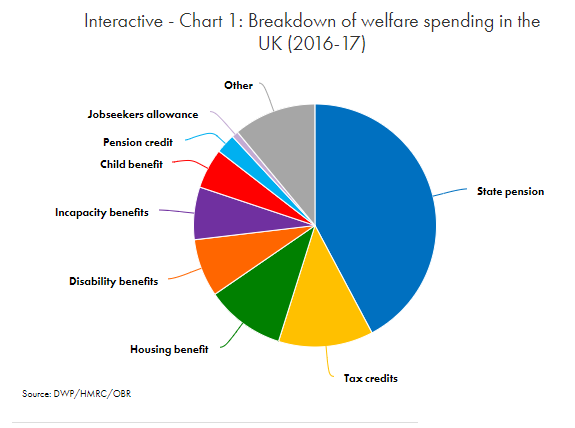

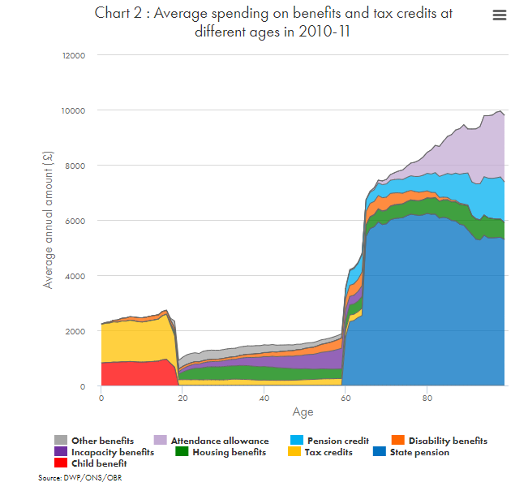

As the figure above shows, the largest single slice of the expenditure on welfare is directed towards people in retirement, sitting at 40% of total revenue. Despite recent policy changes to raise the retirement age in light of an aging population, this portion of welfare is set to increase. The rest is divided amongst those on disability and incapacity benefit, families, and low-income people. These benefits are either on a contributory basis, i.e. pension payments that are dependent on National Insurance contributions, or non-contributory, such as the basic state pension. These benefits can be awarded on a means-tested basis, i.e. housing benefit, or be universally applicable, like universal credit.

As we outlined in the previous chapter, there are three key purposes to the UK benefits system: To provide a safety net for all individuals at the bottom of the economic system; to care for people with special needs; and to protect individuals into old age with a state pension. 

There are obviously flaws in the reality of achieving these goals, some of which will be expanded on in our inequality chapter. We can summarise by boiling these down to (i) administrative costs and errors and (ii) issues with inequality and delivery. Food-bank use in the UK rose 13% in the 2017-18 period alone, following a 6% increase the year previously [@TheTrussellTrust2019]. This is due in part to rising costs of living, and in part to administrative issues having to do with the rollout of universal credit, which has left many people behind in their payment schedule. This too will be expanded on in more detail in the chapter on inequality, but for now, it's important to recognise that there are issues in the implementation of these welfare ideals in practice. 

# 6.4 Bugs in the System

## Identifying the issues

There are several problems with the UK tax and benefit system as it stands today. These are issues that we can categorise into a few groups as follows: administrative and compliance barriers, tax avoidance and evasion, and public acceptance of taxes. 

A broad complaint about the tax system is its complexity. The over-complexity of the UK tax system has led to high administrative and collection costs, as well as a number of unwanted consequences around progressivity. It has also allowed an extensive number of exemptions and loopholes to arise in the system. These can be described as government expenditures, masked as tax rebates. They complicate the system and most of them should be removed.

Moreover, it could be said that despite its length, the system lacks ambition. As it stands, the tax system doesn’t take sufficient advantage of opportunities to change consumer behaviour. Only about one-sixth of existing tax revenue is raised from taxes which are aimed at behavioural change. Given the potential for taxation to create behavioural norms and effect social change, this is a missed opportunity.  

## Administrative Issues

The complexity of the current tax system is made worse by the number of loopholes, exemptions, and tax-credits that it offers on a variety of different criteria. It is difficult for the non-specialist citizen to comprehend the full extent of the tax system as it stands. Many employ professional services like accountants and lawyers to deal with its details. Clearly, citizens cannot hold politicians to account when they don't understand the system. Politically influential groups can gain a great deal of influence in shaping the tax code without citizens ever becoming aware of it.

It is also difficult for the government to administer the policies. HMRC is one of the largest government departments, costing over $3bn annually to run. Its administrators face huge challenges in monitoring and enforcing a tax system which covers over 65 million individuals, with over 26 taxes applied on direct and indirect tax bases, using what is often a manual data-management process.

Moreover, due to its complexity, there are several interplays between different taxes - and these interplays can distort behaviour in an economically inefficient way. The entire existence of 'tax advice' firms shows that there are economic resources engaged in avoiding tax instead of producing goods and services, with a net loss of value to society.

The issues that surround implementation are offshoots of the system’s complexity. Unintended consequences of taxes can arise from weak communication and poor implementation of new policies. 

## Public acceptance

The perceptions of tax as an inevitable evil aren't helpful for its implementation. Fears of government tax grabs and regressive impacts can mean that even policies that appear well-designed in principle can fail in practice. It is important to consider the communication strategy during the implementation process, and to explain the public purposes for which revenues raised from taxes are spent. 

A paper published by Demos, a cross-party think tank, suggests a number of ways that taxes can be designed to make them more politically acceptable. An overriding comment is that voters and citizens are increasingly wary of bureaucratic 'black holes' of spending - an issue that came to light in the MP expenses scandal over the last decade. Finding that taxpayers' money had been frittered onto, amongst other things, expensive duck-houses for MPs was a factor in decreasing the perceived legitimacy of government tax revenue. As the authors  describe, "Government appears as a black hole into which resources disappear." [@Mulgan1993] This paper sets out three mechanisms by which taxes can be made palatable to a voting public.

Firstly, taxes should be 'hypothecated,' i.e. taxes can be clearly linked to the specific public goods provision enabled by revenues raised. We can see this in the case of carbon tax theory, which a number of studies have examined to determine the most politically viable avenues for allocation of these new revenues. A recent study by the Oxford Martin School found that how the design of carbon pricing reforms incorporated this issue was directly linked to their longer-term success [@OurWorldinData2018]. An overarching finding was that the visibility of the spending enabled by revenues was a key factor, which could materialise in the form of green infrastructure investments, tax rebates, and consumer subsidies, or even direct transfers to households. The latter methods have the benefit of tackling the potentially regressive impacts of carbon taxes, which are consumption-based and therefore tend to hit poorer households harder than richer consumers, at least when applied to developed countries.  

'Regressive' means that the burden of the tax falls proportionately harder on the poor than on the prosperous. With consumption taxes, even though the latter may be paying more in absolute terms, as a percentage of disposable income, the poor pay more. Taxes like VAT, National Insurance, Vehicle Excise Duty, and council tax fall under this category. British Columbia is an example of success in this respect, having directly rebated households with the proceeds from their nascent carbon taxation scheme. Public acceptance rates of this scheme have thus been maintained. Compare this to the poorly communicated fuel levy placed in France towards the end of 2018 and the resultant ‘Gilet Jaune’ protests, and the importance of clear communication about the purposes to which a tax policy is put become clear. 

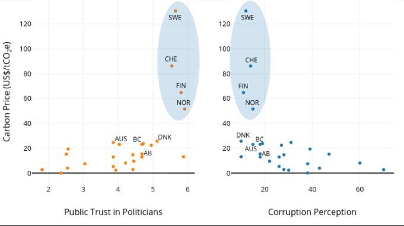

The figure above correlates the height, or price, of carbon prices in governments with public trust in government and politicians. Carbon tax rates are positively correlated with trust in politicians, and negatively correlated with perceptions of corruption [@OurWorldinData2018]. 

The second recommendation from Demos' paper was that voters "should have more influence on spending choices… spending should be decided by referendums" [@Mulgan1993]. This is potentially a way to bypass allegations of corruption and low public trust. However, the administrative cost of such a system is significant. 

Thirdly, local spending should be tied to local taxes, so that high levels of visibility can be maintained for local voters. Councils should be allowed to determine local spending to an extent that is agreed on by their electorates. This feeling of buy-in is not only important on the lower income levels of UK society, as we shall explore in the next section on tax avoidance. Citizen buy-in is an important factor for ensuring sustainability within the system. 

## Tax Avoidance Strategies

As Theresa May said in 2017, "Taxes are the price we pay for living in a civilised society." [@Houlder2017] Speaking in the wake of the tax avoidance scandal that implicated a number of well-known celebrities, including Jimmy Carr and Bono, the Prime Minister spoke for a cross-party majority when she attacked those who evaded and avoided tax. However, given the large number of reliefs, loopholes, and rebates that continue to exist in the over-complex system we have, it's difficult to say whether her concern was genuine or feigned. 

As it stands, HMRC relies on self-reported income, and could therefore be termed an honesty scheme. There are regular check-ups, used to incentivise people into truthfully reporting their income. However, the sheer scale of the enterprise, combined with the ability for wealthier individuals to use complex taxation schemes, means that the administrative body is often playing catch-up in enforcing these regulations. The system's loopholes encourage avoidance, and HMRC has not, until recently, strongly punished evasion. Richer individuals and companies are incentivised to pay advisers to avoid tax legally (or even illegally). Large companies can take advantage of variations in tax treatments between different countries ('tax arbitrages'). It must be admitted that changes in a single country's tax policies cannot prevent this alone. However, simplification of the UK tax system could at least enhance transparency for officials and the public, aiding in identifying those entities which engage in tax arbitrage practices.

HMRC has started to tackle tax avoidance more strongly in recent years, with "tough new legislation and demands that they pay disputed tax up front." [@Houlder2017] Recent prosecutions and stricter controls have closed off many of the avenues that were once commonplace for large multinationals and wealthier individuals. The world of tax evasion and avoidance is smaller, and mostly plays closer to the letter of the law – layering the available relief schemes available from the government. Yet tax-saving ploys remain available that allow and encourage high-net-worth individuals to reduce their tax liabilities.

Knowledge is power - not least when it comes to tax avoidance and evasion. It seems relevant to outline the most common methods of tax avoidance and evasion that high-net-worth individuals engage in. HMRC itself regularly publishes a breakdown of tax evasion and avoidance strategies it knows of. [@HMRC2018b] 

Following this, we can see that these strategies include:

1) Tax havens
2) Shell companies
3) Equity swaps
4) Avoiding capital gains tax
5) Evading estate tax/inheritance tax
6) Shell trust funds
7) Incorporating
8) Payments in kind
9) Life insurance borrowing
10) Real estate borrowing

We will not be able to tackle every accounting problem, but have some overarching goals for reforming this aspect of the tax system. Our approach is twofold: (i) To create a much simpler system of income tax with fewer marginal rates and fewer taxes -- aiming to eliminate the separate benefits-means-testing system and employers' and employees' National Insurance, and yet introduce a proper system of tax contribution records; and (ii) to build in some new forms of taxation, such as a land value tax and an upstream carbon tax.

In other words, we follow Einstein's maxim: 'Make it as simple as possible, but no simpler.'

# 6.5 The Mirrlees Review

Our starting point in building our proposals were the recommendations of the Mirrlees review.[@Mirrlees2010] The review's final report  suggested a number of key reforms of the UK tax system, intended to create effective incentives for a better-functioning society. It also discussed different approaches to taxation of income invested, with particular reference to whether and how initial income, capital gains, and/or final consumption are taxed. Unlike the present report, however, the Mirrlees review did not cover the benefit system. 

The recommendations of Mirrlees' summary report are as follows:

1. Replace Business Rates with a Land Value Tax
2. Reform Council tax (and Stamp Duty) into a single simple tax on property
3. Remove exemptions from VAT and compensate by increases in benefits and allowances
4. Extend congestion charging
5. Rationalise the approach to greenhouse gas (carbon) taxation
6. Remove transaction taxes (stamp duties), as these are highly economically distorting
7. Introduce a consistent approach for dealing with the VAT exception of financial services (especially when bundled with other services)
8. Simplify the tax system where possible
9. Introduce an allowance for corporate equity (ACE) to eliminate the favouring of debt financing over equity financing

We use these proposals to inform our own recommendations for new policies. 

# 6.6 Philosophy of Our Proposals

Our guiding principles are that the taxation system should be *beneficial, fair, and practical.* We define a simple set of proposals that may help achieve an optimal taxation system. 

## Beneficiaries

Our new tax system considers the citizens of the UK to be akin to 'shareholders' of a company, with a stake in the country's development and produce. Citizens are the intended beneficiaries of the tax system. The 'paying customers' of this system should be the property owners, particularly the owners of UK land, and anyone building wealth by selling goods and services to UK consumers. These paying customers of the UK tax system should include individuals and organisations who are resident abroad, yet receiving payment streams from the UK -- for example, the foreign owners of a Coca-Cola bottling plant in the UK. This principle is already reflected in the existing corporation tax system, but we want to make it explicit here. 

## Changing Incentives

Income, Wealth, and Environmental Damage of Consumption should be taxed. Personal Incomes are already adequately taxed, while Wealth and Environmental Damages are not. The main goal of our wealth taxation proposals is to tax the top 1% (and particularly the top 0.1%) by wealth. This can be achieved by taxing all forms of wealth, with allowances/subsidies granted to those who remain resident in the UK. We also propose to properly regulate environmental damage through the application of a Carbon Tax, which should help incentivise more sustainable choices by electricity generators as well as consumers. 

## Avoiding Avoidance

Under the new system, one would receive *tax benefits* from residing in the UK. Land is an inelastic base of taxation, as it cannot be moved. The profits (net income) on sales of consumer goods and services to UK residents are also an inelastic tax base, as it is expensive for a UK resident to leave the country just to go shopping, and companies are likely to continue to sell to UK consumers so long as they can make some profit. Non-resident foreigners who own UK assets will be treated in an equivalent way to the UK super rich - with high levels of taxation applied to their UK holdings. 

## Simplicity is key

The tax system should be as simple as possible. Moreover, where there are options for making the tax system automatic (i.e. for levying taxes automatically), we should take them. The new tax system should not need or involve any 'self assessment,' which can often act as an extra barrier to engaging fully with the system - and an opportunity for tax fraud.

## Privacy and Transparency

The new tax system should allow privacy for ordinary members of the public. That could be achieved by the assignment of secure identities to taxpayers, independent of their named identity (so that name or address would be separately stored than the 'tax' identity). There may however be a case made for the complete transparency of the very rich (0.1% by wealth or income) and major companies. This would be part of a checks-and-balances mechanism for regulation of political and financial influence within the UK.

# 6.7 Institutional Reforms

## Residency Allowance

The new tax system would shift incentives away from non-residency, by providing strong tax benefits to maintaining UK residency (i.e. a residency allowance). The existing system of tax benefits for offshore interests or people with 'non-domiciled' status would be ended. The super-rich and offshore resident owners would be treated equivalently, with steep tax rates, unless the offshore residents reside in a trusted partner country with good disclosure mechanisms on taxable assets (e.g. an EU country).

## Local Taxation

Taxes on housing should be transformed over time into a 100% Land Value Tax, plus a wealth allowance. The exact size of this wealth allowance could be decided by local authorities. Local authorities would be funded by a progressive land wealth tax. Any uplift in land rental values should be distributed 50-50 between local and national authorities. The LVT could be adjusted for the effect of any infrastructure investments on land values, where 100% of the uplift would be captured by the authority making the investment. 

## Strategic Tax Reform

Instead of having an annual budget, the tax system should be treated strategically. In other words, it would be run much like the strategic spending and defence review - namely a 'strategic tax review.'

# 6.8 Conclusions

It is clear from the foregoing that the UK's existing taxation and benefits system does not operate in practice in the way it is meant to in principle. The system has failed to effectively enforce behavioural taxes on a wide and mobile tax base. 

Accordingly, it’s important to draw out some recommendations for how policy makers should adapt the tax system to fix these implementation issues. Communication, clarity, and enforcement are all aspects of this transition. 

What is taxed should be concrete and objective. It should not depend on the honesty of those declaring the tax, and it should not penalize the honest relative to the dishonest. The tax system should not contain 'tax arbitrages,' and should not allow for dishonesty. This would help to combat the issues of public acceptance and administrative complexity. 

The costs and time-commitment of administering the system should never be excessive. Streamlining the tax code to simplify the number of tax rates, directly tying benefits to the purposes of taxes that are applied, and severely limiting the number of exemptions, should be among the steps taken. Above all, the tax and benefit system should be capable of being easily understood by the public.

In terms of public acceptance, the purposes and targets of taxes should be well communicated and clear. As outlined in the previous chapter, following clear principles when taxes are created, so that they are practical, beneficial, and fair, is essential to ensure their successfully launch and acceptance. Tax should either fall on things that *don't go away* when we tax them (e.g. land), or things that we *want to have go away* when we tax them (e.g. fossil fuel use, or excessive sugar consumption).

It is important to our everyday lives that the tax and benefit system works well. As we've shown, income tax and consumption tax revenues are the lifeblood of public services like social security, the education system, and the National Health Service.

There is already buy-in on the welfare side. Most individuals in this country will benefit from a public payment of some kind, from healthcare to child benefit to the state pension, within their lifetimes. Creating the same level of connection with the taxation system is an essential component of the system's public acceptance and fiscal sustainability. 

The key mechanisms by which the UK raises revenue, redistributes income, incentivises corporations, and nudges individuals towards choices in the public interest, have been neglected and left to rust, out-of-step with the times we live in. There is no shortage of popular support for reform. Indeed, consensus seems to be on the side of improving and simplifying the current tax and welfare system. 

As we will explore in coming chapters in more detail, things are changing, but not enough. Proposals put in place that aim to move towards the Universal Credit system have ignored the need for the changes to be practical, beneficial, and fair. HMRC’s attempts to reduce tax evasion have yet to do much to solve the problem. And destructive behaviours, especially by corporations, have yet to be effectively targeted through the use of taxation. There is still a long way to go to implement our high principles in practice.

# CHAPTER 7: WELFARE AND WORK

This chapter considers the social security system of the UK from the perspective of *work* -- paid employment. The existing social security system is a mess: there are large disincentives to work, massive complexity and conditionality, and interruptions to benefits causing harm to vulnerable people. In this chapter, we aim to reform this social security system not *just* to encourage work but also to improve the quality that work and the financial security of all. We propose a system of universal benefits, integrated with the taxation system, and combined with a *contributory* sovereign wealth fund. We also propose an additional *conditional* element (a high quality and rapid combined work-and-skills training program) aimed at improving the skillset of the British population. Together these reforms can eliminate the disincentives to work in the current system, reward both paid employment and valuable non-paid work such as child-rearing and caring, encourage high-skills, security and wealth for all. These reforms are not only, we believe, practical and beneficial, but also consistent with the long-held values of the British population.

## Summary 

- Work plays a major role in modern life, yet it can be difficult to define precisely. Work can be purposeful and fulfilling (work as leisure) or it can be unsatisfying drudgery (work as toil).  

- Work can be of benefit to society (e.g. nursing) or it can be harmful (e.g. creating advertisements for junk-food). Benefit and harm are often not reflected in salaries.

- In the UK, there has been a decrease in unemployment, but proportional growth in low income, low-skilled and insecure work. There has been an increase in people relying on tax credits to top up their wages.

- Many people feel overqualified and dissatisfied with their work. Other people work excessively long hours. This is associated with increased rates of heart disease, mental illness, diabetes, and stroke.

- There is a relationship between the labour market and welfare. When work is precarious, there is a need for unemployment benefits to plug the gaps. Illness from overwork may lead to a need for Employment and Support Allowance or disability payment.

- The current British welfare system is unsuitable for the needs of today's workforce.

- The current system discourages people from transitioning into work. There is also a stigma associated with receiving benefits, contributing to a non-takeup of benefits by people who are entitled to them. Administrative delays and assessment mistakes are also rife.

- Any new welfare system should: be flexible, avoid disruptions in income, be empowering, promote work-life balance, be non-stigmatising, be simple, avoid benefits trap, be modern, and sufficient to live on.

- Citizens Income would meet many - though not all - of the above requirements.  It is an income unconditionally granted to all, on an individual basis, without means test or work requirement.

- Guaranteed Jobs and Skills Training could be used to improve the skill level of people in deprived communities.  A successful program would help people discover what work people would like to do, and would be targeted towards skills needed by employers.  

> *"I think there's a lot of pressure in this country to work when you have kids, and I don't think that's true of everywhere. You think of somewhere like Germany, when you are at home with your kids that's OK, but here there's pressure all the time to be out working."* 'Laurie,' single parent

> *"I also just feel that bringing up a child is working! Why is that not given the status?"* 'Ray', single parent.

> *"I have a job with a really flexible employer, but I do get called up at short notice and it's incredibly stressful."* 'Martina'

> *"If you are on a zero-hour contract, you are already not going to be earning much, so how do you pay for childcare to cover those times? It's not unreasonable for people to have some kind of predictability in the workplace."* 'Keira'

# 7.1 What is Work?

*"We shall honour those who can teach us how to pluck the lilies of the field who toil not, neither do they spin"* [@Keynes1930]

in 1930 by John Maynard Keynes, the eminent economist, in an essay entitled Economic Possibilities for our Grandchildren. Keynes predicted that in 100 years' time, people in the developed world would be working for about 15 hours per week on average. He assumed that because of rapid technological advancement and productivity growth, people would work less and still meet their needs. He thought people would have more leisure time, and worried about how they might use it. This prediction was made for the year 2030, just a few years from now. We are still far away from the conditions of life and work he imagined.

As explained by Keynes' biographer, Lord Edward Skidelsky, in 'How Much is Enough' [@Skidelsky2013], Keynes was largely correct in his predictions on technological advancement. However, we have not seen a commensurate decrease in working hours, nor the wage growth that would allow people to meet their needs with reduced working hours. From the latest ONS figures, full-time workers in the UK put in an average of 37.5 hours per week. Those working part-time work on average 16.1 hours per week [@ONS2016b]. So, even what we consider nowadays to be a 'part-time' working schedule has more weekly hours than Keynes' predictions.  

Work in the form of paid employment plays a huge role in our conception and experience of modern life. Many of us spend more of our waking hours in work environments than at home or in non-work social situations. Even these basic categories are not fully descriptive, as our work colleagues can often become our friends and spouses, and our homes may also be our offices. Moreover, the concept of a career (as opposed to merely a 'job') plays a central role in our sense of identity and personal purpose. One of the most common questions asked when meeting someone is, 'What do you do'? Those without an impressive answer may feel a sense of personal shame during the introduction ritual [@YouGov2015]. This is no surprise - for most of us, the importance of our role in the workforce and the centrality of a career to our personhood has been drummed into us through the questions asked in our childhoods such as 'What will you be when you grow up?'

## Defining work as Leisure or Toil

For such a widely used term, the specific meaning of 'work' seems strangely hard to pin down.  A standard definition might be 'the exertion of effort in exchange for remuneration,' although that would not account for unpaid domestic labour, or the efforts of entrepreneurs and artists who are yet to see income from their activities. Even within this definition, the breadth of experiences covered is striking. For example, handsomely-paid actors who live out their dreams by appearing in films call this activity 'work.' This is the case even if they would perform the same exertions for much less remuneration. Similarly, an exhausted cleaner, vacuuming office buildings at 2 AM on a very low wage because they need money to pay for rent and food, is also performing 'work.'  

Work is often talked about by politicians as though it is an absolute good. To some, to be 'in work' is always better than to be 'out of work' no matter what the job is, or what other worthwhile activities the 'out-of-work' person might be performing [@PatrickWintour2010].  Slogans about getting people into work are regularly parroted, and often precede restrictions on access to benefits. Yet, as the above example demonstrates, work can be a purposeful and fulfilling activity which a person engages in for its own sake, or a drudgery which a person does purely for the purpose of remuneration. This difference is clarified by Skidelsky, who makes a useful distinction between work as 'leisure' and work as 'toil'. *Leisure* is described as activity done for its own sake, because it is intrinsically purposeful to the person performing the activity, rather than for an extrinsic reward. Notably, this definition of leisure does not equate to idleness.  As Skidelsky writes, 

> *"The sculptor engrossed in cutting marble, the teacher intent on imparting a difficult idea, the musician struggling with a scene, the scientist exploring [...] space and time. Such people have no other aim other than to do well at what they are doing.  They may receive an income for their efforts,but that income is not what motivates them."* [@Skidelsky2013]

Toil, on the other hand, is activity with no intrinsic value to the person performing it. It is done solely for an extrinsic end, usually a paycheck. Of course, this division is not clear-cut; a lawyer might be engaging in leisure when fighting a cause they believe in, and toiling when they are not. An artist who sells a few paintings may be engaging in leisure, but also has to toil as a taxi driver to make ends meet. An activity which is fun and enjoyable once per week, may become toil when it is performed on a punishing 40 hour-a-week schedule. So these concepts are limited, yet useful, because they help us direct ourselves towards what we want more of in society (purposeful activity) and clarify what we want less of (drudgery). We therefore apply these terms in the following discussion of welfare and work, as they help better flesh out the issues that can arise with policies geared at 'getting people back into work.' 

## Work as Benefit or Harm

The concept of work is also broad in relation to benefit or harm. In its common usage, 'work' is a word used to describe activities which are beneficial to society as well as activities which are socially destructive. The activity performed by a teacher, for example, is generally considered socially useful. A good teacher helps children to develop into thoughtful, mature adults. A teacher imparts valuable knowledge and skills which prepare students for further study, future employment, and life in the outside world. This way, educated students can then go on to make their own valuable contributions. Teachers' activities are essential for all kinds of social progress and social cohesion.

In contrast, consider the work of an advertising executive who designs campaigns that promote tobacco, alcohol, or online gambling. His exertions at work are designed to encourage impulsive purchases, which then may lead to addiction and illness. The social costs of such outcomes can then have downstream effects on social provision like health services, welfare, and the prison system. Much (though not all) advertising work is an effort to create a sense of need or desire in people which is not already present, or to create a sense of inadequacy which (it is promised) will be relieved by purchase of the advertised product. The result is often status anxiety, with social comparisons between those who 'have' the desired goods and those who do not, and wastage as still-functional but 'obsolete' items become undesirable. This leads to unnecessary increases in consumption of the earth's raw materials. The New Economics Foundation has attempted to quantify the social value contributed by some work, and the social costs caused by other work. In their report, A Bit Rich, they found that "for every '£1 of value created by an advertising executive, £11.50 is destroyed." By contrast, they found that for every "£1 paid to a hospital cleaner, £10 is created in social value." [@NewEconomicFoundation2009]

Consider also the work of tax accountants who specialize in tax minimization for the ultra-wealthy. Such accountants are often very well-paid. They spend their time finding loopholes in the tax system to enable companies and wealthy individuals to avoid paying tax. It is estimated that £12 billion is lost to the UK government from companies and £13 billion from individuals each year due to tax avoidance.  These accountants' activities are harmful to society as a whole, yet they are also considered to be 'work.'  According to the New Economics Foundation, tax accountants destroy £47 of value for every pound in value they generate.

There are, of course, forms of work which neither greatly benefit nor greatly harm society. There may also be work which appears not to make any contribution, but which may lead to a socially beneficial outcome after a long time. Few people could have imagined, for example, that Charles Darwin's curious hobby of cataloguing plants and animals would lead to a theory which would underpin major scientific and medical developments. So we cannot always tell when work is socially beneficial, but at a basic level, we should try to incentivize that which we know to be beneficial, and reduce that which we know to be harmful.  

## Work, value and pay

There is no clear correlation between pay and the kinds of work which are socially beneficial. If anything, the opposite is often true. Using the examples mentioned, tax accountants and advertising executives are vastly better paid than the teachers, despite the often dubious outcomes of work done by the former two kinds of professional. We could take this point further and observe that it is possible to perform activities which are extremely socially useful, but receive no remuneration at all. Since they lack remuneration, there has been debate as to whether to term these activities as 'work', but activities such as child-rearing, caring for elders, volunteer work, and other forms of unpaid activity are often of great value to society.  We should keep this point in mind as we consider the role of welfare and welfare recipients in society. Although people may be in receipt of benefits because they have no or little income from paid work, they may in fact be performing unpaid work which is socially beneficial [@Webber2016].

# 7.2 Work in the UK

## Wages and the growth of low-skilled work

With those broader considerations in mind, we can consider the status quo for work here in the UK. In the three months leading up to May 2016, the UK unemployment rate fell to its lowest figure since October 2005.  The graph below shows the unemployment rate from March 2011 to March 2016 [@RichardClegg2016].

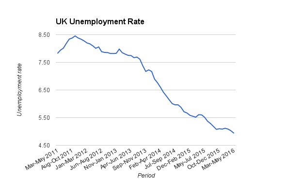

The number of employed people reached a record high of 74.4%. On the surface, this seems to be great news, but just like the concept of 'work,' the 'employment rate' hides a myriad of experiences.  

Firstly, employment often does not provide sufficient income to cover an individual's essential outgoings. According to research by the CIPD Institute in 2014, in-work poverty in the UK has grown by 20% in the past decade [@CIPD2014]. According to the New Policy Institute, in 2012, 4.3 million working families were receiving some form of welfare benefit, with the vast majority receiving support in the form of tax credits. While the level of employment is at a high not seen since the early 1970s, the annual rate of growth in wage earnings is slowing. 

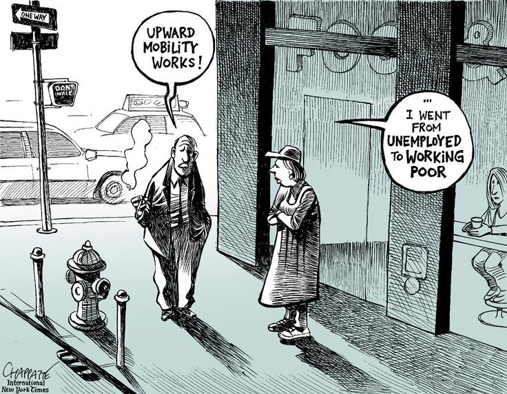

The Guardian economics editor Larry Elliot [@LarryElliott2016] suggests three reasons why this might be occurring. Firstly, the UK is attracting people from other EU countries, so employers can comfortably find workers without increasing wages (Brexit may well put a dent in the number of EU citizens wanting to come to the UK). He believes that restrictions on public sector pay have been a second factor. Finally, the jobs being created tend to be low-paid, such as those in hospitality. The CIPD Institute suggests that the government has taken a 'low road' approach to industrial policy, whereby the workforce are relatively disposable, providing relatively standardized goods and services at a low price, and firms come to the UK because of the country's low corporate tax rates. They argue:

*"Not only does a drift towards a low-road labour market and economy make for unfulfilling working lives for many (with associated stress and health costs attached), it supports the increase of low-skilled, low-paid work, helps fuel the growth in 'in-work' poverty, and at least some of the costs of employers adopting such practices are being passed on to the taxpayer and government via in-working tax credits that top up low wages."* [@CIPD2014]

## Underemployment and dissatisfaction at work

A related phenomenon is underemployment and under-utilization of skills. The Spring 2016 Employee Outlook report from CIPD found that a third of employees believe that they are overqualified for their jobs [@CIPD2016]. As well as contributing to low wages, this is likely to lead to dissatisfaction at work. The ONS compared the educational distribution in the UK labour market against average educational attainment per occupation.  Their findings, shown below, were that the percentage of employees who were overqualified for their jobs had steadily increased since 2010 [@FredFoxton2016].

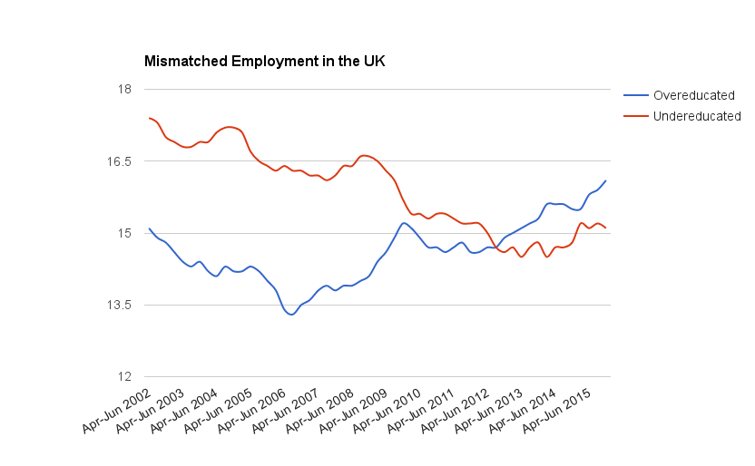

The CIPD report found that a third of employees thought that their organization did not provide them with the opportunity to learn and grow. Over a quarter felt dissatisfied with opportunities to improve and extend their skills. Our earlier discussion introduced the concepts of work as inherently meaningful and work as toil. It seems probable that when people feel as though their abilities are being underutilized, they are more likely to experience their work as toil.  

Work will also seem toilsome if it feels meaningless or pointless. A YouGov survey from 2015 investigated meaninglessness and work. 37% said that their job is not making a meaningful contribution to the world. 33% said that their work was not very fulfilling or not at all fulfilling. Another 45% said their work was 'fairly fulfilling' [@YouGov2015]. Clearly this is a far cry from the ideal of people undertaking deeply satisfying and meaningful work which one would perform for its own sake. Additional research also revealed widespread employee dissatisfaction. The 2016 employee sentiment poll from Investors in People reported that 1 in 3 employees in the UK are unhappy with their current job, and 49% were looking for a new job in 2016 [@InvestorsinPeopleHQ2016].

## Illness and Wellness

Another cause of workplace dissatisfaction that appears again and again in employee surveys is an insufficient work-life balance [@AntoniaMolloy2015]. A punishing work schedule can transform work into toil. It can also contribute to workplace stress, mental illness, physical illness, and family discord. Worryingly, the number of people working excessively long hours is increasing in the UK. A total of 3.417 million people are working longer than 48 hours per week, an increase of 15% since 2010 [@RachelMiddleton2015]. The associated health risks are well documented. There is a direct correlation between the length of a working week and stroke risk. A comprehensive study by University College London [@SarahBoseley2015] found that those working between 41 and 48 hours had a 10% higher risk of stroke and those working 49 to 55 hours per week had a 27% increased risk of stroke. The over 55 hour group also had a 13% increased risk of coronary heart disease. Other studies have shown increased risk of diabetes and obesity. These findings are unsurprising when we consider that long working hours often entail more time being sedentary, less time for physical exercise, less time to prepare healthy meals and less time for relaxing or sleeping. These basic lifestyle factors which underpin good health are all undermined by long working hours.

Overwork doesn't only show itself in physical illness. The Mental Health Foundation warns, 

> *"The pressure of an increasingly demanding work culture in the UK is perhaps the biggest and most pressing challenge to the mental health of the general population."*[@MentalHealthFoundation2018]

In 2014/15, there were 440,000 reported cases of work-related stress, depression, and anxiety. This translated to 9.9 million working days lost annually, with an average of 23 days per case. Stress accounted for 35% of all work-related ill-health cases [@HealthandSafetyExecutive2018]. However, long working hours aren't the only causes of mental illness. Other work factors reported included tight deadlines, excessive responsibility, a lack of managerial support, and workload pressures.  

Clearly, the current status of work in the UK today is far from the future which Keynes envisioned. Rather, overwork and underemployment are both prevalent factors, with some workers suffering from lack of work-life balance, and others from low pay (and some from both). Many experience their work as toil, feeling little satisfaction or meaning, whilst those making meaningful contributions to society may be unpaid or poorly paid. Importantly, the labour market does not distinguish between work which is beneficial or harmful to society in the way those jobs are remunerated. There is a need to apply new approaches and perspectives in addressing issues related to labour markets and state provision of safety nets. It is to this that we now turn.

# 7.3 Welfare

> *"I have reduced hours and taken time off from work and will have to do so again in order to continue caring. I am torn between caring, working and being there for my own family. I don't want to care anymore but I have no choice. I will jeopardise my job, health and personal life in the process. I don't know what will happen to me in the future."* 'Jane', carer [@CarersUK2014]

> *"The statements flying around about the 'work shy' and 'people who don't work for their money' are actually pretty offensive to me. This is not a life that we chose and my own experiences have shown me that it really could happen to anyone - we have gone from living in a privately rented home and earning a good wage to the very real struggles of living in social accommodation while struggling to get by."* 'Christina,' living with illness [@Fishwick2013]

> *"Trying to work full time (which is necessary!) and look after my father caused me to almost get to breaking point.This is when I was advised to contact social services about direct payments. I have since found out that I could have received direct payments for the past three years due to my father's condition, but nobody advised our family of this"* 'Sara,' carer

> *"Even though I had been actively looking for work, and proved I was, when I spoke to my local centre about my difficulties in leaving my house, I was spoken to like a "benefit bum" and was sanctioned with absolutely no benefits for FIVE WEEKS. I was finished. I got more into debt, and had to rely on family to help me out. I really think a lot of the problems in people not finding work is down to the advisors in Job Centres who make claimants feel dumb, worthless and who obviously need extra help. I truly think this is where the government need to start, rather than just slashing people's payments."* 'Martin,' age 25.  After becoming unemployed, he started receiving JSA. He became depressed while unemployed and missed an appointment, leading to benefit sanction. 

> *"I'm sick of the government only describing the working as 'the strivers'. I AM a striver too, I worked incredibly hard to get into the best university in the country, but I can't work. That isn't MY fault. But I am STRIVING to get better and make a decent contribution to society. I wish I could give those ministers in the multimillion pound homes a piece of my mind."* 'Bernadette,' aged 18, has clinical depression.

## What is Welfare?

People who are unable to find work, are too ill to work, are retired from work, are too young to work, or whose work doesn't generate a livable income, still need the means to live.  They still have to pay for food, shelter, heating, medical care, transport, and family costs. This is where government assistance, known alternatively as 'social security', 'social insurance', 'welfare', and 'benefits', comes in. Welfare exists to prevent people from becoming destitute. It aims to provide a bare minimum standard of living.

The origin of the welfare state may be traced back to late Victorian Britain, during which liberal policymakers responded to the widespread squalor, poverty, and criminality prevalent during industrial revolution. The modern welfare state was formed amidst the idealism of the post-WWII period, and it was set up to tackle the 'Five Giant Evils': Want (Poverty), Disease, Ignorance, Squalor (Homelessness), and Idleness(Unemployment) as described by William Beveridge [@Beveridge1942]. The Labour Party sought to eliminate these evils in their pledge to provide for the people of the United Kingdom "from the cradle to the grave" through their victory in the 1945 general election. The plan for the welfare state was visionary, in the sense that it was motivated by a vision of the future which could be much better than the present and the past.  

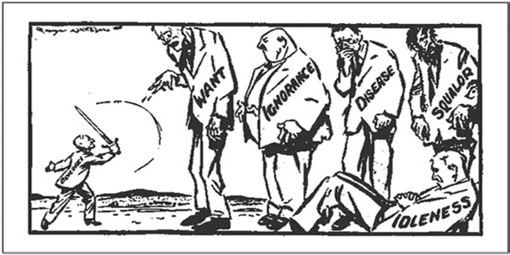

Philosophically, it had two moral underpinnings.  Firstly, it was based on reciprocity. This is the idea that if you've paid in, you're entitled to take out. Secondly, it had an absolute moral position, which said that whether a person had contributed or not, it would be wrong to allow them to become destitute. Thus, a multifaceted welfare system emerged in the United Kingdom, built from a raft of different policies to protect the citizens from destitution. These include social insurance for the unemployed and sick and those injured at work, a national health service, free education, council housing, and increased employment through public spending.  

The welfare state has grown rapidly since its inception. In 2015/16, the total benefit pay out, (including the state pension) by the Department for Work and Pensions is expected to amount to about £171 billion (23% of public spending).[@Fullfact2015] This does not include the costs of administering the benefits. £116 billion is projected to be spent on benefits for pensioners (including state pension) and £53 billion on working age people. Benefits and tax credits together are projected to amount to £210 billion in 2015 [@Fullfact2015].

There is, of course, a sympathetic relationship between the issues with work outlined above, and demand for the welfare system. With increasing numbers of people in low-wage jobs, there is a parallel increase in the need for supplementary income from the state insurance mechanisms.

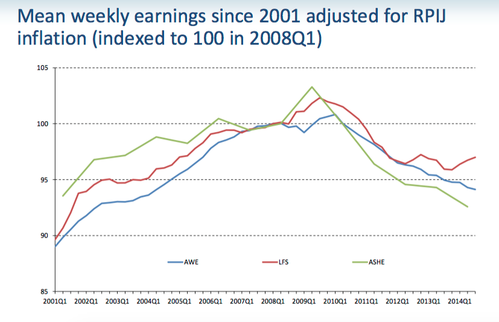

With an increase in precarious and short-term jobs comes an increased need for unemployment benefit to fill in the gaps in employment. Overwork and unhealthy work habits can lead to illness, which then require the payment of Employment and Support Allowance. Built around the model of long-term employment with a single employer, the current welfare state is unsuited to the demands of today's working environments.

Today's welfare state covers five main categories of welfare spending: 

1. Incapacity, Disability and Injury Benefits
2. Pension Spending
3. Unemployment Benefits
4. Housing (including Housing Benefit and Rent Rebate)
5. Family Benefits, Income Support and Tax Credit

# 7.4 Issues with the Benefit System

## The 'Benefit Trap'

One of the problems with means-tested benefits is that they can create a disincentive to seeking paid employment. A person receiving benefits may find that their benefits cease when they take a job, and they also pay tax on their earnings, which often leaves them scarcely better off than they were on benefits. The current system is engaged in a shift from a sharp cut-off point to a gradual phase-out. With the former, when the costs of commuting to work and/or childcare are taken into account, this creates a strong disincentive for the unemployed to take up a low-wage job. 

The diagram below shows how benefits taper off as take home pay increases, for a lone parent with two children. We can see that the parent could hold a job which makes £175 per week, and along with benefits, will receive a net income of around £570 per week. If the lone parent decides to increase her income from paid work (usually by increasing working hours), to '£400 per week, she will be barely making any more in net income than she was before - around £590 per week. 

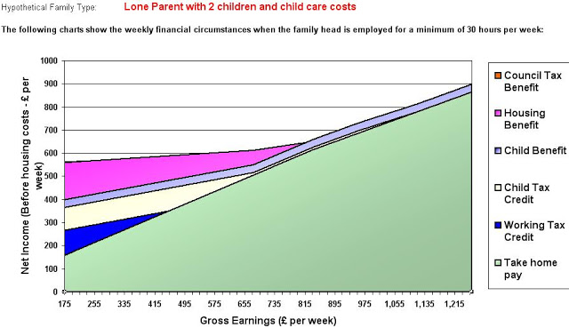

Similarly the below chart shows how increases in household incomes can provide 'disincentives' for some when income reaches beyond certain thresholds, creating a jagged transition for income progressivity [@Dyson2015].

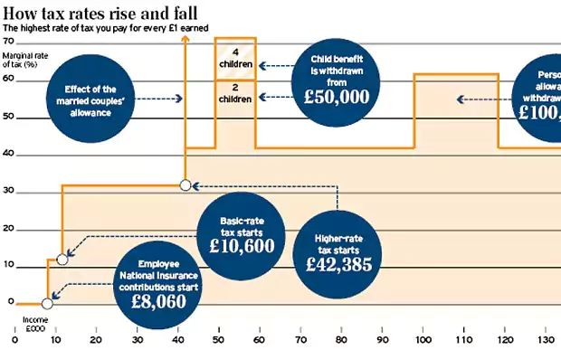

When we add the means-testing of benefits, the situation is even worse. For every £1 earned, 70p or more of benefits are withdrawn. This is clearly a disincentive against work, a 'welfare trap'.

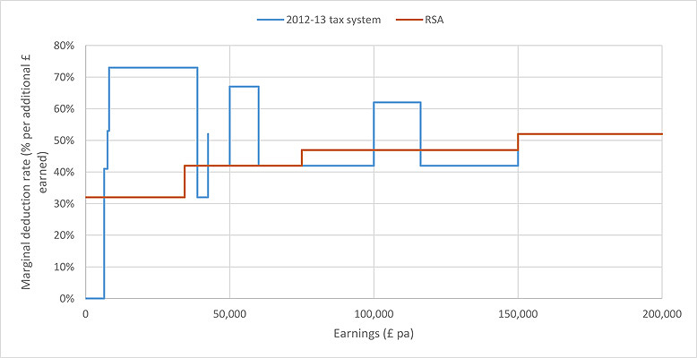

## Administration 

Many benefits require claimants to inform the Department of Work and Pensions of any changes of circumstances which may affect their benefits.  Such changes may include, for example, a decline or improvement in an illness which may affect one's capacity to work or affect one's living support needs. A gift of some money may affect someone's Job Seeker's Allowance. In many cases, the claimant is obliged to volunteer the information to the DWP. In some cases (as for ESA and PIP), capability assessments are made by the department.

When a change in circumstances affecting entitlement occurs, this can often mean a sudden withdrawal of benefits and a long wait while decisions are appealed.  There are also significant waiting times for people once they have submitted applications until payments materialise, particularly in the case of JSA and Housing Benefit.  When these gaps in support occur, individuals often experience serious economic hardship and mental stress.

The following real-life case studies demonstrate ways in which hardship can occur:

**Liam:**

Liam received Employment and Support Allowance for mental health and mobility issues. After undergoing a work capability assessment, his ESA was withdrawn. Liam appealed the decision and after four months, his ESA was reinstated. However, he was without income for several weeks between the termination of his ESA and applying for JSA. He attempted to make savings and was compelled to go to a local food bank. His anxiety issues increased and the process exacerbated his young son's anxiety issues. After having ESA reinstated, it was again withdrawn after another work capacity assessment and he was forced to go through the same process again. He says,

> *"It's hard when you have to make choices. Do you cut down on the electricity you're using or do you cut down on the food? And when you're cutting right down to the bare minimum it's hard to cut back any more"* [@ChildPovertyActionGroupa]

This example demonstrates the hardship which can occur from an incorrect work capability assessment and from any form of sudden disruption to income. The frequency of errors in work capability assessments is worrying. Figures recently released by the DWP show that tribunals overturned 52% of Employment and Support Allowance appeals in the period Oct 2014-Dec 2014.

**Sarah: **

Sarah is a single parent and is at university.  During the student summer, she has to go on job seeker's allowance and is subject to the conditionality criteria even though she would be unable to take up work because of her studies. She receives housing benefit during the summer months and this is reduced during term time. She says that whenever she has to reapply for Housing Benefit, she always has problems or delays:

> *"It causes me nothing but trouble. Last scholastic year I had to restart my housing benefit because they stopped it... it's just stress, stress, stress, stress, stress, all the time. Are they going to do it properly? Every time, twice a year I have to change my circumstances with them. And it's never once gone right, not once."* [@ChildPovertyActionGroup] 

These issues have exacerbated her anxiety and this has had an effect on her studies. She also feels that she has taken out some of the stress on her young son as there are only the two of them in the family.

**Emma: **

Emma and her husband have very variable monthly incomes. They also receive tax credits. Despite contacting the DWP on a monthly basis to inform them of their fluctuating incomes, they were overpaid. As a result, they are now not receiving any tax credits at all. They now feel that even if they are entitled to tax credits, they are more trouble than they are worth.

> *"Currently we're not receiving any tax credits. We've not had anything for a wee bit and anything we do receive now would be offset against the over payment received. But we've come to the conclusion now that it's been so much more hassle than it's worth that, I think if I'm entitled to something then I should get it, but I'm scared to spend it."* [@ChildPovertyActionGroupb]

## Stigma 

There is a significant social stigma in receiving government assistance. Television shows like 'Benefits Street' and salacious tabloid headlines have contributed to the idea that those receiving benefits are lazy or a drain on society. Political and media rhetoric arguing for 'crackdowns on benefit cheats' have also fostered a culture in which people claiming benefits are viewed as untrustworthy and lazy.  In such an environment, it can be seen as shameful to receive benefits.  

In 2012, the charity, Turn2us UK, commissioned a study [@Baumberg2012] to assess the impact of stigma in applying for benefits. They found that the wider public sees benefit claimants as less deserving now than they did twenty years ago, with particular increases around the early 1990s and 2000s.  They observed that these increases correlated strongly with non take-up of benefits, suggesting that many people do not take up the benefits to which they are entitled out of a desire to avoid the associated stigma. Worryingly, given the prevalence of mental illness in Britain, the study found that social stigma contributed to feelings of low self-esteem and worthlessness in claimants.  As one contributor to the study who was claiming Job-seeker's allowance stated, 

> *"I know I'm not a scrounging bit of scum but when it's told you over and over again and that's all you hear I can understand some people get really affected by it."* [@Baumberg2012]

The study also found that countries with benefit systems based on citizenship or contribution, see lower levels of benefit stigma than those with benefits based on means testing.

Benefits exist to prevent extreme poverty, to ensure a minimum standard of living for people, to enable people to take part in the economy and social life of the nation, and to help individuals better themselves. It is beneficial for the nation as a whole that those who are entitled to benefit receive them.  

There is, however, a serious problem of people not taking up their benefit entitlements. In the period 2014-15, only 6 out of every 10 people who were entitled to pension credit claimed this benefit. Only 5 out of 10 of those entitled to income-based jobseeker's allowance claimed it. 1.4 million families who were entitled to housing benefit did not submit a claim.

According to a 2014governmental report, "Take-up may be affected by factors such as the attractiveness of the benefit, lack of awareness of the benefit or application procedure, lack of awareness of entitlement, the perceived stigma of receiving a benefit or other factors." [@ONS2016c]

The chart below shows the proportion of unclaimed benefits to overpaid benefits. 
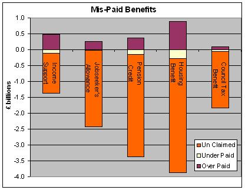

# 7.5 Criteria for a New Welfare Model

- **Flexibility** The welfare system needs to be adapted to a current work environment, in which people go in and out of short-term contracts and may be working part-time. The current system involves a time-consuming application process which is not responsive enough to changing conditions in people's work lives.  
- **Stability** The system should, as far as possible, minimise or eliminate anxiety-inducing disruptions to income. Whether due to delays in processing applications, or because a claimant has changed their address or experienced some other life change, the current system imposes delays and cuts to benefits. This can cause extreme anxiety and repercussions on family members.
- **Enabling** In regards to support into work, the system should enable people to find their own way towards what they want to do. Ineffectual fortnightly appointments and compulsory work programmes often do not provide the tailored support needed. The goal should be to assist people to find work which is fulfilling and enjoyable for them (work as leisure), rather than taking any job for fear of benefit sanction (work as toil).
- **Balance** The welfare system and industrial policy generally should promote, as far as possible, a flexible workforce in which people are able to avoid illness-causing overwork. Improved work-life balance is likely to help carers, parents and older people who want to continue working past retirement age. It is also likely to reduce unemployment, as people are able to share jobs.
- **Non-stigmatising** The current system is extremely stigmatising, particularly for the unemployed. Some of this stigma derives from compulsory and infantilising processes, such as requiring people to fill in a job diary, attend fortnightly meetings, and take any job offered. Some stigma also derives from the fact that the benefits are means-tested.  
- **Simple** The welfare system should be as simple as possible, and avoid excessive and unnecessary bureaucracy. Complexity creates confusion about entitlements, which can then lead to costly sanctioning. 
- **Incentivising** The welfare model should avoid creating a benefits trap in which people experience a high effective marginal tax rate when they move from benefits to working.
- **Modernised** The welfare system should make use of technological advances as much as possible. Allowing people to submit information online rather than fill in pages of paper forms, can save both time and money. 
- **Sufficient** Many people are struggling to make ends meet on the benefits they receive. Many carers, for example, are sacrificing basic essentials as they try to survive on Carer's Allowance. Jobseeker's allowance is too low for most to live on, so for those who cannot rely on savings or family and friends, it can be extremely difficult to survive whilst looking for work.

## Current Changes to the Welfare System

Much has been said already of the issues in the current welfare system. Bureaucracy and expense, over-complexity, and poor built-in incentives have plagued the system since Beveridge's proposal for a 'Social Insurance' system [@Beveridge1942] was published in 1942. Following the 'National Assistance Act' in 1948, the first of Beveridge's policies implemented by Atlee's Labour government, successive British governments have continued to build and shape the modern welfare system into what it is today. 

Beyond the original report, the reforms have generally lacked overarching strategy. There have been a number of jolting, ill-thought-out changes made to the administration of welfare in the United Kingdom, as each political party sought to make their own mark on improving the system. It seems then that tackling the problems of the welfare system may have had cross-party support, but that there has been no cross-party agreement on a coherent plan to fix them.  

Damien Green, the current DWP secretary, said it is "compulsory to quote William Beveridge in any review of welfare policy." Beveridge laid the foundations for the modern welfare system, and is remembered for stating that "the object of government in peace and war is not the glory of rulers or of races, but the happiness of the common man." This is, of course, what the welfare system aims to achieve - if you understand 'happiness' as the ability to live a dignified existence with sufficient access to nutrition, shelter and healthcare. The entire endeavour is founded on the idea that any civilised society needs an economic 'safety net' for its poorest, and most at need. In any reforms this principle must be held above all others. The system may be efficient, it may be beautifully designed, but above all it must ensure that enough support is given to those who need it to survive. 

A welfare system must also be sustainable. Firstly, it must ensure that sufficient revenues are collected from those in employment to fund this 'collective insurance', and secondly it must encourage those who are able to seek employment from other sources than the government. This should be a welfare system, rather than a welfare state. The current welfare system arguably doesn't do a good enough job at encouraging people back into work. This is, in part, due to built-in bugs that mean an individual faces a 'cliff-edge' when they work above a certain, arbitrary threshold. [[3\]](#_ftn3)There is also a lack of effective retraining opportunities and support that would enable an individual to upskill themselves and seek more fulfilling employment. These are important considerations when planning any kind of reform to the current welfare system.

The most recent overhaul of Welfare fell to Iain Duncan-Smith, then the Secretary for the Department of Work and Pensions (DWP). This overhaul was spearheaded by 'Universal Credit'. First proposed as a concept in a 2009 report by Duncan Smith's think tank, the Centre for Social Justice [@CentreforSocialJustice2009], the government legislated for UC in their Welfare Reform Act 2012. 

It was announced that the 'best performing' DWP and Tax-Credit processing centres would be chosen to run the pilot scheme from 2013. This was subject to a great deal of critique as to the 'overly ambitious' [@Norris2016] timetable chosen for the UC roll out. Such criticisms have also been echoed in the National Audit Office's report on 'Rolling out Universal Credit' [@NationalAuditOffice2018]. In this, they allege that the rapid implementation of the Universal Credit scheme has had detrimental impacts on the aims of the project - which include saving money on administration, running costs and promoting people to re-enter the workforce.  The National Audit Office, which oversees government spending, said that the universal credit programme was "driven by an ambitious timescale" and that it had suffered from "weak management, ineffective control and poor governance". They recommended that the roll-out be much slower, with a great deal more monitoring to ensure that any potential impacts on claimants are accurately assessed and accounted for. 

At inception, Universal Credit had cross-party support. The policy involved combining six different means-tested benefits, and their associated IT systems, into one coordinated benefit. The benefits which were consolidated were Income Support, Income-based Jobseeker's allowance (JSA), Income-based Employment and Support Allowance (ESA), Housing benefit, Child tax-credit and Working Tax-credits. The purpose was to streamline these benefits and make it easier to claim 

Unlike with the old system, there is no limit to the number of hours that an individual claimant can work. Rather, the system operates on a universal entitlement principle, whereby a base threshold of income is set which is thereafter reduced on a flat rate as an individual's earnings increase. 

This adjustment to the system means that people on a low income no longer face the cliff-edge of the 100% benefits withdrawal rate once they start working more than 16 hours. It is thought that a more gradual withdrawal rate, like that built into the new system, encourages such an individual back into full-time employment, as it ensures that no one is better off claiming benefits than they would be working. Universal Credit currently sets this at a 63% withdrawal rate. This means that for every £1 earned above the income threshold, £0.63 is removed from their Universal credit entitlement.

The title is perhaps a misnomer. Universal credit is still subject to eligibility criteria. An individual must be between age 18 and state-pension credit age, not in full-time education or training and with savings under £16,000. They are also still subject to a maximum income threshold, above which they are no longer able to claim Universal Credit.

The Institute for Fiscal Studies has warned of a possibility that 'over three million households will see lower entitlements from universal credit with an average loss of £1,800 a year (and around two million households will see bigger entitlements with an average gain of £1,400 a year)' if they are not eligible for transitional protection [@Hood2017]. Claimants for Child Tax credit and Working Tax credit will be the hardest hit by these changes. For those who fear a sharp reduction in their benefits entitlements, there is a transitional smoothing mechanism built in to the system. This is part of the Government's commitment that 'no-one will be worse off under Universal Credit.' Provided an individual has claimed correctly for their benefits entitlements in time for the universal credit rollout, any loss in income when transferring to the new system will be accounted for by a transitional top-up payment. This, of course, omits those who have not engaged, or cannot fully engage with the current UK welfare system (e.g. the homeless, those with mental illnesses, and those who have fallen through the cracks in the social security system). 

With over 1 million claimants now within the Universal Credit scheme, it has become apparent that there are some major flaws within its administration. Designed to replicate the payment schedules of traditional employers, Universal Credit payments are made in arrears. This means that a claimant must submit their projected income for the month at least four weeks in advance. This ignores the fact that most people who live on small incomes often receive payment on a weekly basis. Under the old system, the goal was to pay benefits within two weeks of a claim. Under Universal Credit, there is a formal waiting period of one week with no money when someone is onboarded to the scheme. With an average initial processing time of two weeks for every applicant, this means that there is at least a six week wait built into system before any benefits are paid out. However, around 25% of all Universal claimants must wait more than 6 weeks to receive their first payment in full because of errors and problems in evidencing their claims. This has caused problems for individual budgeting, especially for those on exceptionally low incomes, as well as for landlords. 

According to the Trussell Trust, food bank usage has continued to climb in areas where Universal Credit has been rolled out. They claim that this is because delayed payments have seen people struggle to afford the basics as they wait for their entitlement to be paid. More pressingly, a shift in the payment of housing benefit to being paid directly to tenants rather than their landlords has caused significant increases in the number of people falling behind with their rent. Moreover, because the new system is fully digitized, those claimants who lack access to the internet or a mobile phone will find it difficult to follow up on, edit, or even make new claims. This may cause further issues in administering the payments. 

Moreover, the updated welfare system still does not incorporate the necessary retraining opportunities to effectively encourage individuals back to work. Perhaps lessons should be learned from alternative welfare systems like that in Switzerland, where language lessons and retraining classes are covered by the state if an individual becomes unemployed. Although the system makes headway by removing the 'cliff-edge' and improving the incentive mechanisms to return to work, the conditional element of UC still penalises an individual - both in income and time - for choosing to look for gainful employment rather than taking poorly paid and unfulfilling roles. It is understandable that for any welfare system to be sustainable, individuals with the capacity to work must do so. However, without effective retraining and educational opportunities, the bulk of the low-income workforce may remain under-skilled and under-employed. 

Universal Credit is not in itself a bad proposal. As with most political agendas, the key lies in its administration. Streamlining the welfare system has been well overdue. With over 25 different benefits, it can often be an overwhelming process for claimants to ensure that they are receiving everything which they are eligible for. However, the rapid roll-out of the Universal Credit scheme has resulted in several administrative issues, delayed payments and increased confusion on behalf of the claimants. This can hardly be said to be fulfilling Beveridge's requirements for ensuring successful welfare reform.

Universal Credit should be considered as the first step towards a new system. It has done the 'hard work' of reconciling a few different benefits to give reformers a tractable baseline for income-related benefits. It has also gone some way to reducing the bureaucracy by consolidating six different, separate IT systems into one, though it must be said that the UC administrative system is still far from perfect in terms of both operative efficiency and expense. We need now to work on addressing the remaining conditionality in the system, which still 'penalises' individuals for working. We also must expand the focus of these reforms to include better training opportunities and cooperation between the state and private sector to better support people into gainful employment. A shift in this direction would also help tackle stigma by transforming the 'welfare state' into its intended form, as a form of social insurance that builds an individual's capacity and capabilities, and guarantees them a sufficient and decent standard of existence.  

We therefore argue that a Citizens Dividend could be the next step forward in combating these issues, which we will explore in the next section in more detail.

# 7.6 The Citizens Dividend: A Brief Introduction

## Brief History and Principles

In June 2016, a landmark referendum was held in Switzerland. The Swiss went to the polls to vote on whether the Swiss government should pay each citizen a monthly sum sufficient to allow them to live in a dignified manner and participate in public life. In Switzerland, referendums are commonplace - but what made this one remarkable is that it was the first time that the citizen's dividend idea was put to a referendum for serious consideration by the populace. Even more significantly, though, the referendum launched the idea into the mainstream media, bringing it widespread attention, both within Switzerland and internationally.

So what is a citizens dividend? We use the term here as synonomous with Basic Income, but with the understanding that a citizen's dividend is a 'top up' and is not intended to be enough to live on. 

There are many different models of a citizens dividend, but the core principle is the same.  The Basic Income Earth Network describes it as follows: 

*'A basic income (citizens dividend) is an income unconditionally granted to all on an individual basis, without means test or work requirement.* 

It is a form of minimum income guarantee that differs from those that now exist in various European countries in three important ways:

- It is being paid to individuals rather than households;
- It is paid irrespective of any income from other sources;
- It is paid without requiring the performance of any work or the willingness to accept a job if offered. [@BasicIncomeEarthNetworkBIEN]

This idea sounds shockingly radical to many of us, who are used to the mainstream stigmatizing of benefit claimants as lazy and work-shy.  Many assume the idea of a citizens dividend is a new innovation. However, there has been a long history of advocacy for a citizens dividend. It has been advocated at different times and in different countries by both progressive and conservative economists. 

One of the earliest modern scholars to advocate the idea was British. Towards the end of the First World War, philosopher Bertrand Russell advocated a universal income sufficient for necessities, writing;

> *'A certain small income should be open to all, whether they work or not and that a larger income - as much larger as might be warranted by the total amount of commodities produced should be given to those who are willing to engage in some work which the community recognise as useful.  When education is finished, no one should be compelled to work, and those who choose not to work should receive a base livelihood and be left completely free.*'[@BertrandRussell1918]

##  Case Studies 

## Alaska

The Alaska Permanent fund is a constitutionally established fund, owned by the State of Alaska. It began in 1976 with the goal of ensuring that every Alaskan could benefit from the state's exploitation of oil resources, and that future generations could benefit even after resources ran out. Since 1982, Alaskans have received a yearly dividend from the fund, the amount of which varies according to returns on investments in the fund. In 2015, the dividend payout was £2072.

The fund has been credited with contributing toward income equality, with Alaska having the second-lowest inequality of any state in the USA. In the period from the early 1980s to 2000s, Alaska was the only state in which the income of the bottom 20% of the population grew faster than the top 20% [@BrianMerchant2015].

## Madhya Pradesh, India

In villages in Madhya Pradesh, every adult was given a monthly payment of 200 rupees and every child, 100 rupees (paid to the mother or guardian). These amounts were later increased to R300 and R150 respectively. These figures mean that an average family received the equivalent of USD$24 or GBP £15 a month. The amounts were initially paid in cash, and later into bank accounts. The effect of the grants on the communities was studied over period of eighteen months, with the villages receiving grants compared with other 'control' villages which didn't receive the grants.  

The findings were very positive. Many in receipt of the benefit used the money to improve their housing, build latrines, and protect themselves against Malaria. There was a significant improvement in the average weight-for-age among children, particularly with young girls. People had better diets, partly because they could afford to eat more vegetables and fruits. School attendance also improved.

Those receiving the payments were more likely to reduce debts. Also there was an increase in production from small-scale investments, such as planting improved grain, repairs to equipment, and the creation of shops. The scheme had a particularly positive effect for disadvantaged groups, such as women, the disabled, and lower-caste families.

According to Professor of Development Studies Guy Standing, allowing people to gain control over their lives was crucial to the scheme's positive outcomes. He wrote: 

> *"The policy has transformative potential for both families and village communities. The whole is greater than the sum of the parts. Unlike food subsidy schemes that lock economic and power structures in place, entrenching corrupt dispensers of BPL (Below Poverty Line) cards, rations, and the numerous government schemes that supposedly exist, basic income grants gave villagers more control of their lives, and had beneficial equity and growth effects."* [@Standing2017]

## Manitoba, Canada

Between 1974 and 1978, the Canadian government ran a field experiment in the town of Dauphin, Canada. As part of the experiment, any family without income from other sources would receive a dividend amounting to 60% of the 'Statistics Canada Low Income Cut-Off' - (called LICO [@StatisticsCanada2018]). Every dollar of income from other sources would reduce the payments by 50 cents. Payments were indexed to cost of living. This meant a particularly significant increase for people who did not qualify for welfare under traditional schemes, such as the elderly, single, employable males and the working poor. Those who already received social assistance would see little change in their income.

The experiment ended without an analysis or report of findings, but in 2010 a Canadian social scientist, Dr. Evelyn Forget, uncovered the raw data. She found that compared with a control group,for those receiving the income there was a significant reduction in hospitalisation, especially for accident, injury, and mental illness. Contact with physicians regarding mental illness also reduced during the period. They found no increase in fertility or family dissolution. A greater proportion of students also stayed in school to Grade 12. Dr. Forget concluded: "These results would seem to suggest that a Guaranteed Annual Income, implemented broadly in society, may improve health and social outcomes at the community level." [@Forget2011]

## Arguments in favour of a Citizens Dividend

## It avoids the 'benefit trap'

The basic income concept avoids this trap because it is not means-tested. It provides a minimum income floor. Any income from work which a person receives will be added to this income floor. This makes it much easier for people to take on part-time or low wage jobs. 

## Citizen's Dividend is simple and cheap to administer 

Means-testing adds to the cost of administering benefits. The finances of each claimant is individually assessed, which is time-consuming and labour-intensive. For example, the cost of administering claims for housing benefit and council tax benefit is almost 16 times higher than the cost of administering child benefit, which is non means-tested.  

Also, the Department of Work and Pensions makes individualised disability assessments to determine claimants' eligibility for the Employment and Support allowance and the Personal Independence Payment. These assessments are performed by private contractors and are costly and time-consuming. A report by the National Audit Office in January 2016 found that the over the period 2015 to 2018, the Department of Work and Pensions expected to spend £1.6 billion on contracted out health and disability assessments. The cost of ESA assessments was found to have increased from £115 per assessment to £190 per assessment after a change in contractors in 2015. The process of assessment for Employment as Support Allowance can be painful for claimants. The report found that ESA claims take on average 23 weeks to administer, during which period the claimants are not entitled to full payments [@DeptForWorkAndPensions2015].

A citizens dividend model would require no individualised means-testing of benefits. Most models of citizens dividend still require some benefit for those with particular disabilities or long-term illness, who have higher living costs as a result. Therefore, even with a citizens dividend, some individualised assessment would be necessary.  However, many people who currently receive Employment and Support Allowance do not have extra costs due to their illness, but are merely unable to work. That is, many are on ESA because JSA would require them to look for work, not because they have extra health costs. With a Citizens Income of a sufficient amount, it is reasonable to believe that many of those people would be satisfied with the basic amount, and will not require assessment for additional benefits.

As Simon Duffy of the Centre for Welfare Reform notes, "Even on its own such a system (citizens dividend) would replace a large part of the need for the ESA, which currently costs £14 billion and is received by 2.5 million people (an average of £108 per week). This would kill in one stroke the crazy and expensive world of conditionality, sanctions, privatised assessments and ineffective training programmes into which disabled and sick people are currently forced."

## It reduces the stigma of receiving benefits

The study also found that countries with benefit systems based on citizenship or contribution, see lower levels of benefit stigma than those with benefits based on means-testing [@Duffy]. The basic income would be universal, and therefore is less likely to induce social stigma. It may not completely remove stigma of course, as there may be some stigma towards those who receive the benefit and do not attempt to find work.  

## It promotes freedom & independence, without compulsion

Rather than force people to apply for jobs which they have no interest in or for which they are unsuitable, the Citizens Dividend allows them to make decisions about what is best for them.  As Sam Bowman of the Adam Smith Institute argues, 

> *"A basic income (citizens dividend) is the least paternalistic welfare scheme possible. Instead of pushing would-be computer programmers into work as Poundland assistants, a scheme like this would leave decisions entirely up to the individuals involved. The discovery process that each of us is engaged in would continue, and now without mass decision-making by a central state authority."* [@SamBowman2013]

## Assessing how much would be paid

Our citizen's dividend is not intended to meet all living costs. It is intended to exist in conjunction with a workfare scheme and together these would provide sufficient income on which to live.

To get some idea of what people might receive, we can look at the Minimum Income Standard calculator provided by the Centre for Social Policy and Research. They suggest that a single adult with no children will need £286.54 per week. This can give us an upper bound for the amount needed. The Royal Society for the Encouragement of Arts, Manufactures and Commerce (RSA) has proposed a basic income of £3692 annually, rising to £7420 for pensioners [@RSA2015]. The current state pension is £115 per week. The below chart shows that the RSA model would provide a more gradual marginal deduction rate as earnings increase, compared with the status quo.

For those who are ill long-term, or disabled, we would provide a greater amount based on their particular needs. This would be a non- means-tested, non-taxable amount. Like the Personal Independence Payment today, an assessment of needs could be made, and supplementary amount provided. Depending on the base level of our Citizens Dividend, a supplementary amount may also be needed for full-time carers. Simon Duffy of the Centre for Welfare Reform proposed a system in which abled people receive a taxable top-up to their citizen's income, as well as a supplement based on additional needs.  

In assessing disability needs, we should avoid the harsh bureaucratic and alienating system which in operation today. Duffy [@Duffy] suggests a model in which people can claim the correct disability assessment for their circumstances and then have it validated by a GP, social worker, or NHS expert (we suggest a new department at the NHS that would do these assessments). Reassessment should occur on a more personalised basis.

> *"In the end, this system would help us take a big step forward towards human rights for all, including disabled people. Nobody would be subject to demeaning systems of control and punishment managed by the DWP (whether they had a disability or not). Everybody would get a basic income. Sick or disabled people would get an appropriate supplement to that income. In addition, we would organise any further support and assistance in a way which was empowering and under the control of disabled people themselves."*

# 7.7 Options For Welfare System 

So, as we have discussed, the present benefit system is a mixture of unconditional, conditional, means-tested, taxable, and non-taxable payments. It is illogical and ill-thought through. Additionally, different means-tested benefits are means-tested in different ways. The sum total of the system creates perverse incentives and does not encourage work effectively. Indeed, dealing with the benefits system is like a job in itself, both for the person claiming benefits and for the people administering benefits. This complexity is unnecessary because means-testing is just a tax in disguise: it takes away money from people as wages increase. Such a function is best performed by the income tax system, which also takes away money from people as wages increase. 

We propose a return to universal benefits with 'means testing' performed by the income tax system, rather than the benefits system, in an integrated and smooth way. The basic universal benefit in our proposed system is the Citizens Dividend. It is a universal payment to all UK citizens. The Citizens Dividend is a per capita payment to all citizens of the country, paid regardless of employment status. It is a universal payment to everyone in society who is a citizen of the UK. The payment would be initially equal to current income support levels, i.e, around £75 a week, or £3800 per year. 

The system we envision will be different rates for children (replacing child benefit and child tax credit, paid to mothers), working-age adults (replacing income support) and pensioners (equivalent to the existing state pension). It provides all UK citizens with the minimum amount of income. We also propose to offset payment of Citizens Dividend against other taxes so taxpayers only receive a net bill or payment.

In addition, there will need to be further payments for particular categories of people with specific needs -- for example, disabled people, the elderly, carers, and mothers with children. We propose that these payments would be made on a similar and consistent basis to the Citizen's Dividend described above. There will obviously need to be changes to the tax system in order to pay for these universal benefits, but the system of government accounting should account for a means-tested benefit and a taxable universal benefit.

We also propose to offset payment of Citizens Dividend against taxes. This would specifically apply to those taxes that are highly visible such as property taxes, so that individuals will receive or pay only the net amount of either taxes or benefits. 

The ideal education and welfare system include not only a (low) citizens income, around the current level of income support but also an integrated training, entrepreneurship, and workfare scheme. The workfare system would be a system that pays a small wage, but also develops the claimant's skill-set. This is also the purpose of some further education courses. Integrating workfare with training allows continual upgrading of the skill-set. Such training should always prepare the recipient both for employment and for entrepreneurship/self-employment. For example, mini-economies can be created in schools and universities to allow older school children to trade between themselves. The training-workfare college should develop these entrepreneurial skills further, removing one major barrier to entry to all industries: A general lack of entrepreneurial skills.

We need a system of contribution records. We suggest merging Income Tax, National Insurance and Means Testing into a *single* tax at a rate of around 40% for the bottom 99% of the population. Since we are replacing means testing there would be *no personal threshold*. However, the payments of the first 4,000 pounds of tax would be consisidered a 'contribution record.' The government would aim to purchase an equivalent amount of asssets. Those assets would uprate the unconditional benefits with an additional, funded 'basic property' allowance.

Finally we suggest help for increasing people's skills by integrated work and training placements. This is not within the main scope of this book.

## Different ways to fund a Citizens Dividend Scheme

This article argues that there are *different types* of Citizens Dividend Scheme, depending on what the Citizens Dividend Scheme replaces and how it is funded. Those types are a *simplifying* Citizens Dividend Scheme, a *compensating* Citizens Dividend Scheme, a *redistributive* Citizens Dividend Scheme, and an *extra* Citizens Dividend Scheme. A *simplifying* Citizens Dividend Scheme is paid for by changes to income tax and pre-existing benefits; a *compensating* Citizens Dividend Scheme is paid for by increases in other taxes that are paid by all, such as a carbon tax. A *redistributive* Citizens Dividend Scheme is paid for by taxes on the rich; whereas an *wealth fund* Citizens Dividend Scheme is paid for by a wealth fund.

These are not just different ways to fund a Citizens Dividend -- they are inherently different overall propositions. A simplifying Citizens Dividend Scheme does not change incomes very much, but it does simplify the benefits system. A compensating Citizens Dividend Scheme's main rationale is to remove the regressive effect of independently worthwhile policy. A redistributive Citizens Dividend Scheme moves money from rich to poor. And a wealth fund Citizens Dividend Scheme increases national savings by funding the transfers with asset purchases.

## A Simplifying Citizens Dividend Scheme

The main goal of a simplifying Citizens Dividend Scheme is to simplify the existing system of welfare provision with lower benefit withdrawal rates and a more universal aspect, so as to prevent the bureaucratic checks that accompany means testing and conditionality. A strategy for implementing the simplifying Citizens Dividend Scheme would be to remove the personal allowance and find the 'common feature' across many different schemes, then add a Citizens Dividend, and at the same time reduce benefits and allowances by the same amount across the board.

*Simplifying Citizens Dividend Scheme, Typical tax increased: Income tax (personal allowance)*

## A Compensating Citizens Dividend Scheme

The reasoning behind a 'compensating' Citizens Dividend Scheme is to compensate for changes to taxes that would otherwise be undesirable because of their regressive effect. Environmental taxes are desirable because they attempt to properly price externalities. Health taxes aim to change behaviour of consumers and modify the composition of produced foods. However, sometimes these taxes have a regressive effect, because the poor spend more as a proportion of their income on food or energy than the rich. A *compensating* Citizens Dividend Scheme would redistribute these tax revenues using the mechanism of the Citizens Dividend Scheme. Examples of this approach include a carbon tax combined with a Citizens Dividend , referred to as the 'tax and dividend' approach.

*Compensating Citizens Dividend Scheme, Typical tax increased: Carbon tax*

## A Redistributive Citizens Dividend Scheme

Like a compensating Citizens Dividend Scheme, a redistributive Citizens Dividend Scheme is also paid for out of increased taxes. But in this case, the taxes that would be increased would be taxes primarily on the wealthy. So for example, a Land Value Tax or property tax falls more heavily on the wealthy.

There are variations of a redistributive Citizens Dividend Scheme that can be tailored to make a land value tax more palatable. For example, there could be a personal allowance for property owners, and a Citizens Dividend Scheme for non-property owners. In that way, a property tax is made to favour those who own just one property. Those who own more than one property will pay extra tax, whereas those that own none get a compensating payment. This allowance would be equivalent to a Citizens Dividend Scheme for property owners. It could then be extended by using the funds raised by the multiple property owners to those who are renting.

*Typical tax increased: Land Value Tax (new tax)*

## A Wealth Fund paying a Citizens Dividend: Basic Property

Whereas the previous three example would be funded by increased taxes and/or reduced other benefits, a wealth-fund basic income would be funded by a sovereign wealth fund. Wealth funds already exist, for example the Norwegian sovereign wealth fund. In this case the wealth fund would buy assets such as equities, bonds, land, or property. The wealth fund would pay out dividends according to the return (dividends, interest, rent) on the underlying assets.

But how would the assets themselves be financed? From which source? There are a number of options: Taxation, Financial Surpluses from some other activity, Government Borrowing, and Quantitative Easing.

An obvious example in this case would be corporation tax. Increased corporation taxation would be used to purchase additional equities. In effect, companies would be asked to pay an increased corporation tax in shares. This approach was tried in Sweden for some time, and proved successful and popular. Companies paid a portion of their taxes in shares, and this enhanced a fund that paid a basic
dividend to everyone.

Surpluses from local development are another method to fund the basic income. For example, a local bank could be set up. This bank would purchase land/ lend on land, and the surplus that it generates would be stored in a local social fund. The dividends from the fund would then be used to pay a basic income. The advantage of this approach is that the assets paying the fund would be themselves useful to provide capital for the bank, and the dividends would also be helpful.

Another indirect way to fund a wealth fund basic income would be Quantitative Easing or Bond Issuance, used to buy up assets, perhaps at the same time as taxes were used to reduce those assets. Purchasing assets vs. taxing them act in opposite directions in regards to the sale price of assets. Taxing an asset will often reduce its market price; purchasing that asset tends to increase the price. The introduction of taxes on assets at the same time as purchase of assets, allows for financial stability at the same time as capture of surplus by the authorities.

One step beyond a basic income is *basic property.* This would be a basic requirement for providing a portfolio of owned property, e.g. shares in a mutual fund, for all citizens.

# 7.9 Towards a Contributory System

The Beveridge report and the system of national insurance that it brought in have at their heart the dual ideas of universal benefits and  of contributory benefits. Universal benefit is a benefit that is paid at the same level whatever happens. Contributory benefits are those where tax or national insurance contributions affect the future amount of benefits provided.

The Beveridge report argued *against* means-testing, which can be defined as taking away benefits as income increases. But the UK welfare state has introduced means-testing -- which is effectively a second income tax, applied only on the income of those on benefits. Of course, taking money away from people as their income rises is what income tax does, and it is odd that in the uk four separate systems were set up for doing this (income tax, employers and employees national insurance, and means testing of benefits, recently integrated into a single benefit, universal credit).

A simple and *integrated* tax and benefits system recognises that taxes and means-testing are essentially the same thing. A benefits system with a basic income at its heart recognises that the high benefits withdrawal rates of the current system. So a transition to a  basic income of, for example, £4000 per year, could be financed.

## Contributory Basic Income Increases

It will be assumed here that we can fund a basic income from environmental taxes. This would pay a basic income of £4000, but this amount would not be uprated with inflation. In order to achieve our target of a basic income of £6000 per person, the addition would be funded by  securities purchased in the market. The money raised to fund these purchases would be from the following sources: Taxes on company profits or wealth, or money purchase of overseas securities. The allocation of the tax paid would be to everyday people according to the tax paid, up to some maximum value per year.

So for example if £2000 saving would be put into securities yielding 5% per year, then the basic income next year (and thereafter) would be 5%\*£2000 = £100 extra per year. There would be two ways to earn these credits.

There would be two methods for saving this £1000. First, for every £ you pay in income tax, you might get £1 of securities set aside for you. Second, the local authority or national government could pay you for doing various community actions.

Communities need maintenance. Public goods need to be paid for. This creates a basic income scheme very much like the sort of scheme Beveridge intended, and also the welfare schemes that many countries have, which have a 'contributory' component. In other words, if you don't pay work and pay taxes, your right to benefits declines.

It is intended to be the sort of scheme that represent the and financial interests of 99% of the population and the value set of 80% of the population, that build a broader coalition than egalitarianism alone to include community, the work ethic, as well as simplification and the national interest. Over time, the scheme would move to being 'funded' perhaps by taxing multinational's shares apportioned by sales so that ownership over time moves to the fund(s) paying the basic income - a sovereign wealth fund in other words.

In summary, the scheme encourages community involvement, eliminates the disincentive effects and deadweight cost of income tax for everyone earning less than £50K per annum, and makes BI more palatable to people that subscribe to ideas that our communities, public physical infrastructure and public goods need maintenance and that work should be rewarded. All at no additional cost.

## A basic income with a tax contribution record.

The basic idea is as follows:

- Every current citizen is granted a right to a basic income of £4000 per year.
- Income tax paid (at 40%) between 0 and 10K is set aside to buy securities
  and thus increments additional amount to the basic income
- Whilst income between 0 and 10K is taxed, the taxpayer increases his or her
  benefit entitlement in so doing, with an exactly equivalent value.
- Community actions could also be paid in this benefit

## Politics of Citizens Dividend Scheme

It seems to me that the major problem with basic income is that people aren't happy with giving money for nothing. If however, it was funded, and there were local organisations with balance sheets paying basic income out of a funded balance sheet, then this would be perfect, because the income would not be seen to be coming out of taxation. It would of course then reduce the tax burden for the state. Taking the population seriously means that taking seriously the idea that people will not just be interested in 'money for nothing'. Perhaps it also means that people are interested in value for value created. But if you create value in a community you should get a reward.

For the last few years, Britain has struggled with the idea of freedom of
movement. The UK, and particularly London, are attractive places for people across the EU to move to, partly because of the English language, partly because the economy was booming, and partly because the international and multicultural nature of London in particular was very welcoming. But it has become clear that some portion of the existing population did not feel much economic benefit from this. A basic income if related to a real or notional personal wealth fund could allow smooth earning of basic income by citizens and then for new residents to 'buy in' to this fund.

## Implementation

*Step 1: Introduction of Payment Card.* The citizen's dividend system would be introduced as a payment card for all citizens (similar to an oyster card).

*Step 2: Simplifying Universal Credit.* Universal credit works like this: You can opt into the system, if you have been on another benefit and you are in an area that UC has been rolled out to. Universal credit replaces the following benefit types: Child Tax Credit; Housing Benefit; Income Support; income-based Jobseeker's Allowance (JSA): income-related Employment and Support Allowance (ESA): Working Tax Credit. Once you are in the system, it works like this: You have a standard payment, that is set up as follows: 

- If you are are getting help with housing: you get a payment
of X per year, not including housing costs. - If you are not getting help with housing: you get a payment of Y per year.

For those people in the universal credit system, replace it with a universal payment and a standard benefits withdrawal rate of 40%. Now, a benefits recipient would receive a universal benefit of £4000 per year, and pay a standard tax of 40% on all income coming in.

*Step 3: Simplifying Income Tax.* For people working, replace it with a basic income and the elimination of the personal threshold. Simultaneously simplify the income tax, employees and employers system to a standard rate of 40% and a higher rate of 60% for the first percentile only. If you are in the PAYE system you get the basic income.

Now these two groups are on a basic income: 

- People earning over the personal allowance 
- People qualifying for universal credit (how many are there?), and legacy benefits to be replaced by universal credit. 

The participation basic income would be paid in two circumstances. First, you are in work. Second, you are in receipt of universal benefits and the legacy benefits that universal benefit allows for.

*Step 4: Reduce Income taxes, Increase Externality Taxes.* The fourth step is to reduce again the basic rate of income tax, and replace it with the carbon tax, at the same time bringing into the scheme those people who aren't either recipients of universal credit, or full time workers above the personal allowance (as was prior to the introduction of the scheme.

*Step 5: Basic Property Tax Free Allowance.* We adopt the same approach to property as with income. We first consider the people who are taxed and the people on benefits and we adopt the same allowances for these two groups. Those owning property and those on housing benefits should have the same benefits. We then extend this allowance to all.

# 7.10 Guaranteed Job and Skills Training

We would also propose a guaranteed job and skills training program, operating in conjunction with the Citizen's Income.  For example we propose taking around 250,000 people into full technical apprenticeships each year.

There are several reasons why we propose these two in tandem:

## Geographical

Citizens Dividend is a flat payment to every individual. The difficulty with setting an amount is that it is hard to make it high enough for London and low enough to be affordable

One option would be to have a variable Citizens Dividend based on location. However this could encourage more pressure on housing in London, thereby worsening housing problems.

If you base the income level on original residency, then you introduce a sort of apartheid, in which neighbours may receive different Citizens Dividend levels.

Unlike the Citizens Dividend, a guaranteed job and skills training program can be applied geographically. It is more targeted.  

## Cost

Citizen's Dividend is intended as a low level payment, available to everyone apart from temporary residents and tourists. Along with the guaranteed job, everyone can be kept above the poverty line. Individually, they will not be sufficient.

The guaranteed job is not likely to be taken up by everyone. The purpose of the guaranteed job is to improve the skill level of people so that they can get an economically viable job in a globalized marketplace. We want to take people from being deskilled to highly skilled.  The approach is to combine skill training in something that the person enjoys with real work experience in that area. 

## Tailoring

The system can be tailored to different types of people. For example, prisoners, homeless people, young people and older people whose work no longer exists have different requirements from a social welfare system.  Implementation would involve trialled schemes and schemes operating in parallel. Local authorities can also be encouraged to set up their own schemes.  Best practice could be developed to ensure individual needs are met. We would need a specific scheme for homeless people and disabled or chronically ill people. 

We propose that prisoners get the full amount. Whilst in prison they would have access to the money to spend on provisions, then when they leave they will have a lump sum to restart their lives and not be a burden upon society. (If they die in prison the money cannot be passed on to relatives). Young people up to 16 years get half the adult amount, and those over 65 get 50% more than the adult amount.

## Compulsion

If you just had a workfare scheme, then poor people would be compelled to take a job they didn't want. This kind of compulsion, as well as being difficult to impose, can lead to wasted time and opportunity, with people showing up for work but doing nothing.  Rather than compelling people to take any job, a work scheme should help people to discover what they would like to do and assist them in that regard. To achieve this, flexibility is required. In contrast to a monolithic single scheme, we propose options for guaranteed jobs of different types which would be optional. 

## Tailoring jobs to skill gaps

Companies can give an idea of what skills are missing.  If there is a situation in which skills are missing, people can be provided with combined training courses and work experience. In the beginning, there will be more training than working and then more working than training as individuals progress. Training will be targeted to particularly deprived areas. The idea is to upskill people within a two month time period, for lower skilled work.  There would be conditionality attached to payment, with possible bonuses for high performance. 

## Organisations providing jobs

Three sectors will be active in providing jobs: government, companies and charities. Charities could run schemes and charities that could be unrelated to the problem of de-skilled unemployment could take on jobs. The benefit of allowing charities to run schemes is that charities often have a caring culture and attitude. This often provides an appropriate work environment for those who have physical or mental illness or who have been long-term unemployed. 

There would be both providers of guaranteed job schemes and providers of the jobs themselves.  Most jobs should be combined work and skills and may be affiliated with education providers. There would be no limit on the number of times people can go through the scheme.  People can pursue more than one skills set if they so choose.

## Entrepreneurship and networking

The scheme should not discriminate against people who want to start their own business.  Entrepreneurship should be part of the core training.  Currently, whilst there is a lot of support for innovation, there isn't much support for 'non-innovative' businesses. For example, China is good at supporting businesses which are not innovative, such as corner shops and copy shops. Skill sharing and networking will also be a part of the scheme. Once a database of skills is developed, people can call on others in the network.  This could be in the form of a voucher or time banking system. Supplementary to this would be a system of CVs of people who have been through or are currently in the program, which could be useful for employers. 

## Creating a more caring society and building local communities

Local authorities can use the scheme to get more funding.  This will contribute to a more caring society and promote the creation of more 'cathedrals' - projects which bring the community together. 

## Potential issues or limitations of the scheme

Guaranteed jobs could displace existing workers. Some employers that have people already could take the free labour and fire the people they already have. This occurrence may be difficult to prevent. In the worst-case scenario, people will be rotated through the skills program.  

A high-skilled economy is inevitably more inflexible as it takes longer to get particular skillsets. Computer technicians cannot easily retrain as brain surgeons. Also, certain work is only suitable for those with very high academic ability.  This scheme would not be of great assistance as regards those kinds of skills.

# CHAPTER 8: INCOME, WEALTH AND INEQUALITY

## Summary 

- When assessing inequality, we can consider whether it is harmful or justified.
- People build material wealth through primary and secondary wealth accumulation. Primary wealth is money or property obtained through savings from wages or acquired through inheritance. Secondary wealth is generated by financial investment of primary wealth.
- Those who have great wealth are able to grow it further through secondary wealth accumulation. Those without wealth (in particular, those who pay rent) have too little income to allow financial investments. They may also see their savings potential decrease through wage stagnation, decreases in the real value of wages, and decreases in their take-home net income, calculated after both taxes and monthly rent are paid (at a time of inexorably rising housing costs).
- Piketty found that under capitalism, returns on financial capital wealth will tend to grow faster than wages. This implies a structural advantage for those who already have secondary wealth. 
- A major problem in current financial capitalism is that the wealthy often use their savings to make financial placements in existing assets (pseudo-investments), e.g. stocks bought on secondary markets or 'investments' in existing real estate. These are investments in a financial but not an economic sense - no real new wealth is created by them. Instead, they extract surplus from their users (e.g. renters).
- Wealthy people are able to put money into unfair pseudo-investments which do not lead to overall growth, such as land or monopolies. 
- Wealthy people also benefit unfairly from lowering of interest rates, leading to increases in asset values.
- Britain has a severe wealth and income inequality problem. 
- Inequality is correlated with many social problems, such as higher crime rates, lower life expectancy, poor health outcomes, poor educational attainment, and lower social cohesion.
- Inequality also poses risks for democracy and economic growth.
- Judging from US data, people want a more equal society (more like Denmark).
- Income tax has an important redistributive role. It is effective in reducing income inequality and reducing the top 1% income share.

# 8.1 Why does Inequality Matter?

 through Knightsbridge in London, and watched as expensive cars parked outside designemar shops - even as homeless people begged for spare change on the sidewalk nearby? That's a clichéd image of inequality. The homelessness of some isn't caused by the great wealth of others. However, stagnant working-class and middle-class wages may well be. The greater problem in Britain is that a propertied ownership class is taking a rising share of national income, extracting rents from everyone else, and getting increasingly wealthy whilst the majority are squeezed by higher monthly outlays on everything from rents or mortgage payments to tuition fees for kids in college. 

In this chapter, we will look at how wealth and income are distributed in Britain. As we will see, the distribution is very unequal. We will ask: Is it a problem that some have so much, while others have little? What relationship is there between high incomes and wealth and contributive merit? Do people really get what they deserve?   

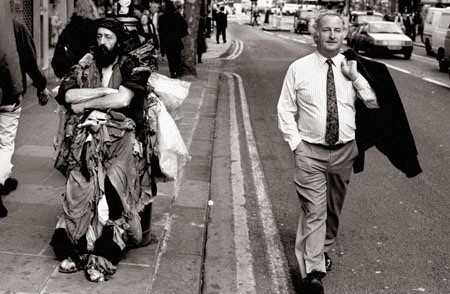

Many would say that extreme inequality is morally wrong, and should be addressed through policy changes and stiff taxes on high incomes and large amounts of accumulated wealth. Others might ask how this wealth was acquired, and warn against discouraging productive activity. We generally have a strong sense that if someone has worked hard for something, then they have earned it and should be able to keep it. If everyone has the same opportunity to build wealth, and rich people gained their wealth through hard work, sacrifice, or ingenuity, we might conclude that the rich deserve their wealth. That is, we would be considering whether the wealth disparity is *fair*, i.e. gained in reasonable proportion to contributive merit.

Aside from fairness, we also have to consider whether there may be serious social ills associated with an excessively unequal distribution of wealth. Does extreme inequality lead to undesirable outcomes for people and society? Does it lead to social problems such as more crime, poorer health, and shorter life expectancy? Is it a threat to representative democracy?  On the other hand, are there social benefits to inequality - for example, does it encourage innovation and the creation of new luxury goods which may eventually be enjoyed by the less wealthy?  Does it motivate economic growth? Such questions point us in the direction of an assessment of potential *harm* or *benefit*.

In evaluating the status quo, we must take a two-pronged approach:

- Benefit or Harm: Consider whether there are benefits or social ills associated with disparities in wealth and income, aside from whether or not those disparities are fair and just.
- Fairness: Consider how income is received and how wealth accumulates in private ownership in Britain. Then we can assess whether this wealth accumulation occurs via fair or unfair means, and in fair or unfair amounts.

Before making this assessment, we should take a step back. We have talked about 'wealth' and 'riches' on the assumption that we all take these words to mean the same things. In fact, the word 'wealth' in its common usage can refer to very different things. We break down our interpretation of this in the next section. 

# 8.2 What is Wealth?

In its most broad sense, wealth refers to anything of value to people. Based on this rather broad definition, 'wealth' can refer to things which are quite intangible. Social connections, charisma, political influence, the rule of law and safety. These are all desirable, at least to most people. People often use the term 'wealth' to describe things which are personal and irreplaceable, such as a family heirloom, or even simply family or friends. Such things have little or no 'exchange value' (i.e. they can't be sold, or at any rate can't be sold for any great amount), but they may have a lot of value in personal and relational terms. 

Some things of great value are what we might term 'social goods' because they are not privately held by one person. Social goods may  include effective public transport, parks, clean air, a free press, and even a feeling of community, or shared destiny. These are hugely important kinds of wealth, even though they aren't privately held. They are part of what economists call 'the commons' or 'common wealth.' A good example is clean air. In a world in which the air was too toxic to breathe, the rich might be able to afford to have air filters built into their homes and cars, and benefit from much cleaner air than the non-rich. However, such a world would entail a diminished life for everyone, including the rich, as they would need to employ an expensive, energy-intensive process to provide them with clean air, compared to simply having a clean atmosphere which all could enjoy. 

Another example is safety in South Africa. The degree of crime is so bad that drivers regularly have their cars stolen while waiting at stoplights. Wealthy people can avoid being the victims of crime by locking themselves away in secure enclaves, surrounded by high walls and security systems, and protected by private armed guards. The public social good, that of public security, is lacking in South Africa. The rich can protect themselves; the poor cannot. One reason may be a less-than-effective police force, but the greater reason is that social norms are distorted in the direction of criminality by widespread desperate poverty and lack of hope for advancement through legal means. Despite their relative privilege and safety, the wealthy still have a diminished quality of life, resulting from restricted freedom of movement and a fear of becoming a victim of crime. 

Perversely, the fact that social goods are valued by everyone can put them at risk in a way that is not the case for goods which are held privately. This is because when people personally own wealth, they are often very concerned about protecting it. People tend to be less actively concerned about wealth held in common with others, as their ties of benefit, provision, and accountability to the social good are often less clear and tangible. Economists refer to this as the 'tragedy of the commons.'

It is 'private wealth' that we are focusing on in this chapter, but we mention social goods here because they are so important for quality of life, and because as we shall see, inequality of private wealth is linked with the loss of some of these social goods. More specifically, we are narrowing ourselves to discussion of privately held material wealth, thereby excluding immaterial or intangible forms of wealth. That said, it is worth noting that having material wealth often enables attainment of immaterial goods of great value. For example, a materially wealthy person may buy access to a top school for their child, which provides that child with access to a good education and good social connections that are likely to lead to lucrative and powerful career opportunities later in life. Similarly, paid entry into expensive elite social clubs offers valuable networking opportunities. Material wealth can buy time, unique experiences, unpaid internships, physical attractiveness (to an extent), and worryingly, it can also buy wildly disproportionate political influence (look at Rupert Murdoch). Perhaps the only thing material wealth can't directly buy is love and happiness - though many will still try.

# 8.3 How Do People Build Material Wealth?

There are many ways, both legal and illegal, but we will confine ourselves here to the most significant legal means:

## Wages

Wages are an income earned through some form of economic activity, such as working as an employee or a self-employed trader, or creating something and selling it. People who earn just enough income to meet their needs won't build up much wealth through savings. High rents on flats in crowded cities - the very places where most of the jobs are - have made it very difficult for most people to save any money at all in contemporary Britain. Only a minority of people blessed with a very high income and low living costs can build up wealth from savings of a portion of their income - perhaps enough to make some financial investments. 

## Inheritance

Some people gain wealth through inheritance, or by dint of a gift from wealthy relations. Great family wealth can be passed down and increased over many generations.

## Theft or illegal trading

In a good many cases, an individual or family acquired its initial wealth pool by illegal means - for example, family members may have taken bribes or kickbacks whilst occupying high government office, or may have sold illegal drugs or weapons. Does this seem unlikely in contemporary Britain? Perhaps - but consider that it is routine in most countries of the world, and enormous amounts of wealth obtained through such means by foreigners has been 'invested' in Britain, for example in expensive London or Oxfordshire real estate. 

## Dumb luck

In still other cases, a person might acquire significant wealth by simple luck. In a very few cases, this might involve buying a winning lottery ticket. In far more cases, it might entail having bought London real estate inexpensively forty or fifty years ago, and now sitting on a property valuated at more than ten times what it had been when it was purchased. 

## Entrepreneurship

In some cases, a person with no money but a lot of energy and talent might be able to persuade an angel investor (and later on, some venture capitalists) to invest in a company startup that produces some novel good or service. If the entrepreneur manages to make a success of the business, and retains a large equity stake, that might suffice to catapult him or her from wage-taking employee status into the wealthy proprietarial class.

The above five ways in which people first acquire significant wealth might be termed 'primary wealth attainment' (Karl Marx called it "primitive accumulation").

Once a person has some wealth, there are myriad ways in which to deploy it so as to increase one's wealth further. This can be called 'secondary wealth accumulation' and includes the following actions, among others:

- Investing in companies by buying stocks and shares or some other financial instrument. If the company does well, then the investor will increase his or her wealth through dividends, or by selling the stock when it has higher value.
- Investing in savings products such as mutual funds (which invest on a person's behalf) that pay interest.
- Buying land or property and selling it once it has increased in value (possibly also receiving rent income in the meantime).
-  Investing directly in a business that produces some good or service. 

From the above list, it's easy to see how those who are already rich can get a lot richer. They don't have to build up wealth through labour or invention. Owning wealth opens up a raft of secondary wealth generation and accumulation opportunities, and it allows one to take bigger financial risks. The wealthy are also likelier to invest their riches profitably because they can afford to pay advisors and wealth managers to locate investment opportunities and to minimise tax liabilities on their behalf.

Are advantages like these really enough to propel the rich into ever-increasing rates of wealth-accumulation? Yes. Ever-increasing global inequality suggests that this is indeed the case. [@OECD2015] Let's take a look at the extent of wealth and income inequality in Britain today.

# 8.4 Inequality of Wealth

## The British Context

There is a serious level of wealth inequality in Britain today. According to the figures from the Office of National Statistics from 2012 to 2014, the richest 10% of UK households hold 45% of all wealth, while the poorest 50% own just 8.7% [@ONS2015].

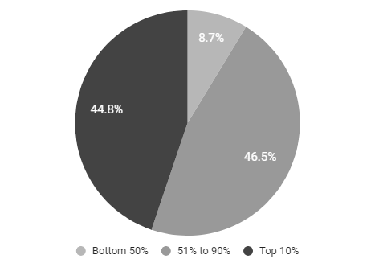

Particularly striking is the fact that the richest five families in the UK are wealthier than the bottom 20% of the population [@Dransfield2014]. 

Here are a few notable facts about the UK wealth distribution:

-  Bottom 10% of households have total wealth of £12,550 or less.

-  Median total household wealth is £225,000.

-  The top 10% of households have a total wealth of over £1m.

-  The top 1% of households have a total wealth of £2.87m+.

 The below chart shows the distribution in a finer grain, allowing us to see the share of wealth held by the top 1% in British society [@ONSWELLBEING2015].

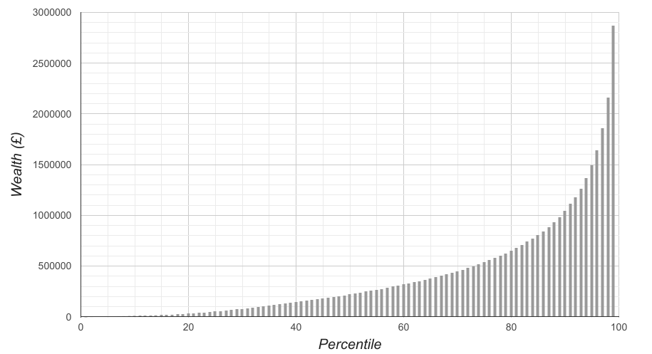

The intensity of wealth inequality continues to increase. The richest 10% are getting richer not only in absolute terms, but also in terms of their percentage share of total wealth and total income.

## The Role of Property

ONS figures from 2012-14 show that while the total proportion of wealth held by the top 1% remained steady at 13%, the next 9 per cent richest households, increased their share to 31.2 per cent of total wealth. This was up from 30.1 per cent two years previously. 

The inequality increase occurred entirely in net property wealth, during a period of house price rises [@ONSWELLBEING2015]. This indicates that a large part of the growing wealth of the richest 10% in Britain is due to their ownership of property, rather than wage income or business income. 

A 2014 Credit Suisse report confirmed these findings. They found that the top 10% in the UK have become wealthier since the financial crisis because of value increases in assets. They also showed that Britain is the only country in the G7 group of leading economies where inequality has increased this century. [@TreanorFarrell2014] 

# 8.5 Inequality of Income

We have discussed wealth inequality, which is the vast discrepancy in the ownership of assets, such as property, cash and investments, held across Britain. There also exists a less severe, but also worrying form of inequality. This is inequality of income. 

Income may come from a variety of sources, such as interest on savings, wages, dividends, cash benefits (such as State benefits), and rental income. Some of this income may be taxed. Measures of income inequality generally consider inequality in disposable incomes (after benefits and after direct taxes). The below flow-chart shows the various stages of household income:

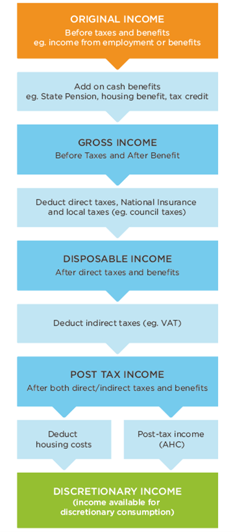

Disposable income may be measured before-housing-costs (BHC) or after-housing-costs (AHC). When considering income, it is important to be precise about the kind of income being discussed. For example, when looking at income inequality, we can see that there is more inequality in income after-housing-costs than in income before-housing-costs, because poorer households tend to spend a higher share of their income on housing than those higher up the income distribution [@McGuinness2016].

In the chart below [@IFS2014], we can see how the share of pre-tax household income going to the top 1% has increased over time. 

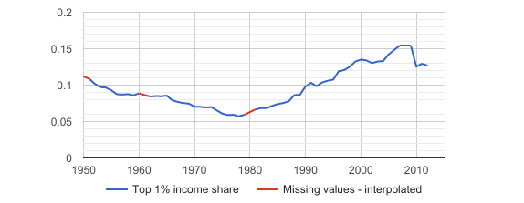

The top incomes of the top 1% appear to be 'racing away' from the remaining 99%. Data suggests that income inequality within the bottom 99% is remaining reasonably stable or possibly slightly decreasing, while the national income share of the top 1% is increasing. 

There exists, of course, a relationship between income inequality and wealth inequality. Income leads to wealth when it is saved up and when it is used to buy assets. Wealth also generates income as shares generate dividends, savings generate interest, and property ownership generates rental income. 

Households with great wealth often also receive high incomes. However we can easily imagine someone who has great wealth in the form of property, investments, and bank balance, but who has little income (perhaps a retiree). Similarly, someone may make a significant income, but have debts and high outgoings, so they don't build up wealth (perhaps a young person on a high salary). The effect of a sudden reduction in income or unexpected expenses would have a dramatically different effect on each of them. 

Broadly speaking, we have seen:

- Wealth distribution in the UK is very unequal and getting more so.
- Income distribution is also very unequal, but less so than wealth distribution.
- The top 1% income share is increasing quickly.
- Wealthy people tend to be on high incomes. Those with little wealth tend to be on low incomes.

Understanding the above graphs and figures requires us to look behind the figures and consider how different groups earn and use their income. At the lower end, there are those who earn their income through labour, and who must pay housing costs. They have very little disposable income and are unlikely to have much income available to invest in secondary wealth generation. They may have seen their nominal wages stagnating [@Khan2016], while the real value of their wages decreases [@Tily2016]. At the other extreme are those who have high incomes and are able to make additional income through purchasing assets. As we have seen, increases in asset values (particularly property assets) have driven an increase in the wealth of the very rich. With assets comes income through dividends, rent, and capital gains. This appears to be contributing to growing inequality of both wealth and income. 

Quoted in the Financial Times, the general secretary of the Trade Union Congress, Frances O'Grady, put it this way:

>*"The economy is paying people too little for hard work and too much just for sitting on wealth. It is making Britain more and more unequal, with those who are already rich moving even further ahead of the typical family [@Giles2015]."* 

# 8.6 Effects of Inequality

But is this inequality in itself really such a problem? If we could ensure that all citizens have their basic wants covered, does it matter if the rich are getting richer? Surely dealing with absolute wealth in this way and ensuring a basic standard of living is a more important focus than the relative wealth between rich and poor? 

It is clear that there is a strong view amongst some circles that inequality is not a problem as long as the poorest have their basic needs met. 

High wealth and income inequality matter for a host of reasons. It causes subtly damaging changes in the way people interact with each other and participate in society. According to the Equality Trust, income inequality is correlated with low civic participation, lower voter turnout, and lower levels of cultural activity [@EqualityTrust2014]. There is even evidence that inequality may affect personality [@EqualityTrust2017]. Research comparing US states found, despite adjusting findings for state and person-level socio-demographic factors, that people in less-equal states were 'less agreeable' than those in more-equal states [@DeVries2011]. 

A World Bank study on inequality and crime rates reported a strong correlation between violent crime and inequality, both within and between countries.

## Inequality and Empathy

Psychologist Paul Piff has conducted research [@Piff2010] on a phenomenon called the 'empathy gap'. In his experiments, test subjects were artificially placed into social hierarchies. Piff and his colleagues concluded that increased wealth and status in society leads to increased focus on oneself. This, in turn, leads to decreased compassion, altruism, and ethical behavior. The opposite is also true. Piff's work suggests that poorer individuals tend to be more generous, charitable, trusting and helpful, compared with their richer counterparts. A related study by Keltner et al, found that 'lower-class individuals' displayed more compassion and sensitivity to the distress of others than their upper-class counterparts [@Stellar2012].

Social class and wealth, therefore, appear to be negatively correlated with qualities like compassion and empathy. This may be exacerbated by increasing physical segregation in where the rich and poor live. Poor, rich, and average households became less and less likely to live next door to one another between 1970 and 2000 [@DorlingDaniel2007] suggesting that socioeconomic polarisation has been accompanied by geographical segregation.

Surprisingly, there is even evidence that inequality may affect personality. Research in the USA compared less equal US states with more equal states. After adjusting for state and person-level socio-demographic factors, de Vries et al found that people in less equal states were 'less agreeable' than in more equal states.

## Inequality and Social Problems

Epidemiologists Wilson and Pickett collated a breadth of transnational research comparing inequality and a variety of social measures. Their results were striking. They found that over a wide range of areas, including health, education, social mobility, social cohesion and foreign aid, increased inequality leads to worse outcomes. See, for example, their findings below, comparing health and social problems with income inequality, across rich countries [@Wilkinson2017]. We can see that the US is highest in income inequality and highest in health and social problems.^[Wilson and Pickett's research has been criticised on the basis that their findings show relationships of correlation, rather than causation. However the researchers note that many of the causal processes linking inequality with social problems are well established from other research. They argue that the key insight from their work is that the connection can be seen repeatedly in countries worldwide.] 

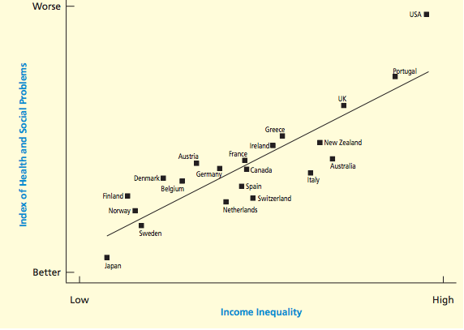

Their message for policy-makers was plain: 

>*"(A) clear warning for those who might want to place low public expenditure and taxation at the top of their priorities. If you fail to avoid high inequality, you will need more prisons and more police. You will have to deal with higher rates of mental illness, drug abuse, and every other kind of problem. If keeping taxes and benefits down leads to wider income differences, the need to deal with ensuing social ills may force you to raise public expenditure to cope."*[@Wilkinson2010]

## Inequality and Crime Rates

In a study on inequality and crime rates, Lederman et al. found a strong correlation between violent crime and inequality  [@Lederman2002], both within and between countries. In their view:

*"The correlation reflects causation from inequality to crime rates, even correcting for other crime determinants."* 

Simply put, this means that inequality causes high crime rates, not vice versa. The mechnism by which this occurs is unclear and may be multifactored. Economic inequality may curtail opportunities for some, leading to feelings of hopelessness, inferiority, and fear which then lead to violence. Inequality may encourage social competition, and low levels of trust and community cohesion within a society.

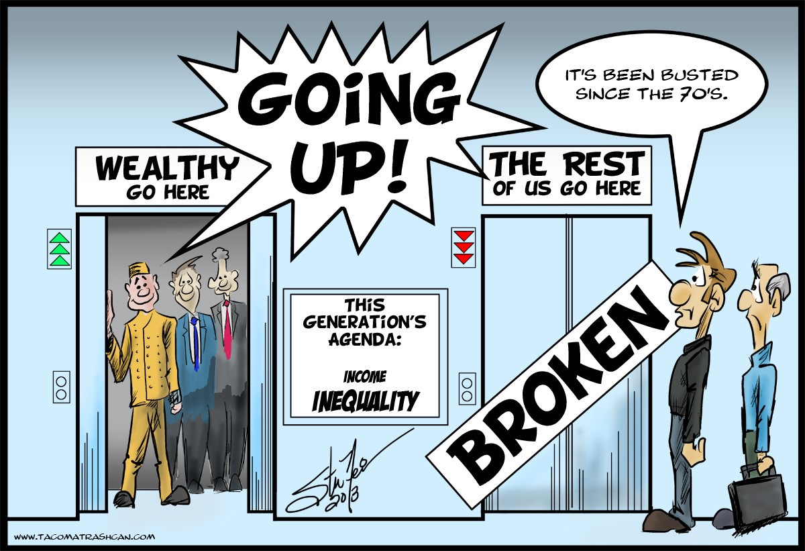

There is also a strong correlation between high income inequality and low social mobility. Social mobility is the upward or downward movement of people between social strata in a society. Mobility may be intra-generational (i.e within a generation, as per 'rags to riches' stories), or it may be inter-generational, i.e a change in social status from parents to children.

In an intergenerational study of the American context by researcher Corak, it was observed that high earnings inequality is likely to be associated with stagnation in intergenerational mobility. This means that earnings inequality makes societies more 'sticky,' such that children are more likely to stay in the same social stratum as their parents.

Corak cautions that this outcome is particularly likely if labour market inequalities translate into political power, which then influences whether progressive policy reforms are made. He warns, 

>*"Without changes in these underlying factors, the transmission of inequality from the current generation to the next will remain a movie that is played to the same script as that viewed by past generations." * [@MilesCorak2011]

Figure 8.8 shows the strong correlation between inequality and a measure called 'intergenerational earnings elasticity' (IEE), which is used by social scientists when considering intergenerational social mobility. IEE is the percentage difference in earnings in the child's generation associated with the percentage difference in the parental generation [@MilesCorak2011]. An intergenerational elasticity in earnings of 0.9, for example, means that if father A makes 100% more money than father B, then the son of father A will, as an adult, earn 90% more than the son of father B. An elasticity of 0.2 says this 100% difference between the two fathers would only lead to a 20% difference between the sons. 

The lower the elasticity, the more mobility in the society. Figure 2.5 shows that increased inequality at any point in time is correlated with lower generational earnings mobility. Note that mobility can be in either direction, up or down. The IEE is simply considering the earnings difference between generations. 

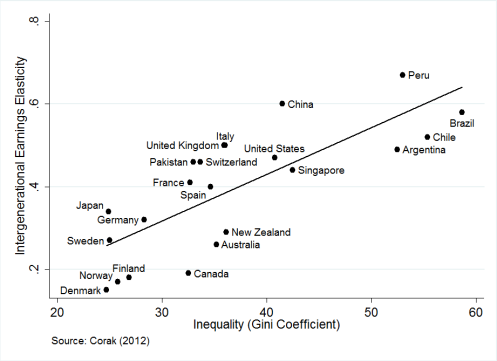

This chart is widely known as the 'Gatsby Curve'. It is so named after the character of Jay Gatsby in the famous novel by F. Scott Fitzgerald. In the novel, Jay Gatsby tries in vain to raise his social standing by becoming very rich. The novel is set in the 1920s, when there was high inequality of wealth and very low social mobility.

One suggested reason for the correlation between inequality and intergenerational earnings mobility is unequal access to educational opportunities. This is exacerbated by poor social and family relationships, which then inhibit learning. The below image is from a 1916 advertisement for a vocational school, and suggests that education is a pathway to upward social mobility.

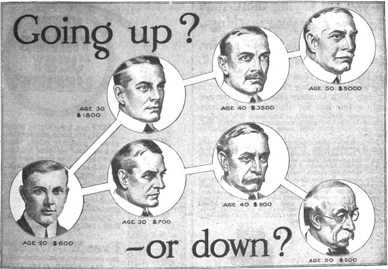

These findings offer insights into how intergenerational poverty and welfare dependency have a real structural basis, and are not entirely within the control of an individual's willingness, effort, or merit.

## Inequality and Liberty

If we accept the evidence that economic inequality lead to negative social outcomes, might we nevertheless also argue that inequality is a necessary and inevitable outcome of a free society and equality before the law?  In his book 'The Constitution of Liberty', political philosopher Fredrich Hayek argued:

> *"From the fact that people are very different it follows that, if we treat them equally, the result must be inequality in their actual position, and that the only way to place them in an equal position would be to treat them differently. Equality before the law and material equality are therefore not only different but are in conflict with each other; and we can achieve either one or the other, but not both at the same time."*

Hayek also argues that an attempt to achieve complete material equality between people can only come at the expense of freedom:

>*"While an equality of rights under a limited government is possible and an essential condition of individual freedom, a claim for equality of material position can be met only by a government with totalitarian powers."*  [@Hayek1944]

One response would be to say that in objecting to extremes of inequality, one is not advocating strict equality of outcome for all. 

The obvious problem with Hayek's argument is that distribution according to merit is just one conception of social justice. Consider the principles of fair equality of opportunity, and the societal goal of raising the lowest social position as much as possible. We propose that extreme inequality needs to be eliminated to create a level playing field where individuals are given the opportunity to demonstrate their merit [@Lister2011].

## Wealth Inequality and the Democratic Process

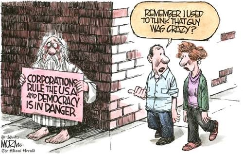

Despite Hayek's famous theory on the constitution of liberty, a very real danger of wealth inequality is the threat to the democratic process. Extremes of wealth mean that those at the top, whether they be corporations (as per the above cartoon) or individuals, have disproportionate access to power, and an ability to influence politicians for their own interests. A famous quotation, attributed to noted American Supreme Court Judge Louis D. Brandeis, put it simply:

>*"We can have democracy in this country or we can have great wealth concentrated in the hands of a few, but we cannot have both."* [@Dillard1904]

There is strong evidence that extremes of wealth inequality lead to so-called 'representational inequality.' Work by Professor Martin Gilens of Princeton University found that in the US, when the policy preferences of the affluent differ from those of the middle-class or poor, there is virtually no relationship between policy outcomes and the desires of less advantaged groups [@Gilens2004]. Policies favored by 20 percent of affluent Americans have about a one-in-five chance of being adopted, while those favored by 80 percent of affluent Americans are adopted about half the time. In contrast, the support or opposition of the poor or the middle class has no impact on a policy's prospects of being adopted [@Gilens2012].

Economist Dabla-Norris notes in a 2015 IMF report [@Dabla-Norris2015] that income inequality can have serious consequences for political stability, saying:

>*"Widening inequality also has significant implications for growth and macroeconomic stability, it can concentrate political and decision making power in the hands of a few, lead to a suboptimal use of human resources, cause investment-reducing political and economic instability, and raise crisis risk."*

## Inequality and Growth

Some would argue that inequality is nevertheless necessary for economic growth. Inequality is thought by some to encourage entrepreneurialism [@Matthews2016] and the wealthy are thought to invest in the economy. It is also claimed that when the state redistributes wealth through taxation and benefits, resources are lost through administration and bureaucracy. However, recent research by the Organization for Economic Cooperation and Development (OECD) suggests that even this purely economic argument is on shaky ground. Its 2014 analysis found that high levels of income inequality have a statistically significant negative impact on growth. 

The study found that: 

>*"Rising inequality is estimated to have knocked more than 4 percentage points off growth in half of the (OECD) countries over two decades. On the other hand, greater equality prior to the crisis helped GDP per capita in a few countries, notably Spain."*  [@OE2014] 

Furthermore, while there is evidence that the promise of wealth is a strong motivator for entrepreneurs, the majority of the top 1% in the US are not entrepreneurs - they are executives, managers, supervisors, and financial professionals [@Bakija2012].

These findings reinforce the work of Piketty on inequality and 'low growth capitalism.' 

In this section, we have considered the effects of inequality in terms of its impact on empathy, social problems, crime rates, and social mobility. Contrary to claims that income and wealth inequality are necessary for liberty and growth, we see evidence that inequality threatens a functional democracy and growing economy.

# 8.7 How much Inequality Do People Want in Society?

We've seen above that income inequality and wealth inequality are associated with very undesirable social consequences. However, most would not welcome an economic system in which everyone received exactly the same amount. There has been some research from the US as to what distribution of wealth people believe there should be in society. 

In a 2011 study by Dan Ariely and Michael Norton [@Norton2011], a nationally representative online panel of Americans were asked to estimate the current distribution of wealth in the USA, and to describe a distribution they deemed 'just'. The results were striking. All demographic groups (including Republicans and the wealthy) desired a more equal distribution than the actual US wealth distribution. Secondly, all groups vastly underestimated wealth inequality in the US, estimating that the top quintile held about 59% rather than the actual amount of about 84%.

The below chart shows the distribution which the participants estimated was the case, the participants' ideal distribution, and the actual US wealth distribution. We can see that the participants' estimated distribution is as far from the actual distribution as their ideal distribution is from their estimated distribution of wealth inequality in the US.

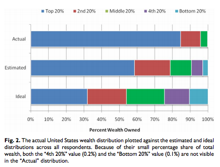

The researchers concluded two main points. First, that a large, nationally representative sample of Americans seems to prefer to live in a country more like Sweden than like the United States. Americans also construct ideal distributions that are far more equal than they estimated the United States to be - estimates which themselves were far more equal than the actual level of inequality.

Second, there was much more consensus than disagreement across groups from different sides of the political spectrum about this desire for a more equal distribution of wealth, suggesting that Americans may possess a commonly held "normative" standard for the distribution of wealth despite the many disagreements about policies that affect that distribution, such as taxation and welfare.

In short:

- Americans think the US is more equal than it is;
- Americans would like the US to be even more equal than they think it is (more like Sweden); and
- This preference held across the political spectrum.

# 8.8 Is Income Inequality Merited?

We have now seen that inequality is associated with significant social ills, such as increased crime rates and poor health and longevity outcomes. We have also seen that it may pose a real threat to representative democracy and to economic growth. So, there is clear evidence of harm or potential harm arising from excessive wealth inequality in Britain.

What about fairness? Has the wealth of the very rich been accumulated through fair means? Remember again the ways of accumulating wealth which we discussed in the beginning of this chapter. There was primary wealth acquisition, occurring through income from legal or illegal economic activity or inheritance. There was also secondary wealth acquisition which involved putting wealth to use in the form of investment, to accumulate more wealth. We said that if the rich are rich because they work hard and 'work smart' and the poor are poor because they do not, then that might be one reason for viewing wealth inequality as fair. 

## Inequality due to Income or Inheritance

When it comes to those primary forms of wealth acquisition, we know that unfairness exists. It would be wonderful if everyone had an elderly aunt who could leave them a sizeable inheritance, but that is clearly not the case. Some people have friends who help them get a high-paying job, some do not. Some people go to excellent schools, some do not. Some work, no matter how important to society, pays less than other work. These kinds of unfairness are difficult to tackle, raise many ethical issues, and are outside the scope of this book. However, it is worth mentioning that the world is not a level playing field and while attempts can be made (through inheritance tax and affirmative action policy) to redress unfairness of opportunity to gain primary wealth, attempts to totally eradicate it would probably be futile. They would also probably have serious unintended consequences. As your parent may have told you when you were a child, 'sometimes life just isn't fair.'

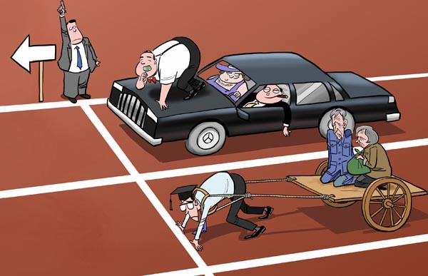

To what extent is someone's monetary success due to their own work, and to what extent is it their luck or privilege (in terms of genes, or parental support), or a product of the wider society? And to what extent should we reward those who seek money over other objectives?

Income taxation is one of the main ways in which the government affects income distribution across society. From a purely philosophical point of view, it's not easy to determine what the rate of income tax should be. We'll come back to this in the next chapter, when we look at this through the prism of income inequality and recent historical experience. We'll also consider the fairness of different processes of wealth accumulation.

# 8.9 Direct Taxes and their Redistributive Role

## Income Tax in the UK

Most people, when they think of tax, immediately think of income tax. It is possibly the most noticeably intrusive tax in every individual's life, requiring, as it does, the keeping of records, the filling in of forms, and possible sanctions from the 'tax man.' Unlike VAT, which is added to goods and services we purchase, income tax comes out of our earnings. There is often an added feeling of grievance associated with the sense that the government is taking money for which we have worked very hard.

Income tax is progressive, with different rates of tax payable according to income. These rates are called 'Bands.' As of 2016, each individual is entitled to a'personal allowance' of £11,000 of non-taxable income. Above this, their income is taxable. Taxable income (i.e. income above the personal allowance) is subject to different tax rates depending upon the band within which it falls. 

The current top marginal tax rate is 45%. The below chart shows how top marginal tax rates have changed over time for different countries. We can see that the top tax rate for the UK was very high during the Second World War and in the late 1970s. The top rate dropped sharply during the prime ministership of Margaret Thatcher in the 1980s.

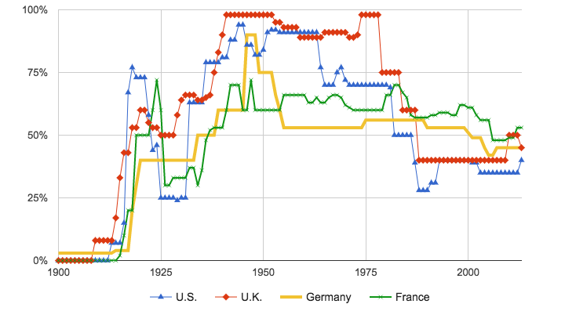

## The Effect of UK Taxes on Income Inequality

Direct taxes (e.g. Income tax, National Insurance Contributions) act to reduce inequality of income. Wealthier households pay higher amounts of direct tax and a higher proportion of their income in direct taxes. They are *progressive* taxes.

The below chart shows the effect which the combination of tax and benefits have on income inequality [@Wells]. The y-axis is the degree of inequality as measured by the 'Gini coefficient' ^[A higher Gini value represents a less equal society, with 100% meaning one person has all the income, and 0 meaning everyone has the same]. The blue line is the level of income inequality before taxation and benefit distribution.

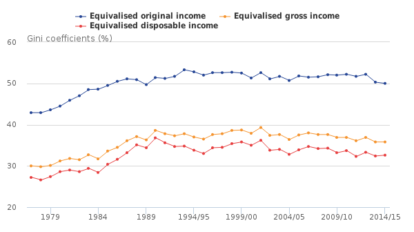

According to these ONS figures in 2014/15, the richest fifth of the population paid 22.8% of their gross income on direct taxes. The majority of this was income tax. The average tax bill for the poorest fifth was 11% of their gross income. The majority of this was from Council tax.

In 2014/15, after direct taxes, the average incomes of the richest fifth of households was five and a half times that of the poorest fifth (£67,000 and £12,300 per year respectively).

Income tax made up the largest proportion of direct tax paid by the richest fifth of the population. Income tax is the most progressive of the direct taxes and thus has the biggest effect on reducing income inequality. The below chart compares the progressivity of income tax, National Insurance Contributions and Council Tax. A positive value indicates progressivity.

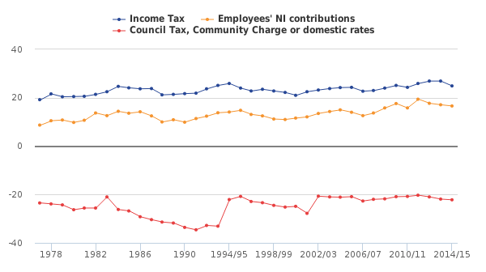

Despite fluctuation, there is a clear overall trend towards increased progressivity.

## Using Income Tax To Reduce Income Inequality

Earlier, we discussed the top 1%, and evidence that their share of total income is racing away from the share of the other 99%. The below chart shows how the income share of the top 1% correlates with top marginal tax rates in the USA. 

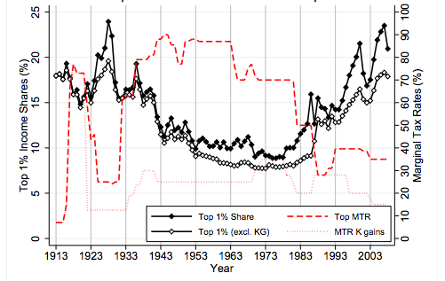

Immediately we can see a strong oppositional relationship, whereby a high marginal tax rate is generally correlated with a lower income share. So again, in the roaring 20s, we have a lower top marginal tax rate of about 25%, and the income share of the top 1% reaching a height of around 23%. During the depression of the 1930s and the Second World War, there was an increase in the top marginal tax rate and a severe reduction in the top 1% income share. During the 1980s, another drop in the top marginal tax rate and and an increase in the top 1% income share once more. So, this suggests a strong direct relationship between an increase in top marginal tax rates and a decrease in the top 1% income share. 

The pattern is also evident if we compare different countries. The below chart shows the top tax rate and 1% share for a variety of countries in 2004-2008.

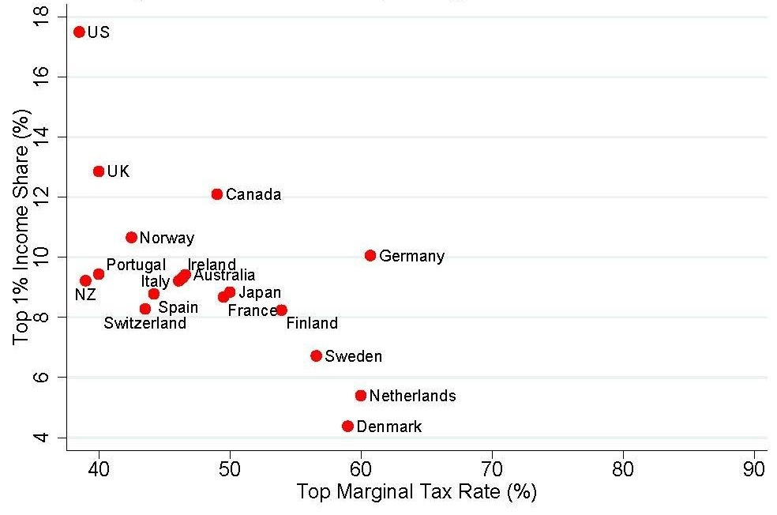

Again the top marginal tax rate appears to have an inverse relationship with top 1% income share. Those with the lowest 1% income share are the Nordic countries, with top marginal tax rates of between 55 and 60%. The UK and US, with lower top marginal tax rates of 40% and under, are also among the highest in 1% income share. There are anomalies, however, which indicate that top marginal tax rate is not the only factor contributing to the 1% income share. Germany is a bit of an outlier, perhaps due to tax deductions.

So, we conclude by arguing that firstly, the progressivity of income tax is welcome; and that a top marginal rate of around 60% is probably necessary to keep a moderate and stable income and wealth share of the top 1%. Reforming deductions and other complexities that the rich can exploit is another possible area of focus.

# 8.10 Income Tax: Who Pays It? How Is It Paid?

Income tax is paid on income, which can include money earned from employment or self-employment, state benefits, some pensions, rental income, investment income, income from trusts, and work benefits. Some income is exempt from tax - for example interest on savings in tax-exempt accounts.

There are several ways in which income tax is paid, which vary according to whether the taxpayer is an employee, self-employed, and/or in receipt of benefits. There is generally no minimum age for paying most income taxes - therefore even children who receive income over the tax-free threshold will be required to pay tax.

## Employees

Employees in Britain have income tax taken out of their pay packet before they are paid their wages. This is called Pay As You Earn (PAYE). Employers determine the tax payable by using the employee's tax code. This is a code which HMRC gives each taxpayer for tax assessment purposes, and which delineates their income tax bracket.

## State benefits

Those whose only income is state benefits may not have to pay any tax. In some cases, HMRC will require those on state benefits to submit a self-assessment tax return. This is a form (available online or in paper form)  which stipulates an individual's income and is used by HMRC to calculate tax owed. The table below shows which benefits are taxable and which are not.

| Taxable  State Benefits                                | Non-taxable  state benefits                                  |
| ------------------------------------------------------ | ------------------------------------------------------------ |
| The State  Pension                                     | Housing  Benefit                                             |
| Jobseeker's  Allowance                                 | Employment and  Support Allowance (income related)           |
| Carer's  Allowance                                     | Income Support (though you may have to pay tax on Income Support if you're involved in a  strike) |
| Employment and  Support Allowance (contribution based) | Working Tax Credit                                           |
| Incapacity  Benefit (from the 29th week you get it)    | Child Tax Credit                                             |
| Bereavement  Allowance                                 | Disability Living Allowance                                  |
| Pensions paid  by the Industrial Death Benefit scheme  | Child Benefit (income based)                                 |
| Widowed  Parent's Allowance                            | Personal  Independence Payment (PIP)                         |
| Widow's  pension                                       | Guardian's  Allowance                                        |
|                                                        | Attendance  Allowance                                        |
|                                                        | Pension Credit                                               |
|                                                        | Winter Fuel  Payments and Christmas Bonus                    |
|                                                        | Free TV  licence for over-75s                                |
|                                                        | lump-sum  bereavement payments                               |
|                                                        | Maternity  Allowance                                         |
|                                                        | Industrial  Injuries Benefit                                 |
|                                                        | Severe  Disablement Allowance                                |
|                                                        | Universal  Credit                                            |
|                                                        | War Widow's  Pension                                         |

## Self-employed

Those who are self-employed, such as those operating as a sole trader,  will be required to register as self-employed and submit self-assessment tax returns.

## Foreign Income

In some cases, a person may be required to pay tax on foreign income. This is income from outside England, Scotland, Wales, or Northern Ireland. Whether a person is required to pay tax on foreign income will depend on whether they are considered 'resident in the UK' for tax purposes. Those who are not resident in the UK will not have to pay tax on foreign income. UK residents pay tax on such foreign income. Special rules exists for UK residents who are 'domiciled' abroad. Foreign income includes wages if a person has worked abroad, foreign investments and savings interest, rental income on overseas property, and income from pensions held overseas. 

# 8.11 Income Tax: Allowances and Rates

## Personal Allowance

Most people will not pay tax on all of their income. Rather, there is a set amount of income which a person can keep tax-free. This is known as the 'Personal Allowance.' Income above the personal allowance is taxable. As of 2017, the standard Personal Allowance is £11,500. Thus, for most people, income up to £11,500 will be tax free, and income above this amount is taxable. Those whose income is greater than £100,000 will have a smaller tax-free personal allowance ^[The Personal Allowance goes down by £1 for every £2 that the 'adjusted net income' is above £100,000.]. Those in receipt of Marriage Allowance or Blind Person's Allowance have a greater Personal Allowance.

## Tax Bands

Above the personal allowance,income is taxable. However it is not all taxable at the same flat rate. The tax rate progressively increases in 'bands' as the amount of income increases. That is why income tax is known as a 'progressive' tax - the rate increases as income increases. These rates are known as 'marginal tax rates.' The below table shows the tax bands for the UK (with the exception of Scotland, which has different rates).

| Tax Band        | Taxable income   | Tax rate |
| ------------------- | -------------------- | ------------ |
| Personal  Allowance | Up to £11,500        | 0%           |
| Basic rate          | £11,501 to  £45,000  | 20%          |
| Higher rate         | £45,001 to  £150,000 | 40%          |
| Additional  rate    | over £150,000        | 45%          |

Income above £150,000, is taxed at the Additional Rate of 45%. 

So, for example, a person who had an income of £50,000 would calculate their tax payable as follows. As can be seen above, the personal allowance is effectively a 0% tax rate on the first £11,500. The basic rate of 20% applies on income above £11,501 and up to £45,000. Any income between £45,001 and £150,000 is taxed at the higher rate of 40%.  

 (£33499 x 0.2) + (£4999 x 0.4) = £6699.8 + £1999.6 = £8699.4.

## Savings and Dividend Allowances and Tax Relief

There are some other specific circumstances in which one might pay less income tax. 

Tax relief: Tax Relief allows taxpayers to reduce the tax they pay or to get some tax repaid. Tax relief may be available to people who pay personal pension contributions, charity donations, or maintenance payments, and to those working in special circumstances. Tax relief also applies to work or business expenses. Self-employed persons may be able to claim tax relief for certain business expenses, while employees may claim tax relief for some expenses incurred during the performance of their job.

Generally, tax is payable on interest earned from savings accounts, and on any dividends earned from shares owned. However, for these two sources of income, tax relief may be applicable, depending on how the investments are disposed or reinvested. 

## Savings interest allowance

In the case of savings interest, the size of the allowance depends on how much 'other' (i.e non savings interest) income the taxpayer has. If the total amount of 'other' income is less than £16,500, then they will be eligible for a maximum savings interest allowance of £5,000. This is called the 'starting rate.' The starting rate will be reduced by £1 for every £1 of other income above the Personal Allowance. Those whose 'other' income is greater than or equal to £16,500 will not be eligible for the 'starting rate' of savings allowance.

HMRC offer the following example of a savings allowance calculation on their website (we paraphrase for clarity) ^[HMRC Website];

> *Mark earns £15,000 in wages and gets £200 interest on his savings. HIs 'other' income (his wages) is less than £16,500, so he is eligible for the maximum savings interest allowance of £5000. Therefore his starting rate is £5000*

>*This rate is reduced by £1 for every £1 of 'other' income above the personal allowance.* *His Personal Allowance is £11,500.* 

> *Therefore £15000 - £11500 = £3500. He has £3500 of 'other' income above the Personal Allowance. Therefore his starting rate is reduced by £3,500. His remaining savings interest allowance is £1,500 (£5,000 minus £3,500).* 

>*Therefore, as Mark's savings interest is £200, which is under his allowance, he doesn't pay tax on his savings interest"* 

The starting rate is not the only way in which one can avoid paying tax on savings interest. Depending on which tax band a taxpayer's income falls in (Basic, Higher or Additional), the taxpayer may get up to £1000 savings interest tax-free. The below table shows the different allowances for the respective tax bands.

| Income Tax band | Tax-free savings income |
| ------------------- | --------------------------- |
| Basic  rate         | £1000               |
| Higher  rate        | £500                |
| Additional  rate    | £0                  |

The savings covered by the allowance include bank and building society allowances, savings and credit union accounts, unit trusts, investment trusts, investment companies, and peer to peer lending. Also, government or company bonds, life annuity payments, and some life insurance contracts. Savings which are already in tax-free accounts (eg ISAs) are not included in the allowance.

## Dividends

No tax is payable on the first £5,000 of dividends received in the tax year. Above this allowance, the tax payable depends upon which income tax band the taxpayer is in. The below table shows the dividend tax rate for various tax bands.

This area of income tax is somewhat complex. For further information, HMRC offers a detailed factsheet. 

| Tax band     | Tax rate on dividends over £5000 |
| ---------------- | ------------------------------------ |
| Basic  rate      | 7.5%                                |
| Higher  rate     | 32.5%                               |
| Additional  rate | 38.1%                               |

# 8.12 National Insurance 

Originally, National Insurance (NI) did resemble an insurance program. It began in 1911, whereby employees would pay a portion of their wages into the scheme, and could claim from it if they fell ill or became unemployed. In this sense, it was very much a contribution-based system, whereby 'those who paid in, could take out'. Now, workers pay National Insurance to build up an entitlement to claim several social benefits. One's entitlement to benefits depends on the 'Class' of National Insurance one pays.

## NI Classes and Contributions:

Some form of NI is payable by anyone who is 16 or over and is either an employee earning over £157 per week or is self-employed and making a profit of £6,025 per year.

There are separate 'classes' of National Insurance. These are numbered 1 to 4. The class into which an individual falls depends on their type of employment and income level.

## Class 1 National Insurance

This is paid by employees under State Pension age earning more than £157 a week. It is automatically deducted by the employer. Employers also pay Classes 1A and 1B NI once a year on any expenses and benefits they give to their employees. For the tax year 2017 to 2018, the rate is 13.8%.

 The 2017-18 Class 1 National Insurance Contribution rates are as follows:

| Your pay                                     | Class 1  National Insurance rate |
| --------------------------------------------- | ------------------------------------ |
| £157 to £866 a week (£680 to £3,750 a  month) | 12% |
| Over £866 a week (£3,750 a month)             | 2%  |

## Class 2 National Insurance

Self-employed people who earn £6,025 per year or over pay Class 2 NI. Those who earn less may choose to pay voluntary contributions. For the tax year 2017-18, the rate is £2.85 a week.

## Class 3 National Insurance

These are voluntary contributions which can be paid to fill or avoid gaps in a person's NI record. 

## Class 4 National Insurance

Class 4 contributions are paid by self-employed people earning profits over £8,164 a year. For 2017-18, the rate is 9% on profits between £8,164 and £45,000, and 2% on profits over £45,000.

People who are employed and self-employed will pay Class 1 contributions on their wages, and Class 2 or 4 contributions on their self-employment income.

Employed people continue to pay NI until they reach State Pension age. Self-employed people who pay Class 2 contributions will pay until they reach State Pension age, while those who pay Class 4 contributions will pay until April 6 of the year they reach State Pension age.

## National Insurance Benefits:

By paying (some types) of National Insurance, workers build up an entitlement to claim state benefits, such as retirement pension. The kind of benefits to which one is entitled depends on the Class of NI which one has paid.

The table at the bottom shows which benefits are available to which NI Class payers.

## National Insurance Credits for those unable to pay

Those who are not paying National Insurance Contributions, for example the unemployed or ill, may receive National Insurance Credits. Those on Jobseeker's Allowance (JSA) or Employment and Support Allowance (ESA) will receive Class 1 credits automatically, while those who meet the conditions for JSA or ESA, but are not receiving them, can apply for NI Credits. There are also credits available (after satisfying conditions) for those on other types of benefit payments. This includes maternity, paternity or adoption pay, carers and foster carers, carers, those on working tax credit, those on universal credit, and some other groups.

| Benefit                                          | Class 1:  employees | Class 2:  self-employed | Class 3:  voluntary contributions |
| ---------------------------------------------------- | ----------------------- | --------------------------- | ------------------------------------- |
| Basic State Pension                                  | Yes                     | Yes                         | Yes                                   |
| Additional State Pension                             | Yes                     | No                          | No                                    |
| New State Pension                                    | Yes                     | Yes                         | Yes                                   |
| Contribution-based Jobseeker's Allowance             | Yes                     | No                          | No                                    |
| Contribution-based Employment and Support  Allowance | Yes                     | Yes                         | No                                    |
| Maternity Allowance                                  | Yes                     | Yes                         | No                                    |
| Bereavement Payment                                  | Yes                     | Yes                         | Yes                                   |
| Bereavement Allowance                                | Yes                     | Yes                         | Yes                                   |
| Widowed Parent's Allowance                           | Yes                     | Yes                         | Yes                                   |
| Bereavement Support Payment                          | Yes                     | Yes                         | No                                    |

# 8.13 Core arguments for progressivity

We've seen that growing inequality in a society can lead to negative consequences for social cohesion and dire outcomes for the poor. We base our argument for progressive tax systems on the following key ideas. 

- Macroeconomic - The rich save proportionately more (spend less) of their income than do the middle class or poor. Therefore, aggregate demand is stronger with redistribution.

- Utilitarian / Darwinian - More money for the rich is worth less in utility terms (or subject to conspicuous-consumption arms races).

- Political problems with growing inequality -> Oligarchy. Monopoly/Oligarchy can also lead to increased rents and inefficient production of goods.

We do have to balance these arguments against the idea of incentives. How does a government decide what should be taxed? Should this be income or consumption? Should it be companies or individual wealth that are targeted, or rather, in what proportions? And are the Government's nudges towards 'better' choices reducing the freedom of individuals to choose? Is paternalistic government a good thing or a bad thing?

If it is the case that consumption taxes, like VAT, are regressive, then this highlights the need to evaluate the broader systemic progressivity of the entire tax system, and its net effects on different income groups. We prioritise this in our proposals section, whereby the inequality of the system is one of our key evaluatory metrics. 

# 8.14 Wealth Begets Wealth: Explaining Piketty

The economist Thomas Piketty [@Piketty2014a] found that in a capitalist economic system, returns on capital wealth will increase at a higher rate (faster) than wages. 

Poorer people make most of their income through wages and hold little wealth in investments. Richer people make a greater proportion of their wealth from investments and much less in wages. The below cartoon illustrates the state of affairs in the US.

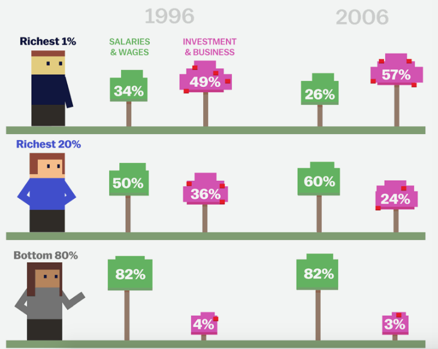
So, as revenue-generating property owners' wealth increases faster than poorer people's wages grow, the gap between rich and poor will tend to increase. There is unfairness built into the system; it works in favour of those who have already accumulated wealth, making them wealthier in a self-reinforcing spiral that requires less and less effort on the part of the wealthier the richer they get.

But why? Wouldn't we expect that financial capital available to invest would be diverted into high-yield 'low hanging fruit' investments first, and that over time, competition over these promising investments pushed the returns down? 

For sure, improving technology would offer new investment opportunities, but in principle, even that should lead to more competition and eventually reduced yields for investors. Why then did Piketty find that the return on financial investment outstripped the growth in wages over the long term? ^[And then, if wealth is consequently better distributed, the option of more leisure time and less toil, as Keynes once hoped for]

To answer this question we have to distinguish between the two meanings of the word 'investment.' The first and primary meaning of 'investment' is the creation, or construction, of a new physical asset; for example, imagine a manufacturing company investing in new equipment. This is investment in the *economic* sense.

The second meaning of the word is in the *financial sense*. I invest if I buy a financial asset which I hope will give me a financial return. This is 'investment' in the financial sense.^[We can also talk of 'placing our money' somewhere, and French has a separate word for a purely financial, not real, investment - a '*placement*'] There are some financial investments that are also economic investments. Classical economists talk about factories as 'capital' goods. ^[The related distinction between capital and land (in classical economic terms) is considered in more detail at the end of the chapter on land] Such investments are *expandable*. As new funds become available, more factories are built. An investor who builds a new factory competes with another factory down the road. The competition reduces prices and the rate of profit falls overall. Even purchasing pre-existing assets can sometimes be part of this process, if the underlying asset is expandable, and that purchase leads to some physical investment elsewhere in the system. 

But there are some financial investments that are not economic investments. We describe these as 'pseudo-investments.' The critical thing about these pseudo-investments is that they are not expandable: they are fixed. *Their return is not competed away* when funds are plentiful. Rather, the price of these assets goes up. A typical example is land. The amount of land in central London is fixed. It cannot expand. Another example would be shares in monopolies, or even other companies existing outside the perfect competition beloved of economists.

So what does this mean for the inequality of wealth? Well, if wealth is primarily composed of 'expandable' forms like factories, then greater availability of investible funds will lead to better growth. That growth will compete away the returns of investors as the profit rate falls. If however wealth is composed primarily of non-expandable forms like land and companies in monopoly positions, then as individuals save and demand assets, these assets will just go up in price, making the richer even richer.

These methods of the rich getting richer are not only unfair, as the monopolist or landowner need not work for the increases in wealth. They are also economically inefficient, as the monopolist overcharges and also pulls scarce investment funds away from productive investments.

The MIT PhD student Matthew Rognlie noted that Piketty's conclusion depends on housing being included in what Piketty calls 'capital' (wealth) [@Matthews]. Without housing, the return on wealth ownership no longer outstrips the growth in the economy. The share of GDP going to capital when housing is excluded is even falling slightly. 

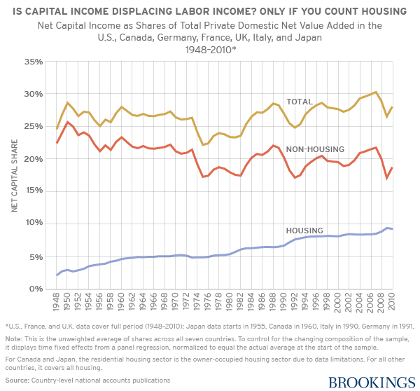

This is consistent with our argument, since housing is closer in nature to land (i.e. non-expandable with a local monopoly) than capital in the classical economic sense (i.e. expandable and competitive). To properly test our hypothesis (that it is the monopoly element - land in housing, market power in companies - that causes inequality) we'd need to disaggregate the land element from housing (relatively straightforward) and the monopoly element from companies (much less straightforward). However, the data is at least broadly supportive of the case suggested by Piketty's economic hypothesis.

# 8.15 The Underlying Drivers

To summarise, economic theory tells us that there are some particular ways in which the wealthy are able to accumulate wealth which we propose to be unfair and unproductive to the economy: Land, Monopoly, and the interplay between interest rates and asset values. 

## Land

Wealthy people make a large proportion of their wealth through increases in the value of land which they own. When we talk about land, we are primarily concerned with the land on which urban buildings stand. This is the part of its value associated with *location*. Land is fixed in supply, and when certain locations become more desirable (such as London), supply cannot increase to meet demand. 

The result is a localised price increase and an increase in wealth of people who own land in the area. It is important to remember that this value was not created by the landowner, but rather by the people who made the location more desirable. These external value drivers include the government, by creating transport links, schools, and parks; business owners, by creating jobs, cafes, shops, and services; and the community, by building community-links and cultural ambience. All of these creations increase the desirability of the land in a particular location. This in turn increases its value. Under the UK's current system, the landowner is able to keep this value increase.

We believe this is unfair, since the community as a whole produces the wealth, and we propose a Land Value Tax to address this unfairness. We go into detail about this topic in chapter eight.

## Monopoly

>*"The head of one of the largest manufacturing firms in the United States said to me recently, "It is not on our ordinary business that we make our money; it is where we can get a monopoly." And this, I think, is generally true."* [@George]

A 'monopoly' is a stranglehold on a particular desired product, asset or service. As in the case of landowners, who are themselves a sort of monopolist, monopolists get rich because of a lack of competitors in the market, which allows them to set nearly any price they like. This means that their profits are far above the efficent level that would be set in a freely competitive market. Natural monopolies can exist when the economies of scale in running a particular business mean that it is more efficient to be large, and market share is captured on a winner-takes-all basis. The figure below summarises concepts of competition and monopoly. 

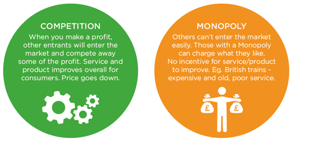

## As Interest Rates Fall, the Value of Assets appreciates

Another effect is closely related, and acts to accentuate monopoly effects. As real investments get exhausted, rates of return on real investments may fall. In addition, the central bank can cut its interest rates to stimulate the economy. This encourages people to take on loans, and through high indebtedness, we can get accustomed to a low interest rate situation. This relationship has important price effects on land and other monopolies.

Wealthy people can see increases in their wealth when interest rates go down. The interest rate determines the ratio of the return on an asset to the capitalised value. For example, as interest rates fall, people can afford to borrow more to buy a house. There will therefore be an increase in the ratio of the purchase price of the house to the rent that such a house will command. This is also true of other forms of wealth, like company shares. Of course if the interest rate goes up, then the opposite happens. Since the early 1980s, there has been a fall in interest rates to the current historically low levels. Asset values have accordingly ticked up. 

The figure below summarises how these factors can contribute to increased income inequality.

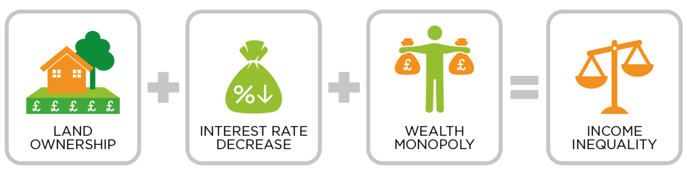

# 8.16 Options for Taxes on Personal Income

Income Tax and National Insurance together account for around half of all revenue raised. These taxes are likely to be important for the foreseeable future. Income tax is important as a tax on wage income and on income from investments.  It is also the primary means of affecting the distribution of income using the tax system. However the existing approach is, like the rest of the tax system, unnecessary complex. Income tax, and its close cousin National Insurance (which we combine into a single tax) are also extremely efficient ways of raising revenue.

At present, the wage income is largely deducted at source in the 'Pay as You Earn' (PAYE) system. This means that companies administer the payment of income tax. They know how much tax to deduct because every individual has a tax code. The tax code indicates whether the taxpayer pays basic or higher rate tax. 

Some income does not fall under PAYE for example: dividend income. It is impractical for a company to know all the tax codes of its shareholders. Thus, income from dividends needs to be declared by individuals at the end of the tax year alongside income tax paid by the individual concerned. At present, corporation tax is paid on profits, and the income tax paid on dividend income is reduced by an equivalent amount to compensate. 

## Simplification Options

We can distinguish between tax simplification and the addition of a basic income.

First, lets look at tax simplification. We can simplify the tax code through the following procedure. First put the income tax and NI system together for earned income, and apply the same rates to unearned income as earned income. Then, you would consider the top rates of tax (Income Tax + NI). We keep these as they are now, and then apply it to lower tax bands. At the same time increase the personal allowance. The two procedures can ensure that nobody pays more tax on their earned income than they do at present. 

- Option 1 is this zero-high rate system (ie a large personal allowance plus a top rate)
- Option 2 is the same system, but with a low rate (no personal allowance) plus a high rate. A small basic income can be added.
- Option 3 is a basic income plus the high rate flat tax

With a flat system, everyone faces the same tax rate. There is no need for a separate tax code for each individual. All income can thus be taxed at source. This would also brings the taxation of dividends into the income tax system, which would therefore mean there is no need for a corporation tax on the part of company profits that is paid out as dividends. We still, however, need a tax on retained earnings.

The disadvantage of a flat tax system is that it is less progressive than the other system.

## Conclusions

We propose to combine the current National Insurance and Income Tax systems so that there is a single tax on income. We also propose to simplify the rate structure so that there is only one rate above the allowance. Having a single rate allows the tax system to be made considerably simpler, and permits taxes to be deducted at source.

# 8.17 Overview of Possibilities for Taxing Wealth

## Source-based Private Wealth Taxes

In general, we prefer to recommend source-based wealth taxes rather than residence based taxes. In other words, we propose to tax income-generating assets located in the UK. The advantage of this approach is that these assets are typically less mobile than the individual. This reduces the risk of tax avoidance. However, there may be a case for an internationally coordinated residence tax as well. 

## Residence-based Private Wealth Taxes

Because of the source-based wealth taxes we have suggested above, such a tax would not need to be set as stringently. However, risk of avoidance by the rich may be high because of their access to skilled legal advice and mechanisms to move their assets to the most advantageous locations. It may therefore be necessary to impose an international residence-based wealth tax.

We propose to consult with European and other partners so as to put in place an internationally coordinated wealth tax. The objective would be to ensure that the richest in society do not get richer faster. As outlined in previous chapters, the increased rate of growth in wealth as compared to the growth in average incomes contributes to the compounding of inequality. For a variety of reasons, this is not a desirable outcome. To that end, we aim to form a coalition with other countries to promote transparency, and create a single coordinated residence wealth tax. However, getting international agreement consensus on such a policy would be difficult and time consuming, and so should not be relied upon.

## Conclusions

We will apply a source based approach which minimises the possibilities for avoidance, including a land value tax. We will cover this in the next chapters on Corporations, Land and Finance.

# 8.18 Summary

We've seen that wealth and income inequality can have deleterious social effects. We've noted the importance of income tax as a progressive tax reducing income inequality. We've also noted three methods of wealth acquisition that are both *economically inefficient* and *unjust:* Land ownership, monopolies, and related unearned capital gains due to falling interest rates. In the next two chapters, we will look at corporate structures; after that we will consider land; and finally, environment and resource rents.

---

# CHAPTER 9: CORPORATIONS

We suggest methods for combatting the scourge of tax evasion. 

# 9.1 Corporations

 Individuals with sufficient earnings pay national insurance and income tax. People who buy goods and services pay VAT. It stands to reason then that companies which consume goods and services, and earn profits in the UK, should also be liable for tax. For what exactly is a company but a collective group of people organised into delivering a certain good or service?

Despite this being a seemingly uncontroversial proposition, there is a minefield of controversy surrounding corporation tax. Several different taxes are currently levelled on companies that operate in the UK, including corporation tax on their profits from their business operations, and business rates on the rateable value of their land and buildings. Several loopholes and rebates exist which aim to keep companies pacified against having to pay increased levels of tax. However, these loopholes often overstep the mark and leave corporations which, despite in reality conduct the majority of their business operations within the UK, are able to claim a foreign base and avoid taxes all together. 

In an increasingly globalised world, national governments now have to tread a thin line between levying sufficient levels of corporation tax, and maintaining an attractive enough environment to induce corporations to remain in the country, rather than relocating their base to a less 'expensive' region in the world. It's a difficult task, and the complexity of determining effective tax rates domestically while coordinating with a myriad of different international standards and regulations means that these loopholes are difficult to close. 

However, lest we forget, corporation taxes are an important source of revenue for a Government which provides the employees of these companies, and the companies themselves, with a variety of public goods that enable them to function successfully. Everything from high-quality national education to effective public transport assists corporations in operating a successful business. It's important, then, that these entities pay their fair share. 

Knowledge is Power. In this chapter we aim to empower the reader with information about what exactly the corporation tax landscape looks like in the UK and how it operates, and explain why the current framework permits certain problems to persist. 

It's worth then outlining some definitions before we enter into the murky world of corporation tax law administration. 

Corporations are, in their most basic definition, a large company or group of companies authorized to act as a single entity and recognized as such in law. A company is a collection of individuals who have grouped together to provide a professional service or some kinds of goods. These companies and corporations are legal constructs. They have no *real* presence in the world, but are legal forms ultimately owned and controlled by a person or people. 

A limited company is a legal form where the financial liability of the owners is limited to the net assets of the company. In other words, a company can go bankrupt and the owners of the company have some protection from the company's creditors. Corporations are the legal forms which are dominant in our modern political economy and, much like religious organisations and educational institutions, wield enormous power.

# 9.2 Corporation Tax

Corporation tax is a tax on company profits. In simple terms, profit is the difference between sales revenue and company costs. In this, there is an analogy with a general principle of taxation, which says that those who have more should pay more. With respect to corporations, those companies who make more profit, should pay more corporation tax. In the UK, this is currently set at 21% for companies with annual profits over £300,000 [-@HMRC2019a]

In the UK, Corporation Tax is a tax payable on the profits of doing business as a limited company, of a foreign company with a UK branch or office or club, or of a co-operative or other unincorporated association. ^[An unincorporated association is an organisation set up through an agreement between a group of people who come together for a reason other than to make a profit (for example, a voluntary group or a sports club).]

Such organisations will pay corporation tax on the money they make from:

- doing business (referred to as 'trading profits')
- investments;
- selling assets for more than they cost (referred to as chargeable gains).

If the company is based in the UK, it must pay corporation tax on all its profits from both the UK and abroad. If a company isn't based in the UK but has an office or branch here, it only pays Corporation Tax on profits from its UK activities. 

Corporation tax is not the only tax on companies. Companies also pay business rates, which is a tax on the rateable value of land and buildings. This is covered in the part on section on land and property.

## Rates and Reliefs

Companies pay corporation tax at the rate which applied during their accounting period. The current corporation tax rate on company profits is 21%.

More complex calculations are also required for: associated companies^[One company is associated with another if either one company controls the other or both companies are controlled by the same companies or people]; companies that have more than one applicable rate during their accounting period; and companies that have an accounting period of less than 12 months. There are also different corporate taxation rates for 'ring fence profits' of companies involved in oil extraction in the UK or UK continental shelf. 

When preparing the company's accounts, the costs of running the company may be deducted from revenues. Anything which a company director or employee gets personal use from must be treated as a 'benefit.' It may be necessary to pay tax on these items. It may be possible to claim capital allowances on assets kept for use in the business - for example, machinery, equipment and business vehicles. Some other reliefs are also available for specific cases, such as where the business is involved in the creative industries or involved in research and development.

Organisations must calculate and report their own tax obligations. There is no bill from HMRC. Rather, they must register for corporation tax within three months of doing business. There may also be a penalty for late registration. 

## Ring-fenced Companies

Different corporation tax rates apply to companies that make profits from oil extraction or oil rights from UK-based resources. These companies are designated as 'ring-fenced' for reasons of national energy policy and security. Such companies can claim marginal relief on profits between £300,000 and £1.5 million. 

## Registration

Registration can be done online, and companies require their unique taxpayer reference number, which usually will have been posted to them by HMRC after the company was registered with Companies House. 

While registering, companies also need to inform HMRC of:

- the company registration number
- the date they started to do business (the accounting period will start from this date)
- the date the annual accounts are finalised.

## Accounting Records

In order to calculate how much to pay, companies must keep accounting records. HMRC has strict and detailed requirements for accounting records. If such records are not kept, companies can be fined £3,000 by HMRC, or individuals may be disqualified from being company directors. It is necessary to keep records for six years from the end of the last company financial year they relate to. 

## Tax Returns

When companies or associations receive a 'Notice to Deliver a Company Tax Return' from HMRC, they must file a company tax return. They must still file a return, even if they have made a loss or have no corporation tax to pay. The tax payable should usually be paid 9 months and 1 day after the accounting period. This accounting period is normally the same 12 months as the financial year covered by a company's annual accounts.

The tax return is due within 12 months after the accounting period it covers. There are various penalties for late filing. If the return is six months late, then HMRC will send a 'tax determination' to say how much tax the organisation must pay. Organisations cannot appeal against a tax determination.

# 9.3 Competing Narratives

## The Need for Corporation Taxes

When it comes to corporation tax, there are two competing narratives at play. The right-leaning microeconomic story posits corporations as wealth creators and suggests that they should be taxed lightly. According to this narrative, corporation tax creates 'distortions.' Reducing corporation tax encourages business to invest and to make profits, and, in so doing, employ more people and provide more useful goods and services. 

The more left-leaning story is focused on the macroeconomic picture. If an economy is 'wage-led' (as most economies are), then the theory goes that boosting the wage share will lead to increased aggregate demand. The profits and capital gains of companies in the end simply make the rich richer, and the rich spend a smaller proportion of the income than the poor. So a higher corporation tax could promote economic growth.

So what is the truth? Why should corporations pay tax on their operations? It seems obvious that as both wealth creators in an economy, and consumers of public services, there is a clear need to balance the needs for revenue, and to account for the value corporations derive from public goods and service provisions, alongside the need to maintain an attractive enough environment to encourage them to settle nationally and employ a national workforce. There are two sides to any coin, and we'll explore these arguments below.

## One Side of the Coin: Why Tax Companies?

A corporation tax is a tax on company profits. It generally covers both profits retained within the company (retained earnings) and those paid out as dividends (distributed earnings). A credit is applied to distributed earnings so tax is only paid once. But should we have a corporate tax at all? Since companies are owned by individuals, might it not be simpler to tax individuals rather than companies?  

It might be clearest to define the functions of a corporation tax first. At the simplest level, it functions as an at-source tax on company profits made in the UK. This has a number of purposes, including regulating foreign ownership of wealth and assets in the United Kingdom; preventing companies from being used as vehicles for low-tax saving; and ensuring that companies pay a fair share of the cost for the government services provided to the company (e.g. enforcement of property rights, education of the workforce, health care provision).

There are also several pragmatic reasons for the application of corporation tax, which be explore below. 

## Reason 1: Revenue

Corporation tax makes up approximately 8% of HMRC total receipts. It is the fourth biggest tax in terms of receipts after Income tax, VAT and National Insurance Contributions, although in the wake of the financial crisis income from the corporation tax fall significantly, from £46.3 billion in 2007/08 to £39.3bn in 2013/14 [-@UKParliament2015]. 

A small number of firms pay the vast majority of income tax. According to the Oxford Centre for Business Taxation, 1% of all companies account for 81% of receipts. Income from the corporation tax is strongly correlated with the business cycle and so can be very volatile. The below chart shows the relationship between the state of the economy and receipts from corporation tax [-@UKParliament2015]. The vertical axis is the annual change in corporation tax receipts, and the horizontal axis is the annual change in economic output, between 1979/80 to 2013/14.

At the time of writing, receipts from Corporation Tax are surprisingly high, with the UK government raising £56 billion in the 2016-17 financial year, which is an increase of 21% from the previous year [@Miller2017]. This is forecast to decrease to £53.2bn in 2017-18. Onshore receipts are projected to fall to 2010 levels, as the below chart from the Institute of Fiscal Studies shows. 

The current level of receipts from Corporation Tax have been attributed to several factors, including a general growth in the UK economy, increases in the profitability of UK corporations, a fall in investment spending (because companies can offset some investment against profits), and increased government focus on combatting tax avoidance [@JacksonHoulder]. 

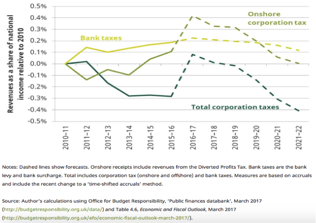

*Private Companies Rely on Public Services Too:* Corporate profits are not totally independent of public investment. Corporations require a number of public goods to run their companies successfully - among other things, educated and healthy employees, smooth roads and public transport systems, and power grids and telecommunications systems. They thus rely on tax-financed public goods, including social investment in the education and health of employees, public infrastructure, legal contracts and property rights. 

## Reason 2: Tackling Rent

****Another reason for corporation tax concerns economic rents. Economic rents are basically the analogue to land rents: Whereas it is assumed that high profits would be competed away by other companies, in some cases this is not possible because the company has some advantage that cannot be replicated by others.

The OECD describes these as 'profits above the normal level of return required for a business to be successful. Economic rents mainly arise as the result of monopoly profits or market power and entrepreneurial skill or ideas.' There are many kinds of economic rent. For example, monopoly profits gained from exclusive rights to intellectual property (patents), which prevent competitors from entering a market (and thereby lowering prices through competition). 

Nicholas Shaxton offers further examples:

> *"[rents] like oil money that flows effortlessly into Saudi or Kuwaiti coffers - are earnings that arise not from hard work and real innovation, but from accidents of nature or good fortune. Adair Turner recently explained how banks in the City of London are particularly adept at earning rents, such as from exploiting insider knowledge and expertise; from natural oligopolies in market-making and other activities; and from "valueless" trading activity."[@Shaxson2011].*

It would be ideal to design corporation tax so as to tax economic rents only, thereby avoiding market efficiency losses. Companies which hold a monopoly over certain goods and services collect economic rent due to a lack of competitive pressure. Corporation tax could recoup such rents and redistribute those funds to the public.

## Reason 3: The Backstop

Individuals can have income from employment and from owning assets. The tax on this income is levied through the UK's 'income tax' and 'National Insurance' systems. We call the tax on profits of companies 'corporation tax.' Sometimes different terminology is used: the income tax is called the 'personal income tax' and the corporation tax 'corporate income tax.'

Income tax is levied not only employment income, it is also levied on distributed profits (dividends). Profits distributed as dividends are taxed twice: Once under the corporation tax and once under the income tax system. The rate of income tax paid on dividends is lower to account for the corporation tax already deducted.

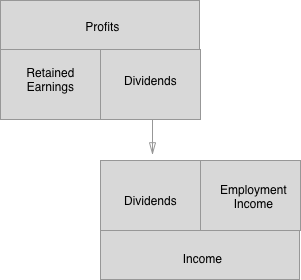

The country where a company actually does business and the country of residence of the company's owner are sometimes different. This means that profits could be made in one country and then distributed to an owner resident in another country.

Corporation tax acts as a sort of backstop to the income tax system. Corporation tax is paid on profits. Profits can, in turn, be retained within the company (retained earnings), or paid out as dividends to the owners of the company. Dividends are subject to income tax, but since corporation tax has already been paid on net income calculated before dividends are distributed, a deduction is made for that purpose. The tax paid on dividends will depend on the residence of the person receiving the dividends. Foreign owners of UK companies are not caught by UK income tax, but the existence of corporation tax does capture some percentage of net income.

It can be difficult to tax individual wealth for two main reasons. First, rich people are geographically mobile and can move to the lowest tax jurisdictions; second, people can hide offshore wealth in foreign and secret locations. It is difficult to tax individuals on their global wealth - but it is not impossible. In relation to income tax, the US does attempt to tax US passport holders on their global income. So it should be possible to apply the same principles to wealth as well.

Corporation tax prevents at least some of the avoidance associated with corporations as a legal form. Without a corporation tax, wealthy individuals could *shelter* their income in a company. A company does not necessarily represent a business, nor is a business necessarily incorporated. For example, an individual can be paid through a fully-owned company, and then offset some costs and smooth wage and dividend payments so as to minimize higher rate income tax on their earnings. In this sense then, corporation tax is an essential companion to the personal income tax system.

## The Other Side of The Coin: Arguments Against Taxing Corporations

## Objection 1: Economic 'Distortions'

When taxes cause corporations or individuals to behave differently than they otherwise would, for example by moving their headquarters to another country, the taxes are said to cause distortions. Taxes on corporate profits are thought to be particularly distorting, in that they create and negate a variety of incentives which result in significant behavioural changes by corporations and those who invest in them. Researchers Johannson et al, in their 2008 OECD Working Paper, observed that corporation tax is likely to have many kinds of effects:

>*"The corporate income tax is likely to distort the total amount of investment and the type of investment projects that are undertaken, the corporate sources of finance (debt, newly issued equity or retained earnings), the location of the corporate tax base, the choice of a business legal form and the tax might have an impact on corporate mergers and acquisitions."* [@Johansson2008]

The researchers suggested that, when different taxes are ranked from least distortive to most distortive, recurrent taxes on immovable property are the least distortive tax instrument, followed by consumption taxes (and other property taxes), personal income taxes, and finally corporate income taxes being the most distortive ^[This is in terms of reducing long-run GDP per capita].

In particular, these distortions are likely to negatively affect economic growth. There is evidence that corporate income taxes negatively affect economic growth. Research by Lee and Gordon examined data from 70 countries which covered the period 1970 -1997. They found that, after correcting for other variables, the corporation tax rate was 'significantly negatively correlated' with economic growth. They suggest that that cutting the corporate tax rate by 10 percentage points can increase the annual growth rate by around 1.1%. The authors explained these findings by suggesting that lower corporate tax rates may encourage more entrepreneurial activity, with more people choosing to leave employment and start businesses. They also noted that lower corporation tax rates seem to be correlated with lower personal tax (income tax) revenue, which would be consistent with such a theory. The authors stressed that

>*"the growth effects of tax reforms, as well as the more standard efficiency and equity effects in a static context, merit serious consideration."* [@Lee2005].

There is a kind of distortion which is particular to corporation tax. This is the 'debt-equity' distortion. This results from an asymmetry at the heart of corporation tax, whereby the return on equity is taxed, but interest payments on corporate debt are tax deductible. This can increase the risk of bankruptcy and encourage tax-minimisation strategies through taking on more debt. Writers on an IMF blog argue for 2 ways to mitigate debt bias: To limit the tax deductibility of interest or provide a deduction for equity costs [@DeMooij2016].

## Objection 2: Who really pays the piper?

In some ways, corporation tax can be thought as an indirect tax on those who are owners of capital.  These owners may be individuals or shareholders of corporations, who gain or lose value through changes in the value of their shares or through the receipt of dividends after a company gains profits through their operations. Notably, the corporation tax burden falls mostly on capital owners, rather than employees, because stock ownership is most concentrated amongst the wealthiest individuals and family trusts. [@Shaxson2011]

Because corporations are not natural persons, but are legal constructions, it has been argued that Corporation Tax is not paid by corporations but by people, and that sometimes these people are not the ones we might prefer to target.

Economist Helen Miller made the following argument in 2017, when she said that "an important feature of Corporation tax is that the ultimate burden is not necessarily entirely borne by company shareholders. It can be borne by workers. In short, if firms decide to respond to higher corporation tax rates by doing less investment in the UK, that leaves UK employees with fewer job opportunities and lower average wages. Evidence suggests that, because capital tends to be much more mobile than workers, a significant share of the burden of corporation tax tends to get shifted to labour. Corporation tax can also be borne by consumers if firms respond by increasing the prices they charge."*[@Miller2017]

However, others have argued that it is unclear whether corporation tax falls largely on employees, and have made the wry point that if Corporation tax doesn't fall on the owners of capital, then why do so many companies try to avoid the tax?

# 9.4 Loopholes in the Law

As has been demonstrated in the previous sections of this chapter, most governments rely on corporation taxes and income taxes as a substantial source of revenue by which to pay for public services, and they regulate the activities of companies within their borders. However, "recent economic developments, and particularly the increasing globalization of capital markets, has made enforcement of national income taxes increasingly difficult." [@Roin2007] Too often, the author says, existing tax systems result in the domestic income of foreign corporations "ending up taxed nowhere." 

## Concern 1: Tax Avoidance

Because corporation tax is based on net income (pre-tax profits), it is vulnerable to clever accounting tricks which exploit differing tax rules in different countries. To illustrate this point, we use a case study of Apple Corporation's corporate tax avoidance.

In 2016, the technology company Apple, accustomed to great praise, received a taste of bad press, but not for its new iPhone model. Rather, its tax arrangements attracted scrutiny from the European Commission, which demanded that Apple pay up to £13 billion (plus interest) for unpaid taxes in Ireland. Both Ireland and Apple condemned the decision, claiming a right to create an agreement between a sovereign nation and a private company. Thus arose a farcical situation in which the Irish government brought legal proceedings in order that they not receive £13 billion in back taxes.

In fact, the agreement between Ireland and Apple allowed the tech company to pay a maximum effective tax rate of only 1% of their profits, a classic sweetheart deal. The standard corporation tax rate in Ireland is already quite low compared to other EU countries, at 12.5%. The arrangement between Ireland and Apple was complex. Apple created two subsidiary entities in Ireland, which effectively own most of the company's intellectual property. These organisations then licensed the intellectual property to Apple subsidiaries elsewhere in the world. Thus, profit earned in countries around the world is transferred to the Irish companies, ostensibly in the form of (obviously bogus) license fees. This income would normally be taxed at 12.5% in Ireland, but the agreement between Apple and Ireland allowed the profits to be attributed to a 'head office,' not located in any country (and thus not subject to tax in any jurisdiction). The result was that Apple paid only 1% tax on its European profits in 2003 and 0.005% in 2014.

According to the European Commission, this arrangement amounted to a form of state aid and was illegal for EU members. The European Competition Commissioner, Margrethe Vestager, argued that the deal was unfair to other businesses, stating:

>*"Our rules don't stop governments applying a law rate to every company...what they can't do is to select just a few favoured businesses and give them special treatment which their rivals can't get. So, when we ask national governments to reclaim unpaid taxes, all we're doing is ensuring that everyone has an equal opportunity."* [@Vestager2016]

## Concern 2: The 'Race to the Bottom'

The foregoing discussion illustrates the underlying tensions between governments and corporations, and the growing difficulty facing governments who attempt to tax corporate profits in a globalised world. Multinational companies which wish to minimise their tax bill are willing to move around and create complex tax structures to achieve this goal. Countries seek to attract investment and gain income from corporation tax. In the case of Ireland, the government has positioned itself as a low tax country in order to attract investment and create jobs. This dynamic between corporations and governments creates a *race to the bottom* in which governments compete to attract companies by lowering their corporation tax rates. The below chart compares the rates of Corporation Tax around the world. [@Miller2017]

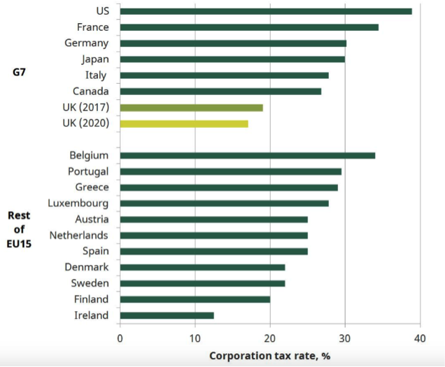

As can be seen in the chart, the UK's main rate of corporation tax will decrease to 17% in 2020. The stated objective of this reduction is to create a more competitive corporate tax system to provide the right conditions for business investment and growth. Government analysis suggests that the change will reduce income to the Exchequer of £120 million in 2019-20 and £945 million in 2020-21 [@HMRC2015]. The chart below, from the Institute of Fiscal Studies, shows the revenue cost of past Corporate tax rate reductions, and the projected cost of future cuts [@Miller2017].

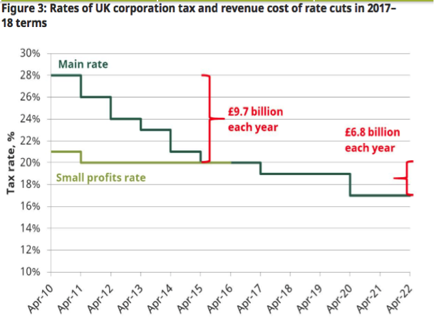

The picture is similar elsewhere. In 2015, Japan, Spain, Israel, Norway and Estonia decreased their corporation tax rates, and Italy, France, Japan and the UK had announced plans to do so. 

These trends in corporate tax rate have a bearing on issues concerning wealth and income inequality. Tax Justice campaigners have warned that as governments have reduced taxes on corporate profits, they have increased the rates of VAT, fuel, and car taxes. The chart below shows the increase in the OECD average rate of VAT from 2000-2015. We can see a steady increase in the VAT average after 2009.

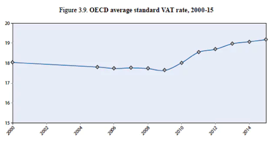

VAT and fuel taxes disproportionately affect lower income earners. According to the Tax Justice Network, after lowering corporation taxes, "Governments make up the shortfall by levying higher taxes on other, less wealthy sections of society, or by cutting back on essential public services." A concern on the other side of the argument is that if higher corporation tax reduces the return to company shareholders, this will not only affect wealthy people with directly held shares, but also older people with private pensions. 

## Concern 3: Ring-Fencing Bads

A final concern with the corporation system as it currently stands lies in the ringfencing of domestic fossil fuel companies. Allowing marginal relief on profits made by these companies is, in fact, a subsidy on their operations, and, in effect, a subsidy for the externalities which their carbon intensive operations create. 

With a stated commitment to lower UK emissions by 80% by 2050, this tax subsidy is clearly incompatible with national goals. Clearly, a change in tax policies could be instrumental in shifting incentives for energy companies away from fossil fuels production. As it stands, however, no such incentives exist within corporate tax policy. 

# 9.5 Reform 

## Ambition and Goals

Substantial reform of the corporate tax system are clearly in the public interest. Inasmuch as the space and issues around corporation tax are complex and challenging to comprehend, so too is their reform. How best to balance the question for fair and sufficient tax revenues against the increasingly mobile nature of companies is a question that numerous academics and politicians have tried to solve. Building on tax-based incentives to create social 'goods' is another layer of complexity in the mix. 

With any question of reform, it is important first to establish the goal to which we are working. With corporation tax, our ideal is: A system of company taxation that rewards exporting companies and all those that invest in physical capital expenditure in the UK. We're also interested in taxing a fair share of the wealth and income of the owners of corporations. 

Any reforms should be applied in such a way that they are not easily avoidable or evadable, and treat companies fairly. Preventing an international 'race to the bottom' is also a key priority. International cooperation on tax policy is the ideal, but designing a tax policy that doesn't compete on lowering taxation rates is a strong alternative solution. Supporting the creation of social 'goods' and discouraging 'bads' is also a core objective of any reform. Lastly, creating an attractive environment for exporters could improve the UK's historically poor balance-of-trade performance. We suggest reforms of VAT and existing corporation tax system to achieve these outcomes, through the unification of both components under a *company cash flow tax*. 

## Options For Reform

For context, in this section, we'll begin by examining a number of possibilities for reform of corporation tax, including unitary taxation, the cash-flow tax, and potential tax-rebates for the creation of social goods, before moving on to discussing what the optimal options could be for the fairer society we'd like to create.  

## Option 1: Unitary Taxation

A rose by any other name would smell as sweet. The same goes for Unitary Taxation, or 'Formulary apportionment' by its slightly more descriptive title. This method of taxation tries to tackle the mobile nature of multinational corporations by allocating the profit earned by corporations proportionally to the jurisdictions they operate in. 

Fairness is the idea at the very heart of this proposal: Fair allocation of tax liability to a fair proportion of a multinational corporation's business activities, fairly apportionable to a certain geographical region. 

To illustrate this point, imagine the following. A company with over 1,000 employees in Switzerland, and 1,000 in London is, you'd think, liable to pay taxes in both regions. However, due to two well-sunned board members residing in the Cayman Islands, the company is able to claim that the majority of their business operations take place in this remote tax-haven. 

Said company - let's call it Peach - is able to legally avoid paying taxes in the countries in which it actually operates in reality, by claiming that its core business activities take place in a country that is conveniently subject to a near 0% corporate tax rate. This, it is clear, is a loophole the size of an oil supertanker completely stuffed with bales of $1,000 bills. 

Unitary taxation could be the solution. This term describes a method by which large corporations are taxed by allocating their profits to various operating jurisdictions in proportion to the measurable relative importance of their real regional operations. A confusing plethora of different methods and formulae for determining how much tax should be paid by companies in certain jurisdictions can be replaced with a single method for calculating tax liabilities: the so-called 'Massachusetts formula.' 

The Massachusetts formula was initially proposed for use in the United States for allocating the profits of corporations between various states in which they operate. The formula takes the total worldwide profits of a corporation, and applies to this a weighting based on the proportion of business operations located in each country or state in which the company operates. 

The formula weighting has three components: The proportion of sales, the proportion of assets, and the proportion of employees in each jurisdiction. One calculates the average of these three proportions for each region of operations. This average weighting is multiplied by the global profits to determine the tax payable in the jurisdiction.

In mathematical terms, the corporation tax paid in jurisdiction i is given by:

$$CorporationTax_{UK} = t_{CT} * Weighting_{UK} * Global Profits$$

where $t_{CT}$ is the tax rate and

$$  Weighting_{UK} = \left( \frac{1}{3} \right)* \left( \frac{Sales_{UK}}{Global Sales} + \frac{Assets_{UK}}{Global Assets} + \frac{Employees_{UK}}{GlobalEmployees} \right)$$

This picture from the Tax Justice group illustrates the change in a slightly more reader-friendly format. As it demonstrates, the change to unitary taxation would fairly apportion tax liabilities according to the percentage of actual business operations that occur in different regions. [@TaxJustice2019]

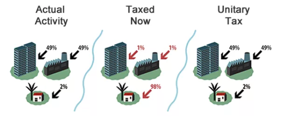

The benefits of such a system are clear, and public support for the system would likely be broad. However, the simplified nature of the calculation does not incorporate the difficulty of enforcing such a policy, nor the problem of incentives for countries to relocate to cheaper countries and export their goods and services from there to the UK market. 

There are also issues around the steadily loosening ties between financial reporting and tax. Increasing reliance and coordination on international financial reporting standards (IFRSs) increases the number of elements in a company's accounting framework that are susceptible to subjectivity, such as in the concepts of income and expenses [@Sikka2015]. This weakens the ability for unitary taxation methods to provide the certainty needed for calculating tax liabilities using this approach. Issues exist also with the administrative costs of collecting and translating financial data from different countries into a single accounting metric. There are barriers against achieving successful unitary taxation without greater coordination and harmony amongst international accounting and tax codes. [@Roin2007]

Another mechanism may be better suited to tackling the challenge, as we shall explore next. 

## Option 2: The 'Cashflow Tax' ('Dyson Tax')

Balancing the need to levy corporation tax against the need to mitigate the disincentives it generates is at the heart of the choice facing policy makers in the UK. The crux is how to convince multinationals that it is worth locating in the UK. 

Given the difficulties around applying and administering the Massachusetts formula, can we find an entirely different and better solution to the problems of tax avoidance? One possibility could be a so-called Cashflow Tax, sometimes referred to as the 'Dyson Tax' in this book. 

The Dyson Tax operates as a corporation tax that subsidises companies for spending in a domestic tax jurisdiction. Put more simply, it's a tax on the difference between domestic (UK) sales and domestic (UK) wages and supplier costs. In the language of international tax, such a tax has a 'destination basis' for sales and a 'source base' for costs. Something can be counted as a UK cost so long as tax has been paid on it. So, for example, UK employment income would be counted as a taxable deduction so long as it was subject to income tax. The equation below illustrates this point. 

$$Cashflow Tax_{UK} = t_{CF} * (Sales_{UK} - Costs_{UK})$$

Note that this cashflow tax can be either positive or negative. If a company locates in the UK but sells abroad, this could create a negative cashflow tax. The cashflow tax therefore theoretically encourages companies to locate in the UK, and promotes exporting. Conversely, if a foreign company sells to the UK but has no UK costs, it will face this cash-flow tax on the totality of its UK sales.

In effect, this policy would act as a sales tax, not a profits tax. The benefit of this is that sales are far easier to measure and monitor, and are not subject to the same issues around manipulation with different accounting standards. The incentives are straightforward, as this policy would encourage businesses to locate in the UK tax area. The higher the corporation tax rate in other countries, the greater the incentive to relocate to the UK.

Since the cashflow tax operates on the 'destination' basis for revenue, it is comparable to a Value Added Tax (VAT), the difference being that UK wage costs become tax-deductible. Given our proposals to introduce a comprehensive system of environmental taxation, integrating a cashflow corporation tax with the existing VAT system could be another method to streamline the system and reduce administration tasks.

Let's use an example to illustrate the benefits of such a system. Assuming a cashflow tax rate of 40% for domestic firms, the impacts on imports would become significant. Under the current VAT system, there is a tax on imports and a subsidy on exports, although it is considerably less than this proposed cash-flow tax rate. To encourage international cohesion on these policies, nation states and tax regions which cooperated with this new cash-flow policy would face a discounted rate on imports from these regions. If, for example, such nations were charged a 20% VAT rate, rather than the standard 25%, then payments made to compliant countries would in effect become half-deductible. Excluding tax-havens from this subsidy would further amplify the impacts, and hopefully encourage an international move towards effective corporate taxation. 

This Dyson-tax therefore satisfies two of the requirements for reform, in that it combats the incentives for policy-makers to engage in a race to the bottom on corporate tax rates. It also would provide a boost to companies that export goods and services, benefiting the UK's trade balance. Finally, the administrative ease of this policy in comparison to that of unitary taxation means that for substantial and effective reform, the Dyson-tax has greater revolutionary potential. 

# 9.6 Transforming the Role of the Corporation ^^

What we have proposed up to this point may have seemed ambitious enough. We have tried to work out ways that corporations (especially large corporations) could pay more tax, and to replace the current 'race to the bottom' with a 'race to the top.' In this section our role is even more ambitious: to transform the role of large corporation in our society.

So what is the current role, and what the new role? We can compare corporations with individuals. Individuals have to make a living, but they also have social responsibilities to those around them - their families, friends, communities, and charitable causes. We need large and focused organisations not only for the provision of *private* goods and services, but also *public* goods and services. Quite often, at the moment, these *public* goods are such because there is no private business model for providing them. Could this be changed?

Let's consider some examples. A new and effective antibiotic drug should only be used in the most serious cases. But that means that there is no business model for providing it, if the model for rewarding pharmaceutical companies is based on selling drugs. Discovering, testing, and securing approval of a new antibiotic is very expensive.

Next, consider social media. At present, the business model of Facebook is to find a way to attract people's attention and use that attention to sell advertising. Instagram similarly captures the attention of young people, and encourages them to cultivate their online image. There are very real psychological downsides, which can be measured, from these tools. What if we measured how much social benefit or harm Facebook caused? It's not easy to do, but one proxy might be teenage suicide rates.

How about technology? Here we have a paradox. We need new technologies to tackle our serious problems in many domains, ranging from medicine to transport and energy generation. But once created, we need these technologies to be cheaply available to all. It's not good enough that technologies are patented and kept away from all those except those willing and able to pay a sky-high-fee.

What about fossil fuel companies? At the moment they resist change. But what if we create an incentive for these companies to tackle climate change, in the form of providing payment by results achieved?

In our proposals chapter, we consider the possibility of taxing corporate *wealth*, and then providing rebates based on progress to achieve social goals. Such policies are not easy to design and we do not purport to have solved all the design issues here. But we must try. It would be better to provide a somewhat rough-and-ready estimate of each company's social effect than the present situation where companies are actively incentivised to lobby, conspire, and act against the public interest - as do energy companies who have done so much to stop or slow a transition to a low-carbon energy system for example.

## Lobbying and Change

Change is hard to enact. Of any thousand well-intentioned plans, very few are enacted into reality. With public policy, this is partly due to administrative and costing issues, but also - especially when such policies overlap with corporate interests - due to corporate lobbying, which is one of the most important phenomena of our era, as can be seen that corporations have bullied policy-makers into letting them destabilise the very climate of the planet, upon which all our lives depend, in order to avoid having to go to the trouble of changing their fossil-fuels-based business models. 

This conflict is no more apparent than in the field of corporation taxes. Fierce opposition to increased costs to business has plagued the field of reform, and has held up progress. One potential solution could lie in corporate tax rebates. By tying tax rebates to collective performance on ESG metrics, perhaps this opposition might be overcome. By ESG, we mean environmental and social governance goals: Lowering carbon emissions or greening public spaces, for example.  Even encouraging the transparency of tax obligations and financial reporting could be thought of as a public good. Tax policy could be used to create encouraging incentives. 

These tax rebates exist in some form already. In the UK, Social Investment Tax Relief (SITR) [@HMRC2016] applies to organisations which are thought to have a socially beneficial purpose. Charities, NGOs, and schools can benefit from these tax reliefs. Social Impact Bonds are also potentially beneficial policy tools. 

There is potential to think big with these policies. By expanding the definition of what social objectives are tax eligible from individual company action to collective action, lobbying interests could be neutralised. For example, with carbon emissions, a tax rebate could be given to companies in the sector which clubbed together to achieve collective reductions in sectoral emissions. This would have the dual benefits of achieving the ESG goal of greenhouse gas reduction, and accelerating this process by combatting private interests which had lobbied against change. 

# 9.7 Proposals

"Although taxes are the price of civilization, most people and companies want the civilization without the taxes."[@Roin2007].

First things first: Prior to any reforms, existing tax law, including on transfer pricing, should be enforced effectively. Beyond that, we propose two far-reaching reforms.

## Proposal A: The 'Dyson Tax'

As we have explored in this chapter, the core challenge to overcome with corporation tax is the need to balance collecting sufficient revenue from corporations and companies against the risk of disincentivising these organisations from remaining located in the UK. Our answer is the Dyson-tax. 

We propose to replace Corporation Tax and VAT with a 'cash flow' tax, and taxation at source of all dividends. This is due to the fact that whereas a corporation tax is a tax on 'economic profit,' a cash flow tax is a tax on net receipts (i.e. retained cash flow). Such a policy is therefore a destination-based corporate tax, exempting exporters, capital investment, and R&D from its remit, but including interest payments. The basis of this tax would be UK sales and borrowing, minus costs, dividends, interest and principal repayments. It would therefore exempt capital expenditure and exports. 

In a way, this policy is similar to a value added tax (VAT), where wage expenditures are deductible. Its advantage is that it can be applied across a broad range of sectors, it relies on easily measurable data, and it promotes domestic investment and exports. Moreover, because with corporation tax there is the additional complexity of the global mobility of corporations, a Dyson-tax offers an incentive to locate in the UK. With the existing system, companies can move the jurisdiction they are registered in, and charge losses to high-tax locations and profits to low tax locations. Under a cash flow tax, all sales in the UK are taxed, and only UK wage payments are deductible. If it is applied to all companies that sell in the UK, 'transfer pricing' becomes irrelevant, and it sidesteps the risk of an international 'race to the bottom' among international corporate tax rates. 

##  Proposal B: Decaying International Property Rights: A Wealth Tax on Companies ^^

Whilst a cashflow tax would be very helpful, it doesn't solve *every* issue we have identified. In particular, we want to tax not just *income* (with the cashflow tax as a backstop to the income tax), but also *wealth.* Companies distribute some of their net income to shareholders, but share ownership also confers asset wealth. We believe the first step is to attempt to tax the underlying assets.

Companies can invest in building up a massive monopoly position by pursuing mergers and acquisitions with rivals. Companies can implement strategies to achieve, in the long run, permanent surpluses that won't be competed away. The M&A business is arguably all about exactly this strategy: Reducing the intensity of competition. A tax on underlying assets, rather than incomes, could address this. 

One way to achieve that is by levying taxes of an annual proportion of equity shares in large companies (e.g. 2% per annum), instead of taking in money as taxes. This makes market-dominant oligopolists less effective at transferring rents to private shareholders, at least on a net basis, since the public also become shareholders. 

A Dyson tax, by contrast, is a tax paid on marginal production, not a tax on rents of market-dominant corporations.

Alternatively taxing total market asset value may be a way to tax wealth. By total market asset value we mean the total of a company's equity (as measured by the market) and outstanding debt (book value). This total market asset value would be allocated to the UK according to an apportionment formula, using two factors: UK Sales, and UK Value Added, equally weighted. 

Once this apprortionment formula is defined, one could deduct the value of UK tangible assets as measured for the purpose of land value tax or business rates. We intend not to disincentivise investment in the UK, but the reverse. We are interested in valuing the market's estimate of 'rent.'

Finally, there's another way for companies to rebate their tax: Through contributing to social goals. Applying rebates to sectors based on sectoral ESG goals would be a valuable way to counteract lobbying interests, while achieving social goals. The effect would be to incentivise companies to act to achieve sectoral progress, rather than relying exclusively on regulation from the government. 

Our ideas here are similar to those of Shann Turnbull^[See for example https://papers.ssrn.com/sol3/papers.cfm?abstract_id=437981]. Turnbull suggests that large corporations should feature 'decaying ownership.' If large corporations do not continually invest, then the ownership would gradually accrue to the community. Thus companies should have the option to pay their taxes in equity shares.

Unlike our other proposals, this 'wealth tax on companies' is little more than a first draft. We have described it here as a way to promote debate amongst tax designers and refomers. Expert workshops can be held to assess and develop detailed proposals, but a single tax designer - a figure like Beveridge - should have authority to make actionable proposals to the government.

# 9.8 Conclusions

A reform of corporation tax should be seen as an opportunity to rewrite the rulebook on what taxes can achieve. The concepts of practicality, benefit, and fairness should sit at the heart of any reform of corporation tax policy. With a cash-flow tax, these remits are satisfied. We claim that if it is designed intelligently and administered well, this policy could tackle the issues of tax-havens, raise revenue for essential public services, and promote the creation of social goods. Under this new system, corporation tax could become, instead of a burden to companies and a worry for states, an opportunity for radical reform and collective success.

# CHAPTER 10: LAND AND PROPERTY

## Summary 

- In the UK, buying a house is extremely and increasingly unaffordable for many. This is contributing to other problems, such as homelessness.
- High house prices are due to high land values. House prices go through boom-and-bust cycles due to land price speculation. This is when people buy land in the hope that it will go up in value. This is not a productive investment, one that leads to economic growth, but rather is a 'pseudo-investment' or placement.
- Landowners get free value from the work of the community, such as the building of public transit infrastructure or community investment in local parks. Landowners receive an increase in land values from these external activities, which they themselves have done no work to create.
- Land Value Tax is an effective solution to this unfairness, and to the housing boom-and-bust cycle. It is a tax on land values.
- LVT is a well-established idea, with multiple benefits. It faces some obstacles, for which there are solutions. The biggest may be political feasibility.
- Land has been neglected in neoclassical economic theory, and generally is conflated with capital. However, land differs from capital in important ways. Many current economic problems have arisen from a failure to recognise this distinction.

\newpage

# 10.1 How Bad is the Housing Affordability Problem in the UK?

 is frequently the topic of national debate, but as housing charity Shelter UK warn, we risk becoming so accustomed to the high cost of housing that we end up seeing it simply as a fact of life [@Shelter2010].

The most recent review into this topic was conducted by Lloyds Bank, who found that home affordability (i.e. the ratio between average house prices and local earnings) across UK cities "has hit its worst level in eight years" [@LloydsBank2016]. The report found that the average UK city house price had risen in 2016 to its highest-ever level of £211,880. Average affordability in the last twelve months had increased from 6.2 to 6.6 times annual average earnings. Most notably, the researchers found no cities in the South of England where house prices are less than 7.5 times the average local income.

The below chart shows how the ratio of UK house price to real earnings has changed over time. 

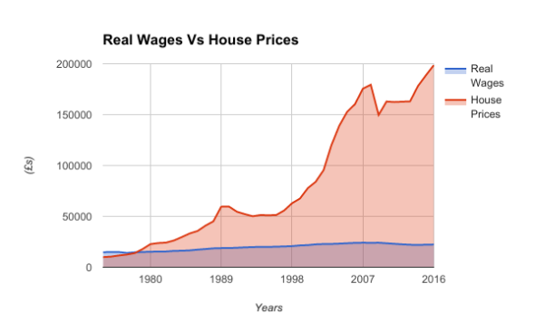

The ratio is the highest it has been since April 2008, at the beginning of the great recession. We can see below that it is particularly hard for first-time buyers to afford a house in London.

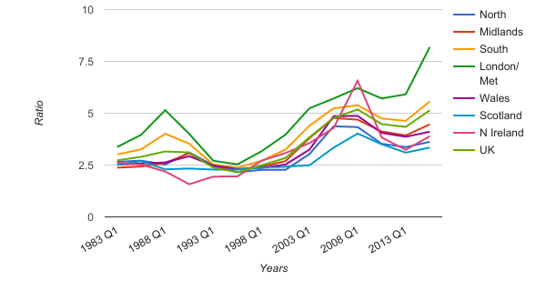

The below chart shows that the gap between the most and the least affordable local authorities has increased since 2002, and this is due to the least affordable areas moving further away from the overall affordability ratio [@ONS2016a].

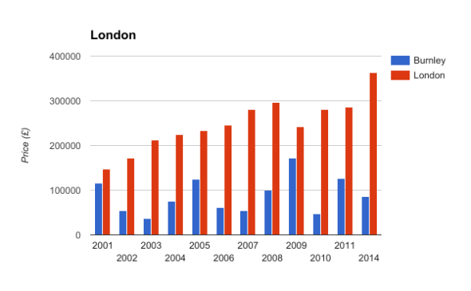

There have also been many demographic changes in housing ownership. The chart below shows the percentage of each age group that are home owners, from 1981 to 2014  [@Ough2016].

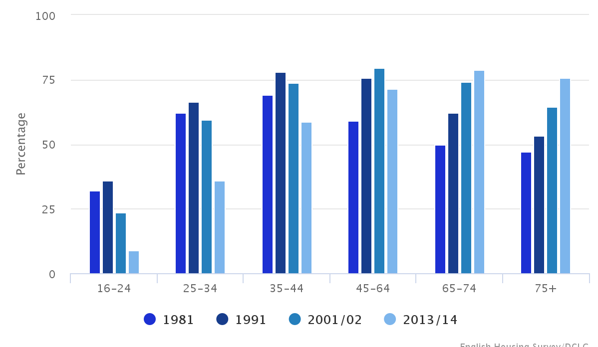

We can see a dramatic reduction in the percentage of people between the ages of 34-44 owning homes, and an increase in the percentage of over 65s owning homes.

##  The Human Impact

The rising cost of housing is also contributing to growing inequality of wealth. The chart below shows the upper bounds of household net property wealth for each 1% of the net property wealth distribution in 2012. 
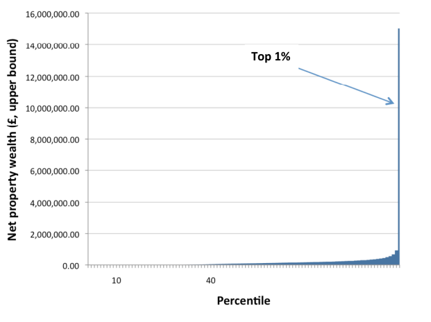

The graph above shows dramatic inequality in property wealth, but it still does not capture the devastating personal effect that unaffordable housing is having on British people. Shelter UK warns that: 

> *"Unaffordable housing plays a vital role in changing the way people live and constraining their choices...the high cost of housing is having an impact on all aspects of life, and raises the prospect that, as a result of a collective failure to find solutions, we could be allowing ourselves to drift into a future where we will all ultimately be worse off."* [@Shelter2010]

A staggering 44% of working families in England (3.7 million families) have had to cut back on essential food and clothing to help pay their rent or mortgage. A further 41% say that housing costs cause them stress and depression [@ShelterEngland2016]. With so many families having to cut back on food and heating expenditures in order to pay for housing costs, it's clear that this is a problem striking at the heart of citizens' well-being.

## Case Study: Michelle and Kevin

Michelle and Kevin rent a small home in Cambridge, where they live with their two children. Kevin works full-time for a cleaning company, while Michelle studies for a career in criminal justice. Kevin had previously been self-employed and his income had dropped so low that they fell behind on rent. With Kevin now in full-time employment, they still struggle to get by.

> *"Even though my husband has a new job now and works as many hours as he can, it's constantly hand-to-mouth. We've cut back on everything to help pay the rent - including food. When the children are at school, the heating isn't on at all, and we only ever buy clothes when we absolutely have to because the little ones have grown out of something."*

Millions of people are experiencing that major life decisions, such as moving out of their parents' homes into their own home, or starting a family, are being affected by the lack of affordable housing. 21% of people aged 18 to 44 said they were delaying having children because of a lack of affordable housing. Worryingly, 36% of this group expected that housing costs would prevent them from starting a family for at least another four years. Shelter UK notes that this will create knock-on effects for the NHS and other public services, as women are forced to delay pregnancy into their less-fertile years:

> *"If women continue to put off starting a family because of housing costs, this could drive up the numbers experiencing fertility problems, putting more people through the trauma of being unable to conceive. As well as the obvious human impacts, such an outcome could also result in additional financial costs to the NHS in the form of increased demand for fertility treatment."* [@ShelterEngland2016]

One of the most surprising findings was that 24% of adults have been forced into continuing to live with a partner they are no longer conjugal with, because they cannot afford to move out, or know someone who has been in this situation. Housing costs are also causing many adults to move back in with their parents, or delay ever moving out at all. At the other end of the age spectrum, housing costs are also making it difficult for adult children to live near to, and care for, their aging parents.

## Case Study : Alan 

Alan lives with his wife in Portsmouth and is an architect. Both of their parents live in Bournemouth. His wife's parents are becoming increasingly frail. Alan and his wife would like to move back to Bournemouth, but their house is in negative equity and house prices in Portsmouth are too high for them. 

>  *"We can't see any improvement in our situation in the short to medium term. What we really fear is that time is not on our side."*

# 10.2 The Cause of the Housing Crisis

If you were riding in a London cab, and were to ask the driver why the cost of buying housing in London is so high, he might say, 'Well, its obvious! It's supply and demand! There is a huge demand for housing in London. Lots of people want to live here!" At face value, this explanation sounds very reasonable; but if I thought a little harder, I might wonder why the cost of other things doesn't increase in the same way. 

The best way to think of this is by picturing another product, like mobile phones. There is very high demand for mobile phones. Almost everyone has one, and like housing, they are generally considered a necessity. However, the cost of phones doesn't keep going up and up. Why not? 

Moreover, we know the housing market has boom and bust cycles, where housing price increase for years and years, and then suddenly start dropping (i.e. housing prices go through boom and bust cycles). Why don't the price trajectories of mobile phones do that?

There is a key difference between housing and mobile phones. Phone-makers can increase the supply of phones essentially at will to meet demand. Housing is different. Housing has to be built on land, and the supply of land is essentially fixed (notwithstanding the impressive achievements of the Netherlands in converting seabottom into land by building dikes and pumping away the water from shallow seas). The taxi driver was right in comprehending that this is an issue of supply and demand. When demand for phones increases, we can increase supply. Prices will stay the same, or even decrease, if an over-supply is generated by competing phone-makers, or process improvements reduce production costs. In stark contrast, when demand for housing increases, as it must when populations increase, we cannot increase the amount of land to build on, so the price of housing (house and land) increases indefinitely. Given rising populations, housing prices are a one-way ratchet.

Though we talk about 'house prices' increasing, it would make more sense to speak of 'land prices' increasing. The supply of land is the factor causing the combined cost of house + land prices to increase - not the cost of actually constructing a house. If we look at valuations in UK regions with high 'house prices,' we see that the land value is much higher than the value of the building sitting on it.

As campaigner Edward J. Dodson states,

>  *"Actually, "house" prices are not increasing. A housing unit is a form of capital good, and all capital goods depreciate over time. The actual value of a house is best defined as its replacement cost, less any depreciation. Thus, the potential selling price of a house has everything to do with the owner's ongoing maintenance and periodic replacement of systems .... Ongoing efficiencies in the production of the materials that go into constructing a housing unit have resulted in a reduction in construction costs per square foot."*

>*"One need look no farther than land acquisition costs for an explanation of why a residential property is an impossible acquisition for a growing segment of the population."* [@Shaxson2016]

If you're not convinced, conside Figure 46 below [@Wightman2013]. This graph compares four important costs relating to housing, and shows how they have changed over time. The lowest line on the graph, 'Build Costs,' is the cost of actually constructing a house. 'House Price' is the value of the house only, and 'Land Price' is the value of the underlying land only. 'Earnings' show the population's average earnings.

We see that while the cost of building houses has remained largely stable between 1986 and 2007, land prices have oscillated dramatically through a boom and bust cycle. The 'House Price' line is most revealing because, while the costs of building houses has stayed the same, the cost of buying them has oscillated - mirroring the 'Land Price' line [@Lloyd2009].

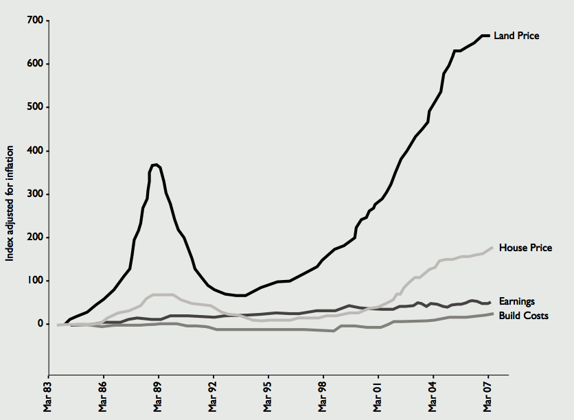

## Why then the boom and bust cycle?

As the population increases, the demand for housing increases. Supply doesn't increase, so we would expect the price to steadily increase. Why then do we see a boom and bust cycle? 

This is because of 'land price speculation,' whereby people buy land in the anticipation that its price will increase. This is a kind of bet (and a fairly safe one at that). When lots of people buy up land because they think the price will go up, it pushes the price up further. There is a fixed quantity of land, so supply cannot respond to demand. It is very difficult, in this environment, for someone to buy a home to live in, because there are plenty of people in the market who simply want land as a way of making money. The price continues to rise until some form of shock occurs, and the value suddenly plummets as people exit the market. After some time, the price starts to climb again as speculators' confidence returns, and they again believe that the land price will increase. So speculation increases the demand for land and causes prices to increase faster and faster.

These land price speculators are treating land as a kind of 'investment.' However, land is not an investment in an economic sense, because no new product or service is produced. No improvement is made. They simply sit on their ownership titles to land, hoping it will increase in value so they can sell it or borrow against it somewhat later in time. 

The impact of land speculation on people who want to buy homes to live in and for renters is obvious. The price of homes goes up and up, and so does the cost of renting. This is also a loss for the economy generally, as money from people's monthly income is spent on rent rather than on other things, which reduces demand for consumer products and hence the jobs involved in producing them. And investors' money is not put into productive investments which benefit the economy, such as new businesses; instead, it is tied up in land speculation.

# 10.3 Fairness and land values

We mentioned that one cause of increased house and land prices is population increase. However, that's not the full story. There are other reasons why some areas may become more in demand and increase in value. In rural communities, it may be, for example, that farmers work to the improve the land itself, say by using new techniques to make the soil more fertile. In most cases though, and particularly in urban areas, land value goes up without the owner making any improvements to the land itself. 

One reason why the value of the land goes up is because of the work of other members of the community in developing the area around a particular piece of land. A bustling high street, cafes, improved public transport, well-kept parks - these are all examples of developments which can come to surround a piece of land and thereby increase its value, even if the owner of that piece of land has made no improvements to it at all. A location tends to become more desirable as a place to live and work because of government and community activity and investment. That is why we may sometimes exchange the term 'location value' for 'land value.'   

Of course the opposite can sometimes occur. We have seen from the experience of the American mid-west that land values can plummet when important local infrastructure or businesses close down, and a local area becomes a less desirable place to live. 

The general trend, though, is for land values to increase. In many cases, a landowner captures a great deal of financial value due to the work of the wider community, without himself incurring any expense or effort. It is appropriate for us to reflect on the fairness of this arrangement.

Let us consider some scenarios:

- If a noisy road is built close to a man's house, and the value of his land and property decreases as a result, is that fair on him?  
- If the public as a whole, via the government, create beautiful parks and amenities close to a woman's land, and this causes her land to increase in value, is it fair that she keeps the value? 

Consider that the rents which her tenants pay may also go up as a result. They have to pay more to live there, but their landlord's land goes up in value. She receives both increased rents and an increase in land value. Is that fair?

## The Jubilee Line example

When the Jubilee Line on the London Underground was created, it cost the public purse £3.5bn. The value of the land around the line's stations shot up by an estimated £13bn [@Riley2001], and it was private landowners who gained that extra value[@Mitchell]. In particular, the land value around Canary Wharf station increased by £2.8bn, while the land value around Southwark station increased by £800 million [@TransportforLondon2004].  This was an increase in land values that landowners adjacent to the Jubilee Line stations had done nothing to create. The public paid for the amenity, and those landowners received a windfall. Is that fair? Should all or at least some of that windfall benefit be shared with the public?

Great minds have already considered this matter. Winston Churchill made his viewpoint clear: 

>*"Roads are made, streets are made, services are improved, electric light turns night into day, water is brought from reservoirs a hundred miles off in the mountains, and all the while the landlord sits still. Every one of those improvements is affected by the labour and cost of other people and the taxpayers. To not one of those improvements does the land monopolist, as a land monopolist, contribute, and yet by every one of them the value of his land is enhanced."*

>*"He renders no service to the community, he contributes nothing to the general welfare, he contributes nothing to the process from which his own enrichment is derived ... the unearned increment on the land is reaped by the land monopolist in exact proportion, not to the service, but to the disservice done."*

John Stuart Mill similarly wrote in 1848, 

>*"Landlords grow rich in their sleep without working, risking, or economising. The increase in the value of land, arising as it does from the efforts of an entire community, should belong to the community, and not to the individual who might hold title."* [@mill1848principles]

More recently, the writer George Monbiot wrote, 

> *"(T)hose who own the land skim wealth from everyone else, without exertion or enterprise. They levy a toll upon all other forms of wealth and every form of industry" *

As mentioned, this form of unearned land value increase is particularly prevalent in urban locations. It is less relevant to agricultural locations, where the work done by a farmer does little to affect the value of her neighbour's land. 

Before we consider in detail how to best address the unique situation of land, and the problems currently associated with it, let us lighten the mood and discuss board games.

# 10.4 The case of Monopoly

Monopoly is a fun game to play, but not necessarily one that leads to familial harmony, at least when playing the standard rules. We all know how Monopoly works - everyone has some starting cash and goes about buying up properties, building houses, and charging rent. As players move around the board, they land on properties and pay rent to whoever owns them. In the end, one person owes everything, and everyone else is left penniless. This is a parable for our present economy.

Rather less commonly known is the fact that Monopoly was preceded by and evolved from another game, called 'The Landlord's Game,' invented and patented by Elizabeth Magie. 

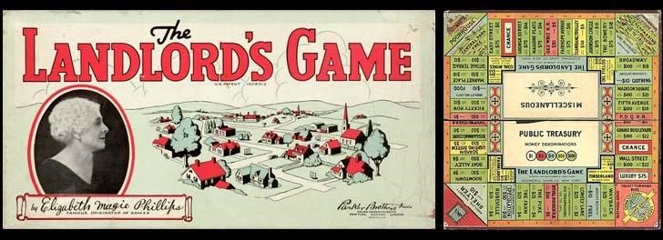

This state of affairs is also present when oligopolies exist. ^[A state of limited competition, in which a market is shared by a small number of producers or sellers.]

Magie's game had two sets of rules of play. The first set of rules is similar to the rules of Monopoly, and similarly led to extreme instability, with the whole board monopolised by one player, and the other players forced into penury and bankruptcy. 

The second set of rules in The Landlord's Game led to a very different outcome. The game, when played by these rules, led to a stable and admittedly boring game with no clear winner. Everyone ended up with something. Not quite world peace, or even family peace, but economic peace - at least within the confines of the game.

So what were the different rules that lead to a much more stable economic outcome? 

The 'economically stable' rules involved a tax levied by the central authorities on the value of the land owned by each individual, and distributed back through public services or a per-capita dividend. This is sometimes called a 'site valuation tax' or a 'location value tax,' but is most often referred to as a 'land-value tax.'

# 10.5 Land Value Tax

## History

Elizabeth Magie intended her game to demonstrate that a single tax on land values could lead to a sustainable economic system in which all benefited. This is the kind of tax we are proposing.

Magie was not the originator of this concept. She was espousing the ideas of a 19th Century self-taught economist named Henry George, who argued that a single tax on land values would be both efficient and fair. It would be *fair* because it taxed unearned increases in land values which occur not as a result of individual effort or ingenuity, but because of development of infrastructure and the wider economy. It would be *efficient* because the quantity of land does not change. He suggested that when we tax labour (via income tax) or tax economic activity via sales tax and corporate taxes, we discourage these activities and thereby make the economy less productive. Taxing land values instead might discourage people from speculating on land, and this would be a good thing, as it would free up funds for more productive investment and free up land for more beneficial purposes.

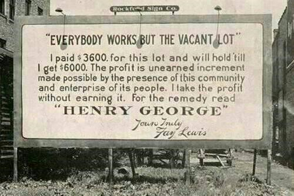

George presented his ideas in a bestselling book, 'Progress and Poverty,' and the case for a land value tax was taken up by great thinkers and politicians, including the Russian novelist Leo Tolstoy and British politicians Winston Churchill and David Lloyd George. It was only the intervention of the first World War that prevented the tax being implemented in the UK. The "people's budget" was passed by the pre-war government, but had not yet been implemented by the outbreak of World War I. After the war, the new government had different priorities, and the tax was never implemented.

Though he popularised the single land tax, Henry George could be seen as a follower of the great classical economists. Adam Smith, David Ricardo, John Stuart Mill, and Karl Marx all supported land value tax or public ownership of land. David Ricardo developed both the theory and recommendations in 1817 in his monograph 'On the Principles of Political Economy and Taxation.' A land value tax was considered the first point of the political program of Marx. The importance and optimality of a land value tax was one of the few things the great classical economists agreed on.

In the 20th Century, the idea of a single tax on land values was espoused by economist Frank Ramsey [@Ramsey1927]. He explained that if any one commodity is absolutely inelastic, either for supply or for demand, the whole of the revenue should be collected off it [@Putland2013]. To clarify, when a commodity is inelastic for supply, this means that its supply is (not very) sensitive to changes in price. Likewise, a commodity which is inelastic for demand is one whose demand is not greatly sensitive to changes in price. Oxygen in the air, needed for people to breathe, is an example of a commodity which is demand inelastic (but fortunately it is a part of the commons, freely provided by nature, and not a "commodity" in a financially valuated sense). However, there is one commodity which is supply inelastic: Land. Some marginal tinkering by Dutch dike-builders notwithstanding, and ignoring for now the future impacts of rising sea levels due to increased greenhouse gas concentrations, one cannot, in general, increase or decrease the amount of land in existence. 

That's why many economists over many years have recommended a land value tax, often considering it an 'ideal' tax. The arguments in favour of the the tax include arguments based on justice as well as arguments based on economic pragmatism. Land Value Tax is rare in this respect.

# 10.6 Benefits of Land Value Tax

Land Value Tax is very much alive within taxation discussion today, and is advocated across the political spectrum. Greens MP Caroline Lucas described Land Value Tax as "sensible, efficient, effective and progressive." In the final report of the Mirrlees review [@Mirrlees2010], the economic case for land value tax was described as "simple, and almost undeniable." 

The Mirrlees review of the tax system was commissioned by the Institute for Fiscal Studies in 2010/11. It brought together internationally renowned experts and researchers to: 

>*"identify the characteristics of a good tax system for any open, developed economy in the 21st Century, assess the extent to which the UK tax system conforms to these ideals, and recommend how it might realistically be reformed in that direction."*

The review wrote extensively about the merits of land value tax. A section of their findings is below.

> *"The economic case for taxing land itself is very strong, and there is a long history of arguments in favour of it. Taxing land ownership is equivalent to taxing an economic rent - to do so does not discourage any desirable activity. Land is not a produced input; its supply is fixed, and cannot be affected by the introduction of a tax. With the same amount of land available, people would not be willing to pay any more for it than before, so (the present value of) a land value tax (LVT) would be reflected one-for-one in a lower price of land: the classic example of tax capitalization."*

>*"Owners of land on the day such a tax is announced would suffer a windfall loss as the value of their asset was reduced. But this windfall loss is the only effect of the tax: the incentive to buy, develop, or use land would not change. Economic activity that was previously worthwhile remains worthwhile. Moreover, a tax on land value would also capture the benefits accruing to landowners from external developments rather than their own efforts."* [@IFS]

Along with the economic efficiency argument, there are other arguments in favour of Land Value Tax. A summary is found below.

1. Funding infrastructure: Increases in land tax can be used to fund better infrastructure.
2. Difficult to avoid/evade: The owners of land cannot re-declare it as being held in an offshore haven. The tax is based on the location of the land, not on the location of the individual owning it.
3. Natural rights: Individual work (labour) is naturally owned by the person who did the work, whereas land and natural resources are naturally unowned, or shared by all.
4. Fairness: Societies that tax land prevent individuals making an economic return simply by sitting on the land as others create improvements around them.
5. Incentives to invest productively: If individuals and companies can make money simply by owning land, they will not feel the need to invest in the real economy. Land Value Tax incentivises those with wealth to invest in productive investments.
6. Economic stability: Speculation on the value of land is associated with credit-based booms and busts. For example, the Japanese late 80's boom and 90's bust, or the recent 'great recession,' which resulted from the bursting of a massive property speculation bubble in the U.S.
7. House price stability: A Land Value Tax could help to stabilise house prices, giving incentives against disproportionate amounts of capital being tied up in property and unsustainable accumulation of mortgage debt. That is, people who are just holding land because they expect the land value to increase, will have an incentive to either use the land productively or sell it. Simply holding it will become too expensive.
8. Benefit to local government: Taxing land values can enable some of the increase in value that results from a prosperous economy and public investments to be captured by local government. This can provide an incentive for local authorities to support economic growth and development, and potentially could become an efficient way of financing infrastructure projects [@Wightman2013].^[Alternatively, a national land tax would naturally redistribute from one region to another, but then you'd lose the local connection.]
9. Removal of counterproductive taxes: Many taxes discourage productive behaviors which we should instead be incentivising. Land Value Tax would allow us to do away with some of these distorting taxes. Nicholas Boles puts it succinctly in a Financial Times article [@Boles]:

> *"The Holy Grail for every Treasury economist is a tax that costs little to collect and does not reduce people's incentives to do the things that we want them to do... Land Value Tax does not discourage productive behaviour, but would enable us to do  away with counterproductive taxes on labour, production, dwellings, other capital, and commerce."*  [@Gaffney2009] 

# 10.7 Does experience bear out the theory?

As indicated above, proponents claim that land value taxation can reduce real estate speculation and volatility in house prices. There are two ways in which LVT might have such an effect.

The first has already been outlined. When house prices start rising, LVT bills will rise commensurately. If a plot of land is not generating an income sufficient to defray the tax, rising bills may become unaffordable. Cumulative LVT bills will also reduce any capital gain the landowner may hope to receive one day by selling the land. Those with under-developed land (that is, land which has a more profitable permitted use) such as land-bankers will therefore have a motive either to put the land to a more active and profitable use, such as housing (or higher-density housing), or else to put it on the market, thereby making it available to those willing and able to develop it.

Thus in theory LVT should discourage land-banking, and may help to reduce upward price-volatility in the housing market by increasing the supply of new housing when prices start to rise. 

It is difficult to demonstrate through comparison studies (i.e. studies comparing times or places with and without LVT) that adoption of land value taxation is associated with higher rates of construction. Differences in population growth, interest rates, and other taxes are just some of many variables which confound such comparisons. Dye & England (2010) in a sympathetic report on land value taxation noted:

> *"Some advocates of land value taxation rely on comparison studies to predict greater building activity in communities adopting a land value tax, but they are making hopeful assertions rather than offering convincing evidence."*

The second way LVT might help to stabilise house prices is by helping to offset the effect of buyers' expectations regarding future prices. Expectations of future rises or falls in price can become self-fulfilling, as they increase or decrease what buyers are willing to pay today.

According to economic theory, the 'fundamental' price of property reflects the present discounted value of future returns (returns are rents paid to the owner, or if one is using the land oneself - living on it, generally speaking - then the financial value of avoiding having to pay rent to someone). Future revenues are discounted to allow for 'time preference,' uncertainty, mortgage costs, and so forth. Fundamental prices tend to rise over time owing to economic growth, but when actual prices exceed fundamental prices, it denotes a speculative bubble caused by self-fulfilling expectations.

LVT costs (and other property taxation) affect future returns from owning a house, and so should cause a discount in house prices. In other words, the tax should be 'capitalised' into house prices. Thus when house-prices escalate, expectations of higher future LVT costs should in theory abate buyers' willingness to pay current prices, reducing upward volatility. Conversely, when house-prices threaten to fall, expectations of lower future LVT costs should bolster buyers' willingness to pay current prices, reducing downward volatility.

It is complicated to demonstrate empirically that property taxes are indeed capitalised into house prices. Studies which try to correlate tax rates and property values must contend with numerous confounding variables. For example, a high tax rate may be a consequence and not a cause of low property values, if the municipality needs to raise a certain level of revenue to pay for local services. One must also allow for the possibility that local property taxes may not be significantly capitalised into house prices if home-buyers feel that the tax burden is indemnified by a commensurate level of local services.

Still, some rigorous studies have found evidence that property taxes are indeed capitalised into long term or 'equilibrium' house prices (e.g. Yinger et al, 1988). The question at hand, however, is the effect of LVT not on long term prices, but on short term price movements. 

In Taxes & Speculative Behaviour in Real Estate Markets (1992), K. E. Case addressed the -

## The Case of Estonia

Estonia experienced a real estate boom and bust between 2003 and 2009, despite having a local land value tax which was introduced in 1993 shortly after establishment of a private property market in the wake of Estonian independence. Nominal rates vary between 0.1% and 2.5% of a plot's 'highest' or 'best' market value. However, because LVT re-assessments have been only sporadic, occurring in 1996 and then for the last time in 2001, effective tax rates have generally fluctuated inversely with prices. Some municipalities even used a regulation introduced in 2002 to lower tax rates on properties in high value areas.

Cocconcelli and Medda (2012) showed using econometric tests that the Estonian real estate boom represented a speculative bubble. They also showed that if an asset pricing model had been implemented in which tax bills had followed annual assessments to track market changes, LVT would have significantly affected house-buyers' attitude to price. That is to say, the effects of the tax would have been significantly capitalised into prices, reducing volatility. 

However, because in reality LVT assessments were sporadic, even large changes in market prices left LVT bills unchanged for a long and indefinite period. As a result, house-buyers, especially speculators, did not take the effects of the land value tax into great account. This curtailed any stabilising effect of LVT on house prices. Thus Cocconcelli and Medda conclude that the Estonian land tax failed to act as "a protective buffer" against a real estate bubble because it was not implemented "correctly." 

## Denmark

Denmark is another country which suffered from a speculative housing bubble in the mid-2000s despite taxing land value. Moreover, in a paper on "the advantages of stabilising housing taxation," Klein et al (2016) detect signs of a new bubble in certain Danish cities such as Copenhagen, where price rises for flats have recently exceeded 10% year-on-year.

As well as a municipal land tax with an average rate of 2.4%, Denmark has a 'property value tax,' which is levied at 1% of a property' entire market value up to a certain threshold, and then 3% on the excess. However, the tax was frozen in 2001, and so ceased to track changes in market prices long before the start of the speculative bubble in the mid-2000s. The average effective rate is now 0.55% and effective rates are lowest in the cities which are showing signs of a new housing bubble.

Nor does Denmark's municipal land tax necessarily track changes in market prices: Assessments may be three years out of date, and year-on-year increases are capped. Thus, for example, when house prices were plummeting in the period 2008-10, land tax demands rose, because they were still catching up with the huge rise in property values of the preceding period. According to the calculations of Klein et al. (2016), the failure of Denmark's two property taxes to track market changes has increased volatility in the Danish real estate market by 22%.

# 10.8 Practical Implementation

## Valuation Methodology

Implementation of a land value tax would require regular valuation of land parcels. This would have to occur in such a way that the taxable valuation excludes the value of any buildings or other 'improvements' made to the land. Critics of Land Value Tax have frequently suggested that the need to provide accurate land valuations is an insurmountable obstacle because of this. 

Yet in reality, it can be done quite straightforwardly, at least in the period preceding the introduction of land value taxes, by substraction of the value of the buildings on the land from the current market price of land-and-buildings (or an average of the market price over, say, the previous three years). The value of the buildings can be calculated by assessing the cost of replacing the existing buildings after depreciation (i.e. after adjusting for their condition: dilapidated, average, or high-standard). 

Determining replacement building construction costs per square meter for a given category of house is not difficult - this can easily be based on available empirical data. A national statistics bureau would maintain frequently updated schedules of regional construction cost data per sq m of different classes of buildings, specifying median construction costs per square meter. The total size in sq m of the house would be measured. This allows a simple calculation of the standard median cost of constructing a replacement for the existing building. In a final step, assessors would take into account the condition of the land, and apply a suitable depreciation multiplier between 0.0 (for a house that is a ruin that will be torn down) to 1.0 (for a house that is in good-as-new, freshly renovated condition). The resulting number would be deducted from the house-and-land market price. The amount left over would be the "land value" on which the land value tax will be calculated. 

Land value, for LVT taxation purposes, is then the difference between the current market price of house-and-land less the replacement cost of the buildings and improvements (e.g. driveways) on the land, adjusted for the depreciated value of the buildings (based on their condition). Rather benignly, using this method for calculating LVT also encourages people to maintain their houses in tip-top shape. 

Indeed, the system outlined here can serve to encourage people to make 'green' energy efficiency improvements to their buildings as well. For example, the multiplier applied to standard building replacement costs could be specified to go above 1.0, for example 1.1, 1.2, 1.3, 1.4, or as high as 1.5, for a specified number of years (e.g. 10 years), depending on whether the building owner has had specific and measurable improvements made that improve energy efficiency, or lower the carbon footprint of the property - for example, heat pumps, rooftop solar hot water heaters, or improved insulation. The highest rating would be for buildings that have achieved a "Passivhaus" standard. 

However, there is a possible problem with this approach in the longer run: There is a feedback loop between land value taxes and the market price of real estate properties (land-and-houses). The higher land value taxes go, the lower we can expect market prices of properties to go. At the end of the day, if the government sets out to capture all the 'economic rent' from land (rather than letting land 'owners' capture it), the 'freehold' price of a piece of property should decline until it amounts to the combination of the value of the buildings, plus the locational value of exclusive usufruct of that particular property even in spite of the fact that in some places, high LVT tax means people who 'own land' are essentially paying rent to the government. 

At that point, it might make more sense to allow or encourage people to sell land back to the government (or to the central bank, which could have land banking added to its duties), and have the government rent out properties to occupiers directly, with the price of leasing a property (for some specified time-frame) determined by competitive bidding. If the leases are longer than a few years (five years?), however, this becomes fraught, since circumstances will change and locational utility will change. Black markets in on-leasing properties (an illegal secondary market) could arise if very long-term leases exist.

Another way to determine how much economic rent is associated with a given piece of property is the price of rent in the neighbourhood. The rent per square meter of a flat differs depending on city and neighbourhood. Why? Partly because of the details of the flat itself - how luxurious its detailing is, how big the windows are, and so on. And these differences can be characterised by setting up a standardised catalogue of different quality levels of flat (derived in part by estimating their replacement costs). But the main reason for differences in rental prices per square meter are locational. A flat facing onto a river and an otherwise identical flat facing a busy motorway will have very different valuations. Because of this, it should be straightforward to develop a schedule of the relative amount of economic rent generated by different properties (and available to be captured, either by private landlords, or by government through a land value tax). 

The Mirrlees review noted that one difficulty is that in most areas and sectors there are generally few transactions in land, separate from any buildings thereon. That's why a valuation approach based on estimates of building replacement cost adjusted by depreciation, as we propose here, makes sense. 

Mirrlees et al. also noted that for Land Value Tax to be efficient (and not discourage productive activity), it does not have to be very accurate - however, inaccurate valuations could cause unfairness between taxpayers. They explain:

> *"It is worth noting that since we are looking at taxing a rent, the figure for land value does not have to be exact - or even approximate - for the LVT to be efficient. The value of each plot of land falls by the present value of the tax imposed on it; in principle, each plot could be taxed at an arbitrarily different rate without compromising the efficiency of the tax. However, to the extent that valuations are not accurate, inequities will be created between taxpayers - just as they can be created by inaccurate valuations under the current property tax regime, but the inequities will be worse if the valuation is less accurate."*[@Mirrlees2011]

The Mirrlees review also found that despite the 'thinness of the market,' there are recognized methods for determining land values where there are a low number of transactions. For example, one obvious way is to look at cases in which similar buildings, in different locations, are on the market at very different prices. This brings us back to our London versus Scunthorpe example, in which we can see that the same kind of house on the same size plot of land sells for a lot more in London than Scunthorpe. This tells us something about the difference between land values in the two locations. Such comparative location data can supplement (but not replace) the building-replacement-cost approach we recommend. 

A study by the Institute for Public Policy Research (IPPR) suggested that another issue that must be overcome pertains to recording land ownership. Approximately 30 percent of land in England and Wales is not currently valued by the land registry, which makes it difficult to ascertain its ownership and value. They note that countries such as Denmark have found ways to record ownership information and assess land value. 

> *"These are not necessarily insurmountable problems, but it would take a lot of detailed work to devise a robust and sustainable system of land value taxation for the UK. Countries with a functioning land value tax have dealt with some of these issues. For example, land in Denmark is valued using a 'hedonic' pricing model based on the compulsory registration of all land transactions. This model uses information about the characteristics of land (location, transport links and soon) that is sold to estimate the value of other land"* [@Lawton2013a]

## The Asset Rich - Cash Poor (The'Devon Pensioners')

One oft repeated concern with Land Value Tax is that there may be people who are living in property which is of high value, but who have little income, for example a pensioner who owns a home in central London. If they had to pay a tax based on land values, critics argue, such people might be forced to sell their homes, even though they had intended to stay until life's end in their familiar surroundings. It should be noted that this concern is vastly overblown when the likely number of 'Devon pensioners' is considered. Oxford University Professor Iain McLean estimated that only about 2% of the population are in this position.

He writes, 

>*"'But what about the Devon pensioners?' I hear. There are actually very few poor people living in rich houses - about 2% of households...They should not distort the discussion of the best property tax for the other 98%."* [@Mclean2013]

Moreover, he argues that 'Devon pensioners' could easily be accommodated by raising the asset threshold for Council tax benefit eligibility, and allowing the tax liability to be deferred and become a charge on the estate when the house is sold [@Maxwell].

## Political Feasibility Issues

'Stern's Law of Tax' suggests that taxes which are best economically are the worst politically. Richard Brooks, research director at the Fabian Society, has investigated whether Land Value Tax might be politically infeasible. He writes, in an IPPR report,

> *"The philosophical and economic case for a land value tax (LVT) seems strong, but the issue has all the hallmarks of a political minefield: Large numbers of people would be affected by any change; the status quo is seen to be unsatisfactory, but there is little consensus about the appropriate response; and public understanding is low."* [@Maxwell]

We could add that those who would most be affected by LVT are also those who are wealthier and have the resources to lobby actively on their own behalf. Notably, many politicians and media moguls are landowners and would be affected by the introduction of LVT.

Brooks suggests some steps which could be taken to better 'prepare the ground' for an introduction of LVT:

- Increase public understanding of Land Value Tax. This could occur through discussion of LVT within the context of related debates, for example debates around Council Tax.
- Some impacts of LVT could be softened, even if this means losing some of the economic benefits. Brooks suggests that households might be protected from sharp increases in their tax liabilities.
- Introduce LVT such that it yielded less revenue than Council Tax in total, resulting in less domestic losers overall. This could be paid for by increasing the total revenue from non-domestic property. 

He also offers an test for proponents of LVT to assess the policy's political feasibility:

> *"What is needed is a really clear understanding of what the household impacts might look like by income group, household type, and geographical area. This kind of work would allow the parameters of a politically plausible scheme to be determined. There is no clear formula for such a calculation, but very crudely, no scheme which appears to be financially detrimental to significant numbers of swing voters in marginal constituencies is politically plausible."* [@Maxwell]

## The Denmark Experience

Land Value Tax has been applied in some form in several countries, including Denmark and Estonia, and some parts of Australia, New Zealand, and the USA. [@Conservative2016]. The chart below illustrates the widespread nature of land tax policies [@Dye2009].

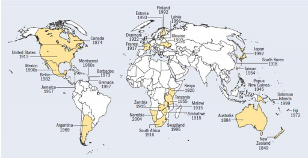

Since 1922, Denmark has levied a land value tax based on the market price of land, revalued every two years. The tax is payable to the local authority and county based on a per-thousandth share of the value of the land. The share varies according to different types of land use; however each share is a minimum of six and a maximum of 24 thousandths of the value of the land, giving an effective tax rate between 0.6% and 2.4% of the land's estimated market value. 

> *"Such a tax raises the cost of holding developable land when demand, as expressed through rising market prices, increases. This should, absent other factors, make holding valuable land more expensive as development pressure increases, encouraging land release for development."* [@Barker2004]

This localised Land Value Tax is still in effect in Denmark today. Denmark initiated another, more centralised, land value tax in 1957, under what was known as the Ground Duty Government. It gained this name because at its inauguration, the government announced that it would collect as much rent or 'Ground Duty' as possible. From 1957 to 1960, under their governance, the Danish economy improved dramatically.

> "*During the Ground Duty Government (1957-1960) industrial production went up - it more than doubled; private investments were three times bigger than public investment; employees and entrepreneurs earned higher real income than ever before; inflation disappeared almost; savings soared immensely; unemployment almost disappeared to around 1 percent; foreign debt was reduced considerably; domestic and foreign trade expanded, and at the end of the period (1960), all economic forecasters expected further economic progress and prosperity."*

> *"How much of the progress was due to the formation and activities of the Ground Duty Government is difficult to estimate exactly, as other countries experienced economic progress in the same period; but in Denmark the progress was eminent."* [@Lefmann2007]

The Ground Duty government were defeated in 1960. According to writer Ole Lefmann, 

> "*Economic analysts who examined the defeat of the Ground Duty Government have all emphasized that the reason for the defeat was political and succeeded because Danish proponents of Land Value Taxation had not enlightened people in general well enough about the advantages of their proposal.*"

According to Danish MP Knud Tholstrup, after the Ground Duty Government defeat, inflation climbed back up to 5% and by 1964 reached 8%. Land prices increased dramatically, increasing 19-fold from 1960 to 1981, while prices of goods and services increased fourfold [@Bauwens2011].

Denmark's experience could be seen as a lesson to proponents of Land Value Tax, or in fact any tax: It's not enough that the tax makes economic sense, is of benefit to the majority, and is 'just.' Public perception matters too. The public need to understand why it is of good in all these ways, otherwise they will be susceptible to noisy fearmongering and lobbying from powerful vested interests.

In the final chapter of this part we investigate in more depth the unique nature of land, how it differs from other factors of production and the implications of this for the economy.

# 10.9 Positive Externalities in Land Use

Markets allocate land to the highest bidder, which suggests that land ownership will go to where its *private* use value is greatest. Whoever can generate the highest revenue from using the land will be willing to make the highest bid. However, little to no attention is paid to the social use of such a space. Rypkema [-@Rypkema1992a] argues that for any commodity to have economic value, it must possess the following four characteristics: 'scarcity, purchasing power, desire, and utility.' Much in the same way that a property value can be increased by the positive externalities flowing from an external investment, like a new transport link or better amenities, so too can the value in a community be increased by a positive use of the land space. The positive value that arises from land stems from the amenities that it provides to the surrounding community, whether that be in beautification, economic and commercial terms, or in facility-provision (like a useful village shop, or an open-access bathroom in a busy high street).

One example of a positive externality could be the conservation of beautiful historical buildings. Tiesdell [@tiesdell1996] says that:

> "*Historic buildings are often more interesting than the new, 'industrial' buildings, housing and shopping centers.*"

Romero argued that such preservation helps people maintain a sense of the past, providing an 'anchor to the past, as well as an incentive to the future' [@romero2004]. This argument hinges on the idea that historic buildings can provide functional diversity, resource value,  economic and commercial value to the surrounding community. However, maintaining such buildings can often present a great cost for a private owner, to such an extent that they may deem it more financially prudent not to maintain their public amenities - be that, as per this example, tearing down a historic building, or perhaps closing the public bathroom that their property had previously maintained.

Governments can intervene to help promote this social value above the private value, either through command and control (e.g. mandating all buildings be the same height so as to control aesthetics) or taxes and subsidies (taxing disused land and subsidising home improvements through rebates). Issues exist with both policy methods. Such direct orders may appear draconian and totalitarian, and may also not be administered properly so as to ensure the desired characteristics of the land are maintained. Taxes and subsidies may not always be set at an appropriate level to properly manage the resource, but they do at least give individuals flexibility in what they choose to do with their property.

# 10.10 In More Depth: The Unique Case of Land

> *Ask for what end the heav'nly bodies shine, Earth for whose use? Pride answers, Tis for mine.* Alexander Pope

> *"This land is your land, this land is my land
From California to the New York island
From the Redwood forest to the Gulf Stream waters
This land was made for you and me."*  - Woody Guthrie

>"*When the Great Way prevailed, natural resources were fully used for the benefit of all and not appropriated for selfish ends... This was the Age of the Great Commonwealth of peace and prosperity*." Confucius

We humans encounter land; we do not make it. It is part of the primordial form which precedes human existence. It has been formed over millions of years, by forces we only partially understand. We observe it, we walk over it, we change it, but we cannot create or destroy it. No human is responsible for the existence of land (or air, or water, or life, or ourselves), but we all benefit from it. More than merely benefitting, we rely on land in the very strongest and most fundamental way, to exist and to survive.

Land generates good things for us 'for free' through mind-bendingly complex processes that seem deceptively simple. These processes arose as a consequence of the billions of years of evolution in a biosphere rife with vast numbers of feedbacks. A seed in the ground can produce a tree without any human involvement. The tree may produce flowers or fruit, and seeds for more trees. We can plant trees, of course, and planting a tree seems a simple action, but it is merely one minor step of intervention in a natural biogenetic technology of awesome sophistication. On this planet and on none other that we know of - and certainly none other in our solar system - land holds the power to make things grow. We may harness these forces, guide them in ways useful to us with agricultural practices, but we do not create them. Anyone who controls land is, by legal convention, given control over the unfolding of this power on that specific piece of land, a power Christians have called 'God's Bounty' and governments call 'natural resources.' Whatever the name, land in this sense belongs to no-one or to everyone - and we suggest that land 'ownership' entails a duty of respectful stewardship.

American Economist Mason Gaffney describes land as our 'free gift':

> *"Land is not produced, it was created. It is the world, the planet from which man evolved, with the sun that energizes it and the orbit that tempers it. Land is a free gift, variously expressed in different philosophies as Spaceship Earth, the Big Blue Marble, God's Gift, Creation, Gaia, The Promised Land, or Nature. Mankind did not create the Earth with its space and resources, nor can we add to them. We can only acquire them, often by fighting, or rent-seeking, or in other counterproductive ways. Man at best improves and develops capacities inherent in the free gift."* [@Gaffney2009]

The notion of land as a gift applies even when land is developed and urbanised. Any piece of land in a city will be affected by its surrounds, but primarily the effects will be positive in terms of social and economic value, because where people gather in high-density groups, interesting things tend to happen. We can see that if the value of the land were publicly owned, as perhaps it should be, then this form of 'free lunch' would be available to all.

Gaffney has spent his career critiquing the inadequate treatment of land in economics. This chapter largely summarises his essay, "Land as a Distinctive Factor of Production," which is highly recommended reading.[@Gaffney2009]

## The Classical Factors of Production

Classical economic thought treated land as one of three 'factors of production.' These are resources or 'inputs' which are used to produce products and services (output). They are mutually exclusive, comprehensive, and necessary for all kinds of economic activity. The three inputs of classical economics were Labour, Capital, and Land. Each factor has a price. The price of labour is wages; the price of capital is interest; and the price of land is rent. Labour is familiar enough: Human time spent working. Capital is "that part of wealth devoted to production."

^[George's precise definition was "**wealth in the course of exchange**" which requires a little more explanation. Here is the whole passage:  "The key, it seems to me, is whether or not the item is in the possession of the consumer. Wealth yet to be exchanged is capital. Wealth in the hands of the consumer is not. Hence, we can define capital as **wealth in the course of exchange**. We must understand here that exchange does not mean merely passing from hand to hand ' it also includes the increase in wealth from the reproductive or transformative forces of nature.Using this definition, we can include all the things that capital properly includes, and eliminate all it does not.]

This definition includes all tools. Tools are really capital, in economic terms. For what makes a tool 'capital' is whether the output of its uses or services are to be exchanged or not. Thus, a lathe used to make things for exchange is capital; a lathe kept as a hobby is not capital. Wealth used in the construction of a railroad, a theater, or a hotel is wealth in the course of exchange. The exchange does not occur all at once, but little by little, with an indefinite number of people - yet there is an exchange. The consumers are not the owners, but rather the patrons who use these facilities.

This definition is consistent with the idea that *capital is that part of wealth devoted to production of more wealth.* But to say that production is merely about 'making things' is too narrow an understanding of the term. Production also includes bringing things to the consumer. Storekeepers are as much 'producers' as farmers or manufacturers. The stock in a store is capital, and it is as much devoted to production as the capital of the others. 

## Land in Economic Theory

Gaffney [@Gaffney2009] defines 'economic land' as "all natural resources and agents, with their sites (locations and extensions in space)," and emphasises that economic land is not simply that which we would colloquially call 'land.' Economic land also includes air, falling water, water and seabeds or lakebeds under it, game, fish, vegetation, and the radio spectrum. In modern parlance: Natural resources.

For John Stuart Mill, 

> *"The part which nature has in any work of man is indefinite and incommensurable."* [@mill1848principles]

Thus land (or natural resources) was recognised by classical economists as being distinct from, and on equal footing with, capital and labour. 

However, according to Financial Times economic commentator Martin Wolf, "something strange" happened in the transition from Classical to Neoclassical economic thought. 

> *"In moving from classical to neoclassical economics - the dominant academic school today - economists expunged land - or natural resources. Neoclassical value theory...still makes a great deal of sense. Expunging natural resources from the way economists think about the world does not."*

Neoclassical economic orthodoxy tends to conflate land (including natural resources) with capital. The neoclassical theorists recognise only two factors of production - labour and capital. For Wolf and a growing number of economists, this change is based on erroneous assumptions, the consequences of which are now having disastrous effects:

*"The idea that land and capital are the same thing is evidently ludicrous. It requires us to believe that the economic machine is self-sustaining - a sort of perpetual motion machine. Capital is the product of savings and investment. It is the result of human frugality and the invention required to imagine and create new capital goods. Labour is also - and in today's circumstances, increasingly - a form of capital. Parents, governments and individual people invest in their own skills, so making themselves more productive.* 

*Yet there would be no economy - indeed no humanity - without a constant inflow of natural resources into the system: What lies above our heads (the sun and the atmosphere), what lies close to us (the soil, the seas and location itself), and what lies beneath us (fossil fuels, metals and minerals and heat). Humanity does not make these things; it exploits them. Some of these resources are also appropriable and so a source of unearned personal wealth."* [@Wolf2010]

## The effects of treating land as a kind of capital

According to writer Martin Adams, this failure to effectively distinguish between land and capital in economic models leads to "incorrect forecasts and faulty economic applications in addressing social issues such as wealth inequality or ecocide."[@Adams2016] This occurs partly because by seeing land as capital, we fail to recognise that *the factors which influence the price (land rents) of land are not the same factors which influence the price (interest rates) of capital.*

This erroneous conflation of land with capital also leads to the treatment of land as an investible product, though it is not. Because land generally increases in value, people talk about buying land 'as an investment.' The buy-to-let landlords in the UK who see themselves as investors in property, are not truly investing in the economic sense. Rather, they are parking their money somewhere - they are making a *'placement,'* not an investment. This is the case because to be an *investment,* by definition, something which is both new and of value must be created - something that did not previously already exist. Land is not investible in the sense that anything new of value is created by the input of money. Acquiring land involves a mere transfer of ownership - not a creation of new value. 

When money is put into start-up businesses producing food, shelving, toys, medical devices, or ultracapacitors, for example, these are productive investments. They may, in tandem with the efforts of people labouring in these businesses, create something new which is of value. The mere purchase of land in the hope that its value will go up later as a city gets generally more expensive, by contrast, is not a productive investment, as it adds no new goods or services of value to the economy. Neo-classical economic theory fails to recognise this important distinction. The results of this are policies which allow or encourage people to park their money in property rather than incentivising them to invest it in truly productive endeavours, such as factories or new infrastructure. This misallocation of finance leads to less creation of new products and services than would be the case if money were invested, rather than merely 'placed'.

# 10.11 Ways in which land differs from capital

Land has unique characteristics which distinguish it from capital as an economic input. Gaffney emphasises ten primary distinctions:

## 1. Land is not produced, nor is it reproducible

When satellites show us pictures of the earth from space, they show us something which we did not create, yet exists: Lands and seas. "Man at best improves and develops capacities inherent in the free gift." 

Capital, on the other hand, is produced by human investment, thrift and production.[@Gaffney1994] It coexists with land, and perhaps this is why microeconomics makes the error of conflating land and capital. Gaffney suggests that neoclassical economics deals mainly with relations of coexistence and largely ignores relations of sequence over time, such as the formation and destruction of capital.

*"The life of capital, like that of people, is marked by major sacraments of birth, growth, aging, and death - all missing from microeconomic theory. Micro deals mainly with how existing resources are allocated at a moment in time, not how they originate, grow, flourish, reproduce, age, die, and decompose."*

## 2. Land as 'site' is permanent and recyclable

Essentially, this is to say that land does not get used up (with the exception of extractive natural resources), destroyed, or depreciate. Capital does decay, however. Capital products - human-created tools, in the broad sense - wear out. They must be kept usable by constant maintenance and repair. It is, of course, possible to damage land, for instance through toxic waste dumping.

## 3. Land supply is fixed

One of the most crucial consequences of this fact is that, unlike capital, land acquisition is a zero-sum game. That is, no one can acquire more land without others having less. The amount of land we have now is fixed. We cannot make more (even attempts to create new land masses involve simply moving land around, e.g. from underwater to the surface).

## 4. Land is immobile in space and uncontrollable in time

The fact that land is immobile in space means that its supply cannot be increased to meet increased demand in a localised area. So when demand goes up, prices go up. 

The fact that land is 'uncontrollable in time' means that the benefits which flow from land, such as raising seedlings, flow steadily at a certain pace. The benefits cannot be set aside and stored for future use.

> *"Nature's services per se...come in a flow like time itself, unbidden and uncontrollable. Mankind cannot advance nor retard its services at will."*[@Gaffney1994]

Another effect of the immobile or fixed location of land is that it suffers externalities - both positive and negative - from activities on surrounding land. That is, the economic value of a piece of land is affected directly by what is going on by the land surrounding it. So for example, land's economic value can be affected by negative externalities such as pollution or crime in the surrounding area. The value of land can also be increased by 'positive externalities,' such as improvements to local infrastructure and the creation of public amenities.

## 5. Land does not turn over. It is recycled and versatile

Land is versatile in that it is available for a multiplicity of uses. Land rarely becomes obsolete, with the result that there is almost always an opportunity cost in the use of land: i.e. it can always be used for something else. This is not the case for many forms of capital, which can and do become obsolete as technologies evolve. 

*"The only source of land for new uses today, as for ages past, is to take it from its previous use."*

## 6. Land is not interchangeable with capital

Interchange must be distinguished from 'exchange.' Land can be exchanged for capital, but they are not interchangeable. Capital can be converted into other types of capital. The consequence is that it's a mistake to think that 'uniformity' within taxation should occur between land and capital. It need only occur within each class.

## 7. Land is subject to market forces that differ from those that determine the price of capital (interest rates).

We mentioned earlier the costs or prices of different modes of production. The price of labour is wages, the price of capital is interest, and the price of land is land rent. But what affects these various prices, and are the influencing factors the same?  The short answer is that they are not the same. Interest rates around the world are subject to common, interconnecting forces, and they rise and fall in sympathy. Land rents are also influenced by common forces, but these are not the same forces as those which influence interest rates. In fact, one of the forces which influences land rents is the interest rate. The two prices vary inversely. As Gaffney states, 

*"Capital and Land are rivals for the same pie, so usually their returns vary inversely. Ground rent equals operating cash flow less interest on the cost of building, and less building depreciation. A rise in interest rates lowers ground rents."*

The melding of land and capital in neoclassical thought causes us to lose sight of this distinction and the attendant inverse relationship. This is an obstacle to attempts to model the outcome of economic policies. 

## 8. Land price guides investors and determines the character of capital, as capital substitutes for land.

There is a relationship between land prices (rents) and the kinds of capital which investors choose to invest in. We are familiar with the idea that when the price of labour is high, then investors prefer 'labour-saving' capital (such as self-service checkouts at supermarkets). Similarly, when land rents are high, investors prefer 'land-saving' capital, such as high buildings. 

They also favour:

- land-enhancing capital (capital used to improve land for a new use)
- land-linking capital (rail lines, canals, etc.)
- land-capturing capital (e.g. dams to secure water rights)
- rent-leading capital

## 9. Land is limitational

This is a technical term which essentially means that all human activity requires some land (including air, space, water, living ecosystems, etc.) and some capital. Labour and capital cannot exist without at least some land, while land can easily exist without labour or capital. Absent human labour or capital, Land supports natural ecosystems, which can be understood as the economies of our cousins in the tree of life - grasslands, forests, lakes, rivers, seas, wildlife habitat.

It has often fallen to environmentalists to remind us of the limitational value of land. The famous environmentalist catch-cry coined by activist Judy Bonds puts it most powerfully: "No jobs on a dead planet!" 

## 10. Land value (basic permanent location value) is not an economic fund

The unique qualities of land certainly give it value, but this value cannot be effectively described by the usual categories which are used to describe economic values. These standard categories divide value into funds and flows. Gaffney clarifies that land value is the present value of anticipated future service flows from land, which cannot be hastened. This is a mouthful, but it expresses an important quality of land. This kind of value is not like capital stores (a fund), which can be drawn from, such as grain from a granary. 

Here we are speaking about the basic permanent location value of land. There are exceptions in cases of exhaustible resources such as oil and gas reserves.

# 10.12 Economic Consequences

## 1. The origin of property in land is political, and owning land imparts superior bargaining power.

Capital may result from the ingenuity and effort of people and involves the creation of something new. There is thus a sort of natural ownership which arises. There is also a natural ownership of one's labour. There is, in contrast, no such natural ownership of land. That is, no-one claims land by right of production. Whilst there are good reasons for private ownership of land, it should be remembered that historically, *the origin and distribution of property in land in not natural - it is political.* 

> *"The initial distribution of land - the origin of property in land - is military, legal, and political, not economic. The prime business of nations throughout history has been to gain and defend land. What was won by force has no higher sanction than lex fortiores, and must be kept and defended by force."* [@Gaffney1994]

The enlightenment era thinker and member of the Physiocrats, Richard Cantillon, similarly wrote: 

> *"It does not appear that Providence has given the right of the possession of land to one man preferably to another: the most ancient titles are founded on violence and conquest."*

This original distribution of land ownership often persists long-term, transmitted through inheritance, and confers political power for generations. This is particularly relevant in regards to fairness.

For the American context, Gaffney puts it thus: 

> *"If one's grandfather was a slave when the Land Office was parcelling out Federal lands to the friends and cousins of corrupt Congressmen, one may be excused from believing Utopia will ensue from limiting all future changes to "win-win" Pareto-optimal changes from the inherited status quo."*

Similar reservations might be held by the descendants of peasants in England, who lost access to the common land after the Enclosure Acts. Writer Helen Salmon has explained the vicious unfairness of the Enclosure Acts:

> *"Predictably, the commissioners, appointed by the rich landowners, gave them the best land, often leaving the poor with useless, infertile plots. Plots were also often allocated to the owners of cottages rather than their tenants, leaving the poor with nothing and their landlords with yet more land.* 

> *If this were not bad enough, the costs of enclosure, including the costs of presenting the bill to parliament and fencing all the plots of land ... would be shared between all the villagers. These costs were ruinous for the poor, who were forced to sell their land to the rich at whatever price was offered.* [@Salmon2005]

The benefits of ownership of land multiply further, because owning land imparts superior bargaining power. Whilst we all have labour power in varying degrees, landowners also receive income from land above that, which gives them discretionary spending or waiting power. And whilst land appreciates in value, capital depreciates. So in contests between the landowner and people who do not own land, the landowner has a key bargaining advantage.

## 2. Land rent does not evoke thrift, production, or investment.

We noted earlier that 'investing' in land is not in itself an act of productive investment. Gaffney puts it thus:

*"Investing in land is macroeconomically sterile. It creates neither income nor capital. Socially, it is a wash: one buys, the other  sells, nothing else happens."*

As we've noted, a term for this type of non-productive investment is 'placement.' A placement is a non-generative, passive place to put your money. When people owning placements see their value increase, they gain that increase in private worth without a corresponding increase in overall societal wealth. This means, in proportional terms, a decrease in social wealth, because it involves a zero-sum game.

Since property and land are tangible assets with a fairly stable and easily-assessed value, they are highly attractive to banks as collateral for financial investment. The same is not generally true for capital, which is seen as much higher risk and less easily valuated. Treating land as an investment diverts the attention and lending activities of banks away from what should be their more important role of funding productive investment in society.

## 3. Land value lowers savings rates

Rising land values in investment portfolios lower the pressure to create real capital in order to generate financial returns. This reduces investment in the supply of capital. Gaffney compares this situation with the case of slave ownership in the past:

*"The existence of high land rents and values, like the ownership of slaves, tends to satisfy the need for accumulation of assets without any actual capital formation."*

## 4. Land destabilises the financial system

Two of the most serious recent economic crises have been associated with land and property speculation: the Japanese crisis of 1990 and the following lost decades, and the great financial crisis of 2007-8 and the consequent 'great recession' (which continues in Europe as a period of prolonged, low-economic-growth stagnation). Both of these economic problems were triggered by property lending bubbles which caused huge losses on bank loans when they burst. These losses rippled through the financial system, causing banks to become insolvent. Banks reduced their lending activity, causing a reduction in economic activity. The government stepped in both to recapitalize banks and also to stimulate the economy through low interest rates and fiscal deficits. These actions prevented an economic catastrophe, but led to a ballooning of government debt. 

What was wrong with the system and its underlying economic model? In the UK, the banking system - the generation of the £ money supply - has been based primarily on mortgage debt and house price speculation. Banks have lent almost exclusively on existing collateral, primarily property (real estate), rather than performing the main economic role originally intended for them, which is to finance new business investment. 

High and volatile house prices create various macroeconomic imbalances. Whilst house prices are increasing, the 'wealth effect' makes people feel richer and able to fund higher consumption, which increases indebtedness. However, when the bubble bursts and house 
prices fall, individuals feel overburdened by debt and cut back on expenditure, leading to a demand deficiency. This is when the government needs to step in to make up for the lack in private sector demand. If the government opts for 'austerity' instead, the result is stagnation or recession and high unemployment, due to weakness in aggregate demand. 

Land and property speculation is not economically productive. It also contributes to increased inequality, which itself has economic consequences. Lending and capital which has been allocated to house price speculation could instead have been used to support productive business and capital investment.

## 5. The price of land must be systemically risky to compensate for supernormal returns

If, as we argue, urban land has a supernormal 'monopoly' return potentially greater than that of other assets, then this presents us with a problem. If rational agents can deduce this, then we'd expect them to pile into this asset class, leading to a rapid appreciation to high levels from which it would no longer be expected to achieve a super return. This is, in fact, exactly what we observe. Land observes semi-regular booms (or 'bubbles') and busts. This instability has very significant economic effects - the Japanese crash of 1990 and the US sub-prime crisis that began in 2006 both had their roots in real estate bubbles.

## 6. A fall in interest rates makes property owners richer and makes own-use home ownership too expensive for millions

Changes in interest rates change the capitalisation rate between a rental flow and the associated capitalised value of a piece of land. Changes in mortgage rates affect the cost of purchase, since they change the total quantity of interest paid to the bank.

Generally, since the 1980s, interest rates have been falling, leading to very large capital gains on land and property assets. Marx argued that the capitalist system, in the course of accumulating capital, would lead to long-term reductions in the rate of return on capital. If these are accommodated by the central bank, this would lead to long-term reductions in the interest rate, leading to capital value appreciation.

As we can see from this discussion, the ownership of land confers a great deal of power to owners. Limited land supply means that the owner is able to benefit from the need for housing (rent), from increases in demand for housing in the area (rent increases), and from decreases in interest rate (asset value increases). These increases in property wealth contribute to the impact outlined by Piketty [@Piketty2014a], whereby the rate of increase in wealth derived from asset ownership outstrips that of wealth derived from saving a portion of wage income, which further compounds inequality between the have-nots and the have-lots. 

# 10.12 The Treatment of Land in Economics Education

We have discussed the problems which the treatment of land in neo-liberal economic theory has caused. To solve these problems, we need to bring land out of the shadows of economic theory. 

According to Gaffney, the original conflation of land with capital may have occurred in part for political reasons, to deflect possible taxes on land. This unfortunate development in economic thought was then institutionalised: Land was ignored in the main economic canon in universities, and was marginalised into sub-disciplines of 'Land Economics' and 'Agricultural Economics.'

Gaffney's scathing observation:

> *"(T)he obvious is obscured, silenced, or denied. Hundreds of books on economic theory are published with 'land' absent from the index. Denial is reinforced by dominant figures using sophistical, pedantic cant, which students learn to ape to distinguish themselves from the laity and advance their careers.* 

> *A number of economists don't buy it, but don't do anything about it - acquiescing in error by silence, indifference, passivity, or anxiety of the professional consequences. They handle the question by 'going into denial,' as it were, resolving a vexing issue by pretending it isn't there. Truth will not be made manifest by hedging, especially against such motivated forces as have an interest in hiding unearned wealth behind the skirts of capital... The discipline has not totally eliminated land, but marginalized it. [...] The sub-disciplines are kept away from the 'core' and 'mainstream' of economic thinking by compartmentalization and colonization. Patronizing 'land economics' as a colonial discipline keeps potentially contagious movements within the empire, where they can absorb critical tendencies under watchful control, while yet remaining safely remote, in the outskirts of the system. Orthodoxy flows out from the core, communicated via mandatory 'core courses.' Land economics is banished from the commanding  heights of economics."* [@Gaffney1994]

There may be additional reasons why land has been so neglected in mainstream economics. One reason may be that land is often thought of in agricultural terms, and is therefore assumed to play a small role in modern industrial economies. However, though we may think of land as rolling green hills and farmland, it must be stressed that 'land' in economics includes urban land. In fact, urban land is possibly more significant to the economies of modern industrial societies than is agricultural land. Another possible reason for the neglect of land in neoclassical economics is that economics in general is focused on production, not on the cost of existing assets. The classical economists perhaps would not have considered the provision of housing services to be part of 'production.' 

A further possibility is that a focus on land economics, and by extension any discussion of taxing land, is politically unpalatable to many. Landowning interests are politically highly influential. Even universities may feel threatened by land economics, as they often hold much of their wealth in the form of land.

Clearly, land must be brought out of the economic theory wilderness and given a central role.

# 10.13 Case Study: Singapore as a 'Property State

Singapore is often described as a neoliberal paradise: Low taxes, open trade, a large financial sector. It has been phenomenally successful, with average growth rates in the range of 5-10%, and has transformed itself into a city-state with amongst the highest GDP in the world.

Scratch the surface, and a rather different story arises, one that has public ownership of land and provision of public housing at its heart, as described by Anne Haila's ['Urban Land Rent, Singapore as a Property State'](https://onlinelibrary.wiley.com/doi/book/10.1002/9781118827611). So what exactly is the 'Singapore model' in relation to property?

Ownership of land really has two components: It allows the landlord to collect rent from whoever is occupying the property, and it gives control over the development of that land, including the effects of development on the physical environment, on other people and landowners, and on the supply of housing. Singapore has both components under public control. Its system includes public capture of rent and public development of housing.

The first component, capturing land rent for public purposes, is in tune with the ideas of advocates for a land value tax (LVT). Proponents of an LVT argue for taxing land value (principally urban land, as agricultural land is of much lower value). An LVT separates the value of a property into two components: the value of the physical building (the bricks and mortar) and that of the underlying location (land value). As we've noted, many of the world's most famous economists, from Adam Smith and David Ricardo to Milton Friedman and Britain's Mirrlees Review of taxation have argued in favour of an LVT, and American journalist Henry George popularised these ideas with his masterpiece *Progress and Poverty*. Recently the Economist [has promoted the idea](https://www.economist.com/briefing/2018/08/09/the-time-may-be-right-for-land-value-taxes). In Singapore, public ownership of land allows the charging of ground rent, but this idea is implemented sensitively, with a view to reducing the cost of housing to low-paid workers.

Singapore has also shown the advantages of the second component: The public sector having a decisive role in developing land. Providing public housing is, of course, crucial in a rapidly-developing high wage city with limited space. Furthermore, the state development of infrastructure increases those very same land values. The public sector housing fund achieves a positive net income, and a replenishment of its funds, which can be used to provide further investment, in a beneficial cycle. Contrast this to Britain, where public infrastructure such as the HS2 high-speed rail line is paid from public funds, whereas the landowners near the stations, who benefit thanks to increased land values, pay nothing. 

The whole tenor of the Singapore approach is pragmatic, putting the public interest first, being sensitive to the interests of individuals, and avoiding concentration of power in any one institution.

Whilst the institutions of the Singapore property state model have evolved over decades, there are policy solutions that could give the benefits of land value tax and of public ownership of land more directly. In the UK, an LVT would replace council tax, business rates, and stamp duty. It would be a proportional tax on the value of property paid by owners rather than occupiers, with a deduction for the value of the bricks and mortar. And future *increases* in land rent could be taxed at nearly 100% and the revenues shared between those responsible: The local community, municipal authority, and national government. Those with large mortgages would be protected by asking banks to pay the land value tax on the proportion covered by a mortgage. Alternatives to bank mortgages, such as building societies and state-backed community land purchases, could also be developed.

Singapore shows that public land ownership can be combined with high rates of owner occupation. Low cost and high-quality public housing can be both affordable and beneficial to all parts of the community, including the business sector. Given the realities of Brexit Britain, where parts of the public sector, such as Railtrack, are still selling off land to the private sector, where public housing provision has declined relative to the private sector, and where property taxation is outdated and arbitrary, the Singapore property state model deserves a closer look by British policy-makers.

# 10.14 Taxes on Land and Property

Because land is fixed in supply, it can be taxed without causing significant economic distortion. A land tax subtracts the value of the premises from the tax on the land itself. It can be imposed progressively, reducing the return to landownership (capital gain plus rent) to around a zero nominal return.

The implementation of land value capture can be achieved in two main ways. Firstly, a simple tax on land values and secondly, the public ownership of land combined with short-term lease sales. The successful city states of East Asia: Hong Kong and Singapore, adopt one or both of these two options. Hong Kong, due to the new territories being originally leased from China to Britain, never had private land ownership simply because the land was to be returned to China eventually. So the government of Hong Kong receives a large part of its revenue in the sale of leases of 20 or 30 years term. 

This tax is best introduced in 3 separate ways:

1. Implementation as a national replacement for as many existing taxes as possible (council tax, stamp duty land tax, inheritance tax on land, TV license fee, etc.).
2. Use of this tax as a macroeconomic stabilizer (the bank of England could increment this tax in order to avoid propose and to ensure that real terms house prices decline gradually to more reasonable levels).
3. Introduction of 'land value covenants', similar to 'government mortgages' but with the interest paid proportional to local land values. Those who have difficulty paying the tax(for example because they are asset rich or income poor) would have the option to roll up the tax into an indefinite 'interest payment' index to the value of the land.
4. Some time threshold for any residual freehold ownership (e.g. 99 years).

A land value tax on built up land would take the total value of the property and subtract the value of the building. Both values are easily assessed: for example there are multiple websites accessing overall property value. The advantage of subtracting property value is also that beautiful and historic buildings, and those that contribute to the character of areas, can be recognize as such. This subsidy on building size would work well as a way to mitigate the increase of fossil fuel taxes on household energy bills.

# CHAPTER 11: MONEY, DEBT, AND FINANCE

## Summary

 - The correct and responsible role of debt is as a useful tool for selective application, to make early use of a longer-term investment that one (individual, firm or nation) has a high degree of certainty one will be able to afford. It should not be a system of dependency to repeatedly shore up insufficient cash-flow.
 - Irresponsible private debt can be discouraged through more-regulated lending and a higher tax on bank balance-sheets.
 - Economic situations forcing individuals into debt can be mitigated with higher wages and/or higher net income due to a citizen's dividend.
 - Financial instability is socially damaging and unnecessary; it can be mitigated with financial taxes explained here.

\newpage

# 11.1 Introduction

 financial services are an opaque and mysterious business.  For many people, banks are places to store hard-earned money or get a loan. However the relationship between these two, the operation of other financial products and the relationship of banks to the wider economy is a puzzle. A study by ESCP Europe in June 2010 found that the general population is not well informed about the banking system, with little awareness of the status of their deposits and what banks do with them.

The financial crisis of 2007-8, whose interconnected causes are still being teased out and debated by experts, has only exacerbated this sense that understanding 'finance' is not possible for normal people.  Several studies have found a substantial deterioration in public attitudes towards the UK Banking Industry following the crisis. A report by YouGov Cambridge in 2013, found that only 4 percent of those surveyed thought that the banks observe high moral and ethical standards - a joint worst rating with betting shops, casinos and online gambling.

## Functions of the Financial Sector

Yet despite its failings, the financial sector exists to serve a useful purpose.  As Philip Booth wrote in the 2011 edition of Balance, the British Banker's Association magazine,

> "Life would be unthinkable without banks.  Not only do banks provide mechanisms to ensure that we can pay each other immediately for the goods and services we consume, they also provide crucial economic functions.  These include screening risk, diversifying risk, reducing transaction costs and providing capital for businesses and credit for consumers.  The flip side is that they provide safe returns for savers.  Without a modern financial system, retirement from work would be more or less impossible." *

Lord Adair Turner, who was the Chairman of the Financial Services Authority from 2008 to 2013 has written in more technical terms on this topic. Turner argues [@FSA2009] that the purpose of the financial system is as follows:

1. The provision of payment services, both retail and wholesale.
2. The provision of pure insurance services, life or general, wholesale and retail, which enable people or businesses to lay off exposure to risks by pooling their exposure with others.
3. The creation of markets in spot or short-term futures instruments in, for instance, foreign exchange and commodities.
4. Financial intermediation between providers of funds and users of funds, savers and borrowers, investors and businesses, an intermediation which plays a crucial role in capital allocation within the economy. This function can be split in turn into four sub-functions: pooling of risks; maturity transformation via balance sheet intermediation;  maturity transformation via the provision of market liquidity; and risk return transformation.

We might argue that the wider economic purpose of the financial system is to support the production of goods and services that contribute to personal, social and environmental well-being.  We could also say that finance should build up the real wealth of the economy, financing productive investment and export sectors such as manufacturing. Finance should be the servant, not the master, of the real economy.

## Reasons for Taxing Finance

The financial system is therefore at the centre of our economy.  Taxation of such a sector must be carefully planned as it may have ramifications on many other parts of society.  A report on financial sector taxation by the European Commission in 2010 identified three policy goals in taxing finance:

- Reduce the size of the financial sector where its social costs in terms of debt and fragility are greater than its benefit
- Ensure finance pays a fair share
- Pay society back for the financial crisis, which was arguably caused by a reckless financial behaviour of the sector.

We argue there are additional reasons for taxing finance, money and debt.  These are outlined below:

1. Finance is supported implicitly by the central bank and that benefit should be paid for.
2. Finance typically caters to the needs of the super rich. Taxing finance can have positive distributive effects, if done right
3. Taxing finance can increase incentives to invest productively
4. Debt does not share in economic downturns, and therefore makes the system more fragile. Taxing debt could reduce incentives to create debt, reducing risk and increasing resilience of the system
5. Helping debtors as opposed to creditors is associated with productive economic situations and peaceful futures
6. The history of public debt management suggests that the government's policy towards interest rates, growth and inflation is highly significant in terms of the evolution of public debt

## Taxing Finance in the UK

Financial services pay a variety of taxes in the UK. In addition to the taxes that all companies pay, banks are also subject to a bank levy on their total assets (which is to be replaced by a surcharge on profits made by financial companies). The estimated total contribution of the financial sector was approximately £66.6 billion in the year ending 31 March 2015.  Banks account for about two thirds of this, other financial institutions the remaining third [@PWC2015].

## Options for Taxing Finance

In this chapter we will consider a number of options for taxing finance. These are:

This part is split into the following chapters indicating different types of taxes on debt, bank income, transactions or money:

1. Bank balance sheet levy
2. Corporation tax or total revenue surcharge
3. Taxing transactions: both in finance and more generally in the economy
4. Financial 'Repression': reducing public debt through inflation, growth, monetisation of debt
5. Demurrage: Taxes on money balances

# 11.2 The Bank Balance Sheet Tax (Bank levy)

Specific to banks, we have the bank levy or bank balance sheet tax.  It is a levy on the total equity and liabilities on the bank balance sheet.

A bank balance sheet consists of assets such as loans, and liabilities such as deposits. A loan is an asset because it is hopefully paid back to the bank. A deposit is a liability because it may be recalled by the depositor . The assets are equal to the liabilities plus the bank's equity. And so a bank balance sheet tax is a tax on the total size of these assets and liabilities.

The bank levy was introduced in 2011 with the purpose of raising £2.5 billion a year from banks operating in the United Kingdom. It was justified as a way of forcing banks to contribute more after the financial crisis and to discourage risky borrowing. The levy only impacts foreign banks on their UK balance sheets, whereas UK banks pay tax on both their domestic activities and their global balance sheets. Banking institutions and groups are only liable to pay the levy where their relative aggregate liabilities exceed £20 billion.

After its implementation, the UK levy increased gradually in each year of its existence until 2015, when it was announced that that it would gradually be decreased over the subsequent six years and would stop applying to worldwide assets from 2021.  The reduction will be from 0.21% to 0.1%.

The reduction was in response to complaints from UK banks that it put them at a competitive disadvantage.  In June 2015, the Chief of the British Banker's Association, Anthony Browne, also warned that the levy was costing London jobs and risked causing banks to move their operations overseas, saying:

> 'The global banks constantly review where they base their business around the world, how much they put in London, New York, Singapore, Tokyo - the trouble is that in London the negative side has got so much longer and positive side shorter. For a lot of them, they've reached a tipping point, and move the operations elsewhere.' *

In fact, although banks threatened to leave the country and HSBC did a long review, none carried out their threat (although the Brexit vote is likely to have a much more serious effect).

The base of the bank levy was initially twofold: both lending in the UK financial system _and_ the global lending of UK-based banks. One can see a justification in both but they are very different from the point of view of the incentives of banks to be based in the UK. 

The first approach (UK lending) does not discriminate between UK based or non-UK banks - all banks that lend in the UK financial system would be covered. Whereas the second approach discourages large global banks to locate here. Therefore it seems that the first approach could sustain a higher rate without affecting bank location.

## Bank Levies in Europe

The United Kingdom is not the only European country to have introduced a bank levy.  Since 2009, 14 countries almost exclusively in the European Union have introduced levies. Many of these levies were instituted in response to a 2010 report by the IMF which proposed the idea of a bank levy (which they called the 'financial stability contribution'). Its explicit aim was to produce a contribution from the banking sector to compensate government for the cost of guarantees and bailouts, and secondly to reduce the risk of future banking crises.

The below table shows all the European banking levies as of 2015 [@Kogler2015].

|   | Tax Base | Tax Rates | Exemptions | Use of Funds |
| --- | --- | --- | --- | --- |
| Austria 1.1.2011 | Total Liabilities | EUR 20bn: 0.09%, EUR 20bn: 0.11% | Equity, Insured Deposits Allowance: EUR 1bnSurcharge: 45% until 2017 | Treasury |
| Belgium 1.1.2012 | Total Liabilities | 0.035% | Regulatory Capital,Insured Deposits | ResolutionFund |
| Germany 1.1.2011 | Total LiabilitiesDerivatives |   |   |   |
| France 1.1.2011 | Regulatory Capital |   |   |   |
| Hungary 27.9.2010 | Total Assets |   |   |   |
| Netherlands 1.10.2012 | Total Liabilities |   |   |   |
| Slovakia 1.1.2012 | Total Liabilities |   |   |   |
| Sweden 30.12.2009 | Liabilities and Provisions |   |   |   |
| UK 1.1.2011 | Total Liabilities |   |   |   |

France and Germany have both introduced levies, though they differ from each other in several respects.  One major difference is in the basis for the levy, i.e. which part of the bank's holdings are being taxed by the levy.  Both the UK and Germany tax the bank's total equity and liabilities, subject to certain exceptions.  The French levy, however, is charged on minimum regulatory capital.  Another difference pertains to where the collected funds are directed.  The proceeds of the UK and French levy are directed into general revenues, whereas the German proceeds feed into a fund, to be drawn upon in the event of a financial crisis.  Also the UK and France determine the tax base on a global/consolidated basis, while the German levy is imposed solely on a single entity.  There are several other differences between the three levies, not the least being their expected yield and rate.  For a detailed analysis of the differences, see the report by Sullivan and Cromwell [@SullivanCromwellLLP2011].

As we discussed, the UK bank levy was criticised on the basis that it placed banks at a competitive disadvantage. The German bank levy has also drawn some criticism, and debate as to whether it is achieving its goals.   The German levy was intended to generate resources for the fund, and to internalise bank's contributions to systemic risk.  In 2014, Deutsche Bank produced a report, evaluating the effects of the German bank levy on bank behaviour.   They found that the revenues raised through the levy were lower than expected, because of low tax rates and high tax thresholds for exemptions.  They also found that the levy did appear to influence bank behaviour, with evidence of a reduction in lending and higher deposit rates.

However a comprehensive study of bank levies across Europe produced by Michael Kogler of the University of St Gallen Institute of Economics in 2015 [@Kogler2015] found that bank levies tend to lead to a raise in lending rates but do not significantly affect deposit rates.  This suggests that the cost of the levy tends to be passed on to borrowers. They found that the amount passed on to borrowers is determined by bank competition (i.e. where banking markets are concentrated and have low competition), more of the levy cost is passed on to borrowers through an increased interest rate.  They also found that less of the levy cost is passed on to customers by well-capitalised banks, possibly because they are less exposed to the levy.

## Conclusion on Bank levies/ bank balance taxes

The bank levy is a tax which is in existence and which raises some revenue, albeit at a low rate.  Despite threats to move their operations from the UK, no banks have done so for this reason and if the tax was imposed solely on UK lending, they would have no reason for doing so.  The tax also meets our earlier criteria for taxes, namely that 'we want to tax things that either we want to go away or that don't go away when we tax them'.We want to reduce the levels of unproductive debt (such as money to buy existing assets), and direct it to more productive purposes.  Debt is a form of wealth and should be taxed appropriately. ^[Add ways to distinguish productive and unproductive debt taxes]

# 11.3 Bank Corporation Tax Surcharge

Whilst reducing the bank levy, in 2011, the government imposed a Bank Corporation Tax surcharge. This is an additional 8% tax on the profits of banking companies above an annual £25 million profit allowance.

There is therefore a key difference in operation between the bank levy and the surcharge. The levy is a tax on the bank's total assets, whereas the surcharge is a tax on profits. The surcharge was projected to raise 6.5 billion pounds between 2016/17 and 2020/21.  Introduced at the same time as the winding down of the bank levy, the surcharge has received mixed reviews from financial institutions.

Some consider that with the removal of the bank levy, and the relatively low Corporation tax rate of 18%, the surcharge is a manageable cost. Others have argued that the surcharge impedes so-called 'Challenger' banks, which are new banks established since the global financial crises.  Many of these formally avoided the bank levy because their liabilities did not exceed the threshold £20 billion.  However, they are now subject to the corporation tax surcharge on their profits.  Some claim that the surcharge will make it difficult for new banks to enter the market and secure investment.

Another option is to tax not only profits but total income. This would include therefore a levy on total banker renumeration as well as corporate profits.

# 11.4 Taxing Financial Transactions

Bank levies are taxes on the balance sheets of banks.  Transaction taxes on the other hand, are (as the name suggests), taxes on either transfers of money (including on ledgers) or transfers of ownership.  This means that the parties to a transaction, pay a tiny percentage of the value of the transaction in tax.  These taxes (and in particular taxes on Foreign exchange trading) are also known as 'Tobin' taxes, after Nobel Laureate James Tobin, who proposed the tax as a means of 'throwing sand in the wheel' and slowing down 'excessive' trading.

Of course there are many types of transactions.  Some types of transactions are already covered by the existing tax system, for example salaries, dividends and expenditure.  (e.g. Income Tax and VAT). Transaction taxes (TT) focus either on other types of transaction, such as the buying and selling of land, financial securities or currencies, or they focus on all transactions mediated through banks. Accordingly, Matheson (2011) distinguishes between types of transaction tax:

- A bank transaction tax (BTT) on the value of inward deposits and/or withdrawals from bank accounts.
- A securities transaction tax (STT) on change of ownership of securities, such as the UK's Stamp Duty.
- A currency transaction tax (CTT) on foreign currency exchanges.
- A capital levy on issuance of new share capital.

Proponents of FTT's argue that the tax discourages economically unproductive activities.  FTTs make short-term investments more expensive relative to long-term investments and may thereby reduce excessive speculative short-term trading.  This enhances market stability and encourages the financing of real, productive ventures.  Proponents also argue that FTTs are effective in raising revenue and are simple to administer.

Critics, on the other hand argue that FTTs increase the costs of raising capital, thereby discouraging investment and reduce the ability for smaller corporations to finance projects.  They also argue that FTTs are ineffective, as the research on the outcomes of FTTs in different countries has often had contradictory or inconclusive findings.

## FTT Case Studies
Reviewing the experiences and outcomes of FTTs in different countries reveals that the ability of an FTT to raise revenue and its effect on markets is dependent on the particular design of the FTT.

**Taiwan**

The Taiwanese FTT was instituted in 1965, starting at a uniform rate of 0.15 percent.  It has evolved into a system of differentiated rates of taxation, ie different rates for shares, bonds, futures and options.  Economist Kapoor suggests that this graduated regime can be considered FTT 'best-practice', as it allows government to fine tune the tax for different products and keeps open the option of adjusting the rates as circumstances require.

The Taiwanese FTT has been very successful in raising revenue, and in 2008, accounted for 5.5% of total tax revenue.  Taiwan also has strict anti-avoidance measures including transfer pricing rules and disclosure requirements. as well as fines for failure to register transactions.

According to Beitler [@Beitler2010], 'Taiwan provides an excellent example of a sophisticated FTT that has regulatory effect through a multi-tiered system of tax rates, but also raises significant revenue for the government.'

**Brazil**

Brazil has introduced and abolished several forms of Bank debit tax since 1993.  Their longest running bank debit tax was the _Contribuicao provisoria sobre movimentacao ou transmissao de valores e de creditos e direitos de natureza financier (CPMF)_ , which was in place from 1997 to 2008.

The tax was imposed on debits by non-bank depositors from current, investment, time deposit and savings accounts, with some exceptions.  Its performance in raising revenue was consistent and strong.

Beitler sites three reasons that the productivity of the tax does not appear to have been affected by rate increases.  Firstly, she suggests that the final rate was not excessively high.  Also, the banking system in Brazil is sophisticated and widely used and finally, the tax was levied on bank debts only, not debits and credits.

There is some evidence that the CPMF affected investment behaviour, leading to a 40 % increase in demand deposits.  It may also have contributed to the migration of business from the San Paolo Stock exchange to overseas markets, although there are likely to have been multiple factors.

**Japan**

Japan introduced a securities transaction tax in 1953, which underwent several rate changes in the ensuing years until abolition in 1999.  The rates in that period ranged from 0.1 to 0.3 % for stocks and 0.08 to 0.16 for corporate bonds.

During the 1980s, the tax raised a significant amount of revenue, at one point reaching US$12 billion per year.  After its abolition in 1999, the data suggests  that there were increases in trade, and increases in price volatility.

**United Kingdom**

The government applies a 0.5% ^[(confirm this)] tax, known as stamp duty, to the transfer of shares in companies with a UK Stock register.  The revenue accrued has been substantial and stable over many years. The cost of collection is low as the tax is collected electronically.  Research suggests that the stamp duty has not had a material impact on trading in the London Stock Exchange, although announcements of rate changes are correlated with changes in the UK equity index. (Saporta and Kan, 1997).

Unlike in the Swedish case below, the stamp duty cannot be avoided through trading in overseas markets as it is required to make the transfer of ownership legally binding.   It is an internationally applied tax on domestically registered companies.  Contrast this with the Swedish case below, which instituted a domestic tax on international capital.

**Sweden**

The Swedish case may be cited as an example of 'how not to' design a financial transaction tax.  Their FTT was introduced in 1984 as a 0.5% tax on both the purchase and the sale of equities.  The rate was increased in 1986 but by 1991, the tax was abolished.

This was largely because of disappointing revenues from the tax and high levels of avoidance.  As the tax applied only to transactions undertaken in Sweden, there was a strong motive for traders to move their activities overseas, and after the 1986 rate increase, 60 % of the most actively traded Swedish stocks had migrated to London.  According to Beitler, 'The underlying design flaw was that the tax did not apply to Swedish citizens or Swedish assets per se, but to transactions undertaken in Sweden.'

## Discussion of FTTs

Thus international experience seems to suggest that financial transaction taxes can be powerful instruments to raise revenue, however much depends on their particular design.  Beitler argues that the most successful taxes are simpler and have a lower rate.  Taxes that levy only one-way transactions have few exemptions, less evasion and higher productivity.

Similarly, there is a great deal of variation in the market impact of the taxes, which can be alleviated by adjustments to rate and design, as demonstrated by the UK and Sweden comparison.  FTTs must be carefully designed to minimise evasion through migration of trades to overseas markets.

There are two general motivations for transaction taxes: to alleviate short term behaviour and to raise revenue. Some have pointed to the very large volume of transactions in developed financial markets such as London. Even at a low rate, it is argued, a transaction tax would raise a lot of revenue. But it seems that the location of these transactions is extremely sensitive to the tax. Even a small tax might cause a large part of these transactions to move elsewhere. This movement of financial activity might even reduce tax revenue from other taxes (e.g. corporation tax) more than the revenue raised from the transaction tax. This effect would only however happen with a unilateral tax.

Therefore, it seems that the most appropriate way to go is to support an international tax at such a level that it would have a beneficial effect on reducing short-term speculation, and assess the revenue raised. A number of countries could coordinate this approach. We do not propose to introduce a transactions tax unilaterally, except in the sense of making the existing tax system more automatic.

# 11.5 Financial Repression

Growth in GDP is low in European countries, and the level of government 'debt' and of on-going public deficits are of public concern. In such situations, lower or more negative real interest rates become an important policy tool, because they have the effect both of stimulating economic activity and of reducing the interest burden of public debt.

Financial repression refers to government control or manipulation of credit markets in order to achieve fiscal ends, such as a reduction of the interest rate paid on the government debt. Fiscal repression usually involves a lowering of interest rates generally, in order perhaps to lower them on government borrowing. Fiscal repression is often associated with controls on the financial sector.

## Purposes of Financial Repression

The main purposes of fiscal repression are

- To reduce the interest paid on government debt.
- Reducing the power of creditors relative to debtors, which has two further objectives:
- Redistributing income from rich to poor
- Stimulating aggregate demand
- Reducing the incentives for financially destabilizing increases in debt
- Focusing lending onto the productive sector

## Forms of Financial Repression

There are a number of forms of fiscal repression;

1. Monetization of deficits (The requirements for cash meant that in the 1960s at least 20% of government debt was financed through issuing money)
2. Controls on the interest rates charged (e.g. Between 1600 and 1800, the UK had 'usury laws', which set legal maximum limits for charging interest)
3. Forced saving (e.g. as outlined in Keynes' 'How To Pay for the War')
4. Reserve Ratios (e.g. as practiced in China at present)
5. Negative interest rates on money (for example as proposed by Silvio Gesell and implemented in the Austrian town of Wörgl in the 1930s).
6. Capital controls (restrictions on the ability to move money between countries, as existed in the 1945-1980 period in the UK)
7. Credit controls (restrictions on the sectors in which financial institutions can create credit, as existed in the 1945-1980 period in the UK)
8. Taxes on financial credit creation (e.g. a bank balance sheet tax, as implemented after the 2007 financial crisis in the UK)

## History of Financial Repression in the UK

Financial repression in the form of usury laws UK between 1600 and 1815 was probably accidental rather than intentional and was associated with Britain's rise as a world power with no defaults on its debt. 

After world war 1, Britain wanted to repay its war debt and return to the gold standard at pre-war levels; and imposed high interest rates and increased taxes producing fiscal surpluses. But the period was disastrous with falling prices, high unemployment and a public debt to GDP ratio which did not significantly fall.

After 1945, Britain used fiscal repression (low  or negative real interest rates) combined with growth and full employment policies to reduce its debt, this time very successfully.Government debt from 270% of GDP after WW2 to c. 70% in the early 1970s.

After 1979, interest rates rose and fiscal repression ceased. After 2008: some elements of fiscal repression returned (e.g. QE, low interest rates), but there was also a culture of 'austerity'.

# 11.6 Demurrage

Nominal interest rates are currently already at or near zero in most developed countries (the 'zero lower bound'). In this case, cutting real interest rates further requires either negative nominal interest rates or higher inflation.

Creating higher inflation in these situations is often very difficult. It is usually expected that interest rates cannot be cut below zero. Having a government fiscal deficits financed by issuing bonds or printing money is an option. But in extreme situations this money or bonds are simply stored. What could convince people to invest in real products or spend money rather than just store it under the mattress or in banks?

One option is that if you don't use it you lose it -- in other words, money unspent would carry a small penalty.

But what would a negative interest rate mean in practice?  It would mean a carrying cost on base currency, known as _demurrage_.  That is, there would be some form of charge for banks and individuals to hold money.  Interest on reserves would be paid _to_ the central bank.

There are several possible forms of demurrage.  One form is a tax on money balances, implemented by requiring that holders of banknotes pay a certain charge every month in order to keep their notes legal tender.  In current times, demurrage would be a negative intrinsic interest rate on base money and would therefore, in addition to stamped banknotes or similar, require the payment of negative interest rates on bank reserves held at the central bank. The primary purpose of demurrage is to encourage the circulation of money, ie the exchange of money to for goods and services, rather than the holding of money.

The idea of a monthly charge to keep notes legal tender may seem very implausible and possibly undesirable to the reader.  However, demurrage has been implemented in the past with great success.  One of the most famous examples is known as the 'Miracle of Worgl'.  Worgl was a small town in Austria which was suffering high unemployment and poverty during the Great Depression.  To tackle this, the new Mayor case up with a radical solution; he issued a 'Stamp Script' which was a form of money.  A stamp had to be applied each month at a cost of 1% of the face value, in order to keep the script legal tender.  The stamp script was extremely successful in stimulating the local economy.  The fast circulating money enabled Worgl to redress unemployment, compete infrastructure projects and increase tax revenue.  Surrounding towns copied the scheme, with success, until the project was forcibly ended by the Austrian Central Bank.

Worgl's Mayor, when announcing the demurrage scheme to the township, rather poetically expressed its purpose and method.

'_Slow circulation of money is the principal cause of the faltering economy. Money as a medium of exchange increasingly vanishes out of working people's hands. It seeps away into channels where interest flows and accumulates in the hands of a few, who do not return it back to the market for the purchasing of goods and services but withhold it for speculation._

_As money is an indispensable wheel in the machine of production, an accumulation of great sums in a few hands means a gigantic danger for peaceful production. Every time the flow of money is interrupted, so is the exchange of goods and services, with a consequent fall in employment. Uncertainty about the state of the economy makes the owner of money careful, causing him/her to hoard it or to spend it reluctantly. He or she distrusts investment. Money circulation is thus slowed down, the turnover of goods and services shrinks and jobs disappear. Such a situation denies incentives to the population, threatening peace and wealth with destruction. Whole nations and states are under the threat of ruin._

_Our small place cannot liberate the world, but we want at least to give a sign. In the Wörgl area the sluggish, slow-circulating National Bank currency shall be replaced with a medium of exchange with a better circulating performance than ordinary money. 'Certified Compensation Bills' shall be issued in denominations of 1, 5 and 10 Schillings and put into circulation. The council shall issue the Bills and the public shall undertake to accept such Bills at their full nominal value in payment for goods and services. In order to turnaround the economy of the township, public works shall be planned and paid for with the same Bills.'_ [@Shwarz1951]

# 11.7 Conclusion
Money, bonds and other forms of debt involve someone who will pay money back (debtor) and someone who will be repaid (creditor). They are therefore forms of private wealth for creditors and fall under our wealth tax. Finance also involves taking care of transactions between individuals and companies. Therefore, in this section we investigate taxes on money, debt, and transactions.

We apply our general principle that we want to tax things that either we want to go away or that don't go away when we tax them. Taxes on debt, especially unproductive debt satisfy this criteria in the sense that we wish to reduce the overall level of debt and to target it towards productive purposes.

It also seems plausible that debt is a tax base that is less likely to move than one on financial transactions, because lending in international markets is difficult, whereas transactions are easily moved both within international financial institutions and offshore. Therefore it seems that a bank balance tax or a tax on unproductive lending (for example mortgage lending) is the right approach.

# CHAPTER 12: ENVIRONMENT, HEALTH, AND RESOURCES

# 12.1 Introduction

> *"Future generations are unlikely to condone our lack of prudent concern for the integrity of the natural world that supports all life."*  [@Carson1962]

> *"For the sake of civilised society, it's time we truly figure out how to enable economic growth, while keeping intact the very grounds upon which all prosperity is based: clean air, fertile soil, metals and minerals, and all natural resources that enable us to flourish as human beings."*
>
> 

 a great number of environmental problems, many of which are caused or contributed to by human economic activity. Everything in the world that really matters for our survival and well-being -- the rivers and lakes we drink from, the air we breathe, the food we eat, the animals and plants with which we share the planet -- is being impacted by irresponsible human action.

This chapter is devoted to reducing the harm caused to the environment and human health by economic activity such as burning fossil fuels or excessive production and consumption of red meat. We also investigate the distributional effects of resource extraction and consumption -- in particular, the financial surpluses that accrue to whoever controls the land from which rents are extracted.

Economic activity often causes damage that's not suffered or accounted for by the polluting parties themselves, but rather borne by those who have neither benefited from the activity nor caused the damage. Manufacturing businesses pumping out CO~2~ into the atmosphere have little or no obligation to pay for the damage that climate change causes around the world. Resulting 'damage costs' often can be ignored because they affect third parties and may be difficult to quantify and difficult to locate the direct source for. Such costs are called 'negative externalities.'

Negative externalities can be accounted for (or 'internalised') if an economic actor has to pay for the cost of the damage via a tax. This is known as a Pigouvian tax (after Arthur Cecil Pigou, a British economist). Pigouvian taxes are intended to disincentivise damage-causing economic activities. Companies and individuals will be motivated to find less damaging alternatives to polluting economic activities when these damage costs fall on them, acting not altruistically, but rather in order to reduce their tax bill [@Pigou1932].

There are some difficulties with applying taxes on resource consumption and environmental or health bads. Such taxes can be difficult to quantify, costly to apply, and sometimes unpopular, and they may fall harder on those with lower incomes. In particular, the 'incentive' effect of a green tax may need to be substantial in order to have the desired effect; but high externality taxes are often unpopular. Accordingly, when considering revenues from environmental taxes, we must focus not only on their possible economic co-benefits, but also on possible political resistance to imposing them.

With this in mind, we recognise that we may be able to use Pigouvian taxes to reduce other taxes, i.e. implement a 'Green Tax Shift.' This could be particularly beneficial if Pigouvian taxes replace taxes on productive activities (reducing some taxes and increasing others, for overall government tax revenue neutrality). 

Alternatively, if we are focused on political acceptability, instead of having Pigouvian taxes create fiscal room for reducing other taxes, we might consider simply giving the money raised from Pigouvian taxation back to the population, either through targeted subsidies or perhaps by means of direct payments on an equal per-capita basis. We discuss two possible strategies here: An output subsidy on goods produced (especially electricity), or a payment to everyone in society (a citizen's dividend).

In relation to natural resources, there is a second important concept in addition to Pigouvian taxes -- namely Resource Rent. We are already familiar with the concept of resource rent from our chapter on land.^[Land rent is the payment made to the landowner by the occupier of the land, whether land has buildings on it or not. It is the private value associated with ownership of the land, net of any costs associated with making use of the land. So the land rent of a landowner's field is roughly the value of the land (strictly speaking, the unimproved land) if he were to rent the land out on the open market. This rental value is clearly closely associated with the surplus that the land can produce -- the value of the foodstuffs that he produces, net the costs of his time and other expenditures needed to get those resources to market. Resource rent is similar, but is calculated per unit of a commodity.]

Resource rent is the excess of the sale price of the resource over the cost of production. And just like land rent, resource rent is associated with control of the legal rights to extract certain natural resources from a piece of land. So for example, the resource rent of oil extracted in a certain place is the sale price of the oil minus the cost of extraction.

Thus, in the economics of environment and resources, we distinguish between two sorts of argument. The first argument is that the world economy is doing radically the wrong activities, because the cost on the environment is not considered. The second argument is that the purchase of resources gives large transfer payments to those who deserve them least. But the two arguments are linked. As Al Gore once put it, "We're borrowing money from China to buy oil from the Persian Gulf to burn it in ways that destroy the planet. Every bit of that has got to change."

In the next section, we will deal with resource rents: i.e., the distributional consequences of the production side of resources. The rest of the chapter deals with the topic of negative externalities from the perpective of consumption.

# 12.2  Resource Rents

Future resource rents represent unearned income in the form of natural resources yet to be extracted. Tax revenues gathered from charges on resource extractions are different to general government revenues in two key ways. First, resource revenues are volatile because they are driven largely by volatile commodity prices, and the revenues are, in principle, temporary. Secondly, natural resources are part of the commons: In principle, all citizens have an equal claim on them, and unlike income-based government revenues, resource rents have not been appropriated from anyone, and so represent 'distributions' as opposed to 'redistributions' [@Segal2012].

A large body of work finds that having a large resource sector generally has adverse effects on a country's economy, institutions, and politics. These effects are collectively known as the 'resource curse' [@Ploeg2011]. Resource revenues are frequently misused, wasted, or lost to corruption [@Segal2012]. Citizens in countries funded mostly by resource revenues rather than taxes end up being recipients of government largesse doled out by unaccountable authoritarian rulers. However, a statistical review found that resource wealth does not *necessarily* cause poor institutional or political outcomes such as a tendency for authoritarianism [@Haber2011]. Resource rents also have significant potential to increase the welfare of citizens, if correctly managed. Norway is an example of a country where this is the case. 

There exists *competition* over the capture of resource rents between government agencies, private corporations, and intermediaries (e.g. corrupt politicians). Oil producers can be taxed or nationalised, as already happens in the UK and elsewhere. Very large oil producers, in particular Saudi Aramco, can drive up prices by reducing production in order to increase the oil price (with the side effect, however, that this might stimulate competitors to enter the market, such as shale-oil producers in the United States). This is the *producer side* capture of resource rents. 

Interestingly, however, *consuming countries can get into the resource-rent-capture game as well,* by means of the same taxes that correct for externalities (carbon taxes and taxes on rare metal consumption, for example).  Resource-importing countries could impose coordinated taxes on externalities and natural resource imports (including oil) to capture resource rents and reduce transfer payments to resource-producing countries. This could be beneficial to the environment. We are used to rent-seeking being a negative phenomenon, but rent-seeking by resource-importing countries could reduce the overall amount of resources extracted.

## Producer Country Capture of Resource Rents
The notion of 'resource nationalism,' in the sense that resources belong to the country in which they are located and should be used for that country's benefit, is a principle codified in numerous international treaties on human rights. This is a relatively recent development. Paul Segal of King's College London explains this historic shift [@Segal2012]:

> *"The twentieth century saw a dramatic reorientation of resource ownership rights. First, the principle that subsoil resources are owned by governments as opposed to private landowners was settled in almost all countries (private land in the US being the only major exception), with private agents gaining access to them through regulated contracts...*
>
> *...More dramatically, decolonisation led to an assertion of the rights of developing-country governments and a massive swing in bargaining power in their favour, away from the international mining companies and their rich-country owners that had dominated the industry. The development of national oil and mining companies was part of this trend."* 

In some parts of the world, resource rents have been used to create schemes known as 'severance tax trust funds,' which have specific remits to invest in projects for various kinds of public benefit. The Alaska Permanent Fund, created in 1976, is perhaps the best-known example. The fund pays a per-capita dividend to citizens, based on the principle of common ownership. Severance tax trust funds are also in place in Montana, New Mexico, Utah, North Dakota, and Wyoming.

In some parts of the world, resource rents have been used to pay per capita dividends to citizens. This can be done directly from oil revenues, or indirectly, by creating investment vehicles known as 'severance tax trust funds,' a form of sovereign wealth fund from which citizens dividends are paid to the general population. The Alaska Permanent Fund, created in 1976, is perhaps the best-known example. The fund is funded in part from revenues from oil extraction.^[Revenues from the sale of exploration and extraction leases; oil royalties] It invests the funds to maximise returns. It then pays a per-capita dividend to citizens, based on the principle of common ownership. Severance tax trust funds are also in place in Montana, New Mexico, Utah, North Dakota, and Wyoming.

Philosopher Thomas Pogge has advanced an alternative vision for resource rents that is based not on resource nationalism but resource globalism. Pogge presented his idea of a 'global resources dividend' as a means of tackling global poverty [@Pogge1998]. However, such a system would require significant international coordination, and critics have suggested the distributive effects could anyway harm poor nations that are not resource-rich [@Hayward2005]. We propose that UK producer resource rents could help contribute to a national citizen's dividend.

## Consumer Country Capture of Resource Rents

A use of resource consumption taxes to *reduce* resource rent capture by producers is an additional justification for taxes on fossil fuels, alongside their value in motivating emissions reductions. Indeed, an optimal coordinated tax would include the optimal capture of rent as well as internalisation of global externalities. 

As with our story in an earlier chapter about the gun-toting landlord of an island, resource rent is a surplus without any associated obligation. Resource rents are associated with the violence of whichever group has seized effective control of the resources and rents in the first place, or bought such control with funds found from other sources. Perhaps in part because resource rent is associated with violence and control more than any specific competence, it seems that resource rents are often associated with authoritarian regimes (e.g. Saudi Arabia) or states plagued by a great degree of conflict (e.g. Democratic Republic of Congo). 

The battle for resource rents between consuming countries (who want to reduce the price of fossil fuels and other resources) and producing countries (who want to increase the market price of fossil fuels or other commodities) appears to be a zero sum game. In fact, it may be a negative-sum game: Resource payments often make violence, terrorism, or inequality worse. In that respect, they are a lose-lose proposition for the people of both countries. What is more, easy collection of large amounts of resource rents can discourage developing countries from moving up the economic value chain.

Increased resource rents are associated with larger transfers between countries. From a consuming country's point-of-view, if a resource rent goes up, it's analogous to your landlord putting up the rent: There is no extra value delivered for the extra money paid. In other words, the price of fossil fuels is a monopoly price, not primarily contingent on the cost of production. 

Transfer payments from resource importers to resource exporters can have some serious consequences. Consider the 1970s oil shocks, where after both shocks, oil importers suddenly paid oil exporters roughly four times more for a barrel of oil. This could actually be compared to the reparations extracted by the governments of Britain, France, and other countries from 1920s Germany. These reparations involved payments of hard currency (gold or dollars) for no additional value flowing in the other direction. They were simply a form of looting. It's no surprise that the 1970s payments for much more expensive oil caused a combination of low growth and high inflation in consumer countries, not unlike that experienced in 1920s Germany. 

The lesson to be learned is that resource consuming countries have a collective interest in reducing their aggregate consumption, thereby reducing prices and payment volumes to producers. Reducing total demand for fossil fuels would reduce their global open market price and improve the economic well-being of consuming countries, provided that energy services weren't reduced in effective quality or quantity in the consuming countries. For example, if automobiles in consuming countries became twice as fuel-efficient, with no loss in transportation service quality, then that's a straight win for those consuming countries. The same is true if consuming countries shift to e-cars powered by affordable domestically produced electricity, instead of importing oil to power oil-burning cars.

Policies to reduce climate change often are associated only with the demand side. People tend to assume that oil and other fossil fuels are priced according to their cost of production. This isn't generally the case. Of course, fossil fuels won't be produced if the marginal cost of producing them exceeds the global market price. However, there is a more important factor driving oil prices: An oil producers' cartel that controls aggregate supply (OPEC) by pumping more or less oil from 'easy oil areas' where reserves are large and production is very cheap (e.g. Saudi Arabia). 

What is the implication for climate change policy? Well, to tackle climate change, we really must leave fossil fuels in the ground - we have already dug or pumped out and burned far too much coal, oil, and gas; unless we're prepared to lose all our coastal cities and great river deltas to the waves and make a huge swathe of land around the equator uninhabitable due to excessive temperatures, we must *reduce* atmospheric CO2 levels as soon and as rapidly as possible, and return them to pre-industrial-era levels, not continue to increase them. That means we must *increase* the post-tax price to fuel consumers to reduce demand. At the same time, we should also *reduce* the pre-tax global open market price of fossil fuels, because that way, only the cheapest-to-extract fossil fuels will be extracted.

This shows how challenging tackling climate change is. If policy action reduces the price of fossil fuels, the price fall may increase demand in other parts of the world which do not impose large carbon taxes. This 'rebound effect' cautions against the idea that a national emissions reduction caused by a stiff carbon price will also cause a global emissions reduction. Coordinated action on carbon pricing amongst consumer countries is essential to achieve a transition to a future in which most remaining fossil carbon stocks stay safely underground, where they belong, and don't end up as atmospheric carbon or methane.

## The Case for Coordinated Resource Rent Taxes

Let's consider how consumer countries could work together to reduce the pre-tax price of fossil fuels. It may seem perverse, but to prevent fossil fuels from being extracted, their pretax market price should fall below the cost of production. This means that the 'resource rent' would be reduced to zero. Producers would lose money by producing. That is, in fact, the policy aim. Even the most cheap-to-produce oil should be unprofitable to produce.

An internationally-coordinated tax on the consumption of resources (principally crude oil, but also including other fossil fuels and other non-renewable resources, such as scarce metals or phosphate reserves) is therefore, something of a 'super-land value tax'. It would be as efficient as a land value tax in the sense that it would be almost impossible to avoid or evade (so long as the commodities are as bulky as fossil fuels, and therefore as difficult to hide) and it would prevent the flow of resource rents out of the country. It would generate the polar opposite of the 'oil price shock' of the 1970s. Moreover, the revenues from such a tax could be used to subsidise fossil fuels demand reducing infrastructure investments such as efficient urban transportation systems, which have several positive co-benefits. 

Resource rent taxes can be charged both by consumers and by producers. In that way, there is competition between the two. There is already a tax on profits from extraction of North Sea oil and an aggregates levy. These should be retained.

We propose a tax on coal, crude oil, and gas, as well as refined oil and gas products (whether imported or domestically produced), imposed by coordinated international action between coal, oil, and gas-consuming countries. This should be increased over time, with the aim of reducing the open-market price of oil. Imposing such a tax is essential in order to reduce new exploration and the environmental damage it causes. It would also help reduce trade deficits. 

In principle, resource taxes should be imposed on the extraction of any and all high-rent natural resources, although oil appears to be the only relevant resource in the UK. Such taxes should be coordinated between oil-consuming countries. A resource rent tax is, in effect, a land value tax on resource rents which would otherwise be captured overseas.  

## Towards a Total Fossil Fuels Phase-out

There may also be a case for setting a total fossil fuels phase-out date, as a sort of forward-looking regulation. In this case, it would be an expected norm of behaviour that no fossil fuels will be extracted from the ground after that date. Now, clearly it's going to be hard for the whole world to agree on this norm. But could such a norm could be defined by a group of consumer countries, or even just a single country, and then gradually extended to other countries? The financial system may provide a pressure point. Certain investments can be classified as 2 degrees C compliant or 1.5 degrees C compliant, others as consistent only with a higher global average temperature increase target limit. Such a process of classification should lead to serious financial disbenefits imposed on financial institutions investing in anything related to new fossil fuel extraction.

# 12.3 Taxing Bads

Having dealt with resource rents, we now move on to the other main topic: Negative externalities, or 'bads.' The world faces a range of environmental problems which seem to be steadily getting worse. Ocean acidification, climate change, fisheries depletion, over-hunting of wild animals, wilderness and wildlife habitat destruction, water resource depletion, plastics in the oceans... These are all caused or worsened by human activity. We humans have developed bad habits that we cannot seem to break -- not least because there is no financial incentive to change our habits. Why do we allow such tremendous environmental destruction to result from our economic activity? How could the tax system alter the balance of incentives?

Many environmental problems are caused by economic activity ^[actions involving the production, distribution, and consumption of goods and services]. We are familiar with the example of effluent from a factory poisoning nearby waterways for the surrounding community. This happens because the factory doesn't have to pay for the damage it causes. Another way of saying this is that the factory's operators don't have to account for the full cost of their activities. 

If I chop down a forest to sell the timber, the price at which I sell it will account for my expenses incurred in chopping down the trees, the cost of my labour, and any permits required. The price will *not* have accounted for the cost of destroying the ecological goods and services ^[Ecological goods and services (EG&S) are the benefits arising from the ecological functions of ecosystems. Such benefits accrue to all living organisms, including animals and plants, rather than to humans alone.] [@LandStewardshipCentreofCanada2018] that the trees were providing to their local environment. 

The trees will have been slowing the rate of water runoff and preserving soil structure, as well as providing carbon storage, wildlife habitat, shade, and microclimate moderation. Now they are gone, soils will erode faster, and the fertility of the land will be reduced. Downstream flood risk is increased, and the productivity of irrigation infrastructure and a hydroelectric power project are reduced. The trees are no longer absorbing carbon dioxide from the air and storing the carbon in their biomass. If any of the timber is used as fuel, or rots, the stored carbon will be returned to the atmosphere in the form of carbon dioxide, so I have increased the atmospheric concentration of a greenhouse gas that contributes to climate change. 

Yet I, the logger, have had to pay for none of the costs incurred by these damages. I do not pay to stabilise the soil, or for flood damages to the local village, or for the reduced productivity of farmland in the area. I don't provide new, alternative habitat for forest creatures, either. I simply did not have to consider these costs when I was judging whether it made financial sense for me to cut down these trees. 

There are a number of underlying reasons why environmental and social damages occur. Rational Choice Theory contends that it is because economic agents ^[individuals and institutions that engage in economic activity] tend only to consider costs to themselves. Most, if not all, such damages tend to be imposed upon and incurred by third parties, and so the party causing the damage does not consider them. This was the case in my (hypothetical) example in which I cut down a forest to sell wood. The damage I caused was suffered directly by others, and I didn't have to pay for any of it, so I didn't consider it. 

It is also the case that many damages do not immediately manifest or are not plainly visible, and so do not contribute to the knowledge that informs economic value assessments. William Forster Lloyd's famous theory of the 'tragedy of the commons' [@Lloyd1833] suggests that even when resource users know their activities will contribute to collective exploitation and are against the common good, many independent individual actors will continue to pursue their own self-interest. 

The cost of raising and harvesting my trees, as well as the costs paid by distributors and consumers of the timber, are examples of 'private costs.' They are costs incurred by participants in economic activity. We define the full cost of an activity, including damages caused, as the 'social cost' or 'damage cost.' In the example above, the social cost includes the costs to soil, atmosphere, fisheries, wildlife, irrigation infrastructure, hydroelectric project, flood security, and other parts of the economic and ecological system affected. 

The difference between the private and the social cost, i.e. the costs that are left out of free market prices, are called 'externalities.' We mostly encounter negative externalities, but positive externalities also exist, where environmental or social benefit is provided by activities but not accounted for in prices. The benefit that a landowner gets from developments in nearby infrastructure, public services or the general economy, is an example of a positive externality. ^['Positive externalities' also exist where environmental or social benefit is provided by activities but not accounted for in prices. The benefit that a landowner gets from developments in nearby infrastructure, public services or the general economy, is an example of a positive externality *received* by a private agent. Private agents can also *produce* positive externalities. An example of this might be a beautiful building or a café with charm and character. 

The concept of 'externalities' was first put forward by aforementioned British economist Arthur Cecil Pigou. 'Externalities' are a very elegant contribution to economic theory. Pigou realised the tremendous implications of the discrepancy between social and private costs and prices. All kinds of activities that appear at first to be profitable might not really be profitable at all, once their full costs are included. We are allowing private profit literally at the expense of others who are damaged by such activity. This, he thought, is simply unacceptable. Pigou then devised a relatively simple solution. All we have to do is calculate the value of the 'negative externality' and levy a tax of that amount so that the private cost is equivalent to the social cost. This is known as a Pigouvian tax [@Pigou1932].

In practice, things are more complicated than simply pricing everything correctly to reflect the money impact of 'externalities,' but, even so, Pigou certainly pointed in the right direction, i.e. towards recognising and rectifying damages to the environment and society caused by economic activity.

# 12.4 Policy Options for Tackling Social and Environmental Damages

Pigou was particularly concerned that any damages caused to the environment or to people should be paid for. If we get prices right (so that they reflect full social costs), this will discourage activities that would otherwise seem profitable despite causing external damage. 

The 'polluter pays principle' is "the commonly accepted practice that those who produce pollution should bear the costs of managing it to prevent damage to human health or the environment" [@GranthamResearchInstituteonclimatechangeandtheenvironment2014]. This principle is the basis for most attitudes to the regulation of environmental pollution, forming part of the broader set of guidelines on the matter created in the 1992 Rio Declaration [@UnitedNations1992].

The issue of externalities is of particular relevance to the conservation of natural resources and the environment. These resources -- the land, the animals, the air -- are vital to continued high-quality human existence. If we strive to reflect the true environmental costs of economic activities in our prices, we will stop undermining the sustainability of the economy and our prosperity. 

Successful Pigouvian policies have been put in place to manage a variety of environmental and social issues -- from the 5 pence bag 'tax' to congestion charging in busy metropolitan centres. However, these existing policy initiatives are not nearly sufficient to tackle the large environmental problems or to ensure our economies are developing in a sustainable and regenerative manner. 
The figure below illustrates what has worked well to date, and notes some areas for future development. 

Sustainable development as defined by the Brundtland report is 'development that meets the needs of the present without compromising the ability of future generations to meet their own needs.' [@CommissiononEnvironment] Unless we act now to create policy tools to properly account for and manage environmental damage, our actions will definitely continue to be grossly unfair to future generations.

## Policy Options

Pigouvian taxes are not the only tools at our disposal to solve the problem of negative externalities. There are a number of ways to address social and environmental damages. 

- We could ban or regulate the activities that cause harm ('command and control');
- We could directly or indirectly subsidise desirable behaviours;
- We could create market-based instruments (MBIs) which placing an overall limit on the damage we will allow, and then distribute or sell tradeable rights to contribute to the acceptable damage total ('cap-and-trade');
- We could levy taxes to discourage harmful activities, as Pigou suggested.

## Command-and-Control

The prohibition of ozone-damaging CFCs ^[Chlorofluorocarbons - compounds that, when released into the atmosphere, damage the ozone layer that protects humans and other organisms against damaging Ultraviolet (UV) light] in aerosols is an example of a successful command and control policy. It was effective because it applied to a specific production input (CFCs) that directly caused environmental damage, and because alternative substances were available for substitution. This latter quality meant there was minimal disruption to existing production in terms of input cost, design and manufacturing, and other changes to supply. To put this another way, producers of aerosols could easily replace CFCs with other ingredients.

However, this kind of solution would not work with many other kinds of environmental problems. The combination of direct application of regulation to the damaging externality together with very contained and predictable economic effects is unusual within the scope of environmental externalities. While 'command-and-control' solutions may appear to be the simplest and most direct approach to preventing or restricting damaging activities, their economic impacts tend to be complex and difficult to predict and measure in advance. In some cases, restricting one activity or product may simply cause it to be replaced with another that is equally or even more damaging, meaning net social costs are actually increased. In addition, regulatory mechanisms tend to be expensive to administer, meet high resistance from vested interests, and can be difficult to enforce. Stephen Shavell of Harvard University [@Shavell2011] presents a damning summation:

> *"Conventional regulatory policies, which have not accounted for economic responses, have been excessively costly, ineffective, or even counterproductive... the 'tragedy of the commons' might be better described as the 'failure of commons regulation'."* 

One possible way to reduce the effects of economic shocks of regulation is to introduce restrictions incrementally, or with delayed effect, perhaps in conjunction with development subsidies. One can then observe early economic effects and give industry the chance to adapt and transition. Forward-looking regulation can be extremely effective.

However, there are further reasons to seek alternatives to command-and-control approaches. As World Bank economist Stefano Pagiola and colleagues explain:

> *"While regulation can to some extent ensure basic compliance with minimum environmental and social requirements (although enforcement is usually far from perfect), use of positive incentives can unleash creativity and entrepreneurship which can lead to results far beyond the minimum."* [@Pagiola2002]

## Subsidies

Subsidies for innovation and development are an obvious choice to generate positive incentives to protect the environment. As a widespread approach, however, this would not only set up an untenable strain on public finances, but would also represent an entirely backward logic. It would involve using tax revenue from labour and other productive activity to reduce damage that was inefficient or inappropriate to start with.

Our proposals operate in accordance with the 'polluter pays' principle. It is a core tenet of this book that there should be a direct financial cost on damaging activities. This means that the burden for this damage falls on those that are responsible for it. This would not be achieved by a subsidy approach. We choose, therefore, not to include pure subsidies in our proposals, but we do consider a tax-and-subsidy hybrid later on in this report. 

## Cap-and-Trade (Emissions Trading)

There still remains an alternative to taxation we've not yet considered: The emissions trading scheme or 'cap-and-trade' system. We consider this in the context of greenhouse gases. The current EU Emissions Trading Scheme (ETS) is an example of a 'cap-and-trade' system. It *caps* the total volume of greenhouse gas (GHG) emissions from fixed installations like power plants and aircraft operators responsible for around half of EU GHG emissions. It then allows *trading* by affected firms of emission allowances so that the property rights to the collective total emissions are assigned to their most economically efficient use (i.e., the highest bidder). The aim is that collective total emissions remain within the cap, and the system acts as a least-cost mechanism to reduce emissions. If an emitting company undertakes measures to reduce their emissions to a level below their assigned portion of the amount permitted by the overall cap, they may sell the excess allowance to other firms. In this way, the market finds an appropriate 'damage cost' for these emissions and incentivises technological advancement to find less polluting alternatives to current business practices that are affected by the scheme.

In theory, this system works by assigning property rights to the ability to 'emit,' and allows free trade amongst market participants to ensure these property rights are allocated in the most efficient way along the Pareto frontier i.e., where no party can have a utility increase without decreasing the utility of another party. Simply put, people and firms that have the greatest need or desire to emit purchase the greatest number of permits from other economic actors who can reduce emissions or find less polluting alternative business practices. In this simple model, free exchange leads to a 'Pareto optimal division of goods' [@Allcott2018]. In reality, however, the initial allocation of these property rights can often mean that although the outcome is economically efficient, it is distributionally unfair. 

The effect is to reduce the production-damage to companies that find it more costly to reduce emissions and to incentivise firms with a lower marginal cost associated with emissions-reduction to decrease their emissions more than it is required of them to do so. 

However, in practice, the EU's ETS has highlighted the many pitfalls in this approach. In requiring international negotiations on the terms of the scheme (to ensure that there is a large and diverse enough market to make the system efficient), the ETS was watered down by lobby interests to the point whereby it has been barely effective at all. Far too many permits were distributed, and the cost of credits was too low to dramatically encourage decarbonisation. This was helped by the fact that most were allocated free of charge instead of being auctioned, and the overall base of the scheme covered only half of European GHG emissions. 

Subsequent iterations of the ETS system have barely improved on these issues, because the political will to actually achieve emissions reductions was missing - and lobbyists prevented politicians from taking simple actions like buying back or cancelling an appropriate percentage of the excessive numbers of permits previously issued. It will be a long, unwieldy process to properly internalise externalities using this method, given the many players who are in a position to block progress. The ETS has, since its introduction, arguably been worse than no carbon pricing measure at all: It has since its introduction in 2005 served as a fig leaf, allowing politicians to pretend the carbon pricing problem has been dealt with at the European level, when in fact the ETS did very little, perhaps nothing at all, of actual effectiveness in reducing emissions. 

## Environmental Taxation

It is a core premise of this book that we should tax unproductive and damaging activities instead of those that are wealth-creating. We are used to taxing goods, incomes, and transactions, but we really should be taxing 'bads'! If we do this well, it will be possible to reduce environmental and social externalities in ways that improve on or overcome the crucial shortcomings of command-and-control approaches, and also potentially confer additional benefits. 

Well-transitioned environmental taxes can achieve a system that's fair to industry and consumers and provides sound incentives, whilst also covering the whole tax base. We will explore this policy option in more detail in the section below. For reasons of efficiency, ease of application, and incentivising potential technological developments, our proposals primarily focus on environmental taxes.

## A Proposed Approach to Reducing Bads

# 12.5 Taxing Negative Externalities 

As mentioned earlier, the concept of externalities was developed by British economist Arthur Pigou, after whom 'Pigouvian taxes' were named. In simple terms, Pigou argued that the tax per unit of pollution should equal the damage cost of that unit of pollution (assuming such a thing could be measured). Since the damage cost of a unit of pollution might vary in the quantity of pollution, we should clarify that this rate should normally be measured at the optimal quantity of pollution (that optimum being when the overall sum of 'benefits minus costs' is maximised). In principle, once that tax has been imposed, the best allocation of resources in an economy could then be provided by the free market [@Pigou1932].

A 'marginal' cost is the cost increase in producing one additional unit of a product, i.e., in increasing the margin of production by one increment. A marginal damage cost is, therefore, the cost associated with the damage of producing one additional unit of the externality-causing product. For example, in the case of carbon dioxide (CO~2~), the marginal damage is the present value of future (worldwide) damages from an extra ton of emissions, accounting for the gradual uptake of CO~2~ from the oceans and delayed adjustment of temperatures to higher concentrations [@Parry2012]. These taxes are theoretically efficient solutions to environmental and social problems because they manipulate price mechanisms in order to modify activities, encouraging more efficient damage reduction at a lower administrative cost.

## Calculating Damage Costs

It is notoriously difficult, however, to calculate damage costs, given that this involves evaluating complex systems with multiple feedbacks, predicting damages that have not yet happened, and including factors that are difficult to quantify in any numerically measurable terms (e.g. in monetary terms), such as psychological impacts and aesthetic value. For example, to correctly tax a unit of CO~2~, we must know precisely how a unit increase in CO~2~ emitted today would affect 'social welfare' at different points in the future [@Pagiola2002]. 

Despite these reservations, the authors of a recent IMF working paper argue that inefficiency due to inaccurate damage costs may be overstated:

> *"Even if the tax is set at, say, 50 percent above or 50 percent below marginal damages, a large portion (roughly three-quarters) of the welfare gains from the true corrective tax are still achieved. Or put another way, given inherent imprecision in externality measurement, a tax that is 50 percent above or 50 percent below true marginal damages may still perform reasonably well in terms of expected welfare gains."* [@Parry2012]

According to these IMF economists, therefore, the measure of damage doesn't have to be exact for the Pigouvian tax to be effective. We will further discuss the difficulties and implications of accurately calculating externalities later in the chapter, within the context of carbon taxes. First, we'll complete our introductory review of Pigouvian taxes as the preferable means of internalising social costs,  and explore criticisms they have faced as to their potential to contribute to a tax system that better serves society and the environment. 

## Four Types of Environmental Taxes

In the UK, environmental taxes raised £48.0 billion in revenue in 2017, which as a percentage of GDP has remained fairly stable since the 1990s -- sitting at around 2.2% to 2.8% of national GDP. Forty percent of these taxes fall on households, rather than companies, with 66% of household expenditure on environmental taxes relating to energy taxes and fuel duty. As for the corporations and services to which these taxes apply, those with high energy usage and transport fuel needs faced the next biggest tax burden. Such data indicates that clever and appropriate targeting of tax bases, alongside appropriate use of revenue to mitigate the regressive impacts of such taxes, is needed to ensure that these are sustainable. 

However, taxes on fossil fuels and carbon content remain a significant proportion of these environmental taxes. Of the £48.0 billion raised, around three-fourths were sourced from energy taxes. These encompass taxes on the production and use of energy products like petrol, gas, and diesel. The largest single element of the revenue raised was from fuel duty, which applies to fossil fuels such as petrol and diesel. These taxes raised 57% of total revenue from environmental taxes in 2017. 

Conceptions of environmental taxes are closely linked to creation of disincentives against air pollution and greenhouse gases. Yet Pigouvian taxes can be applied much more widely to other externality targets beyond air pollution.

Environmental taxes can be subdivided into four categories: Energy, transport, pollution, and resources [@ONS2018]. An example is the 1996 landfill tax. Since its introduction, the amount of biodegradable municipal waste sent to landfill in the UK has decreased by 28 million tonnes in 1996 to 7.7 million tonnes in 2017. Solid waste exports to foreign countries and changing attitudes to recycling may also have had an impact, in addition to the landfill tax. But it is clear that such taxes can have a big impact on non-climate related pollution. Moreover, the introduction of the 5 pence bag tax in 2015 [@DEFRA2018] saw a reduction in plastic bag use by 22% in the UK in two years. It worked by forcing people to consider internalising the externality of taking another unnecessary bag, when on average each UK individual was estimated as having around 40 plastic bags already at home. 

Such taxes could also be applied to other 'social bads.' One pertinent example for anyone living in London is traffic congestion. London has been a pioneer in this area, applying several different scales of congestion taxes to ensure the city avoids gridlock or dangerous levels of air pollution. In combination with successful provision of affordable public transit, the London congestion tax -- introduced in 2003 -- reduced congestion in central London by 26% in 2006 from the 2002 levels [@CentreforPublicImpact2016]. Other tangential benefits included a reduction in automobile accidents of around 40-70% in the designated congestion zone, alongside the generation of significant revenues for the municipal government. 

# 12.6 Addressing Inequity

Environmental taxes can be applied to many purposes. We focus here on carbon and fuel taxes, due to their double dividend of reducing the risk of climate change and raising public revenues. However, let's keep in mind that the potential tax base of environmental taxes is broad, and could help us to achieve a range of social objectives. Future examples may include things like taxes on sugar, on disposable plastics, and on other wasteful items that degrade the environment and social well-being. 

We must also keep in mind, however, that some people may face disproprotionate burdens (in terms of their net income) from Pigouvian taxes, and design their implementation to protect those least able to pay. Pigouvian taxes have been criticised for being regressive (disproportionately affecting the less well-off) and exacerbating social inequity. A flat-rate tax on carbon might appear to be unfair because a greater proportion of poor people's income is spent on fossil fuels than that of wealthy people. For example, the percentage of income going to fossil fuel consumption in the lowest decile of income in the US is 10.1% versus 1.5% in the highest decile (Shome, 1995). 

The effect of any specific environmental tax on lower-income households might be evaluated by considering a combination of impacts:

- The direct impact when the price of the taxed good rises and affects household expenditures
- The indirect impact of price increases when taxed goods are used in production of other goods
- The net impact given any improvement in the environment, and its effect on welfare and behavioural changes resulting from changes in the price of taxed goods. [@OECD2011]

## How Should Revenue be Used?

The overall social benefit of Pigouvian taxes depends in part on what happens to the revenues raised. If the tax is regressive, it may be appropriate to use some of the money raised to provide subsidies to low-income households. By contrast, it isn't a good idea to simply exempt poor households from Pigouvian taxes, if they also contribute to the externality, since they are not then incentivised to change their behaviour; that would reduce the overall effectiveness of the tax. The Organisation for Economic Co-Operation and Development (OECD), a major intergovernmental organisation promoting trade and economic progress, advises that:

> *"Attempting to address both environmental issues and distributional concerns within the tax itself risks undermining the ability of the tax to do either. For example, an exemption for low-income families from a tax on heating fuel eliminates the incentive otherwise provided to economise on fuel use and to consider alternatives...*
>
> *...Where there are significant negative impacts on, for example, low-income people, these usually are better addressed by other redistributive policy responses."* 

Beyond simply sending a monthly or annual cheque to poorer families to compensate them indirectly for their higher fuel costs, additional or alternative welfare-enhancing options could be to allocate money to public services, or invest in economic growth such that society as a whole is better off. 

Alternatively, the tax could be made revenue-neutral by using the money raised to lower other kinds of taxes, e.g. by raising the basic exemption level of annual income subject to income taxation. This would have the potential to address equity concerns. Economists have discussed how this kind of 'revenue-recycling' could also make the economy work better by reducing taxes that are damaging to production and demand, thus leading to another kind of 'double dividend.'  

## The 'Double Dividend'

Labour taxes are often criticised for their 'distortionary' qualities because, while central to government revenue, they effectively punish people for working in that they reduce people's effective income and their resultant welfare. Such taxes also affect the 'work versus leisure' judgements of individuals that are assumed to determine people's willingness to work, and in turn impact the overall labour supply. In increasing the marginal cost of labour, labour taxes may also have a negative impact on employment. These issues were explored in the Core Tax System chapter. Our concern here is to review the viability of using revenues from environmental taxes to reduce the undesired impact of other kinds of taxes.

Parthasarathi Shome of the International Monetary Fund argues that:

>  *"The attractiveness of garnering a double dividend, of reduced environmental damage and revenue without social cost from environmental taxes, should not be underestimated. Many estimates for the United States suggest that the marginal welfare cost of taxation is about one-third or higher. Thus, taxes such as carbon taxes which have relatively large tax bases could dramatically improve the efficiency with which revenues are raised."* [@ParthasarathiShome]

However, others have argued that because environmental taxes tend to raise the cost of producing output (thus supposedly reducing investment), they in fact may exacerbate the efficiency costs associated with 'tax distortions' in labour and capital markets. This means that the perceived efficiency benefits from revenue-recycling could be outpaced [@Pagiola2002]. It has been suggested that if the negative tax-interaction effect does exceed the positive effect of revenue-recycling, the real-world Pigouvian rate should be set somewhat lower than its theoretical optimal in order to compensate, making a tax both revenue- and efficiency-neutral, but no longer environmentally optimal [@Bovenberg2001].

One study assessed the potential for recycling carbon tax revenues to reduce labour taxes in order to reduce unemployment, and concluded that a positive effect would depend on very special conditions -- specifically that the impact of the tax on after-tax profits is low [@Boehringer2004]. Similarly, another concluded that employment benefits would depend on the initial Pigouvian tax rate being lower than the wage tax rate [Koskela, 1998].

Post-Keynesian economists might disagree with most of the concerns raised in the immediately preceding paragraphs, which are based on questionable conceptions of labour supply and demand, in which the demand for labour goes up as the price of labour goes down, in the same way that the demand for potatoes goes up when the price goes down. In reality, labour 'markets' are nothing like markets for potatoes or other commodities. Labour supply and demand functions are intimately linked, not independent, because *wage-earners are also consumers.* When wages go down, aggregate demand goes down too, because people have less money to spend. 

When money is spent, it circulates - it doesn't disappear. The trick to keeping an economy dynamic and healthy is ensuring that the velocity of monetary circulation is high (this generates a higher GDP than the same amount of money circulating more slowly), whilst also ensuring that money is spent primarily on purposes and production which are socially and environmentally benign as well as welfare-enhancing in a broad consumer-lifestyle sense. Pigouvian taxes can help achieve these outcomes, both by disincentivising 'bads' and by spending the revenues raised on 'goods.'

Whatever the outcome of arguments between adherents of different schools of economic thought may be, it's clear that the likely effects of various combinations of taxes and the potential of revenue recycling need to be properly evaluated and modeled on a case-by-case basis, before a judgement can be made. Such evaluations are complicated by the difficulty of assessing deadweight losses. 

## The Perfect Market: Should We Reduce Deadweight Loss at All Costs?

In neoclassical economic theory, 'deadweight loss' is a term used to describe the loss caused to the society due to 'market inefficiencies.' It occurs when a presumed 'equilibrium' for goods and services is not attained. In other words, it occurs when the supply curve of a commodity does not intersect the demand curve at the free market equilibrium point. 

The idea is that when consumers do not feel the price of a good or service is justified when compared to the perceived utility, they are less likely to purchase the item. With the reduced level of trade, the allocation of resources may become inefficient, which can lead to a reduction in overall welfare within a society.

Neoclassical and neoliberal economists believe that minimum wage and living wage laws can create a deadweight loss by causing employers to overpay for employees, thereby preventing low-skilled workers from securing jobs (they ignore the fact that labour market supply and demand functions are tightly linked, not independent, as we noted above). Price ceilings and rent controls can also create deadweight loss by discouraging production and decreasing the supply of goods, services or housing below what consumers truly demand (they ignore the difference between land, which has an inelastic supply, and other goods or services with elastic supply curves). As a result, according to these theoreticians, consumers experience shortages, and producers earn less than they would otherwise.

Taxes are also said to create a deadweight loss because they prevent people from engaging in purchases they would otherwise make, because the final price of the product is above the 'equilibrium' market price in a completely 'free' market without 'distortions'.

For example, if taxes on an item rise, the burden is often split between the producer and the consumer, leading to the producer receiving less profit from the item, and the customer paying a higher price. Given that a higher price is assumed to result in lower demand, this results in lower consumption of the item than previously, which reduces the overall benefits the consumer market could have received, while simultaneously reducing the benefit the company may see in regard to profits.

In neoclassical theory, a market with no distortions whatsoever, 'a perfect market,' is created under conditions of 'perfect competition.' According to this narrative, both taxes and externalities represent 'distortions' that undermine perfect competition. Yet there are additional factors involved when attempting to evaluate net 'distortion' effects from a new tax. Perfect competition (the market optimum) obtains only if several unrealistic conditions apply simultaneously. These include:

- Liquid markets. The must be a large number of active buyers and sellers making independent bids, so that true market prices are found.
- No monopsony or monopoly. There must be no sellers or buyers with market power to set prices above marginal cost (whereby they could raise prices without losing as many customers to competitors as they should).
- Factors of production must be fully internationally mobile. 
- Perfect information. Producers and consumers must know all prices, and accurately assess the benefits of owning a given item of property, within the context of a basket of market goods. Producers and consumers must also know their own preferences precisely, and these are assumed to be unchanging.  
- Rational economic actors. I.e. there is an assumption that people always optimise the benefit they get from their transactions. This also assumes that people are predictable - this is a core assumption of 'rational actor theory' at the heart of neoclassical economics. It is well beyond the scope of this chapter to critique that theory in detail, but let's make two key observations.

First, accurately assessing 'deadweight losses' approaches impossibility in the face of incomplete knowledge and multiple factors influencing net 'market distortion' effects -- all the more so when we can question whether or not some factors are even theoretically predictable. 

Second, and more importantly, to place the primary focus, or the normative goal, on reducing the absolute magnitude of deadweight losses incurred by taxation, is to assume both that *perfect competition creates a welfare maximum across society,* and that *any lessening of distortions from that ideal is necessarily desirable.* If these assumptions were held consistently, it would also follow that governments should levy no taxes on labour at all, or indeed on any elastic factor of production (i.e., factors for which a change in price affects the level of supply or demand). 

Yet this makes little sense. In reality, taxes pay for public services which are properly understood as legitimate costs of production for goods and services. Without roads, bridges, educational and health services, police and fire departments, legal systems and central banks, factories would not be able to safely produce and distribute goods - indeed, factories could not even exist. Taxes are simply the reflection of the need to pay for the maintenance and supply of these societally shared factors of production. Taxes are membership dues in the national system that maintains the complex infrastructure which allows businesses to operate, and workers to be trained and safely enter contracts with employers. It would be wholly absurd to treat taxes as exogenous to the cost of doing business, or to see taxes as a form of 'theft,' as corporate libertarian fanatics and some adherents of the 'Austrian school' of economics insist.

In this book, we argue for a shift in the overall tax-base towards things that are inelastic in both supply and demand, but not for the shrinkage of the state -- because the state must pay for the delivery of a complex shared infrastructure, a civilisational 'commons' without which a modern economy could not exist or function, and also because some level of redistribution is necessary to provide an acceptable standard of welfare for all. 

If we consider a progressive tax that disproportionately affects the better-off and redistributes benefits to the less well-off, it is easy to see that the overall welfare gains to society may be thereby increased, even though the amount of economic 'distortion' has increased according to neoclassical terminological conventions. Indeed, characterising this process as a 'distortion' is not an objective description of a value-neutral mechanical process; it is not a statement of fact. It is an ideologically based value judgment, in which a pejorative term is applied in a pseudo-scientific way to make a normative value judgment seem 'objective.'

These points serve to demonstrate that some economic 'distortions,' including the 'deadweight loss' of taxation (insofar as such a thing can even reasonably be said to exist), is desirable insofar as this 'distortion' generates welfare gains to society as a whole, both by paying for the delivery of essential civilisational infrastructure and through redistribution benefits.

# 12.7 Health and Food Taxes

Taxes on items that are harmful to individuals that consume those items are not the focus of this book -- but such taxes do exist. They are often called 'sin taxes.' There are high taxes on cigarettes and alcohol, for example. A case can easily be made for taxing unhealthy but cheap products such as sugar and salt in manufactured food, as well.  

Taxing cigarettes, for example, has the dual benefit of raising revenue for the public Treasury and of reducing pollution from disposed cigarette butts and packaging as well as air pollution from tobacco smoke and its associated health risks. The money thus raised can be spent in part on public health care, compensating the state for the costly health and medical expenditure consequences of smoking.

But taxes are not the only arrow in the quiver when our target is reduction of 'bads.' We suggest a TEAR approach, 'tearing down the old system before it reduces us all to tears.'

1) **T**ax the 'Bad'

2) **E**ducation of the citizens, exhorting them to avoid the 'bad'

3) **A**greement by the citizens to restrict the 'bad' through social sanctions, and finally, if all else fails

4) **R**estrictions and quotas on the 'bad' imposed by legal regulations.

In the following subsections, we go through several categories of health bads as these are taxed at the moment, and outline some proposals for improving the system.

## Alcohol and Tobacco

Alcohol and tobacco taxes can be retained in their current form. A strong case can be made for harmonisation of such taxes across Europe to discourage 'booze cruises.'

## Sugar and Salt Tax on Processed and Prepared Food

Excess sugar intake causes multiple health problems, including obesity, type-II diabetes, and tooth decay. We propose a simple sugar tax on the manufacture or importation of sugar, based on three categories of sugar-like compounds, plus a tax on salt: 

- Class A: 'sugar' (i.e., sucrose, glucose, and fructose), including contents of fruit juice. 
- Class B: synthetic and natural sweeteners with unclear health impacts.
- Class C: 'unprocessed' sugars in raw fruit and vegetables; starch and other carbohydrates.
- Class D: salt.

Class A would have 100% tax (i.e., £0.02 or 2p per gram sugar); Class B, would be charged 50% (i.e., 1 pence per gram sugar sweetness-equivalent, but such sweeteners might be reclassified to class A or C with appropriate scientific evidence), and class C 0%. Class D would be charged according to salt content.

## Red Meat

Red meat (e.g. beef and lamb) causes *both* health damage to those who eat excessive quantites of it *and* major greenhouse emissions, in particular, methane. It also involves deforestation. Reducing beef and mutton consumption would allow land to be returned to forest, which would store more carbon and provide much higher levels of other ecological services as well, ranging from water retention to bird and wild mammal habitat. Two-thirds of agricultural lands world-wide are pastureland, mostly for cattle and sheep. 

A straightforward way of taxing red meat would be in proportion to its estimated greenhouse gas emissions, according to the same tax rate per CO2 equivalent as is proposed below. ^[Technically, the Global Warming Potential over 100 years]. The lifecycle emissions per meat type and per gram of meat would need to be approximated. This would not not explicitly tax the health downsides of red meat, but reducing its consumption by taxing concomitant greenhouse gas emissions will have a health benefit if it results in reduced consumption.

## Wholesome Foods

A healthy diet includes plenty of fresh fruit and vegetables, pulses, nuts, and other sources of vegtable protein. It's essential that everyone has access to low-cost, fresh, wholesome foods. Therefore, any additional taxes on food should be used to encourage and ensure easy availability of healthy foods, especially in poorer areas. To eat healthily should be the easy default option - unlike the situation that pertains now, where unhealthy junk-food is generally the easy default option. The bottom line is that healthy foods should be cheaper and more readily accessible than unhealthy foods. 

# 12.8 A Green Tax Shift

We are proposing a broad suite of environmental taxes, together representing a 'green tax shift' whereby increased taxes on resources to internalise environmental and social damages complement reductions in taxes on labour. This resonates with the ideas of Dutch entrepreneur Eckart Wintzen for a 'value extracted tax,' which taxes the value that a certain product or raw material extracts from the environment through human use [@VanKamp2003]. Wintzen proposed that such a tax could form the basis of a new system that promotes services above material goods. These ideas have become the basis of the Ex'Tax project, which has explored how such measures might operate across the tax system, and proposed a plan for implementing such a scheme in the Netherlands [@Groothuis2014].

There is a potential issue with replacing labour taxes with environmental taxes, in that it must inevitably undermine the stability of government revenue flows. If an environmental tax discourages a certain kind of behaviour, that tends to reduce returns to the treasury. If a tax rate is linked to damage costs under evolving circumstances and shifting behaviour, it is dynamic and possibly more difficult to rely on than is a levy on labour. Ex'Tax respond to this difficulty with diversity, setting out a broad range of environmental taxes that collectively help to secure stable revenues. Taxes on energy and natural resources are relatively inelastic compared to labour taxes, which means that there is room to increase the rates without causing a large decrease in government income. 

Ex'Tax also point out that the assumption that labour is a reliable and stable source of government income no longer holds as true as it once did. We live in a globalising world in which jobs move across the globe, and high rates of unemployment, ageing populations, and increasing health costs all weaken the stability of traditional labour tax revenues. This reality certainly applies to the UK [@TUC2017], where the growth of insecure employment is estimated to cost the Exchequer '£4bn a year.' For the case study in the Netherlands, the Ex'Tax group outline a $33.7b shift in the national tax base from labour to natural resources and consumption. Below is a summary of the measures they suggest: 

| **Decreases in  Labour Taxes**                               | **Increases in  Natural Resource & Consumption Taxes**       |
| ------------------------------------------------------------ | ------------------------------------------------------------ |
| Exemption threshold of '16,300' for income tax  and employee national insurance contributions | Flat VAT rate at 22%                                         |
| Allowances for the retired and unemployed/underemployed      | Excise duties on fossil fuels (transport fuels including jet fuel, natural gas) |
| Zero VAT rate for environmentally 'best practice products' and for labour-intensive services | Tap and groundwater tax                                      |
|                                                              | Electricity tax for large-scale consumers                    |
|                                                              | Deposit system for metals                                    |

^^^^
Some additional green taxes that could be imposed are described below. For taxes that are difficult to apply discretely, it may be possible to vary (rebate or increase) corporate tax according to progress made by corporations at reducing these impacts. Please see the Corporations chapter for more details on this.

## Scarce Water
The appropriation of scarce water resources should be taxed. This is particularly important in areas short of water, so rates could be set regionally rather than nationally. 

## Endangered Fish
Many fish stocks and species are endangered through overfishing. It's not enough to ensure that fish of a given species are fished at sustainable rates; they must not be close substitutes for fish taken from unsustainable fisheries, or threatened species will be wiped out as side effects of a larger fishery. The taking of some fish species should be banned althogether; others can be taxed, with the revenues raised allocated to fisheries management and enforcement. Sustainable fish farming in ponds on land, in contrast, could be rewarded with a managed market in which a government-subsidised floor price is set. For wild fisheries, the most important measure is to set sustainable quotas and properly enforce them, and impose heavy sanctions against rule-breaking. 

## Chemicals Use in Agriculture
Pesticides have been implicated in the reduction in insect numbers over recent decades. What exactly is to blame for the decline is not yet known with certainty. Nevertheless, the overuse of pesticides is almost certainly an important factor. Pesticides should be heavily taxed, to discourage their overuse.

Fertilisers can cause direct greenhouse gas emissions. In addition, the runoff of fertilisers and animal waste into streams and waterways  causes widespread problems of eutrophication. 

Antibiotics are often used in animal husbandry. But overuse of antibiotics threatens to create a new class of antibiotic-resitant organisms. Antibiotics should also be heavily taxed, to discourage overuse.

## Plastics and Packaging
Plastics clog rivers, lakes and seas. Some forms of plastic packaging should be banned outright. A small tax not only on plastic bags but on all forms of non-degradeable packaging can be imposed to avoid needless overpackaging and to encourage a switch to biodegradable packaging.

## Local Pollution
Additional local pollution caused by fossil fuels such as coal, for example SO2 and soot (including PM10s), could be controlled either by regulations or by taxes or tradeable permits. However, high carbon tax will eliminate coal-burning in any case.

## Risk Charge
A more general problem is that risk is not taxed. Let's consider some examples. Imagine that a small oil exploration company drills in the Arctic. There's a spill which bankrupts the company. The damages continue, and the company is no longer there to pay. Now, consider a bank or a nuclear power station. With the bank, and probably the nuclear plant, there is a risk that the entity will create damages that will have to be 'bailed out' by the state. (In the case of the nuclear power plant, this risk is likely to be much lower than the risk of climate change it helps mitigate through avoided carbon emissions, but the risk, however small, still stands.) With banks and the financial system, during a financial crisis, banks have been bailed out by the taxpayer. 

There is a case for assessing risks, especially those considered 'uninsurable,' and imposing a tax on the entities that generate that risk, so that they have in effect paid insurance against it. These taxes should be set differentially, in connecton with a risk management certification system, so as to encourage avoidance of high-risk behaviours that could cause major costs to the public (e.g. behaviours that could result in oil spills, large-scale methane leaks, nuclear meltdowns, bank collapses). Adding rules for personal financial liability of senior corporate officers in some industries, especially banking, may also be appropriate. 

# 12.9 Focusing Tax: The Case of Vehicle Emissions

The difficulties of assessing true damage costs have led to two common adaptations to the original Pigouvian ideal. 

- The first adaptation is to use direct taxes that are aimed at meeting specific regulatory standards, and priced according to abatement costs, rather than set according to the full cost of the externality per se. In theory, this can provide a degree of choice to damaging agents to either pay the tax or (if it is better value) to reduce damages, or a combination of both. If the tax is set high enough, it will be an effective way to meet specific damage-reduction targets. There can be issues if the costs borne by agents are highly unequal, which we will discuss later in the context of carbon taxes. 
- The second is to impose consumption taxes on goods that are implicated in environmental damages, rather than directly taxing the sources of the externalities or targets. Taxes are set commensurate with the damage, in industries where damage increases in direct proportion to the amount of activity undertaken or product used. The issues with this approach are outlined in this section, using the example of fuel taxes.

The example of vehicle emissions highlights the importance of recognising where multiple externalities are associated with a product or activity, and optimising taxes accordingly.

Let's explore the question of where best to target taxes by examining policies intended to reduce vehicle emissions. 
Vehicles generate at least eight externalities: 

1. Vehicles emit carbon dioxide emissions, which contribute to the greenhouse effect. 
2. Vehicles use petroleum products (petrol or diesel) which are imported (or use products which could be exported) from unstable and authoritarian countries. This is costly in financial and political terms, and has security implications (Sallee, 2011).
3. Vehicles pollute local air, harming health and the environment.
4. Driving contributes to traffic congestion. 
5. Vehicle use entails risks of accidental injury to pedestrians, cyclists, animals, and other motorists, and causes accidental damage to property. 
6. Driving wears down road surfaces and increases infrastructure maintenance costs.
7. Roads use high-value land that could be used for other purposes.
8. The construction and maintenance of roads costs money and resources that could otherwise be allocated elsewhere.

These eight externalities, taken together, drive us toward some conclusions on vehicle taxes. 

Given that the first two externalities are directly proportional to the volume of fuel consumed, ^[assuming conventional petrol or diesel fuels; biofuels complicate the overall emissions flux] their ideal Pigouvian solution is a fuel tax. Taxing fuel directly will discourage its use, leading to efficient reduction in those damages. Given that emissions vary with fuel use (because they are also factors of engine efficiency, road surface, etc.), the optimal solution here is an emissions tax, but that would be impractical given current technologies [@Anderson2011]. However, a fuel tax still has an estimated two-thirds of the benefits of an optimal tax on emissions [@Fullerton2000].

Injury risk is a composite of a suite of factors including overall mileage, average speed, weather conditions, prevalence of other road users, and safe driving technique. Injury risk therefore evades an optimal tax, but it is certainly correlated with overall vehicle use, so its reduction is aligned with taxes that incentivise reduced vehicle use. Infrastructure use and wear is optimally addressed with a mileage tax. The current system of road tax is unfair because it charges all road users within the same tax band evenly, despite widely different levels of road use. The tax band system itself is a form of tax on fuel economy, intended to incentivise the use of more fuel-efficient vehicles to reduce pollution effects. This is also flawed.

## Fuel Taxes

Burning fossil fuels causes both global and local environmental problems. In addition, burning oil products in cars causes health problems, and car travel is relatively dangerous. A tax on fuel is a way of paying for those costs. 

A fuel tax is a type of consumption tax, and consumption taxes can be very effective at driving consumer behaviour, whilst being efficient Pigouvian taxes if a large proportion of the externalities tackled are confined within a particular sector or product class. If an externality has multiple sources, such a tax will not be optimal unless it tackles all of those sources. 

One important comparison is between fuel taxes and taxes on the cars themselves in inverse proportion to their fuel economy rating.
A US study of tax policy and fuel economy concluded that:

> *"Fuel economy taxation shares the weaknesses of fuel economy regulation in that it induces a 'rebound effect' by lowering the cost of driving, which erodes gasoline savings and increases congestion and accident externalities...* 
>
> *...while they do work to improve vehicle fuel economy, the same goals could be achieved at a lower cost to society if policy makers instead directly taxed fuel."* [@Anderson2011].

The existing road tax, with a band system based on engine capacity, plus the existing vehicle excise duty (VED) with exemptions for low-emission vehicles, are inefficient at reducing emissions, and can cause rebound effects. Replacing both with a fuel tax would retain universal incentives to reduce vehicle use (excepting electric vehicles, but they would still be equally liable to pay congestion charges). A fuel tax would increase manufacturer incentives to improve fuel efficiency to meet consumer demand, and create a more efficient system for emissions-reduction. But would much higher fuel taxes be accepted politically? A better option (or complementary measure) might be to increase congestion charges.

## Congestion Charges

Cars travelling at peak times take up limited road space, and prevent other car users from reaching their destination timely. Fuel taxes can be seen as implicitly charging for congestion; however, they do so imperfectly (because congestion and its cost are concentrated at very specific times and places which do not constitute a large proportion of total fuel use), and so we propose a separate congestion charge. 

Congestion is linked to overall vehicle use, but is strongly focused on busier times and locations, so a time- and place-based congestion charge, such as has been introduced in London, is the most effective practical solution. However, congestion charging would only be optimised if it accounted for all times and places that congestion occurs, imposing responsive per-mile tolls on congested roads, which may become more feasible with future monitoring technology [@Parry2012].

We propose to adjust the existing VED to become a congestion charge. This would work on a tax and rebate system. Everyone would pay the charge, but people would have the option to have a black box in their car which would prove through acceleration, location or time that the driver was not driving in a congested area. Every day that the vehicle was not in congestion would generate a small refund from the overall tax paid.

We support per-mile congestion charges, once appropriate supportive technology becomes available. In the meantime, congestion taxes similar to that of London should be rolled out across cities and congested motorways. 

Since there are so many externalities associated with road vehicles, we have considered road fuels separately. Next we consider the impacts of fossil fuels more generally.

# 12.10 Tackling Climate Change: A Carbon Tax

There is an overwhelming consensus in the scientific community that anthropogenic (human-created) GHG emissions are leading to increasing global average temperatures through the greenhouse effect. Atmospheric CO~2~ is by far the largest contributor to the rapid rate of warming that must be quickly stemmed if we are to avoid a suite of extremely dangerous and expensive climate disruptions. 

> *"The most important anticipated consequences of climate change are changes in precipitation, decreased snowpack, glacier melting, droughts in mid to low latitudes, decreased cereal crop productivity at lower latitudes, increased sea level, loss of islands and coastal wetlands, increased flooding, greater storm intensity, species extinction, and spread of infectious disease... Estimates of economic impacts of unrestrained climate change vary, with most falling in the range of one to three percent of world GDP per year by the middle of the current century (with large regional differences), assuming 4C warming."* [@Shavell2011].

There is a global imperative, including a strong economic argument, for large systemic changes to our activities to meet these challenges. Yet even a staunch 'climate skeptic' (someone who has been misled by disinformation campaigns, paid for by fossil fuel industry interests, to reject the validity of physical chemistry and thermodynamics as applied to global climate research) can find very good reasons to support a well-designed fiscal policy on carbon. Fossil fuels, the primary source of current CO~2~ emissions, are non-renewable resources, so there is a need to transition to renewable energy sources in the medium term to ensure long-term energy security. Moreover, technologies that don't involve emissions also are associated with cleaner air. 

A well-designed carbon plan can catalyse the transition to renewable energy sources, and help incentivise the innovation and early-adoption of sustainable energy technologies. Moreover, the approach we propose would lead to significant welfare gains for every citizen, because of the shift in state revenues it would help to facilitate. 

## The difficulty of calculating the external costs of carbon emissions

Because of the sheer unpredictability of the integrated feedbacks between the earth-system and social and economic responses, given unprecedented climate change, compounded by the difficulties of distributing the burden of spending along a projected future timeline, the problem of estimating damage costs is encountered here at its zenith. Estimations of the external costs of carbon emissions vary hugely and find little consensus. For example, one study placed the cost of a ton of CO~2~ at over \$300 USD [@Stern2006a] while another suggested a much more modest tax of \$30 per ton of carbon, increasing to about \$85 USD in 2050 [@Nordhaus2007]. Gregory Mankiw, Professor of Economics at Harvard University, explains an important quirk of the economics of projected costs:

> *"Suppose I were to tell you that some event - it could be global warming, or it could be a falling meteor - is going to lower permanently real GDP by 100 billion starting one century from now. How much would you pay today to avoid that future event? The answer depends on how you trade off dollars today against dollars in the future, which is measured by the discount rate. At a discount rate of 1 percent per year, you would be willing to pay 3.7 USD trillion today. At a discount rate of 5 percent per year, the answer is a mere $15 billion. Plausible changes in the rate of discount can easily change the answer by more than 100-fold. This simple numerical example goes to the heart of a difficult problem: the issue of global warming involves taking costly actions today to avoid adverse outcomes that will occur far in the future. Economists have not yet figured out the best way to calibrate that trade-off."* [@Mankiw2009]

The models that economists build to simulate the social cost of carbon (SCC) are known as 'integrated assessment models' (IAMs). They combine a climate science model, describing GHG emissions and their impact on temperature, with an economic model, which includes projections of abatement costs and a description of how changes in climate affect output, consumption, and other economic variables. Many critics are not convinced that these models are reliable. In a 2013 review of IAMs to date, Robert Pindyck, MIT Professor of Economics, concluded that:

> *'The models are so deeply flawed as to be close to useless as tools for policy analysis.'*  [@Pindyck2013]

## Trying a different approach: Choosing a set level for CO~2~

If we cannot rely on these models, how can we hope to get the price of a carbon tax right? We need to bark up a different tree. Instead of persisting with the impossible task of estimating CO~2~ damage costs, we should instead say that the marginal tax rate could perhaps most feasibly be set to equal the marginal cost of reducing CO~2~ to a set level ^[Here we talk of CO~2~ prices as a direct tax on the causes of emissions that also discourages the unsustainable extraction of high-carbon natural resources] as determined by reviewing national 'carbon budget' emissions targets as part of commitments to longer-term goals set in multinational agreements under the Kyoto Protocol. So, instead of attempting to evaluate the full costs of a complex system of damages and feedbacks, we are faced with a somewhat more manageable question: How the short-term cost of reducing net emissions to a more acceptable level can be internalised. This would be the first stage of an eventual transition to a carbon-neutral economy, in which economic activity would induce zero net gain in the atmospheric carbon pool. Depending on the time this takes, it may be necessary to move to a position of net carbon sequestration for several decades, in order to bring the desired stability to the climate and to sea levels. 

The cost of reducing net CO~2~ emission to a set level can be approached from two angles. On the one hand are the costs of reducing the current rate of human-caused emissions (abatement costs); and on the other, the costs involved in increasing the rate at which atmospheric carbon is captured and stored (sequestration costs). Consider for a moment that we could calculate both the available sequestration capacity and the marginal cost of additional sequestration. If we did this, we would know how much it would cost to capture an additional tonne of carbon from the atmosphere and store it such that it is not contributing to the greenhouse effect. We could use this knowledge and this potential capacity to increase sequestration to make an offer to CO~2~ emitters using the tax system. An emitter could choose either to reduce their emissions to the required level (and incur abatement costs), or to pay for the service of having the equivalent carbon sequestered (pay the tax), or some combination of the two, according to relative costs. 

This would mean that whatever happens, the emissions target will be reached, and the price attributed to carbon as a marginal damage cost is accurately equated to the cost of negating the damage, i.e. once the target moves to zero net emissions, the tax would be one hundred percent efficient at internalising the externality. 

However, obviously the feasibility of this policy depends on two key conditions: 

- If the sequestration cost is too high, such that it greatly exceeds emitters' abatement costs, the resulting high carbon tax rate could leave emitters with no option but to bear the full upfront costs of abatement. The economic shock of this would likely cause a lot of damage to production, including rendering firms bankrupt. Similarly, if the sequestration cost was much lower than most firms' abatement costs, there would be no incentive to decarbonise production, and the concurrent benefits for promoting sustainable resource use would be lost. The latter scenario will remain much less likely than the former for the foreseeable future. 

- There must be enough capacity for additional sequestration to meet demand. Otherwise, the target would not be met, or the carbon price would be inflated. ^[The scenario of a sequestration supply capacity that is both smaller than demand and cheap to provide, with appropriate supply:demand and abatement:sequestration cost ratios supporting only a moderate carbon price increase, seems highly unlikely. Therefore, we assume supply must be able to meet demand]. The most feasible scenario in which this system would work would involve additional sequestration capacity that can be provided at an acceptable and relatively stable price. 

There is considerable future promise for establishing sequestration services which could allow us to set a carbon dioxide price that reflects the cost of negating the emissions externality, and is not simply based on guesswork about damage costs. 

## Other Greenhouse Gases

We should also consider greenhouse gases from sources other than the two mentioned so far (carbon dioxide emissions from fuel combustion and methane from red meat production). Cement production is an important example. In addition, industrial processes sometimes produce non-CO~2~ greenhouse gases such as SF6, N~2~O and HFCs. The general rule is that we need a greenhouse gas tax at a consistent rate, in proportion to the greenhouse forcing effect of each gas.

# 12.11 The Urgency of Climate Change and the Transition

So how should we transition to an effective, behaviour-driving carbon tax? The design of our carbon tax is of crucial importance to how fast we can decarbonise.

For a practical transition policy, we could implement a broad-based carbon tax at a relatively moderate rate which increases with time. There are several reasons for starting with a lower rate. First, it would establish that there is a social cost of carbon, and that this cost must be internalized in the prices that consumers and firms pay [@Pindyck2013]. Second, it gives polluting firms time to adapt to abatement pressures, and develop new technologies towards that end. Third, it allows us to monitor economic impacts more gradually rather than introducing a large shock with unpredictable consequences. 

However, climate change is becoming increasingly urgent. Is there a more creative way that can motivate change more rapidly? At this late date, with scientists saying major climate disruptions are now inevitable and could get much worse if massive action on decarbonisation isn't taken immediately, any serious solution needs to unleash the full force of both public and private sectors. The necessary role of the public sector (apart from taxes, which we will come back to) is huge; describing its many facets is not fully in the scope of this book. ^[We will limit ourselves to a few remarks.]

Let's talk engineering first. The principle alternative energy sources (renewable and nuclear) produce electricity rather than other energy vectors. To meet our climate targets of limiting global temperature rises to 1.5-2C above the pre-industrial level requires a *rapid* (two decade) transition to emissions-free energy *globally*. Therefore, producing *sufficient* generation capacity quickly enough is the key challenge. Let's talk about costs.

For nuclear in particular, costs are kept down and speed is optimised when a standard design can be deployed and repeated many times. Furthermore, both nuclear and renewables need low interest rates. Government borrowing typically enjoys the lowest interest rates of any economic actor, and so state investment, or a hybrid involving low borrowing costs of state entities, seems optimal.

Revenues of carbon taxes could be allocated to the construction of low-carbon energy generation equipment, i.e. renewables or nuclear. In addition to this public sector role, the full force of the private sector must be brought to bear, so that action results as quickly as is reasonably possible.

How can the private sector be motivated to take action? Not by means of a small and slowly rising carbon tax. For the private sector to come on board rapidly, we will need very strong financial incentives.

One option is subsidies rather than taxes. So called 'feed-in tariffs' have been used in the UK and other European countries to subsidise low-carbon energy sources in the short term. But feed-in tariffs are falling out of favour because of their relatively high cost. Furthermore, the tariffs encourage the construction of new clean electricity generation capacity -- but they do nothing at all to discourage dirty generation sources. So Germany, often described as a success story due to its large proportion of renewable electricity, still burns lignite (brown coal), the dirtiest of all energy sources.

Yet there are also problems with a large carbon tax. A major issue with even a moderate carbon tax is that it will increase electricity prices. The risk is that domestic and industrial customers will be forced to pay increased electricity bills until renewable low-carbon energy sources become cheaper. Don't we actually want to make electricity *cheaper*? The whole economy needs energy and, assuming that we build lots of renewable and nuclear capacity, we also need to transition cars, homes, and industry to use electricity rather than fossil fuels directly.

There is potential here to achieve a double win. When we introduce a high carbon tax, we could simultaneously introduce an electricity subsidy. This would mean that all electricity producers would receive a subsidy payment per unit of electricity produced. Those hit by the carbon tax, the fossil-fuel power stations, would initially have most of those costs mitigated, while low-carbon sources would receive the same subsidy for electricity without having to pay the carbon tax. 

Thus, electricity-output subsidies give the opportunity to put in place a big incentive for clean energy sources, without cost to the taxpayer and without raising electricity bills significantly in the short term. So, for example, a tax of £200/tCO2 would raise the cost of gas-turbine-generated electricity by around 8p/kWh. If that were combined with an electricity subsidy of 6p/kWh, gas-powered electricity would be generated at a cost only 2p/kWh higher than today. But just look at the effect on rewewables and nuclear. Their net production cost (the financial cost to electricity generating companies) would be almost free, with a subsidy of 6p/kWh covering almost their entire cost of production. Coal would be eliminated entirely because the net tax on coal would be a crippling 18p/kWh (due to its higher carbon emissions).

Obviously this system would only work if a unitary price is charged for electricity to electricity consumers. That price would have to be at least sufficient to allow gas-fired electricity generators to stay in business during an interim period. 
Electricity generating companies would react to the new incentives by building new clean energy generating plants. The subsidy would have to be set up to react dynamically to shifts in the relative availability of fossil vs. clean electricity, in order to ensure that the carbon tax covers the cost of transitioning to low-carbon electricity; i.e. the electricity subsidy would have to decline in tandem with the total revenues from the carbon tax, in a feedback loop. 

This proposal is an example of how creative use of a mix of carbon taxes on the one hand, and subsidies paid to clean energy producers from the proceeds of those carbon taxes on the other hand, can work together to motivate a rapid transition to a low-carbon energy future. Dynamic economic modelling showing the flows of different kinds of energy in relation to flows of money over a several year time horizon should be used in order to compare different approaches of this kind, and seek optimal trajectories. We have not yet done such modelling.

Output-based subsidies could be used in other sectors too. Consider steel production. A tax on carbon inputs to steel could be combined with a subsidy on steel production. But don't we want to tax steel consumption too? Well yes, we could tax consumption as well as production, at the same rate. In this case, exports of steel would be exempted from our carbon tax, and imports of steel included. What we have then is the starting point to a border tax adjustment in order to consitute a carbon tax based on economic *consumption* rather than *production*.

# 12.12 Borders and Competition: Making a National-Level Carbon Tax Feasible

The UK already has a form of small carbon tax in place, called the 'carbon price floor,' which was introduced in 2013 and is set as a 'top-up' tax on top of the European Union Emissions Trading System (EU ETS)  ^[(HMRC, July 2016)] [@Grover2016]. However, it does not apply to all domestic production, and in particular, it does not apply to imports. As Dieter Helm of the University of Oxford explains:

> *"The UK and EU targets are all based upon production and not consumption. They therefore do not link in any clear way to the CO~2~ ppm [parts per million] concentrations at the global level. Hence, the abatement cost measures are not strictly carbon ones...*
>
> *...it is possible to hit the domestic production targets whilst at the same time increasing global emissions."* [@Helm2009]

To be comprehensive and effective, then, a carbon tax must have a broad tax base. In other words, it should apply to many things rather than just a few. It also needs to actively incentivise decarbonisation. The carbon emissions implicated in producing most of the products we consume in this country occur in other jurisdictions, because those products are imported. The UK runs a trade deficit, which means we import more than we export. In 2015, we exported £284 billion and imported £411 billion of goods and services ^[ONS, 2016]. A carbon tax would ideally cover the emissions implicated in all of the goods we produce as well as all the goods we import. These CO~2~ emissions resulting from the production, transport, and use of goods, are known as 'embodied emissions.'

What would happen if we started taxing embodied emissions, and increased the carbon tax to better incentivise decarbonisation?

If we levy a moderate carbon tax on goods and services produced in the UK as a standalone policy, it could negatively affect domestic firms' ability to compete on international markets. We will have incorporated the carbon externality into pricing, but other jurisdictions may not have done, or may have done so to differing amounts. So while our carbon price may be 'right,' the global carbon market price will be lower, and for product categories in which a lot of energy was used in production, UK firms will struggle to compete. 

We could potentially avoid this issue by having a carbon tax based on consumption, not production. If we do not impose the carbon tax on things produced in this country, but we do impose a tax to reflect the embodied carbon of things consumed here, there are fewer unfair negative competition effects for UK firms. It would, however, drive competition between both domestic and foreign firms that supply the UK market to reduce embodied emissions and thus, reduce the price to consumers. Taxing UK consumption but not UK production would also be likely to drive exports, which in turn would be good for our economic growth.

In an ideal world, this would actually be doing things the wrong way around. An 'upstream' carbon tax, at the point of extraction, refinement, or electricity production, is the most efficient tax base because the carbon stored in fossil fuels can be precisely quantified and taxed without having to calculate embodied emissions. This would also lead to savings in administration costs of the tax. A system of rebates could incentivise the development of 'downstream' emissions capture technology [@Parry2012]. The ideal for global CO~2~ emissions reduction is to arrange a global price for carbon that is taxed upstream. International coordination towards this end should be promoted. 

However, for now, we need to find an approach that works on a national level. Because of the efficiency losses and generally high administration costs of downstream tax bases relative to upstream bases, it is still desirable for us to impose a carbon tax on domestic production in high-carbon industries, rather than taxing at the point of consumption. But in order to negate the international competitive effect, we would also need a subsidy on exports, which could simply be arranged as a tax refund. Imports would need to be taxed based on embodied carbon, in order to correct for the domestic carbon tax. Systems like this are known as 'border tax adjustments' (BTAs).

In general, we can separate two different types of border tax adjustment. One type, similar to the approach in output-based subsidies above, would provide taxes and rebates according to standardised quantities of the major carbon-intensive commodities.

## Border Tax Adjustments: Feasible and Legal?

Concerns have been raised in discussions about the feasibility of these policies. We address some of them here.

## Complexity and Administrational Cost

Our proposed BTA system is very simple in principle. The complexity comes in assessing the embodied carbon of imports. To do this thoroughly would require consideration of the tax policies of all countries exporting to the UK in order to assess the extent to which embodied emissions of imports have already been taxed under other jurisdictions. This monitoring role might be appropriately delegated to an international agency, e.g. the IEA, International Energy Agency. As more exporting countries respond to the financial incentive to reduce embodied emissions, the border tax adjustment rates charged at UK points of entry could be decreased.

The UK could form mutual agreements with other nations that impose a comparable tax on embodied emissions of imports, such that both sides refund these taxes at the border. An evaluation of such measures in light of international trade agreements would be necessary to ensure conformity with World Trade Organisation rules. 

## WTO and GATT Legality

The General Agreement on Tariffs and Trade (GATT) is a multilateral agreement between 128 countries (including the UK) on the terms of fair international trade, regulated by the World Trade Organisation (WTO). A detailed analysis by the German Federal Ministry for the Environment found that in principle, BTAs seem to be acceptable under GATT: It is permissible to impose a tariff on imports concurrent with a subsidy on exports of comparable goods and services.

A central tenet of the GATT agreements is that there must be no policy discrimination for imports based on country of origin. However, the German study's authors argue that there are exceptions written into the agreement that could feasibly be invoked with the justification of protecting the environment as a global resource [@Hilbert2009].

# 12.13 Conclusions to the Chapter

We've argued here for a suite of environmental taxes to tackle climate change and a host of other issues faced by humanity. A carbon tax can initially be rebated on electricity production, thus allowing a higher rate and encouraging a more rapid switch to clean energy sources. Taxes on other greenhouse gases, congestion charging, and other environmental problems are also crucial.

---

# CHAPTER 13: THE GLOBAL PERSPECTIVE: CLIMATE, FISCAL POLICY AND COLLECTIVE ACTION

Climate change is sometimes characterized as a ‘tragedy of the commons’ or ‘prisoner’s dilemma’ situation. In these game-theory setups, the self-interest of individual nations leads the world collectively to pursue a collectively sub-optimal outcome. This framing tends to implicitly assume a few features of the problem. 

The ‘agents’ are nation states (the EU sometimes will act in this capacity, but this is the exception), with the sovereignty to decide on and legally implement the outcome. In general, the interests faced by nation states are ‘national interest’. The ability of the world in general, or the nation states collectively, to impose the ‘collective interest’ is rather limited. Under these circumstances, game theory suggests that nations imposing their own interests leads to a sub-optimal collective outcome. This analysis makes certain assumptions, such as the existence of national sovereignty and of unitary and well-understood national interest at variance with international collective well-being. With these caveats, it does seem like a sensible first approximation.

The standard tragedy of the commons can be exacerbated by structural problems which are contingent on the policy frame adopted. For example, the Kyoto Protocol, the predecessor of the Paris Agreement, suffered various design flaws from a collective action perspective. 

A cap-and-trade system for carbon emissions, combined with international trading of emissions permits, has the following flaws. Firstly, asking countries to cap their absolute emissions uses a variable that is admittedly highly environmentally relevant, but it also targets a variable that is highly correlated to economic growth. Countries may see this as a constraint on their growth. 
Second, there may be real questions of transnational justice, since on a per-capita basis, rich western countries have higher levels of emissions than poorer countries. These considerations may suggest that no action be taken until the richer countries pay the poorer countries in compensation, and indeed may motivate countries to burn more fossil fuel, given a risk that they will be forced to reduce emissions later.

These issues may well have bite, but they amount, in effect, to a lack of agency and power at the global relative to the national level. 

Carbon taxes are a useful target for transnational incentives. Why? Because a carbon tax does not necessarily negatively affect the national interest, unlike an emissions target (which faster-than-expected emissions growth will blow through). One caveat is that, of course, nations do not always behave in a unitary and well-known national interest. If a carbon tax is very unpopular, a canny politician will not want to adopt it. Therefore, there is a need to incentivize policies that are both effective and useful. This brings us back to the need for measures to counteract unpopular consequences, such as the electricity feebates described in an earlier section.

Given these collective action design issues, there is a clear need to adopt a policy frame that is more conducive to action. One option that has been proposed (e.g. by Nordhaus) is a harmonized carbon tax framework. 

# Prioritizing Carbon Taxes in Real Political Contexts

A carbon tax is considered an optimal policy at least in part because it is reasonably full: it covers all sectors. From the perspective of optimal policy, the carbon tax should be as full and complete as possible. 
Another perspective is that we don’t live in the optimal situation. For a start, there are international collective action problems, and it is hard to know the exact best carbon tax rate.

Therefore, it may make sense to prioritize carbon taxes in particular sectors or countries. We can also distinguish between the carbon tax on new investment and the carbon tax on existing investments. 

In order to define financial conditionality or as part as a ‘climate club’ as proposed by William Nordhaus, it will be necessary to define a carbon price (either a carbon tax or an emissions trading scheme).

In order to impose carbon-tax conditionality it may be necessary to measure the level of the carbon tax. The simplest way to do this is to measure according to a simple index. Chris Hope has proposed such an index which might be termed the 'Hope Index'. It is defined as Level of a carbon price*Coverage of carbon pricing. So, a carbon tax of $100/tCO2 across the economy considered an index of 100. Countries that have a lower carbon tax rate, or less coverage. When a carbon tax is layered (only covers one part of the energy transformation process such as electricity generation), there needs to be some way of measuring this coverage. This requires more research.

# CHAPTER 13: CONCLUSIONS

# 13.1 Overview

In this book, we have compared the Tax and Welfare system to an operating system - a mechanism of levers through which society is run, funds are raised, and public services are delivered. Using this metaphor, we have been able to troubleshoot the bugs in the current system, and illustrate why the UK has seen increasing inequality of outcomes between the best- and worst-off in our society, as well as stagnation for the broad middle. 

We have an unwieldy, overly complex tax and welfare system in which the rich get progressively richer, while those on the bottom and in the middle income classes see no improvement. For those in the bottom income tiers, the system delivers benefits on a means-tested basis, and so doesn't encourage re-entering employment. For those in the middle, rent and mortgage payments have become an increasingly onerous burden - the cost of simply having a home or flat to live in has become essentially a kind of heavy private financial tax that has increasingly drained ordinary families of much of their after-tax incomes. 

Early on in this book, we outlined the framework with which we would structure our evaluation of the UK tax system, by building on Beveridge's work in fighting his "Five Great Evils" of society. In accordance with Beveridge's programme, we argue for a tax system that is fair and leads to greater equality of opportunity amongst its members. It should be beneficial and contribute to the sustainable and ethical development of society. Finally, such a system should be practical in its administration and application. 

Taxes, amongst their other roles of providing helpful behavioural incentives ("nudges") and redistributing income, are predominantly aimed at financing public provision of goods and services - including welfare for the most needy in society. We emphasise that these three balls need to be balanced carefully, so as to ensure that a reformed UK Tax and Welfare system can help us build the fair and prosperous society that we aim to achieve.

We summarise the findings from our discussion below. Broadly, on the whole, we propose to simplify the income tax and benefit system. We propose taxation of 'bads' to discourage negative behaviour where there is a social outcome that needs to be achieved. A comprehensive Land Value Tax (LVT) should be phased in, so as to ensure that land is successfully developed and any excess rent will be captured by the commons and the windfall redistributed.

Our proposals should be considered interim, since we have not yet completed accurate modelling of all their effects.

# 13.2 Summary of Recommendations

We propose a simple tax system which aims to fulfils our requirements of being beneficial, fair, and practical. These proposed policies, and the related transitional arrangements, aim to resolve issues around incentives and redistribution in the current UK tax system in a politically achievable way. 

## Main Taxes

1. Replace Business Rates and Council Tax with a norm-based LVT consisting of a 100% Land Value Tax on increases in land rent. Transition the residual tax to a tax on land wealth.
2. Replace Corporation tax with a 'Dyson' Tax (Cashflow Tax) with half deductibility for imports from VAT compliant non-tax havens.  
3. Introduce a corporate wealth tax on the same principles as the Dyson tax.
4. Introduce a layered upstream consumption based Carbon Incentive. Transition this over time to an upstream consumption based Carbon Tax and distribute much of its revenues through a Citizen's Dividend.
5. Simplify Income Tax and National Insurance with a simple progressive income tax system with a very simple rate structure. (Definition of the exact details of the rate structure and basic income will depend on accurate modelling of the tax system.)

## Benefits

1. Replace unemployment benefit with a payment by a results-conditional work-and-trade-school hybrid, not unlike Germany's 'dual training' apprenticeships.
2. Slowly introduce a citizen's dividend as a compensating payment for additional consumption taxes.
3. Pay for housing benefit automatically out of LVT.
4. Retain other benefits, but fold all means-testing into the income tax system, with the maximum means-testing amount equal to the tax paid on the personal allowance.
5. Once this is achieved it will be straightforward to abolish all personal allowances and replace the whole system with a basic income with additional payments conditional on disability/carer/age status. Note that to avoid the basic income (declining in nominal real terms) someone would need to pay tax or do some other activity of value in order to achieve contribution records.

## Further minor taxes

1. Introduce congestion charges in lieu of a carbon tax on transport fuels.
2. Introduce comprehensive environmental and health taxation (packaging tax, sugar tax, meat tax, and others if needed).
3. Increase the bank balance sheet tax, adapt it counter-cyclically, and adjust it to favour lending to real businesses.
4. Introduce a comprehensive wealth register. This may take the form of a disclosure requirement on all UK wealth owned by foreigners and on ownership of foreign wealth by UK residents. Combine this with a small 0.1% wealth tax on both of these classes of wealth.

# 13.3 Transitional Questions

To ensure that these new proposals are implemented successfully, any transition to the new taxation system would need to account for the following three effects. 

1) First the transition must be *practical* and *simple* to understand.
2) Second the transition should be, and be seen to be, *fair*.
3) Third the transition should be seen to be *beneficial* in the short term as well as the long term.

Asset value effects are important in this. These are important both from the fairness perspective and from the perspective of economic benefit. Volatile rises and falls in asset values are arguably unfair - rises because the people who receive their benefits are not necessarily deserving of them; and likewise for any falls. Both of these impacts can be amplificed through ineffective application of government policy. For example, two major government policies - not revaluing Council Taxes and reductions in long term interest rates - have caused national house price increases.

The following table shows both the final strategic objective and the intermediate/transitional one. 

| **Policy Area**                    | **Initial, Intermediate   Approach**                         | **Final Objective**                                          |
| ---------------------------------- | ------------------------------------------------------------ | ------------------------------------------------------------ |
| Income Tax                         | Simplify rates structure, make existing benefits universal and add in means testing using tax system instead of benefits means testing. | Income tax is only paid by the upper half of individuals     |
| VAT                                | Remove Exemptions, SImplify                                  | Transition to a profits tax based on UK sales                |
| Carbon Tax                         | A system that gives general incentives based on a high implicit   carbon price that does not raise significant revenue | A high carbon tax used for general revenue                   |
| Money Balance Tax                  | No change from existing system                               | Electronic deposits are taxed at approximately 5% per annum with a significant tax free personal allowance. Cash are registered and are time   limited and a small fees are paid on withdraw |
| Citizen's Dividend                 | Use existing benefit rates that simplify the system and reduce   conditionality. | In the long term, build up a personal sovereign wealth fund to pay   individuals are larger citizen's dividend |
| Guaranteed Training and Employment | Short term, high quality master craftsman level courses for specific   groups to optimize the system | Long term, rolling out the guaranteed training to all sections of the   population |
|                                    |                                                              |                                                              |

 

# 13.4 Concluding Remarks

With this book, we have tried to outline the purposes and principles behind the UK tax and welfare system as it stands today, and we have attempted to address where exactly it has been going wrong. Excessive complexity, poorly communicated purposes, administrative and procedural problems, and lack of public buy-in are all issues with the current structure. 

Throughout this book, we have shown how the flaws in this system have played out into reality. None of this is about abstract principles; the tax and welfare system deeply touches the lives of everyone in Britain. Growing inequality, insufficient retraining or work-friendly support for the unemployed, tax evasion and avoidance: We need to apply a simplified and principled approach to fixing these mechanisms. By taxing revenue sources in a simplified way, and by taxing unearned wealth so as to lessen the distortive impacts of the tax system, we can help fight inequality and build a better future. Through removing means-testing from welfare provision, and supplying better support in helping people back to work, we can ensure rewarding employment for all. 

These are not pipe dreams. By making our voices heard at the highest levels, and bringing these ideas into popular discourse, we hope to help shift the dialogue away from the hyper-capitalistic rhetoric that has loudly dominated for far too long. We want to make a society that is more equitable, fairer, and less unstable than the one we have today. We know our operating system; we know what we want to achieve; and we have a toolkit at our disposal. It's up to us to learn how to use it properly and justly to build a reinvigorated Britain that is both prosperous and fair.

The tax and welfare systems are powerful tools by which to effect social change. Use them properly, and we could see a society where housing becomes affordable through application of a land value tax, our environmental future is secured by requiring those who pollute to pay for damage they cause, and the dignity of decent work for decent pay is assured by supporting people into gainful, good employment by a state that encourages and helps people to succeed in effective ways.

Above all, we emphasise the importance of the idea that any reforms should follow the three principles we outlined at the top of this chapter -- namely that any changes should be practical, beneficial, and fair. Ensuring this happens is something that we consider to be a matter of morality. It is also essential to the success of our reformist agenda. These three criteria are linked to the achievement of political acceptance. For the transition to be practically achievable and politically feasible, it needs to be fair, and to be fair it needs to be overarchingly beneficial. 

Maintaining fairness as the front-and-centre principle in both the transitional phase and in the long-term outcome will allow us to really make substantial changes in the way the system operates. A just process, with just effects, is our goal. We build on the Rawlsian ideas of improving the welfare of the worst off, without sacrificing that of the middle or the top. Change is possible with minimal harm, as long as we combine clever policy design with clear communication about its purposes. 

A clear *public understanding* of taxation as an essential component of life in our society, as a useful tool for incentivising companies to do the right thing, for protecting public goods, for creating a fairer distribution of income and wealth, and for raising revenue to protect those who most need it in society: This is the first step towards change. We hope that this book has helped to communicate this message, and perhaps will prove to have been among the first pebbles thrown in what could be a landslide of movement toward a more practical, beneficial, and fair tax and welfare system.
