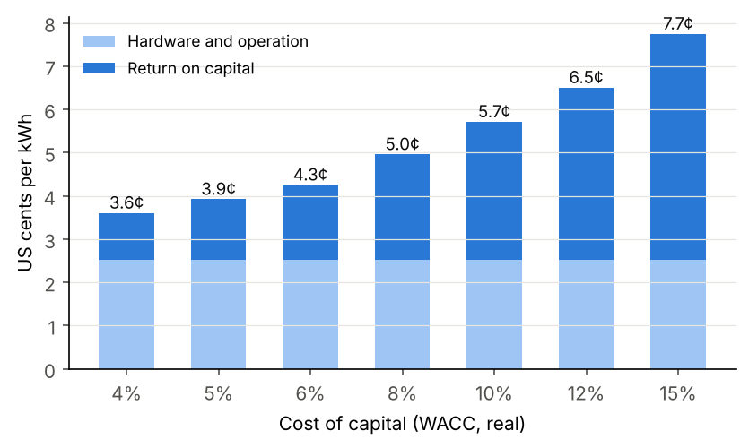

*Climate Fiscal Policy Brief No. 2.1, October 2026. Stephen J. Stretton, writing in a personal capacity. The views expressed are the author's own and do not represent those of any institution with which he is or has been affiliated. The proposal builds on a policy brief on regional payment intermediary facilities written with Nils Zimmermann and on the solar payments intermediary proposal developed by Evie Davey.*

# Executive summary {.unnumbered}

*The problem.* Solar power has no fuel bill, so its price is mostly the cost of the money that built it. A plant that needs 3.9 US cents per kilowatt-hour when financed at 5 percent needs 6.5 cents at 12 percent. In developing economies financing was about half the cost of utility-scale solar in 2021, against 25–30 percent in advanced economies and China. Much of the premium is not about the plant but about the buyer of its power, usually a loss-making state distribution company that may pay late, in part or not at all.

*The proposal.* Put a creditworthy payment intermediary facility between generators and distribution companies. It buys power from every project under one standard power purchase agreement, sells it on to the distribution companies, and pays generators in full and on time whatever they do. The facility collects arrears itself, behind a guarantee waterfall agreed before any plant is built: the distributor's owner, the national government through an intercept of its transfers, a multilateral agency and a donor contingency account.

*Why guarantee the contract.* A guarantee on project debt protects lenders but leaves equity exposed, covers one deal at a time, and leaves the guarantor with a claim on an unpaid project company. A guarantee on the contract removes the payment risk itself, covers every project selling to the same buyer, and keeps the distributor's debt alive, owed to a repeat creditor with powers to collect. In a stylized 100-megawatt case the contract guarantee saves the buyer \$0.94 million a year at an expected cost of \$0.18 million; a debt guarantee saves \$0.30 million at an expected cost of \$0.40 million.

*The evidence.* India's Solar Energy Corporation, rated AAA, has sold about 60 gigawatts at an average Rs 2.93 per kilowatt-hour on a 7-paise margin, behind letters of credit, a payment security fund and the power to have the central bank debit a defaulting state's account. But distribution companies stayed weak, and the center had to fund a Rs 90,000 crore liquidity scheme in 2020 and reschedule Rs 1.4 lakh crore of arrears in 2022. Nigeria's bulk trader shows the failure case: a single buyer with no reliable revenue behind it.

*What it costs.* The state's exposure falls in size and becomes contingent, contracted and conditional on its own conduct. It does not vanish. In a stylized 2-gigawatt regional facility, the national government's expected calls are about 2 percent of contract payments, recoverable from its own utilities.

*What to do.* Large countries should build national facilities and small ones should share regional facilities. Contract in local currency on tariffs that decline over time. Make utility reform a condition of entry, and record the guarantee at its expected cost with a published cap.

# 1. The cost of capital, not technology, prices clean power

Solar power is a bond with panels attached: almost all of its cost is paid up front, and the tariff repays the capital. Table 1 shows a representative utility-scale plant costing \$800 per kilowatt, running at a 20 percent capacity factor for 25 years. Only the cost of capital changes from row to row. At a 4 percent real weighted average cost of capital (WACC) the plant needs 3.6 cents per kilowatt-hour. At 12 percent it needs 6.5 cents, 80 percent more for the same hardware. The return on capital rises from 30 to 61 percent of the price.

| WACC (real) | 4% | 5% | 6% | 8% | 10% | 12% | 15% |
|---|---:|---:|---:|---:|---:|---:|---:|
| Levelized cost (US cents/kWh) | 3.61 | 3.92 | 4.26 | 4.96 | 5.72 | 6.51 | 7.75 |
| Relative to 4% | 1.00 | 1.09 | 1.18 | 1.38 | 1.58 | 1.80 | 2.15 |
| Return on capital, share of cost | 30% | 36% | 41% | 49% | 56% | 61% | 68% |

: Table 1. The same solar plant costs twice as much at 15 percent as at 4 percent (stylized). Capital cost \$800/kW, capacity factor 20 percent (1,752 kWh/kW a year), operation and maintenance \$12/kW a year, 25-year life. "Return on capital" is the capital charge above straight-line depreciation. Capital is spent at commissioning, with no interest during construction; Brief 2.2 adds two years of construction interest, which raises the cost at 10 percent from 5.72 to 6.2 cents [@CFPB32]. Code: `2.Source/model.py`.

{width=95%}

The gap between rich and poor countries sits in that table. The International Energy Agency's surveys found that in 2021 the cost of capital for utility-scale solar in key emerging economies was two to three times that in advanced economies, and that financing made up about half the levelized cost in emerging and developing economies against 25–30 percent in advanced economies and China [@IEA2022]. For projects reaching investment decision in 2022 the gap was still more than double, and the agency estimates that closing it by one percentage point would cut clean energy financing costs in these economies by about \$150 billion a year [@IEA2024]. Academic estimates agree that the cost of capital differs widely between countries and drives the cost of renewables [@Steffen2020; @Egli2018], and that the higher cost of finance in developing economies traps them in dearer, dirtier power [@Ameli2021; @Calcaterra2024].

# 2. The risk sits with the buyer of the power

A completed solar plant carries little operating risk; the buyer of its power carries a lot. In most developing countries that buyer, the offtaker, is a state-owned distribution company that sells below cost and collects badly. A World Bank study of 39 Sub-Saharan African countries found only two, Seychelles and Uganda, whose electricity sectors were financially viable [@Trimble2016]. When such a utility runs short of cash, it pays its generators last.

Investors price this payment risk into every project that sells to the utility. A simple model shows how much. Suppose the utility falls into a payment-default episode on average once every six or seven years, withholds payment for a year, and eventually pays 60 percent of what it withheld. Suppose investors price these episodes at twice their actual frequency, because default risk is partly undiversifiable and bond prices imply default rates above those actually observed [@Driessen2005]. Then the generator needs a tariff 11 percent above its cost to break even, worth 1.4 percentage points on the WACC (stylized). Longer episodes or poorer recovery push the premium to 2–4 percentage points. The premium is set by how long arrears last and how much is recovered, not by how often a utility is merely late.

# 3. The intermediary and its waterfall

The fix is to change who the generator is exposed to. A payment intermediary facility is a creditworthy institution that buys power from generators under a standard power purchase agreement, on-sells it to distribution companies, and pays generators whatever the distribution companies do [@StrettonTC]. The generator's credit risk becomes the facility's. The distribution company's arrears become a debt to the facility, which is a repeat counterparty with more patience and more leverage than any single developer.

The facility is protected by a guarantee waterfall: a sequence of guarantors that each pay, in order, only if the layer above has not. The layers are agreed before the facility operates in a territory, so that in a crisis the sequence runs by contract rather than by negotiation:

1. The offtaker, which must open letters of credit and pays late-payment interest.
2. Its subnational owner, a state or province, which agrees to stand behind its utility as a condition of entry.
3. The national government, which authorizes an intercept of its transfers to the defaulting subnational government, as India's tripartite agreement does.
4. A multilateral agency, for political risks the government will not cover.
5. A donor contingency account for the remaining tail.

Each layer is chosen because it can bear its risk cheaply or because bearing it disciplines the party that causes it. The facility itself holds a liquidity buffer to bridge arrears until the next layer pays. In a stylized regional facility buying 2 gigawatts of solar power, with contract payments of \$174 million a year, a buffer of about \$57 million covers the arrears it would face at the 99.5th percentile of a correlated crisis while the sovereign layer is called.

# 4. Guarantee the contract, not the debt

A guarantee can sit on the project's loan or on the buyer's promise to pay. The two look alike and behave differently. A debt guarantee pays lenders when the project cannot service its loan, whatever the cause. A contract guarantee pays the generator when the buyer does not.

The contract guarantee wins on three counts when defaults are temporary and recoverable, as they usually are for state utilities.

*Coverage.* The contract guarantee removes the payment risk from the whole project, equity included, so the whole premium leaves the tariff. A debt guarantee protects only lenders; the equity still bears the buyer's arrears and still demands a premium. One contract guarantee also covers every project that sells to the same buyer; debt guarantees are written one deal at a time.

*Cost.* The contract guarantor pays arrears and recovers them, so its cost is the part of the arrears it never collects. A debt guarantor is exposed to the face value of the loan, and its claim runs against a project company that has itself not been paid.

*Recourse.* Under a contract guarantee the distribution company still owes the money, now to the facility. That keeps the incentive to pay where it belongs.

| Stylized 100 MW solar plant | No guarantee | Contract guarantee | Debt guarantee |
|---|---:|---:|---:|
| Tariff (US cents/kWh) | 5.50 | 4.96 | 5.33 |
| Saving to the buyer (\$ million a year) | – | 0.94 | 0.30 |
| Guarantor's expected cost (\$ million a year) | – | 0.18 | 0.40 |
| Saving per dollar of expected cost | – | 5.3 | 0.8 |
| Largest exposure (\$ million) | – | 8.7 a year of arrears | 60 of debt |

: Table 2. A contract guarantee buys more tariff reduction per dollar of risk (stylized). Base WACC 8 percent; offtaker default episodes of one year at 15 per 100 offtaker-years; 60 percent recovered by generators, 95 percent by the facility; debt is 75 percent of the \$80 million cost; 30 percent of the offtaker's losses fall on lenders; the debt guarantee also covers 1 percent a year of non-payment risks such as construction failure. The working paper states the conditions in full [@StrettonWP31].

The reason is in the last line of Table 2. The facility's worst case is a year or two of unpaid bills, which it recovers in large part. The debt guarantor's worst case is the loan.

Nigeria shows the debt-shaped alternative. For the 459-megawatt Azura-Edo gas plant, the government declined to give a sovereign guarantee and instead signed a put-and-call option that obliges it, if the power contract ends early, to buy the plant at a price that at least covers the outstanding debt; the World Bank Group described this as having "no negative impact" on the government's balance sheet [@WBGAzura]. A promise to repay a project's debt on termination is a debt guarantee with a delay, and it should be counted as one.

# 5. What India's Solar Energy Corporation shows, good and bad

The Solar Energy Corporation of India (SECI) is the working model of a payment intermediary. It is wholly owned by the central government. It signs power purchase agreements with developers only after signing back-to-back power sale agreements with state distribution companies, earns a trading margin of Rs 0.07 per kilowatt-hour, and had about 60 gigawatts under sale agreements at a weighted average tariff of Rs 2.93 per kilowatt-hour in 2025 [@ICRA2025]. That margin is 2.4 percent of the tariff. In the model of Table 1 it pays for itself if it lowers the WACC by a third of a percentage point.

Its protections are layered much as Section 3 proposes. Distribution companies must open letters of credit; since a Ministry of Power order of June 2019, grid operators may schedule power only after the letter of credit is in place [@Powerline2019]. A payment security fund, financed from the central budget, developer penalties and interest, covers older National Solar Mission capacity, and since 2019 developers deposit Rs 5 lakh per megawatt toward it for newer tenders [@ICRA2025]. Since October 2016 SECI has been a beneficiary of the tripartite agreement among the central government, the states and the Reserve Bank of India, under which the central bank can debit a defaulting state's account and credit the central utility [@ICRA2025; @Kenning2017]. SECI invoked it in 2020–22 against distribution companies in Andhra Pradesh and Karnataka. ICRA rates SECI AAA.

The failure is that the buyers were never fixed. The same rating report records large past delays and letter-of-credit coverage of only 68 percent [@ICRA2025]. Across the sector, the central government announced a Rs 90,000 crore liquidity scheme in May 2020, lent through two public finance companies against state guarantees, so that distribution companies could pay generators [@CRISIL2020]. In June 2022 it allowed them to reschedule their arrears into up to 48 monthly installments [@Powerline2022]. Legacy arrears fell from Rs 1,39,947 crore in June 2022 to Rs 3,330 crore in March 2026 [@PTI2026]. The waterfall worked: generators were paid, and the arrears were in the end recovered. But the risk was moved to the central government, not removed, and the center paid twice to keep it moving.

Nigeria shows what happens without the waterfall. Its bulk trader, set up under the 2010 power sector roadmap as a single buyer [@WBGAzura], had no reliable revenue behind it. In 2017 the government arranged a central bank facility of up to N701 billion so it could pay generators, while it collected on average about a quarter of its invoices from distribution companies [@Okafor2017]. In 2020 the World Bank lent \$750 million to cut the sector's tariff shortfalls [@WorldBank2020PSRO]. An intermediary is only as good as the layer behind it and the reform beneath it.

# 6. Design choices

*Declining tariffs.* A flat 20-year contract signed when solar is dear locks the buyer into old prices as new plants get cheaper, which is when governments renegotiate. A tariff that starts at 7.7 cents and falls to 3.9 cents by year 7 has the same present value at 8 percent as a flat 5 cents. It cuts the value of the contract still outstanding after year 7 by about a quarter, and halves the part of it above the cost of new solar (stylized). It saves no money in present value, so the developer will not accept a lower starting price; what it buys is a contract the buyer is less tempted to break.

*One currency rule.* Write contracts in the currency the buyer earns. A dollar tariff makes the utility and the state hold the devaluation risk, which is the risk they can least bear. If a project borrows in dollars, the currency hedge belongs with the financier or the facility, priced and visible, not hidden in the tariff.

*National or regional.* Large markets such as India, Nigeria and Brazil can support a national facility. Small states should share a regional one, for example in the Economic Community of West African States, which spreads fixed costs and diversifies across buyers. A regional facility lacks an intercept like India's across borders, so its multilateral layer must be stronger.

*Countries in debt distress.* For a country that cannot borrow more, the facility can buy power from private plants and sell it as a service, so the state buys electricity rather than building plants. This changes the form of the obligation, not its existence: a long-term take-or-pay contract is a fiscal commitment and should be recorded as one. Its advantage is that it replaces an open-ended, foreign-currency fuel bill with a fixed and falling local-currency one.

*Conditionality on utility reform.* A guarantee makes the generator whole; it does not make the utility solvent. Entry should require a published path to cost-recovery tariffs, letters of credit, an intercept agreement and loss-reduction targets, with access widening as targets are met. A country that will not reform its utility is asking the guarantor to insure a certain loss.

*Fiscal accounting.* Governments should record their layer at its expected cost. Under the IMF's statistical standard, calls expected under a scheme of many similar guarantees are recorded as a liability, while one-off guarantees are disclosed as contingent [@IMF2014GFSM]. A facility with one standard contract is such a scheme. The national layer should carry a statutory cap and be reported each year.

# 7. What to do

Finance ministries in countries where distribution companies are the main buyers of power should create, or join, a payment intermediary facility with one standard power purchase agreement and a guarantee waterfall signed before the first tender. They should route new utility-scale renewable procurement through it, in local currency, on declining tariffs. They should make distribution companies' entry conditional on letters of credit, an intercept agreement and a tariff path, and record the national guarantee at expected cost under a published cap. Development banks should guarantee the facility, not individual project loans, and stand behind regional facilities for small states. Donors should fund the contingency account at the bottom of the waterfall. Once contracts are standard and guaranteed, plants can be refinanced as a few homogeneous asset classes through two-stage finance and synthetic sovereign bonds [@CFPB32].

# Related papers in this series {.unnumbered}

- **2.0** *Make Clean Power an Asset Class: Standardized De-risking for Developing Countries*. The series overview: the risk stack and who should hold each layer.
- **2.2** *From Projects to Asset Classes: Two-Stage Finance and Synthetic Sovereign Bonds for Clean Power* [@CFPB32]. Refinances the contracts this facility makes safe as a few standard securities.
- **3.1** *Reward the Stock as Well as the Flow: Notional Capitalized Value and Guarantee-Based Climate Incentives* [@CFPB41]. Guarantee capacity earned by climate policy, which can stand behind this facility's waterfall.
- **3.2** *The Climate Investment Trust: Hold Capital, Lend Its Strength* [@CFPB42]. A source of loss-absorbing capital for the donor layer.
- **3.3** *Codify Sustainability-Linked Sovereign Lending, Then Give It Scale* [@CFPB43]. A way to pay for the utility reforms that make the guarantee affordable.

# References {.unnumbered}

::: {#refs}
:::
