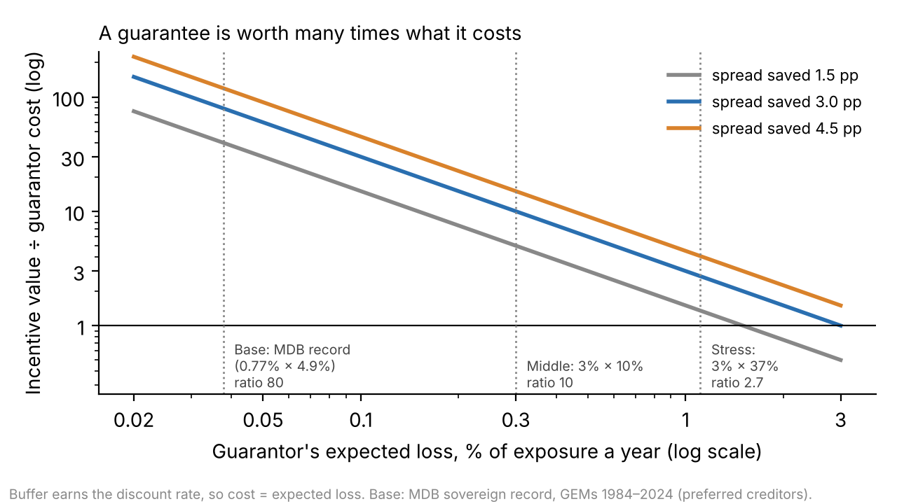
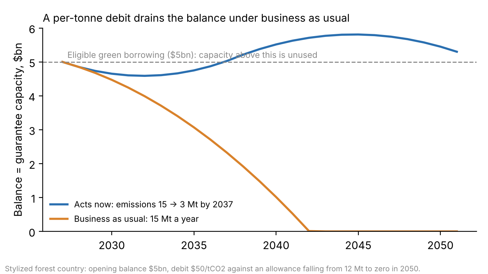

*Climate Fiscal Policy Brief No. 3.1, October 2026. Stephen J. Stretton, writing in a personal capacity. The views expressed are the author's own and do not represent those of any institution with which he is or has been affiliated. The full argument, proofs and code are in the companion working paper.*

# Executive summary {.unnumbered}

*The problem.* International climate finance pays countries for emission cuts measured against a counterfactual nobody can observe. Baselines get inflated, payments arrive years after the political cost is paid, and a country that never cleared its forest has nothing to sell. Guyana's forests hold 19.5 billion tonnes of CO₂-equivalent; it is paid only for the gap between actual deforestation and a reference level, about $50 million a year from its sale of credits to Hess. Donors will not vote for cash transfers on the scale that stocks like this would justify.

*The proposal.* Credit each participating country with a notional capitalized value: a balance opened by its verified carbon stock, debited for every tonne it emits above an agreed allowance path and credited for every tonne below. The balance is never paid out. It sets the country's guarantee capacity, the maximum outstanding guarantee exposure that development banks will provide on its eligible green borrowing, backed by a buffer fund.

*Why it works.* A guarantee saves the borrower the full credit spread but costs its provider only the expected loss. Gabon's insured 2023 bond paid 6.1 percent when its other bonds yielded 9–10.5 percent. On conservative loss assumptions shared across this series, each dollar of donor cost delivers about $2.70 of interest savings; on the development banks' own sovereign loss record, far more. Because every tonne emitted shrinks the balance, the incentive acts from the first year, and is equivalent to a carbon price of the debit price times the spread over the discount rate.

*The key design choice.* Use two prices. A low stock price sizes the balance to what the country borrows; a higher debit price sets the reward per tonne. Priced at $100 per tonne, Guyana's stock would be a $1.95 trillion balance that no guarantor could back and that never binds, so an extra tonne would cost nothing. With a $5 billion balance and a $50 debit, each tonne costs the country about $30 in lost savings and each hectare cleared about $32,500, forty or more times the deduction in the new Tropical Forest Forever Facility.

*What it costs.* Each $1 billion a year of incentive needs $33 billion of guarantee capacity, a buffer of about $3.1 billion that donors hold rather than spend, and about $370 million a year of expected losses in the conservative case. A capacity schedule that declines as fast as clean technology costs fall halves the donor cost of inducing early action.

*What to do.* Development bank shareholders should create rules-based guarantee capacity outside country envelopes, allocated by notional capitalized value; donors should fund the buffer, not the reward; forest and coal countries should negotiate allowances, not baselines.

# 1. Climate finance pays for flows and ignores stocks

Results-based climate finance pays for tonnes avoided against a reference level. Guyana is the leading national case: the Architecture for REDD+ Transactions issued it 33.47 million credits for 2016–2020 [@OilNow2022], and Hess agreed to buy 37.5 million credits to 2030 for at least $750 million, starting at $15 per tonne [@GuyanaDPI2023]. That is about $50 million a year for a country whose forests store 19.5 billion tonnes of CO₂-equivalent on about 18 million hectares [@Guyana2022LCDS].

Paying for the flow has three costs. The baseline can be gamed: synthetic-control studies of forest-conservation projects find claimed reductions far above any measurable effect [@West2023]. The payment arrives after the result, often years after the government paid the political cost, so it guards against reversal more than it starts reform [@Angelsen2017]. And a country that kept its forest has little to sell, while leaving coal or oil in the ground earns nothing at all.

The first instrument to pay for the stock is now running. The Tropical Forest Forever Facility, launched by Brazil in November 2025 with the World Bank as trustee, aims to raise $25 billion of junior sponsor capital and $100 billion from market investors, invest it in emerging-market bonds, and pay the spread to forest countries at about $4 per hectare a year [@Barber2025]. It deducts 100 to 200 times the hectare rate for each hectare cleared [@Mongabay2025]. At Guyana's average density of about 1,080 tonnes per hectare, the payment is a fraction of a cent per tonne of stock a year, and the deduction is under $1 per tonne released.

# 2. The notional capitalized value: a balance the stock opens and emissions draw down

A country's notional capitalized value is a climate balance held for it by an international arrangement. It opens at the stock price times the verified carbon stock. Each year it is debited at the debit price for every tonne emitted above an agreed allowance path, and credited for every tonne below. Land-use emissions count like any others, so clearing a hectare is debited as the carbon it releases.

The balance is notional. Nobody claims the forest could be sold for its value; the number is an agreed basis for an entitlement [@StrettonTC, ch. 21]. The accounting mirrors liability law: an emission imposes future damage, so it is properly a capital requirement rather than an expense, and an unreleased stock is notional capital [@StrettonRPWT, ch. 7].

The stock price and the debit price must differ. The balance only changes behavior if guarantee capacity binds, that is, if the country wants more guaranteed borrowing than it has capacity for. If capacity is slack, a tonne emitted reduces a balance that nobody uses. Guyana's stock at $100 per tonne gives a $1.95 trillion balance, far above any borrowing need, so an extra tonne would cost the country nothing. Sizing the balance to a $5 billion borrowing need requires a stock price of about $0.26 per tonne, and at that single price a tonne emitted is worth only $0.15. Two prices solve this: a low stock price decides how much each country starts with, and a uniform, higher debit price decides what each tonne costs.

The stock still does essential work. A sovereign will not pay a fine for emitting above a benchmark, but it can lose part of a balance it already counts as its own. Without a stock there is nothing to debit [@StrettonRPWT, ch. 5].

Earlier versions of the idea took four forms: interest on a notional value paid into a trust account, guarantee capacity released over ten years, a climate balance used up by business-as-usual emissions, and a "climate allowance" of guarantee capacity. This brief chooses guarantee capacity, defined as a cap on outstanding exposure, with interest on the balance as the variant for countries that do not borrow.

# 3. From balance to guarantee capacity: why a guarantee is worth more than it costs

A guarantee is worth the full spread to the borrower and costs the guarantor only its expected loss. The market charges a lower-rated sovereign for the risk it poses to all creditors; a development bank that is a preferred creditor, with a counter-indemnity from the government, bears much less. Development bank loans to sovereigns defaulted at 0.77 percent a year over 1984–2024 and recovered 95.1 percent [@GEMs2025], an expected loss of 0.04 percent a year. Gabon's 2023 debt-for-nature bond, insured by the US Development Finance Corporation, priced at 6.097 percent and was rated Aa2, when the sovereign's other bonds yielded 9–10.5 percent [@Reuters2023Gabon].

The ratio of incentive to cost is the spread saved divided by the expected loss. This series does not rely on the banks' record. Its base case assumes that governments fail to honor 3 percent of guarantee obligations a year and that creditors lose 37 cents on the dollar when they do, an expected loss of 1.11 percent a year; a buffer of 9.3 percent of exposure then keeps the annual chance of exhausting it at 1 percent [@StrettonWP32]. At a 3-point spread, each dollar of expected cost buys $2.70 of interest savings. With a 10 percent loss per call the ratio is 10; on the banks' record, about 80.

The original version of the proposal understated its own incentive tenfold. It valued a 100 MtCO₂ forest at $100 per tonne, a $10 billion balance, released "roughly $1 billion of capacity per year", and at a 3 percent saving found $30 million a year, $300 million over ten years [@StrettonTC, ch. 21]. Those figures hold only if $1 billion is a cap on total exposure, which leaves $9 billion of balance idle and makes an extra tonne cost nothing. Read as a cap on outstanding exposure equal to the whole balance, the incentive is $300 million a year, and each tonne emitted costs about $21 in lost savings.

# 4. Paying for acting early

Falling technology costs and the option to wait reward delay. A government weighing a reform that costs money up front gains from waiting a year by the interest on that cost plus the fall in technology costs. Acting now beats waiting only if the yearly reward from the tonnes cut covers both. For a stylized reform costing $1 billion, falling 5 percent a year, that cuts 5 MtCO₂ a year at a 5 percent discount rate, the minimum incentive is $20 per tonne; allowing for the value of waiting under uncertainty raises it to about $30 [@DixitPindyck1994].

A balance whose capacity declines over time pays a premium for acting early. A tonne saved this year preserves capacity for all later years; a tonne saved in ten years preserves less. The working paper shows that the cheapest schedule that still makes acting now optimal lets capacity decline at the rate technology costs fall. In the example, that halves donors' cost of delivering the $20 incentive, from $740 million to $370 million in present value. The same incentive paid in cash on results would cost $1 billion.

Energy and forests need different schedules. Once clean power is cheaper than coal, keeping it costs nothing, so the incentive can phase out. A standing forest keeps an opportunity cost as long as there is demand for land, so the forest incentive needs a permanent floor.

# 5. How big can it be?

The incentive scales with what a country borrows, not with its stock. A country saves spread only on debt it actually issues, so the guarantee form delivers large incentives to large, lower-rated borrowers.

| Incentive to the country | Guarantee capacity needed | Buffer held (9.3%) | Expected donor cost a year | Present value over 20 years |
|:--:|:--:|:--:|:--:|:--:|
| $0.1bn a year | $3bn | $0.3bn | $37m | $1.2bn |
| $1bn a year | $33bn | $3.1bn | $370m | $12.5bn |
| $5bn a year | $167bn | $15.5bn | $1.85bn | $62bn |

: Table 1. What a big incentive needs, at a 3-point spread saving. Expected donor cost uses the conservative series base case of 1.11 percent a year; on the development banks' record it would be about one-thirtieth. Source: author's calculations.

A stylized forest country shows the mechanism. Give a country with Guyana's stock a $5 billion opening balance sized to its borrowing, a $50 debit price and emissions of 15 MtCO₂ a year against an allowance falling from 12 million tonnes to zero in 2050 (all stylized). It saves $150 million a year while it keeps its balance. Under business as usual the debits exhaust the balance by 2042; cutting emissions to 3 MtCO₂ by 2037 keeps it. Acting is worth about $1 billion to the country in present value. Donors hold a buffer of $0.47 billion and expect to lose about $56 million a year, or $11 per tonne of a $30 carbon-price equivalent.

The comparison with sustainability-linked lending shows why scale needs guarantees. Uruguay's $350 million sustainability-linked World Bank loan of 2023 can save it at most about $12.5 million over its life [@CFPB33]. A $1 billion a year incentive through guarantees needs donors to hold $3.1 billion, which they keep and which earns.

Coal reserves need a narrower rule. Indonesia had 34.9 billion tonnes of proved coal reserves at the end of 2020 [@BP2021], about 78 billion tonnes of CO₂ at default carbon contents. Crediting all of it would reward ownership of coal and invite inflated reserve reports. Credit only reserves legally retired, at a low price that allows for leakage through world coal markets [@Harstad2012], and debit combustion emissions like any other. For an investment-grade sovereign saving only a point of spread, guarantees are a weak reward; the same balance is better delivered through trust collateral or sustainability-linked lending.

# 6. Risks and safeguards

*Moral hazard.* Cheaper borrowing invites more of it. Capacity is capped by the balance, only eligible green borrowing is covered, and the government counter-indemnifies the guarantor, so a call becomes a debt to a development bank.

*Hidden fiscal exposure.* The scheme does not remove the government's liabilities. Its exposure becomes smaller in expected cost, contingent and contracted, but stays its own. Donors' exposure is contingent too, and the buffer must be sized to stressed, correlated losses and published.

*Valuation disputes.* Disputes over stocks and allowances change only the level of a country's balance, which is a matter of distribution. The debit price, which governs incentives, should be uniform and set by rule. Forests near ecological thresholds [@LovejoyNobre2018] warrant a higher debit per hectare, not a higher stock value.

*Permanence and leakage.* A tonne released is debited whenever it is released, so reversal is priced. Fires beyond a government's control need a pooled reserve. Leakage across borders falls with broad participation.

*Fairness.* A stock-based balance favors forest-rich countries. The allowance corrects part of this, because low emitters earn balance every year they stay below it; a per-capita floor would correct more. For countries that borrow little, interest on the balance paid into a trust account is the better form.

*The strongest objection* is that much of the stock was never at risk, so its balance is a transfer for nothing. The transfer is cheap, because it is capacity costed at expected loss rather than cash; it is what makes the per-tonne debit enforceable; and it does not dilute the incentive at the margin, which the debit price alone sets.

# 7. What to do

Development bank shareholders should create rules-based guarantee capacity outside country lending envelopes, allocated by notional capitalized value: an opening balance from each country's verified stock at a low, uniform stock price; an allowance path to net zero; a uniform debit price of $30–70 per tonne; capacity sized to bind on eligible green borrowing and declining at about the rate clean technology costs fall; and any surplus flowing to a beneficiary account.

Donors should fund the buffer, not the reward. A trust that holds and invests the buffer, sized to stressed losses, is the institution for this [@CFPB32].

Forest and coal countries should negotiate allowances rather than baselines, seek credit for legally retired reserves, and write the allowance path into sustainability-linked loans as the performance indicator [@CFPB33].

The scheme fails if spreads saved are small, if capacity is so large that it never binds, if the buffer is sized to expected rather than stressed losses, or if verification is captured.

# Related papers in this series {.unnumbered}

- **3.0** *Reward Governments, Not Projects: International Incentives for National Climate Policy*. The series overview.
- **3.2** *The Climate Investment Trust: Hold Capital, Lend Its Strength* [@CFPB32]. The buffer fund that stands behind the guarantees and holds beneficiary accounts.
- **3.3** *Codify Sustainability-Linked Sovereign Lending, Then Give It Scale* [@CFPB33]. The delivery channel for the allowance path.
- **2.1** *Guarantee the Contract, Not the Debt: A Payment Intermediary for Clean Power* [@CFPB21]. A payment intermediary whose guarantees the capacity can back.
- **1.7** *Measure Carbon Pricing by the Emissions It Cuts: The Total Effective Carbon Price* [@CFPB17]. The measure used for the carbon-price equivalent.

# References {.unnumbered}

::: {#refs}
:::
