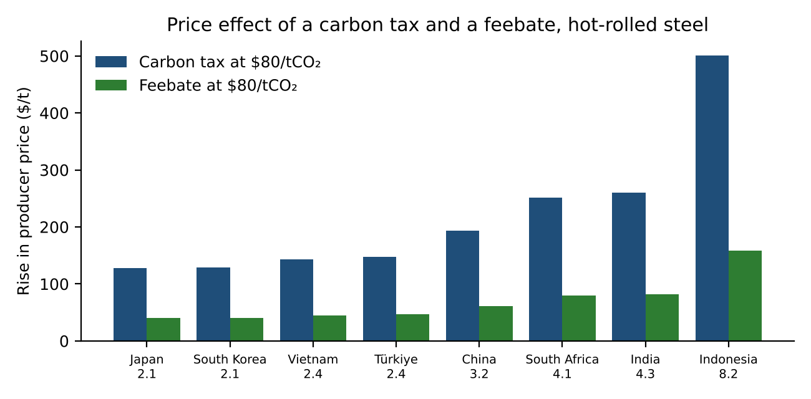

---
# MASTER - this is the file to edit. The .docx beside it and the website page are made from it.
title: "Price Production and Consumption Separately"
subtitle: "A Two-Track Architecture for Carbon Pricing in Open Economies"
author:
  - name: "Stephen J. Stretton"
    note: "Writing in a personal capacity."
date: "October 2026"
version: "0.4"
abstract: |
  A carbon tax on domestic production does two jobs at once: it rewards firms for cutting emissions per unit of output, and it charges for the carbon in what the economy consumes. In an open economy the second job undermines the first, because the charge falls on exports and spares imports. This paper separates the jobs. A revenue-neutral feebate prices production intensity; a destination-based charge, levied through the value-added tax and through forward-announced obligations on energy suppliers, prices consumption. I show that the two tracks together reproduce the Pigouvian allocation for domestic consumption without leakage, that the feebate's residual cost is second order, that international payments above half the feebate rate make adoption a net gain, and that destination charges make each exporter's most competitive feebate rate equal to the charge in its markets. A calibration to the EU's default emission values for steel illustrates the magnitudes.
keywords: [carbon pricing, feebates, output-based rebating, border carbon adjustment, destination-based taxation, policy crediting, carbon leakage]
jel: [F18, H23, H87, Q54, Q58]
bibliography: OpenEconomyCarbonPricing.bib
csl: https://www.zotero.org/styles/chicago-author-date
number-sections: true
crossref:
  fig-prefix: Figure
  tbl-prefix: Table
  sec-prefix: Section
  eq-prefix: equation
format:
  docx: default
---

*Working paper, version 0.4, October 2026. Stephen J. Stretton, writing in a personal capacity. The views expressed are the author's own and do not represent those of any institution with which he is or has been affiliated. A short version for policy makers is [Climate Fiscal Policy Brief No. 1.1](brief:).*

# Executive summary {#sec-summary}

**Carbon prices stay low in open economies because one instrument is asked to do two jobs.** A carbon tax on what a country produces pushes firms to cut emissions per tonne of output, which is the job it does well. It also raises the price of everything the country makes, which is meant to make buyers use less carbon. In an open economy the second job goes wrong: the price rise falls on exports, which compete against unpriced rivals, and spares imports. Governments respond by exempting heavy industry or keeping the rate low. Explicit carbon prices cover about 28 percent of global emissions, at an average of about \$19 per tonne where they apply.

**This paper gives each job its own instrument.** On the *production track*, each industrial sector pays a revenue-neutral feebate: firms pay a charge on emissions per tonne above the sector average and receive a rebate below it. The payments cancel out, so the treasury neither gains nor loses, and the sector's average cost barely moves, but every firm still gains the full carbon price for each tonne it cuts. On the *consumption track*, what the country consumes pays for its carbon, whether made at home or imported: through a carbon component of the value-added tax (VAT), with exports exempt as in any VAT, and through an obligation, announced years ahead, on the few large firms that sell fuel for homes and vehicles.

**The feebate makes a high carbon price affordable for exporters.** In hot-rolled steel, at \$80 per tonne of CO₂, a carbon tax would raise the producer price by 25 percent for a Turkish-intensity mill and 32 percent for a Chinese-intensity one. A feebate at the same rate raises it by 8 and 10 percent, the cost of the abatement itself, because it does not charge firms for the emissions that remain. The price of this saving is that a feebate alone does not discourage consumption of steel; the consumption track supplies that, without leakage, because imports pay the same charge.

**Outside money can make adopting a feebate a gain for the country.** If a climate-finance facility pays a price per tonne of reduction above half the feebate rate, and the country keeps the reduction toward its own target, the country gains, and its best choice is a feebate rate equal to the payment. This is the case for paying for policies rather than projects.

**Border charges can turn leakage into a race to the top.** Once importers charge for the carbon in what they buy, measured for each exporting country and sector, an exporter's lowest delivered cost comes from a feebate at the same rate as the charge in its markets. In a simulated steel market with eight exporters, the average carbon content of imports falls by about 70 percent when exporters respond this way, against about 28 percent when only the mix of suppliers changes.

**What to do.** Developing-country exporters can start with a production feebate: it needs only sector intensity data and costs the treasury nothing. Importers, the EU first, should credit feebates and other non-price policies at the border, measured as carbon-price equivalents, and can move part of VAT onto carbon. Development banks and climate-finance facilities should pay for policies at a price per tonne above half the feebate rate they induce.

# Introduction {#sec-intro}

Explicit carbon prices cover about 28 percent of global emissions. The average price on covered emissions is about \$19 per tonne, and averaged over all global emissions it is about \$5 [@WorldBank2025], far below the range the High-Level Commission on Carbon Prices judged consistent with the Paris temperature goals, at least \$50–100 per tonne by 2030 [@HLCCP2017]. The usual explanation is political will. This paper argues that the gap is also built into the instrument.

A conventional carbon price, a tax or an emissions trading system covering domestic emitters, is levied on the origin basis: it falls on what a country produces. It therefore does two jobs with one rate. It gives each firm an incentive to cut emissions per unit of output, the *intensity margin*. And it raises the price of carbon-intensive goods, so that buyers use less of them, the *quantity margin*. In a closed economy both jobs are welcome and one rate does both efficiently. In an open economy the second job is done badly. The price rise falls on exports, which compete against unpriced foreign supply, and spares imports, which displace domestic production. Part of the quantity response is leakage rather than abatement, and the competitive loss is concentrated in the energy-intensive, trade-exposed sectors that hold most industrial emissions. Governments respond by exempting those sectors, allocating permits free or keeping the rate low [@KeenParryRoaf2022]. A border adjustment on imports, such as the EU's Carbon Border Adjustment Mechanism [@EU2023], protects the home market but leaves exports exposed and recognizes only explicit carbon prices paid abroad.

This paper proposes giving each job its own instrument. The *production track* prices intensity with a revenue-neutral feebate: each producer pays $t(e_i - \bar e)$ per unit of output, a charge above a sector benchmark $\bar e$ and a rebate below it. "Production" here means production in the economic and trade sense, what a country makes for home use or for export, and the metric is emissions per unit of physical output, or per dollar of output where products differ. The *consumption track* prices what is consumed at home, whatever its origin, with a destination-based charge on embodied carbon. It has two parts: a carbon component of the value-added tax (VAT) on goods, with imports charged and exports zero-rated, and a forward-announced legal obligation on the few large firms that supply energy for domestic use: fuel for heating and transport. Electricity sold to final users bears the consumption-track price on its generation carbon, net of any carbon price paid upstream (under a revenue-neutral feebate generators pay nothing net on average, so on average nothing is deducted): through the VAT carbon component where one exists, through the supplier obligation where it does not. A *measurement framework*, a carbon-price-equivalent metric of the kind @black2022framework compute with a full model, puts every instrument, price-based or not, on one scale. Electricity generation is on the production track, priced on the same intensity metric; the separate case for doing so turns on capital turnover and household prices rather than trade, and is made in the companion paper on feebates [@CFPB12].

The paper makes five contributions.

1. **An implementable architecture** (@sec-model). The production track is a revenue-neutral feebate with a benchmark updated to the sector average, so it needs no emissions trading system and no auction revenue and can be adopted by one developing country alone; the consumption track runs through VAT across all goods rather than through an excise on a few materials.
2. **An equivalence result with a revenue corollary** (@sec-equivalence). With a common rate, the two tracks reproduce the Pigouvian allocation for domestic consumption and production intensity, with no leakage through the goods channel. This is an implementable statement of a known allocation result [@Markusen1975; @Holland2012], and close to @BoehringerRosendahlStorrosten2017, who show that output-based rebating combined with a consumption tax on emission-intensive, trade-exposed goods can be equivalent to a border carbon adjustment. What is new is the corollary on revenue, which tells finance ministries which countries gain and which lose: the difference from a Pigouvian origin tax equals the charge on carbon in net exports.
3. **The cost of the production track, calibrated** (@sec-cost, @sec-calibration). A revenue-neutral feebate costs the treasury nothing and raises the producer price only by the resource cost of abatement, $\tfrac12 t\,\Delta e$: about a third of the price effect of a tax at \$80/tCO₂, calibrated to the EU's default intensities for steel. Its weakness, the absence of an output signal, has a precise size, and the consumption track removes it.
4. **A self-interested case for policy crediting** (@sec-crediting). If an outside buyer pays $\pi$ per tonne abated and the host keeps the reduction toward its own target, a feebate is a net gain to the adopting country whenever $\pi > t/2$, the threshold @StrandRBP2020 derives for a donor-supported carbon tax, and the country's best response is $t = \pi$.
5. **From leakage to a race to the top** (@sec-race). Once importers charge for embodied carbon measured for each exporting country and sector, each exporter's most competitive feebate rate equals the charge in its markets. In a calibrated simulation the average embodied intensity of steel imports falls by about 70 percent when exporters respond.

The paper anchors a series. The consumption track is developed in @CFPB13, the feebate design in @CFPB12, the measurement framework in @CFPB61, and the reform of the EU's border mechanism in @CFPB14.

# Related literature {#sec-literature}

The paper connects five literatures. This section gives what is needed to see the gap; Appendix A reviews each in detail, with the work that challenges each proposition.

*Leakage and competitiveness.* Unilateral carbon pricing shifts emissions-intensive production abroad. A meta-analysis of model-based estimates puts leakage from unilateral carbon pricing at 5 to 25 percent of the emission cut, with a mean of 14 [@BrangerQuirion2014]; the competitiveness loss is concentrated in energy-intensive, trade-exposed sectors. Ex-post studies find little or no leakage at the EU's past carbon prices, partly because free allocation shielded industry [@NaegeleZaklan2019; @Dechezlepretre2022; @Colmer2024], so the problem is prospective: it bites at rates in the upper half of the High-Level Commission's \$50–100 range for 2030, which this paper is about. Pass-through of carbon costs in EU industry is probably under half in most cases, and lower where less regulated competitors are present [@NeuhoffRitz2019]; in a set of US manufacturing industries about 70 percent of energy-driven cost changes are passed through [@GanapatiShapiroWalker2020]. The difference is consistent with trade exposure. The theoretical case for border adjustment when carbon prices differ across countries is established: @Markusen1975 shows that with an international externality the optimal unilateral policy combines a production tax with a trade tax, equivalently a consumption tax, and @KeenKotsogiannis2014 show that when some countries' carbon prices are constrained below efficient levels, Pareto efficiency requires border tax adjustments.

*Border carbon adjustment.* The design literature [@IsmerNeuhoff2007; @Mehling2019; @Cosbey2019; @KeenParryRoaf2022] establishes the main choices: sectoral coverage, measurement of embodied carbon (domestic benchmark, country default or firm-specific data), treatment of exports and recognition of foreign policy. Keen, Parry and Roaf note the tension this paper builds on: a border adjustment in the VAT sense puts tax on a destination basis, while the Paris Agreement assigns responsibility on an origin basis.

*Output-based rebating and intensity standards.* Output-based allocation, tradable performance standards and feebates price intensity but subsidize output relative to a tax [@Fischer2001; @FischerFox2007; @FischerFox2012]. @HollandHughesKnittel2009 show that an intensity standard can even raise emissions when the implicit output subsidy is large, and @FowlieReguantRyan2016 show, for cement, that output-based allocation can outperform auctioning once leakage and market power are counted. @KeenParryRoaf2022 classify feebates and output-based rebates as cutting intensity but not output. This paper takes that weakness as given and assigns the output margin to a separate instrument.

*Destination-based taxation.* VAT spread across most of the world within half a century [@KeenLockwood2010]. For a uniform tax, the destination and origin bases are trade-neutral [@LockwoodWhalley2010]; the trade effects in this paper come from charges that vary with carbon intensity, not from the destination basis as such. The same logic underlies proposals for destination-based corporate taxation [@Devereux2021]. Consumption-based emissions accounting shows that industrialized countries are net importers of embodied CO₂: their consumption footprints exceed their territorial emissions [@PetersHertwich2008; @Grubb2022].

*International incentives.* Climate clubs use border measures to induce participation [@Nordhaus2015]; @HelmHepburnRuta2012 analyze the strategic use of border adjustments; @ParryRoafBlack2021 propose an international carbon price floor among large emitters, with non-price measures counted through their carbon-price equivalents [@black2022framework]. Results-based climate finance pays for verified reductions. Project crediting has a poor record on environmental integrity: @Probst2024 find that under 16 percent of credits represent real reductions, and @Calel2025 that at least 52 percent of Indian wind credits under the Clean Development Mechanism were non-additional. @StrandRBP2020 derives the payment that makes a donor-supported carbon tax worthwhile for the host.

*What is new.* The split is old in theory. @Markusen1975 showed that with an international externality the optimal unilateral policy combines a production tax with a trade (equivalently, consumption) tax; @WeisbachKortumWangYao2023 restate this with an extraction leg; @Holland2012 proves that an intensity standard combined with a consumption tax can sometimes reach the first best under leakage when an emissions tax combined with a consumption tax cannot; and @BoehringerRosendahlStorrosten2017 show that output-based rebating plus a consumption tax on emission-intensive, trade-exposed goods can be equivalent to a border carbon adjustment, and that adding the consumption tax to existing rebating improves welfare. It also has close policy precedents: @Grubb2022 list the separation of production incentives from a charge on the use of carbon-intensive materials as a trade-compatible option, @PollittNeuhoffLin2020 simulate a consumption charge on basic materials rising to about €80/tCO₂ by 2050, which cuts EU CO₂ emissions by up to 10 percent by 2050 and, because imports are charged alike, avoids leakage, and @Neuhoff2026 propose benchmark-based free allocation with a standardized liability per tonne of material. Against that work this paper claims five things: (i) a specific pairing of a revenue-neutral, updated-benchmark feebate, which needs no emissions trading system and can be adopted by a developing country alone, with a carbon component of VAT across all goods and forward-announced energy obligations; (ii) the closed-form residual cost of the feebate and its calibration to the EU's default intensities for steel; (iii) the exporter best-response result under intensity-based destination charges; (iv) the extension of Strand's crediting threshold to feebates, with the best response $t = \pi$; and (v) the use of a carbon-price equivalent to make non-price production instruments creditable and recognizable at the border.

# Model {#sec-model}

**Technology.** A competitive sector produces a homogeneous good. A producer choosing emissions intensity $e$ (tonnes of CO₂ per unit of output) has unit cost
$$
c(e) = c_0 + \frac{k}{2}\,(e_0 - e)^2, \qquad e \le e_0,
$$ {#eq-cost}
where $e_0$ is the intensity chosen with no carbon policy and $k > 0$ is the slope of the marginal cost of reducing intensity. The marginal abatement cost per unit of intensity is $k(e_0 - e)$. With competitive pricing and no policy, the price is $p_0 = c_0$.

**Demand.** Home consumption $D(p)$ and foreign demand for home exports $X(p)$ have price elasticities $\eta_D$ and $\eta_X$. In @sec-race, an importing market buys from several exporters under Armington demand [@Armington1969], with elasticity of substitution $\sigma$ among sources.

**Instruments.** Three instruments, each at a rate per tonne of CO₂:

- an **origin tax** $t$: a producer pays $t\,e$ per unit produced, whether sold at home or exported;
- a **feebate** $t$: a producer pays $t\,(e - \bar e)$ per unit produced, with $\bar e$ the sector's output-weighted average intensity, so that payments sum to zero;
- a **destination charge** $\tau$: each unit consumed at home pays $\tau\,m$, where $m$ is its embodied intensity, whether produced at home or imported; exports are zero-rated.

The feebate benchmark is updated to the realized average, so an individual firm's choice moves $\bar e$ only through its own output share. With many firms that effect is negligible, and the firm treats $\bar e$ as given. The propositions compare steady states, in which the benchmark equals the sector's intensity and payments net to zero. In practice the benchmark is last period's average (@sec-implementation); while intensity is falling, the sector's average sits below last period's benchmark, so the lag leaves a small net rebate to the sector, paid by the treasury, of $t$ times the fall in average intensity times output. It disappears as intensity settles, and a government that wants strict neutrality can set the benchmark on a projected path instead.

# The equivalence result {#sec-equivalence}

**Proposition 1 (equivalence).** *Let the home country apply a feebate at rate $t$ and a destination charge at rate $\tau = t$, and let embodied intensity be measured accurately. Then (i) home producers choose the same intensity as under a Pigouvian origin tax at rate $t$; (ii) home consumers face the same price as under that tax for home-produced goods, and the full carbon cost of imported goods; (iii) home exports bear no domestic carbon charge beyond the resource cost of abatement. Revenue is $t$ times the carbon embodied in home consumption, compared with $t$ times the carbon in home production under the origin tax; the difference is $t$ times the carbon in net exports.*

The proof is in Appendix B. The intuition is that a Pigouvian price does two things a feebate and a destination charge can each do separately. The marginal cost of emitting, $t$, is the same under a feebate and a tax, so producers choose the same intensity. The average cost of emitting, $t\,e$, is moved from the producer to the consumer: the feebate removes it from the producer price, and the destination charge adds it back to the consumer price for everything consumed at home. Because the charge applies to imports at their own embodied intensity, foreign producers cannot undercut home producers by being dirtier, and there is no leakage on the consumption base.

@fig-incidence shows the incidence in a stylized steel market. Under an origin tax, home producers carry the carbon charge whether they sell at home or abroad, and imports carry none. A border adjustment on imports fixes the home market but not exports. The two tracks charge home sales and imports alike, and leave exports with only the resource cost of abatement.

{#fig-incidence width=100%}

Four qualifications matter. First, equivalence holds for the home country's consumption; it says nothing about emissions embodied in home exports, which are priced, on the consumption track, by the importer. That is the subject of @sec-race. Second, the result requires the destination charge to be measured on actual embodied intensity, at least for large importers that choose to verify; default values deliberately set high, as in the EU's regime [@EU2025DV], preserve the incentive to verify but tax average importers above their true intensity. Third, the feebate and the destination charge need not share a rate. The production rate $t$ can be set higher than the consumption rate $\tau$, because it does not raise average costs; the consumption rate is set by what households will accept and by the revenue the VAT reform needs (@sec-implementation). Fourth, the result removes leakage through the goods channel only. A coalition that cuts fossil-fuel demand lowers world fuel prices and raises use elsewhere; no border measure on goods addresses that channel, which in model studies is as large as the goods channel or larger [@BrangerQuirion2014; @WeisbachKortumWangYao2023]. The production track in exporting countries, which is the subject of @sec-race, is the response to it [@JakobSteckelEdenhofer2014].

**Corollary (revenue).** Revenue from the two tracks is $\tau\,M_C$, where $M_C$ is carbon embodied in home consumption, against $t\,E_P$ under an origin tax, where $E_P$ is carbon emitted in home production. A net exporter of embodied carbon raises less; a net importer raises more. This is the fiscal counterpart of the distinction between production-based and consumption-based emissions accounts [@PetersHertwich2008].

# What the production track costs {#sec-cost}

**Proposition 2 (intensity).** *A feebate and an origin tax at the same rate induce the same intensity, $e^* = e_0 - t/k$.*

**Proposition 3 (residual cost).** *Under a revenue-neutral feebate the producer price rises by*
$$
\Delta p_F = c(e^*) - c_0 = \frac{t^2}{2k} = \tfrac12\, t\, \Delta e ,
$$ {#eq-residual}
*the resource cost of abatement, while under an origin tax it rises by $t e_0 - t^2/2k$. The ratio is $\Delta e/(2e_0 - \Delta e)$. Output falls by $\eta\, t^2 / (2 k p_0)$ in proportion under the feebate, second order in $t$, and by about $\eta\, t e_0 / p_0$ under the tax, first order.*

The feebate's treasury cost is zero by construction. Its economic cost to producers is the cost of the abatement itself, which a tax also imposes; what it removes is the tax on the remaining emissions, the infra-marginal carbon bill. For a 30 percent cut in intensity, the feebate raises the price by 18 percent as much as a tax at the same rate; for a 48 percent cut, by about a third.

**Proposition 4 (the output margin).** *To cut the same tonnes as an origin tax at rate $t_T$, a feebate alone needs the rate*
$$
t_F = t_T\left(1 + \frac{\eta\, k\, e_0^2}{p_0}\right)
$$ {#eq-premium}
*to first order. The premium rises with the price elasticity of demand, with carbon intensity per dollar of output and with the steepness of abatement costs.*

This is the known weakness of intensity-based instruments [@HollandHughesKnittel2009; @FischerFox2012]. In IMF simulations, packages of feebates and regulations with the same marginal incentive achieve roughly 50–70 percent of the emission cuts of a carbon tax [@IMF2019]. Two features of the open-economy setting limit it. In a trade-exposed sector, much of a tax's output response is foreign supply replacing home supply: it reduces home emissions but not global emissions. The premium in @eq-premium is therefore an upper bound on the feebate's disadvantage from a global view, reached only when $\eta$ reflects genuine demand reduction. And the consumption track restores genuine demand reduction on the consumption base. The architecture, not the feebate alone, delivers both margins.

**Heterogeneous firms.** Let firms differ in baseline intensity $e_{0i}$ and abatement slope $k_i$, with output shares $s_i$. Under a feebate the benchmark is $\bar e = \sum_i s_i e_i^*$ and firm $i$'s unit cost becomes $c_i(e_i^*) + t(e_i^* - \bar e)$. Two consequences follow.

1. *Reallocation.* Costs rise for firms dirtier than the benchmark and fall for cleaner ones, so output moves toward clean producers within the sector. This within-sector reallocation is part of the feebate's abatement, and it does not depend on a fall in total sector output.
2. *Price effects depend on the price-setting firm.* With a competitive fringe, the market price follows the marginal producer's cost. If the marginal producer is dirtier than the benchmark, the price rises by more than @eq-residual; if cleaner, it can fall, and total output can rise.

**Proposition 5 (sign condition).** *Under a revenue-neutral feebate, sector output falls relative to no policy if and only if the price-setting producer's net feebate payment plus its abatement cost is positive: $t(e_m^* - \bar e) + \tfrac12 t\,\Delta e_m > 0$, where $m$ indexes the marginal producer.* With identical firms the condition always holds, so total emissions fall. With a clean marginal producer and a benchmark well above its intensity it can fail, which is the case @HollandHughesKnittel2009 warn against. Updating the benchmark to the realized average is the design response: as the sector cleans, the benchmark falls and the implicit output subsidy shrinks [@CFPB12]. Excluding new entrants' output from the benchmark for their first years is a separate rule with a different purpose, to give entrants the full rate and make their rebates bankable; it keeps the benchmark higher for longer and so works against the sign condition, which is why it should be short [@CFPB12].

*Windfalls.* Firms that are already clean receive rebates from the first year. Relative to a tax, the feebate transfers the infra-marginal carbon bill from dirty firms to clean ones rather than to the treasury. Relative to free allocation by historical output, as in most emissions trading systems, the transfer is targeted at performance rather than at incumbency.

# A calibrated illustration: steel {#sec-calibration}

The illustration uses the EU's default values for embodied emissions in hot-rolled flat steel (CN 7208), adopted under Implementing Regulation (EU) 2025/2621 [@EU2025DV]. Direct emissions intensities range from 2.1 tCO₂ per tonne (Japan, South Korea) through 2.4 (Türkiye) and 3.2 (China) to 4.3 (India) and 8.2 (Indonesia), reflecting differences in production route (blast furnace versus electric arc furnace) and in the coal intensity of iron-making. The rest of the calibration is stylized and labelled so: a base price of \$600 per tonne for every exporter, and an abatement slope $k_i$ set so that a rate of \$50/tCO₂ cuts each exporter's intensity by 30 percent. At \$80/tCO₂ the cut is 48 percent.

@tbl-steel and @fig-steel-prices compare the price effect of a tax and a feebate at \$80/tCO₂. The tax raises the producer price by 21–43 percent for exporters other than Indonesia; the feebate by 7–14 percent. The ratio is constant across exporters, at about 0.32, because the proportional intensity cut is the same; it is the infra-marginal carbon bill that the feebate removes.

| Exporter | Default intensity (tCO₂/t) | Intensity at \$80 (tCO₂/t) | Price rise, tax (\$/t) | Price rise, feebate (\$/t) | Tax (% of price) | Feebate (% of price) |
|---|---:|---:|---:|---:|---:|---:|
| Japan | 2.10 | 1.09 | 128 | 40 | 21 | 6.7 |
| South Korea | 2.12 | 1.10 | 129 | 41 | 21 | 6.8 |
| Vietnam | 2.35 | 1.22 | 143 | 45 | 24 | 7.5 |
| Türkiye | 2.43 | 1.26 | 148 | 47 | 25 | 7.8 |
| China | 3.19 | 1.66 | 194 | 61 | 32 | 10.2 |
| South Africa | 4.14 | 2.15 | 252 | 79 | 42 | 13.2 |
| India | 4.28 | 2.23 | 260 | 82 | 43 | 13.7 |
| Indonesia | 8.23 | 4.28 | 500 | 158 | 83 | 26.3 |

: Producer price effect of a carbon tax and a revenue-neutral feebate at \$80/tCO₂, hot-rolled flat steel. Intensities: EU default values, direct emissions [@EU2025DV]. Base price \$600/t and abatement costs stylized. Source: author's calculation, `2.Source/simulate_steel.py`. {#tbl-steel}

{#fig-steel-prices width=90%}

Two lessons follow for developing-country exporters. A production feebate at a rate comparable to the EU's carbon price is affordable: it raises costs by a single-digit percentage for most exporters, against a quarter to two-fifths for a tax. And the most carbon-intensive producers have the most to gain from adopting one, because their tax liability, which the feebate avoids, is largest.

# International payments and policy crediting {#sec-crediting}

Suppose an outside buyer pays $\pi$ per tonne of emissions abated below the unpriced baseline $e_0 Q$: a results-based climate finance facility, a cooperative approach under Article 6 of the Paris Agreement, or a bilateral arrangement. With @eq-cost and output $Q$, a feebate at rate $t$ abates $Q t / k$ tonnes at resource cost $Q t^2 / 2k$. Output is held at $Q$: under the feebate the output change is second order in $t$ (Proposition 3), so the result holds to first order.

**Proposition 6 (crediting).** *The adopting country's net cost of a feebate at rate $t$ is*
$$
N(t) = \frac{Q\,t\,(t - 2\pi)}{2k}.
$$ {#eq-crediting}
*It is negative for $0 < t < 2\pi$. The country's best response is $t = \pi$, which yields a surplus of $Q\pi^2/2k$, half the buyer's payment of $Q\pi^2/k$.*

The intuition is that the payment is made at the marginal rate, while the country's average abatement cost is half its marginal cost under a linear marginal cost curve and below it under any rising curve. A crediting price therefore induces a feebate at the same rate, without any treasury cost, and leaves the country better off (@fig-crediting).

{#fig-crediting width=80%}

*The buyer's side.* The buyer pays $\pi$ per tonne. Paying is worthwhile if $\pi$ is at or below the buyer's marginal damage from emissions, or below its own marginal abatement cost if the payment counts toward its target. Because the feebate's marginal incentive equals $\pi$, the buyer pays exactly the marginal cost of the last tonne, as in an efficient permit market; it overpays the average cost, and the surplus is the price of getting the policy adopted.

*Baselines and additionality.* The result treats the baseline $e_0$ as known. In practice the adopting country knows it better than the buyer and has an incentive to overstate it. Three safeguards apply. The baseline can be set from verified historical intensity before the policy was announced; crediting can be on the *change* in measured intensity rather than its level, so that overstating the baseline has no payoff once the first year is verified; and the policy's effect can be measured as a carbon-price equivalent, the uniform tax that would produce the same emission change [@CFPB61], which separates the policy's contribution from changes in output and fuel prices. These are the same problems faced by every results-based instrument [@WorldBank2017Baselines; @WorldBank2017RBCF]; the feebate makes them easier because it acts directly on the measured variable, intensity.

*Who claims the reduction.* Proposition 6 assumes the adopting country keeps the reduction toward its own target. If the buyer instead counts it under Article 6 of the Paris Agreement, the seller must make a corresponding adjustment and loses the reduction from its own account [@UNFCCC2022Decision2CMA3]. It then needs to be paid for the carbon as well as the cost, and the break-even price rises from about half the feebate rate to about one and a half times it [@StrandRBP2020; @WorldBank2022Art6]. Crediting of policy without transfer of attribution, as in results-based climate finance, is the cheaper route and the one the proposition describes.

*Why credit policies rather than projects.* Project-based crediting pays for individual installations whose additionality is contested and whose emissions may simply move elsewhere in the sector. A sector-wide feebate moves the whole sector's intensity, and its rebate leg rewards the same clean installations a project mechanism would, without the counterfactual.

# From leakage to a race to the top {#sec-race}

Let an importing market apply a destination charge $\tau$ per tonne of embodied carbon, measured for each exporting country and sector: a value for "hot-rolled steel from country $i$", set from verified national data and updated as that intensity changes. This is how the EU's default values work, and it is the measurement the companion paper on the EU mechanism recommends, because it leaves nothing to gain from routing clean output to the charging market [@CFPB14]. No single firm can move its country's value, so firms do not respond to the charge on their own; the country's policy does. Exporter $i$ runs a feebate at rate $t_i$, its producers choose intensity $e_i = e_{0i} - t_i/k_i$, and its sector delivers at cost
$$
D_i = c_0 + \frac{t_i^2}{2k_i} + \tau\left(e_{0i} - \frac{t_i}{k_i}\right).
$$ {#eq-delivered}

**Proposition 7 (best response).** *When the importer's charge is set on the exporting country's sector intensity, $D_i$ is minimized at $t_i = \tau$. Each exporter's most competitive feebate rate equals the carbon charge in its export markets.*

The result is the production-side mirror of Proposition 1: the importer prices the average carbon in what it buys, and each exporting country does best by matching the marginal incentive at home.

*Plant-level charges.* If the importer instead charges each plant on its own verified intensity, an exporting firm already faces the marginal incentive $\tau$ on what it ships and cuts intensity without any policy at home, so Proposition 7 adds nothing for those units. The feebate still matters in two ways. It extends the same incentive to output sold at home and in markets without a charge, which a plant-level border charge cannot reach. And it removes the gain from shuffling, discussed below, because intensity falls on all output whatever its destination. As importers raise $\tau$, exporters raise $t_i$. Market share moves toward the producers with the lowest embodied carbon after the response. Under origin-based pricing without border adjustment the opposite happens: production moves toward the lowest carbon price.

The direction of competition has a simple statement. Under origin taxes, a country that raises its carbon price loses market share; under the two tracks, a country that raises its feebate rate toward its export markets' charges gains it. VAT, which operates on the same destination principle [@OECD2017VAT], spread country by country without an international agreement, partly because its gains do not depend on partners adopting it [@KeenLockwood2010]. The race to the top is a decentralized form of the club incentive in @Nordhaus2015: no tariff on non-members is needed, because every exporter already faces the charge in its markets.

To quantify the effect, @fig-race simulates an importing market buying hot-rolled steel from the eight exporters in @tbl-steel, with Armington substitution among sources ($\sigma = 5.9$, the estimate for ferrous metals in @HertelHummelsIvanicKeeney2007) and equal shares before any charge. Two cases are compared at each charge $\tau$: exporters do nothing, so only the composition of imports changes; and exporters set $t_i = \tau$. At $\tau = \$100$, the average embodied intensity of imports falls from 3.6 to 2.6 tCO₂/t through composition alone, and to 1.1 tCO₂/t when exporters respond. The most carbon-intensive exporter loses share in both cases, but loses less when it adopts a feebate (1.4 against 0.8 percent of the market): it has the most to gain from adopting. With $\sigma = 4$ the figures are 2.8 and 1.2 tCO₂/t, so the conclusion does not depend on the elasticity.

{#fig-race width=100%}

*The condition.* Proposition 7 requires that the importer's charge fall when the exporting country's sector intensity falls. A destination charge on country-and-sector values that are updated from verified data satisfies it; a default fixed once and never revised does not. The EU's mechanism satisfies it for intensity but not for policy: it deducts from the importer's liability only a carbon price "effectively paid" in a third country, taking into account "any rebate or other form of compensation" [@EU2023; @EU2025Omnibus, Art. 9(1)], and a revenue-neutral feebate, by design, rebates on average all that it charges. An exporter that adopts a feebate gains through lower intensity, but not through recognition of the policy itself. The legal opening is narrow. Article 9 of the regulation, as replaced in 2025, allows a default carbon price for a country only "where a carbon price was set by the rules applicable in the third country" [@EU2023], so recognition of a feebate needs either a broad reading of that text or an amendment at the scheduled review. The companion paper on CBAM proposes recognizing implicit and non-price instruments through the default carbon-price methodology, measured as carbon-price equivalents [@CFPB14; @CFPB61].

*Shuffling.* A charge on actual plant intensity has a weakness that Proposition 7 ignores: an exporter with clean and dirty plants can send clean output to the charging market and dirty output elsewhere, cutting its bill without cutting emissions [@BushnellChenZaragozaWatkins2014]. Standardized values by country and sector avoid this but remove the direct incentive for individual producers abroad [@Neuhoff2026]. A sector-wide feebate in the exporting country restores that incentive from the other side: every plant faces the rate $t_i$, and intensity falls across all output, whatever its destination, so there is nothing to shuffle. Country-and-sector charges and feebates are complements: the charge rewards the country, the feebate passes the reward to each plant. Charges set high on country averages also fall hardest on poorer exporters [@Mattoo2009], which is a further reason to recognize the policy rather than only the plant.

*Crediting and the race together.* An exporter facing both a destination charge $\tau$ in its markets and a crediting price $\pi$ chooses a feebate rate between the two that balances its export competitiveness against crediting revenue. Both forces push the rate up from zero, and both reward the most carbon-intensive exporters most for adopting.

# Implementation {#sec-implementation}

**The production track.** A feebate needs, for each covered sector, a measure of output, a measure of emissions at the installation, and a benchmark rule. The first two already exist wherever an emissions trading system or a CBAM reporting obligation applies; the EU's monitoring rules and default values cover cement, iron and steel, aluminium, fertilizers, hydrogen and electricity [@EU2023; @EU2025DV]. The benchmark is the output-weighted average of the previous period, announced in advance. Canada's output-based pricing system, which charges facilities for emissions above production times an output-based standard and credits them below it [@CanadaOBPS2019], and the free-allocation benchmarks of the EU system are working precedents for the benchmark side [@CFPB12]. The IMF has proposed the same feebate formula for industry in Mexico, a charge equal to the carbon price times the firm's intensity less the industry average, times its output [@BlackEtAl2021Mexico]. In the EU, free allocation to the sectors covered by the CBAM is being phased out between 2026 and 2034 [@EU2023ETSDirective], and a Commission proposal of July 2026 would extend the phase-out to 2038 [@EC2026ETSProposal]; a feebate is one way to keep the production incentive as free allocation goes.

**The consumption track, goods.** The carbon component of VAT is a charge per unit of embodied carbon added to the existing VAT on each good, with the value component reduced so that the total burden changes little at the start [@CFPB13]. Domestic goods carry a sector-average embodied intensity through the VAT chain; imports carry rebuttable default intensities set generously at the outset, so that the charge does not provoke a trade dispute, with importers free to prove a lower value; exports are zero-rated, as in VAT. Keen, Parry and Roaf recommend the same sequence of domestic benchmarks first and country-specific values later [@KeenParryRoaf2022].

**The consumption track, energy.** Fuel sold for domestic heating and transport is burned after the last sale, so its carbon is embodied in no good and the VAT component cannot reach it; and a few large firms dominate its supply: fuel importers, refiners, gas suppliers. For these the consumption track is a legal obligation, announced in advance and rising on a published path, to account for the carbon in what they sell. An obligation announced years ahead gives the firms that plan the capital stock the forward price that a tax set annually cannot credibly give [@KydlandPrescott1977; @HelmHepburnMash2003]. Electricity is different: it is sold on an invoice, so where a VAT carbon component exists it carries the generation carbon to the final user, net of the production-track price already paid [@CFPB13]. Where it does not, as in most developing countries at the start, the obligation can be extended to electricity retailers on the same net basis.

**Measurement.** Each track needs its effect expressed on a common scale for two purposes: recognition at foreign borders, and crediting. The carbon-price-equivalent metric of @CFPB61 expresses any instrument, price-based or not, as the uniform carbon tax that would produce the same emission change. A country that regulates rather than taxes can then claim the same recognition as one that prices. The IMF's framework for comparing mitigation policies across countries takes the same approach for price and non-price instruments [@black2022framework]. Equal carbon-price equivalents mean equal emission effects, not equal costs to firms: a standard and a tax with the same equivalent impose different private costs, and a border rule built on the metric should say which it is matching.

**Trade law.** The consumption charge is an internal tax applied equally to domestic and imported goods and is adjustable at the border under GATT Articles II:2(a) and III:2; the open question is whether carbon intensity, a process characteristic, can differentiate otherwise like products [@Mehling2019; @IsmerNeuhoff2007]. The feebate is a sector-wide charge-and-rebate scheme, not contingent on export performance; its rebate leg needs care under the Agreement on Subsidies and Countervailing Measures, which a sector-wide, formula-based scheme is designed to satisfy. A full legal analysis is outside the scope of this paper.

# Objections and limits {#sec-objections}

*Distribution.* A carbon component of VAT is regressive if carbon-intensive goods form a larger share of poorer households' spending. Because the reform cuts the value component as the carbon component rises, the net effect depends on the difference in carbon intensity across budgets rather than on the level of carbon prices; it should be measured with household expenditure data before rates are set.

*Double charging in mixed regimes.* A good exported from a country with an origin carbon tax to one with a destination charge would pay twice unless the exporter zero-rates its exports, as the destination principle requires, or the importer deducts the origin price. In a transition, the importer's deduction for carbon prices paid, as under CBAM, is the stopgap. The feebate does not create this problem: it has no net payment on average and so nothing to deduct, which is exactly why recognition must rest on the price signal rather than the payment (@sec-race).

*Accounting under the Paris Agreement.* National targets are set on territorial emissions. The production track reduces territorial emissions directly; the consumption track reduces them at home and abroad. A country adopting both gets credit for the first under its target and contributes to others' targets through the second.

*Capacity.* Countries without a functioning VAT cannot run the goods part of the consumption track. They can run the production track, which needs only sector intensity data, and that is where their emissions are.

*General equilibrium.* The model is partial equilibrium. Factor-market interactions, the use of revenue and exchange-rate effects all matter for welfare. The results on intensity, residual cost, crediting and best response do not depend on them; the welfare ranking against a uniform carbon tax does.

# Conclusion {#sec-conclusion}

A carbon price levied on production does two jobs with one rate, and in an open economy the second job undermines the first. Pricing production intensity with a revenue-neutral feebate and consumption with a destination-based charge gives each job its own instrument. Together they reproduce the Pigouvian allocation for domestic consumption without leakage; the production track costs a third or less of a tax in producer prices; crediting at a price above half the feebate rate makes adoption a gain; and destination charges make each exporter's most competitive feebate rate equal to the charge in its markets. The open work is empirical calibration of abatement costs by sector, the legal text for the consumption charge, and the border rules that recognize instruments that price carbon without a price paid.

# References {.unnumbered}

::: {#refs}
:::

# Appendix A: Literature review {.appendix}

This appendix reviews the literature behind each proposition, organized by theme. The working notes behind it, with a summary of each paper and how it was read (full text, abstract or metadata), are in `5.Notes/LiteratureAppendix-draft.md`.

## A.1 Where the architecture sits

The two-track architecture joins four bodies of work that have mostly developed apart: the theory of unilateral policy under leakage, border carbon adjustment, intensity-based instruments, and destination-based taxation.

**The theory of the split is old.** @Markusen1975 showed that with an international externality the best unilateral policy combines a production tax with a trade (equivalently, consumption) tax. @Hoel1996 showed that when tariffs cannot be used, carbon-intensive tradable sectors should face a lower carbon tax. @WeisbachKortumWangYao2023 restate the result in modern form and add an extraction leg. Most directly, @Holland2012 proves that an intensity standard combined with a consumption tax can sometimes reach the first best under leakage when an emissions tax combined with a consumption tax cannot. @BoehringerRosendahlStorrosten2017 show the policy-relevant version: output-based rebating plus a consumption tax on emission-intensive, trade-exposed goods can be equivalent to a border carbon adjustment. Proposition 1 is therefore an implementable statement of a known allocation result, not a new theorem. Its revenue corollary, that the tracks differ by $t$ times carbon in net exports, is the carbon analogue of the neutrality of origin and destination bases for a uniform tax [@LockwoodWhalley2010; @LockwoodDeMezaMyles1994].

**The design has close European precedents.** @Grubb2022 list the separation of incentives at the point of production from a charge on the use of carbon-intensive materials as one of three trade-compatible options. @PollittNeuhoffLin2020 simulate a consumption charge on basic materials rising to about €80/tCO₂ by 2050: it cuts EU CO₂ emissions by up to 10 percent by 2050 and, because imports are charged alike, avoids leakage. @Ismer2016 give the legal design of such a charge as an excise-like charge at product-specific benchmark intensity, applied equally to imports. @Neuhoff2026 propose benchmark-based free allocation plus a standardized liability per tonne of material with export relief. Each is a production-plus-consumption architecture.

**What this paper adds** is narrower: (i) a revenue-neutral feebate with an updated benchmark in place of free allocation, so the production track needs no emissions trading system and no auction revenue and can be adopted by a developing country alone; (ii) a consumption track that runs through VAT across all goods rather than an excise on a few materials; (iii) the closed-form residual cost $\tfrac12 t\Delta e$ and its calibration to EU default intensities for steel; (iv) the exporter best response under intensity-based destination charges; and (v) the extension of Strand's crediting threshold to feebates, with the best response $t = \pi$.

## A.2 Leakage and competitiveness

Model-based estimates of leakage from unilateral carbon pricing range from 5 to 25 percent, with a central value of about 14 percent [@BrangerQuirion2014]. Ex-post studies of the EU system find little or none at prices to date [@NaegeleZaklan2019; @Dechezlepretre2022; @Colmer2024], partly because free allocation shields industry and partly because prices were low; the evidence on relocation of investment is similar [@DechezlepretreSato2017]. Pass-through of carbon costs is probably under half in most EU industrial sectors [@NeuhoffRitz2019], against about 70 percent for energy-cost shocks in a set of US manufacturing industries [@GanapatiShapiroWalker2020]. The case for the architecture is therefore prospective: it concerns rates in the upper half of the \$50–100 range the High-Level Commission set for 2030 [@HLCCP2017], not leakage already observed. A second leakage channel, through world fossil-fuel prices, survives any charge on goods [@BrangerQuirion2014; @WeisbachKortumWangYao2023]; only supply-side measures or wider participation address it [@JakobSteckelEdenhofer2014].

## A.3 Border carbon adjustment

@KeenParryRoaf2022 is the reference design paper: border adjustments are the most effective domestic response to leakage, design is critical, coverage should start with energy-intensive trade-exposed sectors, and charges should be benchmarked first on domestic intensities. @Mehling2019 analyze border adjustments under GATT Articles I, II:2(a), III and XX and the subsidies agreement, and recommend default values with rebuttal and credit for foreign policies, which supports the recognition of non-price instruments argued here and in @CFPB14. @Cosbey2019 give design guidance in the same direction. On distribution, @Mattoo2009 simulate border taxes on the carbon content of all merchandise imports, set at each exporter's sectoral intensity: China's manufacturing exports fall by about a fifth and those of low- and middle-income countries by about 8 percent. The EU's mechanism [@EU2023] as amended in 2025 [@EU2025Omnibus], with default values that carry deliberate mark-ups [@EU2025DV], deducts only carbon prices effectively paid, net of rebates, a choice examined in the companion paper [@CFPB14].

## A.4 Intensity-based instruments and feebates

@Fischer2001 shows that tradable performance standards, taxes with output-based rebates and output-based permit allocation are all equivalent to an emissions tax plus an output subsidy: for a given target they lean too much on intensity and too little on output. That is Proposition 4. @HollandHughesKnittel2009 show that intensity standards can even raise emissions where the output subsidy dominates. @FischerFox2007 and @FischerFox2012 compare output-based rebates with border adjustment: full border adjustment is usually the most effective, but output-based rebating captures many of its gains and, in most sectors, protects output better than an import-only or export-only adjustment. The evidence from feebates in use is mixed in the expected direction. The Swedish NOx charge, refunded on output, contributed to a fall of about 40 percent in emission rates over its first seven years [@SternerIsaksson2006]. The French bonus-malus on cars shifted purchases toward low-emission models but raised total emissions, because higher sales outweighed the shift to cleaner models [@DHaultfoeuille2014]. In IMF simulations, packages of feebates and regulations with the same marginal incentive achieve roughly 50–70 percent of the cuts of a carbon tax [@IMF2019].

## A.5 Destination and origin

For a uniform, broad-based tax, a switch between origin and destination bases changes price levels, not relative prices, and so has no real trade effects [@LockwoodWhalley2010; @LockwoodDeMezaMyles1994]. Proposition 7 therefore rests on the *non-uniformity* of carbon charges across exporters' intensities, not on the destination basis as such. VAT shows that a destination-based tax can spread country by country without an international agreement, because the gain from adopting it does not depend on partners having it [@KeenLockwood2010; @OECD2017VAT]; proposals for destination-based corporate taxation rest on the same logic [@Auerbach2017; @Devereux2021]. Consumption-based accounts show that the footprints of industrialized countries exceed their territorial emissions [@PetersHertwich2008; @Peters2011; @DavisCaldeira2010].

## A.6 Clubs and the race to the top

@Nordhaus2015 shows that a club with a small uniform tariff on non-members can sustain a large coalition. The incentive in Proposition 7 differs: it comes from a charge that rises with each exporter's intensity, not from a flat penalty. @BoehringerCarboneRutherford2016 find the threat of carbon tariffs credible in a numerical game, and @HelmHepburnRuta2012 argue that border adjustments give exporters an incentive to price carbon themselves so as to keep the revenue.

## A.7 Crediting and results-based finance

@StrandRBP2020 derives, for a donor-supported carbon tax, a break-even payment of half the tax rate when the host keeps the reduction toward its own target, the same threshold as Proposition 6, rising to about one and a half times the rate when the credit is transferred with a corresponding adjustment under Article 6 [@WorldBank2022Art6]. The case for crediting policy rather than projects rests on the poor record of project offsets: fewer than 16 percent of credits examined by @Probst2024 represent real reductions, and @Calel2025 find at least half of Indian wind credits non-additional. Baselines remain the hard part [@WorldBank2017Baselines; @WorldBank2017RBCF].

## A.8 Credibility and forward obligations

A government that re-optimizes each period cannot commit, so a carbon price set annually will not be believed by investors in long-lived capital [@KydlandPrescott1977; @HelmHepburnMash2003]. Once firms have sunk low-carbon investment, governments are tempted to lower the price, and firms anticipate this [@HelmHepburnMash2003; @Brunner2012]. A forward-announced legal obligation on the few large suppliers of fuel and electricity is a commitment device of the kind this literature recommends.

## A.9 Literature that challenges a proposition

| Proposition | Challenge | Source | Response in the paper |
|---|---|---|---|
| 1 (no leakage) | Leakage through world fuel prices survives any charge on goods | @BrangerQuirion2014; @WeisbachKortumWangYao2023 | Stated as the fourth qualification to Proposition 1 |
| 1 (novelty) | Intensity standard plus consumption tax already shown able, in some cases, to attain the first best | @Holland2012 | Proposition 1 presented as an implementable statement of a known result |
| 4–5 (output margin) | Intensity instruments can raise output and emissions | @HollandHughesKnittel2009; @DHaultfoeuille2014 | Sign condition (Proposition 5); consumption track supplies the output margin |
| 6 (crediting) | Threshold rises to about $1.5t$ with a corresponding adjustment | @StrandRBP2020; @WorldBank2022Art6 | Proposition 6 restricted to crediting without transfer of attribution |
| 7 (race to the top) | Charges on actual intensity invite shuffling; standardized values preferred | @Neuhoff2026; @BushnellChenZaragozaWatkins2014 | A sector-wide feebate lowers intensity on all output, leaving less to shuffle |
| 7 (development cost) | Charges on the carbon content of all merchandise imports cut developing-country manufacturing exports | @Mattoo2009 | The best response is to adopt the feebate, and recognition should rest on the price signal |

# Appendix B: Proofs {.appendix}

*Setup.* Unit cost $c(e) = c_0 + \tfrac{k}{2}(e_0 - e)^2$; competitive pricing, $p = c(e) + {}$policy payment per unit; baseline $p_0 = c_0$.

*Proposition 2.* Under the origin tax the firm minimizes $c(e) + te$; under the feebate, $c(e) + t(e - \bar e)$ with $\bar e$ taken as given. In both cases the first-order condition is $k(e_0 - e) = t$, so $e^* = e_0 - t/k$ and $\Delta e = t/k$; the second-order condition holds since $c''(e) = k > 0$.

*Proposition 3.* Under the feebate with $\bar e = e^*$, net payments are zero and $p_F = c(e^*) = c_0 + t^2/2k$; since $\Delta e = t/k$, $t^2/2k = \tfrac12 t \Delta e$. Under the tax, $p_T = c(e^*) + t e^* = c_0 + t e_0 - t^2/2k$. The ratio is $(t^2/2k)/(te_0 - t^2/2k) = \Delta e/(2e_0 - \Delta e)$. Output changes follow from $\Delta Q/Q \approx -\eta\, \Delta p / p_0$.

*Proposition 1.* (i) follows from Proposition 2. (ii) Under the two tracks a home-produced unit consumed at home costs $c(e^*) + t(e^* - \bar e) + \tau e^*$; with $\bar e = e^*$ and $\tau = t$ this is $c(e^*) + t e^*$, the Pigouvian price. An imported unit with embodied intensity $m$ costs its delivered price plus $\tau m$. (iii) An exported unit costs $c(e^*) + t(e^* - \bar e) = c(e^*)$. Revenue: the feebate raises zero in total; the destination charge raises $\tau$ times embodied carbon in home consumption. The origin tax raises $t$ times emissions from home production. With $\tau = t$, the difference is $t$ times (carbon in home production minus carbon in home consumption), which is $t$ times carbon embodied in net exports.

*Proposition 4.* To first order, tonnes abated under the tax are $Q\,\Delta e + e_0\,|\Delta Q| = Q t_T/k + e_0 Q \eta t_T e_0 / p_0$; under the feebate alone, $Q t_F / k$ (the output change is second order). Equating gives $t_F = t_T (1 + \eta k e_0^2 / p_0)$.

*Proposition 5.* With a competitive fringe, the price equals the marginal producer's unit cost, $c_m(e_m^*) + t(e_m^* - \bar e) = c_{0m} + \tfrac12 t \Delta e_m + t(e_m^* - \bar e)$. Output falls relative to no policy if and only if this exceeds $c_{0m}$.

*Proposition 6.* $N(t) = Q t^2/2k - \pi Q t/k = Q t (t - 2\pi)/2k$. $N(t) < 0$ for $0 < t < 2\pi$; $N'(t) = Q(t - \pi)/k = 0$ at $t = \pi$, where $N = -Q\pi^2/2k$. The buyer pays $\pi \cdot Q\pi/k = Q\pi^2/k$.

*Proposition 7.* $\partial D_i / \partial t_i = (t_i - \tau)/k_i = 0$ at $t_i = \tau$, and $\partial^2 D_i / \partial t_i^2 = 1/k_i > 0$.

All results were checked symbolically.

# Appendix C: Calibration and simulation {.appendix}

*Data.* EU default values for embodied emissions, direct emissions in tCO₂ per tonne, as adopted under Implementing Regulation (EU) 2025/2621; extracted for cement (CN 2523 29), semi-finished steel (7207 11 11), hot-rolled flat steel (7208) and unwrought aluminium (7601) for 120 countries and the residual "other countries" category in `2.Source/CBAM-default-values-steel-aluminium-cement.csv`. The default values used in the EU's regime from 2026 add a mark-up of 10 percent in 2026, 20 percent in 2027 and 30 percent from 2028 for steel; the calibration uses the values before mark-up, which are the better estimate of actual intensity.

*Stylized parameters.* Base price \$600/t for all exporters, between the 2025 world export price of hot-rolled band (about \$440–485/t free on board) and the Western European ex-works price (about \$630–750/t) [@SteelBenchmarker2026]; the percentage price effects in @tbl-steel scale inversely with it; abatement slope $k_i = 50/(0.3\,e_{0i})$, so that \$50/tCO₂ cuts intensity by 30 percent; an abatement floor at 30 percent of baseline intensity; Armington elasticity among import sources $\sigma = 5.9$, the estimate for ferrous metals in @HertelHummelsIvanicKeeney2007 (Table 1), with $\sigma = 4$ as a sensitivity check; equal preference weights.

*Code.* `2.Source/simulate_steel.py` writes @tbl-steel, @fig-steel-prices and @fig-race; `2.Source/make_fig1_incidence.py` writes @fig-incidence.

# Appendix D: Political feasibility {.appendix}

Let industry accept a policy if the rise in its average cost is at most $\bar c_I$, and voters accept it if the rise in household prices net of rebates is at most $\bar c_V$. Under an origin tax at rate $t$, industry's average cost rises by $t e_0 - t^2/2k \approx t e_0$, and households' prices by $\alpha t$, where $\alpha$ is the carbon embodied per dollar of household spending. The feasible rate is $t^{\max}_{\text{tax}} = \min(\bar c_I / e_0,\ \bar c_V / \alpha)$. Under the two tracks, industry's average cost rises by $t^2/2k$, so the industry constraint allows $t \le \sqrt{2k\,\bar c_I}$, which exceeds $\bar c_I/e_0$ whenever $\bar c_I < 2 k e_0^2$, that is, whenever the industry constraint binds at any rate cutting intensity by less than its full baseline. The household constraint applies to the consumption rate $\tau$ net of the VAT cut. The production rate is no longer limited by what households will accept, and the consumption rate is no longer limited by what industry will accept. That separation is the political case for the architecture.
