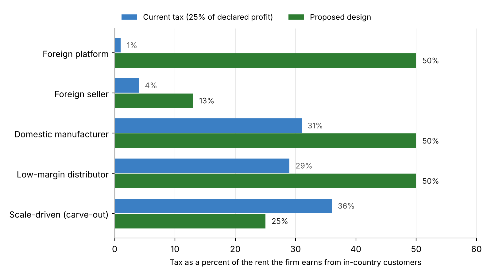

---
# MASTER (policy brief) - this is the file to edit for the brief. The .docx beside it and the brief's web page are made
# from it. The working paper is a separate master: ../RentTax.qmd.
title: "Taxing Rent, Not Effort"
subtitle: "Land and Corporate Taxation Consistent with Free Movement of Capital and People"
series: "Climate Fiscal Policy Brief No. 2.1"
version: "1.0"
author:
  - name: "Stephen J. Stretton"
    note: "Writing in a personal capacity."
date: "October 2026"
abstract: |
  Free movement of capital and people has pushed governments to give up on high taxes on mobile income. This brief argues that they can still tax rent, the income above what is needed to keep an asset or a firm in use, provided they reach it where it cannot leave. It proposes a land value tax above a household allowance and a corporate package that presumes large firms earn rent: a high rate on profit above a normal return, destination-based layers that follow the customer, and a cap. An asset-light foreign platform's tax rises from 1 to 50 percent of its local rent; firms that invest and employ locally pay nothing on their normal return.
keywords: [economic rent, land value tax, allowance for corporate equity, destination-based taxation, market power]
bibliography: Brief-RentTax.bib
csl: https://www.zotero.org/styles/chicago-author-date
format:
  docx: default
---

*Climate Fiscal Policy Brief No. 2.1, October 2026. Stephen J. Stretton, writing in a personal capacity. The views expressed are the author's own and do not represent those of any institution with which he is or has been affiliated. The full analysis, with the propositions, the literature, the worked examples and the revenue arithmetic, is in the [working paper](wp:).*

# Key messages {#sec-key-messages}

**Free movement caps the rate on income that can move, not on rent that cannot.** Governments have given up on high rates because profit and wealth leave. Rent, income that would be earned anyway, can be taxed heavily if the tax reaches it where it cannot leave.

**Tax land above a household allowance.** Land cannot move. A tax of about 2.5 percent a year on site value above the value of an ordinary home's site falls on large holdings, not on ordinary homeowners.

**Presume that large firms earn rent, and tax only the rent.** Exempt a normal return on equity and tax the profit above it at 50 percent. Investment is not discouraged, because the marginal project pays nothing.

**Follow the customer where profit is shifted.** For a few sectors, tax local sales less local costs; for all large firms, charge a small tax on local sales with credits for local assets and payroll. Cap both so that no firm pays more than half the rent it earns from local customers.

**Start with property taxes and an allowance for corporate equity, then add the destination layers.** European Union law, as the Court of Justice has applied it, allows most of the design; the payroll credit needs careful drafting.

# High rates on mobile income have been given up {#sec-problem}

**Free movement of capital and people has made high taxes on mobile income hard to sustain.** The European Union removed restrictions on capital movements between member states in 1990 [@EEC1988]. Before that, under the Bretton Woods system, most countries kept their capital accounts relatively closed [@ObstfeldTaylor2004], and capital that could not leave could be taxed. Once it could leave, it did.

**The retreat shows in the numbers.** Twelve OECD countries taxed net wealth in 1990; four did in 2017 [@OECD2018Wealth]. About 36 percent of multinational profits are shifted to tax havens, and reallocating them would raise the profits declared in high-tax European Union countries by about 20 percent [@TorslovWierZucman2023]. Wealth, meanwhile, has concentrated: in the United States the top 0.1 percent held 22 percent of wealth in 2012, up from 7 percent in 1978 [@SaezZucman2016].

**The usual response, lower rates, gives up more than it needs to.** What a country can charge depends on the base. A base that can leave sets its own rate. A base that cannot leave, or that earns its income from the country's own customers, does not.

# Rent can be taxed at high rates if the tax reaches it where it cannot leave {#sec-idea}

**Rent is income above what is needed to keep an asset, a worker or a firm in its current use.** A tax on rent changes nothing anyone does, so its rate can be high. Economists from Ricardo and Mill to the Mirrlees Review have made the case for taxing it [@Mirrlees2011].

**Not all rent stays put.** Rent from a mine or from a well-located site cannot move. Rent from a patent or a brand can be booked anywhere. The Mirrlees Review draws exactly this line: rent specific to a location can be taxed at source, mobile rent cannot [@Mirrlees2011]. The design therefore taxes location-specific rent where it arises, and mobile rent where the customer is ([working paper, the design](wp:sec-design)).

**Natural resources prove the point.** Norway taxes petroleum profit at a marginal rate of 78 percent, on a base that exempts the normal return [@Norway2025Petroleum]. The oil is where it is.

# Tax land above a household allowance {#sec-land}

**A land value tax is the cleanest rent tax there is.** Land is not produced, so taxing its value does not reduce its supply or change how it is used; the tax is reflected in a lower land price, and owners on the day it is announced bear it [@Mirrlees2011]. Where Pennsylvania cities taxed land more heavily than buildings, building and housing density rose [@OatesSchwab1997; @BanzhafLavery2010].

**An allowance keeps the tax off ordinary homes.** Each household's land is exempt up to an allowance close to the site value of an ordinary home; above it, the household pays about 2.5 percent a year on site value. Most households pay little; large holdings pay a lot. Business land is taxed without an allowance.

**The tax needs three safeguards.** Sites must be valued regularly, since many property taxes rest on values decades out of date [@OECD2022Housing]. The rate should be phased in, because the fall in land prices on announcement hits recent buyers hardest. And owners who are rich in land but poor in cash should be able to defer the tax, with interest, until sale or death ([working paper, land](wp:sec-land)).

# Presume that large firms earn rent, and tax only the rent {#sec-default}

**Large firms should be presumed to earn rent unless they show otherwise.** In a competitive market, profit above the normal return attracts entry and is competed away. A firm that is large and stays large earns rent from network effects, brands, scale, patents or regulation, unless its industry can only support a few firms, as in civil aircraft or leading-edge chips. Markups in the United States rose from 21 percent above marginal cost in 1980 to 61 percent [@DeLoeckerEeckhoutUnger2020], although the measurement is disputed [@Basu2019].

**Rent from being more efficient is still rent.** Some firms are large because they are better [@Autor2020]. Their surplus over rivals is rent too, like the surplus of better land. What matters is not to discourage the investment that made them better, and the design achieves that by taxing only profit above a normal return ([working paper, market power as the default](wp:sec-default)).

**Layer One taxes profit above a normal return at 50 percent.** Each firm deducts a notional return on its equity, an allowance for corporate equity, and pays tax only on the profit above it. A marginal investment earns just the normal return and so pays no tax at any rate; only the surplus is taxed [@BoadwayBruce1984; @BondDevereux2003]. Belgium ran such an allowance from 2006 to 2023 and Italy from 2011 to 2023 [@Belgium2022NID; @Italy2023ACE]. Every firm gets the allowance; groups with revenue above €750 million, the threshold of the OECD's global minimum tax [@OECD2021TwoPillar], pay 50 percent on the profit above it, and the rest 25 percent.

# Follow the customer where profit is shifted {#sec-destination}

**A high rate at origin alone would drive declared profit abroad.** A 1 percentage point lower rate than in other countries raises the profit a multinational reports by about 1.5 percent [@BeerdeMooijLiu2020]. Raising the rate on declared rent from 25 to 50 percent could therefore cut the declared base by more than a third. The working paper's arithmetic shows that Layer One alone would raise about what today's corporate tax raises, not more ([working paper, revenue](wp:sec-revenue)).

**Layer Two taxes local cash flow in sectors where rent is easily shifted.** For designated sectors, such as digital platforms and pharmaceutical patents, firms pay 22 percent of sales to local customers less local costs; royalties and fees paid to related firms abroad are not deductible, and Layer One is credited against it. The base is where the customers are, so moving profit or patents abroad does not reduce it, as in the destination-based cash-flow tax proposed by Devereux and coauthors [@Devereux2021]. The rate stays moderate and the list short, because a tax confined to a few sectors acts as a 28 percent charge on their imported inputs.

**Layer Three charges sales that are not matched by local activity.** All groups above the threshold pay 4 percent of local sales, less credits of 8 percent of local tangible assets and 25 percent of local payroll. A firm with payroll of 16 percent of its sales pays nothing; a remote seller with €1 billion of local sales, €50 million of local assets and €100 million of payroll pays €11 million. The credits work like the payroll and asset carve-out in the OECD's global minimum tax [@OECD2021TwoPillar].

**A cap stops the destination layers from taxing effort.** Without it, a fuel distributor with thin margins could pay more in sales tax than it makes in profit. The destination layers can raise a firm's tax only up to 50 percent of its global rent margin times its local sales: half the rent it would earn locally at its worldwide margin ([working paper, the cap](wp:sec-combined)).

# The design taxes rent and spares effort {#sec-results}

**In five worked firms, the design taxes rent at about half and the normal return at zero.** The table shows tax as a share of the rent each firm earns from local customers ([working paper, five firms](wp:sec-illustration)).

| Firm | Today | Under the design |
|---|---:|---:|
| Foreign platform, designated sector, little local profit declared | 1% | 50% |
| Foreign seller, not designated, little local profit declared | 4% | 13% |
| Domestic manufacturer, heavy local investment | 31% | 50% |
| Low-margin distributor | 29% | 50% |
| Scale-driven manufacturer, carve-out | 36% | 25% |

: Tax as a percent of the rent each firm earns from local customers. Today: 25 percent of declared local profit. Stylized firms; the domestic manufacturer pays nothing on its normal return under the design, against 25 percent today. Source: working paper, Table 1. {#tbl-firms}

{#fig-rates width=100%}

**The foreign platform goes from almost nothing to half its local rent.** It books its profit where its patents are, so today it pays 5 on rent of 335 (€ million). Layer Two, capped, raises its tax to 168.

**The design is weakest for foreign sellers outside the designated sectors.** Their tax rises only from 4 to 13 percent of rent, because Layer Three is deliberately small. Closing the gap means either a longer list of designated sectors or a higher sales charge, and both have costs.

**Firms that invest locally pay nothing on their normal return.** The domestic manufacturer's allowance removes its normal return and its local assets and payroll remove Layer Three; it pays half its rent, more in total than today, but nothing on the return that rewards its investment.

**The revenue is real but not unlimited.** The land tax could raise 1.0 to 2.7 percent of GDP, one to three times what recurrent property taxes raise across the OECD today; the corporate layers 2.3 to 6.3 percent of GDP, against 3.75 percent from corporate income tax today [@OECDRevStats2025]. The low end is Layer One alone, after profit shifting; the high end requires the destination layers to recover rent now shifted abroad ([working paper, revenue](wp:sec-revenue)).

# The law allows most of the design {#sec-law}

**The Court of Justice has upheld steeply progressive taxes on turnover that fall mainly on foreign firms.** In 2020 it held that Hungary's turnover taxes on telecommunications and retail were compatible with freedom of establishment, because turnover is a neutral criterion and a fair indicator of ability to pay [@CJEU2020Vodafone]; in 2021 it held that Poland's progressive retail tax was not state aid [@CJEU2021Poland].

**The payroll credit is the main legal risk.** A remote seller earns no credit for its staff abroad, which could be challenged as a restriction on services within the European Union. Under trade rules, relief for domestic but not foreign labor is the main objection raised against destination-based cash-flow taxes; a sales charge combined with a separate payroll subsidy has the same effect without that objection [@ADKV2017]. Layer Two should give no export rebate ([working paper, law](wp:sec-law)).

**Land raises no free-movement issue at all.** It cannot move, and the tax applies alike to resident and foreign owners.

# What to do {#sec-what-to-do}

**Finance ministries: replace recurrent property taxes with a land value tax above a household allowance.** Value sites regularly, tax business land in full, phase the rate in and allow deferral for cash-poor owners.

**Give every firm an allowance for corporate equity, and tax large groups' rent at a higher rate.** Measure equity on the tax basis, carry losses forward with interest, and phase the higher rate in above €750 million of group revenue so that there is no cliff.

**Add the destination layers, with the cap.** Confine the destination-based cash-flow tax to a short list of sectors where profit is easily shifted, apply the presence-credited sales charge to all large groups, and cap both by half of sales-apportioned global rent.

**European Union members: act together where possible.** Each layer works for one country alone, but a common allowance and common destination layers would leave less room to shift profit or serve a market from next door.

# Related papers in this series {.unnumbered}

- [Climate Fiscal Policy Brief No. 1.1](paper:1.1): the same logic for carbon, pricing production and consumption separately, with consumption taxed at destination [@CFPB11].
- [No. 1.3](paper:1.3): converting a VAT into a destination carbon tax [@CFPB13].
- The [working paper](wp:) behind this brief: the propositions, literature, worked examples, revenue arithmetic and law.

# References {.unnumbered}

::: {#refs}
:::
