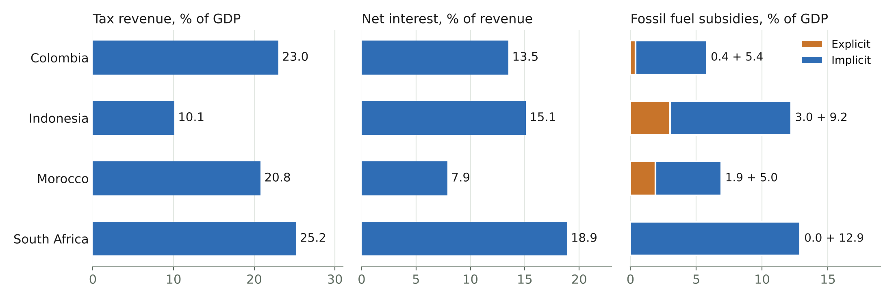

---
# MASTER (working paper) - this is the file to edit. The .docx beside it and the website page are made from it.
# The policy brief is a separate master: 1.Presentation/Brief-FiscalIndicatorsDashboard.qmd.
# Version notes: v0.2 (31 Oct 2026) - executive summary and related-work section added; peer review of 31 Oct 2026 applied
# (5.Notes/PeerReview-2026-10-31.md): "interest-to-revenue" renamed net interest over revenue and its net-creditor filter
# reported; subsidy values re-sourced to the IMF's 2025 update with the IMF's own ratios beside them; excise revenue as a
# share of GDP added to Table 2 and Colombia's reading corrected; the renewable-share discrepancy with Ember reported;
# subtitle changed (the build is not yet public; title unchanged); Table 2 checked against the publishers' releases
# (2.Source/check_public_sources.py); contribution stated against the IMF Climate Change Indicators Dashboard, the fiscal
# space database and the composite-indicator literature; every reference checked (5.Notes/BibCheck-2026-10-31.md).
# v0.1 (29 Oct 2026) in 8.PreviousVersions.
title: "A Global Fiscal Indicators Dashboard for Climate-Fiscal Analysis"
subtitle: "Eighty Public Indicators, One Country Profile, and a Build That Traces Every Number to Its Source"
author:
  - name: "Stephen J. Stretton"
    note: "Writing in a personal capacity."
date: "October 2026"
version: "0.2"
abstract: |
  Before advising a government on carbon pricing, fuel subsidy reform or a climate investment program, an analyst needs a quick, comparable view of the country's fiscal space, its capacity to spend, its cost of capital and how much fossil fuel money runs through its budget. Assembling that view from a dozen databases, each with its own country names, units and vintages, takes days. The Global Fiscal Indicators dashboard assembles it for 217 economies from about twenty public datasets: 80 indicators in twelve blocks, each block answering one question, scored on one 1-to-10 scale and shown as a one-page country profile. A scripted pipeline rebuilds the panel from the raw files, never imputes, records the year and source file of every value, and stops if its configuration and its outputs disagree. A comparison of Colombia, Indonesia, Morocco and South Africa shows the profile separating a revenue problem (Indonesia: tax of 10 percent of GDP, explicit fuel subsidies of 3 percent) from a debt-service problem (South Africa: net interest of 19 percent of revenue). A check against the publishers' own releases confirms most values and finds three faults worth fixing: a mislabeled interest indicator, a revenue denominator that reverses a reading, and a modeled renewable share far from observed generation. The dashboard should be read for the next question to ask, not for a verdict.
keywords: [fiscal indicators, fiscal space, energy subsidies, public investment management, composite indicators, data provenance]
jel: [H60, H20, Q48, C80, O23]
bibliography: FiscalIndicatorsDashboard.bib
csl: https://www.zotero.org/styles/chicago-author-date
number-sections: true
crossref:
  fig-prefix: Figure
  tbl-prefix: Table
  sec-prefix: Section
  eq-prefix: equation
format:
  docx: default
---

*Working paper, version 0.2, October 2026. Stephen J. Stretton, writing in a personal capacity. The views expressed are the author's own and do not represent those of any institution with which he is or has been affiliated. Companion paper to the Climate Fiscal AI Tools. A short version for policy makers is [Climate Fiscal Policy Brief No. 7.2](brief:).*[^credit]

[^credit]: The dashboard (version 1.3) and its build pipeline are part of the Climate Fiscal AI Tools, which sit in a private repository at the time of writing. Every value quoted here comes from public datasets as compiled by the pipeline, and the values in @tbl-four were checked against the publishers' own releases on 31 October 2026 (@sec-check). The four-country comparison is illustrative: it is not an assessment of any country, and no country work by any institution is reproduced. Errors are the author's own.

# Executive summary {#sec-summary}

**Climate-fiscal advice often starts with the wrong constraint because the numbers take days to gather.** Asked whether a country can afford a climate investment program, or should reform fuel subsidies first, an economist needs its debt and interest bill, its tax take, how well it spends capital budgets, what investors charge it for capital, what it spends on fossil fuel subsidies, and how it makes electricity. Each number sits in a different database, with different country names, units and years. Assembling them takes a day for one country and a week for a region, and the next analyst starts again.

**The Global Fiscal Indicators dashboard puts those numbers on one page for 217 economies.** It reads about twenty public datasets, among them the IMF's World Economic Outlook, its revenue database and its fossil fuel subsidy estimates, World Bank debt, budget and energy data, PEFA assessments of public financial management, and Ember's electricity data. It arranges 80 indicators in twelve blocks, each answering one question: can the country pay for it, can it build it, what does capital cost, who finances it, how much fossil and climate money runs through the budget, does it sell or buy fossil fuels, how is power generated. Each value carries its year and source, and a score from 1 to 10 against all other economies.

**The build is designed so that errors cannot hide.** A script turns the raw downloads into one long table, one row per value, with the source file and year. Nothing is imputed: a missing value stays missing and is counted. The build stops if its configuration names an indicator that the data do not supply, a rule added after an earlier version lost indicators without anyone noticing. A Python and an R version of the pipeline matched on the original 53 indicators. The build itself is not yet public, but every input is.

**The dashboard offers no overall index, on purpose.** There is no defensible way to weigh fiscal space against delivery capacity or the cost of capital, and a single score would hide the point of the exercise: a country short of money needs different help from one short of the capacity to spend it. Within blocks the dashboard shows a simple average, which is a reading aid only, because related indicators can count twice.

**Four middle-income economies show how the profile separates different problems.** Indonesia has a revenue problem, not a debt problem: gross debt is 40 percent of GDP, but tax revenue is only 10.1 percent, so net interest still takes 15 percent of revenue, and explicit fuel subsidies cost 3.0 percent of GDP, about 30 percent of tax revenue. South Africa has a debt-service problem: it collects the most tax of the four, 25.2 percent of GDP, but net interest takes 19 percent of revenue, and its unpriced environmental costs from fossil fuels, which the IMF calls implicit subsidies, are the largest of the four, 12.9 percent of GDP. Morocco pays the least interest relative to revenue, 7.9 percent. The profile tells the analyst which question to ask next and which tool to use for it.

**A check against the publishers' releases confirms most values and finds three faults.** Tax revenue, the interest measure, the excise share and the subsidy values all reproduce from the IMF's own files. But the indicator called "interest-to-revenue" is net interest, and the build drops countries that earn more interest than they pay. Colombia's low excise share of revenue reflects its high revenue, not low excises: as a share of GDP its excises match Indonesia's. And the renewable share the panel holds, a modeled series, differs from Ember's observed shares by 5 to 19 percentage points.

**Carbon pricing is the most important missing block.** The dashboard does not yet read explicit carbon prices, effective carbon rates or a Total Effective Carbon Price. Adding them, fixing the three faults and publishing the build would turn a useful internal tool into a public good. Until then, the profile is a first view: it says where to look, and every number on it says where it came from.

# Introduction {#sec-intro}

Climate-fiscal advice usually starts with a scramble for numbers. An economist asked whether a country can afford a climate investment program, or whether it should reform fuel subsidies first, needs its debt and interest burden, its tax take, how well it executes capital budgets, what private investors pay for capital, how much it spends on fossil fuel subsidies, whether it exports or imports fossil fuels, and how it generates power. Each number sits in a different database: the IMF's World Economic Outlook for debt, the IMF's revenue database for taxes, the IMF's subsidy estimates for subsidies, World Bank budget data for capital execution, PEFA assessments for public investment management, academic datasets for the cost of capital. They use different country names, units and years. The usual result is advice framed around whichever constraint the first available number made visible.

This paper asks how to give an analyst a comparable, sourced first view of any country's climate-fiscal position in minutes, in a form that someone who did not build it can check and extend. The answer is the Global Fiscal Indicators dashboard, part of the Climate Fiscal AI Tools. It assembles 80 indicators for 217 economies from about twenty public datasets into twelve blocks, each answering one question, and fills a one-page profile with values, observation years, sources and a score from 1 to 10. Behind the workbook sits a scripted pipeline with rules that stop the commonest ways such compilations go quietly wrong. Applied to Colombia, Indonesia, Morocco and South Africa, the profile separates a revenue problem from a debt-service problem and points each to a different fiscal-energy lever (@sec-example).

The dashboard adds to existing databases by joining them, not by replacing them. The IMF's revenue database and the UNU-WIDER Government Revenue Dataset harmonize tax revenue [@IMFWoRLD; @UNUWIDERGRD2025]; the IMF's fossil fuel subsidy estimates cover explicit and implicit subsidies for 170 countries [@Black2025FFS]; the cross-country fiscal space database assembles 28 indicators of debt sustainability, balance sheets, external debt and market perception [@Kose2022FiscalSpace]; the IMF's Climate Change Indicators Dashboard brings climate indicators onto one platform [@IMFCCID]. None puts fiscal space, delivery capacity, the cost of capital and the energy-fiscal position on one page and one scale, with the year and file of every value, and none feeds the same panel to a model. This one does: it is the data layer of the Macro-Fiscal-Energy Scenario Tool [paper 6.5, @StrettonWP65], so the numbers an analyst reads are the numbers the model starts from.

The paper makes three further contributions beyond the description. First, it states the build rules that make a compiled panel traceable and stop silent error, and the reasons for each (@sec-build). Second, it defends a scoring design (percentile clipping, words not weights, no overall index) against the composite-indicator literature, and states the strongest objection to it (@sec-scoring). Third, it reports what happened when the four-country values were checked against the publishers' own releases: most survive, and three faults appear that matter for any compilation of this kind (@sec-check).

# Related work {#sec-literature}

**Cross-country revenue and fiscal databases each answer one part of the question.** The IMF's World Revenue Longitudinal Database (WoRLD) tracks the level and composition of government revenue for 195 countries from the early 1980s, compiled from IMF surveillance data on the Government Finance Statistics classification [@IMFWoRLD]. The Government Revenue Dataset, begun at the International Centre for Tax and Development and now maintained by UNU-WIDER, combines several international sources and IMF Article IV reports, with a standard treatment of natural resource revenue [@Prichard2014GRD; @UNUWIDERGRD2025]. The fiscal space database of @Kose2022FiscalSpace defines fiscal space as the budgetary resources a government has to meet its obligations and measures it with 28 indicators in four groups for up to 200 countries. Each is a building block of the dashboard's fiscal block and its fiscal risk appendix.

**The IMF's subsidy estimates are the only global source on both fiscal and environmental underpricing.** The December 2025 update estimates explicit subsidies (undercharging for supply costs) of 725 billion US dollars in 2024, 0.6 percent of world GDP, and implicit subsidies (undercharging for environmental costs) of 6.7 trillion dollars, 5.8 percent of GDP, for 170 countries; it uses the IMF–World Bank Climate Policy Assessment Tool (CPAT) to project fuel use beyond the latest energy balances and to estimate electricity supply costs [@Black2025FFS]. The IMF notes that readers who dislike the word "subsidy" for the environmental part may call it underpriced environmental costs. The dashboard uses the IMF's terms and reads the two parts in different blocks.

**Climate dashboards exist, but they are not built for fiscal triage.** The IMF's Climate Change Indicators Dashboard, launched in April 2021, brings together experimental climate indicators on economic activity, cross-border flows, climate risks and government policy, so that countries can be compared on one platform [@IMFCCID]. It does not assess fiscal space, the capacity to spend capital budgets or the cost of capital. The World Bank's Carbon Pricing Dashboard tracks explicit carbon taxes and emissions trading systems [@WBCarbonPricing]; the OECD's effective carbon rates add fuel excises [@OECD2023ECR]; the World Bank's total carbon price adds fuel excises net of subsidies [@Agnolucci2024TCP]. These measure one lever each.

**Each block answers a question with its own literature.** Low tax revenue is a constraint, not only a choice: @Gaspar2016TaxCapacity find a tipping point in tax revenue at about 12¾ percent of GDP: a country just above it has GDP per capita 7.5 percent higher ten years later. Public investment loses on average about 30 percent of its potential value through inefficient management [@IMF2015PIE], which is why the dashboard reads capital budget execution and PEFA's public investment scores beside fiscal space. The cost of capital differs widely across countries, and regionally specific costs of capital change cost-optimal decarbonization paths in developing economies [@Ameli2021]; the global dataset of @Steffen2025WACC now covers 68 countries for solar, onshore wind and offshore wind from 2010 to 2022.

**The composite-indicator literature supports the dashboard's two main design choices.** The OECD and European Commission handbook on composite indicators warns that a composite can send misleading policy messages, invite simplistic conclusions and "disguise serious failings in some dimensions", and that min-max rescaling is distorted by extreme values [@OECDJRC2008]. The dashboard therefore rescales between the 5th and 95th percentiles rather than the minimum and maximum, and offers no overall index. For provenance, the FAIR principles ask that data be findable, accessible, interoperable and reusable, by machines as well as people [@Wilkinson2016FAIR]; the dashboard's long table, with a source file and year for every value, applies the same idea to a compiled panel.

**The gap this paper fills is the joined, traceable first view.** Existing sources are deep on one dimension each. A country economist preparing climate-fiscal advice needs a few indicators from each, on one page, comparable across countries, with enough provenance to defend any number in a meeting.

# What the dashboard assembles {#sec-what}

**The dashboard is organized as twelve questions, not as a list of datasets.** Four assessment blocks come first and carry the diagnosis: fiscal space, delivery, cost of capital, and financing and risk. Three context blocks explain it: how much fossil and climate money runs through the budget, whether the country sells or buys fossil fuels, and how it generates power. Five appendices hold reference material: retail energy prices, power market regulation, the inputs the macro-fiscal models start from, the output of the integrated scenario, and fiscal risk. @tbl-blocks lists each block, its question and its main sources.

| Block | Question | Indicators (examples) | Main public sources |
|---|---|---|---|
| Fiscal | Can they pay for it? | Gross debt; net interest (% of revenue; % of GDP); tax revenue (% of GDP) | IMF WEO; IMF WoRLD |
| PIMA (delivery) | Can they build it? | Capital budget execution; PEFA PI-11 public investment management; PI-12.2 nonfinancial asset monitoring | World Bank BOOST; PEFA 2016 framework |
| Finance 1 | What does capital cost them? | Real after-tax WACC for solar; cross-checks; private creditor rate; official–private spread; average maturity | IRENA; Steffen et al.; IEA observatory; World Bank IDS |
| Finance 2 | Who finances it, and what risk does the budget carry? | Mitigation finance received; creditor mix; US dollar share of debt; PEFA PI-10.3 contingent liabilities; private participation in infrastructure | OECD climate-related development finance; IDS; PEFA; World Bank PPI |
| Context 1 | How much fossil and climate money runs through the budget? | Excise share of revenue; fossil fuel subsidies, explicit and implicit (% of GDP); environment protection spending | IMF WoRLD; IMF fossil fuel subsidies; BOOST |
| Context 2 | Does the country sell fossil fuels, or buy them? | Net fuel trade; energy import dependency; oil, gas and coal rents | World Development Indicators |
| Context 3 | How is power generated, and which way is it moving? | Oil-fired share; renewable share and its change; renewable capacity growth | Ember; IMF fossil fuel subsidies |
| Appendix A | What do users pay for energy? | Retail prices of diesel, gasoline, electricity, gas and coal by sector | IMF fossil fuel subsidies |
| Appendix B | How is the power sector organized? | Market structure; independent regulator; unbundling; RISE scores | Power Sector Reform Tracker; World Bank RISE |
| Appendix C | What do the macro models start from? | Revenue; primary balance; investment; growth; public investment; external debt; CPIA; remittances; reserves; account ownership | IMF WEO; IMF ICSD; IDS; World Bank CPIA; WDI; Global Findex^a^ |
| Appendix D | What would a net zero program do to budget and debt? | Budget need; feasible pricing revenue; GDP and debt in 2050; debt risk | Model output (paper 6.5), not data |
| Appendix E | What could land on the budget? | Sovereign rating; debt maturing within a year; external debt; short-term debt to reserves | Fiscal space database; WDI; IDS^a^ |

: Blocks, questions and sources of the dashboard, version 1.3. ^a^ In version 1.3, part of Appendix C (concessional share of external debt, CPIA, remittances, reserves, account ownership) and all of Appendix E are read through an unpublished compilation, not directly from the public sources named; see @sec-limits. {#tbl-blocks}

**Each source was checked against what the build reads.** The fiscal core comes from the IMF's World Economic Outlook, with projections dropped so that only actual years enter, and from WoRLD's 2026 release for taxes and excises [@IMFWEO; @IMFWoRLD]. WoRLD's "taxes" follow the Government Finance Statistics classification and exclude social contributions. Subsidies and retail energy prices come from the IMF's fossil fuel subsidy data, whose 2024 values are in the 2025 update; the pipeline converts the dollar estimates to shares of GDP with WEO GDP [@Black2025FFS]. Resource rents, fuel trade and energy import dependency come from the World Development Indicators [@WDI]. Generation by source comes from Ember's yearly electricity data [@Ember2025]. Budget execution and environmental spending come from the World Bank's harmonized BOOST data [@BOOST]; public investment management and contingent liability scores from PEFA assessments under the 2016 framework [@PEFA2016]. The cost of capital draws on IRENA's real after-tax WACC assumptions for 2021 [@IRENA2022], the dataset of @Steffen2025WACC and the IEA's Cost of Capital Observatory [@IEACoC]. Borrowing terms and creditor mix come from International Debt Statistics [@IDS], climate finance received from the OECD's recipient-perspective climate-related development finance data [@OECDCRDF], private infrastructure investment from the PPI database [@PPI], regulatory scores from RISE [@RISE], power market structure from the Power Sector Reform Tracker, which covers 142 developing countries from 1982 to 2013 [@UrpelainenYang2019], public investment from the IMF's Investment and Capital Stock Dataset [@IMFICSD], and sovereign ratings, rollover needs and external debt from the fiscal space database [@Kose2022FiscalSpace]. Account ownership comes from the Global Findex [@Findex2021].

**Several obvious sources are left out, for stated reasons.** The UNU-WIDER Government Revenue Dataset was downloaded and set aside because WoRLD's excise and resource columns covered what was needed [@UNUWIDERGRD2025]. IMF Government Finance Statistics and OECD Revenue Statistics are not used; WoRLD is the revenue source. Carbon pricing is not yet a data block: the World Bank's Carbon Pricing Dashboard [@WBCarbonPricing] and the OECD's effective carbon rates [@OECD2023ECR] are not read, and the only carbon pricing figures in the workbook are model output in Appendix D. IMF Public Investment Management Assessment (PIMA) scores are excluded because the IMF publishes a PIMA report only with the authorities' permission [@IMFPIMA]; the author's concern is that the published reports need not be representative, so a scored column could mislead, and PEFA PI-11 is the substitute. Electricity cost recovery was dropped because the modeled supply-cost basis was not reliable enough to score. Each exclusion is written into the workbook's README sheet, so a reader knows that an absence is a decision and not an oversight.

# The build pipeline {#sec-build}

**Raw files go in, one long table comes out, and the workbook reads only that table.** The pipeline has three stages. Stage 1 reads every raw file and writes every observation it finds, for every year, as a row of country code, indicator, year, value and source file: about 130,000 rows. Stage 2 keeps the latest observation for each country and indicator: about 12,400 rows, or 71 percent of the 17,360 cells that 80 indicators for 217 economies would fill. Stage 3 pivots them to one row per economy, with a value column and a year column for each indicator. The workbook builder reads only the Stage 2 output and the configuration file. It never touches raw data, so relabeling an indicator or moving it between blocks needs only a rebuild of the workbook.

**One configuration file defines every indicator, and the build enforces it.** Each row of the indicator file gives an indicator's block, label, direction, evaluation scale, scoring flag, indentation and source label. Adding an indicator means writing its extraction and adding one row. If the configuration names an indicator the pipeline does not emit, the run stops with an error naming it. An earlier version warned and continued, and indicators went missing without anyone noticing; a hard stop is the fix. Source coverage, the number of economies with a value, is counted from the panel at build time rather than typed into the Sources sheet, so it cannot drift from the data.

**Derived indicators are computed in the pipeline from published series, with the formula in the code.** The interest burden $\mathit{NIR}_c$ is the general government primary balance $PB_c$ less the overall balance $NB_c$, divided by revenue $R_c$, all in percent of GDP from the WEO:

$$
\mathit{NIR}_{c} = 100 \times \frac{PB_c - NB_c}{R_c}
$$ {#eq-netint}

The numerator is net interest: interest paid less interest received. Version 1.3 labels the indicator "interest-to-revenue", which overstates it for countries with large financial assets, and keeps it only where revenue is positive and the result lies between 0 and 100 percent. That rule drops every country whose net interest is negative, which are those that receive more interest than they pay; coverage falls from 191 economies for gross debt to 184. The same numerator over GDP gives net interest as a share of GDP, which keeps the negative values. Subsidies as a share of GDP divide the IMF's 2024 dollar estimates by the latest actual WEO GDP in dollars. Total fossil rents sum oil, gas and coal rents; net fuel trade is fuel exports' share of merchandise exports less fuel imports' share of merchandise imports. The spread between official and private borrowing rates is taken at the latest year each side has.

**Four ground rules protect the panel from silent error.** Nothing is imputed: a missing value stays missing, and the profile counts missing rows by block. Every value carries its observation year, because vintages span 2013 to 2025: the fiscal core is 2024, capital execution mostly 2022, rents and the solar cost of capital 2021, power market structure 2013. Every value names its source file in the long table. And three known traps are guarded in the code: a spreadsheet lookup on an empty cell returns zero rather than blank; Ember carries a country's record forward where it has no new observations, which would show a spurious zero change in renewable share; and a count of zero sources of cost-of-capital evidence is an absence, not an observation.

**The pipeline runs in two languages, and parity is checked where it has been run.** A Python script and an R script implement the same pipeline and write separately named outputs that can be compared. In a clean-room run on the original 53 indicators they matched in row count, values, years and coverage. Parity for the 27 indicators added in October 2026 is written but not yet verified. A manifest records the size and MD5 hash of every raw file, so a rebuild after a source refresh shows exactly which inputs changed. A download script fetches the six sources that have direct links into a separate folder, never over the files in use, and prints a checklist for the fifteen that need a manual query, with the settings to choose. Publishers revise series without notice, and an unnoticed revision is how a rebuilt panel stops matching published numbers; the separate folder forces a comparison before anything is swapped in. @sec-check shows why this matters: between the August 2026 download and the October 2026 WEO, Morocco's 2024 gross debt moved from 67.7 to 67.0 percent of GDP.

# Scoring and evaluation {#sec-scoring}

**Every scored indicator is rescaled to 1–10 between the 5th and 95th percentiles of all economies, in the direction that counts as better.** For indicator $k$ with value $x_{ck}$ for country $c$, let $P5_k$ and $P95_k$ be its percentiles across the panel and $\tilde x_{ck} = \min(\max(x_{ck}, P5_k), P95_k)$ the clipped value. Then

$$
s_{ck} = 1 + 9 \, \frac{\tilde x_{ck} - P5_k}{P95_k - P5_k}
$$ {#eq-score}

when a high value is better, and $1 + 9\,(P95_k - \tilde x_{ck})/(P95_k - P5_k)$ when a high value is worse. For tax revenue the bounds are 4.6 and 30.0 percent of GDP across 193 economies; for gross debt, 14.3 and 132.9 percent across 191; for net interest over revenue, 0.25 and 25.75 percent across 184. Clipping at the percentiles keeps a few extreme values (a debt ratio above 200 percent, a subsidy bill of a quarter of GDP) from compressing everyone else into the middle, the distortion the composite-indicator handbook warns of for min-max rescaling [@OECDJRC2008]. About one economy in twenty gets the bottom score and one in twenty the top. The rescale is computed by live formulas in the workbook, so adding countries or updating data moves the bounds automatically.

**Scores become words at fixed thresholds, and the words differ by block type.** A score of 7 or more reads Good, 4 to 7 Medium, below 4 Bad, in the assessment blocks, where the direction is clear: a higher interest burden is worse. In the context blocks the same thresholds read High, Medium and Low, because the number is a magnitude, not a verdict. A country with large fossil rents has revenue the transition puts at risk and, read the other way, a tax base it could broaden; the dashboard does not pick one. Appendices are reference material and carry no block verdict.

**The dashboard deliberately offers no overall index.** There are no defensible weights between fiscal space, delivery capacity, the cost of capital and the energy position, and a single score would erase the triage that is the point of the exercise: a country weak on fiscal space needs different instruments from one weak on delivery. This is the handbook's warning in practice: an index "may disguise serious failings in some dimensions" [@OECDJRC2008]. Scores are also relative: they rank a country within the current sample, and they move if the sample or the data change.

**The block averages are a reading aid, and they double-count.** Each block shows the simple average of its scored indicators and how many have data. The same objection to weights applies inside a block: the fiscal block holds both net interest over revenue and net interest over GDP, which share a numerator, so where both are scored the debt-service dimension counts twice. A block with two values out of six has an average built on those two. The profile should therefore be read for the lowest indicator in each block and its count of missing values, not for the average.

**The strongest objection is that a percentile score measures how unusual a country is, not whether it has a problem.** The sample mixes small islands, oil exporters and advanced economies, at vintages from 2013 to 2025, so a "Bad" can mean "unlike most others". The answer is in how the score is shown and used. It sits next to the value, the year and the source, so the analyst always sees the number behind it. The words are thresholds on a rank, not on a norm, and the profile says so. And the dashboard's use is triage (which question to ask next), not judgment (what the country should do). A peer-group option, scoring within income group or region, would answer the heterogeneity part of the objection, and is the natural next step for the scoring.

# How an analyst uses it {#sec-use}

**The profile is read in three passes.** First the four assessment blocks, to find the binding constraint: is the problem money, the capacity to spend it, the price of capital or the structure of financing? Then the context blocks, to see which climate-fiscal levers the country actually has: subsidies to reform, an excise base to build on, fossil revenue at risk, a power sector moving toward or away from renewables. Then the appendices, for the detail an adviser needs in a meeting: pump prices, who regulates the power sector, the starting point of the macro models. An analyst can do this for a new country in a few minutes, with the year and source of every number on the page.

**The same panel is the data layer for the scenario tool.** The Macro-Fiscal-Energy Scenario Tool reads the panel to calibrate its macro models (debt, revenue, public investment, efficiency, creditor mix) and its carbon pricing screen, and uses the dashboard's own builder to lay out its indicator blocks [@StrettonWP65]. A fix in the dashboard therefore reaches the scenario tool on its next build, and the two cannot disagree about a country's starting position. The flip side is that a fault in the panel, such as those in @sec-check, also reaches the scenario tool.

**Adding a source is a five-step routine, designed to be done with an AI coding assistant.** The analyst first asks the assistant for public datasets that cover the concept for as many of the 217 economies as possible, reporting coverage, years, download route and license before any code is written. The file then goes into the raw-data folder with a row in the sources file. The assistant adds an extraction block that copies an existing pattern rather than inventing a new one, using the shared country-name matcher so that unmatched names are reported. One row in the indicator file declares the new indicator. The two build steps then run, and the configuration check confirms that the indicator exists. The routine puts the assistant to work where it is fast (searching, reading file layouts, writing extraction code in a known pattern) and keeps the decisions that need judgment (which source, which direction, which block) with the analyst.

# An illustrative comparison {#sec-example}

**Four middle-income economies show how the profile separates different fiscal problems.** @tbl-four gives selected fiscal and Context 1 indicators for Colombia, Indonesia, Morocco and South Africa, with the score each scored indicator receives on @eq-score across the full panel. All values are from the public datasets named, as compiled by the pipeline from the August 2026 downloads; the year is 2024 unless marked. The code that reproduces the table from the panel is `2.Source/illustrative_comparison.py`; the check against the publishers' releases is `2.Source/check_public_sources.py`.

| Indicator (source) | Colombia | Indonesia | Morocco | South Africa |
|---|---:|---:|---:|---:|
| Tax revenue, % of GDP (IMF WoRLD) | 23.0 (7.5) | 10.1 (2.9) | 20.8 (6.7) | 25.2 (8.3) |
| Gross debt, general government, % of GDP (IMF WEO) | 61.0 (6.5) | 40.2 (8.0) | 67.7 (5.9) | 76.0 (5.3) |
| Net interest, % of revenue (IMF WEO, derived) | 13.5 (5.3) | 15.1 (4.7) | 7.9 (7.3) | 18.9 (3.4) |
| Excise revenue, % of total revenue (IMF WoRLD) | 3.0 (2023) | 8.6 | 6.9 | 7.8 (2023) |
| Excise revenue, % of GDP (IMF WoRLD; check, not a dashboard indicator) | 1.06 (2023) | 1.11 | 2.00 | 2.17 (2023) |
| Explicit fossil fuel subsidies, % of GDP (IMF) | 0.4 | 3.0 | 1.9 | 0.0 |
| Implicit fossil fuel subsidies, % of GDP (IMF) | 5.4 | 9.2 | 5.0 | 12.9 |
| Gasoline retail price, US dollars per liter (IMF) | 1.16 | 0.57 | 1.46 | 1.13 |

: Selected indicators for four economies, 2024: value (score 1–10 for scored assessment indicators). Subsidy shares are the IMF's 2024 dollar estimates divided by WEO GDP; the IMF's own published shares are lower for Indonesia (2.7 and 8.5), Morocco (1.8 and 4.8) and South Africa (0.0 and 11.9), and the IMF does not list Colombia. WoRLD's coverage is central government for Colombia and Morocco and general government for Indonesia and South Africa. Sources: @IMFWoRLD; @IMFWEO; @Black2025FFS; dashboard panel, version 1.3. {#tbl-four}

{#fig-profiles width=100%}

**Indonesia has a revenue problem, not a debt problem.** Its gross debt of 40 percent of GDP scores 8.0, the best of the four. But it collects tax of only 10.1 percent of GDP, below the 12¾ percent tipping point that @Gaspar2016TaxCapacity estimate, and its general government revenue is only 14.6 percent of GDP, so net interest still takes 15 percent of revenue: more than in Colombia, which has half again as much debt but nearly twice the revenue. The context block shows where the money goes: explicit fossil fuel subsidies of 3.0 percent of GDP, equal to about 30 percent of tax revenue, and the cheapest gasoline of the four, at 0.57 dollars a liter. The IMF's 2025 update lists Indonesia among four countries whose gasoline price is below its supply cost, which is about 80–90 cents a liter almost everywhere [@Black2025FFS]. The next questions for an adviser are about subsidy reform and the tax base, not about debt limits.

**South Africa has a debt-service problem and the largest unpriced environmental cost.** It collects the most tax of the four, 25.2 percent of GDP, but has the highest debt (76.0 percent of GDP) and the highest net interest burden (18.9 percent of revenue), which scores 3.4, in the Bad range. It pays no explicit fossil fuel subsidies; its implicit subsidies, the IMF's measure of unpriced environmental costs, are 12.9 percent of GDP on the dashboard's denominator (11.9 on the IMF's), the largest of the four [@Black2025FFS]. Its electricity is 84 percent fossil-generated [@Ember2025]. The lever is pricing the external cost of its energy system, and the constraint is that debt service limits how much public money can go into the transition at the same time.

**Morocco and Colombia sit in between, for different reasons.** Morocco pays the least interest relative to revenue (7.9 percent) yet still spends 1.9 percent of GDP on explicit fossil subsidies while charging the highest gasoline price of the four, 1.46 dollars a liter, which tells the analyst that its subsidies sit on fuels other than gasoline. Colombia has a moderate fiscal position and the lowest excise share of revenue, 3.0 percent in 2023. That row, however, reflects Colombia's high revenue (34.7 percent of GDP in WoRLD for 2023, including 5.7 percent of social contributions) more than low excises: as a share of GDP, Colombia's excises (1.06 percent) are the same size as Indonesia's (1.11 percent) and about half of Morocco's and South Africa's. Paper 7.1 measures excise revenue as a share of GDP for this reason; an Excise-Fiscal Diagnostic of the kind it describes [@StrettonWP71] would test the excise schedule line by line, for Colombia and Indonesia alike.

**The comparison is a first view, and the profile says so.** Each value carries its year and source. The scores rank against the panel, not against a norm. None of the four readings is a recommendation; each tells the analyst which question to ask next and which tool to use for it.

# Checking the panel against the publishers {#sec-check}

**Most values in @tbl-four reproduce exactly from the publishers' own releases.** On 31 October 2026 every value in the table was recomputed from public interfaces, without the panel: the WEO and Fiscal Monitor (October 2026) through the IMF's DataMapper, WoRLD (release of 18 February 2026) through the IMF's data API, the IMF's 2025 subsidy update and Ember's yearly data. Tax revenue matches to the decimal for all four countries. So does net interest over revenue: Colombia 13.5, Indonesia 15.1, Morocco 7.9 and South Africa 18.9 percent, from primary balances of −2.20, −0.08, −1.78 and −0.50 percent of GDP, overall balances of −6.04, −2.28, −3.88 and −5.67, and revenue of 28.3, 14.6, 26.6 and 27.3. The excise shares match. Gross debt matches for three countries; for Morocco the October 2026 WEO gives 67.0 percent against the panel's 67.7, a revision after the August download that would move its score from 5.9 to 6.0. Every score recomputes from @eq-score. Gasoline prices could not be read from the IMF's dataset in this check and are reported as compiled.

**The subsidy values match the IMF's dollars but not its shares of GDP.** The panel's shares equal the 2025 update's 2024 dollar estimates divided by WEO GDP for 2024: for Indonesia, 42 and 128 billion dollars over 1,396 billion dollars of GDP give 3.0 and 9.2 percent; for South Africa, 52 billion over 401 billion give 13.0 percent. The IMF's own table gives 2.7 and 8.5 percent for Indonesia and 11.9 percent for South Africa [@Black2025FFS]. The difference lies in the GDP denominator, which in the IMF's table is larger than the WEO's 2024 GDP; the dollars agree. A reader comparing the dashboard with the IMF's publication will see different numbers, so the profile should say which denominator it uses.

**Three faults turn up that matter for any compilation of this kind.** First, a mislabeled indicator: the "interest-to-revenue" ratio is net interest, and its filter removes the strongest fiscal positions (@sec-build). Second, a denominator that changes the reading: Colombia's excise share of revenue is the lowest of the four because its revenue is high, not because its excises are low. Third, a modeled series far from an observed one. The panel's 2024 renewable share of electricity, which comes from the IMF's CPAT-based dataset, differs from Ember's observed shares by 5 to 19 percentage points (@fig-renewables): Colombia 79.9 against 61.4 percent, Indonesia 28.0 against 18.1, Morocco 29.5 against 24.4, South Africa 7.0 against 12.5 [@Ember2025]. None of these is an error in a source. Each is an error of compilation that a panel can carry for years unless someone compares it with the publisher, which the build's year and source columns make quick.

{#fig-renewables width=80%}

**Each fault has a simple fix in the next version.** Rename the indicator "net interest, % of revenue" and keep negative values, which clip to the top score. Carry excise revenue as a share of GDP, the measure paper 7.1 uses, beside the share of revenue. Read the renewable share from Ember, the observed series, and keep the CPAT-based series only where consistency with the subsidy estimates requires it, labeled as modeled. And state in the profile that subsidy shares use WEO GDP. The tool lies outside this paper's scope; these are recommendations for its next release.

# Limits {#sec-limits}

**The dashboard is only as current as its slowest source.** Vintages range from 2013 to 2025. The power market structure flags come from a tracker that ends in 2013 and covers developing countries only, so they describe structure, not current state. Resource rents and the solar cost of capital are 2021. Public investment from the IMF's capital stock dataset runs to 2019 [@IMFICSD]. The year column makes this visible; it does not fix it.

**Some series are modeled, not observed.** The subsidy estimates, the retail prices and the renewable share in Context 3 come from the IMF's CPAT-based dataset, which combines observed prices with modeled supply costs, projections of fuel use beyond the latest energy balances, and externality estimates [@Black2025FFS]. Implicit subsidies in particular depend on valuation choices for carbon and air pollution. @sec-check shows how far a modeled series can sit from an observed one. Appendix D is pure model output from the scenario tool and is labeled as such in the workbook and never scored.

**Coverage is uneven, and scores hide it.** The core fiscal indicators cover about 185 to 195 economies, but PEFA scores exist for 89, the solar cost of capital for 99, and the CPIA only for countries eligible for the World Bank's concessional lending (IDA). A country with few values in a block gets a block average built on those few. The profile shows the count; an analyst must read it. The panel also holds subsidy values for 185 economies, more than the 170 countries the IMF's 2025 update covers, which the build's source file should explain.

**Definitions differ across sources and across countries.** Tax revenue from WoRLD and revenue from the WEO are compiled differently and can disagree. WoRLD's coverage is central government for some countries and general government for others, as @tbl-four shows. The excise share divides WoRLD excises by WoRLD total revenue, which includes social contributions and grants. Some country series in the panel look implausible and should be checked against the national source before being quoted. The dashboard's job is to make such checks quick, not to certify every value.

**Two blocks rest partly on a non-public compilation, and the build itself is private.** Part of Appendix C (the concessional share of external debt, CPIA, remittances, reserves and account ownership) and all of Appendix E are read from an unpublished compilation rather than directly from their public sources (WDI, IDS, CPIA, Global Findex and the fiscal space database). The underlying series are public; a public release should read them directly. The pipeline sits in a private repository. Every input is public and every value names its source, so any number can be rebuilt by hand, but the claim that anyone can rerun the build will be true only when the code is published.

**Carbon pricing is the most important gap.** For a climate-fiscal dashboard, the absence of carbon prices is the first thing to fix. Three measures exist and measure different things: explicit carbon prices from the World Bank's Carbon Pricing Dashboard [@WBCarbonPricing], the OECD's effective carbon rates, which add fuel excises [@OECD2023ECR], and the World Bank's total carbon price, which also nets out subsidies [@Agnolucci2024TCP]. The Total Effective Carbon Price (TECP) proposed in this series goes further: the uniform carbon tax that would cut emissions by as much as a country's whole policy mix, including standards and feebates [@CFPB61]. Adding the first three would complete Context 1 and is a routine use of the five-step process in @sec-use; adding the TECP needs the demand system that paper 6.1 sets out.

# Conclusion {#sec-conclusion}

**A traceable first view changes which question an adviser asks first.** The four-country comparison shows that the same tax take can carry very different interest bills, and that the energy-fiscal levers sit in different places: Indonesia's in explicit subsidies and the tax base, South Africa's in unpriced environmental costs under a tight debt-service constraint. The check against the publishers shows the other half of the case for traceability: a panel with a year and a source on every value can be audited in an afternoon, and the audit found three faults that would otherwise have shaped advice. The next steps are to fix those faults, add a carbon-pricing block, add peer-group scoring, verify the Python–R parity for the new indicators, and publish the build so that the subtitle's promise of a traceable number extends to a build anyone can rerun.

# References {.unnumbered}

::: {#refs}
:::
