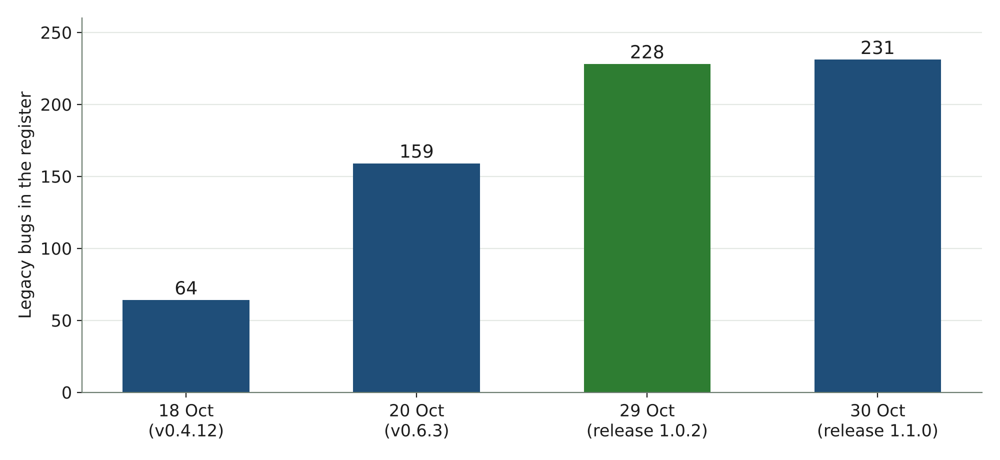

---
# GENERATED - NOT THE MASTER. Made from D Modelling/5.Modelling/5.2.CPATAIImplementation/1.Presentation/Brief-CPATAIImplementation.qmd by build_web_papers.py
# on every compile; edits here are lost. Edit the master instead.
title: "CPAT-AI: Rebuilding a Policy Model as a Transparent, Testable Tool"
subtitle: "What two AI-assisted rebuilds of the Climate Policy Assessment Tool found, and what ministries should ask of the models they use"
series: "Climate Fiscal Policy Brief No. 5.2"
version: "1.0"
author:
  - name: "Stephen J. Stretton"
    note: "Writing in a personal capacity."
date: "October 2026"
abstract: |
  Finance ministries use the Climate Policy Assessment Tool, a large spreadsheet built by the IMF and the World Bank, to judge carbon taxes and fuel subsidy reforms. Nobody had checked all of it. In October 2026 it was rebuilt twice, as a readable workbook and as a Python model, mostly by AI coding agents, under one rule: fix bugs, copy and log deliberate choices. The rebuild found 228 bugs, 24 serious enough to change standard results; the second rebuild found seven bugs in the first. Ministries should require shared variable codes, one register of known problems, a second implementation, and a named owner of every judgment.
keywords: [climate policy modeling, carbon pricing, model quality assurance, spreadsheet risk, artificial intelligence]
bibliography: Brief-CPATAIImplementation.bib
csl: ../../../chicago-author-date.csl
toc: true
date-format: "MMMM YYYY"
citations-hover: true
crossrefs-hover: true
lightbox: auto
---

*Climate Fiscal Policy Brief No. 5.2, October 2026. Stephen J. Stretton, writing in a personal capacity. The views expressed are the author's own and do not represent those of any institution with which he is or has been affiliated. The full account, with the register, the tests and the sources, is in the [working paper](working-paper.qmd); the rebuilt models are public at https://github.com/cpmodelai/cpat_ai.*

# Key messages {#sec-key-messages}

[**Read the full working paper →**](working-paper.qmd) · [Slides (pptx)](../../../papers/Slides-CPATAIImplementation.pptx)

**A model that guides tax reform had never been fully checked.** The Climate Policy Assessment Tool (CPAT) is a spreadsheet of over 21 megabytes with about 400 pages of documentation. Its formulas differ from row to row, so no one could audit it cell by cell.

**Rebuilt twice in October 2026, it turned out to hold 228 bugs, 24 of them serious.** Some changed standard results: a one-off GDP gain compounded every year, and a methane fee on farming and waste did nothing.

**One rule made the rebuild trustworthy: fix bugs, copy deliberate choices and log them.** Every difference from the original has a code and a reason, and every departure was decided in writing by a named owner.

**Building twice caught what one build missed.** The Python version found seven bugs in the rebuilt workbook. But versions built from the same reading can share an error, and agreeing models can all be wrong about the world.

**Ministries should ask four things of any model they rely on:** shared variable codes, one register of known problems, a second implementation tested at every release, and a named owner for every judgment.

# A model ministries rely on had never been fully checked {#sec-problem}

**CPAT shapes advice on carbon pricing and subsidy reform in many countries.** Built by the IMF and the World Bank, it estimates what carbon taxes, emissions trading, fuel subsidy reform and related policies do to energy prices, fuel use, emissions, revenue, GDP and households, year by year, for more than 180 countries [@CPATDoc; @Black2023CPAT]. Finance ministries and development-bank teams use it to size reforms and their effects on the poor.

**It is a spreadsheet, which makes it open but not checkable.** Anyone can open it and see every number, and its authors chose Excel for that reason [@CPATDoc]. But the legacy workbook is over 21 megabytes, its main sheet runs past row 18,000, and its formulas change from row to row, so checking one row says little about the next. Its documentation had also drifted from the workbook.

**Large spreadsheets almost always contain errors.** Studies of spreadsheet audits find errors in a few percent of cells, so a large workbook's question is how many errors it holds, not whether [@Panko1998]; no audit has found an operational spreadsheet free of them [@Powell2008]. Errors of this kind can move a policy debate: a spreadsheet slip, together with data choices, turned 2.2 percent average growth into a published −0.1 percent in a famous study of public debt [@Herndon2014].

**The cure is known; the labor to apply it was missing.** Writing the model as code, testing each block, keeping one list of problems and building it twice are standard advice, and the UK Treasury asks for them of every business-critical government model [@Macpherson2013]. A policy model run by economists rarely has the software team to do them.

# One rule and shared codes made a full rebuild possible {#sec-approach}

**CPAT was rebuilt twice in four weeks, mostly by AI coding agents.** The first rebuild, Excel-AI, is a readable workbook written by code, in which one short formula serves a whole block of cells. The second, Coded CPAT, is a Python model written from the first one's equation list. Both are public [@CPATAIRepo].

**The rule separates mistakes from choices.** A bug is a formula that does not compute what its authors meant, such as one that points to the wrong row; the rebuild fixes it and never copies it. An issue is a deliberate choice that is open to question, such as an old data vintage; the rebuild copies it exactly and logs it for the modelers to decide. Any other departure needs a dated decision by the model's owner ([working paper, the replication rule](working-paper.qmd#sec-rule)). So a reviewer who finds a difference between the rebuild and the original can look up why.

**Shared codes make the three models comparable at every step.** Every input, variable and output has one code, the same in the original workbook, Excel-AI and Python. Comparing any two is then a table join, which can be run after every change ([working paper, shared codes](working-paper.qmd#sec-codes)).

**Every number is checked by something that did not produce it.** Each block is first shown to reproduce the original's own results with its bugs switched back on, so the rebuild understood the method before changing it. The workbook is then checked against an independent recomputation, Python against the workbook (every one of 7,458 outputs per Egypt scenario, to one part in a billion), and each release against the last ([working paper, the testing regime](working-paper.qmd#sec-testing)).

# The rebuild found 228 bugs, 24 of them serious {#sec-found}

**Half of the 454 entries in the register are bugs in the original model.** @tbl-register gives the counts at release 1.0.2. The 24 high-priority bugs change results in standard runs; the 142 low-priority ones sit in options the standard run does not use, or in a reported number only.

| What was found | Number | What the rebuild does |
|:---|---:|:---|
| Bugs in legacy CPAT | 228 (24 high, 62 medium, 142 low priority) | Fixes each; writes a cell-level fix for the original |
| ...of which the CPAT team has fixed, checked cell by cell | 52 (and 9 with caveats; 2 marked fixed were not) | Checks every claimed fix |
| Issues: deliberate choices open to question | 135 | Copies 93 exactly; 14 changed by the owner's decision |
| Departures decided by the owner | 35 | Keeps each, with a reason |
| Bugs in the rebuilt workbook, found by the Python build | 7 (of 22 in all) | Fixes them in both |
| Errors in the published documentation | 20 | Models follow the workbook; documentation to be corrected |
| Proposed upgrades | 14 | Proposed, not built |

: The rebuild of CPAT registered 454 entries; half are bugs in the original model. Source: CPAT-AI register, release 1.0.2, 29 October 2026; working paper, Table 1. {#tbl-register}

**The serious bugs sit where formulas were copied across sectors or years.** Services electricity demand grew with industry's multiple after 2023, the largest single error in power demand. The GDP effect of recycled carbon revenue was added to the growth rate every year instead of to the level once, so a one-off gain compounded. A methane fee on farming and waste had no effect, because that methane never changed. Regulation scenarios did nothing, because a lookup never matched. "Other oil products" were priced at a floor, so their use rose about tenfold by 2030 [@CPATAIBugs].

**Most bugs are latent, and they fire exactly when a ministry asks a new question.** A bug in an option the standard run does not use, such as the detailed road-fleet model, changes nothing until someone switches that option on. That is when a ministry is asking a question the default run does not answer.

**The total is a lower bound.** The register held 64 legacy bugs on 18 October 2026, 159 two days later and 228 at release 1.0.2 on 29 October (@fig-growth); a day later it held 231 [@CPATAICaveats]. The modules not yet rebuilt, air pollution and transport co-benefits, will add more.

{#fig-growth width=100%}

**The owners are fixing what the rebuild found, and the checks keep everyone honest.** Within weeks the CPAT team marked 63 bugs fixed in its next file. A cell-by-cell check confirmed 52, found 9 fixed with caveats, and found 2 marked fixed that were not [@CPATAIBugs].

# Building twice catches what one build misses, but not everything {#sec-twice}

**The Python build found seven bugs that the workbook's own checks had missed.** They included nominal GDP divided by a billion when the source was already in billions, and two gas price series read from each other's rows. All seven were fixed in both models ([working paper, the testing regime](working-paper.qmd#sec-testing)).

**Versions built from the same reading can share the same error.** Software engineers have known this for forty years: in a classic experiment, 27 programs written independently to one specification failed together far more often than chance predicts [@KnightLeveson1986]. A 2026 repeat with programs written by AI agents found the same, though voting across three versions still cut failures by about two thirds [@Ron2026]. CPAT-AI limits the risk by tying every block to the original's own stored results, which no agent wrote, and by sending every fix to the CPAT team ([working paper, what AI did and did not do](working-paper.qmd#sec-ai)).

**Agreement between models is not proof that the model is right.** The tests show that three implementations compute the same thing; they do not show that CPAT's price elasticities are right or that its baseline fits history. That is validation, the subject of [Brief 5.3](../../../modelling/5-modelling/CPATValidation/index.qmd) and [Brief 5.4](../../../modelling/5-modelling/ElasticityValidation/index.qmd) [@StrettonWP53; @StrettonWP54].

# AI agents built; a named owner decided {#sec-ai}

**The agents did most of the construction.** Working under written rules, through Claude Code and GitHub Copilot, they wrote the code that builds the workbook, the checks, the whole Python model and its tests, and the documents generated from the register. The project log records 241 finished tasks in four weeks [@CPATAICaveats].

**The people kept every judgment.** Whether a difference is a bug or an issue is settled by rule, whose default is "copy it and ask". Every departure from the original carries a dated decision by the owner, and the owner accepted each release. The checks caught agents' errors and people's alike: one overlong formula written by an agent stopped a release, and a cell-by-cell check found two bugs that the original's owners had marked fixed but had not.

**The evidence on AI productivity is mixed, so the safeguard is the test, not the tool.** In one experiment programmers with an AI assistant finished a task 56 percent faster [@Peng2023]; in another, experienced developers on their own large projects were 19 percent slower with AI tools while believing they were faster [@Becker2025]. CPAT-AI did not depend on settling that question, because every output was tested by something its author did not write.

# What it means for decisions made with CPAT {#sec-decisions}

**Results from earlier versions of CPAT should be read with the register at hand.** A result that rests on the GDP feedback, methane fees outside energy, regulation scenarios or the detailed road model may be affected by a bug now fixed in the rebuild and, in part, in the CPAT team's latest file. The register lists each bug, where it sits and what it changes, so an analyst can check a past run against it [@CPATAIBugs].

**The rebuilt models are ready for one country, not yet for all.** Excel-AI and Coded CPAT shipped with complete data for Egypt only, because several of CPAT's data tables are licensed; other countries need the full database. Air pollution and transport co-benefits are not yet rebuilt ([working paper, lessons](working-paper.qmd#sec-lessons)).

# What to do {#sec-what-to-do}

**Ministries and agencies that commission a policy model: ask for four things.** A codes map, so that any later audit or rebuild is a table join. One register of bugs, issues and departures, shared with the model's owners. A second implementation, and a regression test on every output at every release. And a named owner who decides every departure in writing, as the UK Treasury asks of its own models [@Macpherson2013].

**The CPAT team and its users: work through the register.** Apply the cell-level fix plans to the legacy file, confirm each fix independently, and rerun the published validation and elasticity checks on the corrected model for every country ([Brief 5.3](../../../modelling/5-modelling/CPATValidation/index.qmd), [Brief 5.4](../../../modelling/5-modelling/ElasticityValidation/index.qmd)).

**Development-bank teams running CPAT for a client: check the run against the register.** Before a result goes into advice, check whether the run used any feature with a known high-priority bug, and say so in the note.

**Anyone building models with AI agents: let agents build and people decide.** Write the rules down, route every agent to them, keep judgments with a named person, and test every output against something its author did not produce.

# Related papers in this series {.unnumbered}

- [Brief 5.1](../../../modelling/5-modelling/CPATMitigationMethods/index.qmd): the CPAT mitigation module, its methods in brief [@StrettonWP51].
- [Brief 5.3](../../../modelling/5-modelling/CPATValidation/index.qmd): validating CPAT against data and other models [@StrettonWP53].
- [Brief 5.4](../../../modelling/5-modelling/ElasticityValidation/index.qmd): are CPAT's price elasticities right? [@StrettonWP54].
- [Brief 6.1](../../../modelling/6-modular-upgrades.qmd#paper-6-1): the Total Effective Carbon Price, which uses the same demand system [@CFPB61].
- The [working paper](working-paper.qmd) behind this brief: the register in full, the replication rule, the four test levels and the sources.

# Downloads {.unnumbered}

[Policy brief (docx)](../../../papers/Brief-CPATAIImplementation.docx) · [Working paper (docx)](../../../papers/CPATAIImplementation.docx)

# References {.unnumbered}

::: {#refs}
:::
