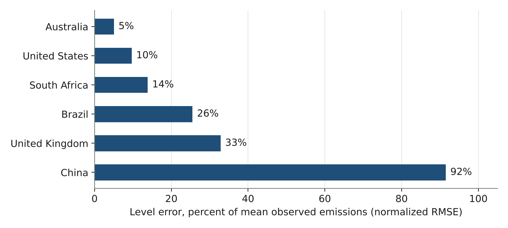

---
# GENERATED - NOT THE MASTER. Made from D Modelling/5.Modelling/5.3.CPATValidation/1.Presentation/Brief-CPATValidation.qmd by build_web_papers.py
# on every compile; edits here are lost. Edit the master instead.
title: "Validating CPAT: Baselines, Back-Casts and Model Comparisons"
subtitle: "How far a finance ministry can trust the Climate Policy Assessment Tool, and how to read its numbers"
series: "Climate Fiscal Policy Brief No. 5.3"
version: "1.0"
author:
  - name: "Stephen J. Stretton"
    note: "Writing in a personal capacity."
date: "October 2026"
abstract: |
  Finance ministries use the Climate Policy Assessment Tool (CPAT) to estimate what a carbon tax does to emissions and revenue. This brief sets out what the tool's published checks show. CPAT fits its base year by construction, follows the trend of emissions in back-casts for large economies, and agrees in order of magnitude with other energy models and with the wide range of evidence on real carbon prices. Its results move most with its price elasticities: a G20 emissions cut of 29 percent can be anywhere from 7 to 39 percent. Ministries should read CPAT results as ranges, use them to compare policies, and ask for the checks to be rerun on the corrected model.
keywords: [climate policy modeling, model validation, carbon pricing, finance ministries, CPAT]
bibliography: Brief-CPATValidation.bib
csl: ../../../chicago-author-date.csl
toc: true
date-format: "MMMM YYYY"
citations-hover: true
crossrefs-hover: true
lightbox: auto
---

*Climate Fiscal Policy Brief No. 5.3, October 2026. Stephen J. Stretton, writing in a personal capacity. The views expressed are the author's own and do not represent those of any institution with which he is or has been affiliated. The full analysis, with every table, source and recomputation, is in the [working paper](working-paper.qmd).*

# Key messages {#sec-key-messages}

[**Read the full working paper →**](working-paper.qmd) · [Slides (pptx)](../../../papers/Slides-CPATValidation.pptx)

**CPAT is good enough for ranges and for comparing policies, not for point forecasts.** Its published checks support the direction and rough size of what a carbon tax does, not the decimal point.

**A CPAT emissions cut of 29 percent means "about 20 to 35 percent".** The price elasticities and the choice of power model drive most of the spread; ask which ones a result uses.

**The evidence on real carbon prices is too wide to say CPAT over- or under-predicts.** On a like-for-like basis, its response is of the same order as the best cross-country estimate.

**Every published check was run on a model that has since been found to contain more than 200 bugs.** The rebuilt model fixes them and runs a country in under a second, so the checks can and should be rerun.

**Ask for a measure of fit with every CPAT result, and fund validation as a routine test, not a one-off study.**

# Why a ministry should ask how wrong the model is {#sec-why}

**A carbon-pricing decision rests on a forecast, and the forecast has an error.** CPAT, built by the World Bank and the International Monetary Fund, estimates the emissions, revenue, GDP and household effects of carbon pricing in more than 180 countries [@CPATDocMitigation]. A typical result is that a carbon tax rising to \$75 per tonne of CO₂ by 2030 cuts G20 emissions by 29 percent against the baseline [@CPATDocMitigation]. If the response to the price is off by half, so are the revenue estimate and the gap to the country's climate pledge.

**CPAT's checks exist, but they are scattered and mostly in charts.** The CPAT team compared the model with history, with other energy models and with studies of real carbon prices, and published the results in a long methodology chapter [@CPATDocMitigation]. The 2026 rebuild of the model added a fourth test: whether independent code reproduces it. The [working paper](working-paper.qmd) sets all of these side by side, recomputes what can be recomputed, and corrects several numbers.

**Four tests answer four different questions.** Does the model match the data in its starting year? Started in the past, does it reproduce what happened next? Do other models, and studies of real carbon prices, give similar answers? Does a second, independent version of the code compute the same numbers? Passing one test says little about the others ([working paper, what validation means](working-paper.qmd#sec-meaning)).

# What the checks show {#sec-checks}

**CPAT matches the starting year because it is made to, so that match proves little.** The model scales its emissions so that they equal each country's official inventory in the base year. The scaling can also carry a data break into every later year. Egypt's inventory jumps by almost a fifth from 2021 to 2022, and the calibrated baseline ends up 16 to 32 percent below the inventory in 2022–2024 ([working paper, baseline fit](working-paper.qmd#sec-baseline)). A ministry comparing CPAT with its own inventory would see this at once.

**Started in 2000 and run to 2017, CPAT gets the trend of emissions right in most of the countries tested and the level right only where prices behave.** The test fed in the world energy prices that actually occurred. The model's typical error was 5 percent of average emissions for Australia, 10 percent for the United States and 14 percent for South Africa, but 26 percent for Brazil, 33 percent for the United Kingdom and 92 percent for China (@fig-backcast). Most of the misses come from domestic prices that the model projected badly, as where governments control prices. None of the six countries is a typical CPAT user, and none is a low-income country.

{#fig-backcast width=95%}

**Against other energy models, CPAT is of the same order.** Its world baseline is close to the International Energy Agency's and Enerdata's, its response of emissions to a carbon price has about the same slope as Enerdata's, and its power-sector mix under a \$40 carbon price resembles that of the World Bank's power planning model. Only the timing of power investment differs much, because the planning model builds in lumps. None of these comparisons reports a measure of fit; all are charts ([working paper, comparisons](working-paper.qmd#sec-comparisons)).

# The evidence on real carbon prices cannot yet test CPAT's response {#sec-evidence}

**CPAT's documentation compares two different measures and calls them comparable.** A \$10 carbon price in CPAT lowers emissions by an average of 2.4 percent over its first five years and 6.2 percent over seventeen. Studies of real carbon prices usually report how much a scheme slowed the *growth* of emissions each year. Put on that basis, CPAT's response is about 0.7 to 0.8 percent a year at \$10, against about 0.5 percent a year in the most comparable cross-country study, which its authors call imprecise [@Rafaty2020] ([working paper, ex-post evidence](working-paper.qmd#sec-expost)).

**The rest of the evidence is too wide to settle whether CPAT responds too much or too little.** One review finds that real carbon prices cut emissions by 0 to 2 percent a year [@Green2021]. A later meta-analysis of 80 studies of 21 schemes finds total cuts of 5 to 21 percent, even though most prices were low [@DobbelingHildebrandt2024]. Both are for real schemes with partial coverage and free permits, so neither scales simply to a comprehensive carbon tax.

**One finding holds up: CPAT ranks the sectors as the evidence does.** Power responds most and transport least, in CPAT and in the cross-country evidence [@Rafaty2020]. Rankings like this, and comparisons between policies, are what CPAT does most reliably.

# The price elasticities decide the answer {#sec-elasticities}

**No other input moves CPAT's results as much as the price elasticities.** The elasticities say how much fuel use falls when prices rise. The CPAT team changed one input at a time in a G20 run of a carbon tax rising to \$75 in 2030 (@tbl-sensitivity). Moving the price elasticities by two standard deviations either way moves the cut from 29 percent to anywhere between 7 and 39 percent. Choosing one power model rather than the other moves it between 22 and 34 percent. Income elasticities, fiscal multipliers and GDP growth hardly matter for the size of the cut.

| What changes | G20 CO₂ cut in 2030 |
|:---|---:|
| Default settings | 29% |
| Price elasticities one standard deviation higher / lower | 35% / 20% |
| Price elasticities two standard deviations higher / lower | 39% / 7% |
| Power model: elasticity / engineering | 34% / 22% |
| World energy prices 50 percent lower / higher | 31% / 20% |
| Income elasticities, fiscal multipliers or GDP growth changed | 29–30% |

: A carbon tax rising to \$75 cuts G20 emissions by 29 percent in 2030; the price elasticities can move that from 7 to 39 percent. Source: CPAT methodology, section Parameter Sensitivity Analysis; working paper, Table 4. {#tbl-sensitivity}

**The evidence finds most elasticities in the right range, with clear exceptions.** The CPAT team's own estimates on data for 2000–2018 find the household electricity elasticity lower than CPAT assumes (−0.1 against −0.4), and services fuels less responsive than CPAT assumes. For gasoline the picture is mixed: the team's estimate is lower than CPAT's, but a review of many studies puts the long-run value higher [@Brons2008], so CPAT's value sits inside the range [@CPATDocMitigation] ([working paper, sensitivity](working-paper.qmd#sec-sensitivity); [Brief 5.4](../../../modelling/5-modelling/ElasticityValidation/index.qmd)).

# The rebuilt model reproduces CPAT and found its bugs {#sec-rebuild}

**Independent code reproduces CPAT's method to many decimal places.** The 2026 rebuild rewrote each block of the original Excel model in Python and required it to reproduce the original's stored results. The road and power-price blocks match to better than one part in ten trillion, and the new Python model reproduces the rebuilt workbook to nine digits [@CPATCodedTesting]. CPAT's results are therefore a property of its method, not an accident of one spreadsheet ([working paper, replication](working-paper.qmd#sec-replication); [Brief 5.2](../../../modelling/5-modelling/CPATAIImplementation/index.qmd)).

**The rebuild also found 231 bugs in the original model, 24 of them serious.** They include a population path for Egypt that departed from the United Nations projection and an income effect on power demand applied twice [@CPATAIBugs]. Every published check was run before these were fixed, so the evidence is about an earlier model. The corrected Python model runs one country in under a second, so the checks are now cheap to rerun for every country.

**Outsiders can rerun the method, not every country's numbers.** Six of CPAT's data tables are proprietary, and the public repository holds them only for Egypt, slightly perturbed [@CPATAIRepo]. Repeating the validation for all countries needs the full database.

# How to read a CPAT number {#sec-reading}

**Read a CPAT emissions cut as a range.** A cut of 29 percent is best read as "about 20 to 35 percent": the spread from one standard deviation in the price elasticities and from the choice of power model. Ask which power model a result uses.

**Trust comparisons more than levels.** When two policies run on the same baseline, errors in the baseline largely cancel. "Policy A cuts twice as much as policy B" is more reliable than "policy A cuts 29 percent".

**Check the elasticities where the result depends on one sector.** Results driven by household electricity, services or road fuels deserve a check against national evidence. Road transport needs extra care: CPAT describes it in three ways that are not consistent with each other, and no published check compares them ([working paper, where CPAT fits](working-paper.qmd#sec-fit); [Brief 6.4](../../../modelling/6-modular-upgrades.qmd#paper-6-4)).

**Compare the baseline with the national inventory before using it.** A break in the inventory, as in Egypt in 2022, can leave the whole baseline too low or too high.

# What to do {#sec-what-to-do}

**Finance ministries: ask for ranges and a measure of fit.** Request every CPAT result with its sensitivity to the price elasticities and the power model, and with the baseline set against the national inventory and one other projection.

**Development-bank and IMF country teams: report which settings a run uses.** State the power model, the elasticities and the data vintage in every report, and flag results that hinge on household electricity, services or road transport.

**The teams that maintain CPAT: make validation a routine test.** Rerun the back-casts, model comparisons and sensitivity analysis on the corrected model for every country with data; report a measure of fit for each; repeat them at every release ([working paper, what validation remains](working-paper.qmd#sec-remains)).

**Researchers and funders: test CPAT against real carbon prices.** Use cases such as Sweden and British Columbia, with the data available before each tax began, and measure the response the way the ex-post studies do, per dollar of carbon price.

# Related papers in this series {.unnumbered}

- [Climate Fiscal Policy Brief No. 5.1](../../../modelling/5-modelling/CPATMitigationMethods/index.qmd): the CPAT mitigation module, its methods in brief.
- [No. 5.2](../../../modelling/5-modelling/CPATAIImplementation/index.qmd): rebuilding CPAT as a transparent, testable tool.
- [No. 5.4](../../../modelling/5-modelling/ElasticityValidation/index.qmd): whether CPAT's price elasticities are right.
- [No. 6.1](../../../modelling/6-modular-upgrades.qmd#paper-6-1): the Total Effective Carbon Price, the yardstick for comparing policies [@CFPB61].
- [No. 6.4](../../../modelling/6-modular-upgrades.qmd#paper-6-4): activity levels across CPAT and other models, including road transport.
- The [working paper](working-paper.qmd) behind this brief: every table, source and recomputation.

# Downloads {.unnumbered}

[Policy brief (docx)](../../../papers/Brief-CPATValidation.docx) · [Working paper (docx)](../../../papers/CPATValidation.docx)

# References {.unnumbered}

::: {#refs}
:::
