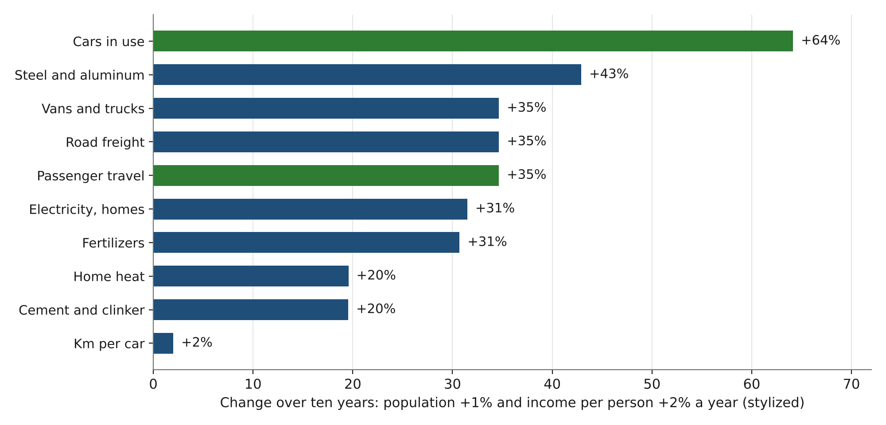

---
# GENERATED - NOT THE MASTER. Made from D Modelling/6.ModularUpgrades/6.4.ActivityModelling/1.Presentation/Brief-ActivityModelling.qmd by build_web_papers.py
# on every compile; edits here are lost. Edit the master instead.
title: "Activity Levels Across CPAT, SISEPUEDE, CBAM and FTT"
subtitle: "Put Four Climate Models on One Baseline, and Count the Carbon Price Once"
series: "Climate Fiscal Policy Brief No. 6.4"
version: "1.0"
author:
  - name: "Stephen J. Stretton"
    note: "Writing in a personal capacity."
date: "October 2026"
abstract: |
  Finance ministries increasingly ask several climate models the same question, and the models disagree before any policy is applied, because each starts from different levels of activity: electricity used, distance traveled, vehicles on the road, tonnes of steel and cement made. This brief shows how four models used in climate-fiscal work (CPAT, SISEPUEDE, the CBAM Policy Tool and FTT) can share one set of drivers and one growth rule, so that their baselines agree. It sets out where a carbon price's effect on demand must be counted, and only once, and why every link needs a check that cars stay inside total travel.
keywords: [climate policy models, model linking, energy demand, carbon pricing, finance ministries]
bibliography: Brief-ActivityModelling.bib
csl: ../../../chicago-author-date.csl
toc: true
date-format: "MMMM YYYY"
citations-hover: true
crossrefs-hover: true
lightbox: auto
---

*Climate Fiscal Policy Brief No. 6.4, October 2026. Stephen J. Stretton, writing in a personal capacity. The views expressed are the author's own and do not represent those of any institution with which he is or has been affiliated. The full method, with the equations, the parameter sources and the proofs, is in the [working paper](working-paper.qmd).*

# Key messages {#sec-key-messages}

[**Read the full working paper →**](working-paper.qmd) · [Download this brief (pdf)](../../../papers/Brief-ActivityModelling.pdf) · [Slides (pdf)](../../../papers/Slides-ActivityModelling.pdf)

**Linked climate models disagree before any policy is applied, because each starts from its own forecast of activity.** CPAT, SISEPUEDE, the CBAM Policy Tool and FTT grow electricity use, travel, vehicles and industrial output from different drivers, so a ministry that links them gets four baselines.

**One driver layer fixes this.** Grow ten activities with population, income per person and the cost of the energy service, from one forecast and one base year, and let each model keep its own data and take the layer's growth.

**A carbon price must reach demand exactly once.** CPAT and the CBAM Policy Tool already respond to prices; SISEPUEDE and FTT do not. Apply the layer's price response only to the activities it passes to those two.

**Cars grow faster than travel, so every link needs a check.** Under stylized growth, cars in use rise 64 percent in ten years and travel 35 percent; left unchecked, car travel would exceed all travel within two generations.

**Fix the data gaps that matter most.** FTT has no car data for 21 of its 71 regions, SISEPUEDE's country calibrations are not public, and the response of heavy industry to a carbon price rests on judgment.

# Linked models disagree before any policy is applied {#sec-problem}

**A ministry that asks four models about a carbon price gets four different starting points.** The Climate Policy Assessment Tool (CPAT), built by the World Bank and the International Monetary Fund (IMF), grows fuel use with total GDP and prices for more than 180 countries [@black2023cpat]. SISEPUEDE, an open model developed by RAND and the Inter-American Development Bank, grows travel, freight, household energy and industrial output with income and population [@Kalra2023]. The CBAM Policy Tool grows output of the steel, aluminum, fertilizer and cement that the European Union's carbon border adjustment covers ([Brief 6.2](../../../modelling/6-modular-upgrades/CBAMPolicyTool/index.qmd)) [@StrettonWP62]. The Future Technology Transformations (FTT) models decide which technologies win in power, cars, freight and heating, but take the size of each market as given [@Mercure2012; @FTTStandAlone]. Each is good at its job.

**The differences are in the drivers, not just in the numbers.** CPAT does not separate population from income: a country whose population grows fast gets the same fuel growth as one getting richer ([working paper, CPAT](working-paper.qmd#sec-cpat)). SISEPUEDE never lets prices change demand; a carbon tax changes its emissions only if the analyst writes a change into the scenario ([working paper, SISEPUEDE](working-paper.qmd#sec-sisepuede)). FTT's demand is a fixed input file that ends in different years for different sectors ([working paper, FTT](working-paper.qmd#sec-ftt)). So two models can disagree about the effect of a carbon tax simply because they disagree about how much driving or steelmaking there would have been without it.

**Inside CPAT, road transport is described three ways that need not agree.** By default, road fuel follows CPAT's general fuel equation. An optional engineering model tracks vehicles, electric-vehicle choice and distance driven. A third block values congestion, accidents and road damage, and it always uses the engineering model's driving, whichever model the user selects [@CPATAIBugs]. A ministry reading CPAT's co-benefits of a fuel tax should ask which road model produced them.

# One driver layer puts the four models on one baseline {#sec-layer}

**The layer grows ten activities with one rule.** The activities are electricity generated, passenger travel, cars in use, kilometers per car, road freight, vans and trucks, home heat, steel and aluminum, cement and clinker, and fertilizers. Each grows with population, with income per person, and with the cost of the energy service it provides, through fixed elasticities. Activities that follow people, such as travel and households, grow one-for-one with population; activities that follow the economy, such as industrial output, grow with total GDP ([working paper, the rule](working-paper.qmd#sec-rule)).

**Every model gets the same two forecasts and the same base year.** Use the IMF World Economic Outlook for GDP and the United Nations World Population Prospects for population, for every model [@IMFWEO; @UNWPP2024]. Each model keeps its own last data point and takes the layer's growth from there, so FTT keeps its own fleet and FTT's power demand keeps its own level ([working paper, feeding the models](working-paper.qmd#sec-feeding)).

**Where the models' own values fail against the evidence, the layer replaces them.** SISEPUEDE's example data grow regional travel with income at an elasticity of 2.64, with no ceiling, and move every industrial elasticity to 1 by 2050 [@SISEPUEDECode]. The evidence says total travel rises roughly in proportion with income [@SchaferVictor2000] and that demand for steel and cement rises for decades and then levels off [@vanRuijven2016]. Vehicle ownership grows about twice as fast as income at low and middle incomes, then saturates [@DargayGately1999]. The layer uses those patterns. Where no public estimate fits, as for heavy-industry output, the working paper states its values as assumptions ([working paper, parameters](working-paper.qmd#sec-parameters)).

# Count the carbon price's effect on demand once {#sec-price}

**A price response applied twice doubles; one never applied is lost.** If the layer cuts driving because fuel got dearer and the receiving model cuts it again, the response is counted twice. If neither does, a carbon tax changes nothing in that model's demand. @tbl-price shows which model already responds and where the layer's price response belongs.

| Model | Does its demand respond to price? | What the layer passes |
|:--|:--|:--|
| CPAT | Yes, every fuel and sector | The baseline only, as a cross-check; for road vehicles, the baseline only |
| CBAM Policy Tool | Yes, output of covered goods | Nothing for prices; it passes product output back to the layer |
| SISEPUEDE | No | Activity with the layer's price response |
| FTT | No (prices move technology shares, not demand) | Activity with the layer's price response |

: Apply the carbon price's effect on demand in exactly one place for each activity. Source: [working paper, concordance and Proposition 2](working-paper.qmd#sec-propositions). {#tbl-price}

**The layer's price responses are modest, and mostly come through fewer vehicles.** A carbon price that raises the energy cost of driving by 20 percent cuts car use by about 5 percent in the long run, 4.5 percent through fewer cars and 0.9 percent through less driving per car, in line with the review evidence [@Goodwin2004]. The same rise in the energy cost of freight cuts tonne-kilometers by about 2 percent [@deJong2010]. These are the responses SISEPUEDE and FTT otherwise lack.

**The easiest double count to miss sits inside CPAT.** CPAT's engineering road model responds to the cost per kilometer itself. If it is fed vehicle numbers that already include the layer's price response, the response is counted twice even when CPAT's fuel equation is switched off. Feed it the baseline only, and select it as the road model whenever co-benefits are reported ([working paper, propositions](working-paper.qmd#sec-propositions)).

**Product detail matters for heavy industry, and it does not always point the way people expect.** A carbon price of 50 dollars per tonne of CO₂ raises the cost of clinker, which is cheap and carbon-intensive, by about two-thirds, and the cost of blast-furnace steel by about a sixth (stylized prices and intensities). Because clinker is hard to replace, output falls by 5 to 6 percent in both cases ([working paper, worked example](working-paper.qmd#sec-example)). A model that ties industrial energy to GDP, as CPAT does, cannot show either result.

# Cars grow faster than travel, so the link needs a check {#sec-cars}

**Under stylized growth, cars outrun travel within a decade.** With population growing 1 percent a year and income per person 2 percent, cars in use grow 64 percent in ten years and passenger travel 35 percent (@fig-activity). The share of travel by car rises by about a quarter. That is what happens in middle-income countries, and it is what FTT's transport model needs to see.

{#fig-activity width=100%}

**Left unchecked, car travel would overtake all travel.** At these growth rates, a car share of 30 percent of passenger travel reaches 100 percent in about 56 years. A saturating ownership curve, like the one in CPAT's engineering road model, does not prevent this: with that curve the crossing still comes in year 54. What keeps car travel inside total travel in practice is that each car is driven less, and carries fewer people, as ownership rises ([working paper, Proposition 3](working-paper.qmd#sec-propositions)).

**So every link should check, every year, that cars fit inside travel.** The check is simple: cars times kilometers per car times occupancy must stay below total passenger travel. Where it fails, the layer lowers kilometers per car. Without the check, a model can show emissions from road transport that no plausible amount of travel could produce.

# The data gaps bind as hard as the method {#sec-gaps}

**FTT cannot yet run its transport model for much of the developing world.** Its standalone version has no car fleet data for 21 of its 71 regions, including Nigeria, South Africa, Pakistan and Kenya, and its industrial heat module ships without baseline data [@FTTStandAlone]. Its steel model runs only inside the full E3ME-FTT model [@Vercoulen2023].

**SISEPUEDE's country calibrations are not public.** Its open repository holds one example country, and the calibrated values in that example swing widely, including a negative income elasticity for chemical output [@SISEPUEDECode]. Teams using it for a country need the developers' calibration, and should replace values that fail against the evidence.

**The response of heavy industry to a carbon price rests on judgment.** Output elasticities for steel, aluminum, fertilizer and cement are thin in the literature; one Brazilian estimate for steel is −0.14 [@Schmidt2006]. Results that depend on them should be reported with a range.

**The strongest objection is that a rule-based link is second-best.** Solving the models together, as E3ME-FTT does for demand and technology, would make prices, technology and demand consistent by construction. But none of these four models was built for that, ministries run them separately, and a link with written rules is far easier to audit and maintain ([working paper, limits](working-paper.qmd#sec-limits)).

# What to do {#sec-what-to-do}

**Finance ministries: ask for one set of drivers before comparing model results.** Before comparing what two models say about a carbon price, ask whether they used the same GDP and population forecast and the same base year, and which model carries the price response for each activity.

**Teams running CPAT, SISEPUEDE or FTT: link through one layer and count the price once.** Give every model the IMF and UN forecasts. Grow activities with one rule from one base year and splice them onto each model's own data. Apply the price response in SISEPUEDE and FTT only. In CPAT, select the engineering road model whenever co-benefits are reported, and feed it the baseline only. Check every year that cars fit inside travel.

**Model developers: close the gaps that block linking.** Add car fleet data for FTT's 21 missing regions. Publish SISEPUEDE's country calibrations, or the method to rebuild them. Give CPAT one road transport story, and estimate output elasticities for heavy industry.

**The CPAT-AI project: build the layer as an open table and test it on one country.** Run one country through all four models from the same layer, and use the gap between CPAT's fuel-based baseline and the layer's activity-based one as a test of both.

# Related papers in this series {.unnumbered}

- [Climate Fiscal Policy Brief No. 5.1](../../../modelling/5-modelling/CPATMitigationMethods/index.qmd): what CPAT's mitigation module computes [@StrettonWP51].
- [No. 5.4](../../../modelling/5-modelling/ElasticityValidation/index.qmd): whether CPAT's price elasticities are right [@StrettonWP54].
- [No. 6.1](../../../modelling/6-modular-upgrades/PolicyEquivalentCarbonPriceAndCES/index.qmd): the Total Effective Carbon Price, and a demand system with fuel switching [@CFPB61].
- [No. 6.2](../../../modelling/6-modular-upgrades/CBAMPolicyTool/index.qmd): the CBAM Policy Tool [@StrettonWP62].
- [No. 6.3](../../../modelling/6-modular-upgrades/PublicInvestment/index.qmd): public investment needs in CPAT [@StrettonWP63].
- The [working paper](working-paper.qmd) behind this brief: the concordance, the rule, the parameter sources and the proofs.

# Downloads {.unnumbered}

[Policy brief (pdf)](../../../papers/Brief-ActivityModelling.pdf) · [Working paper (pdf)](../../../papers/ActivityModelling.pdf)

# References {.unnumbered}

::: {#refs}
:::
