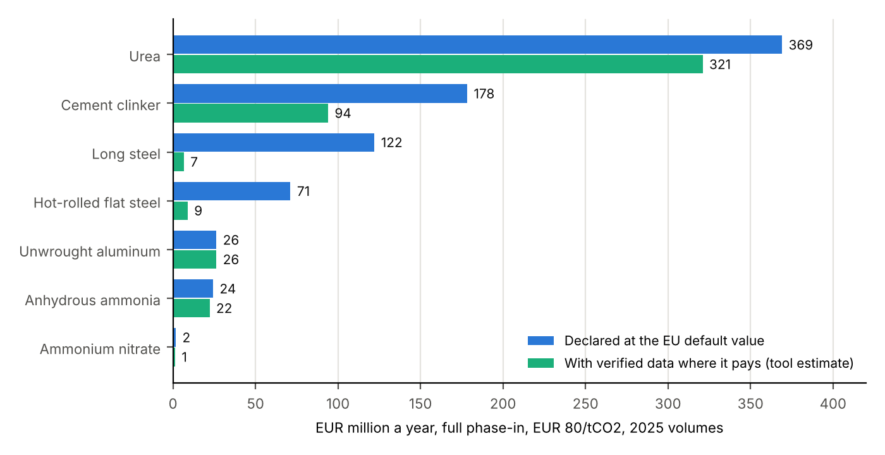

---
# GENERATED - NOT THE MASTER. Made from D Modelling/6.ModularUpgrades/6.2.CBAMPolicyTool/1.Presentation/Brief-CBAMPolicyTool.qmd by build_web_papers.py
# on every compile; edits here are lost. Edit the master instead.
title: "The CBAM Policy Tool"
subtitle: "What the EU's Carbon Border Charge Will Cost Exporters, and Which Lever Cuts It"
series: "Climate Fiscal Policy Brief No. 6.2"
version: "1.0"
date: "October 2026"
abstract: |
  Since January 2026 the EU has charged importers for the carbon in steel, aluminum, cement and fertilizers. Exporting governments can cut the bill in three ways: by getting plants to file verified emissions data, by cutting emissions, and by pricing carbon at home so the EU deducts it. The CBAM Policy Tool computes the bill product by product and year by year. Turkish hot-rolled steel owes €107 a tonne in 2026 and €252 at full phase-in. For Egypt, verified data would cut the charge on steel by about 90 percent, but barely move it on urea, the largest exposure. The right lever differs by product, so ministries should run the numbers before choosing.
keywords: [carbon border adjustment, CBAM, default values, emissions verification, carbon pricing, Egypt, Türkiye]
bibliography: Brief-CBAMPolicyTool.bib
csl: ../../../chicago-author-date.csl
toc: true
date-format: "MMMM YYYY"
citations-hover: true
crossrefs-hover: true
lightbox: auto
---

*Climate Fiscal Policy Brief No. 6.2, October 2026. The views expressed are the author's own and do not represent those of any institution with which he is or has been affiliated. Legal texts as of 31 October 2026. All amounts are at a stylized certificate price of €80 per tonne of CO₂. The Egypt results are illustrative tool results, not official estimates. The method, the equations and the data are in the [working paper](working-paper.qmd).*

# Key messages {#sec-key-messages}

[**Read the full working paper →**](working-paper.qmd) · [Download this brief (pdf)](../../../papers/Brief-CBAMPolicyTool.pdf) · [Slides (pdf)](../../../papers/Slides-CBAMPolicyTool.pdf)

**The EU's carbon border charge is large, and for dirty goods most of it arrives in the first year.** Turkish hot-rolled steel declared at the EU's default value owes €107 a tonne in 2026 and €252 at full phase-in, close to half its price.

**Exporting governments have three levers: verified emissions data, cleaner production, and a carbon price at home that the EU deducts.** For Turkish steel, data are worth €58 a tonne and a €20 domestic price another €49, which stays at home.

**The right lever differs by product.** For Egypt, verified data would cut the charge on steel from €193 million to €16 million a year, but on urea, the largest exposure, only from €369 million to €321 million.

**A tool's accounting must follow the EU's rules exactly.** Two fertilizer corrections changed the largest line in the Egypt results.

**Run the numbers for each product before choosing a policy, and press the EU to credit price signals, not only payments.**

# The border charge is large and arrives early {#sec-charge}

**Since January 2026, EU importers of steel, aluminum, cement, fertilizers, hydrogen and electricity have owed a charge on the carbon in what they buy.** Under the Carbon Border Adjustment Mechanism (CBAM), importers buy certificates priced in line with the EU's emissions trading system for the emissions embedded in their imports [@EU2023; @EU2025Omnibus]. Certificates go on sale in February 2027. Importers bringing in less than 50 tonnes a year are exempt. The charge is phased in as the EU's own steel, cement and fertilizer plants lose their free emission allowances, by 2034 under current law [@EU2023ETSDirective].

**The bill depends on three things exporting governments can influence.** First, whether plants file verified emissions data: if they do not, the EU applies a default value for the country, raised by a mark-up of 30 percent from 2028 (1 percent for fertilizers) [@EU2025Defaults]. Second, whether plants cut their emissions. Third, whether the country levies a carbon price that the EU deducts: a price "effectively paid", net of any rebate, can be subtracted from the charge [@EU2025Omnibus, Art. 9].

**For goods far dirtier than the EU benchmark, most of the charge applies from 2026.** The phase-in only shields emissions up to a benchmark set from the cleaner EU plants; everything above it is charged in full from the start. Turkish hot-rolled steel declared at the default owes €107 a tonne in 2026, €196 in 2030 and €252 at full phase-in, against an average 2025 import price of €549 (@fig-path). The 2026 charge is already 42 percent of the final one ([working paper, the charge per tonne](working-paper.qmd#sec-charge)).

{#fig-path width=100%}

**The EU may slow the phase-in, but not by much.** A Commission proposal of July 2026, not yet adopted, would keep 15 percent of free allocation until 2037 and end it in 2038 [@EU2026ETSProposal]. The charge on Turkish hot-rolled steel would then be €188 a tonne in 2030 instead of €196, and €236 in 2034–2037 instead of €252.

# The CBAM Policy Tool turns the rules into a bill a ministry can check {#sec-tool}

**The tool computes the charge for each product of one exporting country, year by year, from public inputs.** It builds each product's emissions from its energy use and chemistry, compares them with the EU's default value, applies the phase-in and the certificate price, and deducts a domestic carbon price where the rules allow. Every input sits in a labeled cell with its source ([working paper, what the tool does](working-paper.qmd#sec-tool)).

**It answers the three questions a ministry asks.** How large is the charge on each product each year? How much would verified data save? And what would a domestic carbon price do: how much of the fall in the charge comes from cleaner production, and how much from the deduction? With a €20 price and a 10 percent cut in emissions per tonne, the charge falls by a third, two-thirds of it from the deduction ([working paper, abatement and deduction](working-paper.qmd#sec-response)).

**Its estimates of what plants emit are technology averages, not plant data.** The EU will use each plant's verified figures. The tool's estimate shows where verification is likely to pay; plant data must confirm it. The tool computes exposure, not who bears the charge, and it is not a compliance calculator ([working paper, limits](working-paper.qmd#sec-limits)).

# Data and a domestic price are each worth tens of euros a tonne {#sec-levers}

**Filing verified data saves at least the mark-up.** A Turkish steel plant at the country average that files verified data avoids the 30 percent mark-up on the default, worth €58 a tonne at full phase-in. A cleaner plant gains more.

**A domestic carbon price lowers the border charge one for one and keeps the money at home.** A €20 price effectively paid on all emissions cuts the charge on Turkish hot-rolled steel by €49 a tonne, and the treasury collects the same €49. Together with verified data, the charge falls from €252 to €146 a tonne. At 2025 volumes, a €20 price on the three Turkish goods in the example would move about €127 million a year from the EU budget to Türkiye's ([working paper, worked example](working-paper.qmd#sec-example)).

**A rebated price or feebate earns no deduction under the draft rules.** A feebate charges producers above their sector's average emissions per tonne and rebates those below. It keeps the full incentive to cut emissions, but the Commission's draft rules treat emissions below a baseline as compensation to be netted off, so the feebate earns nothing at the border [@EU2026DraftCarbonPrice, Art. 8]. [Brief 1.4](../../../policy/1-carbon-pricing/IronSteelCBAM/index.qmd) argues that the EU should credit the price signal, not only the payment [@CFPB14].

# Egypt shows the right lever differs by product {#sec-egypt}

**The tool's Egypt application compares its estimates with the EU defaults for seven products, and the gaps range from enormous to nil.** @tbl-egypt and @fig-egypt show the charge at full phase-in on 2025 volumes, declared at the EU default and with verified data where it pays. Across the seven products the charge falls from about €793 million a year to €480 million ([working paper, Egypt](working-paper.qmd#sec-egypt)).

| Product | EU imports, 2025 (thousand tonnes) | Tool estimate (tCO₂ per tonne) | EU default (tCO₂ per tonne) | Charge at default (€ million a year) | Charge with verified data (€ million a year) |
|---|---:|---:|---:|---:|---:|
| Hot-rolled flat steel | 169 | 0.66 | 4.05* | 71 | 9 |
| Long steel | 294 | 0.28 | 4.00* | 122 | 7 |
| Cement clinker | 1,350 | 0.87 | 1.27 | 178 | 94 |
| Anhydrous ammonia | 147 | 1.89 | 2.05 | 24 | 22 |
| Urea | 3,286 | 1.22 | 1.39 | 369 | 321 |
| Ammonium nitrate | 9 | 1.93 | 2.39 | 2 | 1 |
| Unwrought aluminum | 135 | 2.51 | 1.87 | 26 | 26† |
| Total | 5,390 | | | 793 | 480 |

: Verified data would cut the charge on Egypt's steel by about 90 percent and on urea by about 13 percent. Charge at full phase-in and €80/tCO₂. Defaults before mark-up. \*No Egyptian default for steel; the "other countries" value applies. †The estimate is above the default, so the producer keeps the default. Illustrative tool results, not official estimates. Sources: @CBAMToolEgypt2026; @EUDVWorkbook2026; @EurostatComext; working paper, Table 4. {#tbl-egypt}

{#fig-egypt width=100%}

**Egypt's steel is charged as if it came from the dirtiest exporters, so verified data are worth almost the whole charge.** Egypt has no EU default of its own for steel, so the EU applies a value of about 4 tonnes of CO₂ per tonne, set from the most carbon-intensive exporters. Egypt makes steel from gas and scrap in electric furnaces; the tool puts it at 0.16–0.73. Verified data would cut the charge on Egyptian steel from €193 million to €16 million a year. The tool's figure for gas-based steel is uncertain, but even at the EU's own default for Iran, another gas-based producer, the charge would be €36 million ([working paper, steel range](working-paper.qmd#sec-app-corrections)).

**Some of what verification "saves" on steel may be routing, not cleaner steel.** A firm with both gas-based and scrap-based plants can send only scrap-based steel to Europe. Its verified figure then falls below what the country's steel actually emits. Measuring by country and sector, as [Brief 1.4](../../../policy/1-carbon-pricing/IronSteelCBAM/index.qmd) proposes, removes that gain.

**For urea, Egypt's largest exposure, the default is close to what plants emit, so data barely help.** Urea is made from ammonia, and the EU counts both the ammonia's emissions and the carbon dioxide the urea carries, which it releases when spread on fields [@EU2025Methods; @IPCC2006Urea]. Counted this way, Egyptian urea emits 1.22 tonnes of CO₂ per tonne against a default of 1.39. Data save €48 million a year; €321 million remains. For urea the levers are cleaner production, such as cleaner ammonia production, and a domestic carbon price that keeps the charge at home: €20 a tonne of CO₂ on urea alone would move about €80 million a year.

**Getting the accounting right changed the answer.** The tool's first Egypt results deducted the carbon dioxide in urea and counted only half the ammonia in ammonium nitrate, against the EU's rules. They also used the tool's own estimates of trade volumes rather than the trade Eurostat records. Corrected, the charge at default values rose from €595 million to €793 million and the remaining charge with verified data from €177 million to €480 million, and urea moved from the strongest case for data to the weakest ([working paper, corrections](working-paper.qmd#sec-app-corrections)).

# What to do {#sec-what-to-do}

**Exporting ministries: run the calculation product by product before choosing a policy.** Where the default is far above what plants emit, as for Egyptian steel and clinker, build verification capacity first: accredited verifiers and monitoring at the plants that sell to the EU. Where it is close, as for Egyptian urea and ammonia, the choice is between abatement and a domestic carbon price that keeps the charge at home. Where plants emit more than the default, as for Egyptian aluminum, keep the default.

**Design a domestic carbon price knowing what the EU will deduct.** A price effectively paid is deducted one for one; a rebated price or feebate earns nothing under the draft rules. A ministry that wants the incentive of a feebate and the deduction of a tax should know the cost of each before choosing, and can finance abatement from the revenue in ways the draft rules do not net off.

**Use the 2027 revision of default values.** The EU must revise its default values in 2027 at the latest [@EU2025Defaults]. A country with no default of its own, as Egypt for steel, or whose plants emit far less than its default, should bring documented estimates to that revision, and a country with a carbon price should engage on the default carbon price methodology the Commission is preparing [@Technopolis2026].

**The European Commission: credit price signals, and measure by country and sector.** Crediting a feebate or other non-price policy at its carbon-price equivalent ([Brief 6.1](../../../modelling/6-modular-upgrades/PolicyEquivalentCarbonPriceAndCES/index.qmd)) would reward the instruments exporters can adopt, and country-sector values would stop routing ([Brief 1.4](../../../policy/1-carbon-pricing/IronSteelCBAM/index.qmd)).

**Tool builders: follow the EU's accounting exactly, and publish the corrections.** The Egypt fertilizer errors were in the method, not the data. The tool's next version should carry the corrections, reconcile its steel factors, and report each product as a range.

# Related papers in this series {.unnumbered}

- [Climate Fiscal Policy Brief No. 1.4](../../../policy/1-carbon-pricing/IronSteelCBAM/index.qmd): crediting the price signal under CBAM, and why country-sector measurement stops routing [@CFPB14].
- [No. 1.1](../../../policy/1-carbon-pricing/OpenEconomyCarbonPricing/index.qmd): the two-track architecture, in which a production feebate sits beside a destination charge on consumption [@CFPB11].
- [No. 1.2](../../../policy/1-carbon-pricing/FeebatesAndOutputBasedRebating/index.qmd): feebates, the full carbon price at the margin without the carbon bill [@CFPB12].
- [No. 6.1](../../../modelling/6-modular-upgrades/PolicyEquivalentCarbonPriceAndCES/index.qmd): the Total Effective Carbon Price, a yardstick for crediting non-price policies [@CFPB61].
- The [working paper](working-paper.qmd) behind this brief: the method in five equations, the data, the Türkiye example and the Egypt application with its corrections.

# Downloads {.unnumbered}

[Policy brief (pdf)](../../../papers/Brief-CBAMPolicyTool.pdf) · [Working paper (pdf)](../../../papers/CBAMPolicyTool.pdf)

# References {.unnumbered}

::: {#refs}
:::
