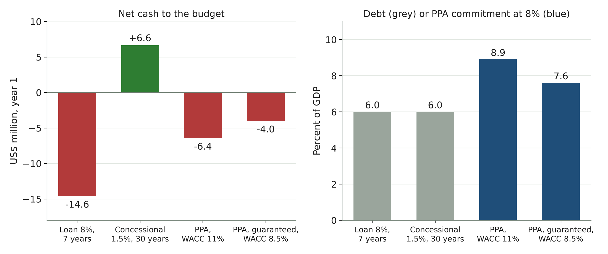

---
# GENERATED - NOT THE MASTER. Made from D Modelling/6.ModularUpgrades/6.3.PublicInvestment/1.Presentation/Brief-PublicInvestment.qmd by build_web_papers.py
# on every compile; edits here are lost. Edit the master instead.
title: "Price the Capital, Then Test the Budget"
subtitle: "Climate Investment Needs, the Cost of Capital and Public Spending in CPAT"
series: "Climate Fiscal Policy Brief No. 6.3"
version: "1.0"
author:
  - name: "Stephen J. Stretton"
    note: "Writing in a personal capacity."
date: "October 2026"
abstract: |
  Finance ministries use the Climate Policy Assessment Tool to see what a carbon price raises and cuts, but not what the clean capital it calls for costs to finance or whether the budget should pay. This brief proposes two extensions. The first prices investment needs at each country's cost of capital and at a social rate: a typical clean asset that pays its way at 6 percent breaks even at 12.6 percent. The second tests each use of public money against the cost of raising tax and counts cash, debt and contract liabilities. Often the budget's problem is cash and hidden liabilities, not value.
keywords: [investment needs, cost of capital, public investment, marginal cost of public funds, power purchase agreements]
bibliography: Brief-PublicInvestment.bib
csl: ../../../chicago-author-date.csl
toc: true
date-format: "MMMM YYYY"
citations-hover: true
crossrefs-hover: true
lightbox: auto
---

*Climate Fiscal Policy Brief No. 6.3, October 2026. Stephen J. Stretton, writing in a personal capacity. The views expressed are the author's own and do not represent those of any institution with which he is or has been affiliated. The equations, proofs, worked example and country runs are in the [working paper](working-paper.qmd).*

# Key messages {#sec-key-messages}

[**Read the full working paper →**](working-paper.qmd) · [Download this brief (pdf)](../../../papers/Brief-PublicInvestment.pdf) · [Slides (pdf)](../../../papers/Slides-PublicInvestment.pdf)

**The cost of capital, not the size of the bill, decides whether clean capital pays its way in developing countries.** A typical clean asset that pays its way handsomely at 6 percent stops paying above 12.6 percent.

**CPAT can price this, but teams should say which cost of capital they use.** Its default adds a technology premium to each country's own rate; its optional income-group rates put lower-middle-income countries at 12.5 percent, right on the line.

**What investors see and what society gets differ, and the gap is what de-risking buys.** Each point off the cost of capital is worth about \$36 billion a year for each year's global clean energy investment.

**A project can be worth building and still break the budget's cash flow.** In a stylized island, a solar plant worth \$108 million leaves the budget \$14.6 million a year short on a seven-year loan; a power purchase agreement hides a larger liability than the debt it avoids.

**Ministries should test public spending with a cost of funds that rises when cash is short, and count contract liabilities as debt.**

# Climate models price policies but not the capital they call for {#sec-problem}

**Developing countries need trillions of dollars of clean capital, and ministries' main climate model does not price it.** Developing countries other than China need \$2.3 to 2.5 trillion a year of climate investment by 2030 [@IHLEG2024]. The Climate Policy Assessment Tool (CPAT), built by the World Bank and the International Monetary Fund (IMF), tells a ministry what a carbon tax raises and cuts in more than 180 countries [@Black2023CPAT]. Its power model builds new plants and reports what they cost. But outside power it has no capital at all, and it has no test of whether public money should pay ([working paper, what CPAT lacks](working-paper.qmd#sec-cpat)).

**A minister needs two answers before any of the capital is built.** The first is what the capital costs to carry. For a solar plant, money is most of the price: the International Energy Agency finds that the cost of capital for utility-scale solar in emerging and developing economies is well over twice that in advanced economies [@IEA2024], and the same plant financed at 12 rather than 4 percent sells power for about 80 percent more ([Brief 3.2](../../../policy/3-finance-and-risk/CleanPowerAssetClasses/index.qmd), @CFPB32). The second is whether the budget should pay, and how. A plant can pay back handsomely and still break a budget that must service a short loan.

# Price investment needs three ways {#sec-lenses}

**The first extension turns the physical change CPAT computes into investment, and prices it three ways.** Investment is new capacity times its unit cost, against a baseline: gigawatts of solar, kilometers of line, buses bought. CPAT supplies this for power; elsewhere a share-of-GDP rule fills in until a physical model, such as the open SISEPUEDE model, can replace it. The capital is then turned into an annual charge three ways: at the market cost of capital the country faces, at the World Bank's 6 percent social rate [@WorldBank2016Discount], and at 6 percent with cleaner air and carbon counted ([working paper, investment needs](working-paper.qmd#sec-needs)).

**The three lenses separate the price of finance from the value of time.** The market rate is what investors and households pay. The social rate is what the economy gives up by waiting. The physical need is the same in all three; what changes is the cost of carrying it and the benefits set against it. The gap between the first lens and the third is the case for public finance.

**A typical clean asset pays its way at 6 percent and stops paying at 12.6 percent.** Take an asset that saves 13.3 cents a year in fuel and running costs for each dollar it costs, over 25 years. That is a stylized figure, of the same order as the financial savings the SISEPUEDE model finds for Latin America [@Kalra2023]. Each \$1,000 of it earns \$43 a year at 7.5 percent, \$23 at 10 percent, about \$1 at 12.5 percent, and loses \$22 at 15 percent (@tbl-breakeven).

| Cost of capital | 6% | 7.5% | 10% | 12.5% | 15% |
|:--|--:|--:|--:|--:|--:|
| Annual capital charge per \$1,000 | 78 | 90 | 110 | 132 | 155 |
| Saving less capital charge per \$1,000 | +55 | +43 | +23 | +1 | −22 |

: A typical clean asset pays its way at 6 percent and breaks even at 12.6 percent. US dollars a year per \$1,000 of capital; stylized asset saving \$133 a year for 25 years. The four rates from 7.5 to 15 percent are CPAT's optional rates for high-, upper-middle-, lower-middle- and low-income countries. Source: working paper, Proposition 1. {#tbl-breakeven}

**CPAT's default cost of capital differs from what its documentation says, and the choice moves the verdict.** CPAT's documentation describes a cost of capital by income group, from 7.5 percent in high-income to 15 percent in low-income countries [@CPATTeam2024]. The model's default is different: each country's own rate, built from risk-free rates and country risk premiums, plus a technology premium of about 3 points for wind and solar in a lower-middle-income country [@CPATAI2026]. The income-group rates are an option. Under the option, a lower-middle-income country sits right on the break-even line; under the default, its solar asset crosses it once the country's own rate passes about 9.7 percent. Uganda's observed rate for renewables, 8.5 percent, is far below the 15 percent the option would give it ([working paper, the cost of capital](working-paper.qmd#sec-coc)).

**At the scale of global needs, the cost of capital is worth tens of billions of dollars a year.** Applied to the expert group's 2030 estimate of \$2.4 trillion of investment in developing countries other than China, the same stylized asset earns \$45 billion a year more than its financing costs at a 10.5 percent market rate and \$131 billion at 6 percent; at 15 percent it loses \$52 billion. Each point off the cost of capital is worth about \$36 billion a year for each year's global clean energy investment of \$4.8 trillion ([working paper, what the lenses show](working-paper.qmd#sec-lenses)).

**The instruments that close the gap already exist.** Pricing carbon and air pollution turns society's gains into revenue. Concessional loans substitute a lower rate for the market rate. Guaranteeing the power contract rather than the debt removes payment risk ([Brief 3.1](../../../policy/3-finance-and-risk/ClimateFinanceIntermediationForCleanPower/index.qmd), @CFPB31), and refinancing operating plants through pooled securities cuts the cost of solar power by about a fifth (@CFPB32). A high cost of capital also changes what gets built: dear capital favors fossil plants over capital-heavy wind and solar [@HirthSteckel2016].

# Test whether the budget should pay {#sec-budget}

**The second extension asks what each dollar of net public money buys.** For each candidate measure, compare the value to people with what the budget really pays, after removing what the private sector would have done anyway, money lost in delivery, and money that comes back as fees or fuel savings. Fund the measure if value per budget dollar beats the cost of raising a dollar of tax, about \$1.20 in African evidence [@AuriolWarlters2012]. With a cost of funds of one, this is the World Bank's usual net present value test ([working paper, the rule](working-paper.qmd#sec-rule)).

**Money spent is not capital built.** The IMF estimates that low-income developing countries get 40 percent less from public investment than the same spending could buy, emerging markets 27 percent and advanced economies 13 percent; better investment management could close up to two-thirds of the gap [@IMF2015PIM]. The extension charges each public measure for that loss once, and puts capital and recurrent costs on one footing, because unfunded maintenance is a main way public capital loses value ([working paper, five corrections](working-paper.qmd#sec-corrections)).

**Revenue that comes back is worth more than its face value.** Each dollar the budget recovers saves more than a dollar of tax, so who keeps a fuel saving changes the budget case but not the economic one. And pricing comes first: a carbon tax raises money cheaply, so a subsidy that a price could replace should be flagged ([Brief 6.1](../../../modelling/6-modular-upgrades/PolicyEquivalentCarbonPriceAndCES/index.qmd), @CFPB61).

# A good project can still break the budget {#sec-island}

**In a stylized island, a solar plant worth \$108 million passes every test but cash.** The island has \$2 billion of GDP, public debt of 85 percent of GDP and diesel power. A \$120 million solar plant with batteries replaces 30 percent of its diesel and saves \$20.5 million a year. At 6 percent it is worth \$108 million, and it stays worth building down to oil at about \$22 a barrel ([working paper, worked example](working-paper.qmd#sec-example)).

**The only commercial loan, at 8 percent over seven years, leaves the budget \$14.6 million a year short.** Debt service and upkeep come to \$24.8 million a year; the budget keeps half the fuel saving. The plant still passes the public-money test: each budget dollar buys over four dollars of value. But the cash gap lasts seven years, and headline debt rises from 85 to 91 percent of GDP (@fig-island).

{#fig-island width=100%}

**Concessional finance closes the gap; a power purchase agreement hides it.** A 30-year concessional loan at 1.5 percent puts \$6.6 million a year into the budget from the start. A power purchase agreement with a private producer keeps the plant off the debt statistics and narrows the cash gap to \$4.0 to 6.4 million a year. But its committed payments are worth 7.6 to 8.9 percent of GDP at the government's borrowing rate, more than the 6 percent of debt it keeps off the books. A guarantee that cuts the producer's cost of capital from 11 to 8.5 percent is worth about \$31 million to the island.

**A longer loan eases cash but does not make borrowing cheaper.** At the government's own rate, the seven-year and 25-year loans cost the same in present value. A model with one fixed cost of public funds even prefers the short loan. Only a cost of funds that rises in cash-short years sees the trap.

# Country runs show the same pattern {#sec-country}

**Illustrative runs put 2030 mitigation investment at 4 to 5 percent of GDP in Kenya, Uganda and St Lucia.** The investment-needs tool shares global totals among countries, so the results are allocations, not bottom-up estimates [@InvNeedsTool2026]. In Kenya and Uganda the extra investment is a net cost at market rates and at 6 percent, and pays only when cleaner air is counted. In St Lucia, which burns imported diesel, it pays at any rate ([working paper, country runs](working-paper.qmd#sec-country)).

**In Uganda, under a fifth of the benefits of net zero reach the budget as cash.** A run of the open SISEPUEDE model values Uganda's net-zero strategy at \$161 billion at 6 percent, but only 18 percent of its benefits are fuel and system savings that a budget or utility would see; the rest is health, crops and water [@SISEPUEDEUganda2025]. Such measures make a strong case for public money, financed mostly by tax, not by the savings they generate.

# The method has limits that teams should state {#sec-limits}

**The weakest numbers are the savings per dollar and the country cost of capital, and they matter most.** The 13.3 cents of savings is stylized; country runs should use CPAT's own fuel savings or a SISEPUEDE run. Observed costs of capital for renewables exist for a few dozen countries, and CPAT's default premium is a judgment. Even the accounting convention matters: if savings start in year zero, as in CPAT's own cost formula, the break-even rate is 14.8 percent rather than 12.6 ([working paper, limits](working-paper.qmd#sec-limits)).

# What to do {#sec-what-to-do}

**Finance ministries: ask for investment needs at your own cost of capital and at 6 percent, side by side.** Ask which cost-of-capital setting the model used, and what each point off it would be worth.

**Ministries and debt managers: test public measures with a cost of funds that rises when cash is short.** Count a power purchase agreement's committed payments, valued at the government's own rate, as a liability beside debt, and compare financing routes on cash, debt and liabilities together.

**Development-bank teams running CPAT: report which cost-of-capital setting and which accounting convention you used.** Replace the stylized savings rate with CPAT's own fuel savings or a SISEPUEDE run, and apply the delivery haircut once.

**The CPAT team: publish the cost of capital by country and technology as open data, with sources.** It is the most influential input in the model and the least measured.

# Related papers in this series {.unnumbered}

- [Climate Fiscal Policy Brief No. 3.1](../../../policy/3-finance-and-risk/ClimateFinanceIntermediationForCleanPower/index.qmd): guarantee the power contract, not the debt [@CFPB31].
- [No. 3.2](../../../policy/3-finance-and-risk/CleanPowerAssetClasses/index.qmd): refinance clean power as an asset class [@CFPB32].
- [No. 5.1](../../../modelling/5-modelling/CPATMitigationMethods/index.qmd): the CPAT mitigation module, including its cost-of-capital settings [@StrettonWP51].
- [No. 6.1](../../../modelling/6-modular-upgrades/PolicyEquivalentCarbonPriceAndCES/index.qmd): the Total Effective Carbon Price [@CFPB61].
- [No. 6.5](../../../modelling/6-modular-upgrades/MacroFiscalEnergyScenarioTool/index.qmd): the macro-fiscal model that returns the affordable envelope [@StrettonWP65].
- The [working paper](working-paper.qmd) behind this brief: the equations, the four propositions, the worked example and the country runs.

# Downloads {.unnumbered}

[Policy brief (pdf)](../../../papers/Brief-PublicInvestment.pdf) · [Working paper (pdf)](../../../papers/PublicInvestment.pdf)

# References {.unnumbered}

::: {#refs}
:::
