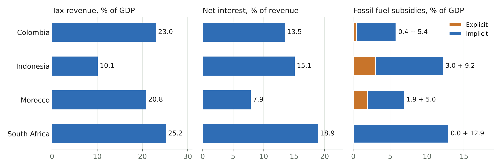

---
# GENERATED - NOT THE MASTER. Made from D Modelling/7.AdditionalAnalytics/7.2.FiscalIndicatorsDashboard/1.Presentation/Brief-FiscalIndicatorsDashboard.qmd by build_web_papers.py
# on every compile; edits here are lost. Edit the master instead.
title: "A Global Fiscal Indicators Dashboard for Climate-Fiscal Analysis"
subtitle: "Find the binding constraint before choosing the climate-fiscal lever"
series: "Climate Fiscal Policy Brief No. 7.2"
version: "1.0"
author:
  - name: "Stephen J. Stretton"
    note: "Writing in a personal capacity."
date: "October 2026"
abstract: |
  Climate-fiscal advice often starts from whichever number was easiest to find. The Global Fiscal Indicators dashboard puts the numbers that matter on one page for 217 economies: 80 public indicators in twelve blocks, each answering one question, scored 1 to 10, with the year and source of every value. Four middle-income economies show the payoff: Indonesia has a revenue problem and costly fuel subsidies, South Africa a debt-service problem and large unpriced pollution. A check against the IMF's own files confirms most values and finds three compilation faults. Ministries and development banks should use such profiles to choose the next question, and should publish the builds behind them.
keywords: [fiscal space, energy subsidies, public investment, climate finance, fiscal indicators]
bibliography: Brief-FiscalIndicatorsDashboard.bib
csl: ../../../chicago-author-date.csl
toc: true
date-format: "MMMM YYYY"
citations-hover: true
crossrefs-hover: true
lightbox: auto
---

*Climate Fiscal Policy Brief No. 7.2, October 2026. Stephen J. Stretton, writing in a personal capacity. The views expressed are the author's own and do not represent those of any institution with which he is or has been affiliated. The full account, with the build rules, the scoring, the check against the publishers and the sources, is in the [working paper](working-paper.qmd).*

# Key messages {#sec-key-messages}

[**Read the full working paper →**](working-paper.qmd) · [Slides (pptx)](../../../papers/Slides-FiscalIndicatorsDashboard.pptx)

**Climate-fiscal advice often fixes on the wrong constraint because the right numbers take days to gather.** Debt, tax, capital spending, the cost of capital, fuel subsidies and the power mix sit in a dozen databases with different names, units and years.

**One page can show them all, for 217 economies, with the year and source of every number.** The Global Fiscal Indicators dashboard arranges 80 public indicators in twelve blocks, each answering one question, and scores each from 1 to 10.

**The profile separates problems that call for different levers.** Indonesia collects tax of only 10 percent of GDP and spends 3 percent on explicit fuel subsidies; South Africa collects 25 percent but pays 19 percent of its revenue in net interest.

**A first view is only as good as its compilation.** Checked against the IMF's own files, most values hold, but three faults appear: a mislabeled interest measure, a denominator that reverses a reading, and a modeled renewable share far from observed generation.

**Use the profile to choose the next question, not to issue a verdict, and publish the build.** The next step for the tool is a carbon-pricing block.

# Advice goes wrong when the first number found frames the problem {#sec-problem}

**Before advising on carbon pricing, subsidy reform or climate investment, an adviser needs to know which constraint binds.** A country that cannot raise revenue needs different help from one that raises plenty but spends a fifth of it on interest, or one that has money but cannot execute capital budgets. Each calls for a different climate-fiscal lever: broaden the tax base, reform subsidies, price pollution, or fix public investment before scaling it.

**The numbers that reveal the constraint are scattered.** Debt and interest are in the IMF's World Economic Outlook, taxes in the IMF's revenue database, fuel subsidies in the IMF's subsidy estimates, capital budget execution in World Bank budget data, public investment management in PEFA assessments, and the cost of capital in academic datasets [@IMFWEO; @IMFWoRLD; @Black2025FFS]. Assembling them takes a day for one country and a week for a region, and the next analyst starts again.

**Each existing database answers one part of the question.** The cross-country fiscal space database measures debt sustainability and market access for up to 200 countries [@Kose2022FiscalSpace]. The IMF's Climate Change Indicators Dashboard brings climate indicators onto one platform [@IMFCCID]. Neither puts fiscal space, the capacity to spend, the cost of capital and the energy-fiscal position side by side.

# Twelve questions on one page {#sec-dashboard}

**The dashboard is organized around the questions an adviser asks, not around datasets.** Four assessment blocks carry the diagnosis: can the country pay for it (fiscal space), can it build it (public investment management), what does capital cost it, and who finances it and with what risk. Three context blocks explain it: how much fossil and climate money runs through the budget, whether the country sells or buys fossil fuels, and how its power is generated. Five appendices hold reference material, such as retail energy prices and the starting point of the macro-fiscal models ([working paper, what the dashboard assembles](working-paper.qmd#sec-what)).

**Every value is traceable to a public file and a year.** A script turns about twenty public downloads into one long table, with the source file and year on every row. Nothing is filled in: a missing value stays missing, and the profile counts the gaps. The build stops if its configuration asks for an indicator the data do not supply, a rule adopted after an earlier version lost indicators without anyone noticing ([working paper, the build pipeline](working-paper.qmd#sec-build)). The build itself is not yet public; every input is.

**Scores rank each country against all others, and there is deliberately no overall index.** Each indicator is rescaled from 1 to 10 between the 5th and 95th percentile of all economies, so that a few extreme values do not squeeze everyone else into the middle. Scores of 7 and above read Good, below 4 Bad. There is no defensible way to weigh fiscal space against delivery capacity, and the standard handbook on composite indicators warns that a single index "may disguise serious failings in some dimensions" [@OECDJRC2008]. Within each block the dashboard shows a simple average, which is a reading aid only: the analyst should look at the weakest indicator and the count of missing values ([working paper, scoring](working-paper.qmd#sec-scoring)).

**The same data feed the scenario tool, so the profile and the model agree.** The Macro-Fiscal-Energy Scenario Tool, which links a climate investment program and carbon pricing to growth, revenue and debt, reads the same panel ([paper 6.5](../../../modelling/6-modular-upgrades/MacroFiscalEnergyScenarioTool/index.qmd)) [@StrettonWP65]. A correction in one reaches the other on the next build.

# Four economies, four different problems {#sec-four}

**The profile separates a revenue problem from a debt-service problem.** @tbl-four-brief shows selected indicators for Colombia, Indonesia, Morocco and South Africa in 2024, with the score each assessment indicator receives against all economies, and @fig-profiles-brief shows the main contrasts. These are illustrative readings from public data, not assessments of any country.

| Indicator, 2024 | Colombia | Indonesia | Morocco | South Africa |
|---|---:|---:|---:|---:|
| Tax revenue, % of GDP (score) | 23.0 (7.5) | 10.1 (2.9) | 20.8 (6.7) | 25.2 (8.3) |
| Gross debt, % of GDP (score) | 61.0 (6.5) | 40.2 (8.0) | 67.7 (5.9) | 76.0 (5.3) |
| Net interest, % of revenue (score) | 13.5 (5.3) | 15.1 (4.7) | 7.9 (7.3) | 18.9 (3.4) |
| Excise revenue, % of GDP | 1.06 (2023) | 1.11 | 2.00 | 2.17 (2023) |
| Explicit fossil fuel subsidies, % of GDP | 0.4 | 3.0 | 1.9 | 0.0 |
| Implicit fossil fuel subsidies, % of GDP | 5.4 | 9.2 | 5.0 | 12.9 |
| Gasoline retail price, US dollars per liter | 1.16 | 0.57 | 1.46 | 1.13 |

: Selected indicators for four economies, 2024, as compiled by the dashboard (score 1–10 against all economies; 10 is best). Subsidy shares divide the IMF's dollar estimates by WEO GDP; the IMF's own shares are somewhat lower. Sources: IMF WoRLD, WEO and fossil fuel subsidy data [@IMFWoRLD; @IMFWEO; @Black2025FFS]; working paper, Table 2. {#tbl-four-brief}

{#fig-profiles-brief width=100%}

**Indonesia's problem is revenue, and its subsidies are a large claim on it.** Its debt, 40 percent of GDP, is the lowest of the four. But it collects tax of only 10.1 percent of GDP, below the 12¾ percent that IMF research identifies as a tipping point for growth [@Gaspar2016TaxCapacity], so net interest still takes 15 percent of revenue. Explicit fuel subsidies cost 3.0 percent of GDP, about 30 percent of tax revenue, and gasoline sells for 0.57 dollars a liter, below its supply cost [@Black2025FFS]. The useful questions are about subsidy reform and the tax base, not about debt limits ([working paper, the comparison](working-paper.qmd#sec-example)).

**South Africa's problem is debt service, and its largest climate-fiscal lever is pricing pollution.** It collects the most tax of the four, 25.2 percent of GDP, but net interest takes 18.9 percent of revenue, the most of the four. It pays no explicit fuel subsidies, but its unpriced environmental costs from fossil fuels, which the IMF calls implicit subsidies, are 12.9 percent of GDP, the largest of the four; 84 percent of its electricity comes from fossil fuels [@Ember2025]. The lever is pricing those costs; the constraint is that debt service limits how much public money can go into the transition at the same time.

**Morocco and Colombia sit in between, for different reasons.** Morocco pays the least interest relative to revenue, 7.9 percent, yet spends 1.9 percent of GDP on explicit subsidies while charging the highest gasoline price of the four, so its subsidies sit on other fuels. Colombia's fiscal position is moderate, and its excises, at 1.06 percent of GDP, are as small as Indonesia's, which an excise diagnostic could examine line by line ([Brief 7.1](../../../modelling/7-analytics/ExciseFiscalDiagnostic/index.qmd)) [@StrettonWP71].

# A first view is only as good as its compilation {#sec-check}

**Checked against the IMF's own files, most values hold.** Tax revenue, net interest and the excise shares in @tbl-four-brief reproduce exactly from the IMF's revenue database and its October 2026 fiscal data. Gross debt matches for three countries; Morocco's was revised from 67.7 to 67.0 percent of GDP after the dashboard's August download ([working paper, the check](working-paper.qmd#sec-check)).

**Three faults turned up, each of a kind any compilation can carry for years.** First, the indicator the dashboard calls "interest-to-revenue" is net interest, and its filter drops the countries that earn more interest than they pay, the strongest fiscal positions. Second, the dashboard's excise measure, excises as a share of total revenue, ranks Colombia lowest of the four because its revenue is high, not because its excises are low; as a share of GDP, the measure paper 7.1 uses, Colombia's excises equal Indonesia's. Third, the renewable share of electricity the dashboard holds is a modeled series that differs from observed generation by 5 to 19 percentage points: for Colombia, 79.9 percent against 61.4 percent observed [@Ember2025].

**Subsidy shares depend on the GDP figure used.** The dashboard divides the IMF's dollar estimates by the IMF's World Economic Outlook GDP and gets 12.9 percent of GDP for South Africa's implicit subsidies; the IMF's own table says 11.9 percent [@Black2025FFS]. Both are defensible; a profile must say which it uses.

**Traceability is what made the check quick.** Because every value names its source and year, the check took an afternoon. A compilation without that record would have carried the same faults into advice and into the models that read it.

# Carbon pricing is the gap to fill first {#sec-gap}

**A climate-fiscal dashboard without carbon prices misses the main climate-fiscal lever.** The dashboard does not yet read carbon prices. Three public measures exist: explicit carbon taxes and trading prices [@WBCarbonPricing], the OECD's effective carbon rates, which add fuel excises [@OECD2023ECR], and the World Bank's total carbon price, which also nets out fuel subsidies [@Agnolucci2024TCP]. Each can be added through the dashboard's routine for new sources.

**The Total Effective Carbon Price would complete the picture.** It expresses a country's whole policy mix, including standards and feebates, as the uniform carbon tax that would cut emissions by as much ([Brief 6.1](../../../modelling/6-modular-upgrades/PolicyEquivalentCarbonPriceAndCES/index.qmd)) [@CFPB61]. Beside the fiscal blocks, it would show not only whether a country can afford the transition, but how hard its current policies already push.

# What to do {#sec-what-to-do}

**Finance ministries and development-bank country teams: start climate-fiscal work with a one-page profile, and read it for the next question.** Find the binding constraint (money, delivery, the cost of capital or financing) before choosing between subsidy reform, carbon pricing, tax measures or investment. Read the weakest indicator in each block and its year, not the block average.

**Teams that compile cross-country indicators: record the source file and year of every value, never impute, and check against the publishers.** Label derived measures by what they compute. Report ratios on the denominator the related literature uses, such as excise revenue as a share of GDP. Prefer observed series to modeled ones, and label modeled ones.

**The dashboard's owners: fix the three faults, add carbon pricing, and publish the build.** Rename the interest measure and keep net creditors; add excise revenue as a share of GDP; read the renewable share from observed generation; add explicit, effective and total carbon prices; and release the code so that anyone can rerun it ([working paper, limits](working-paper.qmd#sec-limits)).

# Related papers in this series {.unnumbered}

- [Brief 6.1](../../../modelling/6-modular-upgrades/PolicyEquivalentCarbonPriceAndCES/index.qmd): the Total Effective Carbon Price, the yardstick the carbon-pricing block should carry [@CFPB61].
- [Paper 6.5](../../../modelling/6-modular-upgrades/MacroFiscalEnergyScenarioTool/index.qmd): the Macro-Fiscal-Energy Scenario Tool, which reads the same panel [@StrettonWP65].
- [Paper 7.1](../../../modelling/7-analytics/ExciseFiscalDiagnostic/index.qmd): the Excise-Fiscal Diagnostic, which reads a country's excise schedule line by line [@StrettonWP71].
- [Brief 5.2](../../../modelling/5-modelling/CPATAIImplementation/index.qmd): rebuilding a policy model so that every number can be checked [@CFPB52].
- The [working paper](working-paper.qmd) behind this brief: the blocks and sources, the build rules, the scoring, the four-country comparison and the check against the publishers.

# Downloads {.unnumbered}

[Policy brief (docx)](../../../papers/Brief-FiscalIndicatorsDashboard.docx) · [Working paper (docx)](../../../papers/FiscalIndicatorsDashboard.docx)

# References {.unnumbered}

::: {#refs}
:::
