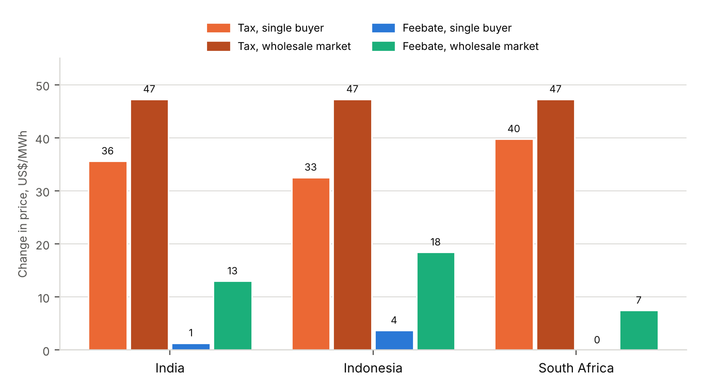

---
# GENERATED - NOT THE MASTER. Made from C Policy and FInance/1.CarbonPricing/1.2.FeebatesAndOutputBasedRebating/1.Presentation/Brief-FeebatesAndOutputBasedRebating.qmd by build_web_papers.py
# on every compile; edits here are lost. Edit the master instead.
title: "Feebates: The Full Carbon Price at the Margin, Without the Carbon Bill"
subtitle: "Decarbonizing Coal-Heavy Power and Trade-Exposed Industry"
series: "Climate Fiscal Policy Brief No. 1.2"
version: "1.1"
author:
  - name: "Stephen J. Stretton"
    note: "Writing in a personal capacity."
date: "October 2026"
abstract: |
  Carbon taxes stall where coal dominates power or industry competes abroad, because they charge producers for every tonne they still emit. A revenue-neutral feebate charges producers whose emissions per unit of output are above their sector's average and rebates those below it. It gives the same incentive to switch to cleaner plants as a tax at the same rate, at no cost to the treasury. At \$50 per tonne in India, Indonesia and South Africa, it raises regulated power tariffs by \$0–4 per megawatt-hour, against \$33–40 for a tax. In a wholesale market where coal sets the price the rise is \$7–18. The benchmark's design decides whether it works.
keywords: [feebates, output-based rebating, carbon pricing, power sector, electricity markets, benchmark design]
bibliography: Brief-FeebatesAndOutputBasedRebating.bib
csl: ../../../chicago-author-date.csl
toc: true
date-format: "MMMM YYYY"
citations-hover: true
crossrefs-hover: true
lightbox: auto
---

*Climate Fiscal Policy Brief No. 1.2, October 2026. Stephen J. Stretton, writing in a personal capacity. The views expressed are the author's own and do not represent those of any institution with which he is or has been affiliated. The full analysis, with the model, proofs and calibration, is in the [working paper](working-paper.qmd).*

# Key messages {#sec-key-messages}

[**Read the full working paper →**](working-paper.qmd) · [Slides (pptx)](../../../papers/Slides-FeebatesAndOutputBasedRebating.pptx)

**A carbon tax charges producers for every tonne they still emit, and that bill, not the incentive, is what stalls it.** In coal-heavy power and in industry that competes abroad, governments exempt the biggest emitters or keep the rate low.

**A feebate keeps the incentive and drops most of the bill.** Producers dirtier than their sector's average pay; cleaner ones are rebated. The payments cancel, the treasury neither gains nor loses, and every tonne cut is still worth the full rate.

**Power plants are run and built exactly as under a tax.** What consumers pay depends on how power is sold: almost nothing extra where a single buyer sets tariffs at average cost, and much less than a tax, but not nothing, in a wholesale market.

**The benchmark decides whether a feebate works.** It must fall as the sector cleans, cover all fuels, and measure a dominant state utility against everyone else's average.

**Coal-heavy countries should legislate a feebate at the rate they would have wanted for a tax.** Importers should credit it at the border.

# A carbon tax charges for the whole bill, not just the change {#sec-problem}

**A carbon tax sends two signals, and only one of them cuts emissions.** It makes coal dearer than gas and gas dearer than solar, so power companies run and build cleaner plants. It also charges every producer for each tonne it still emits, which raises the sector's average cost and moves that carbon bill to the treasury. The first signal is the policy. The second is a transfer, and in coal-heavy power and trade-exposed industry it decides whether the policy survives.

**In coal-heavy power the bill is enormous.** Coal is cheap per unit of energy and rich in carbon. At \$50 per tonne of CO₂, a tax adds \$4.73 per gigajoule to coal bought at \$2.50, a rise of 189 percent, using standard emission factors [@IPCC2006] and illustrative fuel prices. A tax at that rate on India's power sector would collect about \$70 billion a year from generators ([working paper, country cases](working-paper.qmd#sec-cases)).

**Concentrated losses on organized producers are the classic recipe for defeat** [@Olson1965]. Canada shows the pattern: it set its consumer fuel charge to zero from 1 April 2025 but kept output-based pricing for industry, which charges only emissions above a benchmark [@ECCC_OBPS]. Visibility matters more than true incidence: in France after the 2018–19 protests, 70 percent of households would have gained from a carbon tax with a dividend, but only 14 percent believed they would [@DouenneFabre2022].

# A feebate keeps the incentive and drops most of the bill {#sec-feebate}

**Each producer pays or receives the carbon price on the gap between its emissions per unit of output and its sector's benchmark.** A coal plant above the benchmark pays a fee on each megawatt-hour; a solar plant below it receives a rebate. With the benchmark set at the sector's average, fees pay for rebates exactly, so the treasury neither gains nor loses. A tax whose revenue is returned to producers in proportion to output, called output-based rebating, is the same instrument [@Fischer2001].

**Every tonne a producer cuts is still worth the full carbon price.** Cutting emissions per unit of output lowers a fee or raises a rebate by exactly the rate, as under a tax. What disappears is the charge on the average producer's remaining emissions. The IMF describes the instrument for power in these terms [@IMF2019] and has proposed it for industry in Mexico [@BlackEtAl2021Mexico].

**The price of the design is a weaker signal to use less of the product.** Because average costs barely rise, buyers have little reason to consume less. The IMF finds that packages of feebates and regulations achieve 50–70 percent of the emission cuts of a carbon tax with the same incentive at the margin [@IMF2019]. In power that loss is small, because demand for electricity responds little to its price in the short run, and partly welcome, because cheap clean power is what draws transport and heating away from oil and gas.

# Power plants are run and built as under a tax {#sec-power}

**A feebate and a tax at the same rate put plants in the same order of dispatch.** The benchmark shifts every plant's cost by the same amount, so the cheapest plant under a tax is the cheapest under a feebate, and coal is switched to gas at the same carbon price ([working paper, the power-sector model](working-paper.qmd#sec-model)). The UK's carbon price on generators cut power-sector emissions by 20.5–26 percent a year over 2013–2017 [@Leroutier2022]; a feebate at the same rate keeps that signal.

**The choice between new clean and new coal capacity is also the same.** The benchmark cancels when the two are compared, so a feebate steers investment as strongly as a tax. The cost of capital matters more than the choice of instrument: in the working paper's illustrative example, raising the cost of capital from 6 to 12 percent raises the carbon price at which new clean capacity beats new coal from \$8 to \$29 per tonne ([working paper, investment](working-paper.qmd#sec-investment)). Financing costs for renewables are markedly higher in developing countries [@Steffen2020], so cheaper finance complements the feebate.

**The feebate tightens by itself as the grid cleans.** As clean output grows, the average falls, so the fee on each megawatt-hour of coal rises toward the full tax without any vote to raise the rate. In the working paper's simulation starting from India's 2024 mix, the net fee on coal rises from \$11 to \$38 per megawatt-hour over 25 years at a rate of \$50.

# What consumers pay depends on how power is sold {#sec-prices}

**Where a single buyer sets tariffs at average cost, a feebate barely moves them.** Fees and rebates cancel inside the buyer's pool, so the tariff rises only by the cost of switching to cleaner plants. In 2024 generation mixes at \$50 per tonne, that is \$1.3 per megawatt-hour in India, \$3.7 in Indonesia and nothing in South Africa, which has no gas to switch to, against \$33–40 for a tax (@tbl-cases). Most power in the three countries is sold this way today: in India short-term trading was about 12.5 percent of generation in 2023–24 [@CERC2024].

**The protection depends on the buyer netting fees against rebates.** If coal generators pass their fees through their contracts while clean generators keep their rebates, the feebate's tariff effect rises to \$6–13 per megawatt-hour. The buyer, not the contracts, should collect fees and pay rebates.

**In a wholesale market where coal sets the price, a feebate raises the price by much less than a tax, but not by nothing.** Every generator is paid the price of the last plant needed. If that plant is coal, dirtier than the average, its fee is added to the price: \$7.5–18 per megawatt-hour in the three countries, against \$47 for a tax. In a market a feebate is in effect a tax whose revenue is handed back to consumers per megawatt-hour; generators earn exactly what they would under the tax ([working paper, uniform-price market](working-paper.qmd#sec-model)). South Africa legislated in 2024 for a competitive wholesale market [@ERAA2024], so this is its relevant future case.

| At \$50 per tonne of CO₂, 2024 generation mix | India | Indonesia | South Africa |
|---|---:|---:|---:|
| Coal share of generation (%) | 74.5 | 61.5 | 83.6 |
| Single buyer: rise in tariff, carbon tax (\$/MWh) | 35.6 | 32.6 | 39.8 |
| Single buyer: rise in tariff, feebate (\$/MWh) | 1.3 | 3.7 | 0.0 |
| Wholesale market, coal sets price: carbon tax (\$/MWh) | 47.3 | 47.3 | 47.3 |
| Wholesale market, coal sets price: feebate (\$/MWh) | 13.0 | 18.4 | 7.5 |
| Revenue from a carbon tax (\$ billion a year) | 69.8 | 10.7 | 9.9 |

: Price effects of a carbon tax and a revenue-neutral feebate at \$50 per tonne of CO₂. Generation mixes from Ember (2024 data); emission factors from IPCC (2006); costs illustrative. Feebate tariffs assume the buyer nets fees against rebates. Source: [working paper, country cases](working-paper.qmd#sec-cases), Table 2. {#tbl-cases}

{#fig-prices width=100%}

**Low tariffs last only if electricity's own consumption charge stays low.** The series' companion briefs pair a production feebate with a charge on what households consume ([Brief 1.1](../../../policy/1-carbon-pricing/OpenEconomyCarbonPricing/index.qmd), [Brief 1.3](../../../policy/1-carbon-pricing.qmd#paper-1-3)). Applied to electricity at the full rate, that charge would put the household price back where a tax would. The charge on electricity can rightly be set lower while the grid is coal-heavy: what matters for climate is that households choose electricity over oil and gas, which bear their own charge, and power is barely traded, so a low rate causes no leakage ([working paper, why power belongs on the production track](working-paper.qmd#sec-why-power)).

# The benchmark decides whether a feebate works {#sec-benchmark}

**The benchmark must fall as the sector cleans.** France's car feebate kept fixed thresholds while buyers moved to rebated models: sales of those models rose from 20 percent of the market to nearly 50 percent, and a scheme meant to balance cost the state about €285 million in 2008 [@DHaultfoeuille2014]. A benchmark recomputed each year from last year's average, with any shortfall carried into the next year's rebate rate, keeps the scheme in balance.

**A dominant state utility pays its fees largely to itself.** A firm with most of the market lowers the average when it cuts its own emissions, so it sees only part of the rate. Eskom, which supplies over 86 percent of South Africa's needs [@EskomInfo], would face about \$7 of a \$50 rate; NTPC, with 24 percent of India's generation [@NTPCAbout], about \$38. Measuring each large firm against the average of all the others restores the full rate. For dispatch the remedy is simpler: the system operator ranks plants by cost plus the full carbon rate ([working paper, benchmark design](working-paper.qmd#sec-benchmark)).

**One benchmark across coal and gas keeps the switching signal.** Separate benchmarks per fuel would reward efficiency within each fuel and nothing between them. In China's power-sector trading system, using three benchmarks instead of one raises the cost per tonne of reducing emissions by 18 percent [@Goulder2022]. If coal owners must be compensated, a time-limited payment tied to closures does it without blunting the signal.

**New plants should be measured against the benchmark but kept out of it for their first few years.** A large new plant then faces the full rate, its early rebates are known when it is financed, and a new coal unit cannot raise the benchmark and dilute the fee on existing coal. The cost is a small deficit while clean entrants are excluded, recovered the following year. The EU's free allocation to industry works the same way: benchmarks come from existing installations' data, and new installations draw on a reserve [@ECFreeAllocation].

# Industry: protect exporters, then add the consumption charge {#sec-industry}

**In industry a feebate removes most of the competitiveness cost of a carbon price.** In the companion working paper's calibration for hot-rolled steel at \$80 per tonne, a tax raises producer prices by 21–43 percent for most exporters, a feebate by 7–14 percent ([Brief 1.1](../../../policy/1-carbon-pricing/OpenEconomyCarbonPricing/index.qmd)). Output-based rebating captures many of the gains of a full border adjustment for key manufacturing sectors [@FischerFox2012].

**Working systems already price industry against benchmarks.** Canada's output-based pricing system charges facilities above a standard per unit of output and credits those below it [@CanadaOBPS2019]. With standards set at 80–95 percent of the average, it raises net revenue. It survived the end of the consumer charge, but in May 2026 its price path was cut from C\$170 to C\$115 per tonne in 2030 [@ICAP2026Canada]. The EU's free allocation gives each installation allowances equal to a best-performer benchmark times its output level [@ECFreeAllocation], and it is being phased out for the sectors covered by the border mechanism between 2026 and 2034 [@EU2023ETSDirective].

**Border rules do not yet credit feebates.** The EU's border mechanism deducts only a carbon price effectively paid abroad, net of rebates [@EU2025Omnibus], so the average exporter under a revenue-neutral feebate earns no deduction. Crediting the feebate at its carbon-price equivalent, the tax that would cut emissions as much, would fix this ([Brief 1.4](../../../policy/1-carbon-pricing.qmd#paper-1-4), [Brief 6.1](../../../modelling/6-modular-upgrades.qmd#paper-6-1)).

# The record supports the incentive and the benchmark warnings {#sec-evidence}

**Sweden's refunded charge on nitrogen oxides is the clearest test.** From 1992 large combustion plants paid about \$5,000 per tonne of nitrogen oxides, and almost all the revenue went back to them in proportion to the energy they produced. Mean emission rates fell about 40 percent between 1992 and 1998, at a charge level that a tax could not have reached politically [@SternerHoglund2000; @SternerIsaksson2006].

**France's car feebate and Canada's industrial system carry the warnings.** France's fixed benchmark turned a balanced scheme into a subsidy that raised total car sales, so its net effect on emissions was negative [@DHaultfoeuille2014]. Canada's rate was cut when politics turned. A benchmark that tracks the average and a rate set by published formula guard against both.

# What to do {#sec-what-to-do}

**Coal-heavy countries that sell power through a single buyer: legislate a power feebate now.** Set it at the rate you would have wanted for a carbon tax, have the buyer collect fees and pay rebates, recompute the benchmark each year by formula, measure any firm with more than about a fifth of output against the others' average, and pay for coal closures with time-limited transfers rather than separate coal benchmarks.

**Countries liberalizing their power markets: keep long-term contracts for existing plants while the feebate beds in.** A wholesale market passes the fee of the marginal coal plant to consumers; contracts that return the rents of clean generators to consumers limit it.

**All adopters: keep the consumption charge on electricity low while the grid is coal-heavy, and run the same instrument for steel, cement, aluminum and fertilizer.** Add the consumption charge on goods when the VAT system can carry it ([Brief 1.3](../../../policy/1-carbon-pricing.qmd#paper-1-3)).

**The EU and other importers: credit feebates at the border at their carbon-price equivalent.** Development banks can lend against the predictable rebates that clean entrants will earn.

# Related papers in this series {.unnumbered}

- [Climate Fiscal Policy Brief No. 1.1](../../../policy/1-carbon-pricing/OpenEconomyCarbonPricing/index.qmd): the two-track architecture, pricing production and consumption separately [@CFPB11].
- [No. 1.3](../../../policy/1-carbon-pricing.qmd#paper-1-3): a carbon component in VAT and a forward obligation on energy suppliers [@CFPB13].
- [No. 1.4](../../../policy/1-carbon-pricing.qmd#paper-1-4): carbon price recognition under the EU's border mechanism, and scrap shuffling [@CFPB14].
- [No. 6.1](../../../modelling/6-modular-upgrades.qmd#paper-6-1): the Total Effective Carbon Price, which puts a feebate on the same scale as a tax [@CFPB61].
- The [working paper](working-paper.qmd) behind this brief: the model, proofs, country cases and literature.

# Downloads {.unnumbered}

[Policy brief (docx)](../../../papers/Brief-FeebatesAndOutputBasedRebating.docx) · [Working paper (docx)](../../../papers/FeebatesAndOutputBasedRebating.docx)

# References {.unnumbered}

::: {#refs}
:::
