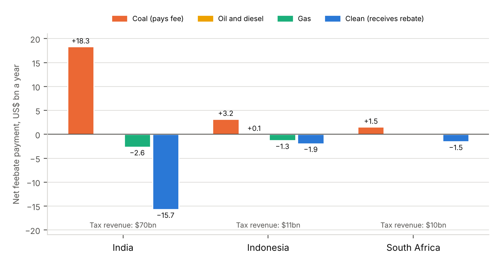

---
# GENERATED - NOT THE MASTER. Made from C Policy and FInance/1.CarbonPricing/1.2.FeebatesAndOutputBasedRebating/FeebatesAndOutputBasedRebating.qmd by build_web_papers.py
# on every compile; edits here are lost. Edit the master instead.
title: "Feebates: The Full Carbon Price at the Margin, Without the Carbon Bill"
subtitle: "Decarbonizing Coal-Heavy Power and Trade-Exposed Industry"
date: "October 2026"
version: "0.4"
abstract: |
  A carbon tax makes coal dearer than clean power, which cuts emissions, and charges producers for every tonne they still emit, which provokes the resistance that stalls it in coal-heavy countries. A revenue-neutral feebate, a fee per unit of output above a benchmark emissions intensity and a rebate below it, keeps the first effect and drops the second. I show that a feebate and a tax at the same rate produce the same merit order and the same choice between clean and coal capacity, but that what consumers pay depends on how power is priced. Where a single buyer passes average cost through, the tariff rises only by the cost of re-dispatch: about \$1 per megawatt-hour in India at \$50 per tonne, against \$36 for a tax. In a uniform-price wholesale market the price rises by \$13, because there the feebate is a tax plus a rebate to consumers. Dominant state utilities see only part of the rate unless the benchmark excludes their own output.
keywords: [feebates, output-based rebating, carbon pricing, electricity markets, coal, benchmark design]
jel: [H23, L94, Q41, Q48, Q54, Q58]
bibliography: FeebatesAndOutputBasedRebating.bib
csl: ../../../chicago-author-date.csl
number-sections: true
crossref:
  fig-prefix: Figure
  tbl-prefix: Table
  sec-prefix: Section
  eq-prefix: equation
toc: true
date-format: "MMMM YYYY"
citations-hover: true
crossrefs-hover: true
lightbox: auto
---

*Working paper, version 0.4, October 2026. The views expressed are the author's own and do not represent those of any institution with which he is or has been affiliated. A short version for policy makers is [Climate Fiscal Policy Brief No. 1.2](index.qmd).*

# Executive summary {#sec-summary}

[**Policy brief (short version) →**](index.qmd) · [Download this paper (pdf)](../../../papers/FeebatesAndOutputBasedRebating.pdf) · [Slides (pdf)](../../../papers/Slides-FeebatesAndOutputBasedRebating.pdf)

**Carbon taxes stall in coal-heavy power and trade-exposed industry because they charge producers for every tonne they still emit.** A tax does two things. It makes coal dearer than gas and gas dearer than solar, which is what cuts emissions. And it charges every producer for all its remaining emissions, which is a transfer to the treasury. In coal-heavy grids the transfer is enormous: at \$50 per tonne of CO₂, a tax nearly triples the price of coal bought at \$2.50 per gigajoule. Governments then exempt the biggest emitters or keep the rate low.

**A revenue-neutral feebate keeps the first effect and drops most of the second.** Each producer pays a fee on its emissions per unit of output above a sector benchmark and receives a rebate below it. With the benchmark at the sector average, fees pay for rebates and the treasury neither gains nor loses. Each tonne a producer cuts is still worth the full rate to it, exactly as under a tax. Output-based rebating of a carbon tax is the same instrument.

**In power, a feebate and a tax at the same rate run and build the same plants.** The order in which plants are dispatched, the switch from coal to gas, and the choice between new clean and new coal capacity are identical under the two instruments, whatever the benchmark. Financing costs matter more than the choice of instrument: in a stylized example, raising the cost of capital from 6 to 12 percent raises the carbon price at which new clean capacity beats new coal from \$8 to \$29 per tonne.

**What consumers pay depends on how electricity is priced.** Where a single buyer or a regulator sets tariffs at average cost, and nets fees against rebates, the tariff rises only by the cost of switching to cleaner plants. In 2024 generation mixes at \$50 per tonne, that is \$0–4 per megawatt-hour in India, Indonesia and South Africa, against \$33–40 for a tax. In a wholesale market where coal sets the price, the feebate raises the price by the gap between coal's intensity and the benchmark: \$7.5–18 per megawatt-hour, against \$47 for a tax. There the feebate is a tax whose revenue is returned to consumers per megawatt-hour, and generators cannot tell the two apart.

**The benchmark decides whether a feebate works.** A state utility with most of the market pays fees largely to itself: Eskom, with over 86 percent of South Africa's supply, would face about \$7 of a \$50 rate. Measuring each large firm against the average of the others restores the full rate. A benchmark that does not fall as the sector cleans turns the feebate into a net subsidy, as France's car feebate showed when it cost about €285 million in its first year. One benchmark across fuels keeps the coal-to-gas signal; one per fuel removes it.

**In industry, a feebate protects exporters at the cost of the demand signal.** In the companion paper's calibration for hot-rolled steel at \$80 per tonne, a feebate raises producer prices by 7–14 percent, against 21–43 percent for a tax. The missing signal to use less steel is supplied by a charge on consumption, which also reaches imports.

**What to do.** Coal-heavy countries that sell power through a single buyer should legislate a power feebate at the rate they would have wanted for a tax, with fees and rebates netted in the buyer's pool, a benchmark recomputed each year by formula, a leave-one-out benchmark for any firm with more than about a fifth of output, and time-limited payments for coal closures instead of separate benchmarks for coal. Importers should credit feebates at their carbon-price equivalent. The policy brief makes the case in plain terms ([Brief 1.2](index.qmd)).

# Introduction {#sec-intro}

A carbon tax at rate $t$ sends two signals, and only one of them cuts emissions. The relative-price signal makes coal dearer than gas and gas dearer than solar, so generators run and build cleaner plants. The average-cost signal charges every producer $t$ on every tonne it still emits, which raises the sector's average cost and moves the remaining carbon bill to the treasury. The first signal is the policy. The second is a transfer, and in coal-heavy power and trade-exposed industry it decides whether the policy survives. At \$50 per tonne of CO₂ a tax adds \$4.73 per gigajoule to coal priced at \$2.50, a rise of 189 percent, and \$2.81 to gas priced at \$8, a rise of 35 percent, using the default emission factors of @IPCC2006 and stylized fuel prices.

Governments respond to the average-cost signal by exempting the largest emitters or holding the rate down for everyone. Losses concentrated on a few organized producers, with benefits spread thin, are the classic recipe for successful opposition [@Olson1965]. Canada shows the pattern: it set its consumer fuel charge to zero from 1 April 2025 and kept its output-based pricing system for industry, which charges only emissions above a benchmark [@ECCC_OBPS]. What drives opposition is the visible price rise, not its true incidence. In France after the 2018–19 protests, 70 percent of households would have gained from a carbon tax with a dividend but only 14 percent believed they would [@DouenneFabre2022], and carbon pricing is more often progressive than regressive in lower-income countries [@Ohlendorf2021].

A feebate keeps the relative-price signal and drops most of the average-cost signal. A producer with emissions intensity $e_i$, in tonnes of CO₂ per unit of output, pays $t(e_i - \bar e)$ per unit, where $\bar e$ is a sector benchmark: a fee above it, a rebate below it. With $\bar e$ set at the output-weighted average, fees fund rebates and the treasury neither gains nor pays. Each tonne avoided is still worth $t$ to the producer. Output-based rebating of a carbon tax, a tax whose revenue is returned per unit of output, is the same instrument seen from the tax side [@Fischer2001; @SternerHoglund2000], and the IMF describes it for power as a fee or rebate in proportion to output times the gap between a generator's emission rate and the industry average [@IMF2019], and has proposed the same formula for industry in Mexico [@BlackEtAl2021Mexico]. The price of the design is the lost signal to use less of the product: the IMF puts feebate and regulation packages at 50–70 percent of the emission cuts of a tax at the same marginal incentive [@IMF2019].

This paper asks when a feebate actually keeps power cheap, and what it does to dispatch, investment, retirement and the incentives of dominant state utilities. The answer to the first question depends on how electricity is priced. Where a single buyer or a cost-of-service regulator passes average cost to consumers, a feebate raises the tariff only by the resource cost of re-dispatch. Where a uniform-price wholesale market sets the price at the marginal plant's cost, the feebate is a carbon tax plus a rebate of $t\bar e$ per megawatt-hour to consumers, and the price rises by $t(e_m - \bar e)$, where $e_m$ is the marginal plant's intensity.

The paper makes four contributions.

1. **A market-design result** (@sec-model). A feebate and a tax at the same rate give the same dispatch when generators take the benchmark as given or the system operator dispatches on cost plus the carbon rate (Proposition 1). Under a single buyer the tariff rises by the resource cost of re-dispatch, bounded by $t$ times the fall in average intensity (Proposition 2). In a uniform-price market every generator earns exactly the margin it would earn under the tax, and consumers pay $t\bar e$ per megawatt-hour less than under the tax but $t(e_m - \bar e)$ more than with no policy (Proposition 3). That rate-based allocation keeps electricity prices lower than auctioning or grandfathering is known from simulations [@BurtrawEtAl2001; @Goulder2022]; what is new is the exact decomposition and the condition on market design. This is the power-sector form of the sign condition in the companion paper on the two-track architecture [@AuthorWP11].
2. **Investment and retirement** (@sec-investment). In a logit model of the choice between clean and coal capacity, the benchmark cancels and a feebate gives the same clean share as a tax (Proposition 4). Financing costs move the switching price more than the choice of instrument: in a stylized example, raising the cost of capital from 6 to 12 percent raises the carbon price at which clean and coal break even from \$8 to \$29 per tonne. Where generators bear fees under fixed-price contracts, the feebate works relative to a tax like an output subsidy of $t\bar e$ that can extend coal plant lives.
3. **Benchmark dynamics** (@sec-benchmark). A firm with output share $s_i$ faces a marginal incentive of $t(1 - s_i)$ per tonne when the benchmark is the current average (Proposition 5). That is \$38 of a \$50 rate for India's NTPC, with 24 percent of national generation, and \$7 for South Africa's Eskom, with over 86 percent. A benchmark that leaves out the firm's own output restores the full rate. @Fischer2011 showed that output-based refunding weakens the incentives of firms with large market shares; this paper adds the effect of the benchmark's timing, the leave-one-out repair and its fiscal cost, and the calibration to two state utilities. Gaming the benchmark never pays once the scheme is running (Proposition 6), and excluding new entrants' output from the benchmark for an initial period gives large entrants the full rate, at a fiscal cost.
4. **Calibrated cases** (@sec-cases). With 2024 generation mixes for India, Indonesia and South Africa [@Ember2025] and stylized costs, a \$50 feebate raises the single-buyer tariff by \$0–4 per megawatt-hour, against \$33–40 for a tax, and the wholesale price in a market with coal at the margin by \$7–18, against \$47.

The paper sits on the production track of the series [@AuthorWP11; @CFPB11]. Generation is priced on the production track by the feebate; electricity sold to final users bears the consumption-track price on its generation carbon, through a carbon component of VAT where one exists and a supplier obligation where it does not, net of any carbon price paid upstream, which under a revenue-neutral feebate is zero on average [@CFPB13]. @sec-why-power explains why power belongs on the production track even though it is barely traded, and why the consumption rate on electricity can be set below the feebate rate. The border treatment of feebates is in @CFPB14 and their measurement as carbon-price equivalents in @CFPB61.

# Related literature {#sec-literature}

The paper draws on seven strands of work, reviewed in Appendix A.

*Intensity-based instruments.* A tradable performance standard, an emissions tax with output-based rebates and output-based allocation of permits are formally the same instrument: a tax on emissions plus a subsidy to output [@Fischer2001]. Each shifts abatement from cutting output to cutting intensity and keeps output prices below the first-best, so reaching a given emissions target needs a higher rate than a tax [@FischerFox2007; @HagemHoelSterner2020; @BoehringerFischerRivers2022]. With steep supply of the dirty good or a lenient benchmark, an intensity standard can raise emissions [@HollandHughesKnittel2009]. Against that, in concentrated, trade-exposed industries the output subsidy offsets market power and leakage, and combining an emissions charge with output-based rebates welfare-dominates a pure tax in a dynamic model of US cement [@FowlieReguantRyan2016].

*Rate-based regulation of power.* The closest precedent for this paper's market-design result is a simulation of the US power sector in which a generation performance standard, an updating output-based allocation of allowances, gives the lowest electricity price of three allocation rules, against grandfathering and an auction, at a higher overall cost [@BurtrawEtAl2001]. China's national emissions trading system is a tradable performance standard for power. In a matched analytical and numerical model it costs about 47 percent more than cap and trade for the same cut, and using three benchmarks instead of one adds about 18 percent; in its favor, it raises electricity prices less [@Goulder2022; @PizerZhang2018]. Simulations of the US Clean Power Plan find that rate standards give consumers lower prices than caps, and that uncoordinated rate standards across interconnected states scramble the merit order [@BushnellHollandHughesKnittel2017]. A price-based feebate avoids the credit-price volatility of a tradable standard [@WangPizerMunnings2021].

*Pass-through in electricity markets.* In uniform-price markets, carbon costs pass almost fully into wholesale prices, because demand is inelastic and firms have little reason to adjust markups [@FabraReguant2014; @Hintermann2016]. Estimated pass-through in Germany and the Netherlands was 60–100 percent, depending on the intensity of the marginal unit, and free allocation produced windfall profits [@SijmNeuhoffChen2006]. These results imply that a feebate's price effect in a market depends on the marginal plant, which the feebate literature has not drawn out.

*Carbon prices, coal and capital turnover.* The UK's Carbon Price Support, a top-up tax on generators, cut power emissions by 20.5–26 percent a year over 2013–2017 [@Leroutier2022] and by 26 percent in three years [@Gugler2023], through coal-to-gas switching and the closure of high-emitting plants [@Gugler2021]. Retirement responds less: a \$51 carbon tax brings forward US coal retirements by about two years, and a \$20 per megawatt-hour subsidy extends lives by six [@DavisHolladaySims2022]. Paris-consistent pathways need coal units to retire at about 35 years for well below 2°C and 20 years for 1.5°C [@Cui2019], and existing energy infrastructure would emit about 658 GtCO₂ if run as in the past [@Tong2019].

*Feebates against standards.* Where the alternative to a feebate is a performance standard rather than a tax, the feebate usually wins. Simulations of France and the United States that hold environmental benefit and revenue fixed find that fuel-economy standards cost up to 1.7 times as much welfare as a feebate, though a tradable standard beats both [@DurrmeyerSamano2018]. Rebating designs that reward reductions in intensity rather than output deliver deeper sectoral cuts at a given price, at the cost of unequal marginal abatement costs across firms [@BoehringerFischerRivers2022]. A power feebate in a developing country is more often an alternative to doing nothing, or to an exemption, than to a tax, and that comparison favors it more.

*Capital and financing.* Investment models of the energy transition put the choice of new capital at the center, because most abatement comes from what replaces retiring plant rather than from how existing plant is run. A logit share of clean investment driven by the levelized cost gap, a vintage capital stock and a learning curve reproduce the S-shaped adoption paths seen in power [@AuthorToyModel]. In that framework every instrument acts through the cost gap, and financing costs enter through the annuity factor on capital, which is why the cost of capital, significantly higher in developing than industrialized countries [@Steffen2020], matters as much as the carbon price.

*Feebates in practice and political economy.* Sweden's refunded charge on nitrogen oxides [@SternerHoglund2000; @SternerIsaksson2006], France's car bonus-malus [@DHaultfoeuille2014; @Durrmeyer2022] and Canada's output-based pricing system [@CanadaOBPS2019] are reviewed in @sec-evidence. Survey evidence across 20 countries finds that support for climate policy depends on perceived effectiveness, effects on poorer households and own cost [@Dechezlepretre2025].

*What is new.* The theory of output-based rebating is settled, and the direction of its price effect in power is known [@BurtrawEtAl2001; @Goulder2022]; so is the weaker incentive of firms with large market shares under output-based refunding [@Fischer2011]. This paper adds four things. It shows that the feebate's price effect depends on market design and gives the exact condition. It shows that in a uniform-price market a feebate is a tax plus a per-megawatt-hour consumer rebate, so generators' incentives, including those for investment and retirement, are identical to the tax's. It shows how the timing of the benchmark changes the incentive of dominant firms, how a leave-one-out benchmark repairs it and what the repair costs. And it calibrates the results to three coal-heavy grids.

# Why power belongs on the production track {#sec-why-power}

The case for a feebate in industry is trade: a tax raises the cost of exports and spares imports [@AuthorWP11]. Electricity is barely traded across most borders, so that case does not carry over. The case for a feebate in power rests on two other things: capital turnover and household prices.

**Capital turnover.** Most of the abatement in coal-heavy grids comes from what replaces retiring coal plant, not from how existing plant is run, and the investment decision responds to the gap between the levelized costs of clean and coal capacity. A feebate gives that gap the full carbon rate, exactly as a tax does (Proposition 4), while the fees of coal plants pay the rebates of their clean replacements. As the grid cleans, the benchmark falls and the net fee on coal rises toward the full tax without a new vote (@sec-benchmark). The instrument therefore starts where the politics allow and tightens as the capital stock turns over.

**Household prices.** Under a single buyer that nets fees against rebates, a feebate leaves the tariff almost unchanged (Proposition 2). That matters because electricity is the clean carrier for transport and heating: its share of global final energy rises from 20 percent in 2020 to about 50 percent in 2050 in the International Energy Agency's net-zero pathway [@IEA2021]. A tax that raises tariffs by \$33–40 per megawatt-hour (@sec-cases) makes the clean carrier dearer just when households choose between electric and fossil vehicles and heating.

**The consumption rate on electricity can be set below the feebate rate.** The two-track architecture charges what is consumed at home as well as what is produced [@AuthorWP11]. If electricity sold to final users bore the consumption-track charge at the feebate rate, the two together would restore the tax's household price: the tariff would rise by the re-dispatch cost plus $t\bar e$ under a single buyer, and the market price by $t e_m$, which is the equivalence result of the two-track paper applied to power. The household-price case for a feebate therefore holds only if the consumption rate on electricity is lower than the production rate, at least while the grid is coal-heavy. There is a good reason to set it lower. The consumption charge exists to make buyers use less carbon; for electricity the choice that matters is between electricity and the fossil fuels it replaces, which bear their own consumption-track obligation [@CFPB13]. A low consumption rate on electricity, rising as the grid cleans, keeps that relative price in favor of electrification, and because power is barely traded it creates no leakage.

# A power-sector model {#sec-model}

**Plants.** A power system has plants $j = 1, \dots, J$ with capacity $K_j$, constant variable cost $c_j$ (\$ per MWh) and emissions intensity $e_j$ (tCO₂ per MWh). Types are coal, gas, oil and clean (renewables, hydro and nuclear, with $e_j = 0$). Demand $D$ is fixed in the short run. Plants are dispatched in merit order, from the lowest declared cost up, until demand is met; plant $m$ is the marginal plant. Output is $q_j$, and $\sum_j q_j = D$.

**Instruments.** A carbon tax at rate $t$ charges each plant $t e_j$ per MWh. A feebate at rate $t$ charges
$$
f_j = t\,(e_j - \bar e), \qquad \bar e = \frac{\sum_j q_j e_j}{D},
$$ {#eq-feebate}
so that $\sum_j q_j f_j = 0$: coal pays, clean plants receive. @sec-benchmark relaxes the assumption that $\bar e$ is the current realized average.

**Two market designs.** In design (a), a *single buyer*, a state utility or a regulator buys all output, pays each generator its cost plus its net feebate payment, and sets the consumer tariff at average cost. This describes vertically integrated utilities, cost-of-service regulation and single-buyer systems with long-term power purchase agreements. In design (b), a *uniform-price wholesale market*, every generator receives the bid of the marginal plant, and competitive generators bid their variable cost plus their carbon payment. Real systems mix the two; the calibrated cases in @sec-cases report both.

**Proposition 1 (dispatch).** *For given demand, and provided each generator takes the benchmark as given or the system operator dispatches plants on $c_j + t e_j$, a feebate and a carbon tax at the same rate produce the same merit order, the same dispatch and the same marginal plant, whatever the level of the benchmark.*

A plant's declared cost is $c_j + t e_j$ under the tax and $c_j + t e_j - t\bar e$ under the feebate. The benchmark term is the same for every plant, so the ranking does not change. The condition matters for large firms. A firm with share $s_i$ of output that allows for its own effect on a current-average benchmark sees one more MWh from its plant $j$, added to total output, cost $c_j + t(1 - s_i)(e_j - \bar e)$, so the carbon spread it bids is scaled down by $1 - s_i$ (Appendix B); this is the dispatch side of Proposition 5. Where a system operator or single buyer dispatches on formula costs, as in most coal-heavy systems, the condition holds by construction. Two consequences follow. The coal-to-gas switch happens at the same rate under both instruments: with the stylized costs of @tbl-params, gas overtakes coal at \$43 per tonne. And the system operator can implement the switch even where money nets out inside one firm, by ranking plants on $c_j + t e_j$. The result needs a single benchmark across all plants; @sec-benchmark shows what fuel-specific benchmarks do instead.

**Proposition 2 (single buyer).** *Under design (a), with $\bar e$ equal to the realized average, the consumer tariff rises by*
$$
R(t) = \frac{1}{D}\sum_j \big(q_j(t) - q_j(0)\big)\,c_j, \qquad 0 \le R(t) \le t\,\big(\bar e_0 - \bar e_t\big),
$$ {#eq-tariff}
*the resource cost of re-dispatch, where $\bar e_0$ and $\bar e_t$ are average intensities before and after. A carbon tax at the same rate raises the tariff by $R(t) + t\,\bar e_t$.*

The difference between the instruments is $t\bar e_t$ per MWh, the tax on the emissions that remain: the infra-marginal carbon bill. The upper bound says that no plant is moved up the merit order at a cost per tonne above $t$, so the system never spends more than $t$ times the tonnes it abates. In India's grid at \$50 the bound is \$1.54 per MWh, and the stylized re-dispatch costs \$1.33 (@sec-cases). Before any re-dispatch the tariff does not move at all.

The single-buyer result has a condition that matters in practice: the buyer must net fees and rebates in the tariff. Suppose instead that coal generators pass their fees to the buyer under cost-plus contracts, while clean generators on fixed-price contracts keep their rebates.

**Corollary 1 (fees passed through, rebates kept).** *If generators with $e_j > \bar e$ pass their fees to the tariff and the others keep their rebates, the tariff rises by $R(t) + t\sum_{j:\, e_j > \bar e} s_j\,(e_j - \bar e)$, where $s_j = q_j/D$.*

In India at \$50 that is \$10.3 per MWh instead of \$1.3. A single buyer protects consumers only if it collects the fees and pays the rebates itself, so that the pool, not the contracts, carries the transfer. New clean capacity procured by auction is the easy case: bidders anticipate the rebate and bid lower tariffs, so consumers capture it. Existing fixed-price contracts are the hard case, and @sec-benchmark returns to them.

**Proposition 3 (uniform-price market).** *Under design (b), let $m$ be the marginal plant under either instrument (Proposition 1). Then:*

*(i) the wholesale price is $p_F = p_T - t\bar e$, where $p_T = c_m + t e_m$ is the price under the tax; relative to no policy,*
$$
\Delta p_F = \big(c_{m(t)} - c_{m(0)}\big) + t\,\big(e_{m(t)} - \bar e_t\big);
$$ {#eq-wholesale}

*(ii) every generator's operating margin is the same as under the tax: $p - c_j - (\text{carbon payment}) = c_m - c_j + t(e_m - e_j)$;*

*(iii) consumers' extra spending, $D\,\Delta p_F$, equals the rise in generators' surplus plus the resource cost of re-dispatch.*

Part (i) qualifies the common claim that a revenue-neutral feebate leaves power prices unchanged. If the marginal plant is coal, dirtier than the benchmark, the feebate raises the wholesale price by $t(e_{\text{coal}} - \bar e)$ even though net feebate payments sum to zero. If the marginal plant is cleaner than the benchmark, as gas is in a coal-heavy grid, the price falls. This is the power-sector form of the sign condition in the two-track paper, where sector output falls under a feebate if and only if the price-setting producer's net payment plus its abatement cost is positive [@AuthorWP11, Proposition 5]. With inelastic demand the sign governs prices rather than output.

Part (ii) says that in a market the feebate is a carbon tax plus a rebate of $t\bar e$ on every MWh consumed. Generators cannot tell the two apart: coal recovers its fee through the price when it is marginal, and an infra-marginal clean plant gains $t e_m$ per MWh under both instruments, through the price under the tax and through the price plus the rebate under the feebate. The instruments differ only in who receives $t\bar e$ per MWh: the treasury under the tax, consumers under the feebate. Refunding a tax's revenue to consumers per kWh, the "simple output-based rebating" variant of the earlier version of this paper [@AuthorV02], is therefore the same instrument in a market.

The consequence for households is the qualification the brief needs. Under a single buyer that nets the pool, the feebate protects household tariffs almost completely. In a market it removes $t\bar e$ of the tax's price rise and leaves $t(e_m - \bar e)$. The near-full pass-through found in liberalized markets [@FabraReguant2014; @Hintermann2016] means that this residual reaches consumers. A market can protect households further only by capturing the infra-marginal rent, for example through two-way contracts for difference with clean generators, whose payments to the counterparty rise with the wholesale price.

A stylized grid makes the two designs concrete: 60 percent coal at 0.946 tCO₂ per MWh, 20 percent gas at 0.365 and 20 percent solar, so that $\bar e = 0.64$. At \$50 per tonne, coal pays a net fee of \$15 per MWh, gas receives \$14 and solar \$32. Under a single buyer that nets the pool the tariff does not move before re-dispatch, against \$32 under a tax. In a market where coal sets the price, the wholesale price rises by exactly coal's net fee, \$15, against \$47 under a tax, and solar's margin rises by \$47 under both instruments: \$15 through the price and \$32 through the rebate.

Most real systems sit between the designs. If a share $\alpha$ of energy is bought at the marginal price and the rest under cost-based contracts that net the pool, the average price paid rises by about $\alpha\,t(e_m - \bar e) + (1 - \alpha)R(t)$. The share $\alpha$ is therefore a policy variable: a government that wants the feebate to protect consumers can keep long-term contracts for existing plants while it reforms the market, or can pair liberalization with contracts that return infra-marginal rents to consumers.

Carbon pricing also changes which plant is marginal in a coal-heavy grid. Before any policy, coal is cheaper than gas and gas sets the price only at peak. Once gas overtakes coal in the merit order, at \$43 per tonne with stylized costs, coal moves to the margin in more hours, and the feebate's price effect $t(e_{\text{coal}} - \bar e)$ applies in more hours. Proposition 3 therefore bites harder as the rate rises past the switching price.

# Investment, retirement and capital turnover {#sec-investment}

Dispatch is the smaller part of the transition in the grids this paper is about. The UK's carbon price worked fast because idle gas capacity could replace coal at once [@Leroutier2022; @Gugler2021]. India has little gas generation, 2.8 percent of output in 2024, and South Africa none [@Ember2025]. There the switch is from coal to new renewables, storage and transmission, which needs capital. This section models the investment choice following the toy model of @AuthorToyModel.

**The investment share.** Let a share $\varphi$ of new capacity be clean and $1 - \varphi$ be coal, with
$$
\varphi = \frac{1}{1 + \exp(\beta\,\Delta)}, \qquad \Delta = \big(L_C(r) + \text{payment}_C\big) - \big(L_D(r) + \text{payment}_D\big),
$$ {#eq-logit}
where $L_C(r)$ and $L_D(r)$ are the levelized costs of clean and coal generation at financing cost $r$, and the payments are the carbon charges per MWh. The parameter $\beta$ measures how sharply investors respond to the cost gap: a high $\beta$ means a switch near cost parity, a low $\beta$ a gradual transition reflecting heterogeneous sites, grid constraints and preferences. For a binary clean-or-dirty choice the logit gives nearly the same shares as a constant-elasticity-of-substitution model and is easier to read [@AuthorToyModel]. Levelized cost is $L(r) = K\,a(r)/(8.76\,\text{CF}) + v$, with overnight cost $K$ (\$ per kW), annuity factor $a(r)$, capacity factor CF and variable cost $v$.

**Proposition 4 (investment).** *For any common benchmark path, the cost gap $\Delta$, and therefore the clean share $\varphi$, is the same under a feebate and a tax at the same expected rate: $\Delta = L_C - L_D - t\,(e_D - e_C)$. In a uniform-price market, expected operating margins are also identical (Proposition 3(ii)), so the instruments give the same incentives for entry and exit. Under a single buyer the result holds when procurement ranks offers on cost plus the feebate payment.*

The benchmark enters both technologies' costs with the same sign and size, so it cancels. The feebate does not need a higher rate to steer new investment, only to match the tax's demand response.

@fig-logit shows the clean share of new capacity against the carbon price with stylized costs (@tbl-params). Financing costs matter more than the instrument. At a 6 percent cost of capital, clean and coal break even at \$8 per tonne; at 12 percent, at \$29. At \$50 the clean share is 88 percent at 6 percent financing and 73 percent at 12 percent. The cost of capital for renewable projects is significantly higher in developing than in industrialized countries [@Steffen2020], so instruments that lower it, such as guarantees and concessional lending, complement the feebate rather than substitute for it.

{#fig-logit width=95%}

**The rebate stream.** A clean entrant's rebate per MWh is $t\bar e_\tau$ in year $\tau$, and it falls as the grid cleans. A tax gives a clean entrant in a market the same total margin (Proposition 3(ii)); a feebate gives it partly as a rebate whose path depends on the benchmark. Under a single buyer with auctions, an entrant bids against the expected rebate path, so uncertainty about that path raises bids. A published benchmark formula reduces the uncertainty. Development banks can go further and lend against the predictable rebate stream, which the earlier version of this paper proposed as bringing future rebates forward to pay for replacement capacity [@AuthorV02].

**Retirement.** In a uniform-price market a feebate neither extends nor shortens coal plant lives relative to a tax, because every plant's margin is the same under both (Proposition 3(ii)). Only the demand response differs: lower prices under the feebate raise consumption a little and keep coal running a little more. Where generators sell under fixed-price contracts and bear their carbon payments themselves, the result changes. A coal plant then pays $t(e_{\text{coal}} - \bar e)$ per MWh instead of $t e_{\text{coal}}$, so relative to a tax the feebate is an output subsidy of $t\bar e$ per MWh: \$34 in India at \$50. In a retirement model estimated on US coal units, a \$20 per MWh subsidy extends the average unit's life by six years, and a \$51 tax brings retirement forward by only two [@DavisHolladaySims2022]. Relative to no policy, the Indian coal plant still pays \$13 per MWh net, about a quarter of the tax.

Three safeguards follow. First, the benchmark must fall: as clean output grows, $\bar e$ falls and the net fee on coal rises toward the full tax, from \$11 to \$38 per MWh over 25 years in the stylized simulation of @fig-dynamics. Second, compensation for stranded coal should be a time-limited transfer paid on closure, not a fuel-specific benchmark that shelters coal output (@sec-benchmark). Third, no new unabated coal capacity should be added, because each new unit locks in decades of emissions: plants under construction cut the Paris-consistent lifetime of existing units by a further five years [@Cui2019]. For fleets built recently, Paris-consistent schedules imply early retirement and the losses that a closure-linked transfer is meant to cover.

**Capital turnover.** The clean share of the operating stock evolves as $S^C_\tau = (1 - d_C) S^C_{\tau-1} + \varphi_\tau I_\tau$, with retirement rate $d_C$ and new investment $I_\tau$ equal to demand growth plus replacement [@AuthorToyModel]. In a stylized simulation starting from India's 2024 mix, with 5 percent demand growth, an 8 percent cost of capital, a \$50 rate and clean capital costs falling 2 percent a year, the clean share of generation rises from 23 percent in 2024 to 58 percent in 2034 and 81 percent in 2049. The benchmark falls from 0.73 to 0.18 tCO₂ per MWh. The simulation is an illustration of the mechanism, not a forecast; it omits grid integration costs, which rise with the clean share.

# Benchmark design and dynamics {#sec-benchmark}

The benchmark is where a feebate is won or lost. France's car feebate shows what happens when it does not move: buyers shifted toward rebated cars, and a scheme calibrated to be budget-neutral cost the state about €285 million in 2008 [@DHaultfoeuille2014]. This section derives how an updating benchmark changes incentives, and how to design one.

**Updating and the dominant firm.** If the benchmark is the current realized average, a firm's own cut lowers the benchmark it is measured against. Let firm $i$ own a set of plants with output $q_i$ and emissions $E_i = e_i q_i$, and let its share of sector output be $s_i = q_i/D$.

**Proposition 5 (dominant firm).** *(i) With $\bar e$ the current output-weighted average, firm $i$'s net payment falls by $t(1 - s_i)$ per tonne of its own emissions cut at given output. (ii) With $\bar e$ equal to last year's average and discount factor $\delta$, a permanent cut is worth $t(1 - \delta s_i)$ per tonne per year. (iii) A leave-one-out benchmark $\bar e_{-i}$, the average of all other firms, restores the full incentive $t$, and is equivalent to scaling firm $i$'s rate to $t/(1 - s_i)$ against the ordinary average, since $e_i - \bar e_{-i} = (e_i - \bar e)/(1 - s_i)$.*

The result is the benchmark form of a finding by @Fischer2011, that output-based refunding weakens the incentive of firms with large market shares and drives their marginal abatement costs apart. The derivation is short. Firm $i$ pays $F_i = t(e_i - \bar e)q_i$. Cutting its emissions by one tonne lowers $e_i q_i$ by one and $\bar e$ by $1/D$, so $F_i$ falls by $t - t q_i/D = t(1 - s_i)$. A small firm sees the full rate. A firm with half the market sees half of it, and a monopolist sees nothing, because it pays fees to itself.

@fig-dynamics (panel B) shows the size of the effect. NTPC reports a 24 percent share of India's power generation [@NTPCAbout], so at \$50 it faces \$38 per tonne. Eskom supplies over 86 percent of South Africa's needs [@EskomInfo], so it faces about \$7, or \$10 with a one-year lag. A feebate inside South Africa's power sector as currently structured would give Eskom almost no financial reason to cut emissions, though independent producers would face the full rate.

Two remedies exist, and they apply to different decisions. For dispatch, money is not needed: the system operator ranks units on $c_j + t e_j$ (Proposition 1), and Eskom's plants are then dispatched as under a tax whatever Eskom's net payment. For investment and retirement, which the firm decides, the leave-one-out benchmark of Proposition 5(iii) restores the full rate. Its cost is exact revenue neutrality: net revenue becomes $t\sum_i q_i(e_i - \bar e)/(1 - s_i)$, positive when large firms are dirtier than average, as a coal-based incumbent facing renewable independent producers would be. For Eskom the scaling is $1/(1 - 0.86) = 7.1$, so it would pay $t(e_{\text{Eskom}} - \bar e_{-\text{Eskom}})$ on all its output, close to a full tax if the other producers are mostly clean, with the proceeds funding the rebates of independent clean producers and any surplus going to the treasury. A state-owned firm whose losses the budget covers may respond weakly to any financial incentive, so for Eskom the feebate works mainly through dispatch rules and the procurement of new capacity.

**The fiscal true-up.** A benchmark set at last year's average cannot be revenue-neutral in a cleaning grid. Net payments in year $\tau$ are $tD_\tau(\bar e_\tau - \bar e_{\tau-1})$, a deficit when intensity falls. In the stylized simulation the benchmark falls by 0.02–0.04 tCO₂ per MWh a year in the first decade, so at \$50 the deficit is \$1.2–2.1 per MWh, or \$2.4–4.4 billion a year at India's 2024 output. This is France's problem in a milder form. The remedy is a true-up: carry each year's imbalance into the next year's rebate rate, which keeps the scheme neutral over two years without changing anyone's marginal incentive.

**Gaming.** A firm could raise its intensity in the base year to inflate the benchmark it will later be measured against.

**Proposition 6 (gaming).** *Under an operating scheme with a one-year lag, raising intensity by $\Delta$ in year $\tau$ costs $t\Delta q_i$ in year $\tau$ and gains $\delta t s_i \Delta q_i$ in year $\tau + 1$: a net loss of $t\Delta q_i(1 - \delta s_i)$. Inflating the benchmark pays only in a base period before the charge applies.*

Gaming is therefore a problem of the launch, not of the scheme. The rule is to fix the first benchmark from verified data for years before the policy was announced, which is the same safeguard proposed for crediting baselines in the two-track paper [@AuthorWP11].

**New entrants.** A new plant should be measured against the benchmark from its first year, but its own output can be left out of the benchmark calculation for an initial period, such as its first three years. The rule has three benefits. A large entrant cannot lower the benchmark it is measured against, so it faces the full rate $t$ rather than $t(1 - s_i)$: the leave-one-out logic of Proposition 5(iii) applied to entry. Its rebate in those years depends only on the published data of existing plants, so it is known at financial close, which is what a lender against the rebate stream needs. And a new coal unit cannot raise the benchmark and so dilute the net fee on existing coal. The rule has a cost. While a clean entrant is excluded, its rebate $t(\bar e - e_j)$ per MWh is not offset by a fall in the benchmark, so the scheme runs a deficit equal to the rate times the entrant's output times the gap, which the true-up below recovers from all output in the following year. And because the benchmark falls more slowly, the output subsidy to clean producers is larger while the exclusion lasts. In power, where demand is inelastic, that costs little. In industry, with a clean producer at the margin, it works against the sign condition of the two-track paper, under which sector output rises when the price-setting producer's net rebate exceeds its abatement cost [@AuthorWP11, Proposition 5]; there the initial period should be short. The response to that condition is the updating benchmark itself, which falls as clean output grows. The EU's emissions trading system uses a similar rule: its benchmarks are computed from the data of existing installations, and new and growing installations are allocated from a reserve against those benchmarks [@ECFreeAllocation].

**One benchmark, not one per fuel.** A benchmark per fuel, one for coal plants and another for gas, would remove the coal-to-gas signal. With fuel-specific benchmarks $\bar e_c$ and $\bar e_g$, coal's cost relative to gas becomes $c_c - c_g + t(e_c - \bar e_c) - t(e_g - \bar e_g)$, which equals $c_c - c_g$ when plants within each fuel are alike: the feebate then rewards efficiency within fuels and nothing between them. China's experience quantifies the cost: using three benchmarks instead of one raises the cost per tonne of its power-sector standard by about 18 percent [@Goulder2022]. The earlier version of this paper proposed pools by fuel type to compensate coal owners [@AuthorV02]. A time-limited transfer tied to closures does that job without blunting the signal: pay owners a fixed sum per MW retired on schedule, financed from the scheme's surplus or the budget, and end it within a few years.

**Who shares the rebate.** Rebating existing hydro and nuclear output pays a windfall that changes no decision, which is why Sweden kept nuclear plants out of its refund pool [@SternerHoglund2000]. In a single-buyer system, the buyer should collect the rebates of existing fixed-price clean contracts into the pool (Corollary 1), and pay rebates directly only to new capacity and to plants whose output responds. Excluding output from the rebate also excludes it from the benchmark, which raises $\bar e$ and lowers the market price effect $t(e_m - \bar e)$ in Proposition 3.

**Verification.** Power plants already meter fuel and output, so the data a feebate needs exist. Sweden ran its scheme at 0.2–0.3 percent of revenue and started with plants above 50 GWh a year, lowering the threshold to 25 GWh in 1996–97 [@SternerHoglund2000].

![A: net feebate charge on coal and rebate to clean generation at \$50/tCO₂ in a stylized two-technology grid starting from India's 2024 coal and clean shares, with the benchmark set at last year's average. As the clean share rises, the coal charge approaches the tax and the rebate falls. In a market with coal at the margin the coal charge equals the wholesale price effect. B: incentive per tonne for a firm with output share $s$ under a \$50 feebate: $t(1-s)$ with a current-average benchmark and $t(1 - \delta s)$ with last year's average ($\delta = 1/1.08$). Firm shares: NTPC 24 percent [@NTPCAbout], Eskom 86 percent [@EskomInfo]. Source: author's calculation, `2.Source/make_wp_figures.py`.](2.Source/figures/fig2_benchmark_dynamics.png){#fig-dynamics width=100%}

# Calibrated country cases {#sec-cases}

India, Indonesia and South Africa generate 62 to 84 percent of their electricity from coal, and together emitted about 1.9 GtCO₂ from power in 2024 on the direct-combustion basis used here. @tbl-data gives their 2024 generation mixes from @Ember2025. Intensities are computed from IPCC default emission factors and stylized heat rates: coal 0.946 tCO₂ per MWh (other bituminous coal at 10 GJ per MWh), gas 0.365 (6.5 GJ per MWh) and oil 0.741, with clean output, including bioenergy, at zero [@IPCC2006]. The resulting benchmarks, 0.66–0.80 tCO₂ per MWh, are close to Ember's own intensities of 681–718 g per kWh, which are on a lifecycle basis and include upstream methane [@Ember2025].

| | India | Indonesia | South Africa |
|---|---:|---:|---:|
| Generation, 2024 (TWh) | 2,036 | 372 | 248 |
| Coal (%) | 74.5 | 61.5 | 83.6 |
| Gas (%) | 2.8 | 18.5 | 0.0 |
| Oil and other fossil (%) | 0.2 | 1.9 | 0.8 |
| Clean (%) | 22.5 | 18.1 | 15.7 |
| Benchmark $\bar e$, direct (tCO₂/MWh) | 0.717 | 0.663 | 0.796 |
| Ember lifecycle intensity (gCO₂e/kWh) | 707 | 681 | 718 |
| Largest generator's share | NTPC 24% | n.a. | Eskom >86% |

: Generation mix and benchmark intensity, 2024. Clean includes hydro, nuclear, wind, solar, bioenergy and other renewables. Benchmark: output-weighted direct intensity with IPCC (2006) emission factors and stylized heat rates. Sources: @Ember2025 (2024 data, downloaded 29 October 2026); @IPCC2006; @NTPCAbout; @EskomInfo; author's calculation. {#tbl-data}

The cost side is stylized and common to the three countries, so that only the mix differs (@tbl-params): coal at \$30 per MWh variable cost (\$2.50 per GJ), gas at \$55 (\$8 per GJ), oil at \$155, clean at zero. Short-run re-dispatch is limited to gas capacity already installed, run up to a stylized 60 percent capacity factor, and South Africa, where Ember records no gas-fired generation, is given no gas to switch to. In all three countries most power is bought under long-term contracts by state-owned distribution companies or a single buyer at regulated tariffs, so design (a) describes today better than design (b). In India short-term transactions, including power-exchange trades, were about 12.5 percent of generation in 2023–24; the rest was sold under long-term contracts, mostly to state distribution companies [@CERC2024]. In Indonesia the state utility PLN buys the output of independent producers and sells at regulated tariffs, and the Asian Development Bank's restructuring road map moves it toward a ring-fenced single buyer, not a wholesale market [@ADB2023Indonesia]. South Africa's Electricity Regulation Amendment Act of 2024 provides for an independent transmission system operator and a market code for competitive wholesale trading [@ERAA2024], which makes design (b) the relevant future case there.

@tbl-cases and @fig-prices give the price effects at \$50 per tonne.

| \$50/tCO₂ | India | Indonesia | South Africa |
|---|---:|---:|---:|
| Coal-to-gas re-dispatch (TWh) | 108 | 55 | 0 |
| Emission cut from re-dispatch (MtCO₂; % of power) | 63 (4.3) | 32 (13.0) | 0 (0) |
| **Single buyer, change in tariff (\$/MWh)** | | | |
| Carbon tax | +35.6 | +32.6 | +39.8 |
| Feebate, pool netted (Proposition 2) | +1.3 | +3.7 | 0.0 |
| Feebate, fees passed through, rebates kept (Corollary 1) | +10.3 | +12.5 | +6.3 |
| **Wholesale market, coal marginal, change in price (\$/MWh)** | | | |
| Carbon tax | +47.3 | +47.3 | +47.3 |
| Feebate (Proposition 3) | +13.0 | +18.4 | +7.5 |
| **Annual flows (\$ billion)** | | | |
| Carbon tax revenue | 69.8 | 10.7 | 9.9 |
| Feebate: fees paid by coal | 18.3 | 3.2 | 1.5 |
| Feebate: rebates to clean | 15.7 | 1.9 | 1.5 |
| Feebate: rebates to gas | 2.6 | 1.3 | 0.0 |

: Price and fiscal effects of a carbon tax and a revenue-neutral feebate at \$50/tCO₂, 2024 mixes. Re-dispatch moves coal output to installed gas capacity up to a 60 percent capacity factor (stylized); none in South Africa. Feebate benchmark: realized average after re-dispatch. Market rows assume coal sets the price before and after the policy. Costs stylized (@tbl-params). Source: author's calculation, `2.Source/make_wp_figures.py`, which writes `2.Source/table_country_cases.csv`. {#tbl-cases}

{#fig-prices width=100%}

**Under a single buyer the feebate keeps the tariff almost flat.** The tax raises the tariff by \$33–40 per MWh, which is $t\bar e$ plus a small re-dispatch cost. The feebate raises it by the re-dispatch cost alone: \$1.3 in India, \$3.7 in Indonesia, where more gas capacity is available, and nothing in South Africa. Both instruments cut the same 63 MtCO₂ in India and 32 MtCO₂ in Indonesia through re-dispatch (Proposition 1). The protection depends on netting: if coal fees pass through to the tariff while clean plants keep their rebates, the feebate's tariff effect rises to \$6–13.

**In a market the feebate removes most, not all, of the price rise.** With coal at the margin the tax raises the wholesale price by \$47 per MWh in each country, the coal plant's full carbon cost. The feebate raises it by \$7.5 in South Africa, where the benchmark is closest to coal, \$13 in India and \$18 in Indonesia, where gas re-dispatch lowers the benchmark furthest. That is 16–39 percent of the tax's price effect. At \$100 per tonne the feebate's market effect in India doubles to \$26 per MWh, about 2.6 US cents per kWh. The earlier version of this paper computed a similar intensity gap for India but reported a 1 percent price change [@AuthorV02]; that figure holds only under the single-buyer design. In hours when gas or clean output sets the price, the feebate lowers the price: by \$16 per MWh in India when gas is marginal.

**The fiscal flows are large but self-financing.** @fig-fiscal shows who pays whom. In India at \$50, coal generators pay \$18 billion a year in fees, clean generators receive \$16 billion and gas generators \$3 billion, with the treasury out of the loop. A tax at the same rate would raise \$70 billion. The rebate to clean output is \$34 per MWh in India and \$40 in South Africa; the net fee on coal is \$13 per MWh in India, equivalent to \$1.30 per GJ of coal, 52 percent of the stylized coal price against 189 percent under the tax.

{#fig-fiscal width=100%}

**The results scale with the rate, and the gap widens.** At \$25 per tonne, below the \$43 switching price, nothing is re-dispatched, so the single-buyer feebate leaves tariffs unchanged while a tax raises them by \$17–20 per MWh; in a market the feebate adds \$4–7 against the tax's \$24. At \$100 the single-buyer effects are unchanged at \$0–4, because the gas headroom is already used, while the tax adds \$61–80; in a market the feebate adds \$15–37 against \$95. The feebate's market effect rises with the rate and with every fall in the benchmark, because $t(e_m - \bar e)$ grows as $\bar e$ falls. @fig-dynamics shows the same mechanism over time: as the clean share rises, the net fee on coal, and with it the wholesale price effect when coal is marginal, climbs toward the tax.

**The three countries call for different designs.** India's tariffs are set mostly through regulated contracts, so a netted pool would keep household tariffs almost flat, and NTPC's 24 percent share leaves it three-quarters of the rate. Indonesia has the most gas capacity to switch to and the largest dispatch response, 13 percent of power emissions at \$50, but also the largest market price effect if it liberalized, because re-dispatch lowers the benchmark furthest. South Africa has no gas to switch to, so its abatement must come through investment; its benchmark is closest to coal, so a market would see the smallest feebate price effect, \$7.5 per MWh; and Eskom's dominance means that a feebate there needs a leave-one-out benchmark or dispatch rules to bite on the incumbent at all.

**What the calibration does not show.** The cost parameters are stylized and the dispatch model is a single annual merit order, so the numbers indicate magnitudes rather than forecasts. Three simplifications matter most. Gas availability, not gas capacity, limits switching in India, so the re-dispatch there is an upper bound. Hourly variation in the marginal plant means the market effect is a weighted average of the coal-marginal and gas-marginal cases. And the cases hold demand fixed; a feebate's lower prices raise demand slightly relative to a tax, which is the output effect discussed in @sec-political.

# Trade-exposed industry {#sec-industry}

For steel, cement, aluminum and fertilizer the same instrument applies with output measured in tonnes of product. The companion two-track paper derives the results for industry [@AuthorWP11]. A feebate and a tax at the same rate induce the same intensity; under a revenue-neutral feebate the producer price rises only by the resource cost of abatement, $\tfrac12 t\Delta e$ for a linear marginal abatement cost, against $te_0 - \tfrac12 t\Delta e$ under a tax (its Proposition 3, the residual-cost result); and a feebate alone needs a higher rate than a tax to cut the same tonnes, by a premium that rises with the price elasticity of demand (its Proposition 4). In its calibration to EU default intensities for hot-rolled steel, at \$80 per tonne of CO₂, a tax raises producer prices by 21–43 percent for exporters other than Indonesia, a feebate by 7–14 percent.

The heterogeneous-firm result there is the industrial counterpart of Proposition 3 here. With a competitive fringe, the market price follows the price-setting producer, and sector output falls under a feebate only if that producer's net payment plus its abatement cost is positive [@AuthorWP11, Proposition 5]. In power, the price-setting plant is the marginal plant in the merit order and demand is inelastic, so the sign condition shows up as the price effect $t(e_m - \bar e)$. In traded industry the price is set largely on world markets, so the feebate's effect is on the home producer's margin rather than on the price.

The output subsidy that is a weakness in a closed economy is useful in an open one. In concentrated, trade-exposed industry, output-based rebating offsets market power and leakage [@FowlieReguantRyan2016], and for key US, Canadian and European manufacturing sectors it achieves many of the gains of full border adjustment [@FischerFox2012]. Rebates targeted on measured leakage risk do better than coarse targeting on intensity and trade exposure [@FowlieReguant2022]. The remaining weakness, the missing demand signal, belongs to the consumption track: output-based rebating plus a consumption charge on the same goods can replicate border carbon adjustment [@BoehringerRosendahlStorrosten2017], which is the design of @CFPB13.

**Benchmarks per product.** In industry the benchmark is set per tonne of a defined product, which raises the question of product boundaries that power does not have. One benchmark across production routes, such as blast furnace and electric arc furnace steel, preserves the incentive to switch routes, just as one benchmark across coal and gas does in power; separate benchmarks per route turn the feebate into an efficiency standard within each route. The monitoring needed already exists for exports to the EU: CBAM requires installation-level reporting of embedded emissions for cement, iron and steel, aluminum, fertilizers, hydrogen and electricity [@EU2023].

**Benchmark precedents.** Two working systems price industry against output-based benchmarks. Canada's output-based pricing system sets each facility's limit as its production times an output-based standard, charges for emissions above the limit and issues tradable credits below it [@CanadaOBPS2019]; with standards at 80–95 percent of the average it is a feebate whose benchmark sits below the average, so it raises net revenue (@sec-evidence). The EU's free allocation to industry is the other. Each product benchmark is the average intensity of the 10 percent most efficient EU installations, it falls each period at an annual rate of between 0.2 and 1.6 percent for 2021–2025, and an installation's free allowances are its benchmark times its activity level, adjusted when output moves by more than 15 percent on a two-year rolling average [@ECFreeAllocation]. Because every installation pays the full allowance price on emissions above its allocation, this is a carbon price with an output-linked rebate at a best-performer benchmark: a feebate with a benchmark well below the average, linked to recent rather than current output. Free allocation to the sectors covered by CBAM is being phased out between 2026 and 2034 [@EU2023ETSDirective], and a Commission proposal of July 2026 would extend the phase-out to 2038 [@EC2026ETSProposal]. As it goes, EU producers lose their output-linked rebate while their competitors abroad can adopt one.

**The border.** The EU's Carbon Border Adjustment Mechanism (CBAM) reduces an importer's liability for a carbon price effectively paid in the country of origin, net of rebates or other compensation [@EU2023, Art. 9]. Its amended Article 9(4) allows a default carbon price only where a carbon price was set by the rules of the exporting country, again net of rebates [@EU2025Omnibus]. Under a revenue-neutral feebate the average exporter pays nothing net, so it earns no deduction; a producer above the benchmark pays $t(e_i - \bar e)$ per tonne of product and could at most claim that.

What the exporter loses is smaller than it looks. Let the EU price be $P$ and the exporter's intensity $e$. Under a home tax at $t \le P$, the exporter pays $te$ at home and $(P - t)e$ at the border: $Pe$ in total, with $te$ kept by the home treasury. Under a home feebate, it pays about nothing at home and $Pe$ at the border: the same total, with $te$ going to the EU budget instead. The exporter is no worse off than under a tax; its country forgoes the revenue. Both instruments still lower the border charge by cutting verified embodied intensity. Recognizing the feebate at its carbon-price equivalent, the tax that would cut emissions as much, would make the border charge $(P - t)e$ and leave the home country's producers better off than under a tax by $te$ per tonne of product: \$192 per tonne of steel at \$80 and 2.4 tCO₂ per tonne. Carbon-price equivalents of this kind have been computed for the G20 [@black2022framework]; @CFPB14 and @CFPB61 propose recognition through CBAM's default carbon price methodology, which on the current text would need a broad reading of "compensation" or an amendment.

**Electricity in industrial products.** The power feebate also lowers the embodied-carbon charge on electricity-intensive exports, through the fall in grid intensity, without raising their electricity costs much under a single buyer. That is the link between the two halves of this paper: a power feebate makes the clean energy carrier cheap at the same time as it makes it clean.

# Evidence from feebates in use {#sec-evidence}

Feebates and refunded charges have run in several sectors for three decades, and their record supports both the incentive claim and the benchmark warnings. @tbl-evidence summarizes the effect sizes. The texts and abstracts available for this paper report point estimates or ranges across specifications, not confidence intervals.

| Scheme | Design | Effect | Source |
|---|---|---|---|
| Sweden NOx charge, 1992– | SEK 40/kg NOx (about \$5,000/t), refunded per unit of useful energy; about 200 plants | Mean emission rates −40% by 1998; administration 0.2–0.3% of revenue; net payers and recipients in every sector | @SternerHoglund2000 |
| | | Refund sped adoption of post-combustion abatement; best firms cut about 70%, median firms caught up | @Bonilla2015; @SternerTurnheim2009 |
| France car bonus-malus, 2008– | Rebate up to €1,000 below 130 gCO₂/km; fee up to €2,600 above 160 g | Class B share of sales 20% → nearly 50%; budget cost about €285m in 2008; total emissions effect negative because sales rose | @DHaultfoeuille2014 |
| | | Average new-car CO₂ −1.6% (structural model) | @Durrmeyer2022 |
| Canada output-based pricing, 2019– | Standards at 80/90/95% of average intensity, tightening 1–2% a year; price C\$65 (2023), C\$95 (2025–26), C\$115 (2030) under the 2026 path | Retained when the consumer charge went to zero in 2025; price path lowered in 2026; no ex-post evaluation found | @CanadaOBPS2019; @CanadaGazette2022; @ECCC_OBPS; @ICAP2026Canada |
| China national ETS (power) | Tradable performance standard, several benchmarks | Modeled cost 47% above cap and trade; three benchmarks add 18%; smaller electricity price rise | @Goulder2022 |
| UK Carbon Price Support, 2013– (a tax, for the relative-price channel) | Top-up tax on generators | Power emissions −20.5 to −26% a year, 2013–17; −26% in three years | @Leroutier2022; @Gugler2023 |

: Effect sizes from feebates, refunded charges and a generator tax. The UK scheme is a tax, included because the feebate preserves its relative-price channel (Proposition 1). {#tbl-evidence}

*Sweden.* The Swedish charge on nitrogen oxides is the clearest test of a production feebate. From 1992 large combustion plants paid 40 kronor per kilogram of NOx, and almost all the revenue was refunded in proportion to useful energy produced. Mean emission rates at the plants first covered fell 40 percent by 1998, and the authors judged that a tax at that rate would not have been politically feasible [@SternerHoglund2000; @SternerIsaksson2006]. The refund sped the adoption of post-combustion abatement [@Bonilla2015], and median plants caught up with best practice as the best cut emissions by about 70 percent [@SternerTurnheim2009]. NOx abatement is an intensity margin with little output effect, which is the setting where a feebate loses least to a tax.

*France.* The French car feebate shows both the power of the incentive and the cost of a fixed benchmark. Sales of rebated cars rose from 20 percent of the market at the end of 2007 to nearly 50 percent in early 2009, the scheme ran a deficit of about €285 million in 2008 and rebates were cut in 2010 [@DHaultfoeuille2014]. Because the scheme raised total car sales, @DHaultfoeuille2014 estimate its effect on total emissions as negative; a structural model of the same scheme finds a 1.6 percent cut in the average CO₂ emissions of new cars [@Durrmeyer2022]. A feebate whose benchmark does not track the average becomes a net output subsidy, which is why the true-up of @sec-benchmark matters.

*Canada.* Canada's output-based pricing system is a feebate tilted to raise revenue. Since 2019 facilities pay for emissions above an output-based standard set at 80, 90 or 95 percent of national production-weighted average intensity, depending on leakage risk, and earn tradable credits below it; most standards tighten by 2 percent a year from 2023 and the most exposed by 1 percent [@CanadaOBPS2019; @CanadaGazette2022]. For new gas-fired generation the standard falls from 370 tCO₂e per GWh in 2021 to zero in 2030 [@CanadaOBPS2019], a published declining path of the kind @sec-benchmark recommends. The system survived the 2025 removal of the consumer charge [@ECCC_OBPS], but not unchanged: the excess-emissions charge was to rise by C\$15 a year from C\$65 in 2023 to C\$170 in 2030, and in May 2026 the federal government cut the path for all industrial systems to C\$100 in 2027, C\$115 in 2030 and C\$130 in 2035 [@ICAP2026Canada]. Industrial pricing survived where the consumer charge did not, but its rate proved negotiable. No peer-reviewed ex-post evaluation of its emissions effect was found for this paper.

*China and India.* China's national market allocates allowances to power plants against output-based benchmarks, so it prices intensity like a feebate with a tradable credit; its modeled costs and smaller price effects [@Goulder2022; @PizerZhang2018] are summarized in @tbl-evidence. India's Perform, Achieve and Trade scheme sets tradable energy-intensity targets for large industrial consumers [@BhandariShrimali2018]; an Indian power or industrial feebate would need to say whether it replaces or sits beside it.

*The UK tax.* The UK's carbon price on generators is not a feebate, but it is the best evidence on the relative-price channel that a feebate preserves at the margin. Its effect came through coal-to-gas switching in existing plants and the closure of high-emitting units [@Leroutier2022; @Gugler2023]. Under Proposition 1 a feebate at the same rate would have produced the same dispatch, while raising wholesale prices by less, through Proposition 3.

*Three lessons.* The record supports three design rules that this paper derives formally. The benchmark must track the average, or the scheme becomes a net subsidy, as in France, or a net tax, as Canada chose deliberately. Exclusions from the rebate pool should target output that cannot respond, as Sweden did with nuclear plants, so that rebates pay for decisions rather than windfalls. And a published path for the benchmark, as Canada set for new gas-fired generation, lets investors price the rebate stream and protects the scheme from annual lobbying.

# Political economy and fiscal effects {#sec-political}

**The strongest objection to a feebate is the revenue it forgoes.** A revenue-neutral feebate costs the budget nothing, which is its political strength, and raises nothing, which is its fiscal weakness. At \$50 per tonne a carbon tax on India's power sector would raise about \$70 billion a year at 2024 output (@tbl-cases), a large sum for a government with a deficit. The answer is that a tax at that rate on coal-fired power has not been on offer in any coal-heavy developing country, and that the revenue can be built up in other ways. Three routes exist: raise it elsewhere, for example from transport fuels, where a carbon price changes prices proportionally much less than for coal (13 percent for diesel at \$1 a liter and \$50 per tonne, against 189 percent for coal, with the stylized prices used here); set the benchmark below the average, as Canada does, so the scheme raises net revenue; or lower the benchmark on a published path until, at $\bar e = 0$, the feebate is a carbon tax. The last route is the one that turns a feebate into a transition rather than a substitute: a government can start where the politics allow, with the full rate at the margin and no net charge on the average producer, and let the net charge on emitters rise as the sector cleans, as in @fig-dynamics, without a vote to raise the rate.

**The abatement penalty is the output margin.** A feebate cuts intensity as much as a tax but gives up the incentive to use less. The IMF puts feebate and regulation packages at 50–70 percent of a tax's emission cuts [@IMF2019]. In power the penalty is small in the short run, because electricity demand is inelastic, and in the long run it is partly a benefit, because cheap power speeds the move from fossil fuels to electricity in transport and heating (@sec-why-power). The consumption track restores the demand signal where it is wanted: on the fossil fuels that electricity replaces, and on electricity itself at a rate that can rise as the grid cleans [@CFPB13].

**The political case rests on visibility, not regressivity.** Carbon pricing is more often progressive than regressive in lower-income countries [@Ohlendorf2021], and within-group variation in burdens exceeds the average burden in US data [@CroninFullertonSexton2019]. The obstacle is that price rises are visible and their compensation is not: French voters who would gain from a tax and dividend mostly believed they would lose [@DouenneFabre2022]. A feebate under a single buyer avoids the visible rise in the tariff altogether. In a market it removes the part of the rise that would go to the treasury and leaves $t(e_m - \bar e)$, which falls on consumers and goes to clean generators.

**Who loses.** The feebate's losers are owners of plants dirtier than the benchmark, and their losses are smaller than under a tax: in India at \$50, coal pays \$13 per MWh net rather than \$47. Under a single buyer the losses fall on whoever bears the fees under the contracts, which the regulator can decide. The feebate shrinks the loss of the organized group that blocks carbon taxes, coal owners, to about a quarter of a tax's, and under a single buyer removes the visible loss to households. Olson's logic predicts that the first matters most [@Olson1965]. The political feasibility metric of the earlier version of this paper is documented in Appendix D.

**The legal text.** In traded goods the rebate leg needs care under the World Trade Organization's subsidy rules [@Trachtman2017]. A sector-wide, formula-based scheme, not contingent on exporting, is the design most likely to pass.

# Conclusion {#sec-conclusion}

A feebate gives the full carbon price at the margin. In power it produces the same merit order and the same choice between clean and coal capacity as a tax at the same rate, whether the benchmark is high or low. What it does to consumers depends on market design. Under a single buyer that nets fees and rebates in the tariff, the price rises only by the cost of re-dispatch, \$0–4 per MWh at \$50 per tonne in the three coal-heavy grids studied here, against \$33–40 for a tax. In a uniform-price market the feebate is a tax plus a rebate to consumers, and the price rises by the marginal plant's excess over the benchmark, \$7–18 against \$47. Dominant utilities see only $t(1 - s_i)$ of the rate unless the benchmark excludes their own output, and a feebate in a cleaning grid needs a fiscal true-up.

The open work is empirical. The calibration needs hourly dispatch data to weight the coal-marginal and gas-marginal cases, plant-level costs in place of stylized ones, and the contract terms that decide whether fees pass through. For coal-heavy countries that use a single buyer today, the recommendation is to legislate a power feebate at the rate they would have wanted for a tax, with the pool netted by the buyer, a benchmark recomputed each year by formula with a true-up, a leave-one-out benchmark for any firm above about a fifth of output, new plants' output kept out of the benchmark for their first few years, and closure-linked transfers instead of fuel-specific pools. The protection of household tariffs lasts only as long as the consumption-track rate on electricity stays below the feebate rate, which is the right choice while the grid is coal-heavy and electricity is displacing fossil fuels.

# Downloads {.unnumbered}

[Policy brief (pdf)](../../../papers/Brief-FeebatesAndOutputBasedRebating.pdf) · [Working paper (pdf)](../../../papers/FeebatesAndOutputBasedRebating.pdf)

# References {.unnumbered}

::: {#refs}
:::

# Appendix A: Literature review {.appendix .unnumbered #sec-appA}

This appendix reviews the five literatures behind the paper by theme. The status of each source (full text, abstract only or bibliographic record) is in the note field of its bibliography entry; claims are taken only from sources whose full text or abstract was read.

## A.1 Theory of intensity-based instruments {.unnumbered #sec-appA-theory}

**Output-based rebating is a tax on emissions plus a subsidy to output.** @Fischer2001 shows that a tradable performance standard, an emissions tax with market-share rebates and output-based allocation of permits are formally the same instrument. For any abatement target each shifts effort toward lower emission rates and away from output contraction. Relative to the optimum, they produce higher marginal abatement costs and lower output prices, with a welfare cost that rises with the substitutability of output and is likely much larger in the long run. Political or market-failure justifications, such as leakage and market power, can make them worthwhile, but they depend on the industry. That is the mechanism of this paper: the "no price rise" property and the forgone demand margin are the two sides of the same subsidy.

**The cost of the subsidy has been measured in several settings.** @FischerFox2007 compare permit allocation rules in a general-equilibrium model with existing tax and trade distortions: the output subsidy implicit in output-based allocation mitigates tax interactions that grandfathering does not, and allocation based on historical emissions protects heavy emitters and counters leakage at a higher welfare cost. @HagemHoelSterner2020 show that to hit the same abatement target as a tax, the fee must be higher under output-based refunding and lower under refunding based on spending on abatement equipment; both are cost-ineffective, because firms rely too much on technology relative to output reduction. @BoehringerFischerRivers2022 compare lump-sum, output-based, abatement-based and two intensity-based rebating schemes in partial equilibrium and a multisector general-equilibrium model. At a given emissions price, intensity-based rebating gives the largest intensity cuts, abatement-based rebating the largest output cuts, and output-based rebating the least pressure on output and emissions. Their intensity-based variants, which reward reductions in intensity, are the formal version of the "pay incumbents to close coal" pools of @AuthorV02.

**An intensity standard can raise emissions.** @HollandHughesKnittel2009 show for California's low carbon fuel standard that an intensity standard taxes high-carbon output and subsidizes low-carbon output, so it can raise total emissions, cannot be first-best and may lower welfare. In their US simulation of a 10 percent cut in carbon intensity, emissions are unlikely to rise, but the surplus cost is \$80–760 billion a year, an average of \$307–2,272 per tonne, against \$16–290 billion for an efficient policy reaching the same cut. A perverse increase is more likely with steep supply or demand for the dirty good and a lenient standard. For power, inelastic short-run demand limits the risk; for industry, the consumption track is the remedy.

**Large firms see less of the rate.** @Fischer2011 analyzes output-based refunding under imperfect competition. The refund can offset the tendency of firms with market power to produce too little, but when firms have large market shares it weakens their incentive to cut emissions, because part of what they pay comes back to them, and with unequal shares their marginal abatement costs diverge. In an asymmetric Cournot duopoly, refunding against the realized average gives higher output, higher emissions and higher costs than a fixed rebate at the same target intensity. Proposition 5 is the benchmark form of this result for a price-taking dominant firm, and the leave-one-out benchmark is the fixed-rebate remedy applied firm by firm.

**With market power and leakage, the output subsidy can be second-best.** @FowlieReguantRyan2016 build a dynamic structural model of the US Portland cement industry with market power, investment, entry and exit and import competition. A full carbon price worsens the market-power distortion and causes leakage, and net welfare is negative across the range of carbon values considered; designs combining an emissions charge with output-based rebates welfare-dominate a pure tax or auctioned permits. @FowlieReguant2022 derive industry-specific measures of leakage risk and show that output subsidies targeted on them cut leakage substantially, while coarse targeting on intensity and trade exposure delivers a small fraction of the benefit. @FischerFox2012 find that output-based rebating for key manufacturing sectors achieves many of the gains of border adjustment in the United States, Canada and Europe.

## A.2 Rate-based regulation of power {.unnumbered #sec-appA-rate}

**Rate-based allocation keeps power prices down.** @BurtrawEtAl2001 compare an auction, grandfathering and a generation performance standard for allocating carbon allowances in a model of the US electricity market. The performance standard, which allocates in proportion to output, gives the lowest electricity price but the highest natural gas price; the auction's social cost is about half that of the other two. Proposition 3 explains the price result exactly: an output-based allocation is a per-MWh rebate, which lowers every bid by the same amount.

**China's national market is the largest feebate-like power instrument.** It began as a tradable performance standard for power, launched in December 2017, which would more than double the global emissions covered by pricing when fully implemented [@PizerZhang2018]. @Goulder2022 model it against cap and trade. The implicit output subsidy makes it less cost-effective: low-intensity units expand output, some generators increase output, and trading equalizes marginal costs net of the subsidy rather than gross. Central-case costs are about 47 percent higher than cap and trade, and using three benchmarks instead of one raises cost per tonne by about 18 percent. In its favor, it gives smaller electricity price increases, shifting the burden from consumers to generators, and less leakage. The 18 percent is the cleanest estimate available of the cost of fuel-specific benchmarks (@sec-benchmark).

**Rate standards across connected markets must be uniform.** Under the US Clean Power Plan, states could choose rate-based or mass-based compliance. @BushnellHollandHughesKnittel2017 show that rate standards can be efficient only if the implied carbon price equals the social cost of carbon and the rate is uniform across states. In their western US simulation, state-specific caps raise average abatement cost 16 percent above a uniform cap, state-specific rate standards can nearly double it, and mixed regimes cost 17–29 percent more. Consumers prefer rate standards, which keep prices lower. For an Indian feebate the lesson is that the benchmark must cover the whole interconnected market; state-level schemes with different benchmarks would distort dispatch across state lines.

**A price-based feebate avoids credit-price risk.** @WangPizerMunnings2021 compare prices and quantities for tradable performance standards. When the coefficient of variation of the credit price exceeds about 50 percent, a price mechanism dominates; the gains from moving to one are about 60 percent for China's national market and 20 percent for California's fuel standard. A feebate with a fixed rate is that price mechanism.

## A.3 Pass-through and market design {.unnumbered #sec-appA-passthrough}

**In liberalized markets carbon costs pass through almost fully.** Using bid-level data from the Spanish wholesale market, @FabraReguant2014 find that emissions costs are almost fully passed through to electricity prices: demand is inelastic, cost shocks are common to all firms and the costs of adjusting prices are small, so firms have little incentive to change markups. @Hintermann2016, using hourly German spot prices and a constructed fossil supply curve, finds complete or nearly complete pass-through on average, varying over the load curve, and concludes there is no economic case for free allocation to power. Earlier estimates for Germany and the Netherlands put pass-through at 60–100 percent depending on the marginal unit, with substantial windfall profits under free allocation [@SijmNeuhoffChen2006].

**These results fix the feebate's price effect in a market.** A per-MWh rebate lowers every generator's bid by the same amount, so the market price moves by $t(e_m - \bar e)$ rather than by zero (Proposition 3). The literature on rate-based instruments confirms the direction, lower prices than under a cap [@Goulder2022; @BushnellHollandHughesKnittel2017], but not the near-zero effect claimed in the earlier version of this paper, which holds only under regulated average-cost tariffs.

## A.4 Carbon prices, coal retirement and capital turnover {.unnumbered #sec-appA-coal}

**Relative prices drove the UK's coal exit.** @Leroutier2022 uses a synthetic control against other European power sectors and finds that the UK's Carbon Price Support cut power emissions by 20.5–26 percent a year on average over 2013–2017, through lower intensity at existing plants, closure of high emitters and faster closure of plants already at risk under EU air-pollution rules. External validity rests on spare gas capacity, limited interconnection and no new coal investment. @Gugler2023 use discontinuities at the rate changes of 2013–2015 and hourly plant data and find a 26 percent (38.6 MtCO₂) fall in three years, as coal was pushed out and gas filled the gap; they flag leakage through imports and the EU system's waterbed. @Gugler2021 find a 55 percent fall in five years, against little decline in Germany despite heavy renewable subsidies, and conclude that a modest carbon price, about €30 per tonne, induces large, cheap abatement where cleaner gas plants can replace coal.

**Retirement timing responds weakly to prices.** @DavisHolladaySims2022 document that nearly a third of the US coal fleet retired in the 2010s and predict that three-quarters of remaining capacity retires within twenty years. In their model, a \$20 per MWh electricity subsidy extends the average generator's life by six years and a \$51 carbon tax brings retirement forward by about two. A feebate that reaches coal owners as a reduced charge works partly like the subsidy (@sec-investment).

**Paris-consistent lifetimes are short.** @Cui2019 combine plant-level data with an integrated assessment model: even with no new plants, existing coal units must retire at about 35 years for well below 2°C and about 20 years for 1.5°C, five years earlier if plants under construction come online and ten if all proposed plants are built. @Tong2019 estimate committed emissions from existing energy infrastructure at about 658 GtCO₂, more than half in electricity. The cost of capital for renewable projects is significantly higher in developing than industrialized countries, with a consistent ranking from solar to onshore to offshore wind [@Steffen2020].

## A.5 Feebates in practice {.unnumbered #sec-appA-practice}

**Refunded charges work on the intensity margin.** The Swedish NOx charge, refunded in proportion to energy output, cut emission rates by 40 percent in six years at a charge level judged out of reach for a tax [@SternerHoglund2000; @SternerIsaksson2006] and sped diffusion of abatement technology [@Bonilla2015; @SternerTurnheim2009].

**Vehicle feebates show the benchmark problem.** The French bonus-malus shifted sales strongly toward rebated classes; because it also raised total sales, @DHaultfoeuille2014 estimate its environmental effect as negative and warn that feebates "should be designed carefully". @Durrmeyer2022 finds a 1.6 percent cut in average new-car CO₂ emissions, higher local pollutants, and a rise in total welfare as French manufacturers' profits more than offset consumers' losses; with an income-proportional tax the scheme becomes progressive. @DurrmeyerSamano2018, simulating France and the United States with equal environmental benefit and revenue, find that fuel-economy standards cost up to 1.7 times as much welfare as a feebate, while a tradable standard dominates both.

**Industrial output-based pricing survives politically.** Canada's federal system charges facilities for emissions above output times an intensity standard and issues surplus credits below it, with the excess-emissions charge legislated to rise from C\$65 per tonne in 2023 by C\$15 a year to C\$170 in 2030; the system remained in effect after the consumer fuel charge was set to zero from 1 April 2025 [@ECCC_OBPS; @CanadaGazette2022], and in May 2026 the price path was lowered to C\$115 in 2030 and C\$130 in 2035 [@ICAP2026Canada]. No peer-reviewed ex-post evaluation was found.

## A.6 Political economy and distribution {.unnumbered #sec-appA-political}

**Visible price rises, not incidence, drive resistance.** In a representative French survey after the 2018–19 protests, 10 percent approved and 70 percent disapproved of a tax and dividend; 70 percent of households would have gained but only 14 percent thought so, and most believed it regressive and ineffective; information treatments shifted beliefs only slightly [@DouenneFabre2022]. Across 40,000 respondents in 20 countries, support depends on perceived effectiveness, effects on low-income households and own cost, and explanations of how a policy works raise support where information about climate impacts alone does not [@Dechezlepretre2025]. A feebate explained as "dirty plants pay clean ones, the average price does not move" fits that finding.

**Incidence is often progressive in lower-income countries.** A meta-analysis of 53 studies covering 39 countries finds progressive outcomes significantly more likely in lower-income countries and for transport policies [@Ohlendorf2021]. In US tax microdata, a carbon tax measured against consumption is progressive, and rebates make it more so, but the variation in burdens within each income decile exceeds the average burden: the poorest decile gains about 1 percent of consumption on average while 44 percent of its families pay more [@CroninFullertonSexton2019]. Revenue recycling and acceptability are reviewed by @Klenert2018. Global fossil-fuel subsidies were \$7 trillion in 2022, and 80 percent of coal consumption was priced below half its efficient level [@Black2023], which is the gap a power feebate begins to close.

**Relief that keeps the marginal price works.** German gas consumption in the second half of 2022 was 23 percent below a temperature-adjusted baseline, driven mainly by prices, and the authors conclude that relief should leave the savings incentive intact [@Ruhnau2023]. Relief that does not depend on current use is the same design logic as a revenue-neutral feebate.

## A.7 Gaps {.unnumbered #sec-appA-gaps}

Three gaps matter for this paper. No ex-post evaluation of Canada's output-based system or Alberta's predecessor schemes was found. The one evaluation of India's Perform, Achieve and Trade scheme cited here was read in abstract only; it judges the targets too lenient to drive efficiency beyond business as usual [@BhandariShrimali2018]. And strategic pricing by large generators under a feebate is not modeled: Proposition 5 covers the benchmark effect of size, and @Fischer2011 the Cournot case, but neither covers bidding in a uniform-price market with a dominant firm.

# Appendix B: Proofs {.appendix .unnumbered #sec-appB}

*Setup.* Plants $j$ with capacity $K_j$, variable cost $c_j$, intensity $e_j$; demand $D$; least-cost dispatch $q(\cdot)$ given declared costs; $\bar e_t = \sum_j q_j(t) e_j / D$.

*Proposition 1.* Declared costs are $c_j + te_j$ under the tax and $c_j + te_j - t\bar e$ under the feebate. Subtracting the same constant from every plant's cost preserves the order, so least-cost dispatch with capacities and demand $D$ gives the same $q_j$ and the same marginal plant. The benchmark is a function of dispatch, but the order does not depend on it, so there is no fixed-point problem. *The condition.* If firm $i$, owning plants with total output $q_i$, allows for $\bar e = \sum_k q_k e_k / D$ with $D$ fixed, its payment is $F_i = t\sum_{j \in i} q_j e_j - t\bar e q_i$. One more MWh from its plant $j$ changes $\bar e$ by $(e_j - \bar e)/D$ if it adds to total output, and by $(e_j - e_r)/D$ if it displaces a rival plant $r$. In the first case the firm's marginal cost of output from plant $j$ is $c_j + t(e_j - \bar e) - t s_i(e_j - \bar e) = c_j + t(1 - s_i)(e_j - \bar e)$; in the second the carbon term is $t(e_j - \bar e) - t s_i(e_j - e_r)$. Either way the ranking differs from the tax's unless $s_i = 0$.

*Proposition 2.* The single buyer pays $\sum_j q_j(c_j + f_j)$ and sets the tariff at this sum divided by $D$, plus fixed costs unaffected by the policy. With $\bar e = \bar e_t$, $\sum_j q_j f_j = t\sum_j q_j e_j - t\bar e_t D = 0$, so the tariff change is $R(t) = \sum_j (q_j(t) - q_j(0))c_j/D$. Lower bound: $q(0)$ minimizes $\sum_j q_j c_j$, so $R \ge 0$. Upper bound: $q(t)$ minimizes $\sum_j q_j(c_j + te_j)$, so $\sum_j q_j(t)(c_j + te_j) \le \sum_j q_j(0)(c_j + te_j)$, which rearranges to $\sum_j (q_j(t) - q_j(0))c_j \le tD(\bar e_0 - \bar e_t)$. Under the tax, the tariff change is $R(t) + t\sum_j q_j(t)e_j/D = R(t) + t\bar e_t$.

*Corollary 1.* The tariff includes the fees of plants with $e_j > \bar e$ and none of the rebates: $R(t) + t\sum_{j:e_j > \bar e} q_j(e_j - \bar e)/D$.

*Proposition 3.* (i) The marginal plant bids $c_m + te_m$ under the tax and $c_m + t(e_m - \bar e)$ under the feebate, and by Proposition 1 it is the same plant, so $p_F = p_T - t\bar e$. Without policy the price is $c_{m(0)}$, which gives @eq-wholesale. (ii) Under the tax, plant $j$'s margin is $c_m + te_m - c_j - te_j$; under the feebate, $c_m + t(e_m - \bar e) - c_j - t(e_j - \bar e)$, the same. (iii) Generators' surplus is $\sum_j q_j(p - c_j - f_j) = pD - \sum_j q_j c_j$, since $\sum_j q_j f_j = 0$. Its change is $D\Delta p_F - \sum_j (q_j(t) - q_j(0))c_j$, so $D\Delta p_F$ equals the change in surplus plus the resource cost.

*Proposition 4.* Under the tax, $\Delta = (L_C + te_C) - (L_D + te_D)$; under the feebate, $\Delta = (L_C + t(e_C - \bar e)) - (L_D + t(e_D - \bar e))$. The two are equal for any $\bar e$, so $\varphi = 1/(1 + e^{\beta\Delta})$ is equal. In a uniform-price market, expected margins are equal plant by plant in every period by Proposition 3(ii), so entry and exit conditions coincide.

*Proposition 5.* (i) $F_i = t(e_i - \bar e)q_i$ with $\bar e = \sum_k q_k e_k / D$. Holding outputs fixed, $\partial F_i/\partial e_i = tq_i(1 - q_i/D)$ and $\partial E_i/\partial e_i = q_i$, so $\partial F_i/\partial E_i = t(1 - s_i)$. (ii) A permanent cut of $\Delta$ in intensity from year 0 saves $t\Delta q_i$ each year; from year 1 the lagged benchmark is lower by $s_i\Delta$, which costs $ts_i\Delta q_i$ each year. The present value is $t\Delta q_i(1 - \delta s_i)/(1 - \delta)$, a per-year equivalent of $t(1 - \delta s_i)$ per tonne. (iii) $\bar e_{-i} = (D\bar e - q_ie_i)/(D - q_i)$, so $e_i - \bar e_{-i} = D(e_i - \bar e)/(D - q_i) = (e_i - \bar e)/(1 - s_i)$; $\bar e_{-i}$ does not depend on firm $i$'s choices, so the marginal incentive is $t$. Net revenue is $t\sum_i q_i(e_i - \bar e)/(1 - s_i)$, zero when shares are equal and positive when large firms are dirtier than average.

*Proposition 6.* With the benchmark for year $\tau$ fixed from year $\tau - 1$, raising intensity by $\Delta$ in year $\tau$ raises the firm's payment by $t\Delta q_i$ in that year and raises next year's benchmark by $s_i\Delta$, lowering next year's payment by $ts_i\Delta q_i$. The discounted net is $-t\Delta q_i(1 - \delta s_i) < 0$ for $s_i < 1$ and $\delta \le 1$.

*Fuel-specific benchmarks.* With one benchmark the coal–gas cost difference is $c_c - c_g + t(e_c - e_g)$, as under the tax. With benchmarks $\bar e_c = e_c$ and $\bar e_g = e_g$ for homogeneous classes it is $c_c - c_g$.

All results were checked symbolically with SymPy, and Propositions 1–3 numerically on 2,000 random merit-order systems, in `2.Source/check_propositions.py`.

# Appendix C: Calibration data and code {.appendix .unnumbered #sec-appC}

*Data.* Generation and capacity by fuel for India, Indonesia and South Africa in 2024 are from Ember's yearly electricity data, global long-format release, downloaded on 29 October 2026 under a CC-BY-4.0 licence [@Ember2025]; the extract used is `2.Source/ember_yearly_2024_IND_IDN_ZAF.csv`. Ember's fuels are mapped to four types: coal; gas; oil ("other fossil"); and clean (bioenergy, hydro, nuclear, solar, wind, other renewables). Ember's emissions are lifecycle CO₂-equivalent; this paper uses direct combustion intensities from the IPCC (2006) default emission factors for consistency with how a feebate would be measured at the stack [@IPCC2006].

| Parameter | Value | Status |
|---|---|---|
| Emission factor, other bituminous coal | 94.6 kgCO₂/GJ | IPCC (2006), Vol. 2, ch. 1, Table 1.4 |
| Emission factor, natural gas | 56.1 kgCO₂/GJ | IPCC (2006), Table 1.4 |
| Emission factor, gas/diesel oil | 74.1 kgCO₂/GJ | IPCC (2006), Table 1.4 |
| Heat rates: coal, gas, oil | 10.0, 6.5, 10.0 GJ/MWh | Stylized |
| Fuel prices: coal, gas, oil | \$2.50, \$8, \$15 per GJ | Stylized |
| Other variable cost: coal, gas, oil | \$5, \$3, \$5 per MWh | Stylized |
| Gas capacity factor ceiling for re-dispatch | 60 percent | Stylized; none in South Africa |
| New clean capacity (firmed, blended) | \$1,500/kW, CF 28%, 25 years, \$12/MWh | Stylized |
| New coal capacity | \$1,200/kW, CF 70%, 30 years, \$38/MWh variable | Stylized |
| Logit sensitivity $\beta$ | 0.05 per \$/MWh | Stylized |
| Simulation: demand growth; retirement rates (coal, clean); clean cost decline | 5%/yr; 1/35, 1/25; 2%/yr | Stylized |
| Firm shares | NTPC 24%; Eskom 86% | Company websites, read 29 Oct 2026 |

: Calibration parameters. Stylized values are chosen to be round and plausible, not estimated. {#tbl-params}

*Method.* Re-dispatch moves coal output to installed gas capacity, up to the capacity-factor ceiling, when gas plus its carbon charge is cheaper than coal plus its carbon charge (at rates above \$43 per tonne). The feebate benchmark is the realized average after re-dispatch. Market-design results assume coal sets the price before and after the policy. The simulation in @fig-dynamics uses a two-technology grid, coal and clean, starting from India's 2024 shares, with the benchmark set at the previous year's average.

*Code.* `2.Source/make_wp_figures.py` reads the Ember extract, prints every number quoted in @sec-cases, @sec-investment and @sec-benchmark, writes `2.Source/table_country_cases.csv` and @fig-prices, @fig-fiscal, @fig-logit and @fig-dynamics. `2.Source/check_propositions.py` checks the propositions.

# Appendix D: A political feasibility metric {.appendix .unnumbered #sec-appD}

The earlier version of this paper proposed measuring political feasibility by the percentage change in the prices that organized groups face, net of any direct rebate [@AuthorV02]. The idea follows @Olson1965: resistance grows with the concentration and visibility of losses. Two prices matter in power: the fuel cost of coal generators, net of rebates, and the electricity price that households and firms pay.

For coal generators the metric is the net charge per GJ of coal divided by the coal price. Under a tax at \$50 it is $50 \times 0.0946 / 2.50 = 189$ percent. Under a feebate it is $t(e_{\text{coal}} - \bar e)/(\text{heat rate} \times \text{coal price})$: 52 percent in India (\$13.0 per MWh, or \$1.30 per GJ), 74 percent in Indonesia and 30 percent in South Africa, at the benchmarks of @tbl-cases. For electricity users the metric is the price change in @tbl-cases: under a single buyer the feebate's tariff effect is 0–11 percent of the tax's, and in a market 16–39 percent.

The metric replaces the earlier version's table, which reported a 1 percent electricity price effect for India without stating the market design; that figure holds only under a single buyer that nets the pool. The metric omits the value of rebates to clean generators and the distribution of losses within groups, which @CroninFullertonSexton2019 show can matter more than averages. It is a screening device for comparing instruments, not a prediction of adoption.
