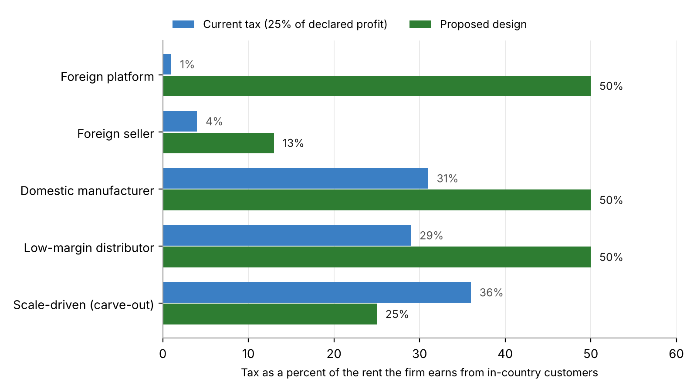

---
# GENERATED - NOT THE MASTER. Made from C Policy and FInance/2.OtherTaxAndFiscalPolicy/2.1.RentTax/RentTax.qmd by build_web_papers.py
# on every compile; edits here are lost. Edit the master instead.
title: "Taxing Rent, Not Effort"
subtitle: "A Simple Design for Land and Corporate Taxation Consistent with Free Movement of Capital and People"
date: "October 2026"
version: "0.2"
abstract: |
  Free movement of capital and people makes high tax rates on mobile income hard to sustain, and most rich countries have responded by giving up on them: twelve OECD countries taxed net wealth in 1990, four in 2017. This paper argues that the constraint binds on the wrong base. Economic rent, the return above what is needed to keep an asset in use, can be taxed heavily without driving anything away, provided the tax reaches it where it cannot move. I propose two instruments. The first is a land value tax above a household allowance. The second is a corporate package that presumes large firms earn rent: a 50 percent tax on profit above a normal return, a narrow destination-based cash-flow tax on sectors whose rent is easily shifted, and a small sales tax with credits for local assets and payroll, all capped so that no firm pays more than half the rent it earns from local customers. In worked examples an asset-light foreign platform's tax rises from 1 to 50 percent of that rent, while a domestic manufacturer pays nothing on its normal return. The design is compatible with European Union law as the Court of Justice has applied it, but needs care under trade rules.
keywords: [economic rent, land value tax, allowance for corporate equity, destination-based cash-flow tax, market power, tax competition]
jel: [H21, H25, H87, R38]
bibliography: RentTax.bib
csl: ../../../chicago-author-date.csl
number-sections: true
crossref:
  fig-prefix: Figure
  tbl-prefix: Table
  sec-prefix: Section
  eq-prefix: equation
toc: true
date-format: "MMMM YYYY"
citations-hover: true
crossrefs-hover: true
lightbox: auto
---

*Working paper, version 0.2, October 2026. The views expressed are the author's own and do not represent those of any institution with which he is or has been affiliated. A short version for policy makers is [Climate Fiscal Policy Brief No. 2.1](index.qmd). Version 0.1 (April 2026) was a sketch; this version adds the literature, states the results as propositions with their conditions, corrects the specification of the two destination layers, and computes the worked examples and revenue estimates.*

# Executive summary {#sec-summary}

[**Policy brief (short version) →**](index.qmd) · [Download this paper (pdf)](../../../papers/RentTax.pdf) · [Slides (pdf)](../../../papers/Slides-RentTax.pdf)

**Governments that let capital and people move freely have stopped trying to tax mobile income at high rates.** A country that taxes the profit booked within its borders at a high rate watches the profit move, and one that taxes personal wealth heavily without exit controls watches the wealthy move. The retreat is visible in the numbers: twelve OECD countries levied a net wealth tax in 1990 and four in 2017, and about 36 percent of multinational profits are shifted to tax havens.

**The constraint binds on the wrong base.** Economic rent is income above what is needed to keep an asset, a worker or a firm doing what it does. Taxing it changes nothing anyone does, so it can bear high rates, provided the tax reaches it where it cannot leave. Two sources of rent meet that test. Land cannot move. And a firm's market power over a country's customers is earned from those customers, wherever the firm books its profit.

**The paper proposes two instruments.** On land, a tax of about 2.5 percent a year on site value above a household allowance, set near the value of an ordinary home's site, so that most households pay little and large holdings pay a lot. Business land is taxed without an allowance. On firms, a package that treats large firms as earning rent unless they show otherwise. Layer One taxes profit above a normal return on equity at 50 percent, so that the normal return is untaxed and investment is not discouraged. Layer Two, confined to sectors where rent is easily shifted abroad (digital platforms, pharmaceutical patents and similar), taxes local sales less local costs at 22 percent. Layer Three, for all large firms, charges 4 percent of local sales less credits of 8 percent of local tangible assets and 25 percent of local payroll, so that firms that invest and employ locally pay nothing. A cap keeps the total below half the rent a firm earns from local customers, measured with the group's global margin.

**The design discriminates between rent and effort.** In five worked firms, an asset-light foreign platform that books little profit locally pays 1 percent of the rent it earns from local customers today and 50 percent under the design. A foreign seller outside the designated sectors goes from 4 to 13 percent: the design is weaker there, and the paper says so. A capital-intensive domestic manufacturer pays nothing on its normal return and half of its rent. A low-margin distributor is protected by the cap from paying a sales tax larger than its profit.

**The revenue is real but smaller than the first draft claimed.** Rough arithmetic for a European economy puts the land tax at 1.0 to 2.7 percent of GDP, after allowing for the fall in land prices that the tax itself causes. The corporate layers raise 2.3 to 6.3 percent of GDP, against 3.75 percent raised by corporate income tax across the OECD in 2023; the low end is Layer One alone after profit shifting, the high end assumes the destination layers recapture the rent now shifted abroad. A 50 percent rate on profit at origin does not by itself raise more than today's tax: the destination layers are what make the high rate pay.

**The law permits most of it.** The Court of Justice of the European Union has upheld steeply progressive taxes on turnover that fall mainly on foreign-owned firms, and land cannot claim free movement. The main legal risks are the payroll credit, which favors local labor in a way the trade rules may treat as discrimination, and the sectoral border adjustment. Both can be designed around.

**What to do.** Replace recurrent property taxes with a land value tax above a household allowance, on regularly updated site values, with deferral for owners who are asset-rich and cash-poor. Give every firm an allowance for corporate equity, and raise the rate on profit above that allowance for large groups. Add the destination layers only with the cap, and only for designated sectors in the case of Layer Two. Start in the European Union, where the Court's rulings give the most legal certainty.

# Introduction {#sec-intro}

Free movement of capital and people is one of the achievements of the postwar order, and it has a fiscal cost. Within the European Union, a directive of 1988 removed restrictions on capital movements between member states from 1 July 1990, and the Maastricht Treaty extended the freedom to movements with third countries [@EEC1988]. In the decades before, under the Bretton Woods system, most countries combined fixed exchange rates with capital accounts that were relatively closed [@ObstfeldTaylor2004]; capital could not easily leave, so it could be taxed. Once it could leave, it did. Twelve OECD countries levied a net wealth tax in 1990 and four in 2017 [@OECD2018Wealth]. About 36 percent of multinational profits are booked in tax havens, and reallocating them would raise the profits declared in high-tax European Union countries by about 20 percent [@TorslovWierZucman2023]. Meanwhile wealth has concentrated: in the United States the share held by the top 0.1 percent rose from 7 percent in 1978 to 22 percent in 2012 [@SaezZucman2016].

The question this paper asks is whether a country that keeps free movement can still tax the income of the very rich at high rates. The usual answer is no: the rate on a mobile base is set by competition with other countries, not by what the country would choose.

The answer here is yes, if the tax falls on rent and reaches it where it cannot move. Rent is income above what is needed to keep an asset, a worker or a firm in its current use. A tax on rent, by definition, changes no decision, so its rate can be high. But rent is not always immobile: a patent's rent can be booked anywhere. The design therefore taxes two sources of rent at the point where they cannot leave. Land is taxed where it lies, above a household allowance that keeps the tax off ordinary homes. The rent of large firms is taxed through a package that presumes they hold market power: a high rate on profit above a normal return, collected where profit is declared, backed by two destination-based layers that follow the firm's customers, with a cap that keeps the total within the rent the firm earns from those customers.

The paper makes four contributions. First, it combines in one design the two classic rent taxes, on land [@George1879; @Mirrlees2011] and on profit above a normal return [@Brown1948; @BoadwayBruce1984; @IFS1991], and argues that free movement is a reason to adopt them together, not a reason to give up on high rates. Second, it makes market power the default presumption for large firms, with a narrow carve-out for sectors where scale is a technical necessity; @sec-default argues that the presumption is supported by the evidence on rising markups [@DeLoeckerEeckhoutUnger2020] and survives the strongest counter-argument, that large firms are large because they are efficient [@Demsetz1973; @Autor2020]. Third, it states the condition under which a high origin rate is safe, that the rent be specific to the location [@Mirrlees2011, ch. 18], and adds two destination layers for rent that is not: a sectoral destination-based cash-flow tax, a narrow application of the proposal of @ADKV2017 and @Devereux2021, and a sales tax with credits for local assets and payroll, close to the substance carve-out in the OECD's global minimum tax [@OECD2021TwoPillar] and to the "Dyson tax" of @Plucked2020. Fourth, it adds a cap that allocates residual profit by sales, as the residual profit allocation of @Devereux2021 and Amount A of the OECD's Pillar One do [@OECD2021TwoPillar], used here not to share the tax base between countries but to protect low-margin firms from a tax on turnover.

@sec-literature reviews what is known. @sec-design sets out the design and states its properties as propositions. @sec-illustration works through five firms, @sec-revenue estimates revenue, @sec-law considers the law, @sec-objections the objections, and @sec-policy what a finance ministry should do.

# What is known about taxing rent {#sec-literature}

## Land: the oldest rent tax {#sec-lit-land}

The case for taxing land rent is as old as political economy. @Ricardo1817 [ch. 2] treated the rent of land as a surplus, the payment for the use of the soil's original powers, determined by the price of its produce rather than determining it. @Mill1848 [bk. 5, ch. 3] proposed taxing the future increase in rent "arising from the mere action of natural causes", while sparing existing rents, a transition rule that @Plucked2020 revives. @George1879 made the land value tax a popular cause, on the argument that land value is created by the community, not the owner. @Dwyer2014 traces the longer history, back to the physiocrats and Adam Smith, of the view that rent is the natural base of public revenue. Modern theory gives the idea a precise form in the Henry George theorem: in a city of optimal size with optimal local public goods, aggregate land rent equals spending on those goods [@ArnottStiglitz1979].

The Mirrlees Review called the economic case for taxing land "very strong" [@Mirrlees2011, ch. 16]. Land is not produced and its supply is fixed, so a tax on its value is reflected one-for-one in a lower price: owners on the day the tax is announced suffer a windfall loss, and nothing else changes. The review recommended a land value tax for business and agricultural land, replacing business rates and stamp duty, and a tax on housing services in place of council tax. The capitalization result has one theoretical exception: when land and capital are alternative stores of wealth, a land tax pushes savings into capital, lowering the interest rate and raising wages, so part of the burden shifts from landowners to the owners of capital [@Feldstein1977]. The effect strengthens the case for the tax, which then raises investment, but it qualifies the claim that landowners bear all of it.

The evidence is limited but consistent. Pittsburgh sharply raised its tax rate on land, but not on buildings, in 1979–80; building activity rose in the following decade while it fell in comparable cities, though other causes contributed [@OatesSchwab1997]. Across Pennsylvania municipalities that adopted split-rate taxes, the ratio of capital to land rose and the main effect was more housing units rather than larger ones [@BanzhafLavery2010]. Across OECD countries, recurrent taxes on immovable property are the taxes least harmful to growth [@Arnold2011], and they are widely seen as underused [@Norregaard2013]: in 2023 they raised 0.95 percent of GDP on average across the OECD [@OECDRevStats2025]. Many are levied on outdated values, which the OECD names as the first thing to fix [@OECD2022Housing].

## Corporate profit: taxing the return above normal {#sec-lit-corporate}

The corporate counterpart of the land tax is a tax on profit above the normal return to capital. @Brown1948 showed that a tax on cash flow, with investment deducted immediately, takes a share of a project's net present value and leaves the decision to invest unchanged. The Meade Committee [-@Meade1978] set out the R-based and S-based cash-flow taxes. @BoadwayBruce1984 showed that any depreciation schedule combined with a deduction for the cost of funds on the written-down value of assets gives the same neutrality, and the IFS Capital Taxes Group [-@IFS1991] turned the result into the allowance for corporate equity (ACE): a deduction for a notional return on shareholders' funds, which taxes only profit above that return. @BondDevereux2003 proved that the ACE is neutral under uncertainty, provided the tax rules for losses, default and wind-up are right. The Mirrlees Review recommended an ACE for the United Kingdom [@Mirrlees2011, ch. 17].

Practice has been mixed. Belgium introduced a notional interest deduction in 2006, narrowed it in 2018 and abolished it for periods ending on or after 31 December 2023 [@Belgium2022NID]; Italy introduced an ACE in 2011 and repealed it from 2024 [@Italy2023ACE]; Austria, Croatia and Brazil ran variants [@Klemm2007]. The evidence is that an ACE reduces leverage [@Princen2012; @HebousRuf2017], but that a unilateral ACE also invites multinationals to route intra-group lending into the country to claim the allowance [@HebousRuf2017], and that when rates are raised to pay for it, profit shifting and discrete location choices make it less attractive for a single country than for countries acting together [@deMooijDevereux2011]. Both findings bear directly on this paper's design.

## Natural resources: high rates on location-specific rent {#sec-lit-resources}

Resource rent taxes are the working proof that rent can be taxed at high rates under free movement of capital. @GarnautCluniesRoss1975 proposed a tax that carries a project's net cash flows forward at a threshold rate of return and taxes only the surplus above it; it became the model for Australia's petroleum resource rent tax. @BoadwayKeen2010 set out the theory. Norway taxes petroleum profit at a combined marginal rate of 78 percent, with the special tax computed on a cash-flow basis since 2022 [@Norway2025Petroleum]. The resource is where it is, so the rent cannot move, and the cash-flow base leaves the normal return untaxed.

## Source, destination and mobile rent {#sec-lit-destination}

A small open economy has a strong reason not to tax the normal return on capital at source, because the cost of capital is set abroad; the Mirrlees Review draws the further distinction on which this paper rests, between rents that are specific to a location (natural resources, proximity to a large market, local skills) and rents that are mobile, such as the return to a patent or a brand [@Mirrlees2011, ch. 18]. Location-specific rent can be taxed at source at high rates; mobile rent cannot. The evidence on mobility is strong. Discrete location choices depend on the effective average tax rate, which rises toward the statutory rate as profitability rises [@DevereuxGriffith2003]. Reported profit is highly sensitive to rate differences: a meta-analysis finds that a 1 percentage point lower rate than in other countries raises reported before-tax income by 1.5 percent [@BeerdeMooijLiu2020].

The proposed answer in the literature is to tax at destination. A destination-based cash-flow tax taxes sales to domestic customers less domestic costs; imports are taxed and exports exempt, as under value-added tax (VAT), so the base is where the customer is and cannot be moved by relocating production or booking profit elsewhere [@ADKV2017; @Devereux2021]. With a flexible exchange rate the currency appreciates to offset the border adjustment and trade is unaffected [@ADKV2017]. In a model with three sources of rent, a destination-based cash-flow tax does not distort behavior, while a source-based one does [@AuerbachDevereux2018]. A second proposal, residual profit allocation by income, splits a group's profit into a routine part, taxed at source, and a residual part, taxed where sales are made [@Devereux2021]. The OECD's Pillar One adopted the same idea in Amount A, which would allocate 25 percent of the residual profit of the largest groups, defined as profit above 10 percent of revenue, to market countries; its Pillar Two sets a 15 percent minimum tax on groups with revenue above €750 million, with a carve-out of 5 percent of payroll and of tangible assets [@OECD2021TwoPillar]. Meanwhile several countries have taxed digital revenue directly, at low rates: France at 3 percent from 2019 and the United Kingdom at 2 percent from 2020 [@France2019DST; @UK2020DST].

## Market power {#sec-lit-market-power}

The evidence that rent in the corporate sector has grown is substantial but disputed. In United States firm-level data, aggregate markups rose from 21 percent above marginal cost in 1980 to 61 percent, driven by the upper tail of the distribution, and the average profit rate rose from 1 to 8 percent [@DeLoeckerEeckhoutUnger2020]. Measured directly from the cost of capital, a large rise in the share of pure profit offsets the decline in the labor and capital shares [@Barkai2020]. The measurement is contested: different methods give different trends, and existing methods cannot rule out stable or modestly rising markups [@Basu2019]. The interpretation is contested too: concentration and high profit may reflect the superior efficiency of leading firms [@Demsetz1973], and the reallocation of sales toward the most productive "superstar" firms explains much of the fall in the labor share [@Autor2020].

## What is new {#sec-lit-gap}

Each instrument in this paper has a literature; what is missing is a design that combines them for a country that will not restrict capital movements. The land tax literature rarely discusses corporate rent, and the corporate literature treats the land tax, if at all, as a separate reform. The ACE literature shows a unilateral ACE invites shifting; the destination literature proposes replacing the corporate tax, which few governments will do at once. This paper keeps a profit tax at source, adds destination layers only where shifting is easy, presumes rent for large firms, and caps the total by the rent earned from local customers. It also computes what the combination does for firms of different kinds.

# The design {#sec-design}

The design has a personal-side instrument on land and a corporate package of three layers. The parameters below are illustrative central values: the land rate is 2.5 percent a year, Layer One's rate is 50 percent with an allowance of 3 percent on equity, Layer Two's rate is 22 percent, and Layer Three charges 4 percent of local sales less credits of 8 percent of local tangible assets and 25 percent of local payroll.

## Land above a household allowance {#sec-land}

Every household receives an allowance of land value $A$, exempt from tax. Above it, the household pays a land value tax at rate $\tau_L$ on the assessed site value, the value of the land without its buildings:
$$
T_{\text{land}} = \tau_L \cdot \max(0,\; V_{\text{land}} - A).
$$ {#eq-land}
For illustration, $A$ is set at the site value of an ordinary home in a modest neighborhood, close to the median household's holding, and $\tau_L$ at 2–3 percent a year. Most households then pay nothing or little, while those holding land worth several times the allowance pay a meaningful rate on the excess. Land held by firms is taxed without an allowance, and the tax a firm pays is deductible from its Layer One base, so that the same rent is not taxed twice.

I have called this a "reverse wealth tax" in earlier drafts, because the allowance can be paired with a payment to households that own no land, making the schedule negative below the allowance [@Plucked2020]. Here the allowance is simply a threshold, and the term is not used again.

**Proposition 1 (land).** *If the supply of land is fixed and the tax depends only on assessed site value, not on how the land is used, the tax does not change any decision about the use of land. Its present value is capitalized into a lower land price on announcement, so its burden falls on those who own land at that date.* The conditions matter. If the assessment rises when the owner builds, it becomes a tax on buildings; and if land and capital are close substitutes as stores of wealth, part of the burden shifts to capital and labor [@Feldstein1977]. Capitalization is also the source of the transition problem: a household that bought its home last year bears the whole present value of the tax. Phasing the rate in, or applying it first to future increases in site value as @Mill1848 proposed, spreads that loss.

The design has three further properties. It is progressive in land wealth without being progressive in earnings. Because land cannot move, there is no exit problem: the owner can leave, but the tax stays. And because cash income and land wealth differ, owners who are rich in land and poor in cash, often pensioners, need the option to defer the tax, with interest, until sale or death [@Plucked2020].

## Market power as the default {#sec-default}

Standard tax analysis treats market power as an exception that must be identified before it can be taxed. This paper reverses the presumption. For firms above a size threshold, the default assumption is that they earn substantial rent, and the burden of showing otherwise sits with the firm.

The reasoning starts from competition. In a competitive market, firms earn about the normal return on capital, because profit above it attracts entry. A firm that is large and stays large must therefore be earning rent of some kind, from network effects, brands, economies of scale, regulatory protection, patents or customer lock-in, or else operate in a sector whose minimum efficient scale is so large that only a few firms can exist. The second category is narrow: civil aircraft manufacturing and leading-edge semiconductor fabrication are examples. In most of the economy, large size reflects rent, not the technical necessity of scale.

The strongest objection is that large firms may be large because they are more productive [@Demsetz1973; @Autor2020]. It does not undo the presumption, because rent from superior productivity is still rent: a firm whose costs are lower than its rivals' earns an inframarginal surplus at the market price, as Ricardo's better land does. What the objection does show is that some of the rent is a return to past investment in innovation, which a tax could discourage if it were expected. The answer is not that the rent was "generated in the past", as the first draft of this paper argued: a permanent, anticipated tax lowers the expected return to the investment that creates rent. The answer is Proposition 2. A tax on profit above a normal return, with losses carried forward at interest and investment (including research and development) deducted in full or through the allowance, leaves the expected return to risky investment unchanged, whatever the rate. Neutrality, not the past, protects innovation.

Three design choices follow from the presumption. First, the threshold does the work of a definition: firms above it are presumed to earn rent, firms below it are presumed competitive. Using the €750 million group revenue threshold of Pillar Two [@OECD2021TwoPillar] means the groups in scope already report the data needed. Second, carve-outs are narrow, sectoral and set in advance; firms in designated scale-driven sectors pay the conventional rate on rent instead of the higher one, and every other firm is covered. Third, the instruments reward local productive activity and tax rent separately, so that no instrument has to decide whether a firm is "really" competitive: the bill is low when local activity is high relative to sales and high when rent is high.

The threshold creates a cliff. Under the first draft, a firm below it paid 25 percent of all its profit, including the normal return, while one just above it paid nothing on the normal return and 50 percent of its rent. Giving the allowance to every firm, and phasing the higher rate in between €750 million and twice that figure, removes the cliff. Consolidation at group level, as under Pillar Two, prevents groups from splitting to stay below it.

## Layer One: profit above a normal return {#sec-layer-one}

The first layer is an ACE. The firm deducts from its taxable profit a notional normal return on its equity, measured on the tax basis (the tax written-down value of its assets less its debt) rather than the book value, and only the residual is taxed:
$$
B_1 = \pi - r_A E, \qquad T_1 = \tau_1 \max(0,\; B_1),
$$ {#eq-ace}
where $\pi$ is taxable profit (with interest deductible, as now), $E$ is equity on the tax basis and $r_A$ the allowance rate. Losses, negative $B_1$, are carried forward with interest at $r_A$. The rate on large groups is $\tau_1 = 50$ percent, within the first draft's range of 45–55 percent.

**Proposition 2 (neutrality of Layer One).** *If equity is measured on the tax basis, the allowance rate equals the rate at which the firm discounts its tax allowances, and losses are refunded or carried forward with interest at that rate, then the present value of tax on a marginal investment is zero for any rate $\tau_1 < 1$, whatever the depreciation schedule.* Appendix A gives the proof, which follows @BoadwayBruce1984. Under uncertainty, the allowance rate that makes the tax neutral is the risk-free rate, provided the allowances themselves are certain, which full loss offset ensures [@BondDevereux2003]. In practice the long-term government bond rate is the workable choice.

Two consequences follow. The rate can be high: a firm deciding whether to invest an extra euro faces the same decision at 30 or 55 percent, because the tax falls only on returns above what the euro had to earn to be worth investing. And the tax collected includes a share of the expected risk premium as well as rent; with full loss offset the government earns that share by bearing a matching share of the risk, so measured revenue overstates the pure rent captured.

**Proposition 3 (where a high origin rate is safe).** *Layer One's base stays in the country only for rent that is specific to its location. Rent that can be booked elsewhere, through transfer prices, intra-group debt or the location of intangible assets, responds to the gap between the country's rate and other countries' rates, and a firm choosing between discrete locations compares effective average rates, which approach the statutory rate for highly profitable projects.* Proposition 2 concerns the scale of an investment that will be made in the country anyway; it does not protect the base from Proposition 3. A 25-point rise in the rate on declared rent, from today's typical 25 percent to 50 percent, would on the semi-elasticity of @BeerdeMooijLiu2020 reduce the reported base by roughly 37 percent, a linear extrapolation well beyond the range of the data but a fair warning of the order of magnitude. That is why the design does not stop at Layer One.

## Layer Two: a sectoral destination-based cash-flow tax {#sec-layer-two}

The second layer addresses rent that is earned from local customers but booked abroad. Digital platforms, holders of pharmaceutical patents, some financial services and streaming services can route revenue through low-tax jurisdictions so that little profit is declared locally, however well designed the ACE. For designated sectors, a destination-based cash-flow tax is added:
$$
T_2 = t_2 \max(0,\; S - C),
$$ {#eq-dbcft}
where $S$ is sales to customers in the country and $C$ is costs incurred in the country, including payroll and purchases from local suppliers; imports and payments to related parties abroad (royalties, management fees, intra-group purchases) are not deductible. Layer One is credited against Layer Two, so a firm pays the larger of the two, not both. The rate is $t_2 = 22$ percent, within the first draft's range of 20–25 percent.

The first draft described this layer as a tax of 20–25 percent "on in-country revenue". Read literally, a 22 percent tax on gross revenue takes 63 percent of the profit of a platform with a 35 percent operating margin and more than all the profit of a firm with a 20 percent margin; that is why national taxes on digital revenue are set at 2 or 3 percent [@France2019DST; @UK2020DST]. Deducting local costs makes Layer Two a tax on the cash flow a firm earns from local customers, which is where its rent is.

**Proposition 4 (the destination layer and its rate).** *Layer Two's base depends on where the firm's customers are and where its local costs are incurred, not on where its profit is booked, so transfer pricing and the location of intangible assets cannot reduce it. Because the tax is confined to a few sectors, the exchange rate does not adjust to offset it, unlike an economy-wide destination-based tax; it therefore acts within those sectors as a tax on imported inputs and related-party services at the tax-exclusive rate $t_2/(1-t_2)$ and favors local costs at the same rate.* At $t_2 = 22$ percent the implicit charge on imported inputs is 28 percent; at 50 percent it would be 100 percent (Appendix B). The first draft gave these as $t_2/(1+t_2)$, 20 and 33 percent, which are the tax-inclusive equivalents and understate the effect. The distortion grows faster than the rate, which is the reason to keep the rate moderate and the scope narrow: only sectors where rent clearly accrues to mobile intangibles and origin taxation demonstrably fails.

## Layer Three: a sales tax with presence credits {#sec-layer-three}

The third layer applies to every group above the threshold. It charges a small rate on sales to local customers and gives credits for local presence:
$$
T_3 = \max(0,\; \tau_s S - d_K K - d_W W),
$$ {#eq-presence}
where $K$ is the value of tangible assets in the country, excluding land, and $W$ is payroll in the country. With $\tau_s = 4$ percent, $d_K = 8$ percent and $d_W = 25$ percent, a firm with €1 billion of local sales, €50 million of local assets and €100 million of local payroll pays €11 million, 1.1 percent of its sales; a firm with the same sales but €500 million of assets and €400 million of payroll pays nothing.

The credits are subtracted from the tax, not from the base, so their incentive is larger than it looks. For a firm with positive liability, each euro of local tangible assets cuts tax by 8 cents a year and each euro of local payroll by 25 cents; the first draft described the asset credit as worth "an extra 2–3 percent" because 8 percent exceeds a normal return of 5–6 percent, which compares a credit rate with a rate of return. Firms already at zero, which is most firms with substantial local operations, get no marginal incentive. Land is excluded from $K$, so that buying land to shelter tax is not rewarded. The credits mirror the substance carve-out of Pillar Two, which excludes from the minimum tax a return of 5 percent of payroll and of tangible assets [@OECD2021TwoPillar], and the "Dyson tax" of @Plucked2020, a destination-based tax on sales less local wages and supplier costs.

Layer Three is a tax on sales that are not matched by local activity. Appendix C shows that a firm pays nothing when $d_K K/S + d_W W/S \geq \tau_s$: payroll of 16 percent of sales is enough on its own. The firms that pay are those whose sales in the country are large relative to their local factor base.

## The cap and the combined liability {#sec-combined}

A tax on sales can exceed a firm's profit. A fuel distributor with €10 billion of sales, payroll at 5 percent of sales and tangible assets at 10 percent pays 1.95 percent of sales under Layer Three, against a net margin of perhaps 2 percent. That would tax effort, not rent. The design therefore caps the destination layers. Let $\rho$ be the group's global rent margin, its worldwide profit less the allowance on its worldwide equity, divided by its worldwide sales, taken from the consolidated accounts. The total liability is
$$
T = \max\Big(T_1,\; \min\big(T_1 + \max(0,\, T_2 - T_1) + T_3,\;\; \tau_1 \rho S\big)\Big).
$$ {#eq-total}

**Proposition 5 (the cap).** *The destination layers never reduce a firm's tax below its Layer One liability, and never raise its total above $\tau_1 \rho S$, the Layer One rate applied to the rent the group would earn on its local sales if its global rent margin applied locally. A firm with no global rent pays only Layer One; a firm whose global rent margin is the same in every market pays at most $\tau_1$ of the rent it earns from local customers.*

The cap is a residual profit allocation by sales, of the kind proposed by @Devereux2021 and adopted for Amount A [@OECD2021TwoPillar], used here as a ceiling rather than a division of the base. It needs only figures that groups above the threshold already publish: consolidated profit, equity and revenue.

# A simple algorithm {#sec-algorithm}

The calculation for a corporate group proceeds in six steps.

1. **Check the size threshold.** If the group's global revenue is below €750 million, it is presumed competitive. It pays the conventional rate, 25 percent, on profit above the allowance on its equity, and stops here.
2. **Compute Layer One.** Measure equity on the tax basis, subtract the allowance $r_A E$ from taxable profit (after deducting any land value tax paid), and tax the residual at 50 percent. Firms in designated scale-driven sectors pay 25 percent on the residual.
3. **For designated mobile-rent sectors, compute Layer Two.** Take sales to local customers, from VAT records, less local costs; tax at 22 percent; credit Layer One against it.
4. **Compute Layer Three for all groups above the threshold.** Take 4 percent of local sales, less 8 percent of local tangible assets other than land and 25 percent of local payroll, with a floor of zero.
5. **Compute the cap.** Multiply local sales by the group's global rent margin and by 50 percent.
6. **Combine** using @eq-total.

The data exist. Profit, equity and payroll come from the local entity's accounts; sales to local customers come from VAT records, which identify the supplies taxed in the country; global profit, equity and revenue come from the consolidated accounts; and groups above the threshold already report payroll and tangible assets by jurisdiction for Pillar Two [@OECD2021TwoPillar].

# Five firms {#sec-illustration}

The design's purpose is to tax rent and spare effort, and five stylized firms show how far it succeeds. All figures are in millions of euros of local activity; the allowance rate is 3 percent. The current tax is 25 percent of declared local profit. Rent earned from local customers is the group's global rent margin times local sales.

| Firm | Local sales | Declared local profit | Rent from local customers | Current tax | Tax under the design | Current rate on rent | Design rate on rent |
|---|---:|---:|---:|---:|---:|---:|---:|
| A. Foreign platform, designated sector | 1,000 | 20 | 335 | 5 | 168 | 1% | 50% |
| B. Foreign seller, not designated | 1,000 | 30 | 185 | 8 | 24 | 4% | 13% |
| C. Domestic manufacturer | 1,000 | 90 | 72 | 23 | 36 | 31% | 50% |
| D. Low-margin distributor | 10,000 | 200 | 170 | 50 | 85 | 29% | 50% |
| E. Scale-driven manufacturer (carve-out) | 1,000 | 80 | 56 | 20 | 14 | 36% | 25% |

: Tax on five stylized firms, € million. Firm A: global operating margin 35 percent, local payroll 60 and other local costs 40, local tangible assets 50. Firm B: global margin 20 percent, local payroll 100, assets 50. Firm C: assets 800, payroll 250, equity 600. Firm D: global margin 2 percent, payroll 500, assets 1,000. Firm E: assets 900, payroll 300, equity 800, pays 25 percent on rent under the carve-out. Source: author's calculation, `2.Source/rent_tax_calcs.py`. {#tbl-firms}

{#fig-rates width=100%}

**The foreign platform pays half its local rent instead of almost none.** It declares 20 of profit locally because its intellectual property is held abroad, so today it pays 5 on rent of 335. Layer One adds little (8.5). Layer Two, at 22 percent of local sales less local costs, gives 198, and Layer Three 21; the cap of 50 percent of 335 binds, and the firm pays 168. The first draft's 40–60 percent is right for this firm.

**The foreign seller outside the designated sectors is the design's weak point.** It too books little profit locally, but only Layers One and Three apply, and Layer Three at 4 percent of sales less credits raises 11. Its rate on rent rises from 4 to 13 percent, far below the 40–60 percent the first draft claimed for all rent-extracting multinationals. Widening Layer Two to more sectors would close the gap at the cost of more border distortion (Proposition 4); raising Layer Three's rate would close it at the cost of a heavier tax on sales. That trade-off is the main design choice the paper leaves open.

**The domestic manufacturer pays nothing on its normal return.** Its allowance removes the 18 that is the normal return on its equity, and its local assets and payroll eliminate Layer Three. It pays 50 percent of its rent of 72, which is more in total than today (36 against 23): the design taxes rent wherever it is, including in domestic firms. What it no longer taxes is the normal return, on which this firm paid 4.5 under the current system.

**The cap protects the low-margin distributor.** Without the cap it would pay 85 under Layer One plus 195 under Layer Three, more than its whole profit of 200. With the cap, the destination layers add nothing beyond Layer One, because its global rent margin is only 1.7 percent.

**The scale-driven manufacturer pays less than today.** The carve-out applies the conventional rate to its rent, and the allowance removes its normal return, so its tax falls from 20 to 14.

# Revenue: an order of magnitude {#sec-revenue}

The first draft estimated revenue of 5.5–11.5 percent of GDP from unsourced inputs and applied the destination rate to gross revenue. A transparent calculation gives smaller numbers; the inputs are in Appendix D, and each is either sourced or labelled as an assumption.

| Instrument | Low | High |
|---|---:|---:|
| Land value tax above the household allowance | 1.0 | 2.7 |
| Layer One alone, after profit shifting | 2.3 | 4.3 |
| Layers One to Three, if the destination layers recapture shifted rent | 4.5 | 6.3 |
| *Memo:* corporate income tax today, OECD average, 2023 | 3.75 | 3.75 |
| *Memo:* recurrent property taxes today, OECD average, 2023 | 0.95 | 0.95 |

: Revenue, percent of GDP, order of magnitude. Land: land value of 1.6 (Germany) to 3.1 (France) times GDP in 2023; tax at 2.5 percent; 30–50 percent of household land above the allowance (assumption); business land fully taxed; values after the fall in land prices the tax causes. Corporate: base inferred from OECD average revenue at a 25 percent rate; 50–70 percent of it is rent (assumption); profit shifting from @BeerdeMooijLiu2020; recapture from @TorslovWierZucman2023. Sources: @Eurostat2025Land; @OECDRevStats2025; author's calculation, `2.Source/rent_tax_calcs.py`. {#tbl-revenue}

**The land tax raises one to three times what recurrent property taxes raise today.** The estimate allows for capitalization: a tax of 2.5 percent a year on land whose rent yields 4 percent lowers land values by 38 percent, so revenue computed on today's values would overstate the yield by about 60 percent. If the land tax replaced existing recurrent property taxes, the net gain would be correspondingly smaller.

**A high rate at origin does not pay for itself; the destination layers are what make it pay.** Layer One alone, at 50 percent on rent, raises 2.3–4.3 percent of GDP after profit shifting, against 3.75 percent raised by corporate income tax today. Only if the destination layers recover the rent now shifted abroad, and the extra shifting the higher rate would cause, does corporate revenue rise to 4.5–6.3 percent of GDP. The two layers are not optional extras; without them the design is a rate rise on the declared base that the declared base would partly escape.

# Free movement and the law {#sec-law}

**The land tax raises no free-movement issue.** Land cannot move, the tax applies equally to resident and non-resident owners, and the allowance is per household.

**Layer One is a corporate tax of a familiar kind.** It applies to all firms by their profit and equity, without regard to residence; Belgium and Italy ran ACEs for over a decade. The high rate on large groups is a size-based distinction, which brings it within the Court of Justice's case law on turnover.

**The Court of Justice has upheld steeply progressive taxes on turnover that fall mainly on foreign-owned firms.** In *Vodafone Magyarország* and *Tesco-Global Áruházak* (3 March 2020), the Grand Chamber held that Hungary's special taxes on the turnover of telecommunications and retail firms were compatible with freedom of establishment, although the higher bands were paid predominantly by firms owned in other member states: turnover is a neutral criterion and a relevant indicator of ability to pay, and the incidence reflected the economic reality of the markets [@CJEU2020Vodafone]. The Court did not decide the state-aid question in those cases, finding it inadmissible; in *Commission v Poland* (16 March 2021) it held that a progressive retail tax was not state aid, because EU law does not preclude progressive taxation based on turnover [@CJEU2021Poland]. These rulings support the size threshold and the sales-based Layer Three.

**The presence credits carry a legal risk the Hungarian cases did not settle.** A remote seller earns no credit for its payroll abroad, so Layer Three treats a firm that serves the market from another member state less favorably than one that establishes locally. That could be argued to restrict the freedom to provide services. The defense is that the credits measure local activity, not nationality, and that the tax is a tax on sales not matched by local activity; but it is a defense, not a settled rule.

**Exit taxes are permitted, with deferral.** A member state may tax unrealized gains when a company moves its seat abroad, but may not insist on immediate payment [@CJEU2011NationalGrid]. The design does not rely on exit taxes, but a country adopting it may want one as a backstop against companies moving their seat to escape Layer One.

**Trade rules are the harder constraint.** Many argue that a destination-based cash-flow tax is inconsistent with WTO rules, because it relieves the cost of domestic labor but not the labor embodied in imports; the economically equivalent combination of a VAT and a payroll subsidy raises no such objection [@ADKV2017]. Layer Three's payroll credit has the same feature, and so does Layer Two's deduction for local costs. Two design choices reduce the risk: giving no rebate on exports, and confining Layer Two to services, which fall outside the GATT's rules on goods, although the services agreement has national-treatment rules of its own. A government that wants certainty can restate Layer Three as a sales charge plus a separate payroll subsidy. France's digital services tax drew objections from the United States and a deferral of collection [@France2019DST]; a design that taxes domestic and foreign firms alike by sales and presence is easier to defend than one aimed at a list of foreign companies. Tax treaties raise a further question: if Layer Two is treated as a tax on income, treaty partners need not credit it, and some treaty provisions may be breached [@ADKV2017].

# Objections and limits {#sec-objections}

**"Corporate taxes fall on workers."** In Germany, workers bear about half of the local business tax [@FuestPeichlSiegloch2018]. That tax falls on the full return, including the normal return; a tax on rent, with the normal return exempt (Proposition 2), does not reduce the capital stock and so should not reduce wages through that channel. Where firms share rent with workers, some of a rent tax will still fall on wages.

**"A sales tax falls on consumers."** Pass-through of standard-rate VAT changes into prices is about complete [@Benedek2020]. The first draft argued that firms with market power pass through less, so the tax falls on rent; that is not a general result, because under imperfect competition pass-through depends on the curvature of demand and can exceed 100 percent [@WeylFabinger2013]. The cap limits Layer Three to firms with global rent, and its rate is low, but some of it will reach consumers.

**"Unilateral adoption invites tax planning."** A unilateral ACE draws intra-group lending into the country to claim the allowance [@HebousRuf2017], and higher rates make a unilateral ACE less attractive than a coordinated one [@deMooijDevereux2011]. The allowance should therefore apply to equity net of holdings in related companies, and the case for coordination within the European Union is strong.

**"Valuing land is hard."** Many recurrent property taxes rest on values decades out of date [@OECD2022Housing]. A land tax needs regular revaluation of sites, which is easier than valuing buildings, because land values can be inferred from sales of vacant plots and from the residual after subtracting rebuilding cost; it is still the main administrative investment the reform requires.

**"The carve-out will be captured."** Every sector will claim to be scale-driven. The list must be short, set in law in advance and reviewed against evidence on the number of viable firms worldwide.

**"The estimates are illustrative."** They are. The worked firms are stylized; the revenue figures rest on two assumptions, the share of the declared base that is rent and the share of household land above the allowance, which Appendix D states. Country calibration with firm-level and cadastral data is the next step.

# What a finance ministry should do {#sec-policy}

**Replace recurrent property taxes with a land value tax above a household allowance.** Value sites regularly, tax business land without an allowance, phase the rate in to spread the capitalization loss, and let asset-rich, cash-poor owners defer with interest.

**Give every firm an allowance for corporate equity, and raise the rate on rent for large groups.** Measure equity on the tax basis, carry losses forward with interest, net out equity invested in related companies, and phase the higher rate in above the threshold.

**Add the destination layers with the cap.** Confine Layer Two to designated sectors, credit Layer One against it, and give no export rebate. Apply Layer Three to all groups above the threshold. Cap both by the Layer One rate times sales-apportioned global rent.

**Start where the law is clearest.** In the European Union, the Court's rulings on turnover taxes give the size threshold and the sales base a sound footing; the payroll credit and the sectoral border adjustment need careful drafting, or restatement as a sales charge with a separate payroll subsidy.

**Coordinate where possible.** Every layer works unilaterally, but each works better if neighbors adopt it: a common ACE reduces shifting, and common destination layers reduce the incentive to serve a market from next door.

# Conclusion {#sec-conclusion}

Free movement of capital and people limits the rates a country can charge on income that can move, but not on rent that cannot. Land, and the market power of large firms over a country's customers, are rent that the country can reach. A land value tax above a household allowance, a high rate on profit above a normal return, and destination layers that follow the customer, capped by the rent earned from that customer, together tax rent at about half and the normal return at zero. The design's weak point is rent booked abroad by firms outside the designated sectors, which Layer Three reaches only lightly. The next step is calibration to one country's firm-level and land data, and the legal drafting of the presence credits.

# Downloads {.unnumbered}

[Policy brief (pdf)](../../../papers/Brief-RentTax.pdf) · [Working paper (pdf)](../../../papers/RentTax.pdf)

# References {.unnumbered}

::: {#refs}
:::

# Appendix A: Layer One mechanics {#sec-app-ace .appendix}

**Proof of Proposition 2.** Consider a marginal project financed by equity: an outlay $I$ at date 0 that yields a stream of returns whose present value, discounted at the firm's required return $r$, equals $I$. Tax depreciation allowances $D_t$ sum to $I$, and the tax written-down value at the start of period $t$ is $V_t = I - \sum_{s<t} D_s$. Under the ACE the firm deducts each period $D_t + r_A V_t$. With $r_A = r$, the present value of the deductions is
$$
\sum_t \frac{D_t + r V_t}{(1+r)^{t+1}} = I,
$$ {#eq-pv}
because $V_{t+1} = V_t - D_t$ and the sum telescopes: each term equals $V_t/(1+r)^{t} - V_{t+1}/(1+r)^{t+1}$, and $V_0 = I$. The present value of the tax base is therefore the present value of the returns less $I$, which is zero for the marginal project, so the tax on it is zero for any rate. The result needs the deductions to be worth their face value, which requires losses to be refunded or carried forward at interest; and it needs equity measured on the tax basis, not the book basis, so that the allowance tracks $V_t$ [@BoadwayBruce1984; @IFS1991]. Under uncertainty, with certain allowances, the appropriate discount rate for them is the risk-free rate [@BondDevereux2003].

**Debt.** Interest remains deductible, and the allowance gives equity the same treatment, removing the bias toward debt. The Belgian and German evidence confirms that leverage falls [@Princen2012; @HebousRuf2017].

**Practice.** Italy set a statutory allowance rate and applied it only to increases in equity after 2010, which reduced the cost of the reform [@Italy2023ACE]. An incremental base is a reasonable transition, because it gives the full incentive at the margin while limiting the revenue cost on existing equity.

# Appendix B: Border arithmetic for Layer Two {#sec-app-border .appendix}

Let $t$ be Layer Two's rate on cash flow, which is tax-inclusive. A firm in a designated sector that buys an input locally for one euro deducts it and saves $t$; if it imports the same input, or buys the service from a related party abroad, it saves nothing. The after-tax cost is $1-t$ for the local input and $1$ for the imported one, so the imported input bears an implicit tax of $t/(1-t)$ on its tax-exclusive cost. Likewise a euro of exports is untaxed while a euro of local sales keeps only $1-t$, an implicit export subsidy of $t/(1-t)$ relative to local sales.

| Rate $t$ | Implicit tax on imported inputs, $t/(1-t)$ | First draft's figure, $t/(1+t)$ |
|---:|---:|---:|
| 22% | 28% | 18% |
| 25% | 33% | 20% |
| 50% | 100% | 33% |
| 60% | 150% | 38% |

: Implicit border charge of a sectoral destination-based cash-flow tax. Source: author's calculation. {#tbl-border}

For an economy-wide tax, the exchange rate appreciates to offset these charges and leave trade unchanged [@ADKV2017]. A tax confined to a few sectors is too small to move the exchange rate, so within those sectors the charges are real. The design keeps them small by keeping the rate moderate and the scope narrow. The first draft's alternative, residual profit allocation by income, would tax only residual profit at destination and avoid this distortion, but requires a definition of routine profit in every sector [@Devereux2021]; the cap in @eq-total borrows its logic without its administrative burden.

# Appendix C: Layer Three calibration {#sec-app-presence .appendix}

Let $k = K/S$ be local tangible assets (excluding land) per euro of local sales and $w = W/S$ local payroll per euro of local sales. Layer Three is zero when
$$
d_K k + d_W w \geq \tau_s.
$$ {#eq-breakeven}
With $\tau_s = 4$ percent, $d_K = 8$ percent and $d_W = 25$ percent, payroll of 16 percent of sales, or tangible assets of 50 percent of sales, is enough on its own. A firm with $k = 0.5$ and $w = 0.3$, typical of manufacturing, has credits worth 11.5 percent of sales, almost three times the charge; the first draft called this an 11.5 percent "break-even sales rate", which is the same arithmetic. The firms that pay are those with local sales large relative to local activity: a remote seller with $k = 0.05$ and $w = 0.10$ pays 1.1 percent of sales. For such firms, each euro of local assets reduces tax by 8 cents a year and each euro of local payroll by 25 cents, until the liability reaches zero. The cap (@eq-total) then protects firms whose global margins are thin.

# Appendix D: Revenue arithmetic {#sec-app-revenue .appendix}

*Land.* Land values in 2023 were 1.63 times GDP in Germany and 3.06 times in France (2.13 in the Netherlands and Austria); households held 57–76 percent and non-financial corporations 20–28 percent [@Eurostat2025Land]. The calculation taxes business land in full and 30–50 percent of household land, the share assumed to lie above the allowance; government land is excluded. A tax at rate $\tau_L$ on land whose rent yields $i$ before tax reduces land values by the factor $i/(i+\tau_L)$; with $i = 4$ percent (an assumption) and $\tau_L = 2.5$ percent the factor is 0.615. Revenue is $\tau_L$ times the taxable value after that fall: 1.0 percent of GDP for German parameters at the low allowance share and 2.7 percent for French parameters at the high one.

*Corporate.* Corporate income tax raised 3.75 percent of GDP on average across the OECD in 2023 [@OECDRevStats2025]. At a 25 percent rate that implies a declared base of 15 percent of GDP, of which 50–70 percent is assumed to be rent. Layer One taxes that rent at 50 percent. Profit shifting reduces the declared base by the semi-elasticity times the 25-point rate increase, using 1.5 percent per point [@BeerdeMooijLiu2020] for the low case and half that for the high case: 2.3–4.3 percent of GDP. If the destination layers recover both this shifting and the profit already shifted out, about 20 percent of the declared base in high-tax European Union countries [@TorslovWierZucman2023], corporate revenue is 4.5–6.3 percent of GDP. The calculation omits the change in investment, the revenue from Layer Three on firms with little global rent (excluded by the cap) and the interaction between the land tax and Layer One, which the deductibility rule in @sec-land resolves.
