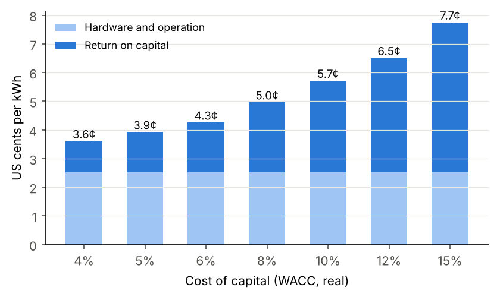

---
# GENERATED - NOT THE MASTER. Made from C Policy and FInance/3.FinanceAndRisk/3.1.ClimateFinanceIntermediationForCleanPower/1.Presentation/Brief-ClimateFinanceIntermediationForCleanPower.qmd by build_web_papers.py
# on every compile; edits here are lost. Edit the master instead.
title: "Guarantee the Contract, Not the Debt: A Payment Intermediary for Clean Power"
subtitle: "Removing offtaker risk at source in developing-country power markets"
series: "Climate Fiscal Policy Brief No. 3.1"
version: "1.0"
author:
  - name: "Stephen J. Stretton"
    note: "Writing in a personal capacity."
date: "October 2026"
abstract: |
  Solar power is cheap to build in developing countries but dear to finance, because investors price the risk that a state-owned distribution company will pay late or not at all. A payment intermediary facility buys power under one standard contract, pays generators in full and on time, and collects arrears itself, behind a guarantee waterfall agreed in advance. Guaranteeing the contract removes the whole risk premium, about two dollars of saving per dollar of expected cost in a stylized case; guaranteeing project debt removes under a third of it. India's Solar Energy Corporation shows the design works, and its buyers' arrears show it needs utility reform.
keywords: [cost of capital, offtaker risk, payment security, guarantees, power purchase agreements, contingent liabilities]
bibliography: Brief-ClimateFinanceIntermediationForCleanPower.bib
csl: ../../../chicago-author-date.csl
toc: true
date-format: "MMMM YYYY"
citations-hover: true
crossrefs-hover: true
lightbox: auto
---

*Climate Fiscal Policy Brief No. 3.1, October 2026. Stephen J. Stretton, writing in a personal capacity. The views expressed are the author's own and do not represent those of any institution with which he is or has been affiliated. The proposal builds on a policy brief on regional payment intermediary facilities written with Nils Zimmermann and on the solar payments intermediary proposal developed by Evie Davey. The full analysis, with the model, proofs and calibration, is in the [working paper](working-paper.qmd).*

# Key messages {#sec-key-messages}

[**Read the full working paper →**](working-paper.qmd) · [Download this brief (pdf)](../../../papers/Brief-ClimateFinanceIntermediationForCleanPower.pdf) · [Slides (pdf)](../../../papers/Slides-ClimateFinanceIntermediationForCleanPower.pdf)

**Clean power in developing countries is cheap to build and dear to finance.** The same solar plant sells power 80 percent dearer when its capital costs 12 percent a year rather than 4, and the cost of capital for solar in emerging and developing economies is well over twice that in advanced economies.

**The risk investors price most directly is the buyer.** A loss-making state distribution company that pays late and recovers little adds about 11 percent to the tariff in a stylized case.

**Put a creditworthy payment intermediary between generators and distribution companies.** It buys under one standard contract, pays generators whatever the buyer does, and collects arrears behind a guarantee waterfall agreed in advance.

**Guarantee the contract, not the debt.** A contract guarantee removes the whole premium for about half its value in expected cost; a debt guarantee removes under a third of it and puts the whole loan at risk.

**Pair the facility with utility reform, and record the guarantee.** Without better collection and fewer defaults the facility only moves risk to the state, as India's experience shows.

# Clean power costs too much because its finance does {#sec-cost}

**Solar power is a bond with panels attached.** Almost all of its cost is paid up front, and the tariff repays the capital. Table 1 shows a representative utility-scale plant costing \$800 per kilowatt, running at a 20 percent capacity factor for 25 years; only the cost of capital changes from column to column. At a 4 percent real weighted average cost of capital (WACC) the plant needs 3.6 US cents per kilowatt-hour. At 12 percent it needs 6.5 cents, 80 percent more for the same hardware.

| Cost of capital (real) | 4% | 5% | 8% | 10% | 12% | 15% |
|---|---:|---:|---:|---:|---:|---:|
| Levelized cost (US cents/kWh) | 3.61 | 3.92 | 4.96 | 5.72 | 6.51 | 7.75 |
| Return on capital, share of cost | 30% | 36% | 49% | 56% | 61% | 68% |

: The same solar plant costs twice as much at 15 percent as at 4 percent (stylized). \$800/kW, capacity factor 20 percent, operation and maintenance \$12/kW a year, 25-year life, capital spent at commissioning. "Return on capital" is the capital charge above straight-line depreciation. Source: working paper, Table 1. {#tbl-lcoe}

{#fig-lcoe width=95%}

**Developing countries pay far more for capital than rich ones.** The International Energy Agency's survey of financiers finds that the cost of capital for utility-scale solar in emerging and developing economies is well over twice that in advanced economies, and that financing can be half or more of the cost of the power. It estimates that narrowing the gap by one percentage point would cut clean energy financing costs in these economies by about \$150 billion a year [@IEA2024].

# The buyer of the power is the risk {#sec-buyer}

**A finished solar plant carries little operating risk; the company that buys its power carries a lot.** In most developing countries that buyer, the offtaker, is a state-owned distribution company that sells below cost and collects badly. A World Bank study of 39 Sub-Saharan African countries found only two, Seychelles and Uganda, with a financially viable electricity sector [@Trimble2016]. The IEA ranks payment risk among the three sector risks that investors price most in these economies [@IEA2024].

**Long arrears and poor recovery cost far more than lateness.** Suppose a distribution company falls into a year of unpaid bills once every six or seven years and eventually pays back 60 percent of what it withheld, and investors charge for that risk at twice its expected loss. The generator then needs a tariff 11 percent above its cost, the same as 1.4 percentage points on the cost of capital. A buyer that is late as often but pays back 90 percent adds only 0.4 points; one that pays back 30 percent adds 2.6 (stylized; [working paper, the premium](working-paper.qmd#sec-cal-premium)).

# A payment intermediary removes the risk at source {#sec-facility}

**The fix is to change whom the generator is exposed to.** A payment intermediary facility is a creditworthy institution that buys power from generators under one standard power purchase agreement, sells it on to distribution companies, and pays generators in full and on time whatever the distribution companies do. Their arrears become a debt to the facility, a repeat creditor with more patience and more leverage than any single developer.

**A guarantee waterfall, agreed before the first tender, stands behind the facility.** If a distribution company does not pay, the facility calls in turn on its state or provincial owner, on the national government through an intercept of its transfers to that owner, on a multilateral agency, and on a donor contingency account. The order is fixed in advance, and the first calls fall on the governments that control the utility.

**Liquidity, not loss, is what can break the facility.** A devaluation or a fuel shock can push many distribution companies into arrears at once. In a stylized regional facility buying 2 gigawatts of solar power, with contract payments of \$174 million a year, a buffer of about \$57 million, a third of a year's payments, bridges a 1-in-200-year crisis until the national layer pays ([working paper, the waterfall](working-paper.qmd#sec-cal-waterfall)).

# Guarantee the contract, not the debt {#sec-contract}

**A contract guarantee removes the whole premium; a debt guarantee removes only the lenders' share.** A debt guarantee pays lenders when the project cannot service its loan, whatever the cause, so equity still bears the buyer's arrears and still charges for them. A contract guarantee pays the generator when the buyer does not, so equity and debt are both paid.

| Stylized 100 MW solar plant | No guarantee | Contract guarantee | Debt guarantee |
|---|---:|---:|---:|
| Tariff (US cents/kWh) | 5.50 | 4.96 | 5.33 |
| Saving to the buyer (\$ million a year) | – | 0.94 | 0.30 |
| Expected cost of the buyer's risk to guarantors (\$ million a year) | – | 0.48 | 0.22 |
| Saving per dollar of that cost | – | 2.0 | 1.4 |
| Largest exposure (\$ million) | – | 8.7 a year of arrears | 60 of debt |

: A contract guarantee removes more of the premium per dollar of expected cost, at a fraction of the exposure (stylized). Base WACC 8 percent; one-year default episodes at 15 per 100 buyer-years; 60 percent of arrears recovered; debt is 75 percent of the \$80 million cost, and lenders bear 30 percent of the buyer's losses. The debt guarantee also covers construction and operating risks, at a further expected cost of \$0.18 million a year. Source: working paper, Table 3. {#tbl-guarantee}

**The contract guarantee is cheaper per dollar saved because its claim is better.** The facility keeps its claim on the distribution company, and in the stylized case recovers 58 cents of each dollar of arrears in present value; a debt guarantor's claim runs against a project company that has itself not been paid, and recovers 39 cents three years later. Its worst case in one episode is a year of unpaid bills, \$8.7 million, against the whole \$60 million loan ([working paper, the comparison](working-paper.qmd#sec-cal-guarantee)).

**The saving is real only if the facility collects better or makes default rarer.** If investors charged nothing for risk and the facility collected no more than generators would, the guarantee would simply move the expected loss from investors to the state. Its value to society comes from better collection (at 80 percent recovery the saving rises to \$3.6 per dollar), from fewer defaults by a buyer that faces one creditor and reform conditions, and from the state bearing a risk more cheaply than investors, which fails when the utility and the treasury are in trouble together ([working paper, Proposition 2](working-paper.qmd#sec-guarantees)).

**Small versions already work in Africa.** Under the World Bank Group's Scaling Solar program, a \$3.5 million IDA guarantee behind the Zambian utility's letter of credit supported a 47.5-megawatt plant financed with about \$60 million, at a tariff of 6.015 US cents per kilowatt-hour [@WBGZambia2018]. The African Trade Insurance Agency's liquidity facility covers independent producers for six months of late payment [@Wass2017RLSF]. The facility pools such guarantees behind one contract and one creditor.

# India shows the design works, and that the buyers must be fixed {#sec-india}

**The Solar Energy Corporation of India is the working model of a payment intermediary.** It is wholly owned by the central government, signs contracts with developers only after back-to-back sales to state distribution companies, and earns a margin of Rs 0.07 per kilowatt-hour. In July 2025 it had sales of about 60 gigawatts at an average Rs 2.93 per kilowatt-hour, well below the distribution companies' average purchase cost, and was rated AAA [@ICRA2025]. Its margin, 2.4 percent of the tariff, pays for itself if it lowers the cost of capital by a third of a percentage point.

**Its protections are layered much as the waterfall proposes.** Distribution companies must open letters of credit, and since August 2019 grid operators may schedule power only once they have [@Powerline2019]. A payment security fund covers older capacity. Since October 2016 the corporation has been a beneficiary of an agreement among the central government, the states and the Reserve Bank of India under which the central bank can debit a defaulting state's account; the corporation used it against distribution companies in Andhra Pradesh and Karnataka in 2020–22 [@ICRA2025].

**But the buyers were never fixed, and the center paid twice.** Most state distribution companies remain financially weak, and their letter-of-credit coverage is only 68 percent [@ICRA2025]. In 2020 the central government organized Rs 90,000 crore of loans to distribution companies against state guarantees so they could pay generators [@CRISIL2020], and in 2022 it let them reschedule their arrears over up to four years [@Powerline2022]. Legacy arrears fell from Rs 1,39,947 crore in June 2022 to Rs 3,330 crore in March 2026 [@PTI2026]. The risk moved to the center; it was not removed.

**Nigeria shows the failure.** Its bulk electricity trader, a single buyer, expected to collect about a quarter of its bills in 2017 and needed a central bank loan of up to N701 billion to pay generators [@Okafor2017]. It had no reliable revenue and no funded layer behind it. A single buyer of that kind invites weak payment discipline and hidden liabilities, as the World Bank warned long ago [@Lovei2000]; the facility avoids that by keeping procurement competitive, leaving the buyers' obligations alive and recording its guarantees ([working paper, objections](working-paper.qmd#sec-objections)).

# Design the facility so the risk stays small {#sec-design}

**Write contracts in the currency the buyer earns.** A dollar tariff hands the distribution company, and behind it the state, the devaluation risk of every contract, and that risk arrives in a balance of payments crisis, when every buyer is stressed at once. Where projects borrow in dollars, the facility should hold and price the mismatch in the open.

**Let tariffs decline over the life of the contract.** A flat 20-year price signed when solar is dear becomes a target for renegotiation as new plants get cheaper. A tariff starting at 7.7 cents and falling to 3.9 cents by year 7 has the same present value at 8 percent as a flat 5 cents, but leaves 23 percent less owed after year 7 and nearly halves the part above the cost of new solar (stylized; [working paper, tariff profile](working-paper.qmd#sec-tariff)).

**Build national facilities in large markets and regional ones for small states.** India, Nigeria and Brazil can each diversify across many distribution companies. Small states should share a facility, for example in the Economic Community of West African States; it lacks a cross-border intercept like India's, so its multilateral layer must be stronger.

**Make utility reform a condition of entry.** A guarantee makes the generator whole; it does not make the utility solvent. Entry should require a published path to cost-recovery tariffs, letters of credit, an intercept agreement and loss-reduction targets, with access widening as targets are met.

# The state's exposure shrinks but does not vanish {#sec-fiscal}

**The facility turns an implicit liability into a smaller, contracted one.** States already bail out their utilities, as India did in 2020 and 2022 and Nigeria in 2017. The waterfall makes that exposure contingent on the state's own utility failing to pay, fixes its order and cap in advance, and, with reform, makes it smaller. In the stylized regional facility the national government expects to be called for about 2.2 percent of contract payments a year, before it recovers from its own utility.

**Record the guarantee at its expected cost under a published cap.** International statistical standards treat expected calls under a scheme of many similar guarantees as a liability [@IMF2014GFSM]; a facility with one standard contract is such a scheme. Countries in debt distress can buy power as a service under the facility's contracts, but a long-term take-or-pay contract is still a fiscal commitment and belongs in debt analysis, alongside the fuel bill it replaces ([working paper, fiscal accounting](working-paper.qmd#sec-fiscal)).

# What to do {#sec-what-to-do}

**Finance ministries: build or join a facility before the next tender.** Use one standard power purchase agreement and sign the guarantee waterfall first; route new utility-scale renewable procurement through it, in local currency, on declining tariffs; and record the national layer at expected cost under a published cap.

**Regulators and utilities: make payment security a condition of supply.** Require letters of credit, enforce dispatch rules like India's, and put distribution companies on a published path to cost recovery as the price of entry.

**Development banks and donors: guarantee the facility, not the loans.** Stand as the multilateral layer, pool payment guarantees of the Scaling Solar kind behind one facility, and fund the donor contingency account at the bottom of the waterfall. Once contracts are standard and guaranteed, the plants can be refinanced as a few standard securities ([Brief 3.2](../../../policy/3-finance-and-risk/CleanPowerAssetClasses/index.qmd)).

# Related papers in this series {.unnumbered}

- [Climate Fiscal Policy Brief No. 3.2](../../../policy/3-finance-and-risk/CleanPowerAssetClasses/index.qmd): two-stage finance and synthetic sovereign bonds, which refinance the contracts this facility makes safe [@CFPB32].
- [No. 4.1](../../../policy/4-sovereign-incentives/NotionalCapitalisedValueAndGuarantees/index.qmd): guarantee capacity earned by climate policy, which can stand behind the facility's waterfall [@CFPB41].
- [No. 4.2](../../../policy/4-sovereign-incentives/ClimateInvestmentTrust/index.qmd): the Climate Investment Trust, a source of loss-absorbing capital for the donor layer [@CFPB42].
- [No. 4.3](../../../policy/4-sovereign-incentives/SustainabilityLinkedLending/index.qmd): sustainability-linked sovereign lending, a way to pay for the utility reforms that make the guarantee affordable [@CFPB43].
- The [working paper](working-paper.qmd) behind this brief: the model, proofs, calibration and the record in India, Nigeria and Zambia.

# Downloads {.unnumbered}

[Policy brief (pdf)](../../../papers/Brief-ClimateFinanceIntermediationForCleanPower.pdf) · [Working paper (pdf)](../../../papers/ClimateFinanceIntermediationForCleanPower.pdf)

# References {.unnumbered}

::: {#refs}
:::
