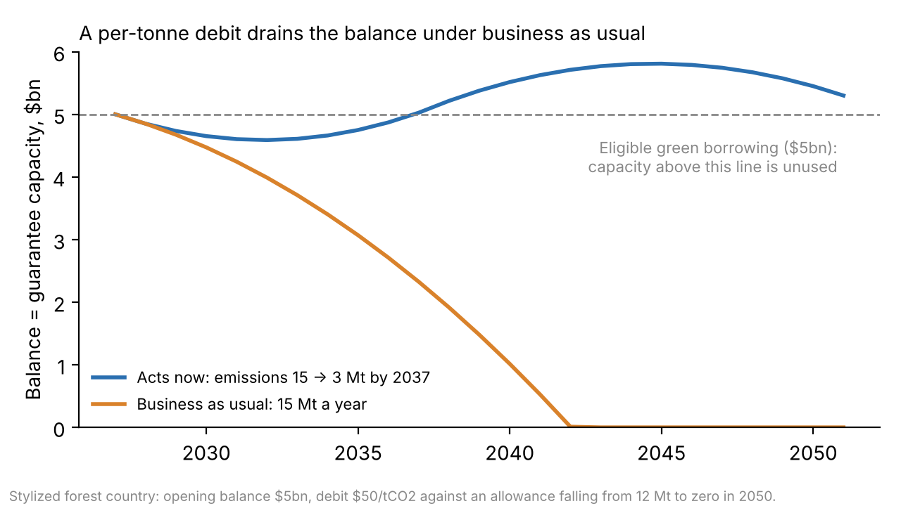

---
# GENERATED - NOT THE MASTER. Made from C Policy and FInance/4.SovereignIncentives/4.1.NotionalCapitalisedValueAndGuarantees/1.Presentation/Brief-NotionalCapitalisedValueAndGuarantees.qmd by build_web_papers.py
# on every compile; edits here are lost. Edit the master instead.
title: "Reward the Stock as Well as the Flow"
subtitle: "Notional Capitalized Value and Guarantee-Based Climate Incentives"
series: "Climate Fiscal Policy Brief No. 4.1"
version: "1.0"
author:
  - name: "Stephen J. Stretton"
    note: "Writing in a personal capacity."
date: "October 2026"
abstract: |
  Climate finance pays for tonnes avoided against baselines nobody can observe, and almost nothing for carbon stocks never released. This brief proposes crediting each country with a notional capitalized value: a balance opened by its carbon stock, debited for every tonne emitted above an agreed allowance, and used as guarantee capacity on green borrowing rather than paid out. A guarantee is worth the full spread to the borrower but costs only the expected loss, so on the development banks' record each dollar of expected loss buys about 80 dollars of interest saving (2.7 in a stress case). For a forest country with Guyana's stock, a $5 billion balance prices emissions at about $30 a tonne.
keywords: [sovereign incentives, guarantees, carbon stocks, forests, results-based climate finance]
bibliography: Brief-NotionalCapitalisedValueAndGuarantees.bib
csl: ../../../chicago-author-date.csl
toc: true
date-format: "MMMM YYYY"
citations-hover: true
crossrefs-hover: true
lightbox: auto
---

*Climate Fiscal Policy Brief No. 4.1, October 2026. Stephen J. Stretton, writing in a personal capacity. The views expressed are the author's own and do not represent those of any institution with which he is or has been affiliated. The full analysis, with the model, proofs, calibration and code, is in the [working paper](working-paper.qmd).*

# Key messages {#sec-key-messages}

[**Read the full working paper →**](working-paper.qmd) · [Slides (pptx)](../../../papers/Slides-NotionalCapitalisedValueAndGuarantees.pptx)

**Climate finance pays for the flow and ignores the stock.** It pays for tonnes avoided against baselines nobody can observe, years after the political cost is paid, and almost nothing to countries that kept their forests or leave coal in the ground.

**Give each country a climate balance instead of a cheque.** The balance opens at a low price per tonne of carbon stock and is debited at a higher, uniform price for every tonne emitted above an agreed allowance. It is never paid out: it sets how much of the country's green borrowing development banks will guarantee.

**A guarantee is worth far more than it costs.** The country saves the whole spread; the guarantor bears only the expected loss. On the development banks' record, each dollar of expected loss buys about \$80 of interest saving; about \$27 counting only the country's net gain, and 2.7 in a stress case.

**Use two prices: a low one for the stock, a uniform one for each tonne.** For a forest country with Guyana's stock, a \$5 billion balance and a \$50 debit price make each tonne emitted cost the country about \$30, at a donor cost of about 40 cents a tonne.

**Fund the buffer, not the reward.** Each \$1 billion a year of incentive needs about \$13 million a year of expected losses and a \$0.16 billion buffer that donors keep (\$370 million and \$3.1 billion in the stress case).

# Climate finance pays for flows and ignores stocks {#sec-flows}

**Countries are paid for tonnes avoided against a reference level, not for what they have kept.** Guyana's forests store about 19.5 billion tonnes of CO₂-equivalent on some 18 million hectares [@Guyana2022LCDS]. Guyana sells credits for avoided emissions: 33.47 million for 2016–2020, and a contract under which Hess buys 2.5 million credits a year to 2030 for at least \$750 million [@GuyanaDPI2023], about \$50 million a year. The stock counts only through a contested adjustment to the reference level worth less than 0.05 percent of the stock a year [@ICVCM2026HFLD].

**Paying for flows has three costs.** Baselines get inflated: most forest-conservation projects evaluated claimed reductions far above any measurable effect [@West2023]. Payment arrives years after the political cost is paid, so it guards against reversal more than it starts reform [@Angelsen2017]. And a country that never cleared has little to sell.

**Donors will not pay cash for stocks on the scale they would justify.** Ecuador asked the world for \$3.6 billion to leave an Amazon oil field unexploited and had raised about \$13.5 million when it abandoned the plan in 2013 [@HernandezRenteria2020]. The new Tropical Forest Forever Facility pays about \$4 per hectare of standing forest a year from the returns on a bond portfolio, and deducts 100 to 200 hectares' payment for each hectare cleared [@TFFF2025CN]. At Guyana's density, that deduction is under \$1 per tonne released.

# A balance that the stock opens and emissions draw down {#sec-proposal}

**A notional capitalized value is a climate balance held for each country.** It opens at a stock price times the verified carbon stock. Each year it is debited at a debit price for every tonne emitted above an agreed allowance path, and credited for every tonne below. Land-use emissions count like any others, so clearing a hectare is debited as the carbon it releases.

**The balance sets guarantee capacity, not a payment.** Capacity is the most that development banks will guarantee, at any one time, of the country's eligible green borrowing: clean power, grids, forest enforcement. A buffer fund, the Climate Investment Trust of [Brief 4.2](../../../policy/4-sovereign-incentives/ClimateInvestmentTrust/index.qmd), stands behind the guarantees. Countries that borrow little receive interest on the balance in a trust account instead.

**Every tonne emitted shrinks the balance, so the incentive acts from the first year.** The debit must follow actual emissions; a draw-down set by a forecast would change nothing at the margin ([working paper, Proposition 2](working-paper.qmd#sec-p2)).

**The opening balance is what makes the debit enforceable.** No sovereign will pay a fine for exceeding a benchmark, but it can lose part of a balance it already counts as its own [@StrettonRPWT, ch. 5]. Because the balance is fixed at entry from a verified stock, a country cannot raise it by threatening to clear, the weakness of paying owners to conserve [@Harstad2016].

# A guarantee is worth far more than it costs {#sec-guarantee}

**The borrower saves the whole spread; the guarantor bears only the expected loss.** Development bank loans to sovereigns defaulted at 0.77 percent a year over 1984–2024 and recovered 95.1 percent [@GEMs2025], an expected loss of 0.04 percent a year, while the same sovereigns pay spreads of several hundred basis points. Gabon's insured 2023 debt-for-nature bond paid 6.1 percent and was rated Aa2 [@AfSDJN2023], when its 2031 bonds yielded about 10 percent [@Smith2023Gabon].

**On that record each dollar of expected loss buys about \$80 of interest saving.** At a 3-point spread saving, 3 divided by 0.038 is about 80. A buffer of 0.5 percent of exposure, held and invested rather than spent, keeps the chance of exhausting it at 1 percent a year ([working paper, Proposition 1](working-paper.qmd#sec-p1)).

**Part of that saving is not a gain to the country.** A country that borrows under a guarantee backed by its own counter-indemnity gives up the option to default on that debt. Counting only the risk premium in the spread, about a third of it [@Longstaff2011], the ratio is about 27, still far above the 1 of a grant.

**A new facility might not inherit the banks' preferred-creditor status, so plan for a stress case.** If 3 percent of guarantees were called each year and 37 cents on the dollar lost, the average haircut in sovereign restructurings [@CrucesTrebesch2013], the ratio would be 2.7, or 1.9 counting only the net gain. The facility can price on the record and hold the stress-case buffer until it has a record of its own; if that buffer costs 2 percent a year to hold, the ratio falls to about 13. It also needs a liquidity line, because calls must be paid before recoveries arrive.

{#fig-ratio}

# Two prices: a low one for the stock, a uniform one for each tonne {#sec-prices}

**One price cannot both size the balance and price the margin.** Priced at \$100 a tonne, Guyana's stock would be a \$1.95 trillion balance, far above anything it would borrow, so capacity would never bind and an extra tonne would cost nothing. Sized to a \$5 billion borrowing need with a single price, the stock is priced at \$0.26 a tonne, and a tonne emitted costs the country only 15 cents ([working paper, two prices](working-paper.qmd#sec-two-prices)).

**A low stock price sets how much each country starts with; a uniform debit price sets what each tonne costs.** Disputes over the stock and the allowance then change only how much a country gets, a matter for negotiation, not how hard it is rewarded at the margin.

**In a stylized forest country, each tonne emitted costs about \$30.** Give a country with Guyana's stock a \$5 billion balance, a \$50 debit price and emissions of 15 million tonnes a year against an allowance falling to zero in 2050. It saves \$150 million a year while it keeps its balance. Each tonne emitted costs it \$30 in lost interest savings (\$50 × 3% ÷ 5%), or \$32,500 per hectare cleared. Donors hold a \$25 million buffer and expect to lose about \$2 million a year: 40 cents per tonne of incentive, or \$11 in the stress case ([working paper, a forest country](working-paper.qmd#sec-forest)).

**Business as usual drains the balance; action keeps it.** On business as usual the balance runs out in 2042; cutting emissions to 3 million tonnes by 2037 keeps it, which is worth about \$1 billion to the country.

{#fig-balance}

**The \$30 holds only while capacity binds and the scheme has no end date.** Balance above what the country borrows is idle, so a surplus must flow to a trust account where it still has value; and a scheme ending in 2050 would cut the price of a tonne emitted in 2027 to about \$20.

# Big incentives need borrowers, not big donations {#sec-scale}

**The incentive scales with what a country borrows, not with its stock.** At a 3-point saving, each \$1 billion a year of incentive needs \$33 billion of guarantee capacity (@tbl-scale). Large, lower-rated forest and coal countries gain most; for an investment-grade borrower saving 1 point, the guarantee form is weak.

| Incentive to the country | Guarantee capacity needed | Buffer held: base (stress) | Expected donor cost a year: base (stress) |
|:--:|:--:|:--:|:--:|
| \$0.1bn a year | \$3bn | \$0.02bn (\$0.3bn) | \$1.3m (\$37m) |
| \$1bn a year | \$33bn | \$0.16bn (\$3.1bn) | \$13m (\$370m) |
| \$5bn a year | \$167bn | \$0.8bn (\$15.5bn) | \$63m (\$1.85bn) |

: What a big incentive needs, at a 3-point spread saving. Base case: development banks' sovereign loss record, an expected loss of 0.038 percent a year and a 0.5 percent buffer. Stress case in brackets: 1.11 percent a year and a 9.3 percent buffer. Source: working paper, Table 5. {#tbl-scale}

**Guarantees deliver what cash cannot.** Multilateral forest funds pledged about \$400 million a year from 2008 [@TFFF2025CN]; Uruguay's \$350 million sustainability-linked loan can save it at most about \$12.5 million ([Brief 4.3](../../../policy/4-sovereign-incentives.qmd#paper-4-3)). A guarantee scheme delivering \$1 billion a year costs donors about \$13 million a year on the banks' record.

**Coal reserves need a narrower rule.** Crediting all of Indonesia's reserves, about 78 billion tonnes of CO₂ [@BP2021], would reward owning coal. Credit only reserves legally retired, at a low price that allows for leakage [@Harstad2012], and debit combustion emissions like any others ([working paper, coal](working-paper.qmd#sec-coal)).

# Declining capacity pays for acting now {#sec-early}

**Falling technology costs reward waiting.** A government weighing a reform that costs money up front gains from waiting a year by the interest on that cost plus the fall in technology costs. For a stylized \$1 billion coal-to-renewables reform cutting 5 million tonnes a year, acting now needs an incentive of \$20 a tonne, or \$32–37 allowing for uncertainty [@DixitPindyck1994]. Without an incentive, the government never acts ([working paper, Proposition 3](working-paper.qmd#sec-p3)).

**Capacity that declines as fast as technology costs fall is the cheapest way to make acting now pay.** It concentrates the reward where it changes the decision. In the example it halves donors' cost of the \$20 incentive, from \$25 million to \$13 million in present value on the banks' record (\$740 million to \$370 million in the stress case). Paid in cash, the same incentive would cost \$1 billion.

**Energy and forests need different schedules.** Once clean power is cheaper than coal the energy incentive can phase out; a standing forest keeps an opportunity cost, so its incentive needs a permanent floor.

# The risks are real but can be bounded {#sec-risks}

**Moral hazard is bounded.** Capacity is capped by the balance, only green borrowing is covered, and a call on a guarantee becomes a debt to a development bank.

**The host's liability shrinks but does not vanish.** Its exposure becomes smaller, contingent and contracted, but stays its own; and other creditors, now standing further back, may charge more [@Chamon2022]. Donors' buffer must be sized to stressed, correlated losses, and published.

**Stocks that were never at risk still deserve a low price.** The balance is cheap, because it is capacity costed at expected loss; it is what makes the per-tonne debit enforceable; and it does not dilute the incentive at the margin, which the debit price alone sets ([working paper, risks](working-paper.qmd#sec-risks)).

**Fairness needs a corrective.** Low-stock countries earn balance every year they emit below their allowance; a per-capita floor on the opening balance would add more. Forests near tipping points [@LovejoyNobre2018] warrant a higher debit per hectare, not a higher stock value.

# What to do {#sec-what-to-do}

**Development bank shareholders: create rules-based guarantee capacity, allocated by notional capitalized value.** Set it outside country lending envelopes: an opening balance from each country's verified stock at a low, uniform stock price; an allowance path to net zero; a uniform debit price of \$30–70 a tonne; capacity sized to bind on eligible borrowing, declining about as fast as clean technology costs fall, with no end date; and any surplus passed to a trust account.

**Donors: fund the buffer, not the reward.** Hold it in a trust that invests it ([Brief 4.2](../../../policy/4-sovereign-incentives/ClimateInvestmentTrust/index.qmd)), sized to the stress case until the facility has its own loss record, and report the budget saving and the net gain together.

**Forest and coal countries: negotiate allowances, not baselines.** Seek credit for legally retired reserves at a low price, and write the allowance path into sustainability-linked loans as the performance indicator ([Brief 4.3](../../../policy/4-sovereign-incentives.qmd#paper-4-3)).

# Related papers in this series {.unnumbered}

- No. 4.0, *Reward Governments, Not Projects: International Incentives for National Climate Policy*: the series overview.
- [No. 4.2](../../../policy/4-sovereign-incentives/ClimateInvestmentTrust/index.qmd), *The Climate Investment Trust: Hold Capital, Lend Its Strength*: the buffer fund behind the guarantees, and the trust accounts [@CFPB42].
- [No. 4.3](../../../policy/4-sovereign-incentives.qmd#paper-4-3), *Codify Sustainability-Linked Sovereign Lending, Then Give It Scale*: the delivery channel for the allowance path [@CFPB43].
- [No. 3.1](../../../policy/3-finance-and-risk/ClimateFinanceIntermediationForCleanPower/index.qmd), *Guarantee the Contract, Not the Debt*: a payment intermediary whose guarantee waterfall the capacity can back [@CFPB31].
- [No. 6.1](../../../modelling/6-modular-upgrades.qmd#paper-6-1), *Measure Carbon Pricing by the Emissions It Cuts*: the carbon-price equivalent used here [@CFPB61].
- The [working paper](working-paper.qmd) behind this brief: the model, proofs, calibration and literature.

# Downloads {.unnumbered}

[Policy brief (docx)](../../../papers/Brief-NotionalCapitalisedValueAndGuarantees.docx) · [Working paper (docx)](../../../papers/NotionalCapitalisedValueAndGuarantees.docx)

# References {.unnumbered}

::: {#refs}
:::
